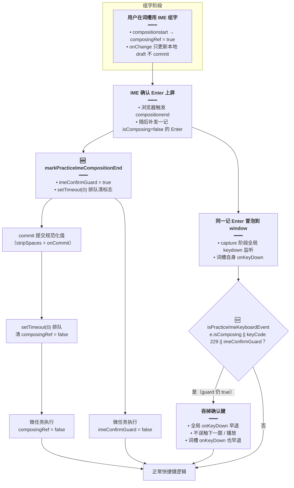

# 练习 IME 键盘防护

> 延伸阅读：[练习键盘上一个](./练习键盘上一个.md)（Shift+空格播放、方向键重映射）、[经典句看中写词槽练习](./经典句看中写词槽练习.md)（`SentenceWordSlots` 词槽交互）

## 1. 背景与目标

经典句「看中写」词槽练习与听写 / 拼写练习都挂了**全局 capture 阶段 keydown 监听**，用于 Shift+空格播放、方向键「上一题 / 下一题」等快捷键。当用户用**中文输入法（IME）**在词槽里组字并按 Enter 上屏时，浏览器会在 `compositionend` 之后**再补发一记 `isComposing=false` 的 Enter**——此时词槽可能已判对并卸掉 input，这记 Enter 会被全局快捷键当成「下一题」，导致**刚确认就跳题**。

目标：在**不动现有快捷键逻辑**的前提下，于 `compositionend` 后延一拍设置模块级守卫标志，让全局 `onKeyDown` 与词槽 `onKeyDown` 都能识别并吞掉这记确认键。

## 2. 改动范围

- `apps/frontend/src/views/englishLearning/practice/utils/keyboard.ts` — **纯新增** `imeConfirmGuard` 模块变量、`markPracticeImeCompositionEnd()` 与 `isPracticeImeKeyboardEvent(e)` 两个函数。
- `apps/frontend/src/views/englishLearning/practice/hooks/usePracticeSessionKeyboard.ts` — import 新增 `isPracticeImeKeyboardEvent`；`onKeyDown` 首行追加 IME 判定。
- `apps/frontend/src/views/englishLearning/daily/hooks/useDailySessionKeyboard.ts` — 同上模式。
- `apps/frontend/src/views/englishLearning/practice/components/slots/SentenceWordSlots.tsx` — import 新增 `markPracticeImeCompositionEnd`；`onCompositionEnd` 改为先打标志再 commit、延一拍清 `composingRef`；`onKeyDown` 追加 `keyCode === 229` 兜底。

## 3. 实现思路

### 3.1 核心要点

1. **模块级守卫标志 `imeConfirmGuard`**：`compositionend` 时置 `true`，用 `setTimeout(0)` 在**下一轮事件循环**清回 `false`。浏览器在 `compositionend` 同步触发后、微任务间隙补发的 Enter 仍在「当前轮」，此时标志仍为 `true`，被 `isPracticeImeKeyboardEvent` 识别为 IME 键并吞掉。
2. **延一拍清 `composingRef`**：词槽的 `composingRef` 原先在 `compositionend` 里同步清掉，但补发的 Enter `keydown` 里 `e.nativeEvent.isComposing` 已是 `false`，同步清会导致词槽 `onKeyDown` 漏判；改为 `setTimeout(0)` 清，确保吞键期间 `composingRef` 仍为 `true`。
3. **`keyCode === 229` 兜底**：部分浏览器 / IME 在组字过程中发出的 `keydown` `isComposing` 可能为 `false`，但 `keyCode` 为 `229`（IME 处理中），将其纳入判定更稳妥。
4. **复用 chat 已验证模式**：与 `chat/useEntry` 的 IME 防护策略一致，不引入新机制。

### 3.2 IME 守卫流程图

下图描述 `compositionend` 后如何通过守卫标志吞掉补发的 Enter 确认键（改动后行为）：



## 4. 关键代码对比与注释

### 4.1 `imeConfirmGuard` / `markPracticeImeCompositionEnd` / `isPracticeImeKeyboardEvent`（`practice/utils/keyboard.ts`）

**对比范围**：文件顶部新增的模块变量与两个导出函数（纯新增，无改动前对照）。

**改动后** · `apps/frontend/src/views/englishLearning/practice/utils/keyboard.ts`（当前，约 L1–L18）

```typescript
// 模块级守卫标志：compositionend 后短暂为 true，用于吞掉 IME 确认补发的 Enter
let imeConfirmGuard = false;

// compositionend 时调用：立即置标志，再用 setTimeout(0) 延一拍清回，确保补发的 Enter 仍落在「guard 开」窗口内
export function markPracticeImeCompositionEnd(): void {
	// 先置 true，让本轮后续 keydown 能识别为 IME 键并跳过
	imeConfirmGuard = true;
	// 排到下一轮事件循环清回 false，避免永久拦截正常 Enter
	setTimeout(() => {
		imeConfirmGuard = false;
	}, 0);
}

// 判定一次键盘事件是否来自 IME 组字 / 确认阶段：三者满足其一即拦截
export function isPracticeImeKeyboardEvent(e: KeyboardEvent): boolean {
	// isComposing：标准属性，组字中为 true
	// keyCode 229：部分浏览器组字 keydown 的兜底信号
	// imeConfirmGuard：compositionend 后、setTimeout 清标志前的那记确认 Enter
	return e.isComposing || e.keyCode === 229 || imeConfirmGuard;
}
```

**变更摘要**：纯新增模块变量 `imeConfirmGuard` 与两个导出函数 `markPracticeImeCompositionEnd` / `isPracticeImeKeyboardEvent`，为全局与词槽 `onKeyDown` 提供 IME 键判定能力；文件原有的 `isPracticeShiftSpacePlayShortcut` 等快捷键判定函数未改动。

### 4.2 `usePracticeSessionKeyboard` 的 `onKeyDown` IME 守卫（`practice/hooks/usePracticeSessionKeyboard.ts`）

**对比范围**：`usePracticeSessionKeyboard` 的 import 块与 `useEffect` 内 `onKeyDown` 首行（摘录，中间未改动分支以 `// ...` 省略）。

**改动前** · `apps/frontend/src/views/englishLearning/practice/hooks/usePracticeSessionKeyboard.ts`（基线，import 约 L7–L11；onKeyDown 约 L52）

```typescript
// 从键盘工具模块导入快捷键判定函数（改动前不含 IME 判定）
import {
	isPracticeShiftSpacePlayShortcut,
	isPracticeToggleIpaShortcut,
	isPracticeTogglePosShortcut,
} from '../utils/keyboard';

// ...（未改动：usePracticeSessionKeyboard 函数签名与参数解构）

useEffect(() => {
	// 全局 capture 阶段 keydown：处理快捷键与方向键导航
	const onKeyDown = (e: KeyboardEvent) => {
		// 阻止按住键重复触发，但未拦截 IME 确认键
		if (e.repeat) return;
		// ...（未改动：词性切换、Shift+空格播放、方向键导航等快捷键分支）
	};
	// ...（未改动：window.addEventListener 与 return 清理）
}, [
	// ...（未改动：canGoPrevious、phase、mode 等依赖数组）
]);
```

**改动后** · `apps/frontend/src/views/englishLearning/practice/hooks/usePracticeSessionKeyboard.ts`（当前，import 约 L7–L12；onKeyDown 约 L52–L54）

```typescript
// 从键盘工具模块导入快捷键判定函数（新增 isPracticeImeKeyboardEvent 用于 IME 守卫）
import {
	isPracticeImeKeyboardEvent,
	isPracticeShiftSpacePlayShortcut,
	isPracticeToggleIpaShortcut,
	isPracticeTogglePosShortcut,
} from '../utils/keyboard';

// ...（未改动：usePracticeSessionKeyboard 函数签名与参数解构）

useEffect(() => {
	// 全局 capture 阶段 keydown：处理快捷键与方向键导航
	const onKeyDown = (e: KeyboardEvent) => {
		// 阻止按住键重复触发，同时吞掉 IME 组字 / 确认键，避免误触「下一题」或播放
		if (e.repeat || isPracticeImeKeyboardEvent(e)) return;
		// ...（未改动：词性切换、Shift+空格播放、方向键导航等快捷键分支）
	};
	// ...（未改动：window.addEventListener 与 return 清理）
}, [
	// ...（未改动：canGoPrevious、phase、mode 等依赖数组）
]);
```

**变更摘要**：import 新增 `isPracticeImeKeyboardEvent`；`onKeyDown` 首行由 `if (e.repeat) return;` 改为 `if (e.repeat || isPracticeImeKeyboardEvent(e)) return;`，使全局快捷键监听在 IME 组字 / 确认期间早退。

### 4.3 `useDailySessionKeyboard` 的 `onKeyDown` IME 守卫（`daily/hooks/useDailySessionKeyboard.ts`）

**对比范围**：`useDailySessionKeyboard` 的 import 块与 `useEffect` 内 `onKeyDown` 首行（摘录，中间未改动分支以 `// ...` 省略）。

**改动前** · `apps/frontend/src/views/englishLearning/daily/hooks/useDailySessionKeyboard.ts`（基线，import 约 L2–L7；onKeyDown 约 L47）

```typescript
// 从练习键盘工具模块导入快捷键判定（改动前不含 IME 判定；daily 复用 practice 的工具函数）
import {
	isPracticeShiftSpacePlayShortcut,
	isPracticeSpacePlayShortcut,
	isPracticeToggleIpaShortcut,
	isPracticeTogglePosShortcut,
} from '../../practice/utils/keyboard';

// ...（未改动：isKeyboardTargetInField 与 DailySessionKeyboardArgs 类型、函数签名与解构）

useEffect(() => {
	// 全局 keydown：处理播放、词性切换与方向导航
	const onKeyDown = (e: KeyboardEvent) => {
		// 阻止按住键重复触发，但未拦截 IME 确认键
		if (e.repeat) return;
		// ...（未改动：Shift+空格播放、空格播放、词性切换、Enter 开始、方向键导航等分支）
	};
	// ...（未改动：window.addEventListener 与 return 清理）
}, [
	// ...（未改动：canToggleMeta、step、spellBoard 等依赖数组）
]);
```

**改动后** · `apps/frontend/src/views/englishLearning/daily/hooks/useDailySessionKeyboard.ts`（当前，import 约 L2–L8；onKeyDown 约 L47–L48）

```typescript
// 从练习键盘工具模块导入快捷键判定（新增 isPracticeImeKeyboardEvent；daily 复用 practice 的工具函数）
import {
	isPracticeImeKeyboardEvent,
	isPracticeShiftSpacePlayShortcut,
	isPracticeSpacePlayShortcut,
	isPracticeToggleIpaShortcut,
	isPracticeTogglePosShortcut,
} from '../../practice/utils/keyboard';

// ...（未改动：isKeyboardTargetInField 与 DailySessionKeyboardArgs 类型、函数签名与解构）

useEffect(() => {
	// 全局 keydown：处理播放、词性切换与方向导航
	const onKeyDown = (e: KeyboardEvent) => {
		// 阻止按住键重复触发，同时吞掉 IME 组字 / 确认键，避免误触「下一题」或播放
		if (e.repeat || isPracticeImeKeyboardEvent(e)) return;
		// ...（未改动：Shift+空格播放、空格播放、词性切换、Enter 开始、方向键导航等分支）
	};
	// ...（未改动：window.addEventListener 与 return 清理）
}, [
	// ...（未改动：canToggleMeta、step、spellBoard 等依赖数组）
]);
```

**变更摘要**：import 新增 `isPracticeImeKeyboardEvent`；`onKeyDown` 首行由 `if (e.repeat) return;` 改为 `if (e.repeat || isPracticeImeKeyboardEvent(e)) return;`，使每日记词会话的全局快捷键监听在 IME 组字 / 确认期间早退。

### 4.4 `SentenceWordSlots` 词槽的 `onCompositionEnd` 与 `onKeyDown`（`practice/components/slots/SentenceWordSlots.tsx`）

**对比范围**：`SlotWordInput` 组件内 `onCompositionEnd` 与 `onKeyDown` 两个 JSX 事件处理器属性（摘录，其余 input 属性以 `// ...` 省略）。

**改动前** · `apps/frontend/src/views/englishLearning/practice/components/slots/SentenceWordSlots.tsx`（基线，onCompositionEnd 约 L156–L158；onKeyDown 约 L170–L173）

```typescript
// ...（未改动：input 的 value、disabled、onChange 等属性）

// compositionend：IME 上屏时同步清组字标志并提交值
onCompositionEnd={(e) => {
	// 同步清标志：但补发的 Enter keydown 里 isComposing 已 false，词槽 onKeyDown 会漏判
	composingRef.current = false;
	// 提交规范化后的输入值
	commit(e.currentTarget.value);
}}

// ...（未改动：onChange 处理器）

// onKeyDown：词槽内的 Tab / Enter / 空格 / Backspace 导航
onKeyDown={(e: KeyboardEvent<HTMLInputElement>) => {
	// 仅靠 composingRef 与 isComposing 判定组字状态，漏掉 keyCode 229 兜底
	if (composingRef.current || e.nativeEvent.isComposing) {
		return;
	}
	// ...（未改动：Tab 循环、Enter / 空格跳槽、Backspace 退格等分支）
}}
```

**改动后** · `apps/frontend/src/views/englishLearning/practice/components/slots/SentenceWordSlots.tsx`（当前，import 约 L13；onCompositionEnd 约 L159–L166；onKeyDown 约 L177–L184）

```typescript
// 新增：从键盘工具模块导入 IME 守卫打标志函数
import { markPracticeImeCompositionEnd } from '../../utils/keyboard';

// ...（未改动：其余 import 与 SlotWordInput 组件签名、commit、useLayoutEffect 等）

// ...（未改动：input 的 value、disabled、onChange 等属性）

// compositionend：先打 IME 守卫标志，再提交值，延一拍清 composingRef
onCompositionEnd={(e) => {
	// 先打标志：置 imeConfirmGuard=true 并排队延一拍清，让补发的 Enter 被全局 / 词槽 onKeyDown 吞掉
	markPracticeImeCompositionEnd();
	// 提交规范化后的输入值（stripSpaces + onCommit + 命中则 onAdvance）
	commit(e.currentTarget.value);
	// 延一拍清 composingRef：确保补发 Enter 期间词槽 onKeyDown 仍判得「组字中」而早退
	setTimeout(() => {
		composingRef.current = false;
	}, 0);
}}

// ...（未改动：onChange 处理器）

// onKeyDown：词槽内的 Tab / Enter / 空格 / Backspace 导航
onKeyDown={(e: KeyboardEvent<HTMLInputElement>) => {
	// 三重判定：composingRef（延清后仍 true 一拍）、isComposing、keyCode 229 兜底
	if (
		composingRef.current ||
		e.nativeEvent.isComposing ||
		e.keyCode === 229
	) {
		return;
	}
	// ...（未改动：Tab 循环、Enter / 空格跳槽、Backspace 退格等分支）
}}
```

**变更摘要**：import 新增 `markPracticeImeCompositionEnd`；`onCompositionEnd` 由「同步清 `composingRef` → commit」改为「先 `markPracticeImeCompositionEnd()` 打标志 → `commit` → `setTimeout(0)` 延一拍清 `composingRef`」；`onKeyDown` 判定条件追加 `e.keyCode === 229` 兜底。

## 5. 兼容性与影响

- **非 IME 用户无感知**：未使用输入法时 `isComposing` 恒为 `false`、`keyCode` 非 `229`、`imeConfirmGuard` 恒为 `false`，`isPracticeImeKeyboardEvent` 返回 `false`，所有快捷键行为不变。
- **`setTimeout(0)` 时序**：守卫标志与 `composingRef` 均在下一轮事件循环清回 `false`，仅吞掉 `compositionend` 后紧邻的那一记 Enter；后续正常 Enter / 方向键不受影响。
- **与练习会话草稿续练无冲突**：草稿续练基于 `sessionStorage` 与 URL `sid`，不涉及键盘事件判定，两条改动路径独立。
- **回归建议**：重点验证经典句看中写词槽 + 中文 IME 组字 → Enter 上屏后不跳题；听写 / 拼写练习 + IME 组字时 Shift+空格播放不被误触；每日记词认读模式 Enter 开始不受影响。

## 6. 相关源码路径

| 说明 | 路径 |
| ---- | ---- |
| IME 守卫标志与判定函数（新增） | `apps/frontend/src/views/englishLearning/practice/utils/keyboard.ts` |
| 练习会话全局快捷键（追加 IME 判定） | `apps/frontend/src/views/englishLearning/practice/hooks/usePracticeSessionKeyboard.ts` |
| 每日记词会话全局快捷键（追加 IME 判定） | `apps/frontend/src/views/englishLearning/daily/hooks/useDailySessionKeyboard.ts` |
| 词槽 input 事件处理器（打标志 + 延清 + keyCode 兜底） | `apps/frontend/src/views/englishLearning/practice/components/slots/SentenceWordSlots.tsx` |

---

（若与仓库最新源码不一致，以源码为准）
