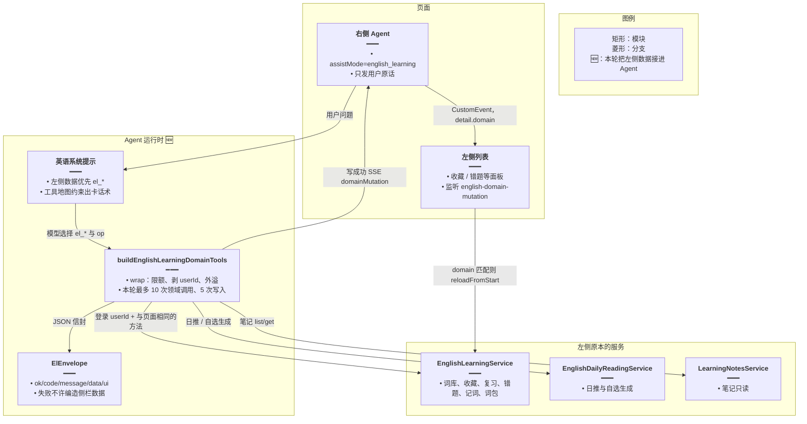
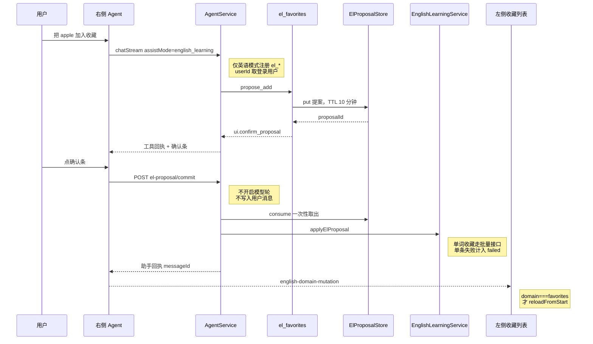

# 英语 Agent 与左侧功能融合

> 文档角色：本篇是 **Agent 如何接上英语学习左侧数据** 的主文档（当前源码路径）。§3～§4 是接入本身；§9 是其后的确认直提交、整类提案和空转收束，与上文冲突时以 §9 为准。
>
> 延伸阅读：
> - 工具内部细节（迁前路径下的逐工具摘录）：[英语Agent领域工具.md](./英语Agent领域工具.md)
> - 大列表不进模型、改走卡片：[Agent大结果旁路展示.md](./Agent大结果旁路展示.md)
> - 整库问法如何稳定挂卡：[整库问法稳定出卡.md](./整库问法稳定出卡.md)
> - 对话里自选生成每日阅读：[每日阅读Agent自选生成.md](./每日阅读Agent自选生成.md)
> - 单轮联网最多三次：[英语Agent联网次数封顶.md](./英语Agent联网次数封顶.md)
> - 后继更新（2026-10-29）：[词句分类列出](./词句分类列出.md)、[分类截断续批](./分类截断续批.md)、[决策改用千问](./决策改用千问.md)、[筛选卡续答与整类收藏](./筛选卡续答与整类收藏.md)、[确认条按会话隔离](./确认条按会话隔离.md)
> - 后继更新（2026-11-03）：Agent 页顶部介绍文案改写——从「可以问我任何英语问题，也可以点下方按钮快速开始」改为「直接输入问题提问，也可以让我帮你整理左侧学习内容」，入口提示从「快捷意图按钮」引导到「输入框直接问 + 引用左侧学习数据」，与本篇「右侧对话用同一份左侧业务数据」的能力口径一致。

## 1. 背景与目标

英语学习页是左右分栏：左侧是词库、语句库、每日阅读、收藏、今日复习、今日记词、错题、单词资料 / 经典语句、学习笔记；右侧是 Agent 对话。

改动前，右侧只挂通用工具（联网、知识库检索、当前日期）。用户问「我收藏了哪些词」「今天该复习多少」时，模型看不到左侧那份账号数据，只能联网猜，或让用户自己翻左侧。

本篇要解决的是：**右侧对话和左侧功能用同一份业务数据，但模型不能直接改表，也不能把整库倒进上下文。**

## 2. 改动范围

| 文件 | 改动 | 在融合里的角色 |
| --- | --- | --- |
| `apps/backend/src/services/agent/agent.module.ts` | 修改 | 把英语学习、笔记模块和提案 / 清单缓存装进 Agent |
| `apps/backend/src/services/agent/agent.prompt.ts` | 修改 | 英语人设里写明左侧数据必须走 `el_*`，并给出工具地图 |
| `apps/backend/src/services/agent/agent.service.ts` | 修改 | 仅 `assistMode=english_learning` 时注册领域工具，并把写成功、清单卡片送进 SSE |
| `apps/backend/src/services/agent/tools/english/domain-tools.ts` | 新增 | 10 个 `el_*` 工具；每个工具只调左侧已经在用的 Service |
| `apps/backend/src/services/agent/tools/english/envelope.ts` | 新增 | 统一 JSON 信封；剥掉模型自填的 `userId` |
| `apps/backend/src/services/agent/tools/english/proposal.store.ts` | 新增 | 收藏 / 错题写入先提案，确认后一次性消费 |
| `apps/backend/src/services/agent/tools/english/artifact.store.ts` | 新增 | 大清单旁路缓存，供卡片和翻页索引共用 |
| `apps/backend/src/services/agent/tools/english/spill.ts` | 新增 | 决定模型看瘦索引、用户看卡片（细节见旁路专题） |
| `apps/frontend/src/store/englishAgent.ts` | 修改 | 收到 `domainMutation` 后广播，让左侧列表重载 |
| `apps/frontend/src/utils/agentSse.ts` | 修改 | 解析 `domainMutation` 事件 |
| `apps/frontend/src/views/englishLearning/favorites/vocabulary/index.tsx` 等收藏 / 错题面板 | 修改 | 监听广播，只刷新自己那一类 |

`pack-ask.ts`、`reading-ask.ts` 负责「生成词包 / 自选阅读时只信用户原话」，分别在词包与每日阅读专题里展开，本篇只说明它们为什么不信模型参数。

## 3. 实现思路

### 3.1 用的什么方案

方案是：**同一 Service、两扇门。**

左侧页面走 HTTP Controller，右侧 Agent 走 LangChain `DynamicTool`。两扇门都调用 `EnglishLearningService`、`EnglishDailyReadingService`、`LearningNotesService`。工具层不写 SQL，也不复制一套查询。这样左侧列表和对话看到的是同一张表、同一套权限（`userId` 来自登录态，不来自模型）。

在这层之上加四条约束，否则「能调 Service」会变成「模型随便改数据、或把几千条词倒进上下文」：

1. **信封。** 每个工具返回 `ElEnvelope` JSON（`ok` / `code` / `message` / `data` / `ui`）。失败看 `code`，模型用人话解释，不能编一份侧栏数据。
2. **身份边界。** `parseElArgs` 删掉入参里的 `userId`。业务用户 id 只用依赖注入进来的登录用户。
3. **写入两段式。** 收藏、错题、词包生成、自选阅读先放进提案缓存（10 分钟、属主校验）。用户点确认条后走 `POST /agent/el-proposal/commit`，不另开模型轮。同一轮里第二份提案直接 `stop_tools`。细节见 §9。
4. **大列表旁路。** `wrap` 在返回模型之前走 `spillListResult`：超阈值的清单放进 `ElArtifactStore`，SSE 推卡片；模型只拿到瘦索引或前几条预览。卡片怎么渲染见 [Agent大结果旁路展示.md](./Agent大结果旁路展示.md)。

没有采用的做法：

- 让模型自己拼 SQL 或调内部 HTTP。左侧的鉴权、分页和硬顶会绕开，也没法做提案。
- 把左侧列表整份塞进系统提示。库可以到上千条，会挤掉对话，也会在用户改收藏后过期。
- 写成功只靠模型说「已经加上了」。左侧当时开着的列表不会变，所以写成功要另发 `domainMutation`。

### 3.2 左侧功能怎么对上工具

| 左侧能力 | 工具 | 读 | 写 | 实际调用的服务 |
| --- | --- | --- | --- | --- |
| 单词库 / 语句库列表 | `el_libraries` | `list` / `compare` | 不写库 | `listVocabularyLibraries` / `listClassicQuotesLibraries`；对比扫库内条目前 200 条 |
| 某个库里的词或句 | `el_items_search` | `list` / `search` / `sample` | 不写 | `list*LibraryItems` / `search*LibraryItems`。整库问法由 `list` 挂卡，见整库专题 |
| 把已拉到的行展示成卡片 | `el_present` | 从 artifact 里挑行 | 不写业务表 | `ElArtifactStore.get` / `put`，再 `onPresented` 把锚点插进正文 |
| 每日阅读 | `el_daily_reading` | `today` / `get` / `list` / `settings` / `gen_status` | `generate_manual` 只挂确认条；点确认后才 `openManual` | `EnglishDailyReadingService`。档位解析见每日阅读专题 |
| 收藏 | `el_favorites` | `list` / `search` / `quiz` | `propose_add` / `propose_remove` 挂确认条；点确认后 `applyElProposal` 批量落库 | `batchAddVocabularyFavorites`、语句侧逐条 `addClassicQuoteFavorite`、批量取消 |
| 今日复习 | `el_review` | `summary` / `peek_queue` | 不代交 SRS 评分 | `getPracticeReviewSummary`、`listPracticeReviewDuePage` |
| 错题 | `el_mistakes` | `list` | `propose_add` / `commit` | 错题列表与新增，和错题页同一套方法 |
| 今日记词 | `el_daily_memo` | `summary` / `records` | 不代打卡 | 记词汇总与记录分页 |
| 单词资料 / 经典语句（词包） | `el_packs` | `history` / `items` | `generate` 的主题和条数只从用户原话解析 | `runVocabularyGeneration` / `runClassicQuotesGeneration` 与词包落库 |
| 学习笔记 | `el_notes` | `list` / `get` | 不新建、不改、不删 | `LearningNotesService.findPage` / `findOne` |

`kind` 只有 `vocab` 和 `classic`。不传时 `kindOf` 当成单词侧，和左侧「单词 / 语句」两个 Tab 对齐。

### 3.3 一轮对话怎么走



**读图要点**：模型不碰表。它只看到工具说明和信封。真正读写仍是左侧页面用的 Service。写成功后多一条 SSE，左侧开着的列表面板自己刷新。



**读图要点**：确认不经过模型。消费提案时再校验属主。落库成功才通知左侧，取消或过期不会刷新列表。

### 3.4 预算和人设怎么一起卡住

英语模式不再按「本轮最多几次工具」封死。空转和重复提案另有两道闸，见 §9.2：

- 联网仍在工具工厂里每轮最多 3 次（`maxInternetSearchCallsPerRun`）。
- 同一句里模型发起的工具来回超过 24 次后，下一次调用被改成错误回执，要求用已有结果作答，并且不许向用户提次数。
- 本轮已经挂出确认条后再调用工具，中间件直接结束，留下「请直接点确认」。
- 图步上限是 `24 * 2 + 16`，只防图自己死循环，不是会话配额。
- 列表分页不再用 2000 条硬顶。`fetchAllPages` 一直翻到没有下一行；库没拿满时回执写「查询没有拿满总数」。

系统提示第 6 条把「左侧数据」点名交给 `el_*`。第 7 条要求多个词一次提案、整类只传 `artifactId`、本轮不要 `commit`。词包和自选阅读也是先确认再开始。

## 4. 关键实现

本节摘录的是接入左侧时的第一版公共层。其中 `elCalls` 次数封顶、`USER_ROWS_HARD_CAP`、「下一轮 commit」已经拿掉。和当前源码冲突的地方以 §9 为准；`wrap` 里剥 `userId`、外溢出卡、失败信封仍然有效。

### 4.1 `ENGLISH_LEARNING_SYSTEM_APPEND`

**对比范围**：`apps/backend/src/services/agent/agent.prompt.ts` 中该常量的完整定义。第 0～5 条两侧相同，改动在工具条款。

**改动前** · `apps/backend/src/services/agent/agent.prompt.ts`（基线，约 L6–L16）

```typescript
// 英语模式追加的人设；基线还没有 el_*，左侧数据无专用入口
export const ENGLISH_LEARNING_SYSTEM_APPEND = `【英语学习专项约束】
// 限定读者是要学英语的普通话使用者，避免跑成通用聊天
你面向希望提升英语（English）的普通话使用者，内容可覆盖单词、短语、短文、口语表达与即时翻译需求。
// 先划服务范围：无关问题不许调工具，避免用联网去答编程或理财
0）服务范围（优先遵守）：仅回答与英语学习直接相关的问题，例如词汇与短语、语法、阅读与写作、口语表达、中英互译、英文材料理解、学习方法与练习设计等。若用户问题明显与英语学习无关（如编程调试、数学/物理等非英语学科作业、生活百科、财经投资建议、非英语学习类长文创作、闲聊八卦等），不得调用任何工具，也不要展开无关解答；应礼貌说明本对话为「英语学习助手」，当前问题超出服务范围，并简短建议用户改用通用智能对话或其它合适渠道。语气友善、克制，一两段即可，勿训斥用户。
// 词汇回答格式：有音标，避免只给中文释义
1）词汇与短语：给出释义、常见搭配、1～2 个地道例句；凡列出单词或短语须标注 IPA 音标（国际音标）；表格或列表逐条给出读音标注；说明仅供参考，以权威词典为准。
// 短文按用户自述水平写，长文分段便于跟读
2）短文：可按用户水平（如 A1～C1 或初中/高中/四级等自述）生成或改写精读材料，配关键句讲解；长文分段输出便于跟读。
// 口语给可替换说法，并声明不能代替纠音
3）口语：提供场景对话范例、可替换说法、常用应答；说明无法替代真人纠音与外教课。
// 翻译要说明歧义取舍，不声称认证译文
4）实时翻译：用户粘贴中英文段落时给出对应译文；可逐句对照或先原文后译文；专有名词、歧义词简要注明取舍理由；不声称等同专业同声传译或法律医学认证译文。
// 版权期内作品不整段抄原文
5）名著与文献：以导读、节选、摘要、讨论为主；公版作品可短节选并注释；仍在版权期的现代作品避免大段复制原文，以摘要与仿写练习为主。
// 基线把生词本和笔记交给知识库检索；用户库内容因此常被猜或搜网页
6）工具：仅在问题属于英语学习范畴时调用；用户生词本与笔记已入库时优先「知识库检索」；需核查用法或新闻英语时可「互联网搜索」**至多 1～2 次**，拿到摘要后**立即作答**，禁止换关键词反复联网或为「再搜一轮」空转。
// 基线第 7 条直接是安全边界，没有左侧工具地图
7）边界：拒绝违规内容；敏感话题以中性语言学习角度处理或礼貌拒绝。`;```

**改动后** · `apps/backend/src/services/agent/agent.prompt.ts`（当前，约 L6–L30）

```typescript
// 英语模式追加的人设；本轮用工具地图把左侧功能和 el_* 绑死
export const ENGLISH_LEARNING_SYSTEM_APPEND = `【英语学习专项约束】
// 与基线相同：读者仍是学英语的普通话使用者
你面向希望提升英语（English）的普通话使用者，内容可覆盖单词、短语、短文、口语表达与即时翻译需求。
// 与基线相同：无关问题仍然禁止调任何工具，包括新加的 el_*
0）服务范围（优先遵守）：仅回答与英语学习直接相关的问题，例如词汇与短语、语法、阅读与写作、口语表达、中英互译、英文材料理解、学习方法与练习设计等。若用户问题明显与英语学习无关（如编程调试、数学/物理等非英语学科作业、生活百科、财经投资建议、非英语学习类长文创作、闲聊八卦等），不得调用任何工具，也不要展开无关解答；应礼貌说明本对话为「英语学习助手」，当前问题超出服务范围，并简短建议用户改用通用智能对话或其它合适渠道。语气友善、克制，一两段即可，勿训斥用户。
// 与基线相同：词汇回答仍要音标
1）词汇与短语：给出释义、常见搭配、1～2 个地道例句；凡列出单词或短语须标注 IPA 音标（国际音标）；表格或列表逐条给出读音标注；说明仅供参考，以权威词典为准。
// 与基线相同：短文按自述水平
2）短文：可按用户水平（如 A1～C1 或初中/高中/四级等自述）生成或改写精读材料，配关键句讲解；长文分段输出便于跟读。
// 与基线相同：口语不代替纠音
3）口语：提供场景对话范例、可替换说法、常用应答；说明无法替代真人纠音与外教课。
// 与基线相同：翻译不声称认证
4）实时翻译：用户粘贴中英文段落时给出对应译文；可逐句对照或先原文后译文；专有名词、歧义词简要注明取舍理由；不声称等同专业同声传译或法律医学认证译文。
// 与基线相同：版权材料以导读为主
5）名著与文献：以导读、节选、摘要、讨论为主；公版作品可短节选并注释；仍在版权期的现代作品避免大段复制原文，以摘要与仿写练习为主。
// 左侧数据走 el_*；空转收束时不许把「停止调用」复述给用户
6）工具：仅在问题属于英语学习范畴时调用。侧栏业务数据（词库、语料库、日推、收藏、复习、记词、错题、单词资料、经典语句、学习笔记）**优先**调用 el_* 领域工具，禁止先联网再猜用户库内容。需核查公开用法或新闻英语时可「互联网搜索」**至多 1～2 次**，拿到摘要后**立即作答**，禁止换关键词反复联网。回执要求不要提及次数时，禁止向用户复述停止原因。
// 工具地图总述：入参是 JSON 字符串，userId 会被丢掉，避免模型冒充别人
7）el_* 工具地图（入参均为 JSON 字符串，忽略任何 userId 字段）：
// 库列表只负责定位库 id；整库卡片交给随后的 el_items_search list
   - el_libraries：list / compare（kind=vocab|classic）。整库问法下，回执给出唯一库 id 时必须对该 id 调用 el_items_search list，不要改选别的库。回执写「没有挂出单词卡」时禁止写已经生成，也不要写见上方或见下方。
// 整库卡由 list 挂上；search 只给索引，要看再 el_present
   - el_items_search：list / search / sample。整库卡由 list 挂上：回执写「卡片已列出」时卡已经在，只说条数，可说在卡片里浏览，禁止提及导出，不要写见上方或见下方。禁止再 el_present，禁止说一次最多若干条、展示上限或未穷尽。回执写「没有挂出单词卡」时禁止声称已生成。其他 list 是瘦索引且不出卡。search 不出卡，要看再 el_present。
// 筛选才 el_present；没有「卡片已列出」回执就不能说已经生成
   - el_present：{"artifactId","mode":"subset"|"all","words"?:string[],"title"?:string}。成组列出时先写组标题再调用，禁止顿号或逗号词表。筛选 mode=subset。整库卡由 list 挂上，不要为整库再调用。没有回执「卡片已列出」就禁止写已经生成，也不要写见上方或见下方。讲解题不要出卡。
// 自选生成先挂确认条，点确认后才开始，避免模型说已经在写
   - el_daily_reading：today / get / list / settings / generate_manual / gen_status。list 用 origin=all，返回每篇 id、中英标题、日期和开头 24 字，不是 5 条预览。可选 q 只做标题/开头子串；回执写「字面未命中」时索引仍是全量，禁止宣称没有。筛选后 el_present 传 id。拿不准的篇最多 get 3 次，禁止逐篇 get。generate_manual 只做自选生成，先挂确认条，用户点确认后才开始，不要说已经开始。用户要长篇、短篇、中篇，或说「主题关于…」，走 generate_manual，不要走 el_packs，不要传 themes 或 profile，禁止触发系统日推。回执里的档位才是这次用的；没在原话点名的字段来自已保存的自选生成配置。说明只能照回执，禁止把默认 B1 说成用户设置。
// 多个词一次提案；整类只传清单 id；本轮不要自己 commit
   - el_favorites：list / search / propose_add / propose_remove / commit / quiz。list 与 search 都不自动出卡，要看再 el_present。点名几个词一次 propose_add，用 items 数组（每项 word 或 english，可带 translationZh），禁止逐词调用。语句收藏传 english，不要只传 word。整类全部收藏：先 el_items_search list，再 propose_add 只传该 artifactId，不要传 items，不要翻 nextOffset 凑词，同一轮不要再 propose_add。多个词一次 propose_remove，传 ids（list 里的收藏记录 id）或 words（词面），禁止逐条调用。add 与 propose_add 相同，写入须等用户点确认；本轮不要 commit。回执没有「请用户确认后再写入」时，禁止说已发起收藏确认或已开始生成。
// 复习只读队列，不替用户打 SRS 分，避免对话改掉左侧到期状态
   - el_review：summary / peek_queue。peek_queue 返回全部瘦行（词面+释义），不是 5 条预览。筛选用 el_present 传词面。不代交 SRS 评分。
// 错题与收藏一样：点名用 items，整类只传 artifactId，本轮不要 commit
   - el_mistakes：list / propose_add / commit。list 可选 q；字面未命中时索引仍是全量。回执写「卡片已列出全部」时卡片已是全量，禁止再说前若干条或尚未展示，也不要再 el_present。点名几个词一次 propose_add 的 items，禁止逐词调用。整类加入错题与收藏相同：只传 list 的 artifactId，不要传 items，不要翻 nextOffset。本轮不要 commit。
// 记词只读，不代打卡
   - el_daily_memo：summary / records。records 是瘦索引，可选 q；字面未命中时索引仍是全量。不代打卡。
// 词包 generate 只挂确认条，点确认后才写库
   - el_packs：history / items / generate（kind=vocab|classic）。history 与 items 是瘦索引，可选 q。列出全部才挂整表卡；筛选不出卡，要看再 el_present，历史传 streamId，词条传词面。回执写「字面未命中」时索引仍是全量，禁止宣称没有。generate 不要传 topic 或 count。没写条数是 100，禁止说成 12000 或 6000。没有主题不要生成。generate 只挂确认条，用户点确认后才开始写库，禁止说已经生成。出卡规则与词库、收藏相同。
// 笔记只读；要看正文必须本轮 get，上一轮卡片不会留在新回复里
   - el_notes：list / get。list 翻完标题，不是 20 条；可选 q 只匹配标题。列出全部挂整表卡；筛选不出卡，要看再 el_present 传 id。回执写「字面未命中」时索引仍是全量，禁止宣称没有笔记。用户要看某一篇正文时，每一轮都要重新 get，上一轮回复里的卡片不会出现在新回复中。get 传笔记行 id；只有上一轮单篇卡片时也可用该卡 artifactId。多篇清单的 artifactId 不能当 get 的 id，须先 list。只有本轮 get 回执写了「卡片已列出这篇笔记」才能说卡片已经列出；写了「禁止再 el_present」才不要再出第二张。禁止复述全文。不新建、不修改、不删除。
// 没拿满总数才说明库没列完；nextOffset 不是卡片条数
   - 只有回执写明「查询没有拿满总数」时才说明库本身没列完。回执里的 nextOffset 只是给你筛选的上下文页，不是用户卡片的条数。
// 禁止把瘦索引复述成顿号词表；记忆方法不能拿来取消整库卡
   - 大列表：回执写「未出卡片，要看再 el_present」时不要逐条复述成顿号词表。讲解题不要出卡。回执写「卡片已列出」时条数以该句为准，禁止复述整表。回执写「没有挂出单词卡」时禁止写已经生成，也不要写见上方或见下方。记忆方法写在卡片旁边，不能用来取消整库卡。
// 工具失败只转述 code/message，避免失败后编造收藏或词库
8）工具失败看返回 JSON 的 code/message，用人话说明，不要伪造侧栏数据。
// 安全边界仍保留，序号后移，避免和工具地图抢第 7 条
9）边界：拒绝违规内容；敏感话题以中性语言学习角度处理或礼貌拒绝。`;```

**变更摘要**：第 6 条从「生词本走知识库」改成「左侧数据走 `el_*`」。新增第 7 条工具地图和第 8 条失败话术，安全边界改为第 9 条。

### 4.2 `AgentModule`

**对比范围**：`apps/backend/src/services/agent/agent.module.ts` 整模块。基线已有英语会话表，但没有把学习服务注入 Agent。

**改动前** · `apps/backend/src/services/agent/agent.module.ts`（基线，约 L1–L54）

```typescript
// Nest 模块装饰器，用来声明 Agent 依赖哪些表和模块
import { Module } from '@nestjs/common';
// 注册 TypeORM 实体，Agent 才能注入对应 Repository
import { TypeOrmModule } from '@nestjs/typeorm';
// 知识库助手消息表；Agent 记忆按 memorySource 选表时要用
import { AssistantMessage } from '../assistant/assistant-message.entity';
// 知识库助手会话表
import { AssistantSession } from '../assistant/assistant-session.entity';
// 知识库助手摘要表
import { AssistantSessionSummary } from '../assistant/assistant-session-summary.entity';
// 知识库助手的回合记忆实现
import { AssistantTableMemory } from '../assistant/assistant-table-memory';
// 英语 Agent 的回合记忆；基线已有会话，但还没有领域工具
import { EnglishTableMemory } from '../english-learning/english-table-memory';
// 英语 Agent 消息实体
import { EnglishAgentMessage } from '../english-learning/entity/english-agent-message.entity';
// 英语 Agent 会话实体
import { EnglishAgentSession } from '../english-learning/entity/english-agent-session.entity';
// 英语 Agent 摘要实体
import { EnglishAgentSessionSummary } from '../english-learning/entity/english-agent-session-summary.entity';
// 知识库检索工具来自这个模块
import { KnowledgeQaModule } from '../knowledge-qa/knowledge-qa.module';
// Skill 加载工具来自这个模块
import { SkillModule } from '../skill/skill.module';
// Skill 试跑消息表
import { SkillTryMessage } from '../skill/skill-try-message.entity';
// Skill 试跑会话表
import { SkillTrySession } from '../skill/skill-try-session.entity';
// Skill 试跑摘要表
import { SkillTrySessionSummary } from '../skill/skill-try-session-summary.entity';
// Skill 试跑回合记忆
import { SkillTryTableMemory } from '../skill/skill-try-table-memory';
// Agent HTTP / SSE 入口
import { AgentController } from './agent.controller';
// Agent 流式主服务
import { AgentService } from './agent.service';
// 默认 Agent 记忆
import { AgentMemoryService } from './agent-memory.service';
// 默认 Agent 消息表
import { AgentMessage } from './agent-message.entity';
// 默认 Agent 会话表
import { AgentSession } from './agent-session.entity';
// 默认 Agent 摘要表
import { AgentSessionSummary } from './agent-session-summary.entity';

// 基线模块：能聊英语会话，但不能调用左侧学习服务
@Module({
	// 本模块要注入的实体仓库
	imports: [
		// 一次注册全部会话表，按 memorySource 选用
		TypeOrmModule.forFeature([
			// 通用 Agent 会话
			AgentSession,
			// 通用 Agent 消息
			AgentMessage,
			// 通用 Agent 摘要
			AgentSessionSummary,
			// Skill 试跑会话
			SkillTrySession,
			// Skill 试跑消息
			SkillTryMessage,
			// Skill 试跑摘要
			SkillTrySessionSummary,
			// 知识库助手会话
			AssistantSession,
			// 知识库助手消息
			AssistantMessage,
			// 知识库助手摘要
			AssistantSessionSummary,
			// 英语 Agent 会话
			EnglishAgentSession,
			// 英语 Agent 消息
			EnglishAgentMessage,
			// 英语 Agent 摘要
			EnglishAgentSessionSummary,
		]),
		// 提供知识库检索工具
		KnowledgeQaModule,
		// 提供 Skill 工具
		SkillModule,
	],
	// 只暴露 Agent 控制器
	controllers: [AgentController],
	// 基线没有提案缓存和清单缓存，写左侧数据无处暂存
	providers: [
		// 流式对话
		AgentService,
		// 默认记忆
		AgentMemoryService,
		// 知识库助手记忆
		AssistantTableMemory,
		// 英语会话记忆
		EnglishTableMemory,
		// Skill 试跑记忆
		SkillTryTableMemory,
	],
	// 其它模块只需 Agent 对话和默认记忆
	exports: [AgentService, AgentMemoryService],
})
// 导出模块类，供 AppModule 挂载
export class AgentModule {}```

**改动后** · `apps/backend/src/services/agent/agent.module.ts`（当前，约 L1–L61）

```typescript
// Nest 模块装饰器
import { Module } from '@nestjs/common';
// 注册 TypeORM 实体
import { TypeOrmModule } from '@nestjs/typeorm';
// 知识库助手消息表
import { AssistantMessage } from '../assistant/assistant-message.entity';
// 知识库助手会话表
import { AssistantSession } from '../assistant/assistant-session.entity';
// 知识库助手摘要表
import { AssistantSessionSummary } from '../assistant/assistant-session-summary.entity';
// 知识库助手回合记忆
import { AssistantTableMemory } from '../assistant/assistant-table-memory';
// 导入英语学习模块，Agent 才能注入词库、收藏、日推等服务
import { EnglishLearningModule } from '../english-learning/english-learning.module';
// 导入笔记模块，el_notes 才能只读笔记
import { LearningNotesModule } from '../learning-notes/learning-notes.module';
// 英语 Agent 回合记忆
import { EnglishTableMemory } from '../english-learning/english-table-memory';
// 英语 Agent 消息实体
import { EnglishAgentMessage } from '../english-learning/entity/english-agent-message.entity';
// 英语 Agent 会话实体
import { EnglishAgentSession } from '../english-learning/entity/english-agent-session.entity';
// 英语 Agent 摘要实体
import { EnglishAgentSessionSummary } from '../english-learning/entity/english-agent-session-summary.entity';
// 知识库检索
import { KnowledgeQaModule } from '../knowledge-qa/knowledge-qa.module';
// Skill
import { SkillModule } from '../skill/skill.module';
// Skill 试跑消息
import { SkillTryMessage } from '../skill/skill-try-message.entity';
// Skill 试跑会话
import { SkillTrySession } from '../skill/skill-try-session.entity';
// Skill 试跑摘要
import { SkillTrySessionSummary } from '../skill/skill-try-session-summary.entity';
// Skill 试跑记忆
import { SkillTryTableMemory } from '../skill/skill-try-table-memory';
// Agent 控制器
import { AgentController } from './agent.controller';
// Agent 主服务
import { AgentService } from './agent.service';
// 默认记忆
import { AgentMemoryService } from './agent-memory.service';
// 默认消息实体
import { AgentMessage } from './agent-message.entity';
// 默认会话实体
import { AgentSession } from './agent-session.entity';
// 默认摘要实体
import { AgentSessionSummary } from './agent-session-summary.entity';
// 清单旁路缓存，大列表不进模型上下文
import { ElArtifactStore } from './tools/english/artifact.store';
// 写入提案缓存，确认后才落库
import { ElProposalStore } from './tools/english/proposal.store';

// 当前模块把左侧服务和两份缓存交给 AgentService
@Module({
	// 声明本模块要引入的依赖，Agent 才能注入左侧服务和会话表
	imports: [
		// 会话表注册与基线相同
		TypeOrmModule.forFeature([
			// 通用 Agent 会话表，非英语模式仍用它
			AgentSession,
			// 通用 Agent 消息表
			AgentMessage,
			// 通用 Agent 摘要表
			AgentSessionSummary,
			// Skill 试跑会话，避免和英语会话混表
			SkillTrySession,
			// Skill 试跑消息
			SkillTryMessage,
			// Skill 试跑摘要
			SkillTrySessionSummary,
			// 知识库助手会话表
			AssistantSession,
			// 知识库助手消息表
			AssistantMessage,
			// 知识库助手摘要表
			AssistantSessionSummary,
			// 英语 Agent 会话表，右侧历史抽屉读它
			EnglishAgentSession,
			// 英语 Agent 消息表，刷新后回放对话
			EnglishAgentMessage,
			// 英语 Agent 摘要表，长对话压缩用
			EnglishAgentSessionSummary,
		]),
		// 知识库检索仍保留，给已入库文档
		KnowledgeQaModule,
		// Skill 仍保留
		SkillModule,
		// 左侧词库、收藏、复习、日推的 Service 从这里导出
		EnglishLearningModule,
		// 笔记 Service 从这里导出
		LearningNotesModule,
	],
	// 只挂 Agent 控制器，领域工具不另开 HTTP 入口
	controllers: [AgentController],
	// 注册可注入的服务，包括记忆和两份英语缓存
	providers: [
		// 流式对话服务，负责注册 el_*
		AgentService,
		// 默认记忆实现
		AgentMemoryService,
		// 知识库助手记忆
		AssistantTableMemory,
		// 英语会话记忆，和左侧业务表分开
		EnglishTableMemory,
		// Skill 试跑记忆
		SkillTryTableMemory,
		// 提案按用户隔离，供收藏和错题的 propose/commit
		ElProposalStore,
		// 清单按用户隔离，供卡片和索引翻页
		ElArtifactStore,
	],
	// 对外仍只导出对话和默认记忆，提案缓存留在模块内
	exports: [AgentService, AgentMemoryService],
})
// 模块类名不变
export class AgentModule {}```

**变更摘要**：`imports` 增加英语学习和笔记模块，`providers` 增加提案与清单两份缓存。会话表本身没有换。

### 4.3 `tools`（`chatStream` 内）

**对比范围**：`chatStream` 里组装 LangChain 工具的 `const tools`。方法其余部分不在本组。基线没有领域工具；当前仅英语模式展开。

**改动前** · `apps/backend/src/services/agent/agent.service.ts`（基线，约 L838–L872）

```typescript
// 基线工具只有联网、知识库、日期和本轮 Skill，没有左侧数据
			const tools = [
				// 通用工具工厂；英语模式已经把联网限制成 3 次
				...buildAgentLangChainTools(
					{
						// 联网检索实现
						webSearchService: this.webSearchService,
						// 知识库 RAG
						knowledgeQaService: this.knowledgeQaService,
						// 知识库过滤用登录用户，不是模型入参
						userId,
						// 英语模式收紧联网，避免反复搜索打满图步
						...(dto.assistMode === 'english_learning'
							// 本轮联网最多 3 次，和提示里的 1～2 次以及中间件封顶对齐
							? { maxInternetSearchCallsPerRun: 3 }
							// 其它模式不改联网默认，避免影响主站对话
							: {}),
					},
					{
						// 检索成功就把来源推到 SSE，供正文角标
						onInternetSearchComplete: (r) => {
							// 本批网页结果
							const batch = r.organic;
							// 空结果不推，避免空胶囊
							if (!batch?.length) return;
							// 按链接去重后并入本轮来源
							turnSearchOrganic = mergeAgentSearchOrganic(
								// 已有来源在前，保证角标序号稳定
								turnSearchOrganic,
								// 本批新结果在后
								batch,
							);
							// 推给前端刷新来源胶囊
							subscriber.next({
								// 事件类型固定为来源胶囊，前端按这个字段更新
								type: 'searchOrganic',
								// 载荷单独一层，和其它 SSE 事件结构一致
								data: {
									// 补上 1-based 序号，正文【n】才能对上胶囊
									organic: withAgentOrganicPositions(turnSearchOrganic),
								},
							});
						},
					},
				),
				// Skill 工具；英语学习通常为空数组
				...buildAgentSkillTools(skillBodies),
			];```

**改动后** · `apps/backend/src/services/agent/agent.service.ts`（当前，约 L959–L1026）

```typescript
// 本轮工具返回过的词面，供收藏白名单直写，防止模型凭空 add
			const elWhitelist = new Set<string>();
			// 通用工具之后，英语模式才插入左侧领域工具
			const tools = [
				// 联网、知识库、日期与基线相同
				...buildAgentLangChainTools(
					{
						// 复用现有联网实现，英语模式不再自建搜索
						webSearchService: this.webSearchService,
						// 已入库文档仍走知识库，和左侧 el_* 分工
						knowledgeQaService: this.knowledgeQaService,
						// 记下属主，消费时必须和登录用户一致
						userId,
						// 只有英语对话才收紧联网次数
						...(dto.assistMode === 'english_learning'
							// 本轮联网最多 3 次，和提示里的 1～2 次以及中间件封顶对齐
							? { maxInternetSearchCallsPerRun: 3 }
							// 其它模式不改联网默认，避免影响主站对话
							: {}),
					},
					{
						// 检索完成后把来源推到前端，正文角标才对得上来源
						onInternetSearchComplete: (r) => {
							// 取出本批网页结果
							const batch = r.organic;
							// 没有结果就不推空事件
							if (!batch?.length) return;
							// 按链接并入本轮来源，重复网页只留一条
							turnSearchOrganic = mergeAgentSearchOrganic(
								// 已有来源在前，保证角标序号稳定
								turnSearchOrganic,
								// 本批新结果在后
								batch,
							);
							// 把事件推进当前 SSE 流
							subscriber.next({
								// 事件类型固定为来源胶囊，前端按这个字段更新
								type: 'searchOrganic',
								// 载荷单独一层，和其它 SSE 事件结构一致
								data: {
									// 补上 1-based 序号，正文【n】才能对上胶囊
									organic: withAgentOrganicPositions(turnSearchOrganic),
								},
							});
						},
					},
				),
				// 非英语模式展开成空数组，Skill 试跑和通用 Agent 不会看到 el_*
				...(dto.assistMode === 'english_learning'
					// 英语模式才构造左侧工具，其它模式这个分支是空数组
					? buildEnglishLearningDomainTools({
							// 登录用户，工具内部所有 Service 调用都用它
							userId,
							// 词库、收藏、复习、错题、记词、词包
							learning: this.englishLearningService,
							// 每日阅读
							dailyReading: this.englishDailyReadingService,
							// 学习笔记
							notes: this.learningNotesService,
							// 生成中的流，避免对话再开一路冲突的生成
							streams: this.elStreams,
							// 收藏 / 错题提案
							proposals: this.elProposalStore,
							// 清单卡片缓存
							artifacts: this.elArtifactStore,
							// 工具失败和耗时打到 Agent 日志，不返回堆栈给模型
							logger: this.logger,
							// 生成词包或阅读时读取模型相关配置
							config: this.configService,
							// 外溢清单：收进本轮快照，并立刻 SSE 给前端画卡
							onResourceList: (payload) => {
								// 先收进本轮快照，刷新会话后卡片仍在
								turnElResources.push(payload);
								// 把事件推进当前 SSE 流
								subscriber.next({
									// 清单走旁路事件，不混进正文字段
									type: 'elResourceList',
									// 超大清单去掉内联 items，前端再按 id 补拉
									data: forSse(payload),
								});
							},
							// 模型点名展示：正文插锚点，卡片画在这句话旁边
							onPresented: (payload) => {
								// 先收进本轮快照，刷新会话后卡片仍在
								turnElResources.push(payload);
								// 生成正文锚点，卡片要画在模型这句话旁边而不是一律堆在末尾
								const anchor = elCardAnchor(payload.artifactId);
								// 锚点计入最终正文，落库后刷新仍能对上卡片位置
								accumulated += anchor;
								// 锚点走正文流，前端按 [[el:id]] 切段
								subscriber.next({ type: 'content', data: anchor });
								// 把事件推进当前 SSE 流
								subscriber.next({
									// 清单走旁路事件，不混进正文字段
									type: 'elResourceList',
									// 超大清单去掉内联 items，前端再按 id 补拉
									data: forSse(payload),
								});
							},
							// 把本轮词面白名单传进工具，直写收藏才能核对
							whitelist: elWhitelist,
							// 本轮用户原话和已挂过的库，供整库问法判断
							surface: elSurface,
							// 写成功通知前端刷新对应左侧列表
							onMutation: (domain) => {
								// 把事件推进当前 SSE 流
								subscriber.next({
									// 写成功用独立事件，不混进正文
									type: 'domainMutation',
									// 只带领域名，左侧按 favorites 或 mistakes 决定要不要重载
									data: { domain },
								});
							},
						})
					// 非英语模式不注册任何 el_*，Skill 试跑看不到左侧工具
					: []),
				// Skill 工具仍接在最后，英语学习通常是空的
				...buildAgentSkillTools(skillBodies),
			];```

**变更摘要**：英语模式在通用工具和 Skill 之间插入 `buildEnglishLearningDomainTools`。清单走 `elResourceList`，写成功走 `domainMutation`。其它 `assistMode` 不注册这些工具。

`resolveAgentSystemPrompt` 本身仍是按 `assistMode` 拼接，英语分支用上一节的追加提示。该函数体没有改分支结构，这里不另贴。

### 4.4 `parseElArgs` / `elOk` / `elFail` / `stringifyEnvelope`

**对比范围**：新增文件里的信封契约。基线不存在这些符号。

**改动后** · `apps/backend/src/services/agent/tools/english/envelope.ts`（新增，约 L46–L189）

```typescript
// 成功信封：业务数据放 data，提示和跳转放 message/meta/ui
export function elOk<T>(
	// 给模型看的结构化结果，字段随工具不同
	data: T,
	// 可选的人话、分页元数据和前端动作
	extra?: Partial<Pick<ElEnvelope<T>, 'message' | 'meta' | 'ui'>>,
// 返回带类型的成功信封
): ElEnvelope<T> {
	// ok 固定为 true，extra 里的 ui 用来挂「打开收藏」或「确认提案」
	return { ok: true, data, ...extra };
}

// 失败信封：code 给模型分支，message 给人话，禁止用空数据假装成功
export function elFail(
	// 稳定错误码，如 bad_args、forbidden、proposal_expired
	code: ElCode,
	// 短原因，模型应转述而不是编造侧栏内容
	message: string,
	// 可选附加，例如多个库重名时的候选
	data?: unknown,
	// 可选按钮，失败时很少用
	ui?: ElUiAction[],
// 失败信封不绑定具体 data 类型
): ElEnvelope {
	// 没有 data 就不放该字段，避免模型把空对象当成查到了
	return { ok: false, code, message, ...(data !== undefined ? { data } : {}), ...(ui ? { ui } : {}) };
}

// 解析工具入参，并去掉模型自填的用户 id
export function parseElArgs(raw: string): Record<string, unknown> {
	// JSON.parse 的结果先放这里
	let v: unknown;
	// 解析可能抛错，坏 JSON 要变成 bad_args 而不是 500
	try {
		// DynamicTool 传入的是字符串，必须是 JSON
		v = JSON.parse(raw) as unknown;
	// JSON 不合法就拒绝，避免把自然语言当参数
	} catch {
		// 不是 JSON 就拒绝，避免把整句自然语言当参数
		throw new Error('bad_args');
	}
	// 只接受对象；数组和空值都当坏参数
	if (!v || typeof v !== 'object' || Array.isArray(v)) {
		// 结构不是对象时同样拒绝，wrap 会转成失败信封
		throw new Error('bad_args');
	}
	// 拷贝一份再删字段，不改解析出的原对象
	const obj = { ...(v as Record<string, unknown>) };
	// 模型不能指定 userId，否则会查到别人的收藏
	delete obj.userId;
	// 蛇形命名一并去掉
	delete obj.user_id;
	// 返回去掉 userId 之后的参数，handler 只看业务字段
	return obj;
}

// 返回给模型前再过体积闸，避免单次 data 撑破上下文
export function stringifyEnvelope(env: ElEnvelope): string {
	// 有 data 才截断；纯错误信封原样序列化
	if (env.data !== undefined) {
		// 先按条数再按字符砍，并记下是否砍过
		const { data, truncated } = truncateElData(env.data);
		// 砍过则 meta.truncated=true，提示词要求模型不要说已经列完
		const meta = {
			// 保留工具自己写的 total 或 limit
			...(env.meta ?? {}),
			// 砍过条数就标记 truncated，模型不能说已经列完
			...(truncated ? { truncated: true } : {}),
		};
		// 序列化截断后的信封给模型
		return JSON.stringify({ ...env, data, meta });
	}
	// 没有 data 的错误信封原样输出
	return JSON.stringify(env);
}```

**变更摘要**：基线无此文件。登录用户 id 只从 `AgentService` 传入，模型入参里的 `userId` 会被删除。

### 4.5 `ElProposalStore`

**对比范围**：提案缓存类全文。基线不存在。

**改动后** · `apps/backend/src/services/agent/tools/english/proposal.store.ts`（新增，约 L28–L67）

```typescript
// 进程内缓存暂存「待确认写入」；过期或换用户都不能消费
@Injectable()
// 提案缓存类，收藏和错题确认前不落业务表
export class ElProposalStore {
	// 复用全局 CACHE_MANAGER，不另起 Redis 结构
	constructor(@Inject(CACHE_MANAGER) private readonly cache: Cache) {}

	// 提案 key 带前缀，避免和别的缓存撞
	private key(id: string): string {
		// 拼缓存 key，避免和其它业务的 id 冲突
		return `${KEY_PREFIX}${id}`;
	}

	// 写入提案并返回 id，给确认条；点确认走 §9 的直提交，不另开模型轮
	async put(userId: number, payload: ElProposalPayload): Promise<string> {
		// 每个提案独立 id，不能猜
		const id = randomUUID();
		// 连同属主和创建时间一起存，消费时核对 userId
		const row: StoredProposal = {
			// 记下属主，消费时必须和登录用户一致
			userId,
			// 待写入的业务字段，确认后原样交给收藏或错题服务
			payload,
			// 记下创建时间，排查过期提案时能对上
			createdAt: Date.now(),
		};
		// TTL 10 分钟，超时必须重新提案
		await this.cache.set(this.key(id), row, TTL_MS);
		// 把提案 id 交回工具，确认条和 commit 都靠它
		return id;
	}

	// 只读查看，不删除；确认条展示时可用
	async peek(
		// 入参是登录用户，用来核对缓存里的属主
		userId: number,
		// 确认条或模型 commit 带来的提案 id
		proposalId: string,
	// 找不到或不属于本人时返回 null，调用方转成过期说明
	): Promise<ElProposalPayload | null> {
		// 按 id 取提案，过期则 cache 返回空
		const row = await this.cache.get<StoredProposal>(this.key(proposalId));
		// 过期、不存在或不是本人，都当没有提案
		if (!row || row.userId !== userId) return null;
		// 属主核对通过才返回载荷，供展示或落库
		return row.payload;
	}

	// 落库前取出并删除，同一提案不能提交两次
	async consume(
		// 入参是登录用户，用来核对缓存里的属主
		userId: number,
		// 确认条或模型 commit 带来的提案 id
		proposalId: string,
	// 找不到或不属于本人时返回 null，调用方转成过期说明
	): Promise<ElProposalPayload | null> {
		// 先算出 key，读取和删除用同一个
		const k = this.key(proposalId);
		// 取出提案，随后立刻删除以免重复提交
		const row = await this.cache.get<StoredProposal>(k);
		// 过期或不属于本人则拒绝，不能靠猜 id 写别人的收藏
		if (!row || row.userId !== userId) return null;
		// 先删再返回，重复 commit 会得到 proposal_expired
		await this.cache.del(k);
		// 属主核对通过才返回载荷，供展示或落库
		return row.payload;
	}
}```

**变更摘要**：收藏和错题的「先给用户看、再落库」靠这份缓存，不在业务表里加待确认行。

### 4.6 `wrap`（`buildEnglishLearningDomainTools` 内）

**对比范围**：工厂内部的 `const wrap`。10 个工具都经它注册。基线不存在。工厂最后 `return` 的就是这些工具，顺序即模型看到的顺序。

**改动后** · `apps/backend/src/services/agent/tools/english/domain-tools.ts`（新增，约 L449–L586，以及 L2283–L2294 的返回）

```typescript
// 把「名字 + 说明 + 业务函数」包成 LangChain 工具，统一限额、信封和外溢
	const wrap = (
		// 工具名，必须和系统提示地图一致，如 el_favorites
		name: string,
		// 给模型的说明：有哪些 op、什么时候不许出卡
		description: string,
		// 真正查左侧 Service 的函数，入参已是对象
		handler: (args: Record<string, unknown>) => Promise<ElEnvelope>,
	// 返回 LangChain 工具，createAgent 只认这个类型
	): DynamicTool =>
		// DynamicTool 的 func 收到的是字符串
		new DynamicTool({
			// 工具名必须和系统提示里的 el_* 一致
			name,
			// 说明传给模型，决定它会不会选错 op
			description,
			// LangChain 传入的是字符串，要先解析成对象
			func: async (raw: string) => {
				// 计时，日志里看哪个左侧查询慢
				const t0 = Date.now();
				// 失败时也要把 op 打进日志
				let op = '';
				// 默认无错误码，成功路径再写 env.code
				let code: string | undefined;
				// 默认失败，handler 成功后再改，日志不会把异常记成成功
				let ok = false;
				// 解析可能抛错，坏 JSON 要变成 bad_args 而不是 500
				try {
					// 本轮领域调用到顶就停，避免 10 次以上把图步耗尽
					if (budgets.elCalls >= ENGLISH_EL_TOOL_RUN_LIMIT) {
						// 构造到顶失败信封，要求模型用已有结果作答
						const env = elFail(
							// 稳定错误码，前端和提示都按它理解成次数用尽
							'el_limit',
							// 把上限写进人话，避免模型继续空转调用
							`本轮领域工具已达上限（${ENGLISH_EL_TOOL_RUN_LIMIT}），请根据已有结果作答`,
						);
						// 记到日志字段，finally 能打出 el_limit
						code = env.code;
						// 立刻返回，不再执行 handler
						return stringifyEnvelope(env);
					}
					// 先占次数，参数错误也计数，防止用坏 JSON 刷
					budgets.elCalls += 1;
					// 解析后的参数；解析失败不会留半份对象
					let args: Record<string, unknown>;
					// 解析可能抛错，坏 JSON 要变成 bad_args 而不是 500
					try {
						// 解析 JSON 并丢掉 userId
						args = parseElArgs(raw);
					// JSON 不合法就拒绝，避免把自然语言当参数
					} catch {
						// 告诉模型改成 JSON 对象，而不是重试同一段自然语言
						const env = elFail('bad_args', '参数须为 JSON 对象');
						// 记到日志字段，finally 能打出 el_limit
						code = env.code;
						// 立刻返回，不再执行 handler
						return stringifyEnvelope(env);
					}
					// 没有 op 时记成 (none)，日志仍能对上
					op = asOp(args.op) || '(none)';
					// 索引或搜索若带了 artifactId+offset，直接翻上一份清单，不再查库
					if (isIndexOp(name, op) || isSearchOp(name, op)) {
						// 带 artifactId 和正 offset 时翻已有清单
						const paged = await pageIndex(deps, args);
						// 翻页成功就不再查库，避免同一清单打两次列表接口
						if (paged) return stringifyEnvelope(paged);
					}
					// 调用该左侧功能自己的 handler
					const env = await handler(args);
					// 用信封的 ok 写日志，而不是用没有抛错来判断
					ok = env.ok;
					// 记到日志字段，finally 能打出 el_limit
					code = env.code;
					// 成功结果里的词面收进白名单，后面才允许直写收藏
					if (env.ok && env.data !== undefined) {
						// 把本次出现的词面收进白名单，后面才允许直写收藏
						harvestWhitelist(env.data, deps.whitelist);
					}
					// 索引和搜索默认不自动出整表卡，除非整库问法另判
					const hideCard = isIndexOp(name, op) || isSearchOp(name, op);
					// 打开一篇笔记要出卡，但回执里只能留标题和开头
					const noteOpen = name === 'el_notes' && op === 'get';
					// 用户在问「整个库有哪些」，索引类 list 才允许挂整库卡
					const inventory =
						// 索引类默认不出整表卡
						hideCard &&
						// 只有索引 op 才考虑整库挂卡
						isIndexOp(name, op) &&
						// 只有用户原话是在要整库时，索引 list 才允许挂整库卡
						listIntent(deps.surface.userText) === 'inventory';
					// 超阈值则整存 artifact，模型只拿瘦索引或预览
					const spilled = await spillListResult(
						// 工具名必须和系统提示里的 el_* 一致
						name,
						// 外溢判断用的是 handler 已返回的信封
						env,
						// 超阈值清单按登录用户写入缓存，前端凭 id 补拉
						(row) => deps.artifacts.put(deps.userId, row),
						{
							// 索引和笔记打开只给瘦字段，避免整表进模型
							slim: hideCard || noteOpen,
							// 这两类即使条数不多也走外溢，保证卡片和回执分离
							always: hideCard || noteOpen,
							// 整库问法传给外溢，用来决定挂不挂整库卡
							inventory,
						},
					);
					// 外溢成功才改回执和出卡，小结果走原信封
					if (spilled) {
						// 笔记正文只在卡片里，回执禁止再 present 第二张
						if (noteOpen) {
							// 从卡片行里取笔记 id，用来防止本轮再挂第二张
							const noteId = noteIdFromCardItems(spilled.full.items);
							// 记下笔记 id，后续 present 会因已展示而拒绝
							if (noteId) deps.surface.shownLibraryIds.add(noteId);
							// artifact 也记下，换 id 再 present 同样算重复
							deps.surface.shownLibraryIds.add(spilled.full.artifactId);
							// 标记本轮已经出过卡，流结束时的兜底不再重复挂
							deps.surface.presented = true;
							// 把整卡推给 SSE，用户侧能滚到全文
							deps.onResourceList?.(spilled.full);
							// 准备改模型看到的 data，卡片仍保留全文
							const data = spilled.model.data;
							// 只有对象信封才能改 items，数组结果不动
							if (data && typeof data === 'object' && !Array.isArray(data)) {
								// 收窄到带 items 的结构，方便替换成瘦行
								const record = data as { items?: unknown[] };
								// 没有 items 就不必瘦身
								if (Array.isArray(record.items)) {
									// 笔记回执只留短字段，正文留在卡片
									record.items = record.items.map(slimRow);
								}
							}
							// 覆盖回执说明，禁止模型再说要出第二张卡
							spilled.model.message =
								// 和系统提示第 7 条同一句话，避免模型复述笔记正文
								'卡片已列出这篇笔记。回执只有标题和开头 24 字。禁止再 el_present，禁止再出一张，禁止复述全文。';
							// 把瘦回执交回模型，结束这次工具
							return stringifyEnvelope(spilled.model);
						}
						// 词包生成的条数以用户原话为准，回执里再钉一次，避免说成导出上限
						if (name === 'el_packs' && op === 'generate' && spilled.model.message) {
							// 词包生成再补一句条数口径，防止说成导出上限
							spilled.model.message +=
								// 100 是未写条数时的默认，12000 和 6000 是导出硬顶不是生成条数
								' 条数以原话为准，没写则是 100，禁止说成 12000 或 6000。';
						}
						// 整库 list：库名对上才挂卡，对不上就明确说没有挂出
						if (inventory && name === 'el_items_search' && spilled.full.libraryId) {
							// 按卡片种类去对库名，语句库不能拿单词库目录比
							const kind = spilled.full.contentKind === 'classic' ? 'classic' : 'vocab';
							// 目录没装过就拉一次库列表，用来和用户原话对库名
							await loadCatalog(kind);
							// 整库卡必须有库 id，前端才能按库分页拉满
							const libraryId = spilled.full.libraryId;
							// 决定挂卡、已挂过、或库名对不上
							const decision = inventoryCardDecision(
								// 用本轮用户原话，不用模型改写后的说法
								deps.surface.userText,
								// 库名来自刚装的目录
								deps.surface.catalog,
								// 当前这份清单属于哪个库
								libraryId,
								// 本轮已挂过的库不再挂第二张
								deps.surface.shownLibraryIds,
							);
							// 库名唯一对上且还没挂过，才出整库卡
							if (decision === 'hang') {
								// 记下已挂库，同一轮后面的 list 不再重复出卡
								deps.surface.shownLibraryIds.add(libraryId);
								// 标记本轮已经出过卡，流结束时的兜底不再重复挂
								deps.surface.presented = true;
								// 留一份给流结束时的兜底判断
								deps.surface.libraryLists.push(spilled.full);
								// 把整卡推给 SSE，用户侧能滚到全文
								deps.onResourceList?.(spilled.full);
							// 已经挂过就只改回执，不再推第二张卡
							} else if (decision === 'skip-shown') {
								// 明确告诉模型卡已经在，不要说没生成
								spilled.model.message = '整库卡片已经列出，禁止再出一张。';
							// 库名对不上或对上多个，不许假装已经出卡
							} else {
								// 再算一次原话命中了哪些库，用来写失败说明
								const hits = matchLibraries(
									// 用本轮用户原话，不用模型改写后的说法
									deps.surface.userText,
									// 库名来自刚装的目录
									deps.surface.catalog,
								);
								// 覆盖回执说明，禁止模型再说要出第二张卡
								spilled.model.message =
									// 只对上一个库时点名那个库，让模型改去 list 它
									hits.length === 1
										// 对上唯一库但仍没挂卡，要求改 list 该 id
										? `没有挂出单词卡。原话只对上「${hits[0].title}」。请 list 该库，禁止写已经生成，也不要写见上方或见下方。`
										// 对不上唯一库时让用户说全名，而不是模型猜一个
										: '没有挂出单词卡。禁止写已经生成，也不要写见上方或见下方。请用户说出完整库名。';
							}
							// 把瘦回执交回模型，结束这次工具
							return stringifyEnvelope(spilled.model);
						}
						// 其它整库问法：挂卡并记住，避免同一轮再挂一张
						if (inventory) {
							// 留一份给流结束时的兜底判断
							deps.surface.libraryLists.push(spilled.full);
							// 标记本轮已经出过卡，流结束时的兜底不再重复挂
							deps.surface.presented = true;
							// 没有库 id 时用 artifactId 记已展示
							deps.surface.shownLibraryIds.add(
								// 优先库 id，没有则退回清单 id
								spilled.full.libraryId ?? spilled.full.artifactId,
							);
							// 把整卡推给 SSE，用户侧能滚到全文
							deps.onResourceList?.(spilled.full);
						// 普通索引先攒着，收尾可能补卡，此刻不推整表
						} else if (isIndexOp(name, op)) {
							// 索引先攒着，流结束时可能补卡
							deps.surface.libraryLists.push(spilled.full);
						// 非索引的外溢直接推卡片，例如明确要求展示的列表
						} else if (!hideCard) deps.onResourceList?.(spilled.full);
						// 把瘦回执交回模型，结束这次工具
						return stringifyEnvelope(spilled.model);
					}
					// 没外溢的小结果原样回给模型
					return stringifyEnvelope(env);
				// Service 抛错时转成工具失败，不让整轮 SSE 断掉
				} catch (e) {
					// Service 抛错转成 unavailable，不把堆栈给模型
					const msg = e instanceof Error ? e.message : String(e);
					// 失败打警告，正文仍由信封说明
					deps.logger.warn?.(
						// 日志带工具名和 op，便于对上哪次左侧查询失败
						`[el_tool] ${name} op=${op} error=${msg}`,
					);
					// 统一成不可用，模型按 code 解释而不是编造数据
					code = 'unavailable';
					// 失败也走同一序列化，截断规则一致
					return stringifyEnvelope(
						// 原因截到 200 字，避免把长堆栈塞进上下文
						elFail('unavailable', msg.slice(0, 200) || '工具执行失败'),
					);
				// 成功失败都打耗时，慢的左侧查询能看出来
				} finally {
					// 每次调用打一行，便于对上慢查询和失败码
					deps.logger.log?.(
						// 一行里带结果、用户和耗时，方便检索
						`[el_tool] tool=${name} op=${op} ok=${ok} code=${code ?? '-'} userId=${deps.userId} latencyMs=${Date.now() - t0}`,
					);
				}
			},
		});

	// 注册顺序就是模型工具列表顺序：先定位库，再条目，再展示，然后是各左侧功能
	return [
		// 先注册库列表，模型定位库名和 id
		libraries,
		// 然后是库内词条或语句
		itemsSearch,
		// 需要筛选展示时再出卡片
		present,
		// 每日阅读，含自选生成
		dailyReading,
		// 收藏，写入走提案
		favorites,
		// 今日复习，只读
		review,
		// 错题，写入走提案
		mistakes,
		// 今日记词，只读
		dailyMemo,
		// 单词资料和经典语句生成
		packs,
		// 学习笔记，只读
		notes,
	];```

**变更摘要**：这是融合的公共层。每个左侧功能只写自己的 `handler`。当前 `wrap` 不再按本轮次数封死，只拒绝与上一次完全相同的调用；身份、出卡和错误信封仍在这里做一次。次数改由 §9.3 的空转中间件收束。

### 4.7 `buildFavoriteBody`

**对比范围**：收藏写入前的字段校验。基线不存在。提案和白名单直写都走它，避免两条路径各校验一遍。

**改动后** · 现位于 `apps/backend/src/services/agent/tools/english/propose-bodies.ts` 的 `buildFavoriteBody`（从 `domain-tools.ts` 移出）。正文还会带上 `lastUserInput`，供整类筛选使用。下面是移出前的字段校验。

```typescript
// 把模型给的字段收成收藏服务要的 body；缺主键则返回失败信封
function buildFavoriteBody(
	// 与左侧 Tab 相同：单词或语句
	kind: 'vocab' | 'classic',
	// 模型传来的字段，还没校验
	args: Record<string, unknown>,
// 返回成功 body 或失败信封，两条写入路径共用
):
	// 校验通过时带上收藏服务要的字段
	| { ok: true; body: Record<string, unknown> }
	// 缺词面或原句时直接把失败信封交回去
	| { ok: false; env: ElEnvelope } {
	// 单词收藏以 word 为主键，没有词面不能写入
	if (kind === 'vocab') {
		// 单词收藏以去空白后的词面为准
		const word = asString(args.word)?.trim();
		// 没有词面不能写入，避免空收藏
		if (!word) return { ok: false, env: elFail('bad_args', '需要 word') };
		// 组装校验结果
		return {
			// 标记字段合法，调用方才会去提案或落库
			ok: true,
			// 字段名和收藏页提交体一致，服务不用再翻译
			body: {
				// 主键是词面
				word,
				// 音标等可空，服务层与收藏页一样接受空串
				ipa: asString(args.ipa) ?? '',
				// 词性可空，空串和收藏页不填时一致
				pos: asString(args.pos) ?? '',
				// 分词可空
				segmentation: asString(args.segmentation) ?? '',
				// 中文释义可空，但有则一并收藏
				translationZh: asString(args.translationZh) ?? '',
				// 例句可空
				example: asString(args.example) ?? '',
			},
		};
	}
	// 语句收藏以英文原句为主键
	const english = asString(args.english)?.trim();
	// 语句收藏没有原句就不能写
	if (!english) return { ok: false, env: elFail('bad_args', '需要 english') };
	// 组装校验结果
	return {
		// 标记字段合法，调用方才会去提案或落库
		ok: true,
		// 字段名和收藏页提交体一致，服务不用再翻译
		body: {
			// 主键是英文原句
			english,
			// 中文释义可空，但有则一并收藏
			translationZh: asString(args.translationZh) ?? '',
			// 出处可空
			source: asString(args.source) ?? '',
			// 中文笔记可空
			noteZh: asString(args.noteZh) ?? '',
		},
	};
}```

### 4.8 `review`（`buildEnglishLearningDomainTools` 内）

**对比范围**：今日复习工具全文。用来说明「只读、调用左侧同一方法、不改 SRS」。基线不存在。收藏的 `list` 同样经 `fetchAllPages` 翻到没有下一行，不再有 2000 条硬顶。收藏写入已改为 §9 的批量 `applyElProposal`，点确认后才落库。下面代码块里的 `USER_ROWS_HARD_CAP` 是旧摘录。

**改动后** · `apps/backend/src/services/agent/tools/english/domain-tools.ts`（新增，约 L1664–L1735）

```typescript
// 今日复习只读：汇总数量或拉到期队列，不提交评分
	const review = wrap(
		// 工具名对应今日复习，和提示地图一致
		'el_review',
		// 说明里写明不代交 SRS，避免模型调用不存在的打分 op
		'今日复习：summary / peek_queue。peek_queue 返回全部瘦行（词面与释义），不是 5 条预览，也不自动出整表卡。筛选后 el_present 传词面。入参 JSON：{"op":"summary"|"peek_queue","kind?:vocab|classic","artifactId?:string","offset?:number"}。不代交 SRS 评分。',
		// 收到已解析的参数后按 op 分流
		async (args) => {
			// 取出操作名，非法字符串当空，后面会落到 bad_args
			const op = asOp(args.op);
			// 左侧复习卡片上的数字，和复习页汇总是同一个方法
			if (op === 'summary') {
				// 和左侧复习卡片同一个汇总方法，数字才一致
				const s = await deps.learning.getPracticeReviewSummary(deps.userId);
				// 汇总放 data，跳转放 ui
				return elOk(s, {
					// 给模型一个可转述的页面入口，不自动打开
					ui: [
						{
							// 前端若要渲染按钮，用导航而不是确认提案
							type: 'navigate',
							// 给模型一个可转述的入口，不代替用户打开页面
							href: '/english-learning/review?kind=vocab',
							// 按钮文案和左侧「今日复习」同一件事
							label: '去复习',
						},
					],
				});
			}
			// 到期队列按单词或语句分页拉满，再收成瘦行
			if (op === 'peek_queue') {
				// 不传 kind 时按单词侧，和左侧默认 Tab 一致
				const kind = kindOf(args);
				// 按页拉满硬顶，避免模型只看到第一页就说复习完了
				const all = await fetchAllPages(
					// 每页 100 条，和收藏、错题列表的页大小一致
					PAGE_USER_ROWS,
					// 硬顶 2000，超过必须在回执里说未穷尽
					USER_ROWS_HARD_CAP,
					// 把分页参数交给复习列表接口
					async (lim, offset) => {
						// 与今日复习列表页同一分页接口
						const page = await deps.learning.listPracticeReviewDuePage(
							// 只查登录用户的到期队列
							deps.userId,
							// 单词或语句分开，避免两个 Tab 的队列混在一起
							{ contentKind: kind, limit: lim, offset },
						);
						// 交给 fetchAllPages 判断是否还要翻页
						return { items: page.items, totalCount: page.totalCount };
					},
				);
				// 模型只需要词面和释义；整行留给需要时的卡片
				const slim = all.items.map((item) =>
					// 单词行有 word，语句行没有，用来分支瘦字段
					'word' in item
						// 复习单词只留词面和释义，音标等留在左侧卡片
						? { word: item.word, translationZh: item.translationZh }
						// 语句行走另一套瘦字段
						: {
								// 原句截到 120 字，队列很长时仍能放进上下文
								english: item.english.slice(0, 120),
								// 释义截到 80 字，够模型辨认即可
								translationZh: item.translationZh.slice(0, 80),
							},
				);
				// 再按字符上限收一刀，避免队列很大时撑破上下文
				const fitted = fitItemsByChars(
					// 估算体积时带上 kind 和总数，和最终信封结构接近
					{ kind, totalCount: all.totalCount },
					// 被裁的是瘦行，不是原始复习记录
					slim,
				);
				// 页没拉完或字符又砍过，都算未列完
				const truncated = all.truncated || fitted.truncated;
				// 队列结果放进成功信封
				return elOk(
					{
						// 标明是单词队列还是语句队列
						kind,
						// 模型只看收过体积的瘦行
						items: fitted.items,
						// 已返回条数，和总数分开，避免说成全部
						returned: fitted.items.length,
						// 队列真实总数，没列完时模型仍知道还有多少
						totalCount: all.totalCount,
					},
					{
						// 分页元数据，truncated 时提示词要求说明未穷尽
						meta: {
							// meta 里再给一次总数，和 data 对齐
							total: all.totalCount,
							// 告诉模型硬顶是多少，而不是页大小
							limit: USER_ROWS_HARD_CAP,
							// 是否没列完，由拉页和字符两道闸合成
							truncated,
						},
						// 没列完时说明总数和已列出数，禁止模型说成只有这些
						message: truncated
							// 没列完时写明总数和已列出数，禁止说成只有这些
							? `今日队列共 ${all.totalCount} 条，已列出 ${fitted.items.length} 条，其余未列入本次结果`
							// 没有截断时不写 message，避免模型以为还有未列出的条
							: undefined,
						// 给模型一个可转述的页面入口，不自动打开
						ui: [
							{
								// 前端若要渲染按钮，用导航而不是确认提案
								type: 'navigate',
								// 链接带上单词或语句，打开的是对应复习 Tab
								href: `/english-learning/review?kind=${kind}`,
								// 按钮文案和左侧今日复习同一入口
								label: '打开复习',
							},
						],
					},
				);
			}
			// 未知 op 直接失败，不提供打分以免改掉 SRS
			return elFail('bad_args', 'el_review 支持 summary|peek_queue');
		},
	);```

**变更摘要**：复习队列和左侧列表共用 `listPracticeReviewDuePage`。工具不提供打分，所以对话不会改掉左侧「今日还要复习几条」。

### 4.9 `noteDomainMutation`

**对比范围**：前端把写成功事件变成浏览器事件。基线的 `englishAgent.ts` 没有这个方法。

**改动后** · `apps/frontend/src/store/englishAgent.ts`（当前，约 L568–L576）

```typescript
// SSE 写成功后调用：记一笔并广播，让正在打开的左侧列表重载
	noteDomainMutation(domain: string): void {
		// 记下最后一次领域，调试和需要轮询的界面可以读
		this.lastDomainMutation = domain;
		// 计数加一，订阅 tick 的组件会刷新
		this.domainMutationTick += 1;
		// 非浏览器环境没有 window，测试或 SSR 直接跳过
		if (typeof window !== 'undefined') {
			// 用自定义事件而不是让每个列表面板订阅 MobX，避免没打开的页也重渲染
			window.dispatchEvent(
				// detail.domain 用 favorites 或 mistakes，左侧面板按这个过滤
				new CustomEvent('english-domain-mutation', { detail: { domain } }),
			);
		}
	}```

`agentSse.ts` 在 `parsed.type === 'domainMutation'` 时调用 `onDomainMutation`，store 的流式回调把它接到 `noteDomainMutation`。事件名和 `detail.domain` 是左侧面板的契约：`favorites`、`mistakes`、`daily_reading`。

### 4.10 收藏列表面板上的监听

**对比范围**：单词收藏面板新增的 effect。基线没有这段监听。语句收藏、单词错题、语句错题是同一段，只是比对的 `domain` 不同（错题为 `mistakes`）。组件其余列表逻辑未改，不整页贴出。

**改动后** · `apps/frontend/src/views/englishLearning/favorites/vocabulary/index.tsx`（当前，约 L131–L139）

```typescript
// 面板处于当前 Tab 时才听广播，切走后卸掉，避免后台空刷
	useEffect(() => {
		// 未激活不订阅
		if (!active) return;
		// 只处理收藏领域；复习或笔记的变更不重载这个列表
		const onMut = (ev: Event) => {
			// 读出领域名，没有 detail 就当不匹配
			const domain = (ev as CustomEvent<{ domain?: string }>).detail?.domain;
			// reloadFromStart(true) 从第一页重拉，和用户在左侧手动刷新一致
			if (domain === 'favorites') void reloadFromStart(true);
		};
		// 订阅写成功广播，Agent 落库后这个列表才能变
		window.addEventListener('english-domain-mutation', onMut);
		// 卸载或 active 变化时移除，防止重复监听
		return () => window.removeEventListener('english-domain-mutation', onMut);
	// 激活状态或重载函数变了就重绑，避免闭包里的列表是旧的
	}, [active, reloadFromStart]);```

**变更摘要**：Agent 写入后，只有正打开且领域匹配的列表面板会重拉。没打开的页面下次进入仍走自己的 `refetchOnEnter`。

## 5. 行为变化与兼容性

- 通用 Agent、知识库助手、Skill 试跑不注册 `el_*`。只有英语学习对话带 `assistMode=english_learning`。
- 左侧页面自己的增删改接口不变。Agent 只是多一个调用方。
- 收藏、错题、词包生成、自选阅读都先出确认条。点确认走直提交，不在对话里再发一条用户消息。确认后左侧对应列表重载。
- 说「收藏这些」会拿本轮或上一轮卡片里还没收藏的行挂一条确认。说「收藏所有关于食物的词」会按清单分批筛选后再挂确认，分类器编出来的词面不会入库。
- 同一轮第二份提案会被拦住，对话停在确认条上。
- 今日复习、今日记词、笔记仍不能从对话打分、打卡或改正文。
- 词包条数和每日阅读档位以用户原话加已保存配置为准，模型在 JSON 里填的 `topic`、`count`、`themes`、`profile` 不会被信任。
- 大列表的卡片、整库挂卡、触顶续写不在本篇重复，分别见延伸阅读。

## 6. 测试与回归

- 英语对话问「我有哪些词库」应调用 `el_libraries`，而不是先联网。
- 点确认后收藏列表出现该词，且对话里只多一条助手回执，没有新的用户消息。
- 同一轮再让它收藏另一批，应停住并提示点确认，而不是挂出第二张确认条。
- 词包或自选阅读在点确认前不应开始生成。
- 问今日复习数量，复习页待复习条数不变（没有代打分）。
- 在 Skill 试跑或主站对话里不应出现 `el_*` 工具足迹。
- 打开单词收藏时让 Agent 改收藏，列表会刷新；停在错题页时不应因为收藏变更而重载错题。

## 7. 未涵盖的边角

- 10 个工具的每个 `op` 分支没有全部贴出。它们都经过 `wrap`，服务方法见 §3.2 的表。确认直提交、整类筛选和空转收束见 §9。`applyElProposal` 的批量落库规则写在 §9.2，完整函数在 `apply-proposal.ts`。
- 外溢阈值、卡片组件、整库三板斧、自选阅读档位解析各自已有专题，本篇只写它们和左侧融合的接点。
- 提案存在缓存里，进程重启或 TTL 过后需重新确认。这是故意的，不把待确认行写进业务表。

## 8. 相关源码路径

| 说明 | 路径 |
| --- | --- |
| 工具工厂与 `wrap` | `apps/backend/src/services/agent/tools/english/domain-tools.ts` |
| 信封 | `apps/backend/src/services/agent/tools/english/envelope.ts` |
| 提案 | `apps/backend/src/services/agent/tools/english/proposal.store.ts` |
| 清单缓存 | `apps/backend/src/services/agent/tools/english/artifact.store.ts` |
| 注册工具与 SSE | `apps/backend/src/services/agent/agent.service.ts` |
| 英语人设 | `apps/backend/src/services/agent/agent.prompt.ts` |
| 模块装配 | `apps/backend/src/services/agent/agent.module.ts` |
| 确认直提交 | `apps/backend/src/services/agent/agent.service.ts` 的 `commitElProposal` |
| 提案落库 | `apps/backend/src/services/agent/tools/english/apply-proposal.ts` |
| 整类筛选 | `apps/backend/src/services/agent/tools/english/category-propose.ts` |
| 卡片收藏 | `apps/backend/src/services/agent/tools/english/favorite-ask.ts` |
| 空转收束 | `apps/backend/src/services/agent/agent-middleware.ts` |
| 写成功广播 | `apps/frontend/src/store/englishAgent.ts` |
| 收藏列表刷新 | `apps/frontend/src/views/englishLearning/favorites/vocabulary/index.tsx` |

## 9. 确认直提交、整类提案与空转收束

§4 摘录之后，写入路径又收紧了一次。确认不再占用下一轮模型；同一轮不能挂出第二张确认条；整类收藏在一次 `propose_add` 里分批筛选；词包和自选阅读点确认后才开始。

### 9.1 提案能装一批

**改动前**

```typescript
// 只有收藏和错题三种，生成还没有确认条
export type ElProposalKind = 'favorite_add' | 'favorite_remove' | 'mistake_add';
// 一条提案只有一份 body，点名多个词只能逐次确认
export type ElProposalPayload = {
	// 种类决定落库方法
	kind: ElProposalKind;
	// 单词或语句
	contentKind: 'vocab' | 'classic';
	// 单条字段
	body: Record<string, unknown>;
	// 取消收藏时的记录 id
	id?: string;
};
```

**改动后** · `apps/backend/src/services/agent/tools/english/proposal.store.ts`

```typescript
// 五种确认，点下去之后按种类落库或开工，而不是再问模型
export type ElProposalKind =
	// 加入收藏
	| 'favorite_add'
	// 取消收藏
	| 'favorite_remove'
	// 加入错题
	| 'mistake_add'
	// 词包或语句包，点确认后才开始写库
	| 'pack_generate'
	// 自选阅读，点确认后才 openManual
	| 'reading_generate';
```

```typescript
// 缓存里的待确认内容，确认前不进业务表
export type ElProposalPayload = {
	// 决定这次确认是落库还是后台生成
	kind: ElProposalKind;
	/** vocab | classic */
	// 单词侧和语句侧的服务方法不同，必须分开
	contentKind: 'vocab' | 'classic';
	/** 写入业务表所需字段（已校验）；批量时为 items[0] */
	// 单条字段；有 items 时仍放第一条，兼容只读 body 的路径
	body: Record<string, unknown>;
	/** 一批词。有则 commit 按数组落库 */
	// 一批词一次确认，避免逐词挂多张确认条
	items?: Record<string, unknown>[];
	/** 点名超过上限、清单未取尽，或有批没判完 */
	// 没装完时回执要说明，不能说已经全部处理
	truncated?: boolean;
	/** cap 点名截断；list 清单未取尽；judge 有批未能判断 */
	// cap 是点名被截断，list 是清单没翻完，judge 是有批没判完
	gaps?: Array<'cap' | 'list' | 'judge'>;
	/** 移除时的收藏记录 id；批量时为 ids[0] */
	// 取消单条时的收藏记录 id
	id?: string;
	/** 一批要取消的收藏记录 id */
	// 一次取消多条，和服务的批量删除对齐
	ids?: string[];
};
```

### 9.2 点确认不经过模型

前端点确认条调用 `POST /agent/el-proposal/commit`。服务先核对会话属主，偷看提案，生成类若已有任务就拒绝且不消费；通过后 `consume` 一次，词包和自选阅读只开工并插入「已开始」，收藏和错题走 `applyElProposal`。部分失败不回滚。回执措辞与界面上的 `englishLearning.proposal.*` 一致。

`applyElProposal` 在 `apply-proposal.ts`：错题走批量接口，来源标记 `agent`；取消收藏走批量删除；单词收藏先按词面查库内快照补字段，再 `batchAddVocabularyFavorites`；语句收藏逐条 `addClassicQuoteFavorite`。`proposalReceipt` 按种类拼中英文，并在 `gaps` 里分别追加截到 400、清单未取尽、有批未能判断。

**改动后** · `apps/backend/src/services/agent/agent.service.ts` 的 `commitElProposal`

```typescript
	/**
	 * 确认条直提交：消费提案、落库、只插一条助手回执。
	 * 不开启模型轮，因此不会在会话里出现「请对提案调用 commit」。
	 */
	// 确认入口只收登录用户和提案 id，不把模型再叫起来，避免对话里多一条假用户消息
	async commitElProposal(userId: number, dto: CommitElProposalDto) {
		// 按会话 id 加用户 id 查英语会话，防止拿别人的 sessionId 提交
		const session = await this.englishSessionRepo.findOne({
			// 条件里同时带用户 id，查不到就当这张确认条不属于当前账号
			where: { id: dto.sessionId, userId },
		});
		// 没有会话就不能落库，否则提案会写到错误账号
		if (!session) {
			// 返回失败对象，前端据此决定要不要把确认条放回去
			return {
				// ok 固定 false，和成功回执区分开，前端不会当成已写入
				ok: false as const,
				// forbidden 表示会话不属于本人，不是提案过期
				code: 'forbidden' as const,
				// 人话留给提示，不把内部 id 暴露出去
				message: '会话不存在',
			};
		}
		// 先偷看提案但不删除，生成中的情况要能让用户再点一次
		const pending = await this.elProposalStore.peek(userId, dto.proposalId);
		// 缓存没有或属主不符就当过期，不能凭 proposalId 猜一份写入
		if (!pending) {
			// 返回失败对象，确认条不再保留
			return {
				// ok 固定 false，过期不能当成写入成功
				ok: false as const,
				// expired 让前端丢掉确认条，过期后再点不应复活
				code: 'expired' as const,
				// 人话和缓存 TTL 对齐，10 分钟后必须重新提案
				message: '提案已过期',
			};
		}
		// 词包确认时若该用户已有生成流，拒绝再开一份，避免两份词包同时写库
		if (pending.kind === 'pack_generate' && this.elStreams.hasUser(userId)) {
			// 返回失败，提案还留在缓存里，当前这份写完后可以再点
			return {
				// ok 固定 false，进行中不是成功开工
				ok: false as const,
				// failed 表示业务上现在不能开始，不是权限问题
				code: 'failed' as const,
				// 人话和左侧「生成中」是同一件事
				message: '已有生成进行中',
			};
		}
		// 自选阅读要单独看日推服务里有没有手动任务
		if (
			// 种类必须是自选阅读，词包的占用不能误伤阅读确认
			pending.kind === 'reading_generate' &&
			// peek 只查询不占位，确认失败时任务状态不变
			this.englishDailyReadingService.peekManualRun(userId)
		// 条件结束，下面决定拒绝还是继续消费提案
		) {
			// 返回失败，提案不消费，用户可等当前篇结束后再确认
			return {
				// ok 固定 false，进行中的自选生成不能被第二张确认条覆盖
				ok: false as const,
				// failed 和词包进行中用同一个码，前端提示同一句失败文案
				code: 'failed' as const,
				// 人话对应自选生成，不和词包混淆
				message: '已有自选生成进行中',
			};
		}
		// 确认通过后才一次性取出并删除，重复点击不会写两次
		const payload = await this.elProposalStore.consume(userId, dto.proposalId);
		// 取完仍可能为空，是并发下另一请求刚消费掉
		if (!payload) {
			// 返回失败，这次点击作废
			return {
				// ok 固定 false
				ok: false as const,
				// expired，前端不再把确认条放回
				code: 'expired' as const,
				// 人话与第一次偷看失败相同，用户只需重新让 Agent 提案
				message: '提案已过期',
			};
		}
		// 生成类不走收藏落库，只负责开工并留一句回执
		if (
			// 词包生成走后台写库
			payload.kind === 'pack_generate' ||
			// 或自选阅读，二者都还没写业务表
			payload.kind === 'reading_generate'
		// 条件结束，进入开工而不是 applyElProposal
		) {
			// 回执只说已经开始，不把生成正文塞回这条消息
			const content =
				// 词包和阅读各一句，避免用户以为收藏已经写入
				payload.kind === 'pack_generate' ? '已开始生成。' : '已开始自选生成。';
			// 词包才走词包开工
			if (payload.kind === 'pack_generate') {
				// 后台启动词包生成，不 await，确认接口立刻返回
				startConfirmedPack(
					// 英语学习服务，和左侧生成词包是同一套方法
					this.englishLearningService,
					// 流注册表，让停止生成还能取消这次确认后的任务
					this.elStreams,
					// 当前用户，不从提案体里取
					userId,
					// 提案里已校验的主题和条数，不再信模型临时改口
					payload.body,
				);
			// 否则就是自选阅读
			} else {
				// 启动自选阅读，同样不阻塞这次 HTTP
				startConfirmedReading(
					// 日推服务，openManual 与生成资源页是同一入口
					this.englishDailyReadingService,
					// 当前用户
					userId,
					// 提案里的主题和档位
					payload.body,
				);
			}
			// 只插入一条助手消息，不插入用户消息，历史里不会出现请 commit
			const messageId = await this.englishTableMemory.insertAssistantNote(
				// 写到这张确认所属的会话
				dto.sessionId,
				// 上面那句已开始
				content,
			);
			// 返回成功，前端把这句话追加到对话
			return {
				// ok 固定 true，前端才会收起确认条
				ok: true as const,
				// 消息 id 用来去重和刷新后对齐
				messageId,
				// 回执正文
				content,
				// 种类留给前端决定要不要刷新哪一类列表
				kind: payload.kind,
				// 领域字段按种类二选一，左侧只刷新对应面板
				domain:
					// 词包刷新词包历史
					payload.kind === 'pack_generate'
						// 常量收窄，避免把别的字符串传给列表
						? ('pack' as const)
						// 自选阅读刷新每日阅读列表
						: ('daily_reading' as const),
				// 新写入条数占位 0，生成还没产生收藏计数
				created: 0,
				// 占位 0，已存在对生成没有意义
				existed: 0,
				// 占位 0，失败发生在后台，不在这次 HTTP 里
				failed: 0,
				// 生成类不截断提案
				truncated: false,
				// 空的缺口列表，前端不用追加清单未取尽
				gaps: [] as Array<'cap' | 'list' | 'judge'>,
			};
		}
		// 收藏或错题才落库，生成类已经在上面返回
		const stats = await applyElProposal(
			// 英语学习服务，和收藏页、错题页同一批方法
			this.englishLearningService,
			// 当前用户，不从提案体里取
			userId,
			// 刚消费的载荷，含 items 或单条 body
			payload,
		);
		// 界面语言：en-US 用英文回执，其它一律中文，避免把未知语言码写成英文
		const lang = dto.lang === 'en-US' ? 'en-US' : 'zh-CN';
		// 按条数和缺口拼回执，刷新后仍是这句话
		const content = proposalReceipt(
			// 语言
			lang,
			// 提案种类，取消收藏和加入收藏措辞不同
			payload.kind,
			// 落库统计
			stats,
			// 截断标记转成布尔，回执才加截到 400
			Boolean(payload.truncated),
			// 缺口数组，区分没列完和没判完
			payload.gaps,
		);
		// 再插一条助手回执，不开启模型
		const messageId = await this.englishTableMemory.insertAssistantNote(
			// 会话 id
			dto.sessionId,
			// 回执正文
			content,
		);
		// 返回成功
		return {
			// ok 固定 true
			ok: true as const,
			// 消息 id
			messageId,
			// 回执正文，前端直接展示，不再让模型复述
			content,
			// 种类
			kind: payload.kind,
			// 领域来自落库结果，收藏或错题，左侧只刷新对应列表
			domain: stats.domain,
			// 新写入条数
			created: stats.created,
			// 已存在条数，避免用户以为全部是新的
			existed: stats.existed,
			// 失败条数，部分失败不回滚已成功的
			failed: stats.failed,
			// 是否截断，和回执里的后半句一致
			truncated: Boolean(payload.truncated),
			// 没有 gaps 时给空数组，前端不用判空
			gaps: payload.gaps ?? [],
		};
	}
```

前端 `commitProposal` 在请求前拿掉确认条。过期不再放回；其它失败放回。成功只追加一条助手消息，并 `noteDomainMutation`。

**改动后** · `apps/frontend/src/store/englishAgent.ts` 的 `commitProposal`

```typescript
	// 点确认走直提交，只追加助手回执，不另开一轮对话
	async commitProposal(proposalId: string): Promise<void> {
		// 先抓住当前确认条，请求期间用户可能又点一次
		const pending = this.pendingProposal;
		// 必须是当前会话，不能把提案写进别的对话
		const sid = this.activeSessionId;
		// 没有会话、没有确认条、id 不符或正在提交，直接忽略
		if (
			// 没有打开的会话
			!sid ||
			// 没有待确认提案
			!pending ||
			// 点到的不是当前这一张
			pending.proposalId !== proposalId ||
			// 上一笔确认还没回来，避免消费两次
			this.proposalCommitting
		// 条件结束，下面才发请求
		) {
			// 不发请求
			return;
		}
		// 挡住连点
		this.proposalCommitting = true;
		// 先拿掉确认条，失败且未过期再放回去
		this.pendingProposal = null;
		// 请求失败要能区分过期和网络错误
		try {
			// 直提交，不把这句话当成用户消息送进模型
			const res = await commitElProposal({
				// 当前会话
				sessionId: sid,
				// 确认条上的提案 id
				proposalId,
				// 回执语言和界面一致
				lang: getActiveLocale(),
			});
			// 没有消息 id 就当没写成，不能在对话里造一条回执
			if (!res.success || !res.data?.messageId) {
				// 错误码决定确认条还留不留
				const code = (res.data as { code?: string } | undefined)?.code;
				// 过期就丢掉确认条，其它失败放回去让用户再点
				if (code !== 'expired') {
					// 放回原来的确认条
					runInAction(() => {
						// 确认条对象还是点下去之前那一份
						this.pendingProposal = pending;
					});
				}
				// 提示过期或失败，不把内部异常原文丢给用户
				Toast({
					// 警告而不是成功
					type: 'warning',
					// 文案走界面语言
					title: translateSync(
						// 过期和失败用不同的句子
						code === 'expired'
							// 过期文案
							? 'englishLearning.proposal.expired'
							// 其它失败，包括已经有生成在进行
							: 'englishLearning.proposal.failed',
					),
				});
				// 失败就停，不追加助手消息
				return;
			}
			// 成功体
			const data = res.data;
			// 回执和按钮文案同一套措辞，刷新后仍是这句话
			const content = proposalReceiptText(data);
			// 把回执和列表刷新放进同一次动作
			runInAction(() => {
				// 当前会话的消息列表
				const st = this.ensureSessionState(sid);
				// 只追加助手消息，不追加用户消息
				st.messages.push({
					// 用服务端消息 id，刷新后能对上
					chatId: data.messageId,
					// 角色是助手，历史里不会出现一条你没发过的话
					role: 'assistant',
					// 回执正文
					content,
					// 时间用现在，排序和刚确认的时刻一致
					timestamp: new Date(),
				});
				// 通知左侧刷新对应列表，收藏变更不会去重载错题
				this.noteDomainMutation(data.domain);
			});
		// 网络错误不当成过期
		} catch {
			// 确认条还没被别的操作换掉才放回去
			runInAction(() => {
				// 没有新的确认条时才恢复这一张，避免盖住后出现的提案
				if (!this.pendingProposal) this.pendingProposal = pending;
			});
		// 无论成败都解除连点锁
		} finally {
			// 锁和确认条一样放进动作里，避免界面还停在提交中
			runInAction(() => {
				// 允许再点一次
				this.proposalCommitting = false;
			});
		}
	}
```

### 9.3 同一句空转，以及第二张确认条

英语模式不再用「本轮最多 N 次工具」。`buildAgentLangchainMiddleware` 在英语分支换成下面两个中间件，其它模式仍是 `runLimit: 12`。联网仍由工具工厂限制为每轮 3 次。

`wrap` 里按调用次数封死的 `elCalls` 已去掉。和上一轮完全相同的工具入参会返回 `el_limit`，并要求不要向用户提次数。本轮已经有 `openProposalId` 时，再提案返回 `stop_tools`，刹车中间件看到这个码就结束。

**改动后** · `apps/backend/src/services/agent/agent-middleware.ts`

```typescript
/** 同一句里的空转保险丝。不是会话配额，下一句用户消息重新从 0 计。 */
// 同一句里的空转上限，下一句用户消息重新从 0 计，不是会话配额
const ENGLISH_QUIET_ROUNDS = 24;

/** Agent.streamEvents 的图步上限（默认 LangGraph 为 25，工具往返易触顶） */
// 图步上限按模式分，英语不再用固定的 45 或 56
export function agentStreamRecursionLimit(
	// 不传就是其它 Agent
	profile?: 'default' | 'english_learning',
// 非英语返回 40，和原来的默认图步一致
): number {
	// 其它模式维持原图步，避免把主站对话的上限一起抬高
	if (profile !== 'english_learning') return 40;
	// 一轮工具按模型节点 + 工具节点两步计。多出的 16 步留给收束后的正文
	// 一轮工具按模型节点加工具节点两步，多出的 16 步留给收束后的正文
	return ENGLISH_QUIET_ROUNDS * 2 + 16;
}

/** 这一句的工具来回已满仍要调工具时，不执行，只让模型作答。不 jumpTo end。 */
// 满 24 次仍放行，第 25 次才把工具调用改成错误回执
function quietRoundMiddleware(): AgentMiddleware {
	// 挂到模型输出之后，工具还没执行
	return createMiddleware({
		// 名字用于日志，和次数封顶中间件区分开
		name: 'ElQuietRounds',
		// 只看模型刚生成的消息
		afterModel: {
			// 拿到当前图状态里的消息
			hook: (state) => {
				// 没有消息就当成空，避免空图抛错
				const messages = state.messages ?? [];
				// 从最后一条用户消息之后开始数
				let start = 0;
				// 从尾部找最近的用户消息
				for (let i = messages.length - 1; i >= 0; i -= 1) {
					// 找到这句的起点
					if (HumanMessage.isInstance(messages[i])) {
						// 记下下标，前面的工具来回不算进这一句
						start = i;
						// 找到就停，更早的用户消息属于上一句
						break;
					}
				}
				// 这一句里的工具来回次数
				let rounds = 0;
				// 只数这句用户消息之后的消息
				for (let i = start + 1; i < messages.length; i += 1) {
					// 当前这条
					const row = messages[i];
					// 带工具调用的模型消息算一轮，纯正文不算
					if (AIMessage.isInstance(row) && row.tool_calls?.length) rounds += 1;
				}
				// 最后一条必须是刚产生的模型消息
				const last = messages[messages.length - 1];
				// 不是工具调用就不用收束，让正文正常结束
				if (!AIMessage.isInstance(last) || !last.tool_calls?.length) return;
				// 这次调用已经算进 rounds。满 24 次仍放行，第 25 次才收束
				// 第 24 次及以前放行，避免把正常的多步查询掐掉
				if (rounds <= ENGLISH_QUIET_ROUNDS) return;
				// 给每个工具调用配一条错误回执，LangChain 才不会一直等
				const closed = last.tool_calls.map(
					// 一次调用一张回执
					(call) =>
						// 错误回执，工具本体不会执行
						new ToolMessage({
							// 正文要求直接作答
							content:
								// 禁止向用户复述次数，否则对话里会出现上限说明
								'停止调用工具。用已有结果直接作答。不要向用户提及次数、轮次或上限。',
							// 对上工具调用 id，否则这条回执会被丢掉
							tool_call_id: call.id ?? '',
							// 工具名留着，日志能看出收束的是哪一个
							name: call.name,
							// 标成错误，模型应停止再调而不是重试同一调用
							status: 'error',
						}),
				);
				// 只替换这条模型消息后面的工具结果，不跳到结束，模型还能写正文
				return { messages: closed };
			},
		},
	});
}

// 第二次提案的标记，和领域工具的 stop_tools 是同一串
const STOP_TOOLS_MARK = '"code":"stop_tools"';

// 把工具消息收成字符串，标记可能在 JSON 里
function messageText(message: BaseMessage): string {
	// 先取 content
	const content = message.content;
	// 已经是字符串就直接用
	if (typeof content === 'string') return content;
	// 数组或多段内容要先变成字符串才能搜标记
	try {
		// 序列化失败就当没有标记，不要因为一条坏消息把图打崩
		return JSON.stringify(content ?? '');
	// 搜不到标记
	} catch {
		// 同轮已经返回 stop_tools 后，模型还要调工具就直接结束
		return '';
	}
}

/** 同轮第二次提案返回 stop_tools 后，若模型还要调工具，直接结束并留下确认句 */
// 挂在模型输出之后
function brakeAfterModel(): AgentMiddleware {
	// 和空转中间件分开，日志能看出是确认条刹车
	return createMiddleware({
		// 模型节点之后
		name: 'ElStopToolsBrake',
		// 允许跳到结束，否则确认句写不出来
		afterModel: {
			// 看状态里最近的模型和它前面的工具回执
			canJumpTo: ['end'],
			// 消息列表
			hook: (state) => {
				// 空图直接返回
				const messages = state.messages ?? [];
				// 还没找到模型消息
				let aiIndex = -1;
				// 从尾部找最近一条模型消息
				for (let i = messages.length - 1; i >= 0; i -= 1) {
					// 找到模型消息
					if (AIMessage.isInstance(messages[i])) {
						// 记下位置，再往前看工具回执
						aiIndex = i;
						// 只看最近这一条模型消息
						break;
					}
				}
				// 没有模型消息就不用刹车
				if (aiIndex < 0) return;
				// 这条模型消息
				const ai = messages[aiIndex];
				// 没有工具调用说明它已经在写正文，不用打断
				if (!AIMessage.isInstance(ai) || !ai.tool_calls?.length) return;
				// 默认不刹车
				let stop = false;
				// 只看这条模型消息紧前面的工具回执
				for (let i = aiIndex - 1; i >= 0; i -= 1) {
					// 往前的一条
					const row = messages[i];
					// 遇到不是工具回执的消息就停，避免把上一句的 stop_tools 算进来
					if (!ToolMessage.isInstance(row)) break;
					// 回执里带 stop_tools 才说明本轮已经挂出确认条
					if (messageText(row).includes(STOP_TOOLS_MARK)) stop = true;
				}
				// 没有标记就放行
				if (!stop) return;
				// 把这次工具调用改成错误回执，工具不会再执行
				const closed = ai.tool_calls.map(
					// 每个调用一张
					(call) =>
						// 错误回执
						new ToolMessage({
							// 告诉模型停在确认条上
							content: '已停止。请让用户点确认，不要再调用工具。',
							// 对上调用 id
							tool_call_id: call.id ?? '',
							// 工具名
							name: call.name,
							// 标成错误，避免模型把这句话当成工具成功结果继续查
							status: 'error',
						}),
				);
				// 同时结束图并留下一句给用户看的话
				return {
					// 跳到结束，不再进入工具节点
					jumpTo: 'end' as const,
					// 错误回执后面补一条助手正文
					messages: [
						// 错误回执展开进去，调用 id 才能对上
						...closed,
						// 用户看到的是请点确认，而不是工具名或次数
						new AIMessage('已有待确认提案，请直接点确认。'),
					],
				};
			},
		},
	});
```

### 9.4 列表翻到没有下一行

**改动后** · `apps/backend/src/services/agent/tools/english/fetch-all-pages.ts`

```typescript
/** 按页拼到数据库没有下一行。结束条件不含条数硬顶。 */
// 按页拼到数据库没有下一行，不再用 2000 条硬顶把库截断
export async function fetchAllPages<T>(
	// 页大小由调用方定，和左侧列表同一页宽
	pageSize: number,
	// 翻页函数，返回本页和可选总数
	fetchPage: (
		// 本页条数
		limit: number,
		// 偏移，第一页是 0
		offset: number,
	// 总数可缺，缺了就翻到空页为止
	) => Promise<{ items: T[]; totalCount?: number }>,
// 拼完后的清单、总数，以及是否没拿满
): Promise<{ items: T[]; totalCount: number; truncated: boolean }> {
	// 累积行，调用方拿到的是整表而不是一页
	const items: T[] = [];
	// 总数先当成无限，这样没回报 total 时不会提前停
	let totalCount = Number.POSITIVE_INFINITY;
	// 偏移从 0 开始，和左侧第一页一致
	let offset = 0;
	// 一直翻，结束条件在循环里，不靠条数硬顶
	while (true) {
		// 向业务服务要下一页
		const page = await fetchPage(pageSize, offset);
		// 服务给了总数就记下，用来判断有没有拿满
		if (typeof page.totalCount === 'number') totalCount = page.totalCount;
		// 空页说明后面没有了，停
		if (!page.items.length) break;
		// 把本页接上，顺序和库内顺序一致
		items.push(...page.items);
		// 偏移按实际拿到的条数前进，避免页重叠
		offset += page.items.length;
		// 本页不足一页，说明已经是最后一页
		if (page.items.length < pageSize) break;
		// 已经达到服务报的总数就停，避免多要一页
		if (Number.isFinite(totalCount) && items.length >= totalCount) break;
	}
	// 服务没给有限总数时，用实际条数当总数
	if (!Number.isFinite(totalCount)) totalCount = items.length;
	// 返回给工具做瘦字段和外溢
	return {
		// 全部行
		items,
		// 总数，回执用它说有没有列完
		totalCount,
		// 条数短于有限总数才算没拿满，回执才写查询没有拿满总数
		truncated: Number.isFinite(totalCount) && items.length < totalCount,
	};
}
```

### 9.5 「关于食物」一次提案

用户原话像「收藏所有关于…」时，先取最近一次词库清单，再 `buildCategoryProposal`。80 行一批，最多 4 路，每批超时 8 秒、最多 1500 token，失败批再判一次。空数组是没有命中，`null` 才算没判完。命中词必须能对上原行，分类器编出来的词面不会入库。清单本身被截断时缺口是 `list`，有批失败时缺口是 `judge`。

说「收藏这些」且不是取消时，`favoriteAsk` 取最近一张不超过 40 条的卡片，去掉已经收藏的，剩下的挂一张确认条。本轮模型没有打开提案时，回合结束还会用历史卡片再试一次。

**改动后** · `apps/backend/src/services/agent/tools/english/category-propose.ts` 的 `buildCategoryProposal`

```typescript
}

/**
 * 整段包在一次 propose_add 里。分批不增加图步。
 * 失败批只计数，不当作这一批没有相关词。
 */
// 整段包在一次 propose_add 里，分批不增加图步
export async function buildCategoryProposal(
	// 清单原行，分类器只能从这里面挑
	items: Array<Record<string, unknown>>,
	// 用户原话，用来判断哪一类
	userText: string,
	// 分类函数由调用方注入，这一层不自己建模型
	classify: (
		// 一批大约 80 行，和 Flash 的长度匹配
		chunk: Array<Record<string, unknown>>,
		// 用户原话每批都带上，避免只看词面
		userText: string,
	// 返回命中词或 null，null 表示这批没判完
	) => Promise<ChunkHit>,
// 命中行和失败批次数，失败批不能当成没有相关词
): Promise<{ bodies: Record<string, unknown>[]; failedChunks: number }> {
	// 按 80 行切开，避免一次塞进模型
	const chunks: Array<Record<string, unknown>>[] = [];
	// 步长用 CATEGORY_CHUNK，和上面的常量同一处改
	for (let i = 0; i < items.length; i += CATEGORY_CHUNK) {
		// 切片不重叠，顺序和原清单一致
		chunks.push(items.slice(i, i + CATEGORY_CHUNK));
	}
	// 预留每批结果，没跑到的位置保持空
	const judged: ChunkHit[] = new Array(chunks.length);
	// 工人用游标领任务，比固定分段少一次切分
	let cursor = 0;
	// 工人函数，最多 4 个同时跑
	const worker = async () => {
		// 还有批就继续领，领完自己退出
		while (cursor < chunks.length) {
			// 先记下序号再移动游标，避免两路领到同一批
			const index = cursor;
			// 游标加一，下一路不会重判这一批
			cursor += 1;
			// 这一批的结果写回原位，空数组是没有命中，null 是失败
			judged[index] = await classify(chunks[index], userText);
		}
	};
	// 并行度不超过批数，也不超过 4，避免把供应商打满
	const width = Math.min(CATEGORY_PARALLEL, chunks.length);
	// 等全部工人结束，这一次 propose_add 才返回
	await Promise.all(Array.from({ length: width }, () => worker()));
	// 只收集出现在本批词面里的命中
	const hits: string[] = [];
	// 失败批计数，回执用 judge 说明没判完
	let failedChunks = 0;
	// 按批合并，顺序稳定
	for (let i = 0; i < chunks.length; i += 1) {
		// 本批原行，用来挡住分类器编出来的词
		const chunk = chunks[i];
		// 这一批的判断结果
		const result = judged[i];
		// null 是超时或解析失败，不能当成没有食物词
		if (!result) {
			// 失败批加一，这些行不会进确认条
			failedChunks += 1;
			// 跳过这一批，其它批照常收
			continue;
		}
		// 只允许本批出现过的词面
		const allowed = new Set(
			// 本批行
			chunk
				// 取出词面
				.map((row) =>
					// 没有词面的行不参与比对
					typeof row.word === 'string' ? row.word.trim().toLowerCase() : '',
				)
				// 去掉空词
				.filter((word) => word.length > 0),
		);
		// 命中并入总表
		hits.push(
			// 词面必须属于本批，分类器编出来的进不了收藏
			...result.words.filter((word) => allowed.has(word.trim().toLowerCase())),
		);
	}
	// 提案行只从原行拷贝，并把失败批数交回去
	return { bodies: bodiesFromHits(items, hits), failedChunks };
}
```

### 9.6 词包和自选阅读点确认后才开始

`generate` / `generate_manual` 只 `put` 提案。点确认才进入下面两个函数。已经有生成在跑时，`commitElProposal` 返回失败且不消费提案。

**改动后** · `apps/backend/src/services/agent/tools/english/domain-tools.ts`

```typescript
/** 用户点确认后才跑词书/语句生成，不把整表塞回本轮对话。 */
// 点确认后才跑词书或语句生成，不把整表塞回这次对话
export function startConfirmedPack(
	// 英语学习服务，和左侧生成是同一套方法
	learning: EnglishLearningService,
	// 流注册表，停止按钮才能取消这次任务
	streams: EnglishLearningStreamAbortRegistry,
	// 当前用户
	userId: number,
	// 提案里已经校验过的主题和条数
	body: Record<string, unknown>,
// 不返回生成正文，确认接口只负责开工
): void {
	// 词包和语句包可以同时在一份提案里
	const ask = body as { vocab?: PackSide; classic?: PackSide };
	// 收成领域工具用的依赖，复用已有的 generateVocab
	const deps = { learning, userId } as BuildEnglishLearningDomainToolsDeps;
	// 一份取消信号，词包和语句包一起停
	const abort = new AbortController();
	// 记下注册过的 streamId，结束时逐个注销
	const held: string[] = [];
	// 生成函数要一个 streamId 才能被停止按钮找到
	const hold = () => {
		// 每个任务自己的 id，不和别的生成混
		const streamId = randomUUID();
		// 先记下再注册，失败路径也能注销
		held.push(streamId);
		// 登记到当前用户名下，左侧能看到进行中
		streams.register(userId, streamId, abort);
		// 把 id 交给 generateVocab 或 generateClassic
		return streamId;
	};
	// 丢到后台，确认请求不 await 整次生成
	void (async () => {
		// 生成抛错不能把确认接口变成 500
		try {
			// 有单词侧才生成词书
			if (ask.vocab) await generateVocab(deps, ask.vocab, hold(), abort.signal);
			// 有语句侧才继续
			if (ask.classic)
				// 语句包和词书共用同一个取消信号
				await generateClassic(deps, ask.classic, hold(), abort.signal);
		// 确认后的失败不再回对话，用户在左侧看状态
		} catch {
			/* 确认后后台生成，失败不再回对话 */
		// 无论成败都要注销，避免停止按钮一直停在生成中
		} finally {
			// 注销每一个登记过的流
			for (const id of held) streams.unregister(id);
		}
	// 不等这个后台任务，避免确认接口被生成拖住
	})();
}

/** 用户点确认后才插入自选阅读并开始写。 */
// 点确认后才插入自选阅读并开始写
export function startConfirmedReading(
	// 日推服务，和生成资源页是同一入口
	dailyReading: EnglishDailyReadingService,
	// 当前用户
	userId: number,
	// 提案里的主题和档位，不改已保存设置
	body: Record<string, unknown>,
// 不把篇章正文返回给这次确认
): void {
	// 这次运行的 id，详情页和停止都靠它
	const runId = randomUUID();
	// openManual 才真正开始写
	dailyReading.openManual(
		// 当前用户
		userId,
		// 主题、档位和 runId 从提案来，不读模型当场改的字段
		{ themes: body.themes, profile: body.profile, runId },
		// 进度回调留空，确认这条消息不跟着正文流式更新
		() => undefined,
	);
}
```

---

（若与仓库最新源码不一致，以源码为准）
