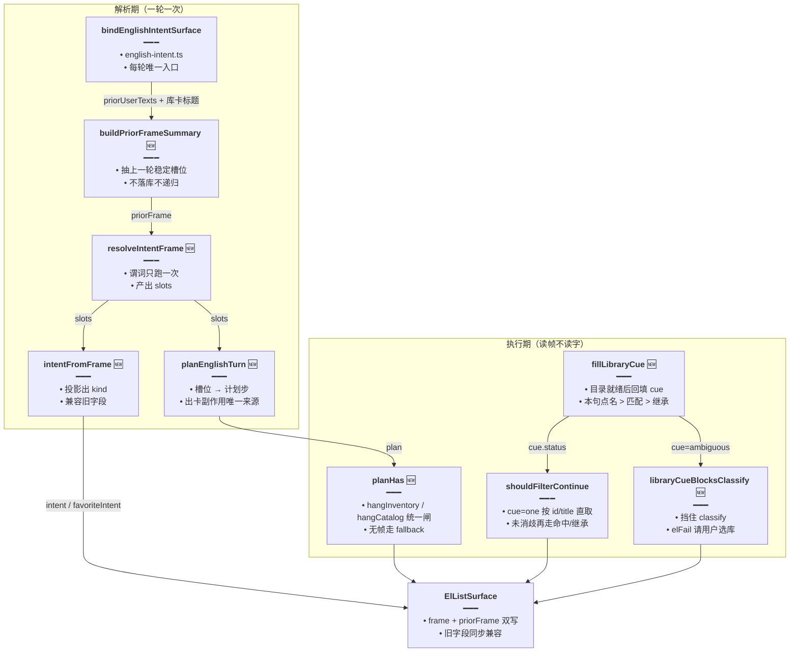
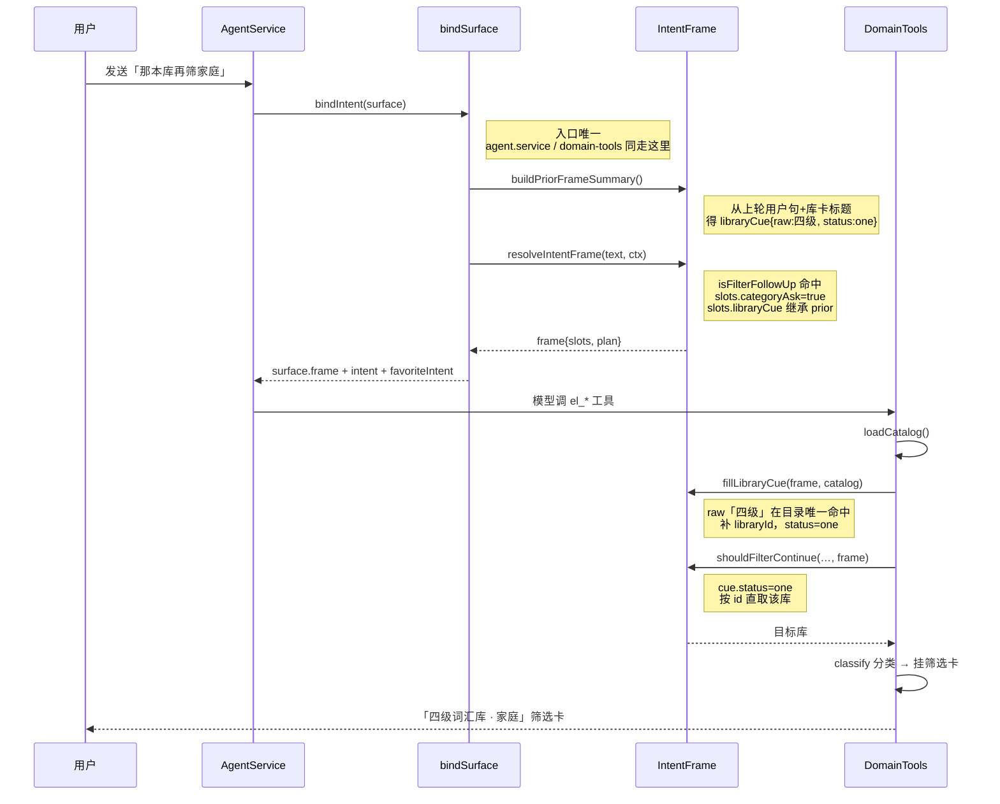

# 英语Agent意图帧（IntentFrame M3）

> 延伸阅读：
> - [语境意图总路由.md](./语境意图总路由.md)：M1 固定优先级路由，本轮起被 IntentFrame 接管为默认路径（`EL_INTENT_FRAME=0` 时回退）。
> - [Agent复合意图通用化.md](./Agent复合意图通用化.md)：M0 旁路补丁与 IntentFrame 的规划来源。
> - [关于类收藏筛选卡.md](./关于类收藏筛选卡.md)：与本轮同批落地的收藏侧修复，`ensureFilterThenPropose` 计划步在那里展开。
> - [筛选卡续答与整类收藏.md](./筛选卡续答与整类收藏.md)：`shouldFilterContinue` / `favoriteSet` 的前序实现。

## 1. 背景与目标

M1 的 `resolveEnglishIntent` 每轮只对用户原话跑一次固定优先级判定，输出一个 `kind`。长对话暴露出四类问题：

1. **续问断链**：「那本库再筛家庭」没有「关于」字眼，`isCategoryAsk` 不认，上一轮筛到一半的库接不上。
2. **继承各算各的**：跨轮信息靠 `priorUserTexts` 正则重放，`inheritedKind`、`shouldFilterContinue` 各自解析一遍，结论可能不一致。
3. **正则误伤**：「所有关于家庭的单词」里「有关」会咬住「有+关」，`categoryLabels` 切错；「所有…单词」又被 `ALL_WORDS_RE` 打成整库盘点，关于类筛选被挤掉。
4. **出卡副作用散点**：挂不挂「库清单卡 / 整库卡」散在 `domain-tools.ts` 多处直判 `listIntent` / `wantsLibraryCatalog`，同一句被重复解释。

目标（规划见 [../ideas/english/复合意图槽位化.md](../ideas/english/复合意图槽位化.md) 的 M3）：**一轮只解析一次**，产出「槽位 `slots` + 计划 `plan`」的意图帧 `IntentFrame`；主意图 `kind`、出卡副作用、续查继承全部改读帧，不再各自重放正则。

## 2. 改动范围

| 路径 | 改动 |
|------|------|
| `apps/backend/src/services/agent/tools/english/intent-frame.types.ts` | **新增**：`IntentSlots` / `PlanStep` / `IntentFrame` / `PriorFrameSummary` 纯类型 |
| `apps/backend/src/services/agent/tools/english/intent-phrases.ts` | **新增**：分域短语桶（catalog / inventory / mistakes）+ `EL_INTENT_FRAME` 开关 |
| `apps/backend/src/services/agent/tools/english/intent-frame.ts` | **新增**：`resolveIntentFrame` 解析、`planEnglishTurn` 计划、`fillLibraryCue` 回填、`buildPriorFrameSummary` 跨轮摘要 |
| `apps/backend/src/services/agent/tools/english/english-intent.ts` | 原 `resolveEnglishIntent` 改名 `resolveEnglishIntentLegacy`；新 `resolveEnglishIntent` 默认走帧；新增 `bindEnglishIntentSurface` 双写 surface |
| `apps/backend/src/services/agent/tools/english/spill.ts` | `FILTER_RE` 加「关于」、`INVENTORY_RE` 迁入 phrases、`categoryLabels` 正则修正、`ElListSurface` 加 `frame` / `priorFrame`、`shouldFilterContinue` 加第 6 参 `frame` |
| `apps/backend/src/services/agent/agent.service.ts` | `bindIntent` 内联逻辑换成 `bindEnglishIntentSurface`；续查 `kind` 优先 `priorFrame.contentKind`；续查后 `fillLibraryCue`；类别标签优先 `frame.slots.filterLabels` |
| `apps/backend/src/services/agent/tools/english/domain-tools.ts` | 同样换 `bindEnglishIntentSurface`；`loadCatalog` / `classify` 后 `fillLibraryCue`；挂卡直判换 `planHas`；`resolveOneLibrary` 先读帧 cue、歧义时 `elFail('ambiguous')` |

## 3. 实现思路

1. **一次解析，双输出**：`resolveIntentFrame(userText, ctx)` 产出 `slots`（catalog / inventory / filterLabels / categoryAsk / libraryCue / domain / mutate / generate）与 `plan`（`hangCatalog` → `resolveLibrary` → `hangInventory` → `classify` → `ensureFilterThenPropose` / `proposeFavorite`）。`kind` 只是 `slots` 的投影（`intentFromFrame`），不再独立判定。
2. **续问认帧不认字**：`isFilterFollowUp` 专认「那本库 / 同上 / 再筛」类续问——只要 `priorFrame` 有 `categoryAsk` 或 `libraryCue`，且本句不是生成 / 收藏操作，即使没有一个「关于」也算筛选续问；类别名由 `followUpFilterLabels` 从「筛家庭」这类短句里补抽。
3. **跨轮摘要只留稳定槽位**：`buildPriorFrameSummary` 从上一轮用户句 + 出库卡标题推导 `PriorFrameSummary`（`libraryCue` / `domain` / `categoryAsk` / `filterLabels` / `contentKind`），不落库、不递归带上一轮的 prior，避免链式爆炸。
4. **cue 两阶段就绪**：解析阶段本句没点名库时先挂 `priorFrame.libraryCue` 的 `raw`；目录（`loadCatalog` / 续查全量页）就绪后由 `fillLibraryCue` 按「本句点名 > 目录匹配 > prior 继承」补 `libraryId` 或标 `ambiguous` / `absent`。
5. **副作用以 plan 为准**：`planHas(frame, 'hangInventory' | 'hangCatalog', fallback)` 统一替换散点直判；帧不存在或开关关闭时走 fallback，行为与 M0/M1 完全一致。
6. **歧义即失败**：`libraryCueBlocksClassify` 命中（cue = `ambiguous`）时 `resolveOneLibrary` 直接 `elFail('ambiguous')` 让模型请用户选定库名，不再猜一本。
7. **开关回退**：`EL_INTENT_FRAME=0` 时 `resolveEnglishIntent` / `bindEnglishIntentSurface` 整体走 `resolveEnglishIntentLegacy`，帧字段写 `undefined`，旧路径零感知。

### 架构图（改动后）



### 时序图（「那本库再筛家庭」续问）



## 4. 关键实现（改动前 / 改动后对比 + 注释）

### 4.1 帧类型定义（`intent-frame.types.ts`，纯新增）

类型单独成文件：`spill.ts` 需要 `IntentFrame` 类型、而 `intent-frame.ts` 又要 import `spill.ts` 的谓词，类型独立后两边都只依赖本文件，斩断循环。

来源：`apps/backend/src/services/agent/tools/english/intent-frame.types.ts`（**改动后**，约 L1–L57，纯新增文件，无改动前）

```ts
// 纯类型独立成文件：spill 与 intent-frame 互相引用对方函数，类型放这里避免循环依赖
/** IntentFrame 纯类型，避免与 spill 循环依赖。 */
// 一轮解析出的全部槽位：下游只读这里，不再各自重放正则
export type IntentSlots = {
	// 是否要看「有哪些库」清单；与关于类可同句，对应 plan 的 hangCatalog
	catalog: boolean;
	// 是否整库盘点（「错题集有哪些资源」），对应 hangInventory
	inventory: boolean;
	// 类别名列表：「关于家庭的和问候的」→ ['家庭','问候']
	filterLabels: string[];
	/** isCategoryAsk && !generate：kind 兼容，即使 labels 为空 */
	// 关于类筛选总开关：续问无「关于」时也能为 true
	categoryAsk: boolean;
	// 目标库线索：解析期只有 raw，目录就绪后由 fillLibraryCue 补 libraryId / 改 status
	libraryCue?: {
		// 用户口中的库名原文（可能来自 prior 继承）
		raw: string;
		// 目录匹配成功后的库 id；未匹配时为空
		libraryId?: string;
		// 消歧状态机：one 可直取，ambiguous 挡 classify，absent/none 走继承或放弃
		status: 'one' | 'ambiguous' | 'none' | 'absent';
	};
	// 分域：错题 / 收藏 / 库 / 笔记 / 词包 / 阅读；可由 prior 继承
	domain?:
		// 错题集域：「错题集有哪些」归入此项
		| 'mistakes'
		// 收藏域
		| 'favorites'
		// 词库 / 语句库域
		| 'libraries'
		// 笔记域
		| 'notes'
		// 词包域
		| 'packs'
		// 自选阅读域
		| 'reading';
	// 收藏类操作：action=null 表示本轮无收藏副作用
	mutate: {
		// 加 / 取消 / 查询三态，取消优先于查询优先于添加
		action: 'add' | 'remove' | 'query' | null;
		// 作用面：单词 / 语句 / 两者 / 卡片本身
		side: 'vocab' | 'classic' | 'both' | 'card';
	};
	// 生成类：词包或自选阅读；与 categoryAsk 互斥
	generate?: 'pack' | 'reading' | null;
};

// 计划步联合类型：出卡副作用只看 plan，不再散点直判
export type PlanStep =
	// 挂库清单卡；setPresented=false 表示不挡后续 classify
	| { type: 'hangCatalog'; setPresented: false }
	// 需要先解析目标库（fillLibraryCue 的挂载点）
	| { type: 'resolveLibrary' }
	// 挂整库卡；是否标 presented 由调用场景定
	| { type: 'hangInventory'; setPresented: boolean }
	// 库内分类；labels 来自 slots.filterLabels
	| { type: 'classify'; labels: string[] }
	// 关于类收藏：先补筛选卡再提案（详见「关于类收藏筛选卡」篇）
	| { type: 'ensureFilterThenPropose' }
	// 普通收藏：直接挂确认条
	| { type: 'proposeFavorite' }
	// 空计划兜底，保证 plan 永不为空数组
	| { type: 'noop' };

// 一帧 = 槽位 + 计划；surface.frame 存的就是它
export type IntentFrame = {
	// 槽位集合：本轮一次解析出的全部意图信息
	slots: IntentSlots;
	// 计划步数组：执行期按序消费，出卡副作用的唯一事实源
	plan: PlanStep[];
};

/** 上一轮稳定槽位摘要（不落库，仅本会话内存/当轮推导）。 */
// 只保留续问需要的最小集合，避免把整帧串成链
export type PriorFrameSummary = {
	// 上一轮锁定的库线索
	libraryCue?: IntentSlots['libraryCue'];
	// 上一轮分域（「错题集」→ mistakes）
	domain?: IntentSlots['domain'];
	// 上一轮是否关于类筛选
	categoryAsk?: boolean;
	// 上一轮类别名（「再筛」无新类别时可复用）
	filterLabels?: string[];
	// 上一轮库卡内容类型：续查时决定拉词库还是语句库
	contentKind?: 'vocab' | 'classic';
};

// 解析上下文：priorUserTexts 必有，其余可选
export type IntentFrameContext = {
	// 本会话历史用户句，供 buildPriorFrameSummary 回放
	priorUserTexts: string[];
	// 上一轮出库卡标题，推断 libraryCue 用
	priorLibraryCards?: { title: string; contentKind?: string }[];
	// 有未点确认条时影响生成类判定（预留）
	openProposalKind?: string | null;
	/** M3：跨轮继承库/域 */
	// 已算好的上轮摘要；bindEnglishIntentSurface 会复用它而不是重算
	priorFrame?: PriorFrameSummary;
};
```

### 4.2 分域短语桶（`intent-phrases.ts`，纯新增）

`INVENTORY_RE` 从 `spill.ts` 迁入，并与 catalog / mistakes 短语组成桶：**新说法只加一行，禁止把万能「有哪些」并进盘点**——这是 M0 踩过的坑（泛「有哪些」把关于类全打成整库）。

来源：`apps/backend/src/services/agent/tools/english/intent-phrases.ts`（**改动后**，约 L1–L62，纯新增文件，无改动前）

```ts
/** 分域短语桶：新说法加一行，禁止万能「有哪些」。 */
// 六个产品域：判定结果写入 slots.domain 并允许跨轮继承
export type PhraseDomain =
	// 错题集域
	| 'mistakes'
	// 收藏域
	| 'favorites'
	// 词库 / 语句库域
	| 'libraries'
	// 笔记域
	| 'notes'
	// 词包域
	| 'packs'
	// 自选阅读域
	| 'reading';

// 桶标记：catalog=库清单、inventory=整表盘点、mistakes=错题域
export type PhraseFlag = 'catalog' | 'inventory' | 'mistakes';

// 单条短语规则：域 + 标记 + 正则三件套
export type PhraseBucket = {
	// 短语归属的产品域：命中后写入 slots.domain
	domain: PhraseDomain;
	// 命中后打的标记：供 phraseHit 按 catalog / inventory / mistakes 查询
	flag: PhraseFlag;
	// 实际做匹配的正则
	re: RegExp;
};

/** 库清单（可与关于类同句）；须带库后缀。 */
// 必须带「语句库/词汇库」等后缀，避免泛「我有哪些」误命中
const CATALOG_RE =
	// 正则本体：库后缀词表 + 「我有哪些/所有/列出/需要的是」四类问法
	/有哪些.{0,8}(语句库|语料库|词汇库|单词库|词库)|我有哪些.{0,8}库|所有语句库|所有词汇库|所有单词库|列出.{0,6}(语句库|语料库|词汇库|单词库)|需要的是所有(语句库|词汇库)/u;

/**
 * 整表/盘点。须盖住「错题集有哪些资源」；勿把泛「有哪些」并进来。
 */
// 从 spill.ts 原样迁入，行为不变，只换住处
const INVENTORY_RE =
	// 正则本体：盘点词 + 错题问法 + 「重新练习」
	/全部|所有单词|所有词|整个库|导出|列出全部|哪些错题|有哪些错|错题集|错题库|我的错题|列出错题|错题.{0,12}(有哪些|哪些|资源)|有哪些.{0,12}错题|重新练习/;

// 错题域单独一张表：inferPhraseDomain 用它把句子归到 mistakes
const MISTAKES_RE =
	// 正则本体：错题相关说法全集（只用于分域，不等于整表标记）
	/错题集|错题库|我的错题|哪些错题|有哪些错|列出错题|错题.{0,12}(有哪些|哪些|资源)|有哪些.{0,12}错题/;

// 桶数组：MISTAKES_RE 同时挂 mistakes 域与 inventory 标记（「错题集有哪些」既要分域又要整表）
export const PHRASE_BUCKETS: PhraseBucket[] = [
	// 库清单问法 → libraries 域 + catalog 标记
	{ domain: 'libraries', flag: 'catalog', re: CATALOG_RE },
	// 错题说法 → mistakes 域（inferPhraseDomain 分域用）
	{ domain: 'mistakes', flag: 'mistakes', re: MISTAKES_RE },
	// 错题说法同时算整表盘点：「错题集有哪些」既要分域又要挂整库卡
	{ domain: 'mistakes', flag: 'inventory', re: MISTAKES_RE },
	// 通用盘点说法 → libraries 域 + inventory 标记
	{ domain: 'libraries', flag: 'inventory', re: INVENTORY_RE },
];

// 按标记查桶：一句命中任一即算
export function phraseHit(userText: string, flag: PhraseFlag): boolean {
	// 任一同标记桶命中即算：some 短路，命中即停
	return PHRASE_BUCKETS.some((b) => b.flag === flag && b.re.test(userText));
}

/** 用户还要看「有哪些库」清单（可与关于类筛选同句）。 */
// spill.ts 的同名函数委托到这里，保持唯一事实源
export function wantsLibraryCatalog(userText: string): boolean {
	// catalog 标记命中即认为在问库清单
	return phraseHit(userText, 'catalog');
}

/** 与历史 listIntent inventory 分支同一张表。 */
// 给 spill.listIntent 用：保证迁移前后判定结果逐句一致
export function inventoryPhraseHit(userText: string): boolean {
	// 直接用迁入的正则判定，与旧表逐句一致
	return INVENTORY_RE.test(userText);
}

// 从命中桶反推分域；不命中返回 undefined 让 slots.domain 继承 prior
export function inferPhraseDomain(userText: string): PhraseDomain | undefined {
	// 库清单问法归 libraries 域
	if (phraseHit(userText, 'catalog')) return 'libraries';
	// 错题说法归 mistakes 域
	if (phraseHit(userText, 'mistakes')) return 'mistakes';
	// 不命中返回 undefined：让调用方继承 prior.domain
	return undefined;
}

/** `EL_INTENT_FRAME=0` 时跳过 plan 执行，保留 M0 旁路。 */
// 环境变量开关：默认开（!= '0'），出问题时一键回退 legacy 路径
export function intentFrameEnabled(): boolean {
	// 只有显式设为 '0' 才关：默认启用帧路径
	return process.env.EL_INTENT_FRAME !== '0';
}
```

### 4.3 帧解析与计划（`intent-frame.ts`，纯新增）

#### 4.3.1 续问谓词与类别补抽

「那本库再筛家庭」没有一个「关于」，`isCategoryAsk` 必然漏判；`isFilterFollowUp` 只要 prior 有筛选痕迹且本句不是生成 / 收藏操作即认续问，`followUpFilterLabels` 再从短句里补抽类别名。

来源：`apps/backend/src/services/agent/tools/english/intent-frame.ts`（**改动后**，约 L37–L63，纯新增文件，无改动前）

```ts
/** 「那本库再筛家庭」类续问：无「关于」也认筛选，且继承 prior。 */
// 续问判定：prior 有筛选痕迹是前提，否则「筛」字没有继承对象
function isFilterFollowUp(text: string, prior?: PriorFrameSummary): boolean {
	// prior 既无 categoryAsk 也无 libraryCue：无可继承，直接否
	if (!prior?.categoryAsk && !prior?.libraryCue) return false;
	// 生成词包 / 阅读优先：「再生成…」不是筛选续问
	if (isPackGenerateAsk(text) || isReadingGenerateAsk(text)) return false;
	// 收藏操作优先：「再收藏」走 mutate 不走 classify
	if (isFavoriteQuery(text) || unfavoriteFromCards(text)) return false;
	// 续问口令：那本库 / 同上 / 继续 / 再筛再找再列 / 关于有关相关
	return /那本|同上|继续|(再|还要?)?(筛|找|列)|关于|有关|相关/.test(text);
}

/** 续问类别：categoryLabels 为空时从「筛家庭 / 关于家庭」抽。 */
// 续问短句往往没有「的」字收尾，categoryLabels 抽不到，这里补一套宽松抽取
function followUpFilterLabels(text: string): string[] {
	// 先试标准抽取：有「关于家庭的」结构时直接用它
	const fromCat = categoryLabels(text);
	// 标准抽取有结果就直接用，不再走宽松补抽
	if (fromCat.length) return fromCat;
	// 宽松抽取的收集桶
	const labels: string[] = [];
	// 统一清洗：去尾「的」、限长 1–8 字，与 categoryLabels 的约束对齐
	const push = (raw: string) => {
		// 去尾「的」并去空白：「家庭的」→「家庭」
		const label = raw.replace(/的$/u, '').trim();
		// 限长 1–8 字：防止把长句尾整段吞成类别名
		if (label.length >= 1 && label.length <= 8) labels.push(label);
	};
	// 三种短句模板逐个尝试：关于X / 筛X / 那本库再筛X
	for (const re of [
		// 模板一：关于 / 有关 / 相关 + 类别名
		/(?:关于|有关|相关)([\u4e00-\u9fff]{1,8})/u,
		// 模板二：筛 / 筛选 / 筛出 / 筛一下 + 类别名
		/筛(?:选|出|一下)?([\u4e00-\u9fff]{1,8})/u,
		// 模板三：「那本库再筛X」固定口令
		/那本库再筛([\u4e00-\u9fff]{1,8})/u,
	// 模板表收尾，进入逐条匹配循环
	]) {
		// 命中即收第一个捕获组；多个模板可叠加（再去重）
		const m = text.match(re);
		// 有捕获组才收：防空匹配污染 labels
		if (m?.[1]) push(m[1]);
	}
	// 去重后返回，保持与 categoryLabels 相同的输出契约
	return [...new Set(labels)];
}
```

#### 4.3.2 `buildPriorFrameSummary`（跨轮摘要）

来源：`apps/backend/src/services/agent/tools/english/intent-frame.ts`（**改动后**，约 L65–L121，纯新增文件，无改动前）

```ts
/**
 * 从 prior 用户句 + 库卡标题推导上一轮槽位摘要。
 * 不递归带 priorFrame，避免链式爆炸。
 */
// 摘要推导：每轮开始时跑一次，给 resolveIntentFrame 当继承源
export function buildPriorFrameSummary(
	// 历史用户句（新→旧倒序扫描）
	priorUserTexts: string[],
	// 历史库卡标题 + 内容类型；默认空数组允许只凭用户句推导
	priorLibraryCards: {
		// 库卡标题：libraryCue.raw 的来源
		title: string;
		// 卡内容类型：过滤标题池、推 contentKind 用
		contentKind?: 'vocab' | 'classic';
	// 参数收尾：数组类型 + 默认空数组
	}[] = [],
// 返回摘要；历史里毫无筛选痕迹时返回 undefined
): PriorFrameSummary | undefined {
	// 倒序扫：最近一句有筛选痕迹的用户话才是「上一轮」
	for (let i = priorUserTexts.length - 1; i >= 0; i -= 1) {
		// 取句并去空白；空句跳过
		const text = priorUserTexts[i]?.trim();
		// 空句没有解析价值
		if (!text) continue;
		// 对该句单独跑一帧：priorUserTexts 传空，禁止递归继承
		const snap = resolveIntentFrame(text, { priorUserTexts: [] });
		// 既不是关于类也不是盘点也不是库清单：这句没有可继承槽位，继续往前找
		if (
			// 不是关于类筛选
			!snap.slots.categoryAsk &&
			// 不是整库盘点
			!snap.slots.inventory &&
			// 不是库清单问法
			!snap.slots.catalog
		// 三者皆空：无可继承槽位
		) {
			// 继续往前找更早的用户句
			continue;
		}
		// 用前序全部用户句 + 库卡推内容类型（词 / 语句）
		const kind = inheritedKind(
			// 截止到本句的历史句序（含本句）：只看「上一轮」之前的语境
			priorUserTexts.slice(0, i + 1),
			// 库卡标题池透传
			priorLibraryCards,
		);
		// 有类型时只留该类型的卡：标题池与续查目标保持一致
		const cards = kind
			// 推出类型则过滤同类型的卡
			? priorLibraryCards.filter((c) => c.contentKind === kind)
			// 推不出类型则全量参与
			: priorLibraryCards;
		// 标题去重去空：多卡同名只算一本
		const titles = [
			// map 取标题 → trim → 去空 → Set 去重后展开为数组
			...new Set(cards.map((c) => c.title.trim()).filter((t) => t.length > 0)),
		];
		// 组装摘要主体：三个稳定槽位直接透传快照
		const summary: PriorFrameSummary = {
			// 是否关于类：续问判定的核心依据
			categoryAsk: snap.slots.categoryAsk,
			// 类别名：「再筛」无新类别时复用
			filterLabels: snap.slots.filterLabels,
			// 分域：供跨轮继承
			domain: snap.slots.domain,
			// null 归一为 undefined，贴合可选字段契约
			contentKind: kind ?? undefined,
		};
		// 标题恰好一本：锁定为 cue，续问「那本库」就指它
		if (titles.length === 1) {
			// status=one：后续 fillLibraryCue 只补 id 不改语义
			summary.libraryCue = { raw: titles[0], status: 'one' };
		}
		// 找到最近一条有痕迹的句即返回，不再往前扫
		return summary;
	}
	// 用户句里没有任何筛选痕迹：退到纯卡标题推导
	const titles = [
		// 去重
		...new Set(
			// 全部库卡标题：去空白并去空串
			priorLibraryCards.map((c) => c.title.trim()).filter((t) => t.length > 0),
		),
	];
	// 标题不是恰好一本：无法锁定，放弃继承
	if (titles.length !== 1) return undefined;
	// 取首卡类型：单词卡 → vocab，语句卡 → classic
	const cardKind = priorLibraryCards[0]?.contentKind;
	// 出库卡反推的摘要：默认 categoryAsk=true（出了库卡多半在筛）
	return {
		// 唯一标题锁为 cue
		libraryCue: { raw: titles[0], status: 'one' },
		// 内容类型字段：
		contentKind:
			// 只认 vocab / classic，其它脏值归 undefined
			cardKind === 'vocab' || cardKind === 'classic' ? cardKind : undefined,
		// 默认在筛选：给续问判定兜底
		categoryAsk: true,
	};
}
```

#### 4.3.3 `resolveIntentFrame`（一轮一次解析）

来源：`apps/backend/src/services/agent/tools/english/intent-frame.ts`（**改动后**，约 L123–L185，纯新增文件，无改动前）

```ts
// 帧解析主入口：所有谓词在这里跑一次，下游不再重放
export function resolveIntentFrame(
	// 本轮用户原话
	userText: string,
	// 解析上下文；默认空历史保证可单句调用
	ctx: IntentFrameContext = { priorUserTexts: [] },
// 返回槽位 + 计划的完整帧
): IntentFrame {
	// 统一去空白：后续谓词都基于 trim 后的 text
	const text = userText.trim();
	// 空句直接给 noop 帧：plan 恒非空，下游不用判空数组
	if (!text) {
		// 返回全假槽位 + noop 计划的兜底帧
		return {
			// 槽位全部置假
			slots: {
				// 不看库清单
				catalog: false,
				// 不整库盘点
				inventory: false,
				// 无类别名
				filterLabels: [],
				// 非关于类
				categoryAsk: false,
				// 无收藏副作用
				mutate: { action: null, side: 'card' },
				// 无生成意图
				generate: null,
			},
			// 计划仅 noop 一步，保持非空契约
			plan: [{ type: 'noop' }],
		};
	}

	// 取出继承源：可能是 bindEnglishIntentSurface 算好传入的
	const prior = ctx.priorFrame;
	// 生成类两兄弟先判：它们与 categoryAsk 互斥
	const genPack = isPackGenerateAsk(text);
	// 阅读生成问法
	const genRead = isReadingGenerateAsk(text);
	// 取消收藏优先级最高（与 legacy 对齐）
	const cancel = unfavoriteFromCards(text);
	// 查询收藏次之
	const favQuery = isFavoriteQuery(text);
	// 软添加收藏：「收藏这些」这类不带类别的也收
	const fav = resolveFavoriteIntent(text);
	// 整库盘点 / 筛选 / 其它的三分
	const list = listIntent(text);
	// 库清单问法（可与关于类同句）
	const catalog = wantsLibraryCatalog(text);
	// 续问判定：依赖 prior，无「关于」也可能为 true
	const followUp = isFilterFollowUp(text, prior);
	// categoryAsk = 标准关于类 或 续问；生成类永远压制筛选
	const categoryAsk = (!genPack && !genRead && isCategoryAsk(text)) || followUp;
	// 类别名：续问走宽松补抽，否则走标准 categoryLabels；非筛选句恒空
	const filterLabels = categoryAsk
		// 是关于类：再看是否续问
		? followUp
			// 续问：宽松补抽类别名
			? followUpFilterLabels(text)
			// 非续问：标准「关于X的」抽取
			: categoryLabels(text)
		// 非筛选句：类别名恒空
		: [];

	// 组装槽位：每个字段都有唯一来源谓词
	const slots: IntentSlots = {
		// 库清单标记透传
		catalog,
		// 盘点 = listIntent 三分里的 inventory 支
		inventory: list === 'inventory',
		// 类别名透传
		filterLabels,
		// 关于类总开关透传
		categoryAsk,
		// 分域：本句推不出时继承 prior（「错题集」→「再看看」仍属 mistakes）
		domain: inferPhraseDomain(text) ?? prior?.domain,
		// 收藏三态：cancel 带 side、query 固定 card、add 用 resolveFavoriteIntent 的 side
		mutate: cancel
			// 取消：side 由 unfavoriteFromCards 给出
			? { action: 'remove', side: cancel }
			// 非取消：再看是否查询
			: favQuery
				// 查询：side 固定 card（查的是卡面状态）
				? { action: 'query', side: 'card' }
				// 否则按软添加结果落定
				: {
						// 只有 resolveFavoriteIntent 判 add 才算添加，否则 null
						action: fav.action === 'add' ? 'add' : null,
						// side 沿用软添加判定结果
						side: fav.side,
					},
		// 生成互斥：pack 优先于 reading
		generate: genPack ? 'pack' : genRead ? 'reading' : null,
	};

	// 本句未点名库时，先挂上 prior 的 cue（id 可能稍后由 fillLibraryCue 补）
	if (
		// 本轮是关于类筛选才有继承意义
		categoryAsk &&
		// prior 的 cue 已锁定唯一库
		prior?.libraryCue?.status === 'one' &&
		// 且 raw 非空
		prior.libraryCue.raw
	// 三条件齐备才继承
	) {
		// 浅拷贝避免共享引用：fillLibraryCue 会原地改写 slots.libraryCue
		slots.libraryCue = { ...prior.libraryCue };
	}

	// 槽位 → 计划：一次组装，执行期只读 plan
	return { slots, plan: planEnglishTurn(slots) };
}
```

#### 4.3.4 计划生成与 kind 投影

来源：`apps/backend/src/services/agent/tools/english/intent-frame.ts`（**改动后**，约 L187–L237，纯新增文件，无改动前）

```ts
// 槽位 → 计划步：顺序即执行顺序，catalog 卡永远最先挂
export function planEnglishTurn(slots: IntentSlots): PlanStep[] {
	// 收集桶：按优先级顺序 push
	const steps: PlanStep[] = [];
	// 库清单卡最先：「有哪些库 + 关于…」双卡场景里库卡在上
	if (slots.catalog) steps.push({ type: 'hangCatalog', setPresented: false });
	// 关于类或盘点都需要先锁定目标库
	if (slots.categoryAsk || slots.inventory) {
		// 计划步：fillLibraryCue 的挂载点
		steps.push({ type: 'resolveLibrary' });
	}
	// 整库盘点卡：标 presented 防止兜底逻辑重复挂卡
	if (slots.inventory) {
		// 计划步：挂整库卡
		steps.push({ type: 'hangInventory', setPresented: true });
	}
	// 分类步：labels 已在 slots 里，直接透传
	if (slots.categoryAsk) {
		// 计划步：库内分类
		steps.push({ type: 'classify', labels: slots.filterLabels });
	}
	// 关于类收藏：先补筛选卡再提案；普通收藏直接提案
	if (slots.mutate.action === 'add' && slots.categoryAsk) {
		// 计划步：补筛选卡再提案
		steps.push({ type: 'ensureFilterThenPropose' });
	// 纯添加收藏（非关于类）
	} else if (slots.mutate.action === 'add') {
		// 计划步：直接挂确认条
		steps.push({ type: 'proposeFavorite' });
	}
	// 空计划兜底为 noop：下游 for 循环不用判空
	return steps.length ? steps : [{ type: 'noop' }];
}

// slots → 主意图 kind：优先级与 legacy 完全对齐（cancel→query→generate→add→category→inventory→chat）
export function primaryKindFrom(slots: IntentSlots): EnglishIntentKind {
	// 取消收藏最高优先
	if (slots.mutate.action === 'remove') return 'favorite_remove';
	// 查询次之
	if (slots.mutate.action === 'query') return 'favorite_query';
	// 生成类压过筛选
	if (slots.generate === 'pack') return 'pack_generate';
	// 阅读生成次之
	if (slots.generate === 'reading') return 'reading_generate';
	// 添加收藏压过纯筛选：「收藏关于家庭的词」kind 是 favorite_add 而非 category_filter
	if (slots.mutate.action === 'add') return 'favorite_add';
	// 纯关于类
	if (slots.categoryAsk) return 'category_filter';
	// 整库盘点
	if (slots.inventory) return 'inventory';
	// 兜底闲聊
	return 'chat';
}

// 帧 → 旧 EnglishIntent：让尚未改读 frame 的路径（收尾话术、提案延期）零改动
export function intentFromFrame(frame: IntentFrame): EnglishIntent {
	// kind 来自投影
	const kind = primaryKindFrom(frame.slots);
	// side 只对收藏类有意义
	const side = frame.slots.mutate.side;
	// 组装旧形状对象
	return {
		// 投影出的主意图
		kind,
		// 仅 add/remove 挂 side：与 legacy 输出形状逐字段一致
		...(kind === 'favorite_remove' || kind === 'favorite_add' ? { side } : {}),
		// needsFilterCards 改由 plan 步推导：有 ensureFilterThenPropose 即需要先补筛选卡
		needsFilterCards: frame.plan.some(
			// 计划里存在该步即需要先补筛选卡
			(s) => s.type === 'ensureFilterThenPropose',
		),
	};
}

// plan 查询统一闸：帧不存在或开关关闭时回退旧直判，保证 M0 行为可复现
export function planHas(
	// 意图帧（可无：无帧走 fallback）
	frame: IntentFrame | undefined,
	// 要查询的计划步类型
	type: PlanStep['type'],
	// 无帧 / 关开关时执行的旧判定
	fallback: () => boolean,
// 返回该副作用是否应执行
): boolean {
	// 无帧回退：fallback 里包的是 M0/M1 的 listIntent / wantsLibraryCatalog 直判
	if (!intentFrameEnabled() || !frame) return fallback();
	// 有帧只认 plan：出卡副作用的唯一事实源
	return frame.plan.some((s) => s.type === type);
}
```

#### 4.3.5 `fillLibraryCue` 回填与消歧

来源：`apps/backend/src/services/agent/tools/english/intent-frame.ts`（**改动后**，约 L239–L327，纯新增文件，无改动前）

```ts
// 在目录里为 cue 找唯一库：先按 id，再按标题双向包含
function matchCueInCatalog(
	// 待匹配的 cue（调用方保证非空）
	cue: NonNullable<IntentSlots['libraryCue']>,
	// 当前目录候选库
	libs: { id: string; title: string }[],
// 命中返回库，否则 null
): { id: string; title: string } | null {
	// 已有 id：直接按 id 查，最稳
	if (cue.libraryId) {
		// 按 id 精确查找
		const byId = libs.find((lib) => lib.id === cue.libraryId);
		// 查到直接返回
		if (byId) return byId;
	}
	// raw 为空无法匹配
	const key = cue.raw.trim();
	// 空 key 直接失败
	if (!key) return null;
	// 双向包含收集候选：「四级」对得上「四级词汇库」，反之亦然
	const hits = libs.filter((lib) => {
		// 标题也去空白再比，与 key 的清洗对齐
		const title = lib.title.trim();
		// 命中条件：
		return (
			// 标题非空
			title.length > 0 &&
			// 全等或双向包含
			(title === key || title.includes(key) || key.includes(title))
		);
	});
	// 恰好一本：锁定
	if (hits.length === 1) return hits[0];
	// 多本候选：只接受严格最长标题（与 matchLibraries 的「严格更长才猜」对齐）
	const ranked = [...hits].sort((a, b) => b.title.length - a.title.length);
	// 前两名严格拉开长度差才敢取最长
	if (ranked.length >= 2 && ranked[0].title.length > ranked[1].title.length) {
		// 取最长标题
		return ranked[0];
	}
	// 单候选兜底
	if (ranked.length === 1) return ranked[0];
	// 等长多候选：不猜，交调用方标 ambiguous
	return null;
}

/** 目录就绪后填 libraryCue；本句 miss 时继承 priorFrame。 */
// 回填主逻辑：loadCatalog / 续查全量页之后调用
export function fillLibraryCue(
	// 要回填的帧（原地改写 slots.libraryCue）
	frame: IntentFrame,
	// 本轮用户原话：认本句点名用
	userText: string,
	// 当前目录候选库
	libs: { id: string; title: string }[],
	// 语句库点名辅助正则（classic 场景才传）
	markSource?: RegExp,
	// 上一轮摘要：本句 miss 时的继承源
	priorFrame?: PriorFrameSummary,
// 无返回：结果写进 frame.slots.libraryCue
): void {
	// plan 没有 resolveLibrary 步：本轮不需要锁定库，直接返回
	if (!frame.plan.some((s) => s.type === 'resolveLibrary')) return;
	// 先认本句点名：「四级词汇库中关于家庭的词」里的「四级词汇库」
	const named = resolveMentionedLibrary(userText, libs, markSource);
	// 本句唯一点名：直接锁 id + 标题
	if (named.kind === 'one') {
		// 锁定 cue
		frame.slots.libraryCue = {
			// raw 用目录里的规范标题
			raw: named.lib.title,
			// 补上库 id
			libraryId: named.lib.id,
			// 状态置 one
			status: 'one',
		};
		// 锁完即返回
		return;
	}
	// 本句点名但多候选：标歧义，libraryCueBlocksClassify 会挡住 classify
	if (named.kind === 'ambiguous') {
		// 写歧义 cue
		frame.slots.libraryCue = {
			// raw 取首个候选标题（展示 / 日志用）
			raw: named.candidates[0]?.title ?? '',
			// 状态置 ambiguous
			status: 'ambiguous',
		};
		// 标完即返回
		return;
	}
	// absent / none：尝试 prior 或已挂在 slots 上的 raw
	const inherit = frame.slots.libraryCue ?? priorFrame?.libraryCue;
	// 继承源是已锁定的 cue：在新目录里重新匹配（目录可能按 kind 换过）
	if (inherit?.status === 'one') {
		// 在新目录里重新匹配继承 cue
		const hit = matchCueInCatalog(inherit, libs);
		// 匹配成功才回填
		if (hit) {
			// 匹配成功：补上本目录下的 id
			frame.slots.libraryCue = {
				// raw 用命中标题
				raw: hit.title,
				// 补 id
				libraryId: hit.id,
				// 状态 one
				status: 'one',
			};
			// 回填完即返回
			return;
		}
	}
	// 全部落空：absent（目录里没有）优先于 none（句里没提）
	frame.slots.libraryCue = {
		// raw 清空
		raw: '',
		// 句里提过但目录没有 → absent；压根没提 → none
		status: named.kind === 'absent' ? 'absent' : 'none',
	};
}

/** cue 已 ambiguous 时跳过后续 classify。 */
// 歧义闸：resolveOneLibrary 用它直接 elFail，让模型请用户选库
export function libraryCueBlocksClassify(
	// 意图帧（可无）
	frame: IntentFrame | undefined,
// 返回是否应拦截 classify
): boolean {
	// cue 为 ambiguous 即拦截
	return frame?.slots.libraryCue?.status === 'ambiguous';
}

/**
 * 从 frame 取续查库；无则 null（交给 legacy shouldFilterContinue）。
 */
// 给续查路径的快捷直取：只认 cue.status=one
export function libraryFromFrame(
	// 意图帧（可无）
	frame: IntentFrame | undefined,
	// 当前目录候选库
	catalog: { id: string; title: string }[],
// 命中库或 null
): { id: string; title: string } | null {
	// 非关于类：续查无从谈起
	if (!frame?.slots.categoryAsk) return null;
	// 读 cue 槽位
	const cue = frame.slots.libraryCue;
	// cue 未锁定：交调用方走命中 / 继承旧逻辑
	if (!cue || cue.status !== 'one') return null;
	// 在目录里把 raw 兑现成具体库
	return matchCueInCatalog(cue, catalog);
}
```

### 4.4 `english-intent.ts`：legacy 改名与 surface 双写

来源：`apps/backend/src/services/agent/tools/english/english-intent.ts`（**改动前**，约 L58–L91，diff `-` 侧）

```ts
/**
 * 固定优先级：cancel → query → generate → add → category → inventory → chat。
 * ctx 预留给 M2/M3 继承策略；M1 判定只靠原话。
 */
// 改名前：这是唯一的意图入口，直接挂在 agent.service / domain-tools 两处
export function resolveEnglishIntent(
	// 本轮用户原话
	userText: string,
	// 继承上下文：M1 未用，下划线标记占位
	_ctx: EnglishIntentContext = {
		// 历史用户句，默认空
		priorUserTexts: [],
		// 历史库卡，默认空
		priorLibraryCards: [],
	},
// 参数收尾：返回判别出的意图
): EnglishIntent {
	// trim 后空句即闲聊
	const text = userText.trim();
	// 空句直接判闲聊，终止判定
	if (!text) return { kind: 'chat' };

	// 取消收藏最优先
	const cancel = unfavoriteFromCards(text);
	// 命中取消收藏：带方向返回
	if (cancel) return { kind: 'favorite_remove', side: cancel };

	// 查询收藏次之
	if (isFavoriteQuery(text)) return { kind: 'favorite_query' };

	// 生成类压过筛选与盘点
	if (isPackGenerateAsk(text)) return { kind: 'pack_generate' };
	// 阅读生成问法
	if (isReadingGenerateAsk(text)) return { kind: 'reading_generate' };

	// 软添加收藏：带 needsFilterCards 标记
	const fav = resolveFavoriteIntent(text);
	// 命中软添加：进入组装分支
	if (fav.action === 'add') {
		// 返回收藏添加意图对象
		return {
			// 意图类型：添加收藏
			kind: 'favorite_add',
			// 收藏方向（词/句）
			side: fav.side,
			// 是否依赖筛选卡上下文
			needsFilterCards: favoriteNeedsFilterCards(text),
		};
	}

	// 纯关于类筛选
	if (isCategoryAsk(text)) return { kind: 'category_filter' };
	// 整库盘点
	if (listIntent(text) === 'inventory') return { kind: 'inventory' };
	// 兜底闲聊
	return { kind: 'chat' };
}
```

来源：`apps/backend/src/services/agent/tools/english/english-intent.ts`（**改动后**，约 L59–L110）

```ts
/**
 * 固定优先级：cancel → query → generate → add → category → inventory → chat。
 * `EL_INTENT_FRAME=0` 时走本函数，不经 IntentFrame。
 */
// 改名 legacy：函数体一字未动，仅改名并在注释里标注回退场景
export function resolveEnglishIntentLegacy(
	// 本轮用户原话
	userText: string,
	// 继承上下文：legacy 不用，下划线标记占位
	_ctx: EnglishIntentContext = {
		// 历史用户句，默认空
		priorUserTexts: [],
		// 历史库卡，默认空
		priorLibraryCards: [],
	},
// 参数收尾：返回判别出的意图
): EnglishIntent {
	// trim 后空句即闲聊
	const text = userText.trim();
	// 空句直接判闲聊，终止判定
	if (!text) return { kind: 'chat' };

	// 取消收藏最优先
	const cancel = unfavoriteFromCards(text);
	// 命中取消收藏：带方向返回
	if (cancel) return { kind: 'favorite_remove', side: cancel };

	// 查询收藏次之
	if (isFavoriteQuery(text)) return { kind: 'favorite_query' };

	// 生成类压过筛选与盘点
	if (isPackGenerateAsk(text)) return { kind: 'pack_generate' };
	// 阅读生成问法
	if (isReadingGenerateAsk(text)) return { kind: 'reading_generate' };

	// 软添加收藏：带 needsFilterCards 标记
	const fav = resolveFavoriteIntent(text);
	// 命中软添加：进入组装分支
	if (fav.action === 'add') {
		// 返回收藏添加意图对象
		return {
			// 意图类型：添加收藏
			kind: 'favorite_add',
			// 收藏方向（词/句）
			side: fav.side,
			// 是否依赖筛选卡上下文
			needsFilterCards: favoriteNeedsFilterCards(text),
		};
	}

	// 纯关于类筛选
	if (isCategoryAsk(text)) return { kind: 'category_filter' };
	// 整库盘点
	if (listIntent(text) === 'inventory') return { kind: 'inventory' };
	// 兜底闲聊
	return { kind: 'chat' };
}

/**
 * 默认经 IntentFrame 再映射 kind；开关关闭时回退 legacy。
 */
// 新默认入口：名字不变，外部调用方零改动
export function resolveEnglishIntent(
	// 本轮用户原话
	userText: string,
	// 继承上下文：历史句卡与帧摘要
	ctx: EnglishIntentContext = {
		// 历史用户句，默认空
		priorUserTexts: [],
		// 历史库卡，默认空
		priorLibraryCards: [],
	},
// 参数收尾：返回判别出的意图
): EnglishIntent {
	// 开关关闭：整轮回到 M1 行为
	if (!intentFrameEnabled()) {
		// 开关关闭：整轮走旧判定
		return resolveEnglishIntentLegacy(userText, ctx);
	}
	// 先解帧再投影 kind：kind 只是帧的一个视图
	const frame = resolveIntentFrame(userText, ctx);
	// 帧投影为 kind 返回
	return intentFromFrame(frame);
}
```

来源：`apps/backend/src/services/agent/tools/english/english-intent.ts`（**改动后**，约 L112–L146，纯新增函数，无改动前）

```ts
/** 双写 surface.frame + intent + favoriteIntent；并挂 priorFrame。 */
// surface 绑定唯一入口：agent.service 的 bindIntent 与 domain-tools 初始化都走这里，杜绝两处各写一遍
export function bindEnglishIntentSurface(surface: {
	// 本轮用户原话
	userText: string;
	// 历史用户句（推 priorFrame 用）
	priorUserTexts: string[];
	// 历史库卡（推 contentKind / libraryCue 用）
	priorLibraryCards: { title: string; contentKind?: 'vocab' | 'classic' }[];
	// 未点确认条的内容类型
	openProposalId?: string | null;
	// 以下四个字段由本函数回写
	intent?: EnglishIntent;
	// 本轮收藏意图（回写）
	favoriteIntent?: FavoriteIntent;
	// 本轮槽位帧（回写）
	frame?: import('./intent-frame.types').IntentFrame;
	// 上一轮帧摘要（回写）
	priorFrame?: PriorFrameSummary;
// surface 字段收尾：返回本轮意图
}): EnglishIntent {
	// priorFrame 已算好就复用：domain-tools 与 agent.service 可能先后绑同一 surface
	const priorFrame =
		// 已有摘要：直接复用
		surface.priorFrame ??
		// 无摘要：由历史句卡现算
		buildPriorFrameSummary(surface.priorUserTexts, surface.priorLibraryCards);
	// 回写 surface：续查 kind、fillLibraryCue 继承都读它
	surface.priorFrame = priorFrame;
	// 组装解析上下文：openProposalId 映射为 openProposalKind
	const ctx: EnglishIntentContext = {
		// 历史用户句透传
		priorUserTexts: surface.priorUserTexts,
		// 历史库卡透传
		priorLibraryCards: surface.priorLibraryCards,
		// 未点确认条映射为 kind
		openProposalKind: surface.openProposalId ?? null,
		// 帧摘要进上下文
		priorFrame,
	};
	// 开关关闭：legacy 判定 + 显式清空 frame，旧路径读不到帧字段
	if (!intentFrameEnabled()) {
		// 旧入口判定整轮意图
		const intent = resolveEnglishIntentLegacy(surface.userText, ctx);
		// 回写主意图
		surface.intent = intent;
		// 同步收藏意图
		surface.favoriteIntent = favoriteIntentFrom(intent);
		// 显式清空帧字段
		surface.frame = undefined;
		// 返回旧判定结果
		return intent;
	}
	// 正常路径：解帧 → 三字段双写
	const frame = resolveIntentFrame(surface.userText, ctx);
	// 回写帧
	surface.frame = frame;
	// 帧投影 kind
	const intent = intentFromFrame(frame);
	// 回写主意图
	surface.intent = intent;
	// favoriteIntent 仍由 intent 回填：旧路径（propose 延期、轮末挂条）零改动
	surface.favoriteIntent = favoriteIntentFrom(intent);
	// 返回本轮意图
	return intent;
}
```

变更摘要：`resolveEnglishIntent` 改名 `resolveEnglishIntentLegacy`（函数体不变），新 `resolveEnglishIntent` 默认走帧；`bindEnglishIntentSurface` 收拢 surface 绑定，消灭 agent.service 与 domain-tools 两处重复内联。

### 4.5 `spill.ts`：短语表迁移与正则修正

「所有关于家庭的单词」两个 bug 一起修：`FILTER_RE` 没有「关于」导致该句漏进 `ALL_WORDS_RE` 被打成整库；`categoryLabels` 的 `(?:关于|有关|相关)` 里「有关」会咬住「所有关于」的「有+关」，切出错误的类别名。

来源：`apps/backend/src/services/agent/tools/english/spill.ts`（**改动前**，约 L28–L45，diff `-` 侧）

```ts
// 筛选词表：缺「关于」，「所有关于家庭的单词」会漏到整库分支
const FILTER_RE = /找出|筛|相关|有关|哪些是|属于|人体|挑出|主题/;
/**
 * 整表/盘点问法。须盖住「错题集有哪些资源」这类：旧式「有哪些错」对不上「有哪些资源」。
 */
// 盘点表常驻本文件：与 intent 解析无共享，新说法容易只改一处漏另一处
const INVENTORY_RE =
	// 盘点说法正则：盖住全部/导出/错题集等
	/全部|所有单词|所有词|整个库|导出|列出全部|哪些错题|有哪些错|错题集|错题库|我的错题|列出错题|错题.{0,12}(有哪些|哪些|资源)|有哪些.{0,12}错题|重新练习/;
/** 「所有英语四级单词库中的单词」：库名隔在「所有」和「单词」之间 */
// 库名隔在中间的「所有…单词」也算整库
const ALL_WORDS_RE = /所有.{0,16}(单词|词条|的词)/;

/** 只看用户原话。筛选词优先于「列出 / 全部」。 */
// 三分判定：filter 优先，避免「列出关于家庭的」被「列出」带跑
export function listIntent(userText: string): ListIntent {
	// 命中筛选词：filter 优先
	if (FILTER_RE.test(userText)) return 'filter';
	// 命中盘点表或「所有…单词」
	if (INVENTORY_RE.test(userText) || ALL_WORDS_RE.test(userText))
		// 判为整库盘点
		return 'inventory';
	// 都不中：其它
	return 'other';
}
```

来源：`apps/backend/src/services/agent/tools/english/spill.ts`（**改动后**，约 L34–L46）

```ts
/** 含「关于」：避免「所有关于家庭的单词」被 ALL_WORDS_RE 打成整库盘点。 */
// 加「关于」：关于类一律先认筛选，不再落入整库
const FILTER_RE = /找出|筛|相关|有关|关于|哪些是|属于|人体|挑出|主题/;
/** 「所有英语四级单词库中的单词」：库名隔在「所有」和「单词」之间 */
// ALL_WORDS_RE 原地保留：库名隔开的整库问法仍要认
const ALL_WORDS_RE = /所有.{0,16}(单词|词条|的词)/;

/** 只看用户原话。筛选词优先于「列出 / 全部」。盘点短语见 intent-phrases。 */
// inventory 分支改调 inventoryPhraseHit：与 intent-phrases.ts 同一张表，单一事实源
export function listIntent(userText: string): ListIntent {
	// 命中筛选词：filter 优先
	if (FILTER_RE.test(userText)) return 'filter';
	// 命中盘点短语或「所有…单词」
	if (inventoryPhraseHit(userText) || ALL_WORDS_RE.test(userText))
		// 判为整库盘点
		return 'inventory';
	// 都不中：其它
	return 'other';
}
```

来源：`apps/backend/src/services/agent/tools/english/spill.ts`（**改动前**，约 L105–L108，diff `-` 侧，节选自 `categoryLabels` 循环头）

```ts
	// 标记正则在 alternation 里「有关」先匹配：「所有关于」被咬成「有+关」
	for (const mark of userText.matchAll(/(?:关于|有关|相关)/gu)) {
		// 从标记后开始切类别名
		let rest = userText.slice((mark.index ?? 0) + mark[0].length);
```

来源：`apps/backend/src/services/agent/tools/english/spill.ts`（**改动后**，约 L109–L113）

```ts
	// 「所有关于家庭」里「有关」会咬住「有+关」，须 (?<!所) 且 关于 优先
	// 交替顺序调为「关于|相关」在前，「有关」加负向后行排除「所有关」
	for (const mark of userText.matchAll(/关于|相关|(?<!所)有关/gu)) {
		// 从标记后开始切类别名
		let rest = userText.slice((mark.index ?? 0) + mark[0].length);
		// 误切到「关|于…」时丢掉：「有关情况如下」的「有关」后面紧跟「于」不是类别标记
		if (mark[0] === '有关' && rest.startsWith('于')) continue;
```

来源：`apps/backend/src/services/agent/tools/english/spill.ts`（**改动前**，约 L137–L141，diff `-` 侧）

```ts
/** 关于类且不是整库问法。整库句仍走 inventory，避免「列出全部」被拿去分类。 */
// 先算 listIntent 再验标记：FILTER_RE 加了「关于」后，关于类句永远到不了 inventory 分支
export function isCategoryAsk(userText: string): boolean {
	// 整库句让路：不当关于类
	if (listIntent(userText) === 'inventory') return false;
	// 有关于类标记才算
	return /关于|相关|有关|属于/.test(userText);
}
```

来源：`apps/backend/src/services/agent/tools/english/spill.ts`（**改动后**，约 L144–L152）

```ts
/**
 * 关于类筛选。句内有「关于/有关…」即分类；
 * 仅当整库盘点且没有关于类标记时才让路（「列出全部」不当分类）。
 */
// 先验标记再让路：FILTER_RE 含「关于」后 listIntent 恒为 filter，顺序必须倒过来
export function isCategoryAsk(userText: string): boolean {
	// 没有关于类标记：直接否，省去 listIntent 计算
	if (!/关于|相关|有关|属于/.test(userText)) return false;
	// 有标记但整句是盘点（如「列出全部关于…」被其它词命中 inventory）：让路整库
	if (listIntent(userText) === 'inventory') return false;
	// 有标记且非整库：是
	return true;
}
```

来源：`apps/backend/src/services/agent/tools/english/spill.ts`（**改动前**，约 L424–L429，diff `-` 侧）

```ts
/** 用户还要看「有哪些库」清单（可与关于类筛选同句，不走 inventory 独占）。 */
// 内联正则：与 IntentFrame 需要复用时只能复制粘贴
export function wantsLibraryCatalog(userText: string): boolean {
	// 内联正则判库清单问法
	return /有哪些.{0,8}(语句库|语料库|词汇库|单词库|词库)|我有哪些.{0,8}库|所有语句库|所有词汇库|所有单词库|列出.{0,6}(语句库|语料库|词汇库|单词库)|需要的是所有(语句库|词汇库)/u.test(
		// 被测原话
		userText,
	);
}
```

来源：`apps/backend/src/services/agent/tools/english/spill.ts`（**改动后**，约 L435–L438）

```ts
/** 用户还要看「有哪些库」清单（可与关于类筛选同句，不走 inventory 独占）。 */
// 委托给 intent-phrases：正则搬家后本函数只是别名，调用方零改动
export function wantsLibraryCatalog(userText: string): boolean {
	// 委托短语桶判定
	return wantsLibraryCatalogFromPhrases(userText);
}
```

变更摘要：`FILTER_RE` 补「关于」、`INVENTORY_RE` 迁出为 `inventoryPhraseHit`、`categoryLabels` 修「所有关于」误切、`isCategoryAsk` 判定顺序倒置、`wantsLibraryCatalog` 委托短语桶。

### 4.6 `spill.ts`：surface 字段与 `shouldFilterContinue` 读帧

来源：`apps/backend/src/services/agent/tools/english/spill.ts`（**改动前**，约 L72–L78，diff `-` 侧，节选自 `ElListSurface`）

```ts
	// 未点确认条的内容类型
	openProposalId?: string | null;
	/** 本轮主意图（总路由）。收尾 / 筛选续查 / 挂条优先读 kind。 */
	// M1 只有 kind：帧信息无处安放
	intent?: EnglishIntent;
	/** 本轮收藏意图。propose_* 延期与轮末挂条都读它；由 intent 同步。 */
	favoriteIntent?: FavoriteIntent;
```

来源：`apps/backend/src/services/agent/tools/english/spill.ts`（**改动后**，约 L73–L82）

```ts
	// 未点确认条的内容类型
	openProposalId?: string | null;
	/** 本轮主意图（总路由）。收尾 / 筛选续查 / 挂条优先读 kind。 */
	// 旧字段保留：未改读 frame 的路径继续用
	intent?: EnglishIntent;
	/** 本轮槽位帧 + 计划；出卡副作用以 plan 为准。 */
	// 新字段：执行期的唯一事实源
	frame?: IntentFrame;
	/** 上一轮槽位摘要（M3 继承库/域）。 */
	// 挂 surface 而非参数传递：fillLibraryCue / 续查 kind 都要读
	priorFrame?: PriorFrameSummary;
	/** 本轮收藏意图。propose_* 延期与轮末挂条都读它；由 intent 同步。 */
	favoriteIntent?: FavoriteIntent;
```

来源：`apps/backend/src/services/agent/tools/english/spill.ts`（**改动前**，约 L526–L545，diff `-` 侧）

```ts
/** 筛选句在模型停手后是否还要由服务端拉词。已出卡、非整句「关于」返回 null。当前句不是恰好一本时，沿用上一本。 */
// 只认原话正则：续问「那本库再筛家庭」没有「关于」，直接 null 断链
export function shouldFilterContinue(
	// 本轮用户原话
	userText: string,
	// 全量库目录
	catalog: { id: string; title: string }[],
	// 本轮是否已出卡
	presented: boolean,
	// 上一轮继承信息（可选）
	prior?: {
		// 历史用户句
		userTexts: string[];
		// 历史库卡
		cards: { title: string }[];
		// 语句库点名辅助正则
		mark?: RegExp;
	},
// 参数收尾：返回续查目标库或 null
): { id: string; title: string } | null {
	// 已出卡不再续查
	if (presented) return null;
	// 生成问法不走筛选续查
	if (isReadingGenerateAsk(userText) || isPackGenerateAsk(userText))
		// 生成问法不续查
		return null;
	// 原话没有关于类标记：放弃
	if (!isCategoryAsk(userText)) return null;
	// 原话唯一命中库：直接用
	const hits = matchLibraries(userText, catalog);
	// 唯一命中直接用
	if (hits.length === 1) return hits[0];
	// 多候选或无 prior：放弃
	if (hits.length > 1 || !prior) return null;
	// 沿用上一本
	return inheritedLibrary(prior.userTexts, prior.cards, catalog, prior.mark);
}
```

来源：`apps/backend/src/services/agent/tools/english/spill.ts`（**改动后**，约 L535–L582）

```ts
/**
 * 筛选句在模型停手后是否还要由服务端拉词。
 * 优先读 frame.slots（M3）；无 frame 或 cue 未就绪时回退 prior 继承。
 * 已出卡、生成问法返回 null。
 */
// 加第 6 参 frame：有帧以帧为准，无帧行为与旧版逐句一致
export function shouldFilterContinue(
	// 本轮用户原话
	userText: string,
	// 全量库目录
	catalog: { id: string; title: string }[],
	// 本轮是否已出卡
	presented: boolean,
	// 上一轮继承信息（可选）
	prior?: {
		// 历史用户句
		userTexts: string[];
		// 历史库卡
		cards: { title: string }[];
		// 语句库点名辅助正则
		mark?: RegExp;
	},
	// 本轮帧（可选）：有帧以帧为准
	frame?: IntentFrame,
// 参数收尾：返回续查目标库或 null
): { id: string; title: string } | null {
	// 已出卡不再续查
	if (presented) return null;
	// 生成问法不走筛选续查
	if (isReadingGenerateAsk(userText) || isPackGenerateAsk(userText))
		// 生成问法不续查
		return null;
	// M3：以 frame.categoryAsk 为准（含「再筛家庭」续问）
	if (frame) {
		// 帧说不是关于类：直接否，不再看原话
		if (!frame.slots.categoryAsk) return null;
		// cue 已锁定：按 id / 标题直取，跳过正则命中
		const cue = frame.slots.libraryCue;
		// cue 已唯一：直取不猜
		if (cue?.status === 'one') {
			// 有 id 按 id：最稳
			if (cue.libraryId) {
				// 按 id 精确找库
				const byId = catalog.find((lib) => lib.id === cue.libraryId);
				// 找到即返回
				if (byId) return byId;
			}
			// 无 id 按标题双向包含：与 matchCueInCatalog 同规则
			const key = cue.raw.trim();
			// 有点名原文才按标题找
			if (key) {
				// 按标题双向包含过滤
				const byTitle = catalog.filter(
					// 对每本库判定
					(lib) =>
						// 全等命中
						lib.title.trim() === key ||
						// 库名含点名
						lib.title.includes(key) ||
						// 点名含库名
						key.includes(lib.title.trim()),
				);
				// 恰好一本才直取：多本不猜
				if (byTitle.length === 1) return byTitle[0];
			}
		}
		// cue 未消歧完：再走命中 / 继承
	} else if (!isCategoryAsk(userText)) {
		// 无帧回退：旧判定原样保留
		return null;
	}
	// 以下为帧与无帧共用的兜底：原话命中 / prior 继承
	const hits = matchLibraries(userText, catalog);
	// 唯一命中直接用
	if (hits.length === 1) return hits[0];
	// 多候选或无 prior：放弃
	if (hits.length > 1 || !prior) return null;
	// 沿用上一本
	return inheritedLibrary(prior.userTexts, prior.cards, catalog, prior.mark);
}
```

变更摘要：`ElListSurface` 新增 `frame` / `priorFrame` 两字段；`shouldFilterContinue` 第 6 参接入帧，续问不再依赖原话有「关于」。

### 4.7 `agent.service.ts`：绑定收口与续查读帧

来源：`apps/backend/src/services/agent/agent.service.ts`（**改动前**，约 L894–L902，diff `-` 侧）

```ts
			// 每轮绑定意图的内联闭包：与 domain-tools 里的初始化逻辑重复
			const bindIntent = (surface: ElListSurface) => {
				// 直接调旧入口：无帧、无 priorFrame
				const intent = resolveEnglishIntent(surface.userText, {
					// 历史用户句透传
					priorUserTexts: surface.priorUserTexts,
					// 历史库卡透传
					priorLibraryCards: surface.priorLibraryCards,
					// 未点确认条映射为 kind
					openProposalKind: surface.openProposalId ?? null,
				});
				// 手写双写：domain-tools 里还有一份一样的
				surface.intent = intent;
				// 同步收藏意图
				surface.favoriteIntent = favoriteIntentFrom(intent);
			};
```

来源：`apps/backend/src/services/agent/agent.service.ts`（**改动后**，约 L894–L896）

```ts
			// 绑定收口到 bindEnglishIntentSurface：frame / priorFrame / intent / favoriteIntent 一处写全
			const bindIntent = (surface: ElListSurface) => {
				// 委托统一入口完成绑定
				bindEnglishIntentSurface(surface);
			};
```

来源：`apps/backend/src/services/agent/agent.service.ts`（**改动前**，约 L1022–L1025，diff `-` 侧，节选自续查 `kind` 判定）

```ts
							// 只从历史用户句 + 库卡正则重放推类型：与帧可能不一致
							const kind = inheritedKind(
								// 历史用户句
								elSurface.priorUserTexts,
								// 历史库卡
								elSurface.priorLibraryCards,
							);
```

来源：`apps/backend/src/services/agent/agent.service.ts`（**改动后**，约 L1014–L1016）

```ts
							// 优先读 priorFrame.contentKind：帧摘要与解析同源，不会再各算各的
							const kind =
								// 优先帧摘要类型
								elSurface.priorFrame?.contentKind ??
								// 无帧回退正则重放
								inheritedKind(elSurface.priorUserTexts, elSurface.priorLibraryCards);
```

来源：`apps/backend/src/services/agent/agent.service.ts`（**改动后**，约 L1042–L1053，纯新增片段，续查 `continuePrior` 组装之后）

```ts
									// continuePrior 组装完：把全量库目录回填进帧，cue 从 raw 兑现成 id
									if (elSurface.frame) {
										// 把全量目录回填进帧 cue
										fillLibraryCue(
											// 目标帧
											elSurface.frame,
											// 本轮原话
											elSurface.userText,
											// 全量库目录
											all.items,
											// 语句库辅助正则
											continuePrior.mark,
											// 上一轮帧摘要
											elSurface.priorFrame,
										);
									}
```

来源：`apps/backend/src/services/agent/agent.service.ts`（**改动前**，约 L1066–L1068，diff `-` 侧）

```ts
					// 类别名只看本句原话：续问短句抽不到，classify 无 labels 可用
					const labels = categoryLabels(elSurface.userText);
```

来源：`apps/backend/src/services/agent/agent.service.ts`（**改动后**，约 L1069–L1071）

```ts
					// 类别名优先帧内 filterLabels：续问由 followUpFilterLabels 补抽的那批在这里生效
					const labels = elSurface.frame?.slots.filterLabels?.length
						// 有帧：用帧内类别名
						? elSurface.frame.slots.filterLabels
						// 无帧：回退原话抽取
						: categoryLabels(elSurface.userText);
```

变更摘要：绑定收口为一行调用；续查 `kind`、库 cue、类别名三处改读帧，原话正则全部退为 fallback。

### 4.8 `domain-tools.ts`：挂卡副作用以 plan 为准

来源：`apps/backend/src/services/agent/tools/english/domain-tools.ts`（**改动前**，约 L996–L1003，diff `-` 侧）

```ts
	// 本轮预算与状态桶初始化
	const budgets: Budgets = { elWrites: 0, openProposalId: null, lastSig: '' };
	// 内联绑定：与 agent.service 的 bindIntent 是同一份逻辑抄两遍
	const intent = resolveEnglishIntent(deps.surface.userText, {
		// 历史用户句透传
		priorUserTexts: deps.surface.priorUserTexts,
		// 历史库卡透传
		priorLibraryCards: deps.surface.priorLibraryCards,
		// 未点确认条映射为 kind
		openProposalKind: deps.surface.openProposalId ?? null,
	});
	// 逐字段手写回写
	deps.surface.intent = intent;
	// 由 intent 同步收藏意图
	const favoriteIntent = favoriteIntentFrom(intent);
	// 回写收藏意图
	deps.surface.favoriteIntent = favoriteIntent;
```

来源：`apps/backend/src/services/agent/tools/english/domain-tools.ts`（**改动后**，约 L1000–L1001）

```ts
	// 本轮预算与状态桶初始化
	const budgets: Budgets = { elWrites: 0, openProposalId: null, lastSig: '' };
	// 收口到统一入口：frame / priorFrame 一并写进 surface
	bindEnglishIntentSurface(deps.surface);
```

来源：`apps/backend/src/services/agent/tools/english/domain-tools.ts`（**改动后**，约 L1038–L1048，纯新增片段，`loadCatalog` 装目录之后）

```ts
			// 目录刚装好：立刻回填 cue，后续 planHas / classify 都读得到
			if (deps.surface.frame) {
				// 语句库需要 mark 正则辅助点名匹配
				const mark = kind === 'classic' ? /语句库|语料库|经典语句/ : undefined;
				// 回填 cue 进帧
				fillLibraryCue(
					// 目标帧
					deps.surface.frame,
					// 本轮原话
					deps.surface.userText,
					// 全量库目录
					all.items,
					// 语句库辅助正则
					mark,
					// 上一轮帧摘要
					deps.surface.priorFrame,
				);
			}
```

来源：`apps/backend/src/services/agent/tools/english/domain-tools.ts`（**改动前**，约 L1088–L1098，diff `-` 侧，节选 `shouldHideModelContent` 内）

```ts
									// 直判原话：与 IntentFrame 的判定可能不一致
									const inventory =
										// 前提：本轮要藏模型内容
										hideCard &&
										// 且为索引类操作
										isIndexOp(name, op) &&
										// 且原话是整库盘点
										listIntent(deps.surface.userText) === 'inventory';
									/** 复合问「有哪些库 + 关于类」：挂库列表卡，但不标 presented，以免挡住后续 classify */
									// 直判原话：库清单问法
									const catalogAsk =
										// 作用于库目录工具
										name === 'el_libraries' &&
										// 且为 list 操作
										op === 'list' &&
										// 且原话问库清单
										wantsLibraryCatalog(deps.surface.userText);
```

来源：`apps/backend/src/services/agent/tools/english/domain-tools.ts`（**改动后**，约 L1093–L1108）

```ts
									// 先算 plan 标记：有帧认 plan，无帧回退 listIntent 直判
									const hangInventory = planHas(
										// 本轮帧
										deps.surface.frame,
										// plan 标记名：挂整库卡
										'hangInventory',
										// 无帧回退：直判原话
										() => listIntent(deps.surface.userText) === 'inventory',
									);
									// inventory 判定改读 plan：与解析期结论严格一致
									const inventory = hideCard && isIndexOp(name, op) && hangInventory;
									/** plan hangCatalog：挂库列表卡且不标 presented */
									// catalogAsk 同样改读 plan：复合问双卡由 plan 顺序保证
									const catalogAsk =
										// 作用于库目录工具
										name === 'el_libraries' &&
										// 且为 list 操作
										op === 'list' &&
										// 有帧认 plan 的挂库卡标记
										planHas(deps.surface.frame, 'hangCatalog', () =>
											// 无帧回退：直判原话
											wantsLibraryCatalog(deps.surface.userText),
										);
```

来源：`apps/backend/src/services/agent/tools/english/domain-tools.ts`（**改动前**，约 L1244，diff `-` 侧，节选 classify 入库后）

```ts
							// classify 完成写回目录种类
							deps.surface.catalogKind = kind;
							// 直判原话决定是否挂整库卡
							const inventoryAsk = listIntent(deps.surface.userText) === 'inventory';
```

来源：`apps/backend/src/services/agent/tools/english/domain-tools.ts`（**改动后**，约 L1253–L1271）

```ts
							// classify 完成写回目录种类
							deps.surface.catalogKind = kind;
							// classify 也装载了目录：同样回填 cue
							if (deps.surface.frame) {
								// 语句库需点名辅助正则
								const mark =
									// 语句库给正则，单词库不给
									kind === 'classic' ? /语句库|语料库|经典语句/ : undefined;
								// 回填 cue 进帧
								fillLibraryCue(
									// 目标帧
									deps.surface.frame,
									// 本轮原话
									deps.surface.userText,
									// classify 装好的目录
									deps.surface.catalog,
									// 语句库辅助正则
									mark,
									// 上一轮帧摘要
									deps.surface.priorFrame,
								);
							}
							// 整库问法改读 plan
							const inventoryAsk = planHas(
								// 本轮帧
								deps.surface.frame,
								// plan 标记名：挂整库卡
								'hangInventory',
								// 无帧回退：直判原话
								() => listIntent(deps.surface.userText) === 'inventory',
							);
```

来源：`apps/backend/src/services/agent/tools/english/domain-tools.ts`（**改动前**，约 L1454，diff `-` 侧，节选 `el_library_items` 的 `list` 分支）

```ts
					// list 分支
					if (op === 'list') {
						// 缺 libraryId 直接失败
						if (!libraryId) return elFail('bad_args', 'list 需要 libraryId');
						// 直判原话：整库问法才给前 5 条预览
						if (listIntent(deps.surface.userText) === 'inventory') {
```

来源：`apps/backend/src/services/agent/tools/english/domain-tools.ts`（**改动后**，约 L1478–L1488）

```ts
					// list 分支
					if (op === 'list') {
						// 缺 libraryId 直接失败
						if (!libraryId) return elFail('bad_args', 'list 需要 libraryId');
						// 整库问法改读 plan：与挂卡判定同一事实源
						if (
							// 整库问法改读 plan 判定
							planHas(
								// 本轮帧
								deps.surface.frame,
								// plan 标记名：挂整库卡
								'hangInventory',
								// 无帧回退：直判原话
								() => listIntent(deps.surface.userText) === 'inventory',
							)
						// 条件收尾：命中则进分支
						) {
```

来源：`apps/backend/src/services/agent/tools/english/domain-tools.ts`（**改动前**，约 L3197–L3201，diff `-` 侧，节选 `resolveOneLibrary`）

```ts
			// 先装目录再匹配
			const libs = await loadCatalog(kind);
			// 语句库点名辅助正则
			const mark = kind === 'classic' ? /语句库|语料库|经典语句/ : undefined;
			// 直接正则命中：恰好一本才用
			const exact = matchLibraries(text, libs);
```

来源：`apps/backend/src/services/agent/tools/english/domain-tools.ts`（**改动后**，约 L3229–L3249）

```ts
			// 先装目录再匹配
			const libs = await loadCatalog(kind);
			// 语句库点名辅助正则
			const mark = kind === 'classic' ? /语句库|语料库|经典语句/ : undefined;
			// 帧 cue 已锁定且有 id：跳过全部正则，直接按 id 取
			const frameCue = deps.surface.frame?.slots.libraryCue;
			// 帧 cue 锁定且有 id：直取
			if (frameCue?.status === 'one' && frameCue.libraryId) {
				// 按 id 找库
				const hit = libs.find((lib) => lib.id === frameCue.libraryId);
				// 找到即单本返回
				if (hit) return [hit];
			}
			// 帧 cue 歧义：不再猜，失败让模型请用户选定库名
			if (libraryCueBlocksClassify(deps.surface.frame)) {
				// 算点名候选供失败回执
				const mentioned = resolveMentionedLibrary(text, libs, mark);
				// 歧义失败：请用户选定库名
				return elFail('ambiguous', `没有唯一${noun}库。请让用户选定库名`, {
					// 失败回执带候选库
					candidates:
						// 仅歧义时给候选
						mentioned.kind === 'ambiguous'
							// 候选最多十条
							? mentioned.candidates.slice(0, 10)
							// 否则空候选
							: [],
				});
			}
			// 直接正则命中：恰好一本才用
			const exact = matchLibraries(text, libs);
```

变更摘要：surface 绑定、`loadCatalog` / `classify` 后回填 cue、四处挂卡直判换 `planHas`、`resolveOneLibrary` 先看帧 cue 再落到旧正则链。

## 5. 行为变化与兼容性

- **开关**：默认启用；`EL_INTENT_FRAME=0` 时 `resolveEnglishIntent` / `bindEnglishIntentSurface` 整体走 legacy，`planHas` 走 fallback，`surface.frame` 恒为 `undefined`——M0/M1 行为逐句复现。
- **兼容**：`EnglishIntent` / `FavoriteIntent` 形状不变；`ElListSurface` 只加可选字段；`shouldFilterContinue` 第 6 参可选，旧调用方（无帧）行为不变。
- **行为修正**（属预期变化）：「所有关于家庭的单词」从整库盘点修正为关于类筛选；「那本库再筛家庭」续问可接上上一本；多候选库从「猜一本」变为「请用户选定」。

## 6. 测试与回归建议

1. 「所有关于家庭的单词」→ 出筛选卡而非整库卡；类别名是「家庭」不是「关于家庭」。
2. 先「四级词汇库中关于问候的词」，再「那本库再筛家庭」→ 续问在同一本库出「家庭」筛选卡。
3. 「我有哪些语句库，其中某库关于问候的语句」→ 库清单卡 + 分类卡双挂。
4. 句中库名多候选（如同时有「四级词汇」「四级词汇精选」）→ Agent 回复请用户选定，不猜。
5. `EL_INTENT_FRAME=0` 重启后端 → 以上场景全部退回旧行为。
6. 「错题集有哪些资源」→ 仍挂错题清单卡（inventory 回归）。

## 7. 相关源码路径

- `apps/backend/src/services/agent/tools/english/intent-frame.ts` / `intent-frame.types.ts` / `intent-phrases.ts`（新增三件套）
- `apps/backend/src/services/agent/tools/english/english-intent.ts`（legacy 改名 + `bindEnglishIntentSurface`）
- `apps/backend/src/services/agent/tools/english/spill.ts`（短语迁移 + `shouldFilterContinue` 读帧）
- `apps/backend/src/services/agent/agent.service.ts`（绑定收口 + 续查读帧）
- `apps/backend/src/services/agent/tools/english/domain-tools.ts`（planHas 闸 + cue 回填 + 歧义失败）

> 若与仓库最新源码不一致，以源码为准。
