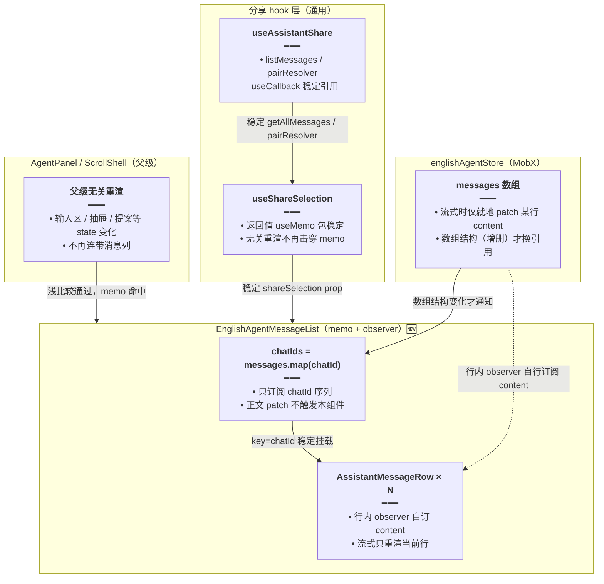

# 英语学习 Agent：消息列订阅收窄与分享态稳定引用

> **延伸阅读**：[英语Agent流式性能隔离.md](./英语Agent流式性能隔离.md)（流式渲染隔离的前置改造）、[英语Agent输入草稿隔离.md](./英语Agent输入草稿隔离.md)（本轮配套的输入侧优化）、[助手分享栏.md](../chat/助手分享栏.md)（分享栏通用实现）。

## 1. 背景与目标

**用户可见问题**：英语学习 Agent 中，两类「不该动的重渲」仍在发生：

1. **消息列整列重挂**：`EnglishAgentMessageList` 被 `memo(observer(...))` 包裹后直接读 `englishAgentStore.messages` 数组。Store 层虽已改为「就地 patch content」，但 `messages.map` 渲染出的每一行在流式期间仍随数组引用变化参与整列 reconciliation，长会话下行数多时代价明显。
2. **memo 被分享态击穿**：`useShareSelection` 每次 render 都返回**新对象字面量**，`useAssistantShare` 内联箭头函数每轮 render 也是新引用。它们作为 prop 传给 `EnglishAgentMessageList` 时，`memo` 的浅比较永远失败——父级任何无关重渲（如输入区 state 变化）都会让整列消息行跟着重渲。

**目标**：

- 消息列只订阅 `chatId` 列表：消息正文变化不再触发列表组件本身重渲（正文由行内 observer 自行订阅）。
- 分享相关 prop 引用稳定：`shareSelection` 对象与 `getAllMessages` / `pairResolver` 回调在父级无关重渲时保持同一引用，`memo` 真正生效。

**若与仓库最新源码不一致，以源码为准。**

---

## 2. 改动范围

| 层级 | 路径 |
|------|------|
| 消息列组件 | `apps/frontend/src/views/englishLearning/agent/EnglishAgentMessageList.tsx` |
| 分享勾选 hook（通用） | `apps/frontend/src/hooks/useShareSelection.ts` |
| 助手分享组装 hook（通用） | `apps/frontend/src/components/design/Assistant/useAssistantShare.tsx` |

---

## 3. 实现思路

1. **订阅粒度收窄到 chatId**：列表组件只 `map` 出 `chatId` 数组；`AssistantMessageRow` 内部本来就是 observer，会自行订阅该行消息的 `content` 等字段。流式 patch 只改某行 `content` 时，列表组件完全不被通知，仅那一行重渲。
2. **返回值 useMemo 化**：`useShareSelection` 把返回的对象字面量包进 `useMemo`，deps 为内部各 state/回调（它们本身已稳定），父级无关重渲时返回同一引用。
3. **回调 useCallback 化**：`useAssistantShare` 把 `getAllMessages`（`listMessages`）与 `pairResolver` 提为 `useCallback`，`resolveSharePair` 改为复用 `listMessages`，三者在非消息变化时引用稳定。

**改动后数据流**：



---

## 4. 关键代码对比与注释

### 4.1 消息列只订阅 `chatId`（`EnglishAgentMessageList.tsx`）

**对比范围**：`EnglishAgentMessageList` 组件体内的 messages 订阅与 map 渲染段。

**改动前** · `apps/frontend/src/views/englishLearning/agent/EnglishAgentMessageList.tsx`（基线，约 L44–L56）

```typescript
// 直接读整个 messages 数组：observer 订阅数组级变化，任何元素字段变化都可能触发本组件重渲
const messages = englishAgentStore.messages;

// 逐条渲染：每次本组件重渲都重新生成全部行元素
return messages.map((m, index) => (
	<AssistantMessageRow
		// key 用 chatId 保持不变
		key={m.chatId}
		selectMessageByChatId={selectEnglishMessageByChatId}
		chatId={m.chatId}
		index={index}
		// 总行数取自 messages 长度
		messagesLength={messages.length}
		// ... 其余 props 未改动 ...
	/>
));
```

**改动后** · `apps/frontend/src/views/englishLearning/agent/EnglishAgentMessageList.tsx`（当前，约 L44–L59）

```typescript
// 只订 chatId 列表：正文就地 patch 不重挂整列；行内 observer 自己订 content
const chatIds = englishAgentStore.messages.map((m) => m.chatId);

// 只按 chatId 序列渲染：某行 content 变化时本组件不被通知，仅该行内部 observer 重渲
return chatIds.map((chatId, index) => (
	<AssistantMessageRow
		// key 仍用 chatId：行实例稳定，React 不重建 DOM
		key={chatId}
		// 行组件按 chatId 自行从 store 找消息并订阅其字段
		selectMessageByChatId={selectEnglishMessageByChatId}
		chatId={chatId}
		index={index}
		// 总行数改取 chatIds 长度，语义同前
		messagesLength={chatIds.length}
		// ... 其余 props 未改动 ...
	/>
));
```

**变更摘要**：订阅对象从「整个 messages 数组」收窄为「chatId 序列」；流式 content patch 不再触发列表组件，整列 reconciliation 消失。

### 4.2 `useShareSelection` 返回值稳定化（`useShareSelection.ts`）

**对比范围**：hook 末尾的 return 语句。

**改动前** · `apps/frontend/src/hooks/useShareSelection.ts`（基线，约 L113–L123）

```typescript
// 每次 render 都返回新对象字面量：作为 prop 传入 memo 子组件时浅比较永远失败
return {
	isSharing,
	setIsSharing,
	checkedMessages,
	setCheckedMessage,
	togglePair,
	replaceCheckedMessages,
	setAllCheckedMessages,
	clearAllCheckedMessages,
	isAllChecked,
	selectedPairCount,
};
```

**改动后** · `apps/frontend/src/hooks/useShareSelection.ts`（当前，约 L113–L140）

```typescript
// 稳定引用：避免父级无关重渲时 MessageList memo 因 shareSelection !== 失效
return useMemo(
	() => ({
		// 分享模式开关 state（useState 返回值，引用随值变）
		isSharing,
		// 开关 setter（useState 派发器，引用恒稳定）
		setIsSharing,
		// 勾选集合 state（Set 引用随勾选操作变）
		checkedMessages,
		// 单条勾选 setter（useCallback 已稳定）
		setCheckedMessage,
		// 整对切换回调（useCallback 已稳定）
		togglePair,
		// 批量替换回调（useCallback 已稳定）
		replaceCheckedMessages,
		// 全选回调（useCallback 已稳定）
		setAllCheckedMessages,
		// 清空回调（useCallback 已稳定）
		clearAllCheckedMessages,
		// 是否全选（useMemo 派生值）
		isAllChecked,
		// 已选对话对数（useMemo 派生值）
		selectedPairCount,
	}),
	[
		// deps：任一字段变化才重建对象，父级无关重渲时返回同一引用
		isSharing,
		setIsSharing,
		checkedMessages,
		setCheckedMessage,
		togglePair,
		replaceCheckedMessages,
		setAllCheckedMessages,
		clearAllCheckedMessages,
		isAllChecked,
		selectedPairCount,
	],
);
```

**变更摘要**：返回对象从「每 render 新建」变为「deps 不变则同引用」；`EnglishAgentMessageList` 的 `shareSelection` prop 不再击穿 memo。

### 4.3 `useAssistantShare` 回调稳定化（`useAssistantShare.tsx`）

**对比范围**：`shareFlow` 组装与 `resolveSharePair` 段。

**改动前** · `apps/frontend/src/components/design/Assistant/useAssistantShare.tsx`（基线，约 L33–L48）

```typescript
const allowAiShare = enabled && Boolean(sessionId);

const shareFlow = useShareFlow<Message>({
	enabled: allowAiShare,
	// 内联箭头函数：每轮 render 新引用，沿 shareFlow 传导击穿下游 memo
	getAllMessages: () => [...readMessages()],
	// 内联 pairResolver：同样是每轮新引用
	pairResolver: (message, all) =>
		resolveSharePairFromList(message, all ?? [...readMessages()]),
});

const { shareSelection } = shareFlow;
// 单条分享预检：内联展开 readMessages，引用随 render 变
const resolveSharePair = useCallback(
	(message: Message): [string, string] | null =>
		resolveSharePairFromList(message, [...readMessages()]),
	[getAllMessages, messages],
);
```

**改动后** · `apps/frontend/src/components/design/Assistant/useAssistantShare.tsx`（当前，约 L33–L58）

```typescript
const allowAiShare = enabled && Boolean(sessionId);

// 稳定的消息列表读取器：deps 为 getAllMessages / messages，非消息变化时引用不变
const listMessages = useCallback(
	() => [...readMessages()],
	[getAllMessages, messages],
);

// 稳定的问答配对解析器：复用 listMessages，避免与 shareFlow 内联版本引用分裂
const pairResolver = useCallback(
	(message: Message, all?: Message[]) =>
		resolveSharePairFromList(message, all ?? listMessages()),
	[listMessages],
);

const shareFlow = useShareFlow<Message>({
	enabled: allowAiShare,
	// 传入稳定引用：useShareFlow 内部 memo/effect 不再每轮失效
	getAllMessages: listMessages,
	// 传入稳定引用：配对解析行为不变
	pairResolver,
});

const { shareSelection } = shareFlow;
// 单条分享预检：复用同一个 listMessages，deps 收敛为单一项
const resolveSharePair = useCallback(
	(message: Message): [string, string] | null =>
		resolveSharePairFromList(message, listMessages()),
	[listMessages],
);
```

**变更摘要**：`getAllMessages` / `pairResolver` / `resolveSharePair` 三处回调全部收敛到同一稳定 `listMessages`；分享链路向消息列传导的 prop 全部通过浅比较。

---

## 5. 兼容性与影响

| 项目 | 说明 |
|------|------|
| **功能行为** | 零变化：勾选、配对、全选、分享预检逻辑一行未改，仅引用稳定性与订阅粒度变化。 |
| **影响面** | `useShareSelection` / `useAssistantShare` 为通用 hook，知识库助手、电子书助手等所有使用方同时受益，无需改动。 |
| **风险点** | `chatIds.map` 仍会在数组结构变化（新消息 push）时重渲整列——这是必要行为；行级 `key=chatId` 保证行实例不重建。 |

## 6. 回归建议

- 英语 Agent 流式输出期间：用 React DevTools Profiler 确认仅当前流式行重渲，列表组件不整列重渲。
- 输入区打字 / 开关历史抽屉 / 提案确认条出现时：消息列不重渲。
- 分享模式：进入分享 → 勾选若干对 → 全选 / 清空 / 取消，行为与之前一致。

## 7. 相关源码路径

| 说明 | 路径 |
|------|------|
| 消息列组件 | `apps/frontend/src/views/englishLearning/agent/EnglishAgentMessageList.tsx` |
| 分享勾选 hook | `apps/frontend/src/hooks/useShareSelection.ts` |
| 助手分享组装 hook | `apps/frontend/src/components/design/Assistant/useAssistantShare.tsx` |
| 行组件（行内 observer） | `apps/frontend/src/components/design/Assistant/AssistantMessageRow.tsx` |
