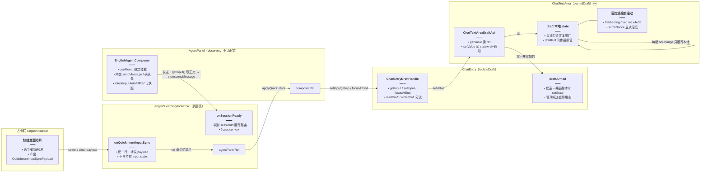
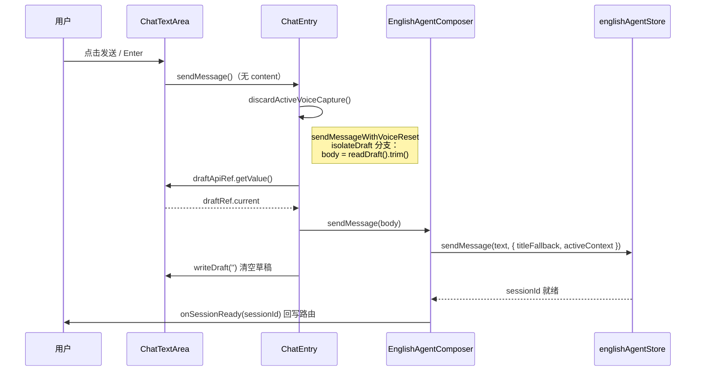

# 英语学习 Agent：输入草稿隔离（打字不卡）

> **延伸阅读**：[英语Agent流式性能隔离.md](./英语Agent流式性能隔离.md)（流式 token 只重渲消息列的前置改造）、[英语Agent消息列稳定渲染.md](./英语Agent消息列稳定渲染.md)（本轮配套的消息列订阅与分享态稳定引用）、[英语学习快捷意图输入.md](./英语学习快捷意图输入.md)（快捷意图填入输入框的原始链路，本轮改为经 `AgentPanelHandle` 透传）。

## 1. 背景与目标

**用户可见问题**：在英语学习 Agent 长会话中打字明显卡顿——每按一个键，输入框正文经 `input` / `setInput` 受控上浮，触发 `ChatEntry` 整树（含工具条、发送钮区、语音逻辑）重渲；同时 `ChatTextArea` 使用 `ScrollArea + field-sizing-content`，每键都可能改变输入框高度，footer 撑高后 flex 挤压消息列，会话 DOM 越大，每次按键引发的整页同步布局越慢。

**目标**：

- 按键不再上浮正文：草稿（draft）落在 `ChatTextArea` 本地，仅「空 ↔ 非空」变化时通知外层更新发送钮禁用态。
- 外部仍需读写正文（快捷意图填入、发送时取正文、发送后清空）：通过 ref handle 命令式读写，不走受控 state。
- 输入框高度固定、内部自滚动：不再每键撑高 footer 挤压消息列。
- 复用该能力的 `ChatEntry` 旧调用方零改动：新行为全部走 opt-in 的 `isolateDraft` / `ownedDraft` 开关。

**若与仓库最新源码不一致，以源码为准。**

---

## 2. 改动范围

| 层级 | 路径 |
|------|------|
| 设计组件（文本域） | `apps/frontend/src/components/design/ChatTextArea/index.tsx` |
| 设计组件（输入条目） | `apps/frontend/src/components/design/ChatEntry/index.tsx` |
| 英语 Agent 面板 | `apps/frontend/src/views/englishLearning/agent/index.tsx` |
| 英语学习页 | `apps/frontend/src/views/englishLearning/index.tsx` |

---

## 3. 实现思路

1. **双层草稿开关**：`ChatTextArea` 提供 `ownedDraft`（正文本地 `useState` 持有），`ChatEntry` 提供 `isolateDraft` 并透传；未开启时保持原受控 `input` 行为，旧调用方（知识库、电子书助手等）零影响。
2. **命令式读写句柄**：`ChatTextArea` 暴露 `ChatTextAreaDraftApi`（`getValue` / `setValue`），`ChatEntry` 再封装为 `ChatEntryDraftHandle`（`getInput` / `setInput` / `focusAtEnd`）经 `draftHandleRef` 暴露给业务层；读值走 `draftRef.current` 而非 state 闭包，保证异步回调里拿到的是最新正文。
3. **空 ↔ 非空才上浮**：`ChatTextArea` 内 `armedRef` 记录「trim 后非空」，仅在布尔翻转时回调 `onArmedChange`；`ChatEntry` 用 `draftArmed` state 驱动发送钮禁用态与语音逻辑，普通按键不触发 `ChatEntry` 重渲。
4. **固定高度 + 自身滚动**：移除 `ScrollArea` 包裹与 `field-sizing-content`（每键撑高会改 footer 高度、flex 挤压消息列），改为固定 `max-h-35 overflow-y-auto`；换行后的「滚到底」改为 `scrollNonce` 显式递增触发，不再每次 value 变化都读 `scrollHeight`（读 `scrollHeight` 会逼浏览器同步 layout）。
5. **Composer 子组件化**：英语 Agent 输入区抽成 `EnglishAgentComposer`（`forwardRef<AgentPanelHandle>`），`AgentPanel` 用 `useMemo` 稳定挂载；快捷意图经 `agentPanelRef → composerRef → draftHandleRef` 命令式写入草稿，不再经页面级 `input` state。
6. **页面瘦身**：`englishLearning/index.tsx` 不再持有 `input` / `sendMessage` / `chatInputRef` / `focusInputAtEndKey`，发送逻辑内收进 Composer；拿到 `sessionId` 后经 `onSessionReady` 回调回写路由参数。

**数据流（改动后）**：



**发送时序（isolateDraft 路径）**：



---

## 4. 关键代码对比与注释

### 4.1 `ChatTextAreaDraftApi` 类型与本地草稿（`ChatTextArea/index.tsx`）

**对比范围**：`ChatTextAreaDraftApi` 类型定义 + 组件内 draft state / `setOwnedDraft` / `useImperativeHandle`（纯新增，无改动前对应代码，按纯新增处理仅贴改动后）。

**改动后** · `apps/frontend/src/components/design/ChatTextArea/index.tsx`（当前，约 L17–L21、L93–L126）

```typescript
/** ownedDraft 时供父级读写正文（发送 / 快捷意图），不经过受控 input 每键上浮 */
export type ChatTextAreaDraftApi = {
	// 读当前正文：走 ref 而非 state 闭包，异步回调里也能拿到最新值
	getValue: () => string;
	// 写正文：同步更新 state（驱动本组件重渲）与 ref（供读取），并按需通知 armed 变化
	setValue: (value: string) => void;
};
```

```typescript
// 本地草稿 state：ownedDraft 时正文只活在本组件，初始值兼容外部传入的 input
const [draft, setDraft] = useState(input ?? '');
// draft 的 ref 镜像：getValue 读它，避免异步回调闭包捕获到旧 state
const draftRef = useRef(draft);
// 每次渲染同步镜像，保证 ref 永远是最新正文
draftRef.current = draft;
// 「trim 后非空」的上次已通知值：只有布尔翻转才回调父级，避免每键重渲 ChatEntry
const armedRef = useRef((input ?? '').trim().length > 0);

// 仅在「空 ↔ 非空」翻转时通知父级（供发送钮禁用态），普通按键不上浮
const notifyArmed = useCallback(
	(value: string) => {
		// 计算当前是否「有内容」（trim 后非空）
		const armed = value.trim().length > 0;
		// 与上次通知值相同则直接返回，阻断每键 setState 链
		if (armed === armedRef.current) return;
		// 记录新的已通知值
		armedRef.current = armed;
		// 回调父级（ChatEntry 的 setDraftArmed）
		onArmedChange?.(armed);
	},
	[onArmedChange],
);

// ownedDraft 模式下的统一写入口：state、ref、armed 通知三件套一次完成
const setOwnedDraft = useCallback(
	(value: string) => {
		// 更新本地 state，触发本组件（仅本组件）重渲
		setDraft(value);
		// 同步 ref 镜像，getValue 立即可读到新值（不等下一次渲染）
		draftRef.current = value;
		// 按需触发空↔非空通知
		notifyArmed(value);
	},
	[notifyArmed],
);

// 把 getValue / setValue 挂到父级传入的 draftApiRef 上，供 ChatEntry 命令式读写
useImperativeHandle(
	draftApiRef,
	() => ({
		// 读正文走 ref 镜像，保证拿到最新值
		getValue: () => draftRef.current,
		// 写正文复用统一入口
		setValue: setOwnedDraft,
	}),
	[setOwnedDraft],
);

// 统一写入函数：ownedDraft 走本地草稿，否则沿用旧受控 setInput（旧调用方不变）
const applyChatInput = ownedDraft ? setOwnedDraft : setInput;
```

**变更摘要**：新增「本地草稿 + 命令式 api + 空↔非空通知」三件套；`applyChatInput` 按开关分流，未开 `ownedDraft` 时行为与旧版完全一致。

### 4.2 `useEntry` 接线与 `value` 分流（`ChatTextArea/index.tsx`）

**对比范围**：`useEntry(...)` 调用块与 `value` 计算。

**改动前** · `apps/frontend/src/components/design/ChatTextArea/index.tsx`（基线，约 L66–L89）

```typescript
const {
	// isComposing,
	handleKeyDown,
	handleCompositionStart,
	handleCompositionEnd,
} = useEntry({
	// 编辑模式标记
	isEdit: mode === 'edit',
	// 发送中禁用 Enter 发送
	loading,
	// 受控正文直接来自父级 input
	input,
	// 每键直接上调父级 setInput，触发 ChatEntry 整树重渲
	setInput,
	// 编辑态消息对象
	editMessage,
	// 编辑态 setter
	setEditMessage,
	// 编辑态 onChange
	handleEditChange,
	// 发送回调
	sendMessage,
	// 透传 textarea ref 供聚焦
	textareaRef: {
		current: ref,
	} as React.RefObject<HTMLTextAreaElement | null>,
});
```

**改动后** · `apps/frontend/src/components/design/ChatTextArea/index.tsx`（当前，约 L128–L154）

```typescript
const {
	// Enter 发送 / Shift+Enter 换行处理
	handleKeyDown,
	// IME 组合输入开始（中文输入法防误发）
	handleCompositionStart,
	// IME 组合输入结束
	handleCompositionEnd,
} = useEntry({
	// 编辑模式标记
	isEdit: mode === 'edit',
	// 发送中禁用 Enter 发送
	loading,
	// ownedDraft 时给 hook 看本地草稿，否则给受控 input；hook 逻辑无需感知开关
	input: ownedDraft ? draft : input,
	// 写入统一走 applyChatInput：ownedDraft 落本地，否则上浮父级
	setInput: applyChatInput,
	// 编辑态消息对象
	editMessage,
	// 编辑态 setter
	setEditMessage,
	// 编辑态 onChange
	handleEditChange,
	// 发送回调
	sendMessage,
	// 透传 textarea ref 供聚焦
	textareaRef: {
		current: ref,
	} as React.RefObject<HTMLTextAreaElement | null>,
});
```

```typescript
// 编辑模式标记
const isEditMode = mode === 'edit';
// 文本域展示值：编辑态看 editMessage；ownedDraft 看本地草稿；否则看受控 input
const value = isEditMode
	? editMessage?.content || ''
	: ownedDraft
		? draft
		: input;
```

**变更摘要**：`useEntry` 的 `input` / `setInput` 入参按 `ownedDraft` 分流到本地草稿，hook 内部（Enter 发送、IME 保护）零改动。

### 4.3 滚动策略：移除 ScrollArea + field-sizing-content（`ChatTextArea/index.tsx`）

**对比范围**：`scrollInputToBottom`、换行后滚动 effect、渲染层容器。

**改动前** · `apps/frontend/src/components/design/ChatTextArea/index.tsx`（基线，约 L91–L131、L143–L174）

```typescript
// ScrollArea 视口 ref：换行后需要同时滚它和原生 textarea
const scrollRef = useRef<HTMLDivElement>(null);

// 换行后滚到底：rAF 两帧各滚一次，兜底布局未稳定
const scrollInputToBottom = () => {
	const scroll = () => {
		// 滚 ScrollArea 视口
		const viewport = scrollRef.current;
		if (viewport) {
			viewport.scrollTop = viewport.scrollHeight;
		}
		// 滚原生 textarea
		const el = typeof ref !== 'function' ? ref?.current : null;
		if (el) {
			el.scrollTop = el.scrollHeight;
		}
	};
	requestAnimationFrame(() => {
		scroll();
		requestAnimationFrame(scroll);
	});
};

// 受控 value 每次变化都跑：读 scrollHeight 逼浏览器同步 layout，长会话每键都卡
useLayoutEffect(() => {
	const el = typeof ref !== 'function' ? ref?.current : null;
	if (!el || document.activeElement !== el) return;
	// 仅光标在末尾才滚（避免打断中间编辑）
	const atEnd =
		el.selectionStart === el.value.length &&
		el.selectionEnd === el.value.length;
	if (!atEnd) return;

	const viewport = scrollRef.current;
	if (viewport) {
		viewport.scrollTop = viewport.scrollHeight;
	}
	el.scrollTop = el.scrollHeight;
	requestAnimationFrame(() => {
		if (viewport) {
			viewport.scrollTop = viewport.scrollHeight;
		}
		el.scrollTop = el.scrollHeight;
	});
}, [value, ref]);
```

```typescript
<ScrollArea
	ref={scrollRef}
	viewportTabIndex={-1}
	className={cn(
		// max-h-35 内 ScrollArea 随内容长高：footer 高度随每键变化，flex 挤压消息列
		'flex max-h-35 w-full flex-col overflow-y-auto border-0',
		className,
	)}
>
	<Textarea
		// ...
		className={cn(
			'flex-1 resize-none border-none shadow-none focus-visible:ring-transparent',
			// ui/Textarea 默认 field-sizing-content：每键重算高度，与 ScrollArea 叠加放大 layout 成本
			textareaClassName ? null : 'min-h-16',
			textareaClassName,
		)}
	/>
</ScrollArea>
```

**改动后** · `apps/frontend/src/components/design/ChatTextArea/index.tsx`（当前，约 L146–L174、L176–L217）

```typescript
/** 仅换行等显式请求时递增；勿每键读 scrollHeight（会逼整页同步 layout） */
const [scrollNonce, setScrollNonce] = useState(0);

// 换行后滚到底：不再立即读 scrollHeight，只递增 nonce 触发下面的 effect
const scrollInputToBottom = useCallback(() => {
	setScrollNonce((n) => n + 1);
}, []);

// Shift+Enter 换行：等受控 value 提交后再滚，避免光标被挡
useLayoutEffect(() => {
	// 首次挂载（nonce=0）不滚，避免无关触发
	if (scrollNonce === 0) return;
	// 仅当焦点仍在文本域时才滚
	const el = typeof ref !== 'function' ? ref?.current : null;
	if (!el || document.activeElement !== el) return;
	// 布局已稳定（固定高度），直接滚原生 textarea 到底
	el.scrollTop = el.scrollHeight;
	// 再补一帧兜底，覆盖极端时序
	requestAnimationFrame(() => {
		el.scrollTop = el.scrollHeight;
	});
}, [scrollNonce, ref]);
```

```typescript
{/*
 * 不用 ScrollArea + field-sizing-content：每键长高会改 footer，
 * flex 挤压消息列，会话 DOM 越大输入越卡。固定高度 + 自身滚动。
 */}
<div
	className={cn('w-full border-0', className)}
	onWheel={onScrollAreaWheel}
	onWheelCapture={onScrollAreaWheelCapture}
>
	<Textarea
		ref={ref}
		id={textareaId}
		value={value}
		maxLength={maxLength}
		onChange={
			// 编辑态走编辑回调；否则走 applyChatInput（ownedDraft 落本地 / 旧受控上浮）
			isEditMode
				? handleEditChange
				: (e) => applyChatInput?.(e.target.value)
		}
		onKeyDown={(e) =>
			handleKeyDown(
				e,
				isEditMode ? editMessage : null,
				scrollInputToBottom,
			)
		}
		// ... 其余 props 未改动 ...
		className={cn(
			'flex-1 resize-none border-none shadow-none focus-visible:ring-transparent',
			// 压过 ui/Textarea 默认 field-sizing-content，避免每键撑高 footer
			'field-sizing-fixed max-h-35 overflow-y-auto',
			textareaClassName ? null : 'min-h-16',
			textareaClassName,
		)}
		disabled={isEditMode ? Boolean(loading) : chatInputDisabled}
	/>
</div>
```

**变更摘要**：容器由 `ScrollArea`（随内容长高）改为固定高度 `div`；`field-sizing-content` 被 `field-sizing-fixed` 压掉；滚动触发由「每次 value 变化」改为「`scrollNonce` 显式递增」，不再每键读 `scrollHeight`。

### 4.4 `ChatEntryDraftHandle` 与读写分流（`ChatEntry/index.tsx`）

**对比范围**：`ChatEntryDraftHandle` 类型、组件内 `readDraft` / `writeDraft` / `focusDraftAtEnd` / `useImperativeHandle`（纯新增，仅贴改动后）。

**改动后** · `apps/frontend/src/components/design/ChatEntry/index.tsx`（当前，约 L119–L124、L208–L253）

```typescript
/** isolateDraft 时：快捷意图 / 外部读写正文，不经由受控 input 每键上浮 */
export type ChatEntryDraftHandle = {
	// 读当前正文（isolateDraft 时转发 ChatTextArea 的 getValue）
	getInput: () => string;
	// 写当前正文（isolateDraft 时转发 setValue，否则走受控 setInput）
	setInput: (value: string) => void;
	// 聚焦并把光标移到末尾（快捷意图填入后使用）
	focusAtEnd: () => void;
};
```

```typescript
// isolateDraft 模式下透传给 ChatTextArea 的 api 容器
const textAreaDraftApiRef = useRef<ChatTextAreaDraftApi | null>(null);
// 发送钮禁用态的唯一上浮通道：仅「空 ↔ 非空」翻转时更新
const [draftArmed, setDraftArmed] = useState(() => input.trim().length > 0);

// 统一读入口：isolateDraft 读 ChatTextArea 本地草稿，否则读受控 input
const readDraft = useCallback(
	() =>
		isolateDraft
			? (textAreaDraftApiRef.current?.getValue() ?? '')
			: input,
	[input, isolateDraft],
);

// 统一写入口：isolateDraft 写 ChatTextArea 本地草稿（不重渲本组件），否则走受控 setInput
const writeDraft = useCallback(
	(value: string) => {
		if (isolateDraft) {
			textAreaDraftApiRef.current?.setValue(value);
			return;
		}
		setInput(value);
	},
	[isolateDraft, setInput],
);

// 聚焦并把光标移到末尾：供快捷意图填入后调用，与 focusInputAtEndKey 同一套 iframe blur 防御
const focusDraftAtEnd = useCallback(() => {
	const el = textareaRef.current;
	if (!el) return;
	const len = el.value.length;
	if (!len) return;
	const active = document.activeElement;
	if (active instanceof HTMLIFrameElement) active.blur();
	el.focus({ preventScroll: true });
	el.setSelectionRange(len, len);
	el.scrollTop = el.scrollHeight;
}, [textareaRef]);

// 把三个命令式方法挂到业务层传入的 draftHandleRef 上
useImperativeHandle(
	draftHandleRef,
	() => ({
		getInput: readDraft,
		setInput: writeDraft,
		focusAtEnd: focusDraftAtEnd,
	}),
	[focusDraftAtEnd, readDraft, writeDraft],
);
```

**变更摘要**：新增「读写分流 + 命令式句柄」层；`readDraft` / `writeDraft` 后续替代所有直接读 `input` / 调 `setInput` 的发送与语音路径。

### 4.5 发送入口 `sendMessageWithVoiceReset`（`ChatEntry/index.tsx`）

**对比范围**：`sendMessageWithVoiceReset` 全函数。

**改动前** · `apps/frontend/src/components/design/ChatEntry/index.tsx`（基线，约 L572–L583）

```typescript
const sendMessageWithVoiceReset = useCallback(
	async (
		content?: string,
		index?: number,
		isEdit?: boolean,
		attachments?: any,
	) => {
		// 发送前先终止并清理录音/语音状态，保证不会有悬挂的录音会话
		await discardActiveVoiceCapture();
		// 调用主发送方法，完成文本/附件正式发送
		sendMessage(content, index, isEdit, attachments);
	},
	[discardActiveVoiceCapture, sendMessage],
);
```

**改动后** · `apps/frontend/src/components/design/ChatEntry/index.tsx`（当前，约 L629–L653）

```typescript
const sendMessageWithVoiceReset = useCallback(
	async (
		content?: string,
		index?: number,
		isEdit?: boolean,
		attachments?: any,
	) => {
		// 发送前先终止并清理录音/语音状态，保证不会有悬挂的录音会话
		await discardActiveVoiceCapture();
		// isolateDraft：正文在 ChatTextArea 本地，需显式取出并作为 content 传给上层
		if (isolateDraft) {
			// 优先用调用方显式给的 content，否则读本地草稿；统一 trim
			const body = (content ?? readDraft()).trim();
			// 空串传 undefined，让上层走「无内容不发送」的既有分支
			sendMessage(body || undefined, index, isEdit, attachments);
			// 发送后清空本地草稿（受控模式下由上层 setInput('') 完成，这里必须自理）
			writeDraft('');
			return;
		}
		// 旧受控路径：原样透传
		sendMessage(content, index, isEdit, attachments);
	},
	[
		discardActiveVoiceCapture,
		isolateDraft,
		readDraft,
		sendMessage,
		writeDraft,
	],
);
```

**变更摘要**：isolateDraft 分支负责「取正文 → 传入 → 清空本地」；受控路径一行未变。

### 4.6 语音回填与「清空即停录」改走 draft（`ChatEntry/index.tsx`）

**对比范围**：Tauri 语音回填 `writeDraft` 替换、`voiceBaseRef` 取值、`prevInputTrimRef` 效果 hook。

**改动前** · `apps/frontend/src/components/design/ChatEntry/index.tsx`（基线，约 L424–L428、L471、L642–L661）

```typescript
// 语音实时回填：直接上调 setInput，每帧识别结果都触发 ChatEntry 重渲
setInput(base ? `${base} ${text}`.trim() : text);
```

```typescript
// 录音前取当前输入内容作为语音识别前缀：直接读受控 input
voiceBaseRef.current = input.trim();
```

```typescript
/** Tauri：输入从非空变为空时停止当前录音/转写（保持语音输入模式） */
const prevInputTrimRef = useRef('');
useEffect(() => {
	if (!isTauriRuntime()) {
		// 非 Tauri 只同步快照
		prevInputTrimRef.current = input.trim();
		return;
	}
	const prev = prevInputTrimRef.current;
	// 依赖受控 input：每键变化都跑本 effect
	const cur = input.trim();
	const hasActiveVoiceSession =
		voiceRecordingRef.current ||
		voiceRecording ||
		voiceTranscribing ||
		mediaRecorderRef.current?.state === 'recording';
	// 非空 → 空 且有录音会话时丢弃录音
	if (prev.length > 0 && cur.length === 0 && hasActiveVoiceSession) {
		void discardActiveVoiceCapture();
	}
	prevInputTrimRef.current = cur;
}, [input, discardActiveVoiceCapture, voiceRecording, voiceTranscribing]);
```

**改动后** · `apps/frontend/src/components/design/ChatEntry/index.tsx`（当前，约 L426–L428、L474、L717–L741）

```typescript
// 语音实时回填：走 writeDraft 分流——isolateDraft 落本地草稿，不再每帧重渲 ChatEntry
writeDraft(base ? `${base} ${text}`.trim() : text);
```

```typescript
// 录音前取当前输入内容作为语音识别前缀：改走统一读入口，兼容两种草稿模式
voiceBaseRef.current = readDraft().trim();
```

```typescript
/** Tauri：输入从非空变为空时停止当前录音/转写（保持语音输入模式） */
const prevInputTrimRef = useRef('');
// isolateDraft 时用 draftArmed 折算『有/无内容』，避免依赖每键变化的 input
const draftPresence = isolateDraft ? (draftArmed ? 'x' : '') : input.trim();
useEffect(() => {
	if (!isTauriRuntime()) {
		// 非 Tauri 只同步快照
		prevInputTrimRef.current = draftPresence;
		return;
	}
	const prev = prevInputTrimRef.current;
	// 只在空↔非空翻转时变化的字符串，本 effect 不再随每键执行
	const cur = draftPresence;
	const hasActiveVoiceSession =
		voiceRecordingRef.current ||
		voiceRecording ||
		voiceTranscribing ||
		mediaRecorderRef.current?.state === 'recording';
	// 非空 → 空 且有录音会话时丢弃录音
	if (prev.length > 0 && cur.length === 0 && hasActiveVoiceSession) {
		void discardActiveVoiceCapture();
	}
	prevInputTrimRef.current = cur;
}, [
	draftPresence,
	discardActiveVoiceCapture,
	voiceRecording,
	voiceTranscribing,
]);
```

**变更摘要**：语音相关三处全部改走 draft 抽象；「清空停录」effect 的触发频率从「每键」降为「空↔非空翻转」。

### 4.7 发送钮禁用态与主按钮逻辑（`ChatEntry/index.tsx`）

**对比范围**：`handleSendOrVoicePrimary` 内判空分支、`hasDraftText` 与 `sendDisabled`。

**改动前** · `apps/frontend/src/components/design/ChatEntry/index.tsx`（基线，约 L686–L745）

```typescript
// 若输入框当前已有内容（由语音识别或手动输入），主按钮视为“发送”
if (input.trim()) {
	// 有内容则发送，并重置语音相关状态
	await sendMessageWithVoiceReset();
	// 发送后重新聚焦输入框
	textareaRef.current?.focus();
	return;
}
```

```typescript
/** 语音模式空闲但输入框有内容时，主按钮展示为发送 */
const voicePrimaryShowsSend =
	voiceUiActive &&
	!voiceRecording &&
	!voiceTranscribing &&
	input.trim() !== '';

// 主发送钮禁用条件（分支顺序与原先嵌套三元一致，勿调换）
const sendDisabled = useMemo(() => {
	const busy = loading ?? false;
	const locked = disableTextInput ?? false;
	// 依赖受控 input：每键变化都重算
	const empty = !input.trim();
	// ... 分支未改动 ...
}, [
	disableTextInput,
	input,
	loading,
	voiceRecording,
	voicePrimaryShowsSend,
	voiceTranscribing,
	voiceUiActive,
]);
```

**改动后** · `apps/frontend/src/components/design/ChatEntry/index.tsx`（当前，约 L766–L826）

```typescript
// 若输入框当前已有内容（由语音识别或手动输入），主按钮视为“发送”
if (readDraft().trim()) {
	// 有内容则发送，并重置语音相关状态
	await sendMessageWithVoiceReset();
	// 发送后重新聚焦输入框
	textareaRef.current?.focus();
	return;
}
```

```typescript
/** 语音模式空闲但输入框有内容时，主按钮展示为发送 */
// isolateDraft 用 draftArmed（空↔非空布尔），受控模式仍用 input.trim()，两者语义一致
const hasDraftText = isolateDraft ? draftArmed : input.trim() !== '';
const voicePrimaryShowsSend =
	voiceUiActive &&
	!voiceRecording &&
	!voiceTranscribing &&
	hasDraftText;

// 主发送钮禁用条件（分支顺序与原先嵌套三元一致，勿调换）
const sendDisabled = useMemo(() => {
	const busy = loading ?? false;
	const locked = disableTextInput ?? false;
	// 用 hasDraftText：isolateDraft 时只在空↔非空翻转时重算，不再每键 memo 失效
	const empty = !hasDraftText;
	// ... 分支未改动 ...
}, [
	disableTextInput,
	hasDraftText,
	loading,
	voiceRecording,
	voicePrimaryShowsSend,
	voiceTranscribing,
	voiceUiActive,
]);
```

**变更摘要**：所有「是否有内容」判断收口到 `hasDraftText` / `readDraft()`；`sendDisabled` 的 memo 不再随每键失效。

### 4.8 向 `ChatTextArea` 透传草稿开关（`ChatEntry/index.tsx`）

**对比范围**：渲染中 `<ChatTextArea>` 的 props 段。

**改动前** · `apps/frontend/src/components/design/ChatEntry/index.tsx`（基线，约 L850 附近）

```typescript
<ChatTextArea
	ref={textareaRef}
	input={input}
	setInput={setInput}
	// ... 其余 props 未改动 ...
	textareaClassName={textareaClassName}
	disableTextInput={disableTextInput}
	t={t}
/>
```

**改动后** · `apps/frontend/src/components/design/ChatEntry/index.tsx`（当前，约 L925–L936）

```typescript
<ChatTextArea
	ref={textareaRef}
	input={input}
	setInput={setInput}
	// ... 其余 props 未改动 ...
	textareaClassName={textareaClassName}
	disableTextInput={disableTextInput}
	t={t}
	// 把 isolateDraft 映射为 ChatTextArea 的 ownedDraft：正文本地持有
	ownedDraft={isolateDraft}
	// 命令式读写 api 容器：readDraft/writeDraft 的数据源
	draftApiRef={textAreaDraftApiRef}
	// 空↔非空翻转通知：直接 set 到 ChatEntry 的 draftArmed state
	onArmedChange={setDraftArmed}
/>
```

**变更摘要**：三个新 prop 完成「开关 + api + 通知」接线；未传 `isolateDraft` 时这三个 prop 均为默认值，行为不变。

### 4.9 `EnglishAgentComposer`：输入区内收（`agent/index.tsx`）

**对比范围**：`EnglishAgentComposer` 组件整体（纯新增，摘录核心：句柄实现与发送）。

**改动后** · `apps/frontend/src/views/englishLearning/agent/index.tsx`（当前，约 L375–L460）

```typescript
/**
 * 输入区：ChatEntry isolateDraft → 正文只在 ChatTextArea 本地，按键不重渲 Composer/工具条。
 * 快捷意图走 draftHandleRef；发送在内部完成并回调 onSessionReady。
 */
const EnglishAgentComposer = forwardRef<
	AgentPanelHandle,
	{
		// ... props 类型：isLoggedIn / isHistoryDrawerOpen / 滚动控制 / onNewChat / onSessionReady / 提案确认等 ...
	}
>(function EnglishAgentComposer(
	{
		isLoggedIn,
		isHistoryDrawerOpen,
		setIsHistoryDrawerOpen,
		enableStickToBottom,
		flushScrollToBottom,
		onNewChat,
		onSessionReady,
		pendingProposal,
		proposalCommitting,
		confirmPendingProposal,
	},
	ref,
) {
	const { t } = useI18n();
	// ChatEntry 命令式句柄：读写草稿、聚焦末尾都经它
	const draftHandleRef = useRef<ChatEntryDraftHandle | null>(null);
	// 记录最近一次快捷意图自动填入的展示名，取消选中时精确剥离
	const intentInputAutoFillRef = useRef<string | null>(null);
	// 发送中与流式标志：驱动 loading 与停止钮
	const isSending = useEnglishAgentIsSending();
	const isStreaming = useEnglishAgentIsStreaming();

	// 暴露给 AgentPanel（再透传给页面）：快捷意图选中/取消的输入框联动
	useImperativeHandle(
		ref,
		() => ({
			applyQuickIntent(payload) {
				// 选中：记录快照、写入 chip 文案、聚焦到末尾
				if (payload.mode === 'select') {
					intentInputAutoFillRef.current = payload.label;
					draftHandleRef.current?.setInput(payload.label);
					draftHandleRef.current?.focusAtEnd();
					return;
				}
				// 取消：取出快照并清空记录
				const snap = intentInputAutoFillRef.current;
				intentInputAutoFillRef.current = null;
				// 无快照说明不是自动填入的，不动用户正文
				if (!snap) return;
				// 读当前草稿，剥离开头的自动填入段（保留用户追加内容）
				const prev = draftHandleRef.current?.getInput() ?? '';
				draftHandleRef.current?.setInput(
					stripAutoFilledIntentName(prev, snap),
				);
			},
		}),
		[],
	);

	// 发送：从草稿句柄取正文（或调用方显式传入），完成后回调路由回写
	const sendMessage = useCallback(
		async (content?: string) => {
			// 优先显式 content，否则读本地草稿；空则不发
			const text = (content ?? draftHandleRef.current?.getInput() ?? '').trim();
			if (!text) return;
			// 清空自动填入快照，避免与下轮 chip 错位
			intentInputAutoFillRef.current = null;
			// 发送时开启贴底，回走私信时视图跟随
			enableStickToBottom();
			// 会话标题回退链：已有标题 → 首条消息摘要（36 字截断）→ 路由默认名
			const sessionTitle = englishAgentStore.sessionTitle?.trim();
			const collapsed = text.replace(/\s+/g, ' ');
			const synopsis =
				collapsed.length > 36 ? `${collapsed.slice(0, 36)}…` : collapsed;
			// activeContext 告知后端当前路由与挂起的快捷意图前缀
			const activeContext = JSON.stringify({
				route: '/english-learning',
				intent: englishAgentStore.pendingIntentPrefix || undefined,
			});
			await englishAgentStore.sendMessage(text, {
				titleFallback:
					sessionTitle || synopsis || t('route.englishLearning.title'),
				activeContext,
			});
			// 新会话拿到 sessionId 后回调页面回写 ?session= 参数
			if (englishAgentStore.sessionId) {
				onSessionReady?.(englishAgentStore.sessionId);
			}
		},
		[enableStickToBottom, onSessionReady, t],
	);

	// 渲染：提案确认条 + isolateDraft 版 ChatEntry（input 恒空串、setInput 为 noop，正文全在本地）
	return (
		<div className="flex w-full flex-col gap-2">
			{/* pendingProposal 确认条与旧版一致，略 */}
			<ChatEntry
				t={t}
				// 受控 input 恒为空串：开启 isolateDraft 后该值不参与展示
				input=""
				// noop：受控写入口封死，所有写入走 draftHandleRef
				setInput={noopSetInput}
				// 开启草稿隔离
				isolateDraft
				// 命令式句柄容器
				draftHandleRef={draftHandleRef}
				maxWidth={AGENT_MAX_WIDTH}
				className="w-full px-0 pb-4.5 backdrop-blur-none"
				textareaClassName="min-h-12 rounded-md"
				inputWrapClassName="border-theme/5 bg-theme/5"
				sendMessage={sendMessage}
				placeholder={t('englishLearning.placeholder')}
				disableTextInput={false}
				loading={isSending}
				stopGenerating={isStreaming ? stopGenerating : undefined}
				entryChildren={entryChildren}
			/>
		</div>
	);
});
```

**变更摘要**：快捷意图联动、发送、路由回写全部内收到 Composer；`ChatEntry` 以 `input="" + noopSetInput + isolateDraft` 的「纯本地草稿」形态挂载。

### 4.10 `AgentPanel` 改为 forwardRef + footer 拆分（`agent/index.tsx`）

**对比范围**：`AgentPanel` 组件签名与 `footerBody` 组装段。

**改动前** · `apps/frontend/src/views/englishLearning/agent/index.tsx`（基线，约 L369–L590 摘录）

```typescript
/** observer 仅用于 userStore 等非流式字段；勿在 render 读 messages / content */
export const AgentPanel = observer(function AgentPanel({
	// 受控正文（页面级 state，每键上浮导致整页重渲）
	input,
	setInput,
	// 输入框 ref（页面传入）
	chatInputRef,
	// 快捷意图填入后聚焦末尾的递增 key
	focusInputAtEndKey = 0,
	// 页面实现的发送逻辑
	sendMessage,
	onNewChat,
}: AgentPanelProps) {
	// ... hooks 与旧版一致 ...

	// footerBody 把输入区、确认条、分享条全塞进一个 useMemo
	const footerBody = useMemo(() => {
		if (allowAiShare && shareSelection.isSharing) {
			return (
				<EnglishAgentShareBar
					shareSelection={shareSelection}
					shareFlow={shareFlow}
					setShareModelVisible={setShareModelVisible}
				/>
			);
		}
		return (
			<div className="flex w-full flex-col gap-2">
				{/* pendingProposal 确认条 */}
				<ChatEntry
					t={t}
					chatInputRef={chatInputRef}
					input={input}
					setInput={setInput}
					focusInputAtEndKey={focusInputAtEndKey}
					sendMessage={handleSendMessage}
					// ... 其余 props ...
				/>
			</div>
		);
	}, [
		// deps 含 input：每键变化 footerBody 重建，ChatEntry 重新挂载
		allowAiShare,
		shareSelection,
		shareFlow,
		setShareModelVisible,
		t,
		chatInputRef,
		input,
		setInput,
		focusInputAtEndKey,
		handleSendMessage,
		isSending,
		isStreaming,
		isLoggedIn,
		isHistoryDrawerOpen,
		enableStickToBottomStable,
		flushScrollToBottomStable,
		handleNewChat,
		pendingProposal,
		proposalCommitting,
		confirmPendingProposal,
	]);

	return (
		<EnglishAgentScrollShell
			scrollControlsRef={scrollControlsRef}
			footerBody={footerBody}
			// ... 其余 props ...
		/>
	);
});
```

**改动后** · `apps/frontend/src/views/englishLearning/agent/index.tsx`（当前，约 L548–L706 摘录）

```typescript
/** observer 仅用于 userStore 等非流式字段；勿在 render 读 messages / content */
export const AgentPanel = observer(
	// forwardRef：向页面暴露 applyQuickIntent（快捷意图写入草稿）
	forwardRef<AgentPanelHandle, AgentPanelProps>(function AgentPanel(
		{ onNewChat, onSessionReady },
		ref,
	) {
		// ... hooks 与旧版一致 ...
		// Composer 句柄：透传快捷意图 payload
		const composerRef = useRef<AgentPanelHandle>(null);

		// 页面侧 agentPanelRef.applyQuickIntent → 转发给 Composer
		useImperativeHandle(
			ref,
			() => ({
				applyQuickIntent(payload) {
					composerRef.current?.applyQuickIntent(payload);
				},
			}),
			[],
		);

		/** Composer 与 draft 稳定挂载；分享条单独走非 memo 路径以免勾选态过期 */
		const composerFooter = useMemo(
			() => (
				<EnglishAgentComposer
					ref={composerRef}
					isLoggedIn={isLoggedIn}
					isHistoryDrawerOpen={isHistoryDrawerOpen}
					setIsHistoryDrawerOpen={setIsHistoryDrawerOpen}
					enableStickToBottom={enableStickToBottomStable}
					flushScrollToBottom={flushScrollToBottomStable}
					onNewChat={handleNewChat}
					onSessionReady={onSessionReady}
					pendingProposal={pendingProposal}
					proposalCommitting={proposalCommitting}
					confirmPendingProposal={confirmPendingProposal}
				/>
			),
			[
				// deps 全部低频：登录态 / 抽屉开关 / 提案 / 稳定回调；正文不再是依赖
				isLoggedIn,
				isHistoryDrawerOpen,
				enableStickToBottomStable,
				flushScrollToBottomStable,
				handleNewChat,
				onSessionReady,
				pendingProposal,
				proposalCommitting,
				confirmPendingProposal,
			],
		);

		// 分享态走独立 observer 的 ShareBar（不 memo，避免勾选态过期）；否则稳定挂载的 Composer
		const footerBody =
			allowAiShare && shareSelection.isSharing ? (
				<EnglishAgentShareBar
					shareSelection={shareSelection}
					shareFlow={shareFlow}
					setShareModelVisible={setShareModelVisible}
				/>
			) : (
				composerFooter
			);

		return (
			<EnglishAgentScrollShell
				scrollControlsRef={scrollControlsRef}
				footerBody={footerBody}
				// ... 其余 props 与旧版一致 ...
			/>
		);
	}),
);
```

**变更摘要**：`AgentPanel` 不再接收 `input / setInput / chatInputRef / focusInputAtEndKey / sendMessage` 五个 prop；输入区经 `composerFooter` 稳定挂载，分享条从 memo 中拆出避免勾选态引用过期。

### 4.11 页面壳瘦身（`englishLearning/index.tsx`）

**对比范围**：`EnglishLearning` 组件的 state 与回调段（摘录）。

**改动前** · `apps/frontend/src/views/englishLearning/index.tsx`（基线，约 L20–L95 摘录）

```typescript
const EnglishLearning = observer(function EnglishLearning() {
	const { t } = useI18n();
	const [searchParams, setSearchParams] = useSearchParams();
	// 页面级受控正文：每键 setState → 整个英语学习页（含左侧栏）重渲
	const [input, setInput] = useState('');
	/** Agent 输入框（ChatTextArea），快捷意图填入后用于自动聚焦 */
	const chatInputRef = useRef<HTMLTextAreaElement | null>(null);
	/** 递增后 ChatEntry 将光标置于文本末尾 */
	const [focusInputAtEndKey, setFocusInputAtEndKey] = useState(0);
	/** 当前由快捷意图自动填入输入框的展示名，用于取消选中时精确移除 */
	const intentInputAutoFillRef = useRef<string | null>(null);

	// 快捷意图联动：直接改页面级 input state
	const onQuickIntentInputSync = useCallback(
		(payload: QuickIntentInputSyncPayload) => {
			if (payload.mode === 'select') {
				intentInputAutoFillRef.current = payload.label;
				setInput(payload.label);
				setFocusInputAtEndKey((k) => k + 1);
				return;
			}
			const snap = intentInputAutoFillRef.current;
			intentInputAutoFillRef.current = null;
			if (!snap) return;
			setInput((prev) => stripAutoFilledIntentName(prev, snap));
		},
		[],
	);

	// 页面级发送逻辑：读 input、拼标题、调 store、回写路由
	const sendMessage = useCallback(async () => {
		const text = input.trim();
		if (!text) return;
		intentInputAutoFillRef.current = null;
		setInput('');
		// ... 标题与 activeContext 组装 ...
		await englishAgentStore.sendMessage(text, { /* ... */ });
		if (englishAgentStore.sessionId) {
			setSearchParams(
				{ session: englishAgentStore.sessionId },
				{ replace: true },
			);
		}
	}, [input, setSearchParams, t]);

	// 渲染：五个 prop 传给 AgentPanel
	<AgentPanel
		input={input}
		setInput={setInput}
		chatInputRef={chatInputRef}
		focusInputAtEndKey={focusInputAtEndKey}
		sendMessage={sendMessage}
		onNewChat={onNewChat}
	/>
});
```

**改动后** · `apps/frontend/src/views/englishLearning/index.tsx`（当前，约 L21–L113 摘录）

```typescript
const EnglishLearning = observer(function EnglishLearning() {
	const [searchParams, setSearchParams] = useSearchParams();
	// 仅保留 AgentPanel 句柄：快捷意图透传的唯一通道
	const agentPanelRef = useRef<AgentPanelHandle>(null);

	// 快捷意图联动：不再碰 state，命令式转发给 AgentPanel → Composer → 草稿
	const onQuickIntentInputSync = useCallback(
		(payload: QuickIntentInputSyncPayload) => {
			agentPanelRef.current?.applyQuickIntent(payload);
		},
		[],
	);

	// 发送成功拿到 sessionId 后回写路由（发送逻辑已内收进 Composer）
	const onSessionReady = useCallback(
		(sessionId: string) => {
			setSearchParams({ session: sessionId }, { replace: true });
		},
		[setSearchParams],
	);

	// 渲染：只剩 ref 与两个低频回调
	<AgentPanel
		ref={agentPanelRef}
		onNewChat={onNewChat}
		onSessionReady={onSessionReady}
	/>
});
```

**变更摘要**：页面壳删掉 `input` / `chatInputRef` / `focusInputAtEndKey` / `intentInputAutoFillRef` / `sendMessage` 五块状态与逻辑；按键路径上页面级组件彻底退出重渲。

---

## 5. 兼容性与影响

| 项目 | 说明 |
|------|------|
| **旧调用方** | `ChatEntry` / `ChatTextArea` 新 prop 全部可选且默认关闭；知识库助手、电子书助手等未传 `isolateDraft` 的调用方行为零变化。 |
| **行为变化** | 仅英语学习 Agent：输入时左侧栏与消息列不再随按键重渲；输入框超出 `max-h-35` 后内部滚动而非继续撑高。 |
| **focusInputAtEndKey** | 保留且兼容 isolateDraft（判空改读 DOM value）；英语 Agent 已改用 `focusAtEnd()`，其它调用方不受影响。 |
| **语音输入（Tauri）** | 回填、前缀快照、清空停录全部改走 draft 抽象，功能一致；Web 端无语音路径不受影响。 |
| **风险点** | `draftRef.current = draft` 依赖每次渲染同步，若未来引入并发渲染需注意 ref 镜像时序；`noopSetInput` 下若有遗漏的受控写路径会静默无效（发送后清空已显式走 `writeDraft('')`）。 |

## 6. 回归建议

- 英语 Agent：长会话（>50 条消息）中快速连续打字，观察消息列/左侧栏无抖动、发送钮随首字符输入立即可用。
- 快捷意图：选中 chip → 输入框填入并聚焦末尾；追加文字后取消 → 仅移除 chip 文案；再次发送后快照不残留。
- 换行：Shift+Enter 多行输入超过 `max-h-35` 后文本域内部滚动，footer 高度不变。
- 发送：Enter 发送后输入框清空、路由出现 `?session=`；流式期间继续打字无卡顿。
- 其它 ChatEntry 调用方（知识库助手、电子书助手）：输入、发送、编辑模式均与之前一致。

## 7. 相关源码路径

| 说明 | 路径 |
|------|------|
| 文本域草稿实现 | `apps/frontend/src/components/design/ChatTextArea/index.tsx` |
| 输入条目读写分流 | `apps/frontend/src/components/design/ChatEntry/index.tsx` |
| Agent 输入区 Composer | `apps/frontend/src/views/englishLearning/agent/index.tsx` |
| 页面壳 | `apps/frontend/src/views/englishLearning/index.tsx` |
| 配套：消息列稳定渲染 | [英语Agent消息列稳定渲染.md](./英语Agent消息列稳定渲染.md) |
