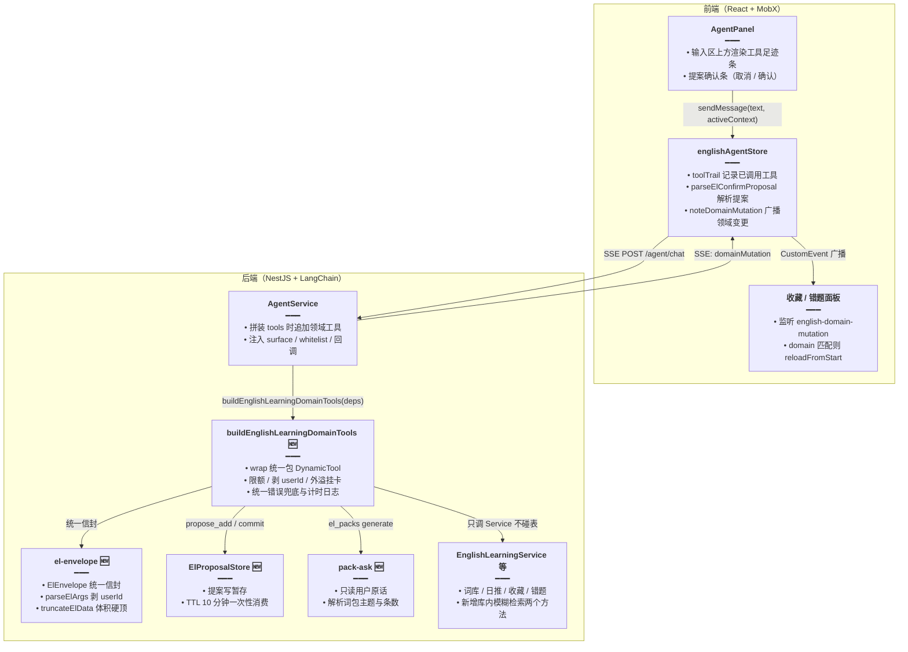
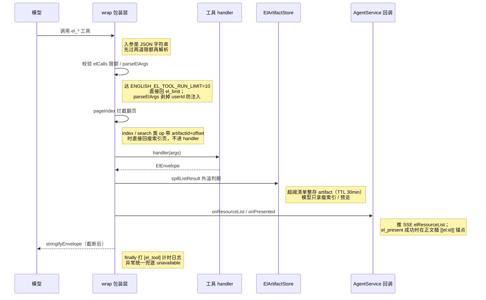

# 英语 Agent 领域工具（el_*）

> **路径**：领域工具已迁到 `apps/backend/src/services/agent/tools/english/`。左侧功能如何接上 Agent，以 [英语Agent侧栏融合.md](./英语Agent侧栏融合.md) 为准。下文代码块里的 `el-envelope.ts`、`english-learning-domain-tools.ts` 等是迁前文件名。
>
> 相关文档：
> - 规划稿：[Agent 词句生成](../../ideas/english/Agent词句生成.md)、[Agent 笔记检索](../../ideas/english/Agent笔记检索.md)、[清单索引可筛选](../../ideas/english/清单索引可筛选.md)、[英语 Agent 关联侧栏](../../ideas/english/英语Agent关联侧栏.md)
> - 已有专题：[英语 Agent 联网次数封顶](./英语Agent联网次数封顶.md)、[英语学习快捷意图输入](./英语学习快捷意图输入.md)
> - 姊妹功能：[Agent 大结果旁路展示](./Agent大结果旁路展示.md)、[整库问法稳定出卡](./整库问法稳定出卡.md)、[每日阅读 Agent 自选生成](./每日阅读Agent自选生成.md)
> - 后继更新（2026-10-29）：[词句分类列出](./词句分类列出.md)、[分类截断续批](./分类截断续批.md)、[决策改用千问](./决策改用千问.md)、[筛选卡续答与整类收藏](./筛选卡续答与整类收藏.md)、[确认条按会话隔离](./确认条按会话隔离.md)

## 1. 背景与目标

英语侧栏 Agent（`assistMode=english_learning`）此前只有通用工具（联网检索、知识库检索、日期），模型想查用户的词库、收藏、错题、每日阅读时只能联网猜测或空答。本轮为英语 Agent 注册 10 个 `el_*` 领域工具，统一走内部 Service，把「用户的英语学习数据」变成模型可调用的结构化能力。

目标：

- 侧栏业务数据（词库、语料库、日推、收藏、复习、记词、错题、词包、笔记）全部可通过 `el_*` 工具读写，禁止模型先联网再猜用户库内容。
- 所有工具返回统一信封 `ElEnvelope`（`ok/code/message/data/meta/ui`），失败时模型看 `code/message` 用人话解释，不伪造数据。
- 大列表不回填模型上下文，外溢为「清单卡片」（artifact），模型只拿到瘦索引或预览（与外溢相关的 spill 逻辑详见 [Agent 大结果旁路展示](./Agent大结果旁路展示.md)）。
- 写操作（收藏、错题）走「提案 → 用户确认 → commit」两段流程，提案存缓存、10 分钟过期、一次性消费。
- 生成类操作（词包生成、每日阅读自选生成）只读用户原话解析主题与条数，不信任模型填的参数。

## 2. 改动范围

本轮该功能涉及以下文件（仓库相对路径）：

| 文件 | 改动 | 作用 |
| --- | --- | --- |
| `apps/backend/src/services/agent/el-envelope.ts` | 新增 | 统一信封、入参解析、data 截断 |
| `apps/backend/src/services/agent/el-proposal.store.ts` | 新增 | 写操作提案暂存（CACHE_MANAGER，TTL 10 分钟） |
| `apps/backend/src/services/agent/english-learning-domain-tools.ts` | 新增 | 10 个 `el_*` 工具工厂（DynamicTool） |
| `apps/backend/src/services/agent/pack-ask.ts` | 新增 | 词包生成原话解析（主题/条数，只读用户原话） |
| `apps/backend/src/services/agent/agent.prompt.ts` | 修改 | 英语系统提示第 6~9 条：el_* 优先与工具地图 |
| `apps/backend/src/services/agent/agent-middleware.ts` | 修改 | 英语 runLimit 8→16，新增 el 分项限额常量，图步 45→56 |
| `apps/backend/src/services/agent/dto/agent-chat.dto.ts` | 修改 | 新增 `activeContext` 字段（侧栏上下文，不入库） |
| `apps/backend/src/services/agent/agent.module.ts` | 修改 | 装配 EnglishLearningModule / LearningNotesModule 与两个 Store |
| `apps/backend/src/services/english-learning/english-learning.module.ts` | 修改 | 导出 DailyReadingService 与 StreamAbortRegistry |
| `apps/backend/src/services/english-learning/english-learning.service.ts` | 修改 | 新增两个库内模糊检索方法 |
| `apps/backend/src/services/learning-notes/learning-notes.module.ts` | 修改 | 导出 LearningNotesService |
| `apps/frontend/src/store/englishAgent.ts` | 修改 | 工具足迹 chips、提案解析、领域变更广播、activeContext 透传 |
| `apps/frontend/src/views/englishLearning/agent/index.tsx` | 修改 | ToolTrailBar 工具足迹条、提案确认条 |
| `apps/frontend/src/views/englishLearning/agent/useEnglishAgentSignals.ts` | 修改 | `useEnglishAgentToolTrail` / `useEnglishAgentPendingProposal` |
| `apps/frontend/src/views/englishLearning/index.tsx` | 修改 | 发送时拼 `activeContext`（route + intent） |
| `apps/frontend/src/views/englishLearning/favorites/{classic,vocabulary}/index.tsx` | 修改 | 监听 `english-domain-mutation` 自动刷新 |
| `apps/frontend/src/views/englishLearning/mistakes/{classic/ClassicQuoteMistakesPanel,vocabulary/VocabularyMistakesPanel}.tsx` | 修改 | 同上（domain=mistakes，复习态守卫） |
| `apps/frontend/src/i18n/locales/{zh-CN,en-US}/englishLearning.ts` | 修改 | 工具足迹文案 |

## 3. 实现思路

### 3.1 总体架构



### 3.2 单次工具调用时序



要点：

- **统一信封**：工具返回给模型的字符串必须是 `JSON.stringify(ElEnvelope)`；`stringifyEnvelope` 在序列化前再做一次体积截断，保证模型上下文不被大列表打爆。
- **限额双闸**：LangChain 中间件 `runLimit`（英语 16）管住所有工具总次数；领域工厂内 `ENGLISH_EL_TOOL_RUN_LIMIT=10` / `ENGLISH_EL_WRITE_RUN_LIMIT=5` 再对 el 工具与写操作分别封顶。
- **写白名单**：`harvestWhitelist` 把本轮 el 工具返回过的词面/原句收进 `whitelist`，`el_favorites` 的直写 `add` 只允许写白名单内的词，防止模型凭空造数据写入。
- **只读原话的生成参数**：`el_packs generate` 的主题与条数由 `parsePackAsk(userText)` 解析，模型填的 `topic/count` 一律忽略，条数缺省 100（`AGENT_PACK_COUNT`）。

## 4. 关键代码与注释

### 4.1 统一信封与入参解析（`el-envelope.ts`，新增）

> 来源：`apps/backend/src/services/agent/el-envelope.ts`（新增文件，约 L1-L60）——改动后

```typescript
/**
 * 英语学习领域工具统一信封与入参解析（M0）。
 * 工具返回给模型的字符串必须是 JSON.stringify(ElEnvelope)。
 */

// 错误码全集：模型按 code 分支向用户解释，禁止伪造数据
export type ElCode =
	// 入参不是合法 JSON 对象
	| 'bad_args'
	// 多库同名等需要用户澄清的场景
	| 'ambiguous'
	// 目标资源不存在或 artifact 已过期
	| 'not_found'
	// 写操作（commit）达本轮上限
	| 'write_limit'
	// el 工具总调用达本轮上限
	| 'el_limit'
	// 提案已过期或已被消费
	| 'proposal_expired'
	// 无权访问（读他人库等）
	| 'forbidden'
	// 工具内部异常兜底
	| 'unavailable'
	// 生成类任务已有进行中实例
	| 'already_running'
	// 筛选意图下提交了整库，拒绝出卡
	| 'present_too_wide';

// 工具可顺带下发的 UI 动作（前端据此渲染按钮）
export type ElUiAction = {
	// navigate 跳页面；confirm_proposal 弹确认条；open_reading 打开日推
	type: 'navigate' | 'confirm_proposal' | 'open_reading';
	// navigate 目标路由
	href?: string;
	// confirm_proposal 对应的提案 id
	proposalId?: string;
	// 按钮文案
	label: string;
};

// 统一信封：所有 el_* 工具的返回形态
export type ElEnvelope<T = unknown> = {
	// 是否成功
	ok: boolean;
	// 失败时的错误码
	code?: ElCode;
	// 给人（也给模型）看的说明
	message?: string;
	// 业务数据
	data?: T;
	// 分页 / 截断元信息
	meta?: {
		// 结果是否被截断
		truncated?: boolean;
		// 总条数
		total?: number;
		// 本页 limit
		limit?: number;
		// 本页 offset
		offset?: number;
	};
	// 顺带的 UI 动作
	ui?: ElUiAction[];
};

/** 单次 data 序列化上限（字符）；全量 list 可能偏大，超限再按数组裁条 */
export const EL_DATA_MAX_CHARS = 100_000;
/** clampLimit / 抽样类默认条数硬顶 */
export const EL_LIST_MAX = 20;
/** stringify 时 items 数组允许的最大条数（全量拉取硬顶对齐） */
export const EL_FULL_LIST_MAX = 2_000;

// 成功信封构造器；extra 可带 message / meta / ui
export function elOk<T>(
	// 业务数据载体，T 由调用方决定（通常是 ResourceList 或 ResourceItem）
	data: T,
	// 可选覆盖：message 给人看、meta 带分页、ui 下发前端动作按钮
	extra?: Partial<Pick<ElEnvelope<T>, 'message' | 'meta' | 'ui'>>,
	// 签名收尾，返回泛型信封
): ElEnvelope<T> {
	// ok 固定 true，展开额外字段
	return { ok: true, data, ...extra };
}

// 失败信封构造器；data / ui 按需附带
export function elFail(
	// 错误码：模型按此分支向用户解释，禁止伪造
	code: ElCode,
	// 给人看的说明文案，prompt 第 8 条要求模型照实转述
	message: string,
	// 可选附带业务数据（如被拒绝的原始 item 详情）
	data?: unknown,
	// 可选附带 UI 动作（如 confirm_proposal 确认条）
	ui?: ElUiAction[],
	// 签名收尾，返回通用信封
): ElEnvelope {
	// ok 固定 false；data 为 undefined 时不带该键，避免 JSON 里出现无意义 null
	return { ok: false, code, message, ...(data !== undefined ? { data } : {}), ...(ui ? { ui } : {}) };
}
```

> 来源：`apps/backend/src/services/agent/el-envelope.ts`（新增文件，约 L62-L108）——改动后

```typescript
/** DynamicTool 入参：必须是 JSON 对象；剥离 userId 防注入 */
export function parseElArgs(raw: string): Record<string, unknown> {
	// 待解析的未知值
	let v: unknown;
	// try/catch 包住 JSON.parse，模型可能传非法 JSON
	try {
		// 先按 JSON 解析
		v = JSON.parse(raw) as unknown;
	// 异常捕获
	} catch {
		// 解析失败统一抛 bad_args，由 wrap 层转成信封
		throw new Error('bad_args');
	}
	// 必须是纯对象：null、数组、原始值都拒绝
	if (!v || typeof v !== 'object' || Array.isArray(v)) {
		// 不是对象也抛 bad_args，避免后续属性访问崩溃
		throw new Error('bad_args');
	}
	// 浅拷贝一份，避免改到模型传入的引用
	const obj = { ...(v as Record<string, unknown>) };
	// 剥掉 userId：userId 只能来自服务端会话，防止模型伪造他人身份
	delete obj.userId;
	// snake_case 变体一并剥掉
	delete obj.user_id;
	// 返回清洗后的入参对象，后续工具直接解构
	return obj;
}

// 读取字符串参数；非字符串返回 undefined
export function asString(v: unknown): string | undefined {
	// 严格 typeof 检查，防止对象/数字误当字符串
	return typeof v === 'string' ? v : undefined;
}

// 读取 op 参数；非字符串按空串处理（后续走 bad_ops 提示）
export function asOp(v: unknown): string {
	// trim 掉空白，空字符串后续被识别为无效 op
	return typeof v === 'string' ? v.trim() : '';
}

/**
 * 让 `{...head, items, returned}` 的 JSON 不超过 EL_DATA_MAX_CHARS。
 * 从尾部按 1/4 减 items，避免 stringify 时无声砍条。
 */
export function fitItemsByChars<T>(
	// 信封头部字段（ok/code/message/meta/ui），序列化时保持不动
	head: Record<string, unknown>,
	// 待裁剪的业务数据数组
	items: T[],
	// 返回裁剪后的 items 和是否发生了截断标记
): { items: T[]; truncated: boolean } {
	// 当前保留的行，初始就是全量
	let kept = items;
	// 计算整包序列化长度：head + items + returned 返回条数
	const size = (rows: T[]) =>
		// size 闭包：把 head + items + returned 一起序列化算字符数，判断当前条量能不能塞进 EL_DATA_MAX_CHARS
		JSON.stringify({ ...head, items: rows, returned: rows.length }).length;
	// 超上限则每轮砍掉尾部 1/4（至少 1 条），直到放得下或清空
	while (kept.length > 0 && size(kept) > EL_DATA_MAX_CHARS) {
		// 砍 1/4 比例避免逐行砍太慢；Math.max(1, ...) 保证至少砍 1 条
		kept = kept.slice(0, kept.length - Math.max(1, Math.ceil(kept.length / 4)));
	}
	// truncated 供回执文案区分「全量」与「已列出 n/m」
	return { items: kept, truncated: kept.length < items.length };
}

// limit 参数收口：非数字用 fallback， clamp 到 [1, EL_LIST_MAX]
export function clampLimit(raw: unknown, fallback = 10): number {
	// 先转成数字：如果已经是 number 直接用，否则 Number() 转换
	const n = typeof raw === 'number' ? raw : Number(raw);
	// NaN / Infinity 非法，直接 fallback
	if (!Number.isFinite(n)) return fallback;
	// clamp 到 [1, EL_LIST_MAX=20]，防止 limit=0 或 limit=10000 爆量
	return Math.min(EL_LIST_MAX, Math.max(1, Math.floor(n)));
}
```

> 来源：`apps/backend/src/services/agent/el-envelope.ts`（新增文件，约 L110-L189）——改动后

```typescript
/** 截断 data：条数优先，再按序列化长度 */
export function truncateElData<T>(
	// 业务数据，可能是数组或包含 items 等列表键的对象
	data: T,
	// 可选覆盖最大条数，默认对齐 EL_FULL_LIST_MAX=2000
	opts?: { maxItems?: number },
	// 返回截断后的 data 和是否发生了截断标记
): { data: T; truncated: boolean } {
	// 条数硬顶默认对齐 EL_FULL_LIST_MAX
	const maxItems = opts?.maxItems ?? EL_FULL_LIST_MAX;
	// 是否发生过截断（被裁过则为 true）
	let truncated = false;
	// 待处理的当前值，逐步被裁剪
	let cur: unknown = data;

	// 分支 1：顶层就是数组且超条数 —— 直接切尾
	if (Array.isArray(cur) && cur.length > maxItems) {
		// slice(0, maxItems) 取前 maxItems 条
		cur = cur.slice(0, maxItems);
		// 标记已截断
		truncated = true;
	// 分支 2：顶层是对象 —— 检查常见列表键 items / candidates / rows
	} else if (cur && typeof cur === 'object' && !Array.isArray(cur)) {
		// 浅拷贝一份，避免改到原始对象
		const o = { ...(cur as Record<string, unknown>) };
		// 逐键裁剪超长的数组字段（这三个是 el_* 工具统一的列表字段名）
		for (const key of ['items', 'candidates', 'rows'] as const) {
			// 取变量
			const arr = o[key];
			// 该键是数组且超条数才裁剪
			if (Array.isArray(arr) && arr.length > maxItems) {
				// 按条数硬顶：超过 maxItems 的数组直接切尾，防止整包 JSON 爆量（前端卡片也吃不下万条）
				o[key] = arr.slice(0, maxItems);
				// 标记截断
				truncated = true;
			}
		}
		// 更新 cur
		cur = o;
	}

	// 条数层面裁完后再看序列化体积
	let json = JSON.stringify(cur);
	// 超长时按数组裁条，避免硬砍字符串破坏 JSON
	while (json.length > EL_DATA_MAX_CHARS && cur && typeof cur === 'object') {
		// 进入体积裁剪循环，至少发生一次截断
		truncated = true;
		// 递归找最长数组并砍 1/4，找不到可裁数组就 break 防死循环
		if (!shrinkLargestArray(cur as Record<string, unknown>)) break;
		// 重算序列化长度
		json = JSON.stringify(cur);
	}
	// 裁到极限仍超长：换成占位对象，提示模型分页拉取
	if (json.length > EL_DATA_MAX_CHARS) {
		// 标记截断
		truncated = true;
		// 占位 payload：只有截断标记 + 分页提示，不再携带业务数据
		cur = {
			// 明确告诉模型数据被截断了
			truncatedPayload: true,
			// 给模型的引导文案，让它用 limit/offset 分页拉取
			hint: '结果过大，请缩小 limit 或按 origin+offset 分页',
		// shrinkLargestArray 返回原对象（已就地裁剪），用 as T 过类型检查（泛型就地修改后 TS 不认）
		} as T;
	}

	// 返回截断后的 data 和标记
	return { data: cur as T, truncated };
}

/** 找到最长数组并砍掉末尾 1/4（至少 1 条），供体积超限时降载 */
function shrinkLargestArray(root: Record<string, unknown>): boolean {
	// 记录命中的最长数组位置：父对象引用 + 键名 + 长度
	type Hit = { parent: Record<string, unknown>; key: string; len: number };
	// 声明可变变量
	let best: Hit | null = null;
	// 深度遍历对象树找最长数组
	const visit = (node: unknown) => {
		// 叶子节点（null / 原始值）直接跳过
		if (!node || typeof node !== 'object') return;
		// 数组本身不递归（只比较长度，不进元素避免浪费）
		if (Array.isArray(node)) return;
		// 进入对象，逐键检查
		const o = node as Record<string, unknown>;
		// 循环
		for (const [k, v] of Object.entries(o)) {
			// 命中非空数组 —— 与当前 best 比长度
			if (Array.isArray(v) && v.length > 0) {
				// 刷新最长记录：更大则替换
				if (!best || v.length > best.len) {
					// 记录当前最大数组：后续按数组长度的 1/4 砍，避免逐行裁剪太慢（每次至少砍 1 条）
					best = { parent: o, key: k, len: v.length };
				}
			// 分支
			} else if (v && typeof v === 'object' && !Array.isArray(v)) {
				// 嵌套对象继续下钻，找更深层的长数组
				visit(v);
			}
		}
	};
	// 从 root 开始遍历
	visit(root);
	// 整棵树没有可裁数组就返回 false
	if (!best) return false;
	// 锁定命中的最长数组（收窄类型后使用）
	const hit: Hit = best;
	// 取出该数组引用
	const arr = hit.parent[hit.key] as unknown[];
	// 砍尾部 1/4（至少 1 条），避免一次砍光
	const nextLen = Math.max(0, arr.length - Math.max(1, Math.ceil(arr.length / 4)));
	// 原地替换父对象上的数组引用
	hit.parent[hit.key] = arr.slice(0, nextLen);
	// 返回 true 表示成功裁剪了一次
	return true;
}

// 序列化出口：先截断 data 再 stringify，保证模型拿到的字符串永远不超上限
export function stringifyEnvelope(env: ElEnvelope): string {
	// 只有 data 存在时才需要截断
	if (env.data !== undefined) {
		// 条数 + 体积双截断
		const { data, truncated } = truncateElData(env.data);
		// 截断标记合并进 meta，让模型知道这不是全量结果
		const meta = {
			// 保留原有 meta 字段
			...(env.meta ?? {}),
			// 如果被截断，注入 truncated: true
			...(truncated ? { truncated: true } : {}),
		};
		// 用截断后的 data + 合并后的 meta 序列化
		return JSON.stringify({ ...env, data, meta });
	}
	// 无 data 直接序列化原信封
	return JSON.stringify(env);
}
```

### 4.2 写操作提案暂存（`el-proposal.store.ts`，新增）

收藏 / 错题写入不直接落库，先由工具生成提案（`propose_add` / `propose_remove`），前端弹确认条，用户确认后下一轮对话里模型调 `commit` 真正写入。提案存 CACHE_MANAGER，10 分钟过期、一次性消费。

> 来源：`apps/backend/src/services/agent/el-proposal.store.ts`（新增文件，约 L1-L67）——改动后

```typescript
// Node 内置 uuid，用于生成提案唯一标识
import { randomUUID } from 'node:crypto';
// NestJS 统一注入的缓存管理器（可配 Redis / 内存）
import { CACHE_MANAGER } from '@nestjs/cache-manager';
// NestJS 依赖注入装饰器：@Injectable 标记类可注入，@Inject 指定注入 token
import { Inject, Injectable } from '@nestjs/common';
// cache-manager 的 Cache 类型
import type { Cache } from 'cache-manager';

// 提案种类：收藏新增 / 收藏移除 / 错题新增 —— 决定后续 commit 走哪条写路径
export type ElProposalKind = 'favorite_add' | 'favorite_remove' | 'mistake_add';

// 提案业务内容：只含业务数据，不含 userId/时间（防模型伪造属主）
export type ElProposalPayload = {
	// 提案种类，决定 commit 时的写路径
	kind: ElProposalKind;
	/** vocab | classic —— 目标资源类型 */
	contentKind: 'vocab' | 'classic';
	/** 写入业务表所需字段（已校验），如 { word, meaning, origin } */
	body: Record<string, unknown>;
	/** 移除时用 id（收藏移除需要知道删哪条） */
	id?: string;
};

// 缓存里的完整记录（带属主与时间戳）
type StoredProposal = {
	// 属主 userId，读取时强校验防止串号
	userId: number;
	// 提案业务内容
	payload: ElProposalPayload;
	// 创建时间戳（毫秒），审计用
	createdAt: number;
};

// 缓存键前缀，拼接 uuid 形成完整 key
const KEY_PREFIX = 'el_proposal:';
/** 提案 TTL：10 分钟 —— 用户确认不应拖太久 */
const TTL_MS = 10 * 60 * 1000;

// NestJS 可注入服务
@Injectable()
// 提案缓存类：el_favorites/el_mistakes 写入前先暂存提案，用户确认后才真正写业务表（支持撤销）
export class ElProposalStore {
	// 复用全局 CACHE_MANAGER，不单独引 Redis 客户端
	constructor(@Inject(CACHE_MANAGER) private readonly cache: Cache) {}

	// 拼缓存键：KEY_PREFIX + uuid
	private key(id: string): string {
		// cache key 拼接：所有提案都加 'el_proposal:' 前缀，避免和别的缓存键冲突，也方便批量清理
		return `${KEY_PREFIX}${id}`;
	}

	// 存提案并返回提案 id（uuid）
	async put(userId: number, payload: ElProposalPayload): Promise<string> {
		// 生成唯一提案 ID
		const id = randomUUID();
		// 组装完整缓存记录（含属主与时间戳）
		const row: StoredProposal = {
			// 赋值
			userId,
			// 赋值
			payload,
			// 赋值
			createdAt: Date.now(),
		};
		// 带 TTL 写入，过期自动失效
		await this.cache.set(this.key(id), row, TTL_MS);
		// 返回
		return id;
	}

	// 只读查看（不消费）；属主不符视同不存在，防串号
	async peek(
		// 属主 userId，用于校验
		userId: number,
		// 待查看的提案 ID
		proposalId: string,
		// 返回提案内容或 null
	): Promise<ElProposalPayload | null> {
		// 从缓存读取
		const row = await this.cache.get<StoredProposal>(this.key(proposalId));
		// 不存在或属主不匹配均返回 null（防止跨用户窥探）
		if (!row || row.userId !== userId) return null;
		// 返回业务内容（不返回 StoredProposal 外壳给调用方）
		return row.payload;
	}

	/** 一次性消费；属主不符或过期返回 null */
	async consume(
		// 属主 userId，用于校验
		userId: number,
		// 待消费的提案 ID
		proposalId: string,
		// 返回提案内容或 null
	): Promise<ElProposalPayload | null> {
		// 先拼 key，后续 get + del 共用
		const k = this.key(proposalId);
		// 读取缓存记录
		const row = await this.cache.get<StoredProposal>(k);
		// 不存在或属主不匹配直接放弃
		if (!row || row.userId !== userId) return null;
		// 读完即删，保证同一提案不会被 commit 两次
		await this.cache.del(k);
		// 返回业务内容
		return row.payload;
	}
}
```

### 4.3 领域工具工厂（`english-learning-domain-tools.ts`，新增）

#### 4.3.1 依赖注入与硬顶常量

> 来源：`apps/backend/src/services/agent/english-learning-domain-tools.ts`（新增文件，约 L1-L93）——改动后

```typescript
/**
 * 英语学习侧栏领域工具（el_*）：只调 Service，统一信封，提案写，noop 触发生成。
 */
// Node 内置 uuid，用于生成 artifact 等唯一标识
import { randomUUID } from 'node:crypto';
// LangChain 工具定义基类：领域工具最终都包装成 DynamicTool 注册
import { DynamicTool } from '@langchain/core/tools';
// NestJS 日志服务：工具内异常兜底时记录
import type { LoggerService } from '@nestjs/common';
// 每日阅读规则模块：自选生成参数解析 + 上海时区今日日期串
import {
	// 每日阅读自选生成参数解析（只读原话，模型参数不覆盖）
	resolveAgentManual,
	// 上海时区今日日期串，给 noop 类工具当默认 date
	shanghaiToday,
// import 收尾：daily-reading.rules（resolveAgentManual、shanghaiToday）
} from '../english-learning/daily-reading.rules';
// 每日阅读 Service：日推生成 / 查询
import type { EnglishDailyReadingService } from '../english-learning/english-daily-reading.service';
// 生成流注册表：检查某用户是否已有进行中的生成实例，防重复
import type { EnglishLearningStreamAbortRegistry } from '../english-learning/english-learning-stream-abort.registry';
// 英语学习主 Service：词库 / 单词 / 经典句 / 收藏 / 错题 CRUD
import type { EnglishLearningService } from '../english-learning/english-learning.service';
// 学习笔记 Service：笔记 CRUD（单词/经典句详情里的备注）
import type { LearningNotesService } from '../learning-notes/learning-notes.service';
// agent-middleware 里的预算计数器（本轮总限额 + 写限额）
import {
	// el 工具本轮总限额（10 次），wrap 层提前拦截
	ENGLISH_EL_TOOL_RUN_LIMIT,
	// el 写操作本轮限额（5 次），防止 Agent 刷写
	ENGLISH_EL_WRITE_RUN_LIMIT,
// import 收尾：agent-middleware（EL 工具预算常量）
} from './agent-middleware';
// el-envelope 里的辅助函数（参数解析 / 信封构造 / 数据截断）
import {
	// 读取 op 参数，非字符串转空串
	asOp,
	// 读取字符串参数，非字符串转 undefined
	asString,
	// limit 参数收口：clamp 到 [1, EL_LIST_MAX]
	clampLimit,
	// 全量拉取硬顶（2000），超过就截断
	EL_FULL_LIST_MAX,
	// 失败信封构造器：带 code + message
	elFail,
	// 成功信封构造器：带 data + 可选 meta/ui
	elOk,
	// 按序列化长度裁剪 items 数组，避免信封超限
	fitItemsByChars,
	// 统一信封类型
	type ElEnvelope,
	// DynamicTool 入参解析 + userId 剥离
	parseElArgs,
	// 信封序列化出口（先截断 data 再 stringify）
	stringifyEnvelope,
// import 收尾：el-envelope（elOk / elFail / stringifyEnvelope 信封工具）
} from './el-envelope';
// el-artifact.store：大外溢清单缓存（整库 > 2000 条）
import type {
	// 清单缓存服务：大列表不落正文，给模型分页索引
	ElArtifactStore,
	// 清单 payload：items + totalCount + artifactId
	ElResourceListPayload,
// import 收尾：el-artifact.store（artifact 瘦页存取、已挂卡集合维护）
} from './el-artifact.store';
// el-proposal.store：写操作提案缓存（收藏/错题写入走提案确认）
import type { ElProposalStore } from './el-proposal.store';
// el-spill：索引 / 卡片 / 外溢主逻辑
import {
	// 列表意图判定 + surface（用户原文 + 模型入参摘要）
	type ElListSurface,
	// 索引类 op 判定（list / records / history / items / peek_queue 等）
	isIndexOp,
	// 检索类 op 判定（search）
	isSearchOp,
	// 卡片是否已挂出（防重复出卡）
	cardAlreadyShown,
	// 整库问法挂卡决策：是立即出还是等 el_present
	inventoryCardDecision,
	// 列表意图识别（inventory / filter / other）
	listIntent,
	// 库名整段包含匹配（模型说「四级词库」能否命中某个库）
	matchLibraries,
	// 从卡片行里提取笔记 id（用于 onMutation 回调）
	noteIdFromCardItems,
	// 词面 / id → 原行（从大清单里抽子集）
	presentRows,
	// 筛选意图下整库提交拦截（model 说 present mode=all）
	presentTooWide,
	// 标题去裁剪后缀（显示给模型的摘要）
	shownTitle,
	// 瘦索引分页：返回轻量列表供模型翻页
	slimPage,
	// 单行瘦身：去冗余字段，减少 token
	slimRow,
	// 外溢主函数：大列表裁剪 + 缓存外溢
	spillListResult,
// import 收尾：el-spill（瘦页生成 + 外溢提案白名单收割）
} from './el-spill';
// pack-ask：每日阅读 generate 主题 / 条数从用户原话解析
import { parsePackAsk, type PackSide } from './pack-ask';

// 领域写成功后可广播的领域名 —— 前端据此重拉对应面板
export type ElDomainMutation = 'favorites' | 'mistakes' | 'daily_reading';

// 工厂入参：由 AgentService 每轮对话组装（全部依赖一次性注入）
export type BuildEnglishLearningDomainToolsDeps = {
	// 会话属主 userId
	userId: number;
	// 英语学习主 Service（词库 / 单词 / 经典句 / 收藏 / 错题）
	learning: EnglishLearningService;
	// 每日阅读 Service（日推生成 / 查询）
	dailyReading: EnglishDailyReadingService;
	// 学习笔记 Service
	notes: LearningNotesService;
	// 生成流注册表：生成前检查该用户是否已有进行中实例
	streams: EnglishLearningStreamAbortRegistry;
	// 写操作提案缓存（收藏/错题写入走提案确认）
	proposals: ElProposalStore;
	// 大清单缓存（整库外溢）
	artifacts: ElArtifactStore;
	// 日志服务，异常兜底时记录
	logger: LoggerService;
	/** 库列表等仍自动出卡，不插锚点 */
	onResourceList?: (payload: ElResourceListPayload) => void;
	/** 模型 el_present 成功：正文插锚点，卡片画在该处 */
	onPresented?: (payload: ElResourceListPayload) => void;
	/** 本轮写白名单：更早 el 工具返回过的词面 / 原句 */
	whitelist: Set<string>;
	/** 词库 list 的整库卡由服务端按库名挂上；筛选仍等 el_present */
	surface: ElListSurface;
	// 领域写成功回调（推 SSE domainMutation）
	onMutation?: (domain: ElDomainMutation) => void;
};

// 本轮预算计数器：wrap 层每调一个工具递增，超限则拦截
type Budgets = { elCalls: number; elWrites: number };

/** 库列表硬顶：一个用户不会有超过 500 个词库 */
const LIBS_HARD_CAP = 500;
/** 库内词条/句子硬顶：对齐 EL_FULL_LIST_MAX=2000 */
const LIB_ITEMS_HARD_CAP = EL_FULL_LIST_MAX;
/** 收藏 / 错题 / 记词硬顶：对齐 EL_FULL_LIST_MAX=2000 */
const USER_ROWS_HARD_CAP = EL_FULL_LIST_MAX;
/** 日推每类硬顶 */
const READING_HARD_CAP = 200;
// 库列表分页大小：翻页拉满每批 100
const PAGE_LIBS = 100;
// 库内条目分页大小：翻页拉满每批 500
const PAGE_LIB_ITEMS = 500;
// 用户行（收藏/错题/记词）分页大小
const PAGE_USER_ROWS = 100;
// 日推分页大小
const PAGE_READING = 100;

// kind 参数归一：只有 classic 是经典语句，其余都按单词处理（防御模型乱传）
function kindOf(args: Record<string, unknown>): 'vocab' | 'classic' {
	// 只有精确等于 'classic' 才算经典语句库
	return args.kind === 'classic' ? 'classic' : 'vocab';
}
```

#### 4.3.2 翻页拉满与瘦索引翻页

> 来源：`apps/backend/src/services/agent/english-learning-domain-tools.ts`（新增文件，约 L96-L171）——改动后

```typescript
/** 翻页拉满硬顶；无 totalCount 时以本页不足 pageSize 为结束 */
async function fetchAllPages<T>(
	// 每批翻页大小，比如 100 / 500
	pageSize: number,
	// 绝对硬顶：超过就停，防 OOM
	hardCap: number,
	// 翻页回调：(limit, offset) => 本页结果
	fetchPage: (
		// 本页取多少条
		limit: number,
		// 从第几条开始
		offset: number,
		// 本页返回 items 和可选 totalCount
	) => Promise<{ items: T[]; totalCount?: number }>,
	// 返回拉满后的 items + totalCount + 是否截断
): Promise<{ items: T[]; totalCount: number; truncated: boolean }> {
	// 累计已拉到的行
	const items: T[] = [];
	// 总条数未知时先记无穷大，拿到真实值再覆盖
	let totalCount = Number.POSITIVE_INFINITY;
	// 当前翻页起点
	let offset = 0;
	// 未到硬顶就继续翻页
	while (items.length < hardCap) {
		// 本页取 pageSize 与剩余额度的较小者，避免末页超额
		const take = Math.min(pageSize, hardCap - items.length);
		// 调业务 Service 拿本页
		const page = await fetchPage(take, offset);
		// 拿到总条数就记下来（后续判断是否拉满）
		if (typeof page.totalCount === 'number') totalCount = page.totalCount;
		// 空页即结束
		if (!page.items.length) break;
		// 合并到累计
		items.push(...page.items);
		// 推进 offset（按实际条数，应对 Service 行为）
		offset += page.items.length;
		// 本页不足额说明已到末页
		if (page.items.length < take) break;
		// 已知总数且已拉满即结束
		if (Number.isFinite(totalCount) && items.length >= totalCount) break;
	}
	// 始终没拿到总条数时按实际拉到数兜底
	if (!Number.isFinite(totalCount)) totalCount = items.length;
	// 返回
	return {
		// 累计拉到的全量数据
		items,
		// 真实总条数（如果拿到了）
		totalCount,
		// truncated = 实际总条数 > 拉到数（即硬顶生效）
		truncated: items.length < totalCount,
	};
}

// q 字面未命中时的统一话术：强调索引仍是全量，禁止模型宣称「没有」
const LITERAL_MISS =
	// q 字面没命中任何词面：强调索引仍是全量让模型换条件，禁止说"没有"误导用户放弃
	'字面未命中，索引仍是全量。请按标题、词面或释义筛选，不要宣称没有。';

// 索引 / 检索类 op 的上下文翻页：模型带 artifactId+offset 时直接回瘦索引页
async function pageIndex(
	// 工厂注入的所有依赖
	deps: BuildEnglishLearningDomainToolsDeps,
	// 模型传的入参（已 parse + 剥 userId）
	args: Record<string, unknown>,
	// 返回瘦索引信封，或 null 表示不拦截（走正常 handler）
): Promise<ElEnvelope | null> {
	// 取出 artifactId（模型翻页时带上）
	const artifactId = asString(args.artifactId)?.trim();
	// offset 可能是 number 也可能是字符串，都转 number
	const offset = typeof args.offset === 'number' ? args.offset : Number(args.offset);
	// 没有 artifactId 或 offset 不合法：不拦截，走正常 handler
	if (!artifactId || !Number.isFinite(offset) || offset <= 0) return null;
	// 从 artifact 缓存里取大清单
	const art = await deps.artifacts.get(deps.userId, artifactId);
	// 缓存不存在或已过期：返回 not_found，让模型重新 list
	if (!art?.items?.length) return elFail('not_found', '清单不存在或已过期，请重新 list');
	// 切出该页瘦行（slimPage 返回 rows + nextOffset）
	const page = slimPage(art.items, offset);
	// 成功返回瘦索引页
	return elOk(
		{
			// 原 artifactId，便于下一轮继续翻页
			artifactId,
			// 本页瘦行
			items: page.rows,
			// 本页返回条数
			returned: page.rows.length,
			// 大清单的真实总条数
			totalCount: art.totalCount,
			// 还有下一页才带 nextOffset；undefined 表示已到末页
			...(page.nextOffset !== undefined ? { nextOffset: page.nextOffset } : {}),
		},
		{
			// message 给模型的引导：有下一页继续翻，没下一页提示筛选
			message:
				// 取值
				page.nextOffset !== undefined
					// 三元真分支：还有下一页，引导模型继续 pageIndex 翻
					? '仍有下一页索引。'
					// 三元假分支：索引到末页了，筛选用 el_present 而不是继续翻
					: '索引已到末页。筛选用 el_present，只能提交见过的 id 或词面。',
		},
	);
}

// 把工具返回里的词面 / 原句收进写白名单（小写），供 el_favorites 直写校验
function harvestWhitelist(data: unknown, into: Set<string>): void {
	// 非对象直接跳过（原始值 / null / undefined）
	if (!data || typeof data !== 'object') return;
	// 深度遍历 data，收集字符串值
	const walk = (v: unknown) => {
		// 叶子节点跳过
		if (!v || typeof v !== 'object') return;
		// 数组逐项递归
		if (Array.isArray(v)) {
			// 循环
			for (const x of v) walk(x);
			// 数组分支处理完了：数组的每个元素已经递归 walk 过，直接 return 不往下钻
			return;
		}
		// 对象：扫描三个可能含业务文本的键
		const o = v as Record<string, unknown>;
		// 只认这三个键：单词词面 / 经典句原文 / 词键
		for (const k of ['word', 'english', 'wordKey'] as const) {
			// 取变量
			const s = o[k];
			// trim + 小写后收进 Set，供 el_favorites 直写时校验
			if (typeof s === 'string' && s.trim()) into.add(s.trim().toLowerCase());
		}
		// 子对象继续下钻
		for (const child of Object.values(o)) walk(child);
	};
	// 从顶层 data 开始遍历
	walk(data);
}
```

#### 4.3.3 wrap 主流程（限额 → 解析 → 翻页拦截 → 外溢 → 挂卡）

> 来源：`apps/backend/src/services/agent/english-learning-domain-tools.ts`（新增文件，约 L448-L585）——改动后

```typescript
	// 统一包装：把 handler 包成 LangChain DynamicTool
	const wrap = (
		// 工具名（LangChain 注册用）
		name: string,
		// 工具 description（给模型看的唯一说明书）
		description: string,
		// 真正的业务 handler：入参已 parse + 剥 userId，返回信封
		handler: (args: Record<string, unknown>) => Promise<ElEnvelope>,
		// 返回 LangChain DynamicTool 实例
	): DynamicTool =>
		// LangChain DynamicTool 构造：name + description + func
		new DynamicTool({
			// 工具名
			name,
			// 工具描述（模型据此选择工具）
			description,
			// LangChain 约定 func 接收 JSON 字符串，内部 parseElArgs 转对象
			func: async (raw: string) => {
				// 计时起点（finally 打延迟日志）
				const t0 = Date.now();
				// 本 op 名（日志用）
				let op = '';
				// 错误码（日志用，finally 打出来）
				let code: string | undefined;
				// 是否成功（日志用）
				let ok = false;
				// try/catch/finally 包住整个工具执行，异常不抛出框架
				try {
					// 第一道闸：el 工具本轮总限额（10 次）
					if (budgets.elCalls >= ENGLISH_EL_TOOL_RUN_LIMIT) {
						// 达上限直接回 el_limit，不让模型再调
						const env = elFail(
							// 上限错误码：统一用 'el_limit'，前端可专门处理这条消息的样式（比如标红提示"今日次数已用完"）
							'el_limit',
							// el_limit 错误文案续行：把 ENGLISH_EL_TOOL_RUN_LIMIT 数字拼进去，用户侧能看到"最多 10 次"
							`本轮领域工具已达上限（${ENGLISH_EL_TOOL_RUN_LIMIT}），请根据已有结果作答`,
						);
						// 记录错误码供日志
						code = env.code;
						// 序列化成 JSON 字符串返回
						return stringifyEnvelope(env);
					}
					// 计入一次调用（原子递增，后面预算都基于此）
					budgets.elCalls += 1;
					// 解析后的入参对象
					let args: Record<string, unknown>;
					// parseElArgs 异常防护：模型偶尔会给非法 JSON，parse 失败回 bad_args 不崩
					try {
						// 解析入参并剥 userId（防模型伪造身份）
						args = parseElArgs(raw);
					// 异常捕获
					} catch {
						// parse 失败（非法 JSON 或不是对象），回 bad_args
						const env = elFail('bad_args', '参数须为 JSON 对象');
						// 赋值
						code = env.code;
						// 返回
						return stringifyEnvelope(env);
					}
					// 从 args 里取 op，空字符串兜底成 '(none)'
					op = asOp(args.op) || '(none)';
					// 索引 / 检索类 op 的翻页请求直接拦截，不进 handler
					// （翻页走 pageIndex，artifact 缓存里拿瘦页，不占业务预算）
					if (isIndexOp(name, op) || isSearchOp(name, op)) {
						// 先试翻页：index/search 类 op 不走 handler，直接从 artifact 缓存里拿瘦页，省一次 Service 调用
						const paged = await pageIndex(deps, args);
						// 翻页命中：pageIndex 从 artifact 瘦页里拿了数据，直接序列化返回，不进 handler 占预算
						if (paged) return stringifyEnvelope(paged);
					}
					// 执行真正的业务 handler（Service 调用 + 信封构造）
					const env = await handler(args);
					// 记录成功状态和错误码（finally 打日志用）
					ok = env.ok;
					// 赋值
					code = env.code;
					// 成功的返回收词面 / 原句进写白名单
					// （el_favorites / el_mistakes 直写时校验词面是否在白名单里）
					if (env.ok && env.data !== undefined) {
						// 白名单收割：成功工具返回里的词面/原句收进 Set，后面直写时校验词面是否合法
						harvestWhitelist(env.data, deps.whitelist);
					}
					// 索引 / 检索类 op 不自动出卡（模型自己决定要不要 el_present）
					const hideCard = isIndexOp(name, op) || isSearchOp(name, op);
					// 笔记 get 单列：回执瘦身但卡片照出（用户要看详情）
					const noteOpen = name === 'el_notes' && op === 'get';
					// 整库问法 = 索引类 op 且用户原话是 inventory 意图
					// （比如「我的四级词库」→ 自动挂整库卡）
					const inventory =
						// 逻辑链
						hideCard &&
						// 逻辑链
						isIndexOp(name, op) &&
						// 逻辑链
						listIntent(deps.surface.userText) === 'inventory';
					// 外溢判断：超阈清单整存 artifact，模型只拿瘦索引 / 预览
					// （spillListResult 会裁剪 + 缓存 + 决定是否挂卡）
					const spilled = await spillListResult(
						// 当前工具名 + 信封内容
						name,
						// 信封字段
						env,
						// 缓存写入回调：大清单存 artifact store
						(row) => deps.artifacts.put(deps.userId, row),
						{
							// slim：回执瘦身（hideCard / noteOpen 时强制瘦）
							slim: hideCard || noteOpen,
							// always：同上
							always: hideCard || noteOpen,
							// inventory：整库问法标记（供后面挂卡逻辑用）
							inventory,
						},
					);
					// 外溢成功：spilled.full 是完整 artifact，spilled.model 是模型回执
					if (spilled) {
						// 笔记 get：卡片列出单篇，回执只留标题和开头 24 字
						if (noteOpen) {
							// 从卡片 items 里提取笔记 id
							const noteId = noteIdFromCardItems(spilled.full.items);
							// 笔记 id 与 artifactId 都记入已挂集合，防重复出卡
							if (noteId) deps.surface.shownLibraryIds.add(noteId);
							// 调 deps 方法
							deps.surface.shownLibraryIds.add(spilled.full.artifactId);
							// 标记已 present，防止后续 el_present 再出一张
							deps.surface.presented = true;
							// 推 SSE 给前端挂卡
							deps.onResourceList?.(spilled.full);
							// 取出模型回执 data，后续对 items 做瘦身
							const data = spilled.model.data;
							// 回执里的 items 全部瘦身成一行
							if (data && typeof data === 'object' && !Array.isArray(data)) {
								// 类型断言：spill.model.data 里肯定有 items 字段（外溢回执约定），收窄类型后好做 slimRow
								const record = data as { items?: unknown[] };
								// items 是数组才瘦身：笔记详情回执可能只有 content 字段没有 items，不能对 undefined map
								if (Array.isArray(record.items)) {
									// slimRow 去掉冗余字段，只留 id/标题/开头
									record.items = record.items.map(slimRow);
								}
							}
							// 回执 message 追加强禁令：禁止复述全文、禁止再出一张
							spilled.model.message =
								// 笔记卡禁令：回执只列标题+开头 24 字，禁止复述全文、禁止再调 el_present 重出、禁止出第二张
								'卡片已列出这篇笔记。回执只有标题和开头 24 字。禁止再 el_present，禁止再出一张，禁止复述全文。';
							// 返回
							return stringifyEnvelope(spilled.model);
						}
						// 词包生成：回执追加「条数以原话为准」，防模型说成硬顶值
						if (name === 'el_packs' && op === 'generate' && spilled.model.message) {
							// 追加强禁令：条数以原话为准，防模型把硬顶 12000 或默认 100 说成真实条数
							spilled.model.message +=
								// 词包生成禁令续句：回执硬顶 12000/默认 100 条，模型不能把硬顶值当成真实条数说给用户
								' 条数以原话为准，没写则是 100，禁止说成 12000 或 6000。';
						}
						// 整库问法的词库 list：按库名包含匹配决定是否挂整库卡
						if (inventory && name === 'el_items_search' && spilled.full.libraryId) {
							// 从 artifact 里取 contentKind（vocab / classic）
							const kind = spilled.full.contentKind === 'classic' ? 'classic' : 'vocab';
							// 确保库名目录已加载（供 matchLibraries 匹配原话）
							await loadCatalog(kind);
							// 当前 artifact 对应的 libraryId
							const libraryId = spilled.full.libraryId;
							// 库名匹配决策：hang（挂卡）/ skip-shown（已挂过）/ no-hang（对不上）
							const decision = inventoryCardDecision(
								// 调 deps 方法
								deps.surface.userText,
								// 调 deps 方法
								deps.surface.catalog,
								// 取值
								libraryId,
								// 调 deps 方法
								deps.surface.shownLibraryIds,
							);
							// 条件分支
							if (decision === 'hang') {
								// 唯一命中且未挂过：挂整库卡并推 SSE 给前端
								deps.surface.shownLibraryIds.add(libraryId);
								// 调 deps 方法
								deps.surface.presented = true;
								// 调 deps 方法
								deps.surface.libraryLists.push(spilled.full);
								// 调 deps 方法
								deps.onResourceList?.(spilled.full);
							// 分支
							} else if (decision === 'skip-shown') {
								// 本轮已挂过同一库：只改回执，不出第二张卡
								spilled.model.message = '整库卡片已经列出，禁止再出一张。';
							// 分支
							} else {
								// 库名对不上：不挂卡，回执引导模型让用户说完整库名
								const hits = matchLibraries(
									// 调 deps 方法
									deps.surface.userText,
									// 调 deps 方法
									deps.surface.catalog,
								);
								// 信封字段
								spilled.model.message =
									// 唯一命中：提示用户说完整库名后再 list
									hits.length === 1
										// 三元真分支：只有 1 个命中库且没有卡片，引导模型 list 该库
										? `没有挂出单词卡。原话只对上「${hits[0].title}」。请 list 该库，禁止写已经生成，也不要写见上方或见下方。`
										// 多命中或零命中：引导用户说完整库名
										: '没有挂出单词卡。禁止写已经生成，也不要写见上方或见下方。请用户说出完整库名。';
							}
							// 无论挂卡决策如何，都返回修改后的模型回执
							return stringifyEnvelope(spilled.model);
						}
						// 其他整库问法（错题 / 记词 / 日推等）：直接挂卡推 SSE
						if (inventory) {
							// 把完整 artifact 存入 libraryLists（供后续 el_present）
							deps.surface.libraryLists.push(spilled.full);
							// 标记已 present
							deps.surface.presented = true;
							// 记入已挂集合（优先 libraryId，没有用 artifactId）
							deps.surface.shownLibraryIds.add(
								// 信封字段
								spilled.full.libraryId ?? spilled.full.artifactId,
							);
							// 推 SSE 给前端挂卡
							deps.onResourceList?.(spilled.full);
						// 分支
						} else if (isIndexOp(name, op)) {
							// 普通索引 list（非整库问法）：全量存 surface 供后续 el_present，但不推卡
							deps.surface.libraryLists.push(spilled.full);
						// 分支
						} else if (!hideCard) deps.onResourceList?.(spilled.full);
						// 外溢路径统一返回修改后的模型回执
						return stringifyEnvelope(spilled.model);
					}
					// 未外溢：原样回 handler 的信封
					return stringifyEnvelope(env);
				// 异常捕获
				} catch (e) {
					// 统一兜底：任何异常都回 unavailable，不让工具抛出框架错误
					const msg = e instanceof Error ? e.message : String(e);
					// 打 warn 日志（带上工具名、op、错误信息）
					deps.logger.warn?.(
						// warn 日志：打工具名、op、错误消息，排查异常时 grep "[el_tool]" 就能聚合所有领域工具的错误
						`[el_tool] ${name} op=${op} error=${msg}`,
					);
					// 错误码统一 unavailable
					code = 'unavailable';
					// 返回截断到 200 字符的错误消息
					return stringifyEnvelope(
						// 所有 catch 统一回 unavailable：截断 200 字符防日志刷屏，空消息兜底"工具执行失败"
						elFail('unavailable', msg.slice(0, 200) || '工具执行失败'),
					);
				// finally：收尾
				} finally {
					// 每次调用打一行计时日志，便于排查慢工具
					deps.logger.log?.(
						// 日志字段：工具名、op、成功/失败、错误码、userId、延迟 ms
						`[el_tool] tool=${name} op=${op} ok=${ok} code=${code ?? '-'} userId=${deps.userId} latencyMs=${Date.now() - t0}`,
					);
				}
			},
		});
```

#### 4.3.4 `el_present`：把清单行做成卡片

`el_present` 是模型唯一的「主动出卡」入口：只能提交本轮已在 artifact 里见过的 id（阅读 / 笔记）或词面（词条），对不上的词会被丢弃，筛选意图下提交整库会被 `present_too_wide` 拒绝。

> 来源：`apps/backend/src/services/agent/english-learning-domain-tools.ts`（新增文件，约 L1015-L1137）——改动后

```typescript
	// 把「已拉到的大清单」里模型挑中的行做成卡片，供前端挂卡展示
	const present = wrap(
		// 工具名
		'el_present',
		// description 是模型的唯一说明书：写清出卡规则与禁令
		'把本轮已拉到的清单中、用户这次要看的行做成卡片。' +
			// 入参 JSON 结构说明（artifactId 从 list 回执里拿）
			'入参 JSON：{"artifactId":"list 回执里的 id","mode":"subset"|"all","words"?:string[],"title"?:string}。' +
			// mode=subset 只传 id（阅读）或词面（词条）；mode=all 整表拉出
			'筛选题必须 mode=subset，words 只传命中 id（阅读）或词面（词条）。浏览或导出用 mode=all。成组列出只写组标题后调用，禁止再写顿号或逗号词表。' +
			// 对不上 artifact 的词会被丢弃（防模型瞎编）
			'对不上 artifact 的词会被丢弃。零命中不出卡片。',
		// 真正的业务 handler
		async (args) => {
			// artifactId 必填：从 list 回执里的 artifactId 拿
			const artifactId = asString(args.artifactId)?.trim();
			// 条件分支
			if (!artifactId) return elFail('bad_args', 'el_present 需要 artifactId');
			// words 只收字符串（过滤掉数字 / 对象等垃圾）
			const words = Array.isArray(args.words)
				// 三元真分支：words 是数组，过滤掉非 string（模型偶尔会塞数字/对象）
				? args.words.filter((w): w is string => typeof w === 'string')
				: [];
			// mode 归一：显式 all/subset 优先；没写但给了 words 按 subset（模型大概率是筛选）
			const mode =
				// 显式 mode 优先，后面三元续行处理"没写但有 words"的默认（模型大概率是筛选）
				args.mode === 'all' || args.mode === 'subset'
					// 显式声明优先
					? args.mode
					// 三元假分支：没给 words，默认走 all 整库模式
					: words.length
						// 有 words 没写 mode → 按 subset（模型在筛）
						? 'subset'
						// 都没 → 空串，后续报 bad_args
						: '';
			// mode 必须是 all 或 subset
			if (mode !== 'all' && mode !== 'subset') {
				// mode 非 all/subset 也没给 words：参数非法，引导模型显式声明展示范围
				return elFail('bad_args', '需要 mode=all，或 mode=subset 且 words 非空');
			}
			// subset 模式必须带 words（不然和 all 没区别）
			if (mode === 'subset' && words.length === 0) {
				// subset 没给 words 和 all 没区别，拒绝；强制 subset 模式必须带上要展示的词面数组
				return elFail('bad_args', 'subset 需要 words');
			}
			// 取 artifact（带 userId 校验，防串号）
			const artifact = await deps.artifacts.get(deps.userId, artifactId);
			// 清单不存在或已过期：让模型重新 list
			if (!artifact?.items?.length) {
				// artifact 过期 / 被清：让模型重新 el_items_search 拉新清单，不要硬 present 不存在的东西
				return elFail('not_found', '清单不存在或已过期，请重新 list');
			}
			// 防重复出卡：同一 artifactId 或同一库（libraryId）本轮已出过卡就直接回执
			if (
				// 同 artifactId 查：外溢生成的瘦页每张 artifact 独立去重，触顶 continue 会产生新 artifactId
				cardAlreadyShown([artifactId], deps.surface.shownLibraryIds) ||
				// 同库 id 也查：同一词库本轮只挂一张卡（不同 artifactId 但同 libraryId 也要去重）
				cardAlreadyShown([artifact.libraryId], deps.surface.shownLibraryIds)
			) {
				// 防重复出卡：同 artifactId 或同库本轮已挂卡，回执只说 alreadyShown=true，禁止再出一张
				return elOk(
					// alreadyShown: true 告知模型别再调了
					{ alreadyShown: true, artifactId },
					// 强禁令回执
					{ message: '这张卡片已经列出，禁止再出一张。' },
				);
			}
			// 词面 / id → 原行；dropped 是对不上清单的词（回执里提示）
			const { matched, dropped } = presentRows(artifact.items, mode, words);
			// 筛选意图下（用户问「哪些带运动」）提交整库 → 拒绝，引导 mode=subset
			if (
				// 判定「筛选问题却要提交整库」：用户问"哪些带运动"却 submit 全量，命中率会远低于预期
				presentTooWide(
					// 用户原话意图
					listIntent(deps.surface.userText),
					// 当前 mode
					mode,
					// 模型声称命中的条数
					matched.length,
					// 清单真实总条数
					artifact.items.length,
				)
			) {
				// 整库提交却命中太少：拦截并引导模型改用 mode=subset + words 精准筛选
				return elFail(
					// 错误码：present_too_wide 专门给这种情况
					'present_too_wide',
					// 引导文案：不要整库，用 subset + words
					'这是筛选问题，不要提交整库。请 mode=subset，words 只包含命中的词面',
				);
			}
			// 零命中：不出卡，告知哪些词被丢弃
			if (!matched.length) {
				// 零命中：不出卡，只说哪些词被丢弃让模型调整筛选条件
				return elOk(
					// matched=0，dropped 列表
					{ matched: 0, dropped },
					{
						// 有丢弃词：列出前 20 个；没丢弃词（完全空）：提示没有可展示行
						message: dropped.length
							// 三元真分支：有丢弃词，列出前 20 个提示模型哪些词不在清单里
							? `没有命中。这些词不在该清单中：${dropped.slice(0, 20).join('、')}`
							// 三元假分支：没有丢弃词也没有命中，整个清单都是空的
							: '没有可展示的行',
					},
				);
			}
			// 命中行的 id 集合（用于按内容判重：已挂过同样内容就别再出）
			const matchedIds = matched.map((item) =>
				// 命中行有 id 才参与判重：item 结构是 object 且含 string 类型 id 时才算有效命中
				item && typeof item === 'object' && typeof (item as { id?: unknown }).id === 'string'
					// 有 id 就取 id
					? (item as { id: string }).id
					// 没 id 就 undefined（不参与判重）
					: undefined,
			);
			// 按内容判重：命中行的 id 集合里有任意一个已挂过就拒绝
			if (cardAlreadyShown(matchedIds, deps.surface.shownLibraryIds)) {
				// 同内容已挂卡：matchedIds 里任意一个已 present 过，禁止再出重复卡
				return elOk(
					// alreadyShown 回执体：告诉模型这张卡内容已挂，不要调 el_present 重出
					{ alreadyShown: true, artifactId },
					// 强禁令：这些内容的卡片已经列出，别再出
					{ message: '这些内容的卡片已经列出，禁止再出一张。' },
				);
			}
			// 按字符上限裁尾，保证卡片 JSON 不超硬顶（fitItemsByChars 按 EL_DATA_MAX_CHARS 裁）
			const fit = fitItemsByChars({ title: artifact.title }, matched);
			// 实际展示条数（可能被 fit 裁少了）
			const shown = fit.items.length;
			// live 卡条件：mode=all 且有 libraryId 且是词库 / 经典句库
			// live 卡前端按 libraryId 分页拉满，卡片只显示「全库」标记
			const liveLibrary =
				// 条件 1：mode 必须是 all（整库才会有 live 卡）
				mode === 'all' &&
				// 条件 2：artifact 必须挂着 libraryId（瘦页生成时只有整库 list 会带）
				Boolean(artifact.libraryId) &&
				// 条件 3：内容类型是词库或经典句库（笔记库没有 live 概念）
				(artifact.contentKind === 'vocab' || artifact.contentKind === 'classic');
			// 总条数：mode=all 用 artifact.totalCount（真实全量），subset 用 matched 条数
			const total = mode === 'all' ? artifact.totalCount : matched.length;
			// 全量卡 = live 卡，或（未截断 && 条数与总数一致）
			// 全量卡的回执文案是「全部 n 条」，部分卡是「n / m 条」
			const fullCard = liveLibrary || (shown === total && !fit.truncated);
			// 标题：模型可自定义（≤40 字），否则沿用 artifact 标题；剥掉「已列出 n/m」等裁剪后缀
			const base = shownTitle(
				// 模型传的 title（trim + 截断 40 字）
				asString(args.title)?.trim().slice(0, 40) ?? '',
				// 是否全量卡（影响后缀剥除规则）
				fullCard,
				// artifact 原始标题（剥后缀的基础）
				artifact.title,
			);
			// 非 live 且被截尾：标题补「已列出 n / m」
			const title =
				// partial 卡 truncated 判定：非 live 库且被 fitItemsByChars 裁尾 → truncated
				!liveLibrary && fit.truncated
					// 被 fitItemsByChars 裁过 → 补 (已列出 shown / matched)
					? `${base}（已列出 ${shown} / ${matched.length}）`
					// 没裁过 → 直接用 base（可能带全量标记）
					: base;
			// 卡片载荷：前端渲染用
			const cardBase = {
				// 卡片标题
				title,
				// 数据来源（如 vocab-library-item-search）
				source: artifact.source,
				// 内容类型（可选，某些 artifact 没有）
				...(artifact.contentKind ? { contentKind: artifact.contentKind } : {}),
				// live 卡带 libraryId，前端据此分页拉满全库
				...(liveLibrary ? { libraryId: artifact.libraryId } : {}),
				// 真实总条数
				totalCount: total,
				// 是否截断：live 卡永远 false（前端自己分页），否则看 fit 或 artifact 截断
				truncated: liveLibrary
					// 三元真分支：fullCard（全部卡）命中 → truncated=false（完整的）
					? false
					// 三元假分支：partial 卡，按 artifact 截断 / live 库裁尾判定 truncated
					: fit.truncated || (mode === 'all' && artifact.truncated),
				// 实际展示的 items（可能被 fit 裁少了）
				items: fit.items,
			};
			// 卡片整存 artifact（刷新后仍可取）
			const cardId = await deps.artifacts.put(deps.userId, cardBase);
			// 标记已 present，后续 el_present 不再出同内容的卡
			deps.surface.presented = true;
			// onPresented：AgentService 在正文插入 [[el:cardId]] 锚点并推 SSE 给前端挂卡
			deps.onPresented?.({ ...cardBase, artifactId: cardId });
			// 回执文案三种：live 全量 / 全量 / 部分
			const counted = liveLibrary
				// live 全量卡：前端自己分页，回执强调「全部 n 条」，禁止模型改说部分
				? `卡片已列出全部 ${artifact.totalCount} 条。不要写已列出若干条、未穷尽或展示上限。`
				// 三元假分支：非 live 库（普通 all 或 subset），进 fullCard 三元再判全部 / 部分
				: fullCard
					// 普通全量卡：回执强调「全部 shown 条」
					? `卡片已列出全部 ${shown} 条。禁止写尚未展示、前若干条或还有剩余。`
					// 部分卡：回执强调「shown / total 条」
					: `卡片已列出 ${shown} / 共 ${total} 条。按这个条数说明，不要改成上下文页大小。`;
			// 返回成功信封
			return elOk(
				// data：给模型的回执数据（matched 实际条数、dropped 丢弃词、total 总条数、是否截断）
				{
					// matched 字段：实际 present 出来的条数（可能被 fitItemsByChars 裁少）
					matched: shown,
					// dropped 字段：不在 artifact 里的词（硬丢，回执里列出让模型告知用户）
					dropped,
					// total 字段：artifact 真实总条数（用于回执"shown / total"表达）
					total: artifact.items.length,
					// 标记截断
					truncated: cardBase.truncated,
				},
				{
					// message：有被丢弃的词时附带说明，让模型告知用户哪些词没匹配到
					message: dropped.length
						// 三元真分支：有丢弃词，把 dropped 列表拼进回执让模型告知用户
						? `${counted}已忽略不在该清单中的词：${dropped.slice(0, 20).join('、')}`
						// 三元假分支：没有丢弃词，counted 就用 shown 数
						: counted,
				},
			);
		},
	);
```

#### 4.3.5 十个工具清单

工厂按以下顺序返回 10 个 `DynamicTool`（`return [libraries, itemsSearch, present, dailyReading, favorites, review, mistakes, dailyMemo, packs, notes]`，约 L2281-L2292）：

| 工具 | op | 作用 | 出卡规则 |
| --- | --- | --- | --- |
| `el_libraries`（约 L587） | `list` / `compare` | 列出或对比词库 / 语料库（`kind=vocab\|classic`） | list 一次拉全；多库同名回 `ambiguous`，禁止猜测 |
| `el_items_search`（约 L739） | `list` / `search` / `sample` | 库内词条 / 句子 | 整库问法下 list 挂整库卡；其余 list 是瘦索引不出卡；search 不出卡，要看再 `el_present` |
| `el_present`（约 L1015） | —（`mode` 参数） | 把本轮清单里的行做成卡片 | 唯一主动出卡入口；`mode=subset` 传 id / 词面，`mode=all` 整表 |
| `el_daily_reading`（约 L1139） | `today` / `get` / `list` / `settings` / `generate_manual` / `gen_status` | 每日阅读查询与自选生成 | list 双类并行返回全量索引；get 单篇截断正文；生成只读原话解析 |
| `el_favorites`（约 L1394） | `list` / `search` / `propose_add` / `propose_remove` / `add` / `commit` / `quiz` | 收藏查询、提案写、出题 | list / search 都不自动出卡；写须提案后 commit（白名单内词可直写 `add`） |
| `el_review`（约 L1662） | `summary` / `peek_queue` | 今日复习概况与队列 | peek_queue 返回全部瘦行不出卡；不代交 SRS 评分 |
| `el_mistakes`（约 L1735） | `list` / `propose_add` / `commit` | 错题查询与提案写 | list 返回全部瘦索引；可选 q 滤词面 / 释义 |
| `el_daily_memo`（约 L1894） | `summary` / `records` | 今日记词概况与记录 | records 返回全部瘦索引；不代打卡 |
| `el_packs`（约 L1964） | `history` / `items` / `generate` | 单词资料 / 经典语句生成历史与生成 | history / items 是瘦索引；generate 主题条数只读原话（见 §4.4） |
| `el_notes`（约 L2168） | `list` / `get` | 学习笔记标题索引与单篇正文 | list 挂整表卡；get 单篇出卡且回执瘦身（见 §4.3.3 noteOpen 分支）；不新建 / 不修改 / 不删除 |

### 4.4 词包生成原话解析（`pack-ask.ts`，新增）

`el_packs generate` 不信任模型填的 `topic` / `count`——模型经常把硬顶值（12000 / 6000）当成条数。改为只读用户原话，用一组正则解析出「单词侧 / 经典句侧各自的主题与条数」，没写条数一律 100。

> 来源：`apps/backend/src/services/agent/pack-ask.ts`（新增文件，约 L1-L75）——改动后

```typescript
// 导入生成硬顶常量：单词侧 / 经典句侧各自的最大生成条数
import {
	// 经典句资料生成硬顶
	ENGLISH_CLASSIC_QUOTES_GENERATION_MAX,
	// 单词资料生成硬顶
	ENGLISH_VOCAB_GENERATION_MAX,
// import 收尾：generate-vocabulary.dto（词包生成请求 DTO）
} from '../english-learning/dto/generate-vocabulary.dto';

/** 只有 Agent 生成用。列表硬顶仍是 EL_FULL_LIST_MAX，两套数字不能混。 */
export const AGENT_PACK_COUNT = 100;

// 一侧（单词或经典句）的主题与条数
export type PackSide = { topic: string; count: number };

/** 没写词数或条数时用 100。主题空则该侧不生成。 */
export type PackAsk = {
	// 单词侧：主题 + 条数
	vocab?: PackSide;
	// 经典句侧：主题 + 条数
	classic?: PackSide;
};

// 清洗后剩下的「主题」若只是这些填充词，视为没主题（空）
const FILLER = /^(?:一些|这些|那些|几个|一点|若干|的|全部|所有|列表)$/;

// 清洗主题串：剥引号、客套话、数量短语、品类词后缀
function cleanTopic(raw: string): string {
	// 声明可变变量
	let t = raw.trim();
	// 去掉成对引号（中英文全角半角都处理）
	t = t.replace(/[「『"“'']|[」』"”'']/g, '').trim();
	// 去掉开头的客套 / 祈使词（请、帮我、生成、再来……）
	t = t.replace(
		// 匹配一连串开头的口语词，全部剥掉
		/^(?:请|帮我|给我|帮忙|我想要|我想|我要|我还是|还是|仍然|依然|继续|重新|再来|再|又|生成|来|要|按|把|一下|一遍)+/,
		// 替换为空串：剥掉开头的"请""帮我""生成"等客套祈使词
		'',
	// 闭合 replace 并 trim：剥离客套词后清理首尾空白
	).trim();
	// 去掉「主题是 X」「主题用 X」这类前缀（显式指定主题格式）
	t = t.replace(/^(?:学习)?主题\s*(?:是|用|为|改成|设为)\s*[:：]?/, '').trim();
	// 去掉开头「二十个句」「3 个句」这类数量短语
	t = t.replace(/^(?:\d+|[零一二两三四五六七八九十]+)\s*个?\s*句/, '').trim();
	// 去掉「20 个单词……」及其后所有内容（数量后面的都是修饰，不是主题）
	t = t.replace(
		// 匹配「N 个单词/词汇/词书/词」并吃掉它后面全部字符
		/(?:\d+|[零一二两三四五六七八九十]+)\s*个\s*(?:单词|词汇|词书|词)[\s\S]*$/,
		// 替换为空串：吃掉"20 个单词"及其后面所有修饰内容
		'',
	// 闭合 replace 并 trim：剥离数量短语后清理残留空白
	).trim();
	// 去掉结尾「3 条 / 5 个」这类尾巴
	t = t.replace(/\d+\s*(?:条|个)[\s\S]*$/, '').trim();
	// 去掉结尾标点（中英文逗号句号分号冒号）
	t = t.replace(/[、，,。；;：:]+$/g, '').trim();
	// 去掉结尾品类词（单词资料 / 词书 / 经典语句……）——可能成对出现
	t = t.replace(
		// 先剥可选的「的」前缀，再匹配品类词（可能连写两个）
		/(?:的)?(?:单词资料|词书|单词|词汇|经典语句|经典句|语句)(?:和|与|以及)?(?:单词资料|词书|单词|词汇|经典语句|经典句|语句)?$/,
		// 替换为空串：剥掉结尾的"单词资料""词书""经典语句"等品类词
		'',
	// 闭合 replace 并 trim：剥离品类词后清理残留空白
	).trim();
	// 去掉结尾「相关的 / 有关的」
	t = t.replace(/(?:相关|有关)的?$/, '').trim();
	// 去掉结尾孤立的「的」
	t = t.replace(/的$/, '').trim();
	// 空串、填充词、超 40 字都视为没主题（太长大概率是解析错了）
	if (!t || FILLER.test(t) || t.length > 40) return '';
	// 返回
	return t;
}

// 中文数字 → 阿拉伯数字（零到九）
const CN_DIGIT: Record<string, number> = {
	// 中文数字映射：零 → 0，cnToInt 查表用
	零: 0,
	// 中文数字映射：一 → 1
	一: 1,
	// 中文数字映射：二 → 2
	二: 2,
	// 中文数字映射：两 → 2（用户常说"两个词"）
	两: 2,
	// 中文数字映射：三 → 3
	三: 3,
	// 中文数字映射：四 → 4
	四: 4,
	// 中文数字映射：五 → 5
	五: 5,
	// 中文数字映射：六 → 6
	六: 6,
	// 中文数字映射：七 → 7
	七: 7,
	// 中文数字映射：八 → 8
	八: 8,
	// 中文数字映射：九 → 9
	九: 9,
};

/** 十、十二、二十。百以上不解析，交给默认 100。 */
function cnToInt(raw: string): number | undefined {
	// 先 trim
	const s = raw.trim();
	// 单独一个「十」就是 10
	if (s === '十') return 10;
	// 「X十Y」型：二十、十二、二十五
	const ten = s.match(/^([一二两三四五六七八九])?十([一二两三四五六七八九])?$/);
	// 有十位：按"十位*10 + 个位"解析（支持"十三"这种无"十"的格式）
	if (ten) {
		// 十位：ten[1] 为空则默认 1（就是「十X」）
		const tens = ten[1] ? CN_DIGIT[ten[1]] : 1;
		// 个位：ten[2] 为空则 0（就是「X十」）
		const ones = ten[2] ? CN_DIGIT[ten[2]] : 0;
		// 十位进位：如"二十"、"三十五"这种有十位的组合数
		return tens * 10 + ones;
	}
	// 单字数字（零-九）
	if (s.length === 1 && CN_DIGIT[s] != null) return CN_DIGIT[s];
	// 不认识的格式返回 undefined
	return undefined;
}

// 条数收口：非法值用默认 100，合法值 clamp 到生成上限
function clampCount(n: number, max: number): number {
	// 非法值（NaN / Infinity / ≤0）都回默认 100
	if (!Number.isFinite(n) || n < 1) return AGENT_PACK_COUNT;
	// clamp 到 [1, max]
	return Math.min(max, Math.floor(n));
}

// 按正则组顺序取第一个能洗出主题的命中（多条正则依次试，谁先命中用谁）
function firstTopic(text: string, patterns: RegExp[]): string {
	// 循环
	for (const re of patterns) {
		// 取变量
		const m = text.match(re);
		// m[1] 是主题捕获组（reg 里用 () 捕获）
		const topic = m?.[1] ? cleanTopic(m[1]) : '';
		// 优先返回 vocabTopic：如果命中且没 classicTopic，用 vocabTopic 当共同主题
		if (topic) return topic;
	}
	// 返回
	return '';
}
```

> 来源：`apps/backend/src/services/agent/pack-ask.ts`（新增文件，约 L86-L139）——改动后

```typescript
// 单词侧主题正则：从「显式指定」到「口语省略」逐条降级
const VOCAB_TOPIC = [
	// 「单词主题是 X」「词汇改为：X」
	/(?:单词资料|词书|单词|词汇)\s*(?:主题)?\s*(?:是|用|为|改成|设为)\s*[:：]?\s*([^，,。；;\n]{1,40})/,
	// 「关于 X 的单词」
	/关于\s*([^，,。；;\n的]{1,24})\s*的?\s*(?:单词资料|词书|单词|词汇|词)/,
	// 「X 相关的词汇」
	/([\u4e00-\u9fa5A-Za-z0-9]{1,24})相关的?\s*(?:单词资料|词书|单词|词汇)/,
	// 「X 的单词」
	/([\u4e00-\u9fa5A-Za-z0-9]{1,24})的(?:单词资料|词书|单词|词汇)/,
	// 「X，二十个单词」
	/([\u4e00-\u9fa5]{1,16})[」』"”']?\s*[、，,]?\s*(?:相关|有关)?的?\s*(?:\d+|[零一二两三四五六七八九十]+)\s*个\s*(?:单词|词汇|词)/,
];

// 经典句侧主题正则（与单词侧对称）
const CLASSIC_TOPIC = [
	// 主题正则 1："经典语句主题是 X" / "用 X 当主题"
	/(?:经典语句|经典句|语句)\s*(?:主题)?\s*(?:是|用|为|改成|设为)\s*([^，,。；;\n]{1,40})/,
	// 主题正则 2："关于 X 的经典语句"
	/关于\s*([^，,。；;\n的]{1,24})\s*的?\s*(?:经典语句|经典句|语句)/,
	// 主题正则 3："X 相关的经典语句"
	/([\u4e00-\u9fa5A-Za-z0-9]{1,24})相关的?\s*(?:经典语句|经典句|语句)/,
	// 主题正则 4："X 的经典语句"
	/([\u4e00-\u9fa5A-Za-z0-9]{1,24})的(?:经典语句|经典句|语句)/,
	// 主题正则 5："X 经典语句" 带可选数量词（"二十条" / "两三个"）
	/([\u4e00-\u9fa5]{1,16})[」』"”']?\s*[、，,]?\s*(?:相关|有关)?的?\s*(?:\d+|[零一二两三四五六七八九十]+)\s*(?:条|句)/,
];

// 两侧共享主题：「主题是 X」（带引号优先）
const SHARED_TOPIC = [
	// 主题正则 6："主题：X" 带引号包裹
	/主题\s*(?:是|用|为|改成|设为)?\s*[:：]?\s*[「『"“']\s*([^」』"”']{1,40})/,
	// 主题正则 7："主题是 X" 冒号分隔
	/主题\s*(?:是|用|为|改成|设为)\s*[:：]?\s*([^，,。；;\n]{1,40})/,
	// 主题正则 8："主题: X" 最简形式
	/主题\s*[:：]\s*([^，,。；;\n]{1,40})/,
];

// 在原话里找靠近品类词的数量（「20 个单词」「三个句」）
function countNear(text: string, kind: 'vocab' | 'classic'): number | undefined {
	// vocab 类型分支：先跑 vocab 相关的 count 正则
	if (kind === 'vocab') {
		// 阿拉伯数字 + 个 + 词类
		const words = text.match(/(\d+)\s*个\s*(?:单词|词汇|词)/);
		// 优先数字形式：匹配"二十个词" → 20
		if (words?.[1]) return Number(words[1]);
		// 中文数字 + 个 + 词类
		const cn = text.match(/([零一二两三四五六七八九十]+)\s*个\s*(?:单词|词汇|词)/);
		// 回退中文数字形式：cnToInt 处理"二十个词"这种纯中文
		const cnN = cn?.[1] ? cnToInt(cn[1]) : undefined;
		// 中文数字命中：直接返回，不再往下走
		if (cnN) return cnN;
	}
	// classic 类型分支：跑经典语句相关的 count 正则
	if (kind === 'classic') {
		// 阿拉伯数字 + 句
		const sentences = text.match(/(\d+)\s*个?\s*句/);
		// 优先数字形式：匹配"五条经典语句"
		if (sentences?.[1]) return Number(sentences[1]);
		// 中文数字 + 句
		const cnSentence = text.match(/([零一二两三四五六七八九十]+)\s*个?\s*句/);
		// 回退中文数字形式
		const cnSentenceN = cnSentence?.[1] ? cnToInt(cnSentence[1]) : undefined;
		// classic 中文数字命中
		if (cnSentenceN) return cnSentenceN;
		// 中文数字 + 条
		const cn = text.match(/([零一二两三四五六七八九十]+)\s*条/);
		// 兜底：非 vocab/classic 类型仍尝试 cn + words 正则
		const cnN = cn?.[1] ? cnToInt(cn[1]) : undefined;
		// 兜底命中返回
		if (cnN) return cnN;
	}
	// 品类词后 16 字内出现的数量：「单词资料 20 条」
	const re =
		// kind 判定：vocab 和 classic 的 count 正则不同
		kind === 'vocab'
			// 三元真分支：vocab 类型，正则抓"N 个词"的数字
			? /(?:单词资料|词书|单词|词汇)[^，,。\n]{0,16}?(\d+)\s*(?:条|个|词)/
			// 三元假分支：classic 类型，正则抓"N 条经典语句"的数字
			: /(?:经典语句|经典句|语句)[^，,。\n]{0,16}?(\d+)\s*(?:条|个)/;
	// 跑后置 count 正则（"生成 N 个词"）
	const after = text.match(re);
	// 后置正则命中：返回数字
	if (after?.[1]) return Number(after[1]);
	// 品类词前的数量：「20 个单词」「3 句经典语句」
	const before =
		// 前置 count 正则："N 个词" 或 "N 条经典语句" 的数字在关键词前面
		kind === 'vocab'
			// 三元真分支：vocab 类型，正则抓"N 个词"的前置数字
			? /(\d+)\s*(?:个|条)?\s*(?:单词资料|词书|单词|词汇)/
			// 三元假分支：classic 类型，正则抓"N 条经典句"的前置数字
			: /(\d+)\s*(?:条|句)\s*(?:经典语句|经典句|语句|句子)/;
	// 跑前置 count 正则
	const head = text.match(before);
	// 前置正则命中返回
	if (head?.[1]) return Number(head[1]);
	// 返回
	return undefined;
}
```

> 来源：`apps/backend/src/services/agent/pack-ask.ts`（新增文件，约 L141-L184）——改动后

```typescript
/**
 * 只读用户原话。不读模型填的 topic 或 count。
 * 只提到单词就没有 classic；两侧都提到且只有一个主题时共用。
 */
export function parsePackAsk(userText: string): PackAsk {
	// trim 原话：去掉首尾空白再跑正则
	const text = userText.trim();
	// 原话是否提到单词侧
	const wantVocab =
		// 检测是否要生成词包：匹配"词"、"词汇"、"X 个词"等关键词
		/单词资料|词书|单词|词汇|\d+\s*个\s*词|[零一二两三四五六七八九十]+\s*个\s*(?:单词|词)/.test(
			// test 的参数：整个原话文本
			text,
		);
	// 原话是否提到经典句侧
	const wantClassic = /经典语句|经典句|语句/.test(text);
	// 两侧都没提：不生成
	if (!wantVocab && !wantClassic) return {};

	// 各侧先按自己的正则组找主题
	let vocabTopic = wantVocab ? firstTopic(text, VOCAB_TOPIC) : '';
	// 声明可变变量
	let classicTopic = wantClassic ? firstTopic(text, CLASSIC_TOPIC) : '';
	// 共享主题（「主题是 X」）补空缺侧
	const shared = firstTopic(text, SHARED_TOPIC);
	// shared 主题兜底：vocab 和 classic 都没单独指定时，用同一个主题
	if (shared) {
		// vocab 主题兜底：有 shared 但 vocabTopic 为空就赋值
		if (wantVocab && !vocabTopic) vocabTopic = shared;
		// classic 主题兜底：同理 classicTopic
		if (wantClassic && !classicTopic) classicTopic = shared;
	}
	// 两侧都要但只有一侧有主题：共用同一主题
	if (wantVocab && wantClassic) {
		// classicTopic 回填 vocabTopic：只说了 vocab 主题也默认 classic 用同一个
		if (vocabTopic && !classicTopic) classicTopic = vocabTopic;
		// vocabTopic 回填 classicTopic：对称逻辑
		if (classicTopic && !vocabTopic) vocabTopic = classicTopic;
	}

	// 兜底数量：原话里任意「N 条/句/个」，只在一侧缺数量时借用
	const loose = text.match(/(\d+)\s*(?:条|句|个)/);
	// looseN：宽松匹配拿到的数字（"一些" → undefined，"五个" → 5）
	const looseN = loose?.[1] ? Number(loose[1]) : undefined;
	// 空的 PackAsk：后面按需填 vocab / classic 其中之一或两者
	const ask: PackAsk = {};
	// vocab 有主题：准备生成词包
	if (vocabTopic) {
		// 优先靠近品类词的数量；另一侧也要时不借兜底数，避免一句「20 个」喂两边
		const n = countNear(text, 'vocab') ?? (wantClassic ? undefined : looseN);
		// ask.vocab 对象字面量
		ask.vocab = {
			// topic 字段：用户提取到的主题，传给 Service
			topic: vocabTopic,
			// count 字段：clamp 到合法区间，超过 ENGLISH_VOCAB_GENERATION_MAX 自动截断
			count: clampCount(n ?? AGENT_PACK_COUNT, ENGLISH_VOCAB_GENERATION_MAX),
		};
	}
	// classic 有主题：准备生成经典句包
	if (classicTopic) {
		// 取变量
		const n = countNear(text, 'classic') ?? (wantVocab ? undefined : looseN);
		// ask.classic 对象字面量
		ask.classic = {
			// topic 字段：经典句主题
			topic: classicTopic,
			// count 字段：经典句 max 常量上限截断
			count: clampCount(n ?? AGENT_PACK_COUNT, ENGLISH_CLASSIC_QUOTES_GENERATION_MAX),
		};
	}
	// 返回组装好的 ask 对象（可能只含 vocab 或只含 classic 或两者）
	return ask;
}
```

### 4.5 Prompt：el_* 优先与工具地图（`agent.prompt.ts`，修改）

> 来源：`apps/backend/src/services/agent/agent.prompt.ts`（`ENGLISH_LEARNING_SYSTEM_APPEND` 第 6~9 条，约 L15-L30）——改动前

```typescript
// 原第 6 条：只有通用工具约束，没有领域工具概念
6）工具：仅在问题属于英语学习范畴时调用；用户生词本与笔记已入库时优先「知识库检索」；需核查用法或新闻英语时可「互联网搜索」**至多 1～2 次**，拿到摘要后**立即作答**，禁止换关键词反复联网或为「再搜一轮」空转。
// 原第 7 条：边界声明
7）边界：拒绝违规内容；敏感话题以中性语言学习角度处理或礼貌拒绝。`;
```

> 来源：`apps/backend/src/services/agent/agent.prompt.ts`（`ENGLISH_LEARNING_SYSTEM_APPEND` 第 6~9 条，约 L15-L33）——改动后

```typescript
// 第 6 条：侧栏业务数据优先走 el_*，禁止先联网再猜用户库内容
6）工具：仅在问题属于英语学习范畴时调用。侧栏业务数据（词库、语料库、日推、收藏、复习、记词、错题、单词资料、经典语句、学习笔记）**优先**调用 el_* 领域工具，禁止先联网再猜用户库内容。需核查公开用法或新闻英语时可「互联网搜索」**至多 1～2 次**，拿到摘要后**立即作答**，禁止换关键词反复联网。
// 第 7 条：逐工具地图——每个工具的 op、出卡规则与禁令都写死在 prompt 里
7）el_* 工具地图（入参均为 JSON 字符串，忽略任何 userId 字段）：
   // 工具指令：el_libraries 用法与回包约束（整库问法下必须 list 该库）
   - el_libraries：list / compare（kind=vocab|classic）。整库问法下，回执给出唯一库 id 时必须对该 id 调用 el_items_search list，不要改选别的库。回执写「没有挂出单词卡」时禁止写已经生成，也不要写见上方或见下方。
   // 工具指令：el_items_search（整库 list 挂卡，瘦索引不出卡）
   - el_items_search：list / search / sample。整库卡由 list 挂上：回执写「卡片已列出」时卡已经在，只说条数和可浏览或导出，不要写见上方或见下方。禁止再 el_present，禁止说一次最多若干条、展示上限或未穷尽。回执写「没有挂出单词卡」时禁止声称已生成。其他 list 是瘦索引且不出卡。search 不出卡，要看再 el_present。
   // 工具指令：el_present 参数与禁令（筛选用 subset，不要为整库再调）
   - el_present：{"artifactId","mode":"subset"|"all","words"?:string[],"title"?:string}。成组列出时先写组标题再调用，禁止顿号或逗号词表。筛选 mode=subset。整库卡由 list 挂上，不要为整库再调用。没有回执「卡片已列出」就禁止写已经生成，也不要写见上方或见下方。讲解题不要出卡。
   // 工具指令：el_daily_reading 所有 op 用法（今天/获取/列表/自选生成）
   - el_daily_reading：today / get / list / settings / generate_manual / gen_status。list 用 origin=all，返回每篇 id、中英标题、日期和开头 24 字，不是 5 条预览。可选 q 只做标题/开头子串；回执写「字面未命中」时索引仍是全量，禁止宣称没有。筛选后 el_present 传 id。拿不准的篇最多 get 3 次，禁止逐篇 get。generate_manual 只做自选生成，不要传 themes 或 profile，禁止触发系统日推。回执里的档位才是这次用的；没在原话点名的字段来自已保存的自选生成配置。说明只能照回执，禁止把默认 B1 说成用户设置。
   // 工具指令：el_favorites 写入须提案后下轮 commit，list/search 不自动出卡
   - el_favorites：list / search / propose_add / propose_remove / commit / quiz。list 与 search 都不自动出卡，要看再 el_present。写入须提案后下轮 commit（或用户点确认）。
   // 工具指令：el_review peek_queue 返回全部瘦行，筛选用 el_present 传词面
   - el_review：summary / peek_queue。peek_queue 返回全部瘦行（词面+释义），不是 5 条预览。筛选用 el_present 传词面。不代交 SRS 评分。
   // 工具指令：el_mistakes list+可选 q，字面未命中时索引仍是全量
   - el_mistakes：list / propose_add / commit。list 可选 q；字面未命中时索引仍是全量。回执写「卡片已列出全部」时卡片已是全量，禁止再说前若干条或尚未展示，也不要再 el_present。
   // 工具指令：el_daily_memo records 是瘦索引，不代打卡
   - el_daily_memo：summary / records。records 是瘦索引，可选 q；字面未命中时索引仍是全量。不代打卡。
   // 工具指令：el_packs history/items 瘦索引；generate 不传 topic/count，禁止说成 12000
   - el_packs：history / items / generate（kind=vocab|classic）。history 与 items 是瘦索引，可选 q。列出全部才挂整表卡；筛选不出卡，要看再 el_present，历史传 streamId，词条传词面。回执写「字面未命中」时索引仍是全量，禁止宣称没有。generate 不要传 topic 或 count。没写条数是 100，禁止说成 12000 或 6000。没有主题不要生成。出卡规则与词库、收藏相同。
   // 工具指令：el_notes list 翻完标题，get 传 id，禁止复述全文
   - el_notes：list / get。list 翻完标题，不是 20 条；可选 q 只匹配标题。列出全部挂整表卡；筛选不出卡，要看再 el_present 传 id。回执写「字面未命中」时索引仍是全量，禁止宣称没有笔记。用户要看某一篇正文时，每一轮都要重新 get，上一轮回复里的卡片不会出现在新回复中。get 传笔记行 id；只有上一轮单篇卡片时也可用该卡 artifactId。多篇清单的 artifactId 不能当 get 的 id，须先 list。只有本轮 get 回执写了「卡片已列出这篇笔记」才能说卡片已经列出；写了「禁止再 el_present」才不要再出第二张。禁止复述全文。不新建、不修改、不删除。
   // 以下两条是地图内的通则
   - 只有回执写明「已达硬顶，未穷尽」时才说明库本身没列完。回执里的 nextOffset 只是给你筛选的上下文页，不是用户卡片的条数。
   // 工具指令：大列表回执通用禁令（卡片已列出时条数以句为准）
   - 大列表：回执写「未出卡片，要看再 el_present」时不要逐条复述成顿号词表。讲解题不要出卡。回执写「卡片已列出」时条数以该句为准，禁止复述整表。回执写「没有挂出单词卡」时禁止写已经生成，也不要写见上方或见下方。记忆方法写在卡片旁边，不能用来取消整库卡。
// 第 8 条：失败处理——看信封 code/message，用人话解释
8）工具失败看返回 JSON 的 code/message，用人话说明，不要伪造侧栏数据。
// 第 9 条：边界声明（原第 7 条顺延）
9）边界：拒绝违规内容；敏感话题以中性语言学习角度处理或礼貌拒绝。`;
```

### 4.6 限额与图步（`agent-middleware.ts`，修改）

> 来源：`apps/backend/src/services/agent/agent-middleware.ts`（约 L44-L65）——改动前

```typescript
			// 挂载工具次数限制中间件：本轮 EL 领域工具调用上限
			toolCallLimitMiddleware({
				// 仅按本轮（上次 Human 之后）计数；勿设 threadLimit=runLimit，否则达限后 continue 会空转耗尽图步数
				// 英语 8 次：通用工具时代的预算
				runLimit: english ? 8 : 12,
				// exitBehavior: continue：触顶不抛异常，返回 el_limit 错误文案继续对话
				exitBehavior: 'continue',
			}),
// ... 省略：中间件其余装配

/** Agent.streamEvents 的图步上限（默认 LangGraph 为 25，工具往返易触顶） */
export function agentStreamRecursionLimit(
	// profile 参数：default 或 english_learning，用于区分不同场景的预算
	profile?: 'default' | 'english_learning',
// 函数签名收尾：返回本轮剩余工具次数
): number {
	// 英语 45 步
	return profile === 'english_learning' ? 45 : 40;
}
```

> 来源：`apps/backend/src/services/agent/agent-middleware.ts`（约 L44-L65）——改动后

```typescript
			// 第二处 toolCallLimitMiddleware（另一 profile 的预算）
			toolCallLimitMiddleware({
				// 仅按本轮（上次 Human 之后）计数；勿设 threadLimit=runLimit，否则达限后 continue 会空转耗尽图步数
				// 英语：16（领域 el_* + 联网 + 日期）；el 分项限额在领域工具工厂内再封顶
				runLimit: english ? 16 : 12,
				// exitBehavior 续：continue 而非 throw
				exitBehavior: 'continue',
			}),
// ... 省略：中间件其余装配

/** 英语领域工具本轮合计上限（与 runLimit 叠加） */
export const ENGLISH_EL_TOOL_RUN_LIMIT = 10;
/** 英语领域写（commit）本轮上限 */
export const ENGLISH_EL_WRITE_RUN_LIMIT = 5;

/** Agent.streamEvents 的图步上限（默认 LangGraph 为 25，工具往返易触顶） */
export function agentStreamRecursionLimit(
	// profile 参数：第二函数的 profile 区分
	profile?: 'default' | 'english_learning',
// 函数签名收尾
): number {
	// 英语工具往返更多，略抬高图步
	return profile === 'english_learning' ? 56 : 40;
}
```

### 4.7 侧栏上下文 `activeContext`（`agent-chat.dto.ts`，修改）

> 来源：`apps/backend/src/services/agent/dto/agent-chat.dto.ts`（约 L30-L48）——改动前

```typescript
	// 快捷意图前缀：拼入模型输入但不入库
	@IsOptional()
	// @IsString()：name 字段必须是字符串
	@IsString()
	// @MaxLength(80_000)：name 字段上限 8 万字符（支持长 prompt）
	@MaxLength(80_000)
	// intentPrefix 可选：领域工具前的意图前缀（给 Agent 模型用）
	intentPrefix?: string;

	// 会话标题回退值
	@IsOptional()
	// @IsString()：prompt 字段必须是字符串
	@IsString()
	// @MaxLength(255)：prompt 字段上限 255
	@MaxLength(255)
	// ... 省略：titleFallback 及其余字段
```

> 来源：`apps/backend/src/services/agent/dto/agent-chat.dto.ts`（约 L30-L55）——改动后

```typescript
	// 快捷意图前缀：拼入模型输入但不入库
	@IsOptional()
	// @IsString()：另一 DTO 的 string 字段
	@IsString()
	// @MaxLength(80_000)：上限 8 万
	@MaxLength(80_000)
	// intentPrefix 可选字段
	intentPrefix?: string;

	/**
	 * 侧栏 / 当前页结构化上下文（不入库），拼入本轮 HumanMessage，便于 el_* 定位。
	 * 例：{"route":"daily-reading","readingId":"...","module":"favorites"}
	 */
	@IsOptional()
	// @IsString()：activeContext 必须是字符串
	@IsString()
	// @MaxLength(4_000)：活动上下文上限 4000
	@MaxLength(4_000)
	// activeContext 可选字段：当前活跃上下文
	activeContext?: string;

	// 会话标题回退值
	@IsOptional()
	// @IsString()：最后一个 DTO 的 string 字段
	@IsString()
	// @MaxLength(255)：上限 255
	@MaxLength(255)
	// ... 省略：titleFallback 及其余字段
```

### 4.8 模块装配（三个 module，修改）

`AgentModule` 需要拿到英语学习域的 Service 与两个新 Store；`EnglishLearningModule` / `LearningNotesModule` 相应导出。

> 来源：`apps/backend/src/services/agent/agent.module.ts`（约 L1-L60）——改动前

```typescript
// ... 省略：既有 import
import { KnowledgeQaModule } from '../knowledge-qa/knowledge-qa.module';
// 改动前：未引入英语学习域与笔记域模块
import { SkillModule } from '../skill/skill.module';
// ... 省略：其余 import

@Module({
	// imports 数组：AgentModule 需要的依赖模块
	imports: [
		// ... 省略：TypeOrmModule.forFeature 等
		KnowledgeQaModule,
		// SkillModule：提供 SkillTryTableMemory 和 SkillService
		SkillModule,
	],
	// controllers：AgentController（HTTP 入口）
	controllers: [AgentController],
	// providers 数组：AgentModule 注册的服务
	providers: [
		// AgentService：Agent 主业务逻辑（HTTP SSE、工具调用编排）
		AgentService,
		// AgentMemoryService：Agent 内存操作（提案/确认/撤销）
		AgentMemoryService,
		// AssistantTableMemory：助手侧表存依赖
		AssistantTableMemory,
		// EnglishTableMemory：英语学习侧表存依赖
		EnglishTableMemory,
		// SkillTryTableMemory：技能尝试表依赖
		SkillTryTableMemory,
		// 改动前：没有 ElProposalStore / ElArtifactStore
	],
	// exports：AgentService 和 AgentMemoryService 导出给别的模块
	exports: [AgentService, AgentMemoryService],
})
// AgentModule 空类：NestJS module 声明体
export class AgentModule {}
```

> 来源：`apps/backend/src/services/agent/agent.module.ts`（约 L1-L62）——改动后

```typescript
// ... 省略：既有 import
// 英语学习域模块：提供 EnglishLearningService / DailyReadingService / StreamAbortRegistry
import { EnglishLearningModule } from '../english-learning/english-learning.module';
// 笔记域模块：提供 LearningNotesService
import { LearningNotesModule } from '../learning-notes/learning-notes.module';
// import：KnowledgeQaModule（知识问答模块）
import { KnowledgeQaModule } from '../knowledge-qa/knowledge-qa.module';
// import：SkillModule（技能模块）
import { SkillModule } from '../skill/skill.module';
// ... 省略：其余 import
// 写操作提案暂存
import { ElProposalStore } from './el-proposal.store';
// 清单卡片暂存
import { ElArtifactStore } from './el-artifact.store';

// @Module 装饰器：AgentModule 装饰器开启
@Module({
	// imports 数组：第二个 AgentModule 的依赖
	imports: [
		// ... 省略：TypeOrmModule.forFeature 等
		KnowledgeQaModule,
		// SkillModule：和上一处相同
		SkillModule,
		// 引入英语学习域
		EnglishLearningModule,
		// 引入笔记域
		LearningNotesModule,
	],
	// controllers：AgentController
	controllers: [AgentController],
	// providers 数组
	providers: [
		// AgentService
		AgentService,
		// AgentMemoryService
		AgentMemoryService,
		// AssistantTableMemory
		AssistantTableMemory,
		// EnglishTableMemory
		EnglishTableMemory,
		// SkillTryTableMemory
		SkillTryTableMemory,
		// 注册提案 Store
		ElProposalStore,
		// 注册清单卡片 Store
		ElArtifactStore,
	],
	// exports：AgentService + AgentMemoryService
	exports: [AgentService, AgentMemoryService],
})
// AgentModule 空类声明体
export class AgentModule {}
```

> 来源：`apps/backend/src/services/english-learning/english-learning.module.ts`（约 L86-L96）——改动前

```typescript
	// 改动前：只导出 EnglishLearningService，Agent 域拿不到日推与生成流注册表
	exports: [EnglishLearningService],
})
// EnglishLearningModule 空类：英语学习根模块
export class EnglishLearningModule {}
```

> 来源：`apps/backend/src/services/english-learning/english-learning.module.ts`（约 L86-L96）——改动后

```typescript
	// 导出三个 Service 供 Agent 域工具使用
	exports: [
		// providers 里的 EnglishLearningService：词库/单词/经典句 Service
		EnglishLearningService,
		// el_daily_reading 依赖
		EnglishDailyReadingService,
		// 生成前查重依赖
		EnglishLearningStreamAbortRegistry,
	],
})
// EnglishLearningModule 空类
export class EnglishLearningModule {}
```

> 来源：`apps/backend/src/services/learning-notes/learning-notes.module.ts`（约 L20-L25）——改动前

```typescript
	// LearningNotesModule 里的 controllers
	controllers: [LearningNotesController],
	// providers：LearningNotesService
	providers: [LearningNotesService],
	// 改动前：未导出，Agent 域拿不到
})
// LearningNotesModule 空类
export class LearningNotesModule {}
```

> 来源：`apps/backend/src/services/learning-notes/learning-notes.module.ts`（约 L20-L26）——改动后

```typescript
	// 第二处 LearningNotesModule controllers
	controllers: [LearningNotesController],
	// providers：LearningNotesService
	providers: [LearningNotesService],
	// 导出给 Agent 域 el_notes 工具使用
	exports: [LearningNotesService],
})
// LearningNotesModule 空类
export class LearningNotesModule {}
```

### 4.9 库内模糊检索（`english-learning.service.ts`，新增方法）

`el_items_search search` 的底层能力：在「本人 + 公开」可读库范围内按词面 / 释义 LIKE 模糊搜，q 剥掉 `%_` 通配符防扫描打爆，limit 硬顶 20。

> 来源：`apps/backend/src/services/english-learning/english-learning.service.ts`（新增方法，约 L2682-L2755）——改动后

```typescript
	/**
	 * Agent / 侧栏检索：在可读单词库内按词面或释义模糊搜（q 必填，limit≤20）。
	 * libraryId 可空 = 全部可读库。
	 */
	async searchVocabularyLibraryItems(
		// 属主 userId，用于校验库可读范围
		userId: number,
		// 搜索参数：可选库ID、关键词、条数
		query: { libraryId?: string; q: string; limit?: number },
	// 返回：items 数组（字段与单词库 search 对称）
	): Promise<{
		// 数组元素类型：库名+词面+语音+词性+释义+例句
		items: Array<{
			// 来源库 ID
			libraryId: string;
			// 来源库标题（联表取）
			libraryTitle: string;
			// 单词词面
			word: string;
			// 国际音标
			ipa: string;
			// 词性
			pos: string;
			// 中文释义
			translationZh: string;
			// 例句
			example: string;
		}>;
	}> {
		// trim 关键词，空串直接拒绝
		const qRaw = query.q?.trim() ?? '';
		// 空关键词：抛 BadRequestException
		if (!qRaw) {
			// 给 HTTP 400 错误，提示模型不要传空关键词
			throw new BadRequestException('搜索关键词不能为空');
		}
		// 剥 LIKE 通配，避免用户通配符打爆扫描
		const q = qRaw.replace(/[%_]/g, '').slice(0, 80);
		// 清理通配符后可能变空，二次校验
		if (!q) {
			// 清理后仍空 → 抛错
			throw new BadRequestException('搜索关键词不能为空');
		}
		// limit 硬顶 20
		const limit = Math.min(20, Math.max(1, query.limit ?? 20));
		// 指定 libraryId 时限定单库范围
		if (query.libraryId) {
			// 指定库时先校验可读（本人或公开）
			await this.assertVocabularyLibraryReadable(userId, query.libraryId);
		}
		// 组装 SQL LIKE 模式：%keyword%
		const pattern = `%${q}%`;
		// 创建 queryBuilder，从 item 表开始
		const qb = this.vocabLibraryItemRepo
			// 别名 item，后续 where/select 用 item.xxx
			.createQueryBuilder('item')
			// 关联库表取库名与属主
			.innerJoin('item.library', 'lib')
			// 可读范围：本人库或公开库
			.where('(lib.userId = :userId OR lib.isPublic = true)', { userId })
			// 词面或释义不区分大小写模糊搜
			.andWhere(
				// 词面或释义模糊匹配（不区分大小写）
				'(LOWER(item.word) LIKE LOWER(:pattern) OR LOWER(item.translationZh) LIKE LOWER(:pattern))',
				// LIKE 参数绑定，:pattern → q 变量
				{ pattern },
			)
			// 选出工具回执所需字段（raw 查询用 snake_case 别名映射）
			.select('item.library_id', 'libraryId')
			// 联表取库标题
			.addSelect('lib.title', 'libraryTitle')
			// 词面字段
			.addSelect('item.word', 'word')
			// 音标语义字段
			.addSelect('item.ipa', 'ipa')
			// 词性
			.addSelect('item.pos', 'pos')
			// 中文释义（snake_case 数据库列）
			.addSelect('item.translation_zh', 'translationZh')
			// 例句
			.addSelect('item.example', 'example')
			// 按词面字母排序
			.orderBy('item.word', 'ASC')
			// take(limit) 硬顶条数
			.take(limit);
		// 指定 libraryId 时限定单库范围
		if (query.libraryId) {
			// 限定单库
			qb.andWhere('item.libraryId = :libraryId', {
				// 限定 libraryId 参数
				libraryId: query.libraryId,
			});
		}
		// getRawMany：返回原始行（不走 TypeORM 实体映射）
		const rows = await qb.getRawMany<{
			// 字段：libraryId - 词库唯一标识，关联到 vocabulary_libraries 表
			libraryId: string;
			// 库ID
			libraryTitle: string;
			// 库标题
			word: string;
			// 词面
			ipa: string;
			// 音标
			pos: string;
			// 词性
			translationZh: string;
			// 释义
			example: string;
		// 例句
		}>();
		// 返回信封 data，空值统一补空串避免 JSON null
		return {
			// 空值字段统一补空串，信封 JSON 不出现 null
			items: rows.map((r) => ({
				// libraryId 直接取
				libraryId: r.libraryId,
				// 库标题兜底空串（innerJoin 理论上必有）
				libraryTitle: r.libraryTitle ?? '',
				// 词面必有
				word: r.word,
				// 音标可选，兜底空串
				ipa: r.ipa ?? '',
				// 词性可选，兜底空串
				pos: r.pos ?? '',
				// 释义必有
				translationZh: r.translationZh ?? '',
				// 例句可选，兜底空串
				example: r.example ?? '',
			})),
		};
	}
```

> 来源：`apps/backend/src/services/english-learning/english-learning.service.ts`（新增方法，约 L2757-L2825）——改动后

```typescript
	/** 经典语句库检索（与单词库对称） */
	async searchClassicQuotesLibraryItems(
		// 属主 userId，用于校验库可读范围
		userId: number,
		// 搜索参数：可选库ID、关键词、条数
		query: { libraryId?: string; q: string; limit?: number },
	// 返回：items 数组（经典句字段）
	): Promise<{
		// 数组元素：库名+原句+译文+来源+注释
		items: Array<{
			// 来源库 ID
			libraryId: string;
			// 来源库标题（联表取）
			libraryTitle: string;
			// 经典句英文原文
			english: string;
			// 中文译文
			translationZh: string;
			// 来源（书/电影等）
			source: string;
			// 译注 / 文化背景
			noteZh: string;
		}>;
	}> {
		// trim 关键词，空串直接拒绝
		const qRaw = query.q?.trim() ?? '';
		// 空关键词：抛 BadRequestException
		if (!qRaw) {
			// 给 HTTP 400 错误，提示模型不要传空关键词
			throw new BadRequestException('搜索关键词不能为空');
		}
		// 剥 LIKE 通配
		const q = qRaw.replace(/[%_]/g, '').slice(0, 80);
		// 清理通配符后可能变空，二次校验
		if (!q) {
			// 清理后仍空 → 抛错
			throw new BadRequestException('搜索关键词不能为空');
		}
		// limit 硬顶 20
		const limit = Math.min(20, Math.max(1, query.limit ?? 20));
		// 指定 libraryId 时先校验可读
		if (query.libraryId) {
			// 经典语句库的可读校验
			await this.assertClassicQuotesLibraryReadable(userId, query.libraryId);
		}
		// 组装 SQL LIKE 模式
		const pattern = `%${q}%`;
		// 创建 queryBuilder
		const qb = this.classicQuotesLibraryItemRepo
			// 别名 item，后续 where/select 用 item.xxx
			.createQueryBuilder('item')
			// 联表库表取库名与属主
			.innerJoin('item.library', 'lib')
			// 可读范围：本人库或公开库
			.where('(lib.userId = :userId OR lib.isPublic = true)', { userId })
			// 英文原句或中文释义模糊搜
			.andWhere(
				// 原句或译文模糊匹配
				'(LOWER(item.english) LIKE LOWER(:pattern) OR LOWER(item.translationZh) LIKE LOWER(:pattern))',
				// 参数绑定
				{ pattern },
			)
			// 选择库ID
			.select('item.library_id', 'libraryId')
			// 联表取库标题
			.addSelect('lib.title', 'libraryTitle')
			// 英文原文
			.addSelect('item.english', 'english')
			// 中文释义
			.addSelect('item.translation_zh', 'translationZh')
			// 来源
			.addSelect('item.source', 'source')
			// 译注
			.addSelect('item.note_zh', 'noteZh')
			// 经典语句按库内 sort_order 排，保持原书顺序
			.orderBy('item.sort_order', 'ASC')
			// take(limit) 硬顶条数
			.take(limit);
		// 指定 libraryId 时限定单库范围
		if (query.libraryId) {
			// 追加 libraryId 限定条件
			qb.andWhere('item.libraryId = :libraryId', {
				// 参数绑定
				libraryId: query.libraryId,
			});
		}
		// getRawMany 返回原始行
		const rows = await qb.getRawMany<{
			// 字段：libraryId - 同上另一接口的同名字段（共享字段类型定义）
			libraryId: string;
			// 库ID
			libraryTitle: string;
			// 英文原文
			english: string;
			// 译文
			translationZh: string;
			// 来源
			source: string;
			// 译注
			noteZh: string;
		}>();
		// 返回信封 data
		return {
			// 空值字段统一补空串避免 JSON null
			items: rows.map((r) => ({
				// libraryId 直接取
				libraryId: r.libraryId,
				// 库标题兜底空串
				libraryTitle: r.libraryTitle ?? '',
				// 原文必有
				english: r.english,
				// 译文可选，兜底空串
				translationZh: r.translationZh ?? '',
				// 来源可选，兜底空串
				source: r.source ?? '',
				// 译注可选，兜底空串
				noteZh: r.noteZh ?? '',
			})),
		};
	}
```

### 4.10 前端：工具足迹与提案确认

#### 4.10.1 Store：提案解析、工具足迹、领域变更广播（`englishAgent.ts`，修改）

> 来源：`apps/frontend/src/store/englishAgent.ts`（约 L26-L80）——改动后（新增函数）

```typescript
/** 从 el_* 工具输出中解析 confirm_proposal UI */
function parseElConfirmProposal(
	// 工具原始输出（字符串已 parse 成对象）
	output: unknown,
	// 触发提案的工具名（可选）
	toolName?: string,
// 返回提案摘要或 null（无提案时）
): { proposalId: string; label: string; tool?: string } | null {
	// 工具输出可能是字符串或已解析对象
	let raw = output;
	// raw 是字符串：可能是 JSON.stringify 的信封
	if (typeof raw === 'string') {
		// 尝试 JSON.parse
		try {
			// 解析成对象
			raw = JSON.parse(raw) as unknown;
		// JSON 解析失败 → 返回 null 非提案
		} catch {
			// 直接放弃，不是信封
			return null;
		}
	}
	// LangChain 有时包一层 { content: "..." }
	if (raw && typeof raw === 'object' && 'content' in raw) {
		// 信封可能有 content 嵌套（LangChain func 返回）
		const c = (raw as { content?: unknown }).content;
		// content 是字符串 → 可能是嵌套 JSON
		if (typeof c === 'string') {
			// 二次 JSON.parse
			try {
				// 解析成对象
				raw = JSON.parse(c) as unknown;
			// 失败则放弃
			} catch {
				/* keep */
			}
		}
	}
	// 必须是对象（null/数组/原始值都不是信封）
	if (!raw || typeof raw !== 'object') return null;
	// 信封里的 ui 数组
	const ui = (raw as { ui?: unknown }).ui;
	// ui 字段必须是数组
	if (!Array.isArray(ui)) return null;
	// 找 confirm_proposal 动作
	for (const item of ui) {
		// 遍历 ui 数组找 confirm_proposal 项
		if (
			// 元素是对象
			item &&
			// item.type === 'confirm_proposal'
			typeof item === 'object' &&
			// 类型守卫：确认是提案 UI 动作
			(item as { type?: string }).type === 'confirm_proposal' &&
			// proposalId 必须是字符串
			typeof (item as { proposalId?: string }).proposalId === 'string' &&
			// 取 proposalId
			(item as { proposalId: string }).proposalId
		) {
			// 组装返回对象
			return {
				// proposalId
				proposalId: (item as { proposalId: string }).proposalId,
				// 缺文案时用兜底
				label:
					// label 可选，兜底「确认操作」
					typeof (item as { label?: string }).label === 'string'
						// 有 label 取 label
						? (item as { label: string }).label
						// 无 label 兜底
						: '确认操作',
				// 记下来源工具，确认时决定调 el_favorites 还是 el_mistakes
				tool: toolName,
			};
		}
	}
	// 遍历完没找到 → 返回 null
	return null;
}
```

> 来源：`apps/frontend/src/store/englishAgent.ts`（约 L89-L131）——改动后（新增类型与常量）

```typescript
/** 本轮已调用的 Skill 或工具，流式结束前一直留在输入框上方 */
export type AgentToolChip = {
	// 来源：skill chip 还是工具 chip
	kind: 'skill' | 'tool';
	// 唯一 key（skill 名 / 工具名）
	key: string;
	// 展示标签
	label: string;
};

// 空数组常量：避免每次 get 都新建数组触发 mobx 多余更新
const NO_TOOL_TRAIL: AgentToolChip[] = [];

// 按 key 去重追加 chip
function rememberToolChip(st: EnglishSessionRuntime, chip: AgentToolChip) {
	// key 重复（同一工具已调用过）就跳过
	if (st.toolTrail.some((row) => row.key === chip.key)) return;
	// 去重追加：新建数组触发 mobx 通知
	st.toolTrail = [...st.toolTrail, chip];
}

/** 单会话运行态（消息、发送、流式句柄、已调用的 Skill / 工具） */
export type EnglishSessionRuntime = {
	// 会话消息列表
	messages: Message[];
	// 是否正在发送（控制输入框禁用等）
	isSending: boolean;
	// 历史消息加载中
	isHistoryLoading: boolean;
	// 流式中断句柄
	abortStream: (() => void) | null;
	// 改动点：toolStatus: string | null → toolTrail: AgentToolChip[]
	toolTrail: AgentToolChip[];
};

// ... 省略：class 头部

	/** M2：待确认的领域提案（来自 el_* 工具 ui.confirm_proposal） */
	pendingProposal: { proposalId: string; label: string; tool?: string } | null =
		// 待确认提案：初始 null
		null;
	/** M2：领域写成功计数，侧栏/列表可订阅刷新 */
	domainMutationTick = 0;
	// 最近一次变更的领域名
	lastDomainMutation: string | null = null;

	// el_* 与通用工具的中文名映射（足迹条展示用）
	static readonly EL_TOOL_LABELS: Record<string, string> = {
		// 查词库工具中文名
		el_libraries: '查阅词库/语料库',
		// 检索工具中文名
		el_items_search: '检索词条',
		// 展示清单工具中文名
		el_present: '展示清单',
		// 每日阅读工具中文名
		el_daily_reading: '每日阅读',
		// 收藏工具中文名
		el_favorites: '收藏',
		// 今日复习工具中文名
		el_review: '今日复习',
		// 错题工具中文名
		el_mistakes: '错题',
		// 今日记词工具中文名
		el_daily_memo: '今日记词',
		// 单词与语句工具中文名
		el_packs: '单词与语句',
		// 学习笔记工具中文名
		el_notes: '学习笔记',
		// 联网检索（通用工具）中文名
		internet_search: '联网检索',
		// 知识库检索（通用工具）中文名
		knowledge_base_retrieval: '知识库检索',
		// 查询日期（通用工具）中文名
		get_current_date: '查询日期',
		// 查询日期时间（通用工具）中文名
		get_current_datetime: '查询日期',
	};
```

> 来源：`apps/frontend/src/store/englishAgent.ts`（约 L203-L212、L564-L579）——改动后

```typescript
	// 当前会话的工具足迹；非流式会话或无流时返回空数组
	get toolTrail(): AgentToolChip[] {
		// 取当前流式会话的 sessionId
		const streamSid = this.streamingSessionId;
		// 取激活会话的 sessionId
		const active = this.activeSessionId;
		// 流式会话 ID 不存在或不匹配 → 返回空数组
		if (!streamSid || streamSid !== active) return NO_TOOL_TRAIL;
		// 命中后取该会话的 toolTrail，没有就兜底空数组
		return this.stateBySession[streamSid]?.toolTrail ?? NO_TOOL_TRAIL;
	}

// ... 省略：中间代码

	// 取消 / 确认后清空提案
	clearPendingProposal(): void {
		// 清空待确认提案（取消或确认后都调用）
		this.pendingProposal = null;
	}

	// 领域写成功：记数 +1 并广播 CustomEvent，侧栏面板据此自动刷新
	noteDomainMutation(domain: string): void {
		// 记录最后变更领域（调试用）
		this.lastDomainMutation = domain;
		// 触发 SSE 订阅者刷新
		this.domainMutationTick += 1;
		// 浏览器环境才 dispatchEvent
		if (typeof window !== 'undefined') {
			// 广播 CustomEvent 给侧栏面板
			window.dispatchEvent(
				// detail 带 domain，面板据此过滤
				new CustomEvent('english-domain-mutation', { detail: { domain } }),
			);
		}
	}
```

`sendMessage` 的 options 增加 `activeContext`，并在 SSE 回调中新增四个处理（`onDomainMutation` / `onMaxTokens` / `onContentReplace` / `onElResourceList`）；其中 `onDomainMutation` 直接转调 `noteDomainMutation`，`onTool` 在 start 时 `rememberToolChip` 记 chip、end 时 `parseElConfirmProposal` 提取提案写入 `pendingProposal`。工具足迹相关的 SSE 回调与消息透传详见 [Agent 大结果旁路展示](./Agent大结果旁路展示.md)。

#### 4.10.2 工具足迹条与提案确认条（`agent/index.tsx`，修改）

> 来源：`apps/frontend/src/views/englishLearning/agent/index.tsx`（约 L170-L191）——改动后（新增组件）

```tsx
// 工具足迹条：横排展示本轮已调用的 Skill / 工具
function ToolTrailBar({
	// 工具足迹 chips 数组（从 hook 取）
	items,
	// i18n t 函数
	t,
}: {
	// 组件 props 类型
	items: ReturnType<typeof useEnglishAgentToolTrail>;
	// t 函数签名：key + 可选参数
	t: (key: string, params?: Record<string, unknown>) => string;
}) {
	// 没调用过工具不渲染
	if (!items.length) return null;
	// 工具足迹为空不渲染
	return (
		// 工具足迹条容器：flex-wrap 允许 chips 换行
		<div className="flex flex-wrap items-center px-4.5 pb-2 text-xs leading-5 text-textcolor/50">
			{/* 前缀文案：已调用工具 / Used tools */}
			<span className="shrink-0">{t('englishLearning.agentTool.trail')}：</span>
			// 遍历每个 chip 渲染成 span
			{items.map((item) => (
				// span 样式：圆角、截断、紧凑间距
				<span
					// key 是工具名 + op 组合，唯一标识一个 chip
					key={item.key}
					// className：紧凑尺寸 + 截断溢出
					className="inline-flex mr-3 max-w-full items-center truncate rounded-full py-px text-textcolor/75"
				>
					{/* Skill 带「Skill · 」前缀，工具直接显示中文名 */}
					{item.kind === 'skill'
						// Skill chip 显示「Skill · 标题」
						? t('englishLearning.agentTool.skillChip', { title: item.label })
						// 普通工具直接显示中文名
						: item.label}
				// span 闭合
				</span>
			))}
		// 容器 div 闭合
		</div>
	);
}
```

> 来源：`apps/frontend/src/views/englishLearning/agent/index.tsx`（约 L395-L414）——改动后（新增确认动作）

```tsx
	// 用户点「确认」：清掉提案条，代发一条让模型 commit 的消息
	const confirmPendingProposal = useCallback(async () => {
		// 取当前待确认提案（useCallback 里闭包取 store 值）
		const p = englishAgentStore.pendingProposal;
		// 无提案或正在发送时不动作
		if (!p || isSending) return;
		// 本地清掉提案条，避免用户重复点
		englishAgentStore.clearPendingProposal();
		// 提案来源是 el_mistakes 就提示调 el_mistakes commit，否则 el_favorites
		const toolHint = p.tool === 'el_mistakes' ? 'el_mistakes' : 'el_favorites';
		// 滚到底部（发消息后）
		scrollControlsRef.current.enableStickToBottom();
		// 代发 commit 消息给模型，让它调 el_favorites/commit 或 el_mistakes/commit
		await englishAgentStore.sendMessage(
			// 提案确认引导文案：告诉模型对某 proposalId 调 commit 完成确认
			`请对提案 ${p.proposalId} 调用 ${toolHint} 的 commit 操作完成确认。`,
			{
				// 会话标题兜底
				titleFallback:
					// store.sessionTitle trim 优先
					englishAgentStore.sessionTitle?.trim() ||
					// 没有会话标题用 i18n 默认
					t('route.englishLearning.title'),
				// activeContext 带上提案 id，服务端拼入 HumanMessage 便于定位
				activeContext: JSON.stringify({
					// 固定英语学习路由
					route: '/english-learning',
					// confirmProposalId 让服务端自动路由到对应 commit
					confirmProposalId: p.proposalId,
				}),
			},
		);
	// useEffect 依赖数组：isSending 和 t 变化时重新跑（定时器重置）
	}, [isSending, t]);
```

> 来源：`apps/frontend/src/views/englishLearning/agent/index.tsx`（约 L488-L555）——改动后（输入区上方加提案确认条）

```tsx
			// render 闭包：JSX 渲染根节点，根据条件 return 或 null
			return (
				// 外层 div：flex 纵向布局，包裹确认弹层所有元素
				<div className="flex w-full flex-col gap-2">
					{/* 有待确认提案时显示确认条 */}
					{pendingProposal ? (
						// 提案条容器：teal 色边框，teal 淡色背景
						<div
							// cn() 合并 className
							className={cn(
								// 左右两端 flex，gap-3 间距
								'mx-auto flex w-full items-center justify-between gap-3 rounded-md',
								// border + bg 调色
								'border border-teal-500/20 bg-teal-500/5 px-3 py-2',
								// 最大宽度与聊天区一致
								AGENT_MAX_WIDTH,
							)}
						>
							{/* 提案文案（如「将 xxx 加入收藏」） */}
							// 左侧：提案文案（如「将 xxx 加入收藏」）
							<span className="text-textcolor/80 min-w-0 truncate text-sm">
								// 显示 pendingProposal.label
								{pendingProposal.label}
							// </span>：内联 span 闭合（按钮文字容器）
							</span>
							// 右侧：取消 / 确认两个按钮
							<div className="flex shrink-0 items-center gap-2">
								// 取消按钮
								<Button
									// type button 避免默认提交
									type="button"
									// ghost variant 弱化样式
									variant="ghost"
									// small size
									size="sm"
									// h-8 紧凑高度
									className="h-8"
									// 发送中禁用
									disabled={isSending}
									// 取消只清本地提案，不发消息
									// onClick：直接清本地提案，不代发
									onClick={() => englishAgentStore.clearPendingProposal()}
								// 取消按钮闭合
								>
									// "取消"：取消按钮文字，点了就 discard 提案
									取消
								// </Button>：取消按钮闭合标签
								</Button>
								// 确认按钮
								<Button
									// type button 避免默认提交
									type="button"
									// default variant 强调可点
									variant="default"
									// small size
									size="sm"
									// h-8 紧凑高度
									className="h-8"
									// 发送中禁用
									disabled={isSending}
									// onClick：void 忽略 Promise，异步执行
									onClick={() => void confirmPendingProposal()}
								// 确认按钮闭合
								>
									// 确认按钮文案
									确认
								// 按钮组闭合
								</Button>
							// </div>：内部容器 div 闭合
							</div>
						// 提案条闭合
						</div>
					// ): null}：三元表达式空分支，条件不满足时不渲染任何东西
					) : null}
					{/* 输入框本体（改动前后一致，只是被裹进 flex 容器） */}
					// ChatEntry 输入框本体（改动前后一致）
					<ChatEntry
						// 传入 t 函数
						t={t}
						// ... 省略：ChatEntry 既有 props 与工具栏
					/>
				// </div>：最外层容器闭合
				</div>
			);
```

#### 4.10.3 信号 hook（`useEnglishAgentSignals.ts`，修改）

> 来源：`apps/frontend/src/views/englishLearning/agent/useEnglishAgentSignals.ts`（约 L44-L77）——改动前

```typescript
// ... 省略：其他 read 函数
// 改动前：直接读 store.sessionId，无拷贝（标量没问题）
const readSessionId = () => englishAgentStore.sessionId;
// 改动前：单条工具状态文案，只有「调用工具：xxx」这一条
const readToolStatus = () => englishAgentStore.toolStatus;

// ... 省略：其他 hook

// 改动前：返回 string | null，单一状态文案
export function useEnglishAgentToolStatus(): string | null {
	// 改动前只订阅 readToolStatus，改动后拆成 toolTrail + pendingProposal 两个 hook
	return useEnglishAgentFlag(readToolStatus);
}
```

> 来源：`apps/frontend/src/views/englishLearning/agent/useEnglishAgentSignals.ts`（约 L44-L78）——改动后

```typescript
// ... 省略：其他 read 函数
// 直接读 store.sessionId，sessionId 是标量无需拷贝
const readSessionId = () => englishAgentStore.sessionId;
// slice() 拷贝：useEnglishAgentFlag 用引用比较判断变更，拷贝保证新数组能触发
const readToolTrail = () => englishAgentStore.toolTrail.slice();
// 待确认提案：Agent 生成收藏/错题写入后等待用户确认的提案对象
const readPendingProposal = () => englishAgentStore.pendingProposal;

// ... 省略：其他 hook

// 工具足迹：返回工具调用链数组，前端渲染为 chips
export function useEnglishAgentToolTrail(): AgentToolChip[] {
	// useEnglishAgentFlag 是通用订阅 hook，传入 getter 函数订阅 store 字段变化
	return useEnglishAgentFlag(readToolTrail);
}

// 待确认提案：返回提案对象或 null，前端据此显示确认条
export function useEnglishAgentPendingProposal(): {
	// 后端生成的提案 ID，确认/取消时带回后端匹配
	proposalId: string;
	// 提案展示标签，如「收藏 apple 到单词库」
	label: string;
	// 触发提案的工具名（可选，调试用）
	tool?: string;
// } | null {：函数返回类型声明收尾，返回某个对象或 null
} | null {
	// 订阅 pendingProposal 字段，一旦后端下发提案立即渲染
	return useEnglishAgentFlag(readPendingProposal);
}
```

#### 4.10.4 发送时拼 `activeContext`（`views/englishLearning/index.tsx`，修改）

> 来源：`apps/frontend/src/views/englishLearning/index.tsx`（约 L81-L95）——改动前

```typescript
			// 改动前版本：只折叠空白 + 生成摘要 + 发送，不带 activeContext
			const collapsed = text.replace(/\s+/g, ' ');
			// 截断 36 字符作为标题兜底，改动前已有的摘要逻辑
			const synopsis =
				// 三元表达式：超长截断加省略号，改动前与改动后逻辑相同
				collapsed.length > 36 ? `${collapsed.slice(0, 36)}…` : collapsed;
			// 改动前只发 text + titleFallback，后端不知道当前路由和挂起意图
			await englishAgentStore.sendMessage(text, {
				// 会话标题兜底字段
				titleFallback:
					// 三元兜底取第一个 truthy，改动前与改动后标题逻辑相同
					sessionTitle || synopsis || t('route.englishLearning.title'),
				// 改动前：不带 activeContext
			});
```

> 来源：`apps/frontend/src/views/englishLearning/index.tsx`（约 L81-L98）——改动后

```typescript
			// 折叠所有空白为单空格，防止多行输入导致会话标题混乱
			const collapsed = text.replace(/\s+/g, ' ');
			// 截断 36 字符作为标题兜底，避免超长 prompt 撑爆侧栏 Tab
			const synopsis =
				// 三元表达式：超长则截断加省略号，否则原样使用
				collapsed.length > 36 ? `${collapsed.slice(0, 36)}…` : collapsed;
			// 侧栏上下文：路由 + 快捷意图前缀，服务端拼入 HumanMessage 便于 el_* 定位
			const activeContext = JSON.stringify({
				// 固定英语学习路由，后端据此决定走 el_* 领域工具链
				route: '/english-learning',
				// 当前挂起的意图前缀（如「收藏」「错题」），让后端自动路由到对应工具
				intent: englishAgentStore.pendingIntentPrefix || undefined,
			});
			// 发给 Agent store，后端经 agent-middleware 注入 system prompt 和 activeContext
			await englishAgentStore.sendMessage(text, {
				// 会话标题三级兜底：显式 sessionTitle > 输入摘要 > i18n 默认标题
				titleFallback:
					// 三元兜底取第一个 truthy，sessionTitle 未设时降级到输入摘要
					sessionTitle || synopsis || t('route.englishLearning.title'),
				// 序列化后的侧栏上下文，后端反序列化后拼入首条 HumanMessage
				activeContext,
			});
```

#### 4.10.5 侧栏面板监听领域变更（四个面板，修改）

`noteDomainMutation` 广播的 `english-domain-mutation` CustomEvent 被四个面板订阅，Agent 里写入收藏 / 错题后，侧栏对应面板自动重拉。四个面板的监听代码结构一致，以单词收藏面板为例：

> 来源：`apps/frontend/src/views/englishLearning/favorites/vocabulary/index.tsx`（约 L131-L141）——改动后（新增 effect）

```tsx
	// 面板激活期间订阅 english-domain-mutation，领域变更时重拉列表
	useEffect(() => {
		// 面板未激活不订阅
		if (!active) return;
		// 变更事件回调：匹配 domain 后触发 reloadFromStart
		const onMut = (ev: Event) => {
			// 取出变更领域
			const domain = (ev as CustomEvent<{ domain?: string }>).detail?.domain;
			// 只关心 favorites 领域
			if (domain === 'favorites') void reloadFromStart(true);
		};
		// 订阅全窗口广播事件，四个面板共用同一事件名靠 domain 过滤
		window.addEventListener('english-domain-mutation', onMut);
		// 卸载 / 失活时退订
		return () => window.removeEventListener('english-domain-mutation', onMut);
		// active 切换时要重新订阅，reloadFromStart 引用稳定但仍列依赖
	}, [active, reloadFromStart]);
```

四处差异对照：

| 面板文件 | domain 匹配 | 额外守卫 |
| --- | --- | --- |
| `favorites/vocabulary/index.tsx` | `'favorites'` | 无 |
| `favorites/classic/index.tsx` | `'favorites'` | 无 |
| `mistakes/vocabulary/VocabularyMistakesPanel.tsx` | `'mistakes'` | `!isReview`（复习态不刷新） |
| `mistakes/classic/ClassicQuoteMistakesPanel.tsx` | `'mistakes'` | `!isReview` |

#### 4.10.6 i18n（zh-CN / en-US，修改）

> 来源：`apps/frontend/src/i18n/locales/zh-CN/englishLearning.ts`（约 L6-L12）——改动后（新增两行）

```typescript
	// 工具足迹条前缀
	'englishLearning.agentTool.trail': '已调用工具',
	// Skill chip 文案
	'englishLearning.agentTool.skillChip': 'Skill · {title}',
```

> 来源：`apps/frontend/src/i18n/locales/en-US/englishLearning.ts`（约 L7-L13）——改动后（新增两行）

```typescript
	// 工具足迹条前缀（英文）
	'englishLearning.agentTool.trail': 'Used tools',
	// Skill chip 文案（英文，格式与中文一致）
	'englishLearning.agentTool.skillChip': 'Skill · {title}',
```

## 5. 行为变化

- 英语侧栏 Agent 新增 10 个 `el_*` 工具，模型可直接查 / 写用户英语学习数据；prompt 第 6 条明确「侧栏业务数据优先 el_*，禁止先联网再猜」。
- 工具全部返回统一信封；失败带 `code/message`，prompt 第 8 条要求模型照实解释。
- 写操作（收藏 / 错题）从「模型一句话直写」变为「提案 → 前端确认条 → commit」两段流程；提案 10 分钟过期、一次性消费。
- 输入框上方从单条「调用工具：xxx」状态变为整排工具足迹 chips，流式结束后清空。
- Agent 内写入收藏 / 错题后，侧栏对应面板通过 `english-domain-mutation` 事件自动刷新，无需手动切页。
- 英语 Agent 工具总限额 8→16；el 工具分项限额 10、写限额 5；图步上限 45→56。
- `el_packs generate` 的主题 / 条数不再信任模型参数，只读用户原话解析，缺省 100 条。

## 6. 兼容与风险

- 旧会话消息不含 `elResources` 等字段，前端透传按 `undefined` 处理，不影响历史会话展示。
- `activeContext` 为可选字段且不入库，旧客户端不发该字段时行为与之前一致。
- 提案机制只约束「通过 Agent 的写入」；侧栏原有的手动收藏 / 错题入口不经过提案，行为不变。
- 风险点：prompt 工具地图较长（约 20 行），占用系统提示 token；若模型仍偶发不照回执文案作答，优先检查回执 `message` 是否被截断。

## 7. 回归测试点

1. 问「我的四级词库里有哪些词」→ 应调 `el_libraries` + `el_items_search list`，挂出整库卡，正文不复述词表。
2. 问「找出和运动有关的单词」→ `el_items_search list` 后模型用 `el_present mode=subset` 出子集卡；直接 `mode=all` 应被 `present_too_wide` 拒绝。
3. 让 Agent「把 apple 加进收藏」→ 出现提案确认条；点确认后下轮自动 commit，收藏面板自动刷新；点取消则不写入。
4. 同一轮反复让 Agent 出同一张卡 → 第二次回执应为「卡片已经列出，禁止再出一张」。
5. 连续调用 el 工具超过 10 次 → 第 11 次回 `el_limit`，模型按已有结果作答。
6. 让 Agent「生成 20 个旅行相关的单词」→ 主题「旅行」、条数 20；说「生成一些单词」（无主题）→ 不生成。
7. 工具入参带 `userId` 字段 → 被剥离，不影响执行（防注入）。
8. 断网 / 服务异常 → 工具回 `unavailable`，Agent 用人话说明，不伪造数据。

## 8. 涉及文件路径表

| 仓库 | 路径 |
| --- | --- |
| dnhyxc-ai | `apps/backend/src/services/agent/el-envelope.ts` |
| dnhyxc-ai | `apps/backend/src/services/agent/el-proposal.store.ts` |
| dnhyxc-ai | `apps/backend/src/services/agent/english-learning-domain-tools.ts` |
| dnhyxc-ai | `apps/backend/src/services/agent/pack-ask.ts` |
| dnhyxc-ai | `apps/backend/src/services/agent/agent.prompt.ts` |
| dnhyxc-ai | `apps/backend/src/services/agent/agent-middleware.ts` |
| dnhyxc-ai | `apps/backend/src/services/agent/dto/agent-chat.dto.ts` |
| dnhyxc-ai | `apps/backend/src/services/agent/agent.module.ts` |
| dnhyxc-ai | `apps/backend/src/services/english-learning/english-learning.module.ts` |
| dnhyxc-ai | `apps/backend/src/services/english-learning/english-learning.service.ts` |
| dnhyxc-ai | `apps/backend/src/services/learning-notes/learning-notes.module.ts` |
| dnhyxc-ai | `apps/frontend/src/store/englishAgent.ts` |
| dnhyxc-ai | `apps/frontend/src/views/englishLearning/agent/index.tsx` |
| dnhyxc-ai | `apps/frontend/src/views/englishLearning/agent/useEnglishAgentSignals.ts` |
| dnhyxc-ai | `apps/frontend/src/views/englishLearning/index.tsx` |
| dnhyxc-ai | `apps/frontend/src/views/englishLearning/favorites/classic/index.tsx` |
| dnhyxc-ai | `apps/frontend/src/views/englishLearning/favorites/vocabulary/index.tsx` |
| dnhyxc-ai | `apps/frontend/src/views/englishLearning/mistakes/classic/ClassicQuoteMistakesPanel.tsx` |
| dnhyxc-ai | `apps/frontend/src/views/englishLearning/mistakes/vocabulary/VocabularyMistakesPanel.tsx` |
| dnhyxc-ai | `apps/frontend/src/i18n/locales/zh-CN/englishLearning.ts` |
| dnhyxc-ai | `apps/frontend/src/i18n/locales/en-US/englishLearning.ts` |

若与仓库最新源码不一致，以源码为准。
