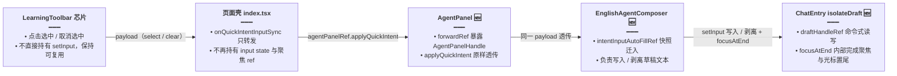

# 英语学习：快捷意图与输入框联动及名著导读意图文案

> **延伸阅读**：[英语Agent领域工具.md](./英语Agent领域工具.md)（Agent 直接读侧栏业务数据的 el_* 领域工具）、[整库问法稳定出卡.md](./整库问法稳定出卡.md)（整库问法挂卡判定）、[Agent大结果旁路展示.md](./Agent大结果旁路展示.md)（大列表旁路卡片与触顶继续）、[英语Agent输入草稿隔离.md](./英语Agent输入草稿隔离.md)（本轮联动改道的背景：输入草稿隔离）。

> **更新记录（2026-10-31）**：配合「输入草稿隔离」改造，输入框联动从「页面级 `input` state + `chatInputRef`」改为「`agentPanelRef.applyQuickIntent` → Composer → `draftHandleRef` 命令式写草稿」。`QuickIntentInputSyncPayload` 类型与工具栏回调不变；自动填入快照 `intentInputAutoFillRef` 与聚焦逻辑内收进 `EnglishAgentComposer`。最新实现见 §4.2 的改动前/后对比。

## 1. 背景与目标

- **快捷意图**：左栏「快捷意图」芯片选中后，`englishAgentStore.pendingIntentPrefix` 会在用户下次发送消息时拼到正文前（与 chip 展示名 `englishLearning.chip.*` 不同，前缀为长文案 `englishLearning.intent.*`）。
- **产品诉求**：选中芯片时，将**意图名称**（短标签）自动填入右侧 Agent 输入框，并**自动聚焦**；取消选中时，尽量只移除自动填入的那段，保留用户自己追加的内容；发送或新对话时避免 ref 状态残留。
- **文案诉求**：「名著导读」附带意图需明确要求摘抄原文优质段落、**不少于 5 段**、**逐段中文翻译**，并约束篇幅与无关照抄。

## 2. 改动范围

| 文件 | 说明 |
|------|------|
| `apps/frontend/src/views/englishLearning/sidebar/components/LearningToolbar.tsx` | 导出 `QuickIntentInputSyncPayload`，工具栏接收 `onQuickIntentInputSync`，在选中/取消时回调父组件（经 `sidebar/index.ts` 转出口） |
| `apps/frontend/src/views/englishLearning/index.tsx` | 当前仅保留 `onQuickIntentInputSync`（转发 `agentPanelRef.current?.applyQuickIntent(payload)`）；历史上的 `stripAutoFilledIntentName` / `intentInputAutoFillRef` / `chatInputRef` 已迁出 |
| `apps/frontend/src/views/englishLearning/agent/index.tsx` | 当前联动主战场：`AgentPanelHandle.applyQuickIntent` 类型 + `EnglishAgentComposer` 内的快照与草稿写入实现 |
| `apps/frontend/src/i18n/locales/zh-CN/englishLearning.ts` | `englishLearning.intent.literature` 中文长文案 |
| `apps/frontend/src/i18n/locales/en-US/englishLearning.ts` | 同上键位英文长文案 |

**说明**：`EnglishAgentStore` 的 `buildOutgoingContent` / `sendMessage` 未改；发送逻辑仍为「前缀 + 用户输入」。

## 3. 实现思路

1. **数据分层**：MobX store 只负责 `pendingIntentPrefix`（发送用长前缀）；输入框短标签的「自动填入 / 撤销」放在 React 侧，用 `useRef` 记录最后一次自动填入的 `label`，避免与 store 强耦合。**2026-10-31 起该 ref 从页面组件迁到 `EnglishAgentComposer` 内**（配合草稿隔离，页面不再持有 input state）。
2. **子传父回调**：工具栏不直接持有 `setInput`，通过可选回调 `onQuickIntentInputSync` 通知页面，页面再经 `agentPanelRef.current?.applyQuickIntent(payload)` 命令式透传给 Composer，保持 `LearningToolbar` 可在无回调场景下复用。
3. **取消选中时的剥离**：`stripAutoFilledIntentName` 先处理「整框等于快照」→ 清空；否则在**保留行首空白**的前提下，若正文以快照字符串开头则去掉快照及紧随空白，否则不改（用户已改写成无关内容时不误删）。
4. **聚焦时机**：**2026-10-31 起**改为 `draftHandleRef.current?.focusAtEnd()`——`ChatEntry` 的命令式句柄内部完成 iframe blur 防御、`focus({ preventScroll: true })` 与 `setSelectionRange(len, len)`，不再依赖页面级 `requestAnimationFrame` + `chatInputRef`。
5. **生命周期**：Composer 内 `sendMessage`、`onNewChat` 将 `intentInputAutoFillRef` 置 `null`，防止与下一轮选择错位。
6. **名著导读**：仅改 i18n 字符串，界面「下次发送附带」预览与 `t(prefixKey)` 发送前缀一并更新，无需改 `chipDefs` 映射。

2026-10-31 起快捷意图写入输入框的命令式链路（描述改动后行为）：



## 4. 关键代码与注释

### 4.1 工具栏：类型与点击分支

**来源**：`apps/frontend/src/views/englishLearning/sidebar/components/LearningToolbar.tsx`（约 L83–L100；文件已随侧栏重构迁入 `sidebar/components/`）

```typescript
/** 快捷意图与输入框联动：选中填入意图名，取消选中时由父级移除自动填入片段 */
export type QuickIntentInputSyncPayload =
	| { mode: 'select'; label: string }
	| { mode: 'clear' };

type EnglishLearningToolbarProps = {
	onQuickIntentInputSync?: (payload: QuickIntentInputSyncPayload) => void;
};

// 说明：prefix = t(c.prefixKey) 供 store 发送前拼接；label = t(c.labelKey) 供输入框展示
onClick={() => {
	if (selected) {
		englishAgentStore.setIntentPrefix('');
		onQuickIntentInputSync?.({ mode: 'clear' });
	} else {
		englishAgentStore.setIntentPrefix(prefix);
		onQuickIntentInputSync?.({
			mode: 'select',
			label: t(c.labelKey),
		});
	}
}}
```

### 4.2 联动链路：从页面级 state 到命令式句柄（2026-10-31 更新）

**对比范围**：`onQuickIntentInputSync` 回调与自动填入快照逻辑。`stripAutoFilledIntentName` 工具函数本身未改（`apps/frontend/src/utils` 导出），不再重复贴。

**改动前** · `apps/frontend/src/views/englishLearning/index.tsx`（基线，约 L28–L65 摘录）

```typescript
// 页面级输入框 ref：快捷意图填入后用于自动聚焦
const chatInputRef = useRef<HTMLTextAreaElement | null>(null);
// 页面级自动填入快照：取消选中时精确移除
const intentInputAutoFillRef = useRef<string | null>(null);

// 快捷意图联动：直接改页面级受控 input state（每次填入都触发整页重渲）
const onQuickIntentInputSync = useCallback(
	(payload: QuickIntentInputSyncPayload) => {
		if (payload.mode === 'select') {
			intentInputAutoFillRef.current = payload.label;
			setInput(payload.label);
			// 说明：等浏览器下一帧再 focus，减少 React 提交前 ref 未就绪
			requestAnimationFrame(() => {
				chatInputRef.current?.focus();
			});
			return;
		}
		const snap = intentInputAutoFillRef.current;
		intentInputAutoFillRef.current = null;
		if (!snap) return;
		setInput((prev) => stripAutoFilledIntentName(prev, snap));
	},
	[],
);
```

**改动后** · `apps/frontend/src/views/englishLearning/index.tsx`（当前，约 L23、L48–L53）

```typescript
// 仅保留 AgentPanel 句柄：快捷意图透传的唯一通道
const agentPanelRef = useRef<AgentPanelHandle>(null);

// 快捷意图联动：不再碰 state，命令式转发给 AgentPanel → Composer → 草稿句柄
const onQuickIntentInputSync = useCallback(
	(payload: QuickIntentInputSyncPayload) => {
		agentPanelRef.current?.applyQuickIntent(payload);
	},
	[],
);
```

**改动后** · `apps/frontend/src/views/englishLearning/agent/index.tsx`（当前，约 L409–L434，`EnglishAgentComposer` 内）

```typescript
// ChatEntry 命令式句柄：读写草稿、聚焦末尾都经它
const draftHandleRef = useRef<ChatEntryDraftHandle | null>(null);
// 自动填入快照：随 Composer 挂载存活，页面重渲与其无关
const intentInputAutoFillRef = useRef<string | null>(null);

// 暴露给 AgentPanel（再透传给页面）：快捷意图选中/取消的输入框联动
useImperativeHandle(
	ref,
	() => ({
		applyQuickIntent(payload) {
			// 选中：记录快照、写入 chip 文案、聚焦到末尾
			if (payload.mode === 'select') {
				intentInputAutoFillRef.current = payload.label;
				draftHandleRef.current?.setInput(payload.label);
				draftHandleRef.current?.focusAtEnd();
				return;
			}
			// 取消：取出快照并清空记录
			const snap = intentInputAutoFillRef.current;
			intentInputAutoFillRef.current = null;
			// 无快照说明不是自动填入的，不动用户正文
			if (!snap) return;
			// 读当前草稿，剥离开头的自动填入段（保留用户追加内容）
			const prev = draftHandleRef.current?.getInput() ?? '';
			draftHandleRef.current?.setInput(
				stripAutoFilledIntentName(prev, snap),
			);
		},
	}),
	[],
);
```

**变更摘要**：联动从「页面 setInput + rAF focus」改为「页面转发 → Composer 经 `draftHandleRef` 写草稿并 `focusAtEnd()`」；写入不再触发页面/消息列重渲，聚焦时机由 `ChatEntry` 句柄内部保证。`ChatEntry` 侧的 `isolateDraft` / `ChatEntryDraftHandle` 实现详见 [英语Agent输入草稿隔离.md](./英语Agent输入草稿隔离.md)。

### 4.3 名著导读：i18n 前缀文案

**来源**：`apps/frontend/src/i18n/locales/zh-CN/englishLearning.ts`（locale 已按域拆分，键位不变）

```typescript
'englishLearning.intent.literature':
	'【意图】请做名著/英语文献导读：摘要、背景与讨论题；并请从原文中摘取不少于 5 段优质段落（每段适度篇幅），逐段附带中文翻译；避免无关的冗长照抄。',
```

**来源**：`apps/frontend/src/i18n/locales/en-US/englishLearning.ts`（同上）

```typescript
'englishLearning.intent.literature':
	'[Intent] Literature guide: context, summary, and discussion; also pick at least 5 high-quality passages from the original (each excerpt reasonably short), each followed by a Chinese translation; avoid unrelated long verbatim copying.',
```

## 5. 兼容性与影响

- **破坏性**：无 API 变更；`EnglishLearningToolbar` 新增可选 prop，旧调用方不传即可。
- **行为变化**：选中快捷意图会覆盖当前输入框内容为 chip 标签；切换另一意图会再次覆盖。用户若在选中后大量改写且不再以快照开头，取消选中不会删改其余正文。
- **多语言**：前缀串随当前 `t` 语言变化；若会话中途切换语言，已选中的 `pendingIntentPrefix` 与 chip 选中态仍以当时字符串比较，属既有模式边界。

## 6. 建议回归验证

1. 选中任意快捷意图 → 输入框为对应中文/英文 chip 文案，光标在文本域内。
2. 选中后追加「测试」→ 取消选中 → 仅剩「测试」。
3. 仅选中后取消 → 输入框清空。
4. 选中名著导读 → 左栏「下次发送附带」区域展示含「不少于 5 段」等的新长文案；发一条消息 → 前缀仍按 store 拼接（可与网络抓包或后端日志核对）。
5. 新对话 / 发送后再次选意图，无异常叠加或焦点丢失。

## 7. 相关源码路径

| 说明 | 路径 |
|------|------|
| 英语学习页（转发回调） | `apps/frontend/src/views/englishLearning/index.tsx` |
| 联动实现（Composer） | `apps/frontend/src/views/englishLearning/agent/index.tsx` |
| 左栏工具栏 | `apps/frontend/src/views/englishLearning/sidebar/components/LearningToolbar.tsx` |
| Agent store（前缀拼接，本轮未改） | `apps/frontend/src/store/englishAgent.ts` |
| 聊天输入（isolateDraft / draftHandle） | `apps/frontend/src/components/design/ChatEntry/index.tsx` |

若与仓库最新源码不一致，以源码为准。
