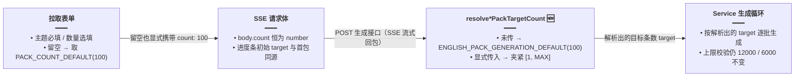

# 英语学习：词数 / 条数选填与「留空默认 100」解析

> **更新记录（2026-10-31）**：留空时的默认目标由「单次请求上限（单词 12000 / 经典句 6000）」调整为 **100**。前端输入框留空时会在请求体中显式携带 `count: 100`，后端解析函数与前端常量、i18n 文案同步收口。本文为该能力的当前主文档，下文 §4 以「改动前 / 改动后」成对方式记录本轮调整。

## 1. 背景与目标

**原始问题**：原先单词包与经典句拉取把 `count` 当作必填语义（前端默认填 `10`、后端 `dto.count ?? 10`），用户无法表达「不指定条数」。

**第一轮（计数选填）目标**：`count` 在 API 与 UI 上均为**选填**；留空时后端按**单次请求上限**生成；前端 SSE 请求体在省略 `count` 时不序列化该键。

**本轮（2026-10-31）调整**：「留空按上限拉取」在实际使用中一次生成几千上万条，等待时间长、模型消耗大，且绝大多数用户想要的是「一批适量的词」。因此把留空默认值从「单次上限」改为 **100**，前后端三处（后端解析函数、前端常量、Agent 内 `AGENT_PACK_COUNT`）对齐同一数值；上限校验（单词 ≤12000、经典句 ≤6000）保持不变。

**若与仓库最新源码不一致，以源码为准。**

---

## 2. 改动范围

| 层级 | 路径 |
|------|------|
| DTO + 纯函数 | `apps/backend/src/services/english-learning/dto/generate-vocabulary.dto.ts` |
| Controller（SSE `target`） | `apps/backend/src/services/english-learning/english-learning.controller.ts`（调用同一 resolve 函数，本轮未改） |
| Service（生成循环目标条数） | `apps/backend/src/services/english-learning/english-learning.service.ts`（同上，本轮未改） |
| 前端常量 | `apps/frontend/src/constants/index.ts` |
| 前端页面 | `apps/frontend/src/views/englishLearning/sections/vocabulary/index.tsx`、`apps/frontend/src/views/englishLearning/sections/classic/index.tsx` |
| 前端 SSE | `apps/frontend/src/utils/englishLearningPackSse.ts`（仅注释更新） |
| 文案 | `apps/frontend/src/i18n/locales/zh-CN/englishLearning.ts`、`apps/frontend/src/i18n/locales/en-US/englishLearning.ts` |

---

## 3. 实现思路

1. **单一真相**：`resolveVocabularyPackTargetCount` / `resolveClassicQuotesPackTargetCount` 仍是 Controller 算 SSE 首包 `target` 与 Service 算生成循环 `count` 的共同入口；本轮只改「未传时的返回值」，显式传入的夹紧逻辑不变。
2. **默认值一处定义**：新增 `ENGLISH_PACK_GENERATION_DEFAULT = 100`（后端）与 `PACK_COUNT_DEFAULT = 100`（前端常量），两边注释互相标注对齐关系，避免日后改一边漏另一边。
3. **前端留空也显式传 count**：输入框留空时把 `effectiveTarget = PACK_COUNT_DEFAULT` 直接放进请求体（`body.count` 恒为 number），进度条初始 `target` 与首包 `target` 天然一致；`englishLearningPackSse` 的「省略 count 键」分支仍保留给 Agent 等不显式传值的调用方。
4. **文案同步**：`countHint` 与 `countPlaceholder` 由「留空按上限」改为「留空默认 100」，中英文双语同步。

留空默认值改动后的数据流（描述改动后行为）：



---

## 4. 关键代码对比与注释

### 4.1 DTO：默认常量与解析函数（`generate-vocabulary.dto.ts`）

**对比范围**：`ENGLISH_PACK_GENERATION_DEFAULT` 常量（纯新增）+ `resolveVocabularyPackTargetCount` / `resolveClassicQuotesPackTargetCount` 全函数 + DTO 字段注释。

**改动前** · `apps/backend/src/services/english-learning/dto/generate-vocabulary.dto.ts`（基线，约 L18–L45）

```typescript
/**
 * 解析单词包目标条数：未传 `count` 时按单次上限拉取；传入时夹在 [1, MAX]。
 */
export function resolveVocabularyPackTargetCount(
	count: number | undefined | null,
): number {
	// undefined / null 均视为未指定：回退到单次上限 12000
	if (count == null) return ENGLISH_VOCAB_GENERATION_MAX;
	// 显式传入时不得小于 1、不得大于上限
	return Math.min(ENGLISH_VOCAB_GENERATION_MAX, Math.max(1, count));
}

/**
 * 解析经典句目标条数：未传 `count` 时按单次上限拉取；传入时夹在 [1, MAX]。
 */
export function resolveClassicQuotesPackTargetCount(
	count: number | undefined | null,
): number {
	// 未指定：回退到经典句单次上限 6000
	if (count == null) return ENGLISH_CLASSIC_QUOTES_GENERATION_MAX;
	// 显式传入时夹紧到 [1, 6000]
	return Math.min(ENGLISH_CLASSIC_QUOTES_GENERATION_MAX, Math.max(1, count));
}
```

**改动后** · `apps/backend/src/services/english-learning/dto/generate-vocabulary.dto.ts`（当前，约 L18–L39、L48、L66）

```typescript
/** 未传 count 时的默认条数（与前端 PACK_COUNT_DEFAULT、Agent AGENT_PACK_COUNT 对齐） */
export const ENGLISH_PACK_GENERATION_DEFAULT = 100;

/**
 * 解析单词包目标条数：未传 `count` 时默认 100；传入时夹在 [1, MAX]。
 */
export function resolveVocabularyPackTargetCount(
	count: number | undefined | null,
): number {
	// undefined / null 均视为未指定：回退到默认 100（不再是单次上限）
	if (count == null) return ENGLISH_PACK_GENERATION_DEFAULT;
	// 显式传入时不得小于 1、不得大于上限（上限语义不变）
	return Math.min(ENGLISH_VOCAB_GENERATION_MAX, Math.max(1, count));
}

/**
 * 解析经典句目标条数：未传 `count` 时默认 100；传入时夹在 [1, MAX]。
 */
export function resolveClassicQuotesPackTargetCount(
	count: number | undefined | null,
): number {
	// 未指定：同样回退到默认 100，单词/经典句默认值一处维护
	if (count == null) return ENGLISH_PACK_GENERATION_DEFAULT;
	// 显式传入时夹紧到 [1, 6000]
	return Math.min(ENGLISH_CLASSIC_QUOTES_GENERATION_MAX, Math.max(1, count));
}
```

DTO 字段注释同步更新（当前 L48、L66）：

```typescript
/** 目标词数；省略则默认 ENGLISH_PACK_GENERATION_DEFAULT */
@IsOptional()
// Transform：把客户端误传的 null / 表单空串归一为 undefined，交给上面的 resolve 走默认值
@Transform(({ value }) =>
	value === null || value === '' ? undefined : value,
)
@IsInt()
@Min(1)
@Max(ENGLISH_VOCAB_GENERATION_MAX)
count?: number;
```

**变更摘要**：未传 `count` 的回退值由「各自上限（12000 / 6000）」统一改为 `ENGLISH_PACK_GENERATION_DEFAULT = 100`；显式传入的 `[1, MAX]` 夹紧与 `@Transform` 归一逻辑不变。

### 4.2 前端常量 `PACK_COUNT_DEFAULT`（`constants/index.ts`）

**对比范围**：`PACK_COUNT_DEFAULT` 常量声明（纯新增，仅贴改动后）。

**改动后** · `apps/frontend/src/constants/index.ts`（当前，约 L148–L152）

```typescript
// 与后端 ENGLISH_VOCAB_GENERATION_MAX 一致：单词数量下限
export const VOCAB_COUNT_MIN = 1;
// 与后端 ENGLISH_VOCAB_GENERATION_MAX 一致：单次拉取上限 12000
export const VOCAB_COUNT_MAX = 12000;
/** 词数/条数留空时的默认目标（与后端 ENGLISH_PACK_GENERATION_DEFAULT 对齐） */
export const PACK_COUNT_DEFAULT = 100;
```

**变更摘要**：前端留空默认值一处定义，注释标注与后端常量的对齐关系。

### 4.3 前端页面：留空显式携带 `count`（`sections/vocabulary/index.tsx`）

**对比范围**：`onGenerate` 内 `effectiveTarget` 与 `body` 组装段。经典句区 `sections/classic/index.tsx` 对称（`QUOTE_COUNT_MIN/MAX`），不重复贴。

**改动前** · `apps/frontend/src/views/englishLearning/sections/vocabulary/index.tsx`（基线，约 L235–L240）

```typescript
// 留空时进度条目标按单次上限展示，请求体不带 count（后端 resolve 得到上限）
let effectiveTarget = VOCAB_COUNT_MAX;
// body.count 可选：留空时整个键不发送
const body: { topic: string; count?: number } = { topic: req };
if (countInput.trim() !== '') {
	const n = Number.parseInt(countInput, 10);
	// ... 校验失败 Toast 后 return；合法则 effectiveTarget 夹紧并写 body.count ...
}
```

**改动后** · `apps/frontend/src/views/englishLearning/sections/vocabulary/index.tsx`（当前，约 L236–L248）

```typescript
// 留空时默认目标 100（与后端 resolve 的回退值一致，进度条初始 target 即真实目标）
let effectiveTarget = PACK_COUNT_DEFAULT;
// body.count 恒为 number：留空也显式携带 100，请求语义一眼可读
const body: { topic: string; count: number } = {
	topic: req,
	count: effectiveTarget,
};
if (countInput.trim() !== '') {
	const n = Number.parseInt(countInput, 10);
	// ... 校验失败 Toast 后 return；合法则 effectiveTarget 夹紧并覆盖 body.count ...
}
```

**变更摘要**：`body.count` 由「选填、留空省略」改为「必填、留空即 100」；`effectiveTarget` 初值由 `VOCAB_COUNT_MAX` 改为 `PACK_COUNT_DEFAULT`。

### 4.4 前端 SSE：省略分支注释更新（`englishLearningPackSse.ts`）

**对比范围**：`runEnglishLearningPackSseStream` 请求体类型注释（仅注释变化）。

**改动前** · `apps/frontend/src/utils/englishLearningPackSse.ts`（基线，约 L185）

```typescript
/** 省略时由后端按单次上限拉取 */
count?: number;
```

**改动后** · `apps/frontend/src/utils/englishLearningPackSse.ts`（当前，约 L185）

```typescript
/** 省略时后端默认 100 */
count?: number;
```

**变更摘要**：`count == null ? { topic } : { topic, count }` 的省略分支保留（Agent 等调用方仍可不传），仅注释语义更新为「默认 100」。

### 4.5 i18n 文案

**对比范围**：`vocab.countHint` / `vocab.countPlaceholder` / `classic.countHint`。

**改动前** · `apps/frontend/src/i18n/locales/zh-CN/englishLearning.ts`（基线，约 L83–L85、L746–L749）

```typescript
'englishLearning.classic.countHint':
	'留空不指定条数，由服务端按单次上限生成；填写须为 1～6000 整数，或点快捷数量',
// ...
'englishLearning.vocab.countHint':
	'留空不指定条数，由服务端按单次上限生成；填写须为 1～12000 整数，或点快捷数量',
'englishLearning.vocab.countPlaceholder': '留空按上限拉取',
```

**改动后** · `apps/frontend/src/i18n/locales/zh-CN/englishLearning.ts`（当前，约 L83–L85、L746–L749）

```typescript
'englishLearning.classic.countHint':
	'留空默认生成 100 条；填写须为 1～6000 整数，或点快捷数量',
// ...
'englishLearning.vocab.countHint':
	'留空默认生成 100 个；填写须为 1～12000 整数，或点快捷数量',
'englishLearning.vocab.countPlaceholder': '留空默认 100',
```

英文侧同步（`apps/frontend/src/i18n/locales/en-US/englishLearning.ts`，当前约 L87–L89、L820–L823）：`'Leave empty to generate 100; enter 1–6000, or tap a preset'` / `'Leave empty to generate 100; enter 1–12000, or tap a preset'` / `'Empty = 100'`。

**变更摘要**：提示与占位文案从「按上限」改为「默认 100」，与后端行为一致。

---

## 5. 兼容性与影响

| 项目 | 说明 |
|------|------|
| **默认行为变化（本轮）** | 留空从「目标 = 单次上限」改为「目标 = 100」；生成耗时与模型调用量大幅下降，用户需要更多时可填具体数字或点快捷预设。 |
| **显式传入** | 仍为 1～MAX 整数；超出由 `resolve*` 夹紧（后端）；前端先校验再请求。 |
| **REST 非 SSE** | `POST vocabulary-pack` / `classic-quotes` 走同一 DTO 与 service 解析逻辑（`generateVocabularyPack` 等内部调用 `run*`），默认 100 同样生效。 |
| **Agent 路径** | Agent 生成词包时若不显式传 `count`，同样落 `ENGLISH_PACK_GENERATION_DEFAULT`；其内部 `AGENT_PACK_COUNT` 与该值对齐。 |

---

## 6. 回归建议

- 单词 / 经典：**仅主题**、count 留空，确认请求体含 `"count": 100`，首包 `target` 为 100。
- 填写边界值 `1`、`12000` / `6000` 与非法值、空串失焦。
- 快捷预设按钮仍写入具体数字并带 `count` 请求。
- Agent 生成词包（不指定数量）时进度目标同样为 100。

---

## 7. 相关文档与源码

| 说明 | 路径 |
|------|------|
| 后端总览 | [英语学习后端实现.md](./英语学习后端实现.md) |
| 去难度专题 | [英语学习无等级.md](./英语学习无等级.md) |
| DTO + 解析函数 | `apps/backend/src/services/english-learning/dto/generate-vocabulary.dto.ts` |
| 前端常量 | `apps/frontend/src/constants/index.ts` |
| 单词包区 | `apps/frontend/src/views/englishLearning/sections/vocabulary/index.tsx` |
| 经典句区 | `apps/frontend/src/views/englishLearning/sections/classic/index.tsx` |
