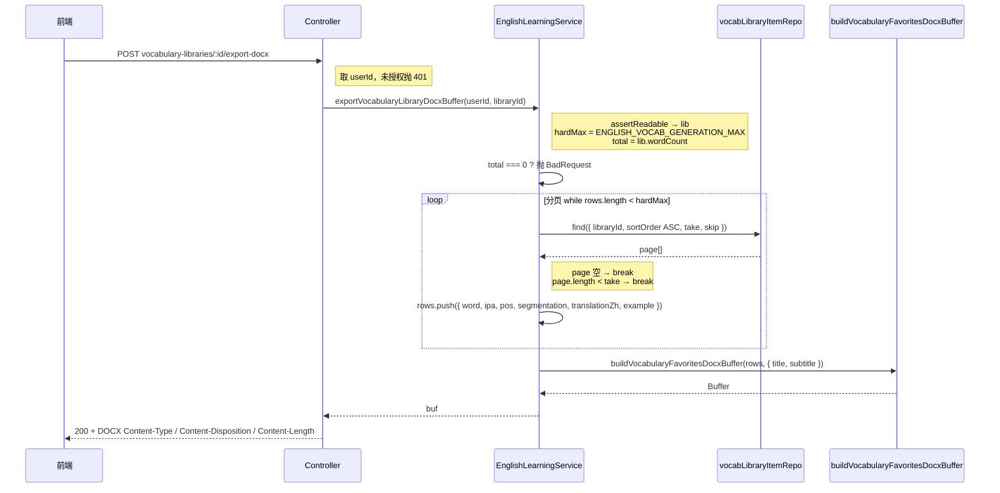
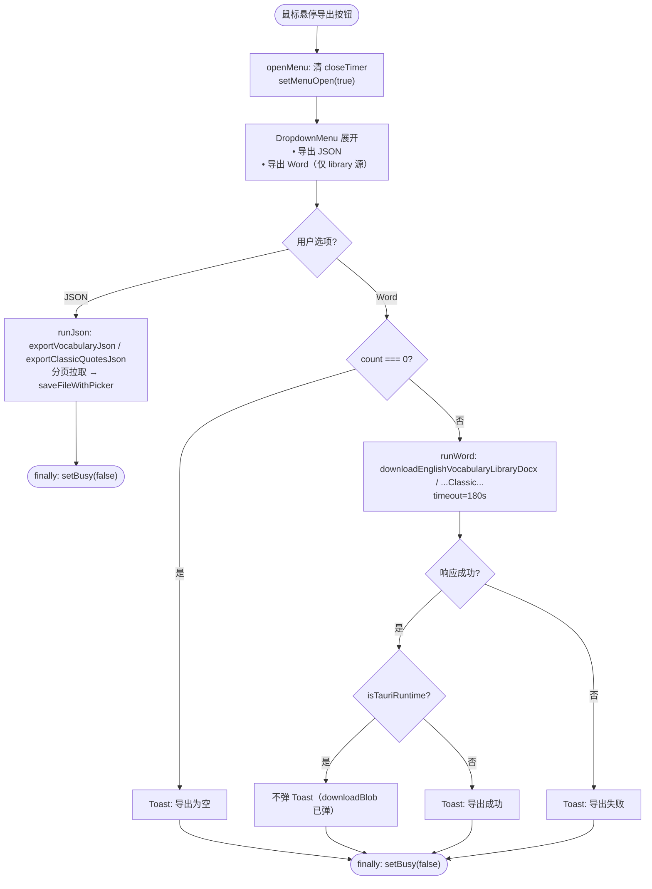

# 词库 / 语句库整库 DOCX 导出

## 延伸阅读

- [单词库导出.md](./单词库导出.md)：单词库 **JSON** 导出（`exportVocabularyJson` 分页拉取 + `saveFileWithPicker`）
- [英语收藏DOCX导出.md](./英语收藏DOCX导出.md)：单词 / 经典句**收藏** DOCX 导出（`buildVocabularyFavoritesDocxBuffer` / `buildClassicQuoteFavoritesDocxBuffer` 构建器，词库整库导出复用同一套 Builder）
- [DOCX异步导出Job.md](./DOCX异步导出Job.md)：**大集合（>1 万条）异步导出 Job**——收藏 / 错题 / 复习超过 1 万条时改为后台生成 + 轮询下载；词库整库同步导出上限内仍走本文路径

> **注**：本文 §4 的 `classic/Export.tsx` / `vocab/Export.tsx` 已迁移到共享 `components/export/Export.tsx` + `ExportMenu.tsx`（Word 导出统一入口与大集合异步分流见姊妹篇 [DOCX异步导出Job.md](./DOCX异步导出Job.md)）。

---

## 1. 背景与目标

英语学习「资源库」中的单词库（vocabulary library）与经典语句库（classic quotes library）此前仅支持 **JSON 导出**（前端分页拉取后 `saveFileWithPicker` 落盘），无法一键导出为可读的 **Word（DOCX）** 文档。收藏与错题已有服务端 DOCX 导出能力，但词库整库导出缺失。

本轮新增 **词库 / 语句库整库 DOCX 导出**：

- **后端**新增两个端点 `POST .../vocabulary-libraries/:libraryId/export-docx` 与 `POST .../classic-quotes-libraries/:libraryId/export-docx`，按 `sortOrder ASC` 分页装载全部条目，硬顶到生成上限（单词 12000 / 语句 6000），复用收藏 DOCX 的 Builder（`buildVocabularyFavoritesDocxBuffer` / `buildClassicQuoteFavoritesDocxBuffer`）生成 Word。
- **前端**将单词库 / 语句库行的导出按钮从「单 JSON 按钮」改造为 **DropdownMenu 下拉**（导出 JSON / 导出 Word 两项）；Word 仅库源（`source === 'library'`）可用，空库弹 Toast；大库生成较慢，下载超时单独拉长至 **3 分钟**。

## 2. 改动范围

**后端**

- `apps/backend/src/services/english-learning/english-learning.controller.ts` — 新增 2 个端点
- `apps/backend/src/services/english-learning/english-learning.service.ts` — 新增常量 `LIBRARY_DOCX_PAGE_SIZE = 1000`；新增 `exportVocabularyLibraryDocxBuffer` / `exportClassicQuotesLibraryDocxBuffer`；`FAVORITES_DOCX_EXPORT_MAX` 注释改为「导出收藏 / 词库为 DOCX 时同步路径最多行数」

**前端**

- `apps/frontend/src/service/api.ts` — 新增 `ENGLISH_LEARNING_VOCABULARY_LIBRARY_EXPORT_DOCX` / `ENGLISH_LEARNING_CLASSIC_QUOTES_LIBRARY_EXPORT_DOCX`
- `apps/frontend/src/service/index.ts` — `downloadEnglishAuthorizedDocx` 新增 `opts?: { timeout?: number }`；新增 `LIBRARY_DOCX_TIMEOUT_MS = 180_000`；新增 `downloadEnglishVocabularyLibraryDocx` / `downloadEnglishClassicQuotesLibraryDocx`
- `apps/frontend/src/views/englishLearning/components/classic/Export.tsx` — 单 JSON 按钮 → DropdownMenu（JSON + Word）
- `apps/frontend/src/views/englishLearning/components/vocab/Export.tsx` — 新增文件（同构 DropdownMenu，Word 走 `downloadEnglishVocabularyLibraryDocx`）

## 3. 实现思路

1. **复用收藏 DOCX Builder**：词库整库导出不重新发明 DOCX 构建逻辑，直接调用 `buildVocabularyFavoritesDocxBuffer(rows, { title, subtitle })` / `buildClassicQuoteFavoritesDocxBuffer(...)`。Builder 已处理多级标题、逐词词性 / 音标 / 释义表，词库条目字段（`word / ipa / pos / segmentation / translationZh / example` 与 `english / translationZh / source / noteZh`）与收藏条目字段完全对齐，无需转换。
2. **分页装载 + 硬顶**：词库条目可能上万，一次性 `find` 会撑爆内存。按 `LIBRARY_DOCX_PAGE_SIZE = 1000`（对齐 items API 上限）分页，`while (rows.length < hardMax)` 循环，`take = min(pageSize, hardMax - rows.length)`，`offset += page.length`，`page.length < take` 时 break。硬顶用生成上限 `ENGLISH_VOCAB_GENERATION_MAX`（12000）/ `ENGLISH_CLASSIC_QUOTES_GENERATION_MAX`（6000），超则截断，避免超大文档 OOM / 超时。
3. **空库提前拦截**：先 `assertVocabularyLibraryReadable` / `assertClassicQuotesLibraryReadable` 取到 `lib.wordCount` / `lib.quoteCount`，`total === 0` 直接 `BadRequestException('无可导出词条' / '无可导出语句')`，不走分页循环。
4. **前端超时单独拉长**：大库生成 + Packer 构建可能超过默认 HTTP 超时（通常 30s）。`downloadEnglishAuthorizedDocx` 新增可选 `opts.timeout`，词库导出传 `LIBRARY_DOCX_TIMEOUT_MS = 180_000`（3 分钟）；收藏 / 错题等其它导出不传，保持默认。
5. **DropdownMenu 替换单按钮**：导出按钮从 `Tooltip + Button` 改为 `DropdownMenu`，Trigger 是 ghost Button（`FileDown` 图标），Content 含「导出 JSON」「导出 Word」两项。Word 仅 `source === 'library' && idOk` 时渲染（历史 pack 不支持服务端整库 Word 导出）；空库（`count === 0`）点 Word 弹空库 Toast。
6. **Tauri 去重 Toast**：桌面端 `downloadBlob` 已弹「下载成功 / 已取消」Toast，若组件再弹「导出成功」会重复。`runWord` 用 `isTauriRuntime()` 判断，仅非 Tauri 环境弹成功 Toast。
7. **菜单延迟关闭（160ms）**：Trigger 与 Content 都挂 `onMouseEnter={openMenu}` / `onMouseLeave={scheduleCloseMenu}`，`scheduleCloseMenu` 用 `setTimeout(() => setMenuOpen(false), 160)`，避免鼠标从 Trigger 移到 Content 时菜单先关闭。`useEffect` cleanup 清除 timer。

### 3.1 后端分页 → Packer → 响应



**读图要点**：Controller 只做鉴权 + 响应头设置，业务在 Service。Service 先断言可读并取计数，空库直接报错；分页按 `sortOrder ASC` 装载（与资源库浏览顺序一致），每页 1000 条，硬顶到生成上限。收集完 rows 后复用收藏 DOCX Builder 生成 Buffer，Controller 写回响应。

### 3.2 前端下拉 → 下载流程



**读图要点**：鼠标悬停展开下拉菜单（延迟 160ms 关闭）。JSON 走原有前端分页 + `saveFileWithPicker`；Word 走新服务端端点，超时 3 分钟。Word 成功后 Tauri 桌面端不重复弹 Toast（`downloadBlob` 已提示），浏览器端弹成功 Toast；失败统一弹失败 Toast。

## 4. 关键代码对比与注释

### 4.1 后端 Controller：两个新端点（纯新增）

**对比范围**：`english-learning.controller.ts` 中 `exportVocabularyLibraryDocx` 与 `exportClassicQuotesLibraryDocx` 两个方法（基线中不存在，为新增端点）。

**改动后** · `apps/backend/src/services/english-learning/english-learning.controller.ts`（当前，约 L716–L742）

```typescript
// 端点文档注释：说明该端点导出单词库为 DOCX，整库导出至多生成上限
/** 导出单词库为 DOCX（可读即可；整库，至多生成上限） */
// 路由装饰器：POST /vocabulary-libraries/:libraryId/export-docx
@Post('vocabulary-libraries/:libraryId/export-docx')
// 异步方法：导出单词库 DOCX
async exportVocabularyLibraryDocx(
	// 从请求对象取鉴权信息（AuthedRequest 注入 userId）
	@Req() req: AuthedRequest,
	// 从路径参数取 libraryId
	@Param('libraryId') libraryId: string,
	// 响应对象，用于直接写二进制流
	@Res() res: Response,
// 返回 void：通过 res.end 直接发送响应，不走 Nest 全局拦截器
): Promise<void> {
	// 从请求用户对象取 userId
	const userId = req.user?.userId;
	// userId 为空则未授权，抛 401
	if (userId == null) {
		throw new UnauthorizedException('未授权');
	}
	// 调用 service 生成 DOCX Buffer
	const buf =
		await this.englishLearningService.exportVocabularyLibraryDocxBuffer(
			userId,
			libraryId,
		);
	// 设置 Content-Type 为 Word 文档 MIME
	res.setHeader(
		'Content-Type',
		'application/vnd.openxmlformats-officedocument.wordprocessingml.document',
	);
	// 设置 Content-Disposition 为附件下载，文件名 english-vocabulary-library.docx
	res.setHeader(
		'Content-Disposition',
		'attachment; filename="english-vocabulary-library.docx"',
	);
	// 设置 Content-Length 为 Buffer 字节数，便于前端显示进度
	res.setHeader('Content-Length', String(buf.length));
	// 结束响应并发送 Buffer
	res.end(buf);
}
```

**改动后** · `apps/backend/src/services/english-learning/english-learning.controller.ts`（当前，约 L965–L991）

```typescript
// 端点文档注释：说明该端点导出语句库为 DOCX，整库导出至多生成上限
/** 导出语句库为 DOCX（可读即可；整库，至多生成上限） */
// 路由装饰器：POST /classic-quotes-libraries/:libraryId/export-docx
@Post('classic-quotes-libraries/:libraryId/export-docx')
// 异步方法：导出语句库 DOCX
async exportClassicQuotesLibraryDocx(
	// 从请求对象取鉴权信息
	@Req() req: AuthedRequest,
	// 从路径参数取 libraryId
	@Param('libraryId') libraryId: string,
	// 响应对象，用于直接写二进制流
	@Res() res: Response,
// 返回 void
): Promise<void> {
	// 取 userId
	const userId = req.user?.userId;
	// 未授权抛 401
	if (userId == null) {
		throw new UnauthorizedException('未授权');
	}
	// 调用 service 生成 DOCX Buffer
	const buf =
		await this.englishLearningService.exportClassicQuotesLibraryDocxBuffer(
			userId,
			libraryId,
		);
	// 设置 Word MIME
	res.setHeader(
		'Content-Type',
		'application/vnd.openxmlformats-officedocument.wordprocessingml.document',
	);
	// 设置附件下载，文件名 english-classic-quotes-library.docx
	res.setHeader(
		'Content-Disposition',
		'attachment; filename="english-classic-quotes-library.docx"',
	);
	// 设置内容长度
	res.setHeader('Content-Length', String(buf.length));
	// 结束响应
	res.end(buf);
}
```

**变更摘要**：两个端点结构对称。Controller 只做鉴权（`userId` 非空校验）+ 调用 Service 生成 Buffer + 设置三个响应头（`Content-Type` / `Content-Disposition` / `Content-Length`）+ `res.end(buf)`。区别仅在路由路径、Service 方法名与下载文件名。

### 4.2 后端 Service：常量注释修改 + 两个新方法

**对比范围**：`english-learning.service.ts` 中 `FAVORITES_DOCX_EXPORT_MAX` 注释、`LIBRARY_DOCX_PAGE_SIZE` 常量、`exportVocabularyLibraryDocxBuffer` 与 `exportClassicQuotesLibraryDocxBuffer` 方法。

**改动前** · `apps/backend/src/services/english-learning/english-learning.service.ts`（基线，约 L4956–L4957）

```typescript
// 改动前注释：仅说明收藏导出上限
/** 导出收藏为 DOCX 时单次最多行数，避免超大文档占用内存 */
// 常量：收藏导出最多 3000 行
private static readonly FAVORITES_DOCX_EXPORT_MAX = 3000;
```

**改动后** · `apps/backend/src/services/english-learning/english-learning.service.ts`（当前，约 L4956–L4960）

```typescript
// 改动后注释：补充词库整库导出也复用此常量语义（同步路径行数上限）
/** 导出收藏 / 词库为 DOCX 时同步路径最多行数，避免超大文档占用内存 */
// 常量：收藏 / 词库导出最多 3000 行（词库硬顶另用生成上限，此处为收藏/错题导出上限）
private static readonly FAVORITES_DOCX_EXPORT_MAX = 3000;

// 新增：分页装载词库 items 时每页条数，对齐 items API 上限（1000）
/** 分页装载词库 items 时每页条数（对齐 items API 上限） */
// 常量：每页 1000 条
private static readonly LIBRARY_DOCX_PAGE_SIZE = 1000;
```

**变更摘要**：`FAVORITES_DOCX_EXPORT_MAX` 注释从「导出收藏为 DOCX」改为「导出收藏 / 词库为 DOCX」，明确该常量也覆盖词库导出场景（词库整库硬顶实际用生成上限，但注释统一语义）。新增 `LIBRARY_DOCX_PAGE_SIZE = 1000`，与 items 列表接口单页上限对齐。

**改动后** · `apps/backend/src/services/english-learning/english-learning.service.ts`（当前，约 L4970–L5023）

```typescript
// 方法文档注释：说明单词库整库导出为 Word，同步 Packer，硬顶生成上限 12000
/**
 * 单词库导出为 Word（可读即可；整库导出）。
 * ponytail: 同步 Packer 持有全文；硬顶 = 生成上限 12000，超则截断。若常 OOM/超时再上异步 Job。
 */
// 异步方法：导出单词库 DOCX Buffer
async exportVocabularyLibraryDocxBuffer(
	// 用户 ID
	userId: number,
	// 库 ID
	libraryId: string,
// 返回 DOCX Buffer
): Promise<Buffer> {
	// 断言当前用户对该库有读权限，并取回库元数据（含 wordCount）
	const lib = await this.assertVocabularyLibraryReadable(userId, libraryId);
	// 硬顶：单词生成上限 12000
	const hardMax = ENGLISH_VOCAB_GENERATION_MAX;
	// 取库词条总数，空则 0
	const total = Math.max(0, lib.wordCount ?? 0);
	// 空库直接报错，不走分页循环
	if (total === 0) {
		throw new BadRequestException('无可导出词条');
	}
	// 收集导出行数组，字段与收藏导出一致（Builder 入参类型）
	const rows: Array<{
		word: string;
		ipa: string;
		pos: string;
		segmentation: string;
		translationZh: string;
		example: string;
	}> = [];
	// 每页条数 = LIBRARY_DOCX_PAGE_SIZE (1000)
	const pageSize = EnglishLearningService.LIBRARY_DOCX_PAGE_SIZE;
	// 分页偏移量
	let offset = 0;
	// 循环条件：已收集行数 < 硬顶
	while (rows.length < hardMax) {
		// 本页取数 = min(每页大小, 硬顶 - 已收集)，最后一页不超硬顶
		const take = Math.min(pageSize, hardMax - rows.length);
		// 查库内条目，按 sortOrder 升序（与资源库浏览顺序一致）
		const page = await this.vocabLibraryItemRepo.find({
			where: { libraryId },
			order: { sortOrder: 'ASC' },
			take,
			skip: offset,
		});
		// 本页无数据则退出（已到末尾）
		if (!page.length) break;
		// 遍历本页条目，映射到导出行结构
		for (const r of page) {
			// 压入行，空值统一为空字符串（Builder 期望 string）
			rows.push({
				word: r.word,
				ipa: r.ipa ?? '',
				pos: r.pos ?? '',
				segmentation: r.segmentation ?? '',
				translationZh: r.translationZh ?? '',
				example: r.example ?? '',
			});
		}
		// 偏移量累加本页实际条数
		offset += page.length;
		// 本页不足一页则说明已到末尾，退出
		if (page.length < take) break;
	}
	// 收集完仍为空（理论上 total>0 不会到这里，但兜底）
	if (!rows.length) {
		throw new BadRequestException('无可导出词条');
	}
	// 复用收藏 DOCX Builder 生成 Buffer，标题用库名（空则「英语单词库」），副标题为条数
	return buildVocabularyFavoritesDocxBuffer(rows, {
		title: lib.title?.trim() || '英语单词库',
		subtitle: `共 ${rows.length} 条`,
	});
}
```

**改动后** · `apps/backend/src/services/english-learning/english-learning.service.ts`（当前，约 L5025–L5077）

```typescript
// 方法文档注释：说明语句库整库导出为 Word，同步 Packer，硬顶生成上限 6000
/**
 * 语句库导出为 Word（可读即可；整库导出）。
 * ponytail: 同步 Packer；硬顶 = 生成上限 6000。若常 OOM/超时再上异步 Job。
 */
// 异步方法：导出语句库 DOCX Buffer
async exportClassicQuotesLibraryDocxBuffer(
	// 用户 ID
	userId: number,
	// 库 ID
	libraryId: string,
// 返回 DOCX Buffer
): Promise<Buffer> {
	// 断言当前用户对该库有读权限，并取回库元数据（含 quoteCount）
	const lib = await this.assertClassicQuotesLibraryReadable(
		userId,
		libraryId,
	);
	// 硬顶：语句生成上限 6000
	const hardMax = ENGLISH_CLASSIC_QUOTES_GENERATION_MAX;
	// 取库语句总数，空则 0
	const total = Math.max(0, lib.quoteCount ?? 0);
	// 空库直接报错
	if (total === 0) {
		throw new BadRequestException('无可导出语句');
	}
	// 收集导出行数组，字段与经典句收藏导出一致
	const rows: Array<{
		english: string;
		translationZh: string;
		source: string;
		noteZh: string;
	}> = [];
	// 每页条数 = 1000
	const pageSize = EnglishLearningService.LIBRARY_DOCX_PAGE_SIZE;
	// 分页偏移量
	let offset = 0;
	// 循环条件：已收集行数 < 硬顶
	while (rows.length < hardMax) {
		// 本页取数 = min(每页大小, 硬顶 - 已收集)
		const take = Math.min(pageSize, hardMax - rows.length);
		// 查库内语句，按 sortOrder 升序
		const page = await this.classicQuotesLibraryItemRepo.find({
			where: { libraryId },
			order: { sortOrder: 'ASC' },
			take,
			skip: offset,
		});
		// 本页无数据则退出
		if (!page.length) break;
		// 遍历本页语句，映射到导出行结构
		for (const r of page) {
			// 压入行，空值统一为空字符串
			rows.push({
				english: r.english,
				translationZh: r.translationZh ?? '',
				source: r.source ?? '',
				noteZh: r.noteZh ?? '',
			});
		}
		// 偏移量累加本页实际条数
		offset += page.length;
		// 本页不足一页则退出
		if (page.length < take) break;
	}
	// 兜底：收集为空时报错
	if (!rows.length) {
		throw new BadRequestException('无可导出语句');
	}
	// 复用经典句收藏 DOCX Builder 生成 Buffer
	return buildClassicQuoteFavoritesDocxBuffer(rows, {
		title: lib.title?.trim() || '英语语句库',
		subtitle: `共 ${rows.length} 条`,
	});
}
```

**变更摘要**：两个方法结构对称。核心流程：`assertReadable` 取库元数据 → `total === 0` 抛错 → `while (rows.length < hardMax)` 分页 `find`（`sortOrder ASC`，每页 1000，最后一页不超硬顶）→ 映射行字段（空值补 `''`）→ 复用收藏 Builder 生成 Buffer。退出条件：`page` 为空或 `page.length < take`。

### 4.3 前端 api.ts：两个新常量（纯新增）

**对比范围**：`api.ts` 中 `ENGLISH_LEARNING_VOCABULARY_LIBRARY_EXPORT_DOCX` 与 `ENGLISH_LEARNING_CLASSIC_QUOTES_LIBRARY_EXPORT_DOCX`（基线中不存在）。

**改动后** · `apps/frontend/src/service/api.ts`（当前，约 L208–L210 与 L220–L222）

```typescript
// 常量注释：导出单词库为 Word，路径后拼 /:libraryId/export-docx
/** 导出单词库为 Word（DOCX）；路径后拼 `/:libraryId/export-docx` */
// 路径前缀：/english-learning/vocabulary-libraries，与列表接口同前缀
export const ENGLISH_LEARNING_VOCABULARY_LIBRARY_EXPORT_DOCX =
	'/english-learning/vocabulary-libraries';

// 常量注释：导出语句库为 Word，路径后拼 /:libraryId/export-docx
/** 导出语句库为 Word（DOCX）；路径后拼 `/:libraryId/export-docx` */
// 路径前缀：/english-learning/classic-quotes-libraries
export const ENGLISH_LEARNING_CLASSIC_QUOTES_LIBRARY_EXPORT_DOCX =
	'/english-learning/classic-quotes-libraries';
```

**变更摘要**：两个新常量复用列表接口的路径前缀（`vocabulary-libraries` / `classic-quotes-libraries`），调用方再拼 `/${libraryId}/export-docx`。与 `ENGLISH_LEARNING_VOCABULARY_LIBRARIES` 等常量同值但语义独立，便于后续路径调整。

### 4.4 前端 index.ts：downloadEnglishAuthorizedDocx 改造 + 两个新函数

**对比范围**：`index.ts` 中 `downloadEnglishAuthorizedDocx` 签名与 `http.post` 调用、新增 `LIBRARY_DOCX_TIMEOUT_MS` 常量与 `downloadEnglishVocabularyLibraryDocx` / `downloadEnglishClassicQuotesLibraryDocx` 函数。

**改动前** · `apps/frontend/src/service/index.ts`（基线，约 L2611–L2621）

```typescript
// 改动前注释：说明带鉴权拉取 DOCX，body.ids 非空时仅导出这些条目
/**
 * 带鉴权拉取英语学习导出 DOCX：`http.post` 取 `ArrayBuffer` 后统一走 {@link downloadBlob}。
 * body.ids 非空时仅导出这些条目；否则全量（至多 3000）。
 */
// 异步函数：下载英语学习授权 DOCX
async function downloadEnglishAuthorizedDocx(
	// 接口路径
	path: string,
	// 下载文件名
	filename: string,
	// 请求体（可选）
	body?: Record<string, unknown>,
// 返回 Promise<void>
): Promise<void> {
	// 发起 POST 请求取 ArrayBuffer，silent 避免全局错误 Toast
	const { data } = await http.post<ArrayBuffer>(path, body ?? {}, {
		silent: true,
	});
```

**改动后** · `apps/frontend/src/service/index.ts`（当前，约 L2611–L2628）

```typescript
// 改动后注释：补充词库走库上限（非 3000）
/**
 * 带鉴权拉取英语学习导出 DOCX：`http.post` 取 `ArrayBuffer` 后统一走 {@link downloadBlob}。
 * body.ids 非空时仅导出这些条目；否则全量（收藏至多 3000；词库走库上限）。
 */
// 异步函数：下载英语学习授权 DOCX
async function downloadEnglishAuthorizedDocx(
	// 接口路径
	path: string,
	// 下载文件名
	filename: string,
	// 请求体（可选）
	body?: Record<string, unknown>,
	// 新增：可选超时配置，词库大库导出需拉长超时
	opts?: { timeout?: number },
// 返回 Promise<void>
): Promise<void> {
	// 发起 POST 请求取 ArrayBuffer，silent 避免全局错误 Toast
	const { data } = await http.post<ArrayBuffer>(path, body ?? {}, {
		silent: true,
		// 若传入 timeout 则设置，否则用 http 默认超时
		...(opts?.timeout != null ? { timeout: opts.timeout } : {}),
	});
```

**变更摘要**：`downloadEnglishAuthorizedDocx` 新增第四个参数 `opts?: { timeout?: number }`，透传到 `http.post` 的 `timeout` 选项。注释更新说明词库全量走库上限（非收藏的 3000）。收藏 / 错题等调用方不传 `opts`，行为不变。

**改动后** · `apps/frontend/src/service/index.ts`（当前，约 L2709–L2740）

```typescript
// 常量注释：词库整库 Word 导出超时，大库生成较慢，单独拉长到 3 分钟
/** 词库整库 Word 导出：大库生成较慢，单独拉长超时 */
// 超时毫秒数：180000 = 3 分钟
const LIBRARY_DOCX_TIMEOUT_MS = 180_000;

// 函数注释：下载单词库 Word（整库）
/** 下载单词库 Word（整库） */
// 导出异步函数：下载单词库 DOCX
export async function downloadEnglishVocabularyLibraryDocx(
	// 库 ID
	libraryId: string,
// 返回 Promise<void>
): Promise<void> {
	// trim 库 ID，去首尾空白
	const id = libraryId.trim();
	// 空 ID 抛错，避免请求无效路径
	if (!id) throw new Error('libraryId required');
	// 调用通用下载函数，拼路径 + 文件名 + 空 body + 3 分钟超时
	await downloadEnglishAuthorizedDocx(
		// 路径：前缀 + encodeURIComponent(id) + /export-docx
		`${ENGLISH_LEARNING_VOCABULARY_LIBRARY_EXPORT_DOCX}/${encodeURIComponent(id)}/export-docx`,
		// 文件名：vocabulary-library-时间戳.docx
		`vocabulary-library-${Date.now()}.docx`,
		// 空 body
		{},
		// 超时 3 分钟
		{ timeout: LIBRARY_DOCX_TIMEOUT_MS },
	);
}

// 函数注释：下载语句库 Word（整库）
/** 下载语句库 Word（整库） */
// 导出异步函数：下载语句库 DOCX
export async function downloadEnglishClassicQuotesLibraryDocx(
	// 库 ID
	libraryId: string,
// 返回 Promise<void>
): Promise<void> {
	// trim 库 ID
	const id = libraryId.trim();
	// 空 ID 抛错
	if (!id) throw new Error('libraryId required');
	// 调用通用下载函数，拼路径 + 文件名 + 空 body + 3 分钟超时
	await downloadEnglishAuthorizedDocx(
		// 路径：前缀 + encodeURIComponent(id) + /export-docx
		`${ENGLISH_LEARNING_CLASSIC_QUOTES_LIBRARY_EXPORT_DOCX}/${encodeURIComponent(id)}/export-docx`,
		// 文件名：classic-quotes-library-时间戳.docx
		`classic-quotes-library-${Date.now()}.docx`,
		// 空 body
		{},
		// 超时 3 分钟
		{ timeout: LIBRARY_DOCX_TIMEOUT_MS },
	);
}
```

**变更摘要**：新增 `LIBRARY_DOCX_TIMEOUT_MS = 180_000`（3 分钟）常量，以及两个对称的导出函数。两者均 `trim` libraryId 并校验非空，拼 `${PREFIX}/${encodeURIComponent(id)}/export-docx` 路径，传 `{ timeout: LIBRARY_DOCX_TIMEOUT_MS }` 给 `downloadEnglishAuthorizedDocx`。区别仅在路径常量、文件名前缀与调用的导出端点。

### 4.5 前端 classic/Export.tsx：单按钮 → DropdownMenu（改动前/后）

**对比范围**：`classic/Export.tsx` 整个组件（imports + `Export` 函数）。

> **注（2026-10-13）**：`classic/Export.tsx` 与 `vocab/Export.tsx` 已合并为共享 `components/export/Export.tsx` + `ExportMenu.tsx`，并在大集合（>1 万条）场景接入异步 Job。本节代码为迁移前的同步版记录，当前实现见 [DOCX异步导出Job.md](./DOCX异步导出Job.md) §4.10。

**改动前** · `apps/frontend/src/views/englishLearning/components/classic/Export.tsx`（基线，约 L1–L98）

```tsx
// 改动前组件注释：仅导出 JSON
/**
 * 语句库 / 历史行：导出该集合全部原句为 JSON。
 */
// 改动前：导入 Tooltip 做悬停提示
import Tooltip from '@design/Tooltip';
// 导入 Button 组件
import { Button } from '@ui/button';
// 导入 Toast
import { Toast } from '@ui/sonner';
// 改动前：FileJson 图标
import { FileJson } from 'lucide-react';
// 改动前：仅需 MouseEvent 与 useState
import { type MouseEvent, useState } from 'react';
// 导入 exportClassicQuotesJson
import { exportClassicQuotesJson } from '../../utils/exportClassicQuotes';

// 改动前：Export 组件返回 Tooltip + Button
export function Export({ ... }: ExportProps) {
	const { t } = useI18n();
	const [busy, setBusy] = useState(false);
	// 改动前：标签为 exportJson
	const label = t('englishLearning.classic.exportJson');
	const idOk = ...;

	return (
		// 改动前：Tooltip 包裹 Button
		<Tooltip side="top" content={label}>
			<Button
				disabled={disabled || busy || !idOk}
				// 改动前：onClick 内联执行导出逻辑
				onClick={(e) => {
					onBeforeClick?.(e);
					e.stopPropagation();
					if (busy || !idOk) return;
					const name = title?.trim() || t('englishLearning.classic.exportFileFallback');
					setBusy(true);
					void exportClassicQuotesJson(...).catch(...).finally(() => setBusy(false));
				}}
			>
				{busy ? <Spinner ... /> : <FileJson ... />}
			</Button>
		</Tooltip>
	);
}
```

**改动后** · `apps/frontend/src/views/englishLearning/components/classic/Export.tsx`（当前，约 L1–L201）

```tsx
// 改动后组件注释：JSON + Word 双导出
/**
 * 语句库 / 历史行：导出 JSON；库源另支持 Word（服务端整库 DOCX）。
 */
// 导入 Button 组件
import { Button } from '@ui/button';
// 改动后：导入 DropdownMenu 系列组件
import {
	DropdownMenu,
	DropdownMenuContent,
	DropdownMenuItem,
	DropdownMenuTrigger,
} from '@ui/dropdown-menu';
// 导入 Toast
import { Toast } from '@ui/sonner';
// 改动后：FileDown 图标（通用下载，非仅 JSON）
import { FileDown } from 'lucide-react';
// 改动后：新增 useCallback / useEffect / useRef
import { type MouseEvent, useCallback, useEffect, useRef, useState } from 'react';
// 导入 Spinner
import { Spinner } from '@/components/ui';
// 导入 useI18n
import { useI18n } from '@/hooks';
// 导入 cn
import { cn } from '@/lib/utils';
// 改动后：导入语句库 Word 下载函数
import { downloadEnglishClassicQuotesLibraryDocx } from '@/service';
// 改动后：导入 Tauri 运行时判断
import { isTauriRuntime } from '@/utils/runtime';
// 导入 JSON 导出函数
import { exportClassicQuotesJson } from '../../utils/exportClassicQuotes';

// 改动后：Export 组件
export function Export({ source, libraryId, streamId, title, quoteCount, disabled, onBeforeClick }: ExportProps) {
	// 获取 i18n t 函数
	const { t } = useI18n();
	// busy 态：导出中禁用按钮并显示 Spinner
	const [busy, setBusy] = useState(false);
	// 改动后：菜单开关状态
	const [menuOpen, setMenuOpen] = useState(false);
	// 改动后：延迟关闭定时器引用
	const closeTimerRef = useRef<ReturnType<typeof setTimeout> | null>(null);
	// 改动后：菜单通用标签（导出）
	const menuLabel = t('englishLearning.export.menu');
	// 校验 ID 是否有效
	const idOk = source === 'library' ? Boolean(libraryId?.trim()) : Boolean(streamId?.trim());
	// 改动后：语句总数，用于空库判断
	const count = Math.max(0, quoteCount ?? 0);
	// 改动后：Word 仅库源可用
	const canWord = source === 'library' && idOk;

	// 改动后：组件卸载时清除关闭定时器，避免内存泄漏
	useEffect(() => () => { if (closeTimerRef.current) clearTimeout(closeTimerRef.current); }, []);

	// 改动后：打开菜单（清掉待关闭定时器）
	const openMenu = useCallback(() => {
		if (closeTimerRef.current) { clearTimeout(closeTimerRef.current); closeTimerRef.current = null; }
		setMenuOpen(true);
	}, []);

	// 改动后：延迟 160ms 关闭菜单，便于鼠标移到 Content
	const scheduleCloseMenu = useCallback(() => {
		if (closeTimerRef.current) clearTimeout(closeTimerRef.current);
		closeTimerRef.current = setTimeout(() => setMenuOpen(false), 160);
	}, []);

	// 改动后：JSON 导出逻辑（从 onClick 内联抽出）
	const runJson = () => {
		if (busy || !idOk) return;
		const name = title?.trim() || t('englishLearning.classic.exportFileFallback');
		setBusy(true);
		void exportClassicQuotesJson(
			source === 'library'
				? { source, libraryId: libraryId!.trim(), title: name, quoteCount }
				: { source, streamId: streamId!.trim(), title: name, quoteCount },
		)
			.catch((err: unknown) => {
				const empty = err instanceof Error && err.message === 'empty';
				Toast({ type: 'error', title: t(empty ? 'englishLearning.classic.exportEmpty' : 'englishLearning.export.failed') });
			})
			.finally(() => setBusy(false));
	};

	// 改动后：Word 导出逻辑
	const runWord = () => {
		if (busy || !canWord) return;
		// 空库弹空库 Toast，不发请求
		if (count === 0) {
			Toast({ type: 'error', title: t('englishLearning.classic.exportEmpty') });
			return;
		}
		setBusy(true);
		void downloadEnglishClassicQuotesLibraryDocx(libraryId!.trim())
			.then(() => {
				// Tauri：downloadBlob 已 Toast 成功/取消，避免重复弹
				if (!isTauriRuntime()) {
					Toast({ type: 'success', title: t('englishLearning.classic.exportDocxSuccess') });
				}
			})
			.catch(() => { Toast({ type: 'error', title: t('englishLearning.export.failed') }); })
			.finally(() => setBusy(false));
	};

	return (
		// 改动后：DropdownMenu 替代 Tooltip
		<DropdownMenu open={menuOpen} onOpenChange={setMenuOpen}>
			<DropdownMenuTrigger asChild>
				<Button
					type="button" variant="ghost" size="sm"
					disabled={disabled || busy || !idOk}
					aria-label={menuLabel} aria-busy={busy} title={menuLabel}
					className={cn('h-7 w-7 shrink-0 rounded-md p-0 transition-colors', 'text-textcolor/65 hover:border hover:border-teal-500/15 hover:bg-teal-500/10 hover:text-teal-500')}
					// 改动后：onClick 仅做回调与 stopPropagation，不再内联导出
					onClick={(e) => { onBeforeClick?.(e); e.stopPropagation(); }}
					// 改动后：鼠标进入打开菜单
					onMouseEnter={openMenu}
					// 改动后：鼠标离开延迟关闭
					onMouseLeave={scheduleCloseMenu}
				>
					{busy ? <Spinner className="size-3.5 text-textcolor" aria-hidden /> : <FileDown className="size-3.5" aria-hidden />}
				</Button>
			</DropdownMenuTrigger>
			<DropdownMenuContent
				align="end" sideOffset={6} scrollable={false} className="min-w-34"
				// 阻止关闭后自动聚焦回 Trigger（避免焦点跳动）
				onCloseAutoFocus={(e) => e.preventDefault()}
				// 鼠标进入菜单内容时保持打开
				onMouseEnter={openMenu}
				// 鼠标离开菜单内容时延迟关闭
				onMouseLeave={scheduleCloseMenu}
				// 阻止点击冒泡到行
				onClick={(e) => e.stopPropagation()}
			>
				// 导出 JSON 菜单项
				<DropdownMenuItem className="justify-center" disabled={busy} onSelect={(e) => { e.preventDefault(); setMenuOpen(false); runJson(); }}>
					{t('englishLearning.export.json')}
				</DropdownMenuItem>
				// Word 菜单项：仅库源渲染
				{canWord ? (
					<DropdownMenuItem className="justify-center" disabled={busy} onSelect={(e) => { e.preventDefault(); setMenuOpen(false); runWord(); }}>
						{t('englishLearning.export.docxMenu')}
					</DropdownMenuItem>
				) : null}
			</DropdownMenuContent>
		</DropdownMenu>
	);
}
```

**变更摘要**：从 `Tooltip + 单 Button（onClick 内联导出）` 重构为 `DropdownMenu`。主要变化：
1. **Trigger** 仍是 ghost Button（图标 `FileJson` → `FileDown`），`onClick` 不再内联导出，只做 `onBeforeClick` + `stopPropagation`；新增 `onMouseEnter/onMouseLeave` 控制菜单。
2. **Content** 含两项：「导出 JSON」（`runJson`，从原 onClick 抽出）与「导出 Word」（`runWord`，仅 `canWord` 时渲染）。
3. **runWord**：空库（`count === 0`）弹空库 Toast；成功后 `isTauriRuntime()` 判断是否弹成功 Toast（Tauri 的 `downloadBlob` 已提示）。
4. **延迟关闭**：`scheduleCloseMenu` 用 `setTimeout(160ms)`，Trigger 与 Content 都挂 enter/leave，避免鼠标移动时菜单闪关。

### 4.6 前端 vocab/Export.tsx：新增文件（纯新增）

**对比范围**：`vocab/Export.tsx` 全文件（基线中不存在，为新增组件，结构与 classic/Export.tsx 同构）。

> **注（2026-10-13）**：`vocab/Export.tsx` 已与 `classic/Export.tsx` 合并为共享 `components/export/Export.tsx`，大集合异步分流见 [DOCX异步导出Job.md](./DOCX异步导出Job.md) §4.10。

**改动后** · `apps/frontend/src/views/englishLearning/components/vocab/Export.tsx`（新增，约 L1–L201）

```tsx
// 组件注释：单词库 / 历史行导出 JSON；库源另支持 Word
/**
 * 单词库 / 历史行：导出 JSON；库源另支持 Word（服务端整库 DOCX）。
 */
// 导入 Button 组件
import { Button } from '@ui/button';
// 导入 DropdownMenu 系列组件
import { DropdownMenu, DropdownMenuContent, DropdownMenuItem, DropdownMenuTrigger } from '@ui/dropdown-menu';
// 导入 Toast
import { Toast } from '@ui/sonner';
// 导入 FileDown 图标
import { FileDown } from 'lucide-react';
// 导入 React hooks
import { type MouseEvent, useCallback, useEffect, useRef, useState } from 'react';
// 导入 Spinner
import { Spinner } from '@/components/ui';
// 导入 useI18n
import { useI18n } from '@/hooks';
// 导入 cn
import { cn } from '@/lib/utils';
// 导入单词库 Word 下载函数
import { downloadEnglishVocabularyLibraryDocx } from '@/service';
// 导入 Tauri 运行时判断
import { isTauriRuntime } from '@/utils/runtime';
// 导入 JSON 导出函数
import { exportVocabularyJson } from '../../utils/exportVocabulary';

// Props 类型：区分 library 与 pack
type ExportProps = {
	source: 'library' | 'pack';
	libraryId?: string;
	streamId?: string;
	title?: string;
	wordCount?: number;
	disabled?: boolean;
	onBeforeClick?: (e: MouseEvent<HTMLButtonElement>) => void;
};

// 导出组件
export function Export({ source, libraryId, streamId, title, wordCount, disabled, onBeforeClick }: ExportProps) {
	// i18n
	const { t } = useI18n();
	// busy 态
	const [busy, setBusy] = useState(false);
	// 菜单开关
	const [menuOpen, setMenuOpen] = useState(false);
	// 延迟关闭定时器
	const closeTimerRef = useRef<ReturnType<typeof setTimeout> | null>(null);
	// 菜单标签
	const menuLabel = t('englishLearning.export.menu');
	// ID 校验
	const idOk = source === 'library' ? Boolean(libraryId?.trim()) : Boolean(streamId?.trim());
	// 词条总数
	const count = Math.max(0, wordCount ?? 0);
	// Word 仅库源可用
	const canWord = source === 'library' && idOk;

	// 卸载时清定时器
	useEffect(() => () => { if (closeTimerRef.current) clearTimeout(closeTimerRef.current); }, []);

	// 打开菜单
	const openMenu = useCallback(() => {
		if (closeTimerRef.current) { clearTimeout(closeTimerRef.current); closeTimerRef.current = null; }
		setMenuOpen(true);
	}, []);

	// 延迟关闭菜单
	const scheduleCloseMenu = useCallback(() => {
		if (closeTimerRef.current) clearTimeout(closeTimerRef.current);
		closeTimerRef.current = setTimeout(() => setMenuOpen(false), 160);
	}, []);

	// JSON 导出
	const runJson = () => {
		if (busy || !idOk) return;
		const name = title?.trim() || t('englishLearning.vocab.exportFileFallback');
		setBusy(true);
		void exportVocabularyJson(
			source === 'library'
				? { source, libraryId: libraryId!.trim(), title: name, wordCount }
				: { source, streamId: streamId!.trim(), title: name, wordCount },
		)
			.catch((err: unknown) => {
				const empty = err instanceof Error && err.message === 'empty';
				Toast({ type: 'error', title: t(empty ? 'englishLearning.vocab.exportEmpty' : 'englishLearning.export.failed') });
			})
			.finally(() => setBusy(false));
	};

	// Word 导出
	const runWord = () => {
		if (busy || !canWord) return;
		if (count === 0) {
			Toast({ type: 'error', title: t('englishLearning.vocab.exportEmpty') });
			return;
		}
		setBusy(true);
		void downloadEnglishVocabularyLibraryDocx(libraryId!.trim())
			.then(() => {
				if (!isTauriRuntime()) {
					Toast({ type: 'success', title: t('englishLearning.vocab.exportDocxSuccess') });
				}
			})
			.catch(() => { Toast({ type: 'error', title: t('englishLearning.export.failed') }); })
			.finally(() => setBusy(false));
	};

	return (
		<DropdownMenu open={menuOpen} onOpenChange={setMenuOpen}>
			<DropdownMenuTrigger asChild>
				<Button
					type="button" variant="ghost" size="sm"
					disabled={disabled || busy || !idOk}
					aria-label={menuLabel} aria-busy={busy} title={menuLabel}
					className={cn('h-7 w-7 shrink-0 rounded-md p-0 transition-colors', 'text-textcolor/65 hover:border hover:border-teal-500/15 hover:bg-teal-500/10 hover:text-teal-500')}
					onClick={(e) => { onBeforeClick?.(e); e.stopPropagation(); }}
					onMouseEnter={openMenu}
					onMouseLeave={scheduleCloseMenu}
				>
					{busy ? <Spinner className="size-3.5 text-textcolor" aria-hidden /> : <FileDown className="size-3.5" aria-hidden />}
				</Button>
			</DropdownMenuTrigger>
			<DropdownMenuContent
				align="end" sideOffset={6} scrollable={false} className="min-w-34"
				onCloseAutoFocus={(e) => e.preventDefault()}
				onMouseEnter={openMenu}
				onMouseLeave={scheduleCloseMenu}
				onClick={(e) => e.stopPropagation()}
			>
				<DropdownMenuItem className="justify-center" disabled={busy} onSelect={(e) => { e.preventDefault(); setMenuOpen(false); runJson(); }}>
					{t('englishLearning.export.json')}
				</DropdownMenuItem>
				{canWord ? (
					<DropdownMenuItem className="justify-center" disabled={busy} onSelect={(e) => { e.preventDefault(); setMenuOpen(false); runWord(); }}>
						{t('englishLearning.export.docxMenu')}
					</DropdownMenuItem>
				) : null}
			</DropdownMenuContent>
		</DropdownMenu>
	);
}
```

**变更摘要**：纯新增组件，与 `classic/Export.tsx` 同构。区别：`quoteCount` → `wordCount`；`downloadEnglishClassicQuotesLibraryDocx` → `downloadEnglishVocabularyLibraryDocx`；i18n 键 `classic.*` → `vocab.*`；`exportClassicQuotesJson` → `exportVocabularyJson`。

## 5. 兼容性与影响

- **用户可感知**：资源库单词库 / 语句库行的导出按钮从「直接导出 JSON」变为「下拉菜单（JSON / Word）」。Word 仅库源可用；历史（pack）源只有 JSON 项。
- **导出内容**：单词库 DOCX 含 `word / ipa / pos / segmentation / translationZh / example`；语句库 DOCX 含 `english / translationZh / source / noteZh`，与收藏导出格式一致（复用 Builder）。
- **上限**：单词库硬顶 12000 条，语句库硬顶 6000 条（生成上限）；超则截断，不报错。
- **超时**：词库 Word 导出前端超时 3 分钟；JSON 导出不受影响。
- **Tauri 去重**：桌面端 Word 导出成功不重复弹 Toast（`downloadBlob` 已提示）；浏览器端弹成功 Toast。
- **向后兼容**：`downloadEnglishAuthorizedDocx` 新增参数为可选，收藏 / 错题等调用方不传，行为不变。
- **风险**：超大库（接近 12000 词）同步 Packer 可能占用较多内存与耗时，若频繁 OOM / 超时需上异步 Job（当前注释已预留该决策点）。

## 6. 相关源码路径

| 说明 | 路径 |
| ---- | ---- |
| 单词库 DOCX 端点 | `apps/backend/src/services/english-learning/english-learning.controller.ts` |
| 语句库 DOCX 端点 | 同上 |
| Service 分页 + Builder 调用 | `apps/backend/src/services/english-learning/english-learning.service.ts` |
| API 路径常量 | `apps/frontend/src/service/api.ts` |
| 下载函数 + 超时 | `apps/frontend/src/service/index.ts` |
| 经典句导出下拉组件 | `apps/frontend/src/views/englishLearning/components/classic/Export.tsx` |
| 单词库导出下拉组件 | `apps/frontend/src/views/englishLearning/components/vocab/Export.tsx` |
| 收藏 DOCX Builder（复用） | `apps/backend/src/services/english-learning/english-favorites-docx.builder.ts`（以实际路径为准） |

---

（若与仓库最新源码不一致，以源码为准）
