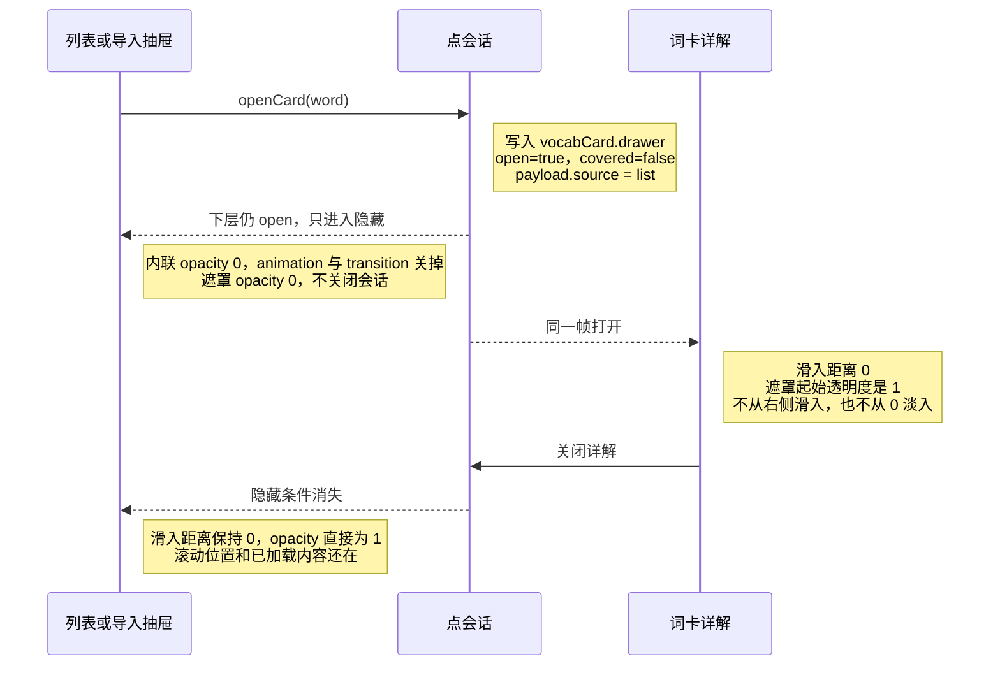

# 详解抽屉瞬时让位

> 延伸阅读：[学习页扩展点](./学习页扩展点.md) · [声明式扩展点](../plugins/声明式扩展点.md) · [单词详解列表](./单词详解列表.md) · [单词详解导入插件](./单词详解导入插件.md)
>
> 文档角色：本篇记录 2026-11-14 的视觉修复。会话仍保持打开。叠放后来从点上的 `covers` / `yieldTo` 收进 `catalog.ts` 的 `stacks`。列表抽屉也不再由页面用 `PluginHostSurface` 和 `openPluginId` 画，改为 `HostPoint`。隐藏仍是同一帧把面板透明度设为 0。载荷带 `source: 'list'`，或这次打开盖住了已经开着的抽屉时，新抽屉不滑入。

## 1. 背景与目标

从单词解析列表或导入抽屉点开单词详解时，下层抽屉在逻辑上已经让开，卡片却还会露一帧，页面也会闪一下。

下层抽屉没有关闭，只是在仍然处于打开动画的 Sheet 上加了 `invisible`（`visibility: hidden`）。遮罩是兄弟节点，`opacity-0` 立刻生效，蒙层先没了。面板上的 500ms 滑入层还在画卡片。详解抽屉同时从右侧滑入，遮罩再从全透明淡入，两层叠在一起。

目标：同一帧里下层卡片消失，详解直接出现在原位，页面不空一帧。关掉详解后，列表和导入仍在原地恢复，不要再从右侧滑入一次。

## 2. 改动范围

- `apps/frontend/src/federation/host/HostPoint.tsx`
- `apps/frontend/src/views/englishLearning/library/vocabulary/index.tsx`

`openCard` 的载荷本来就是 `{ word, source: 'list' }`，这次没有改命令。从词卡按钮打开详解不带 `source: 'list'`，仍走原来的滑入。

## 3. 实现思路

- 让位或被盖住时，用内联样式把面板的 `opacity` 设为 0，并关掉 `animation` 和 `transition`。内联样式压过 Sheet 打开态上的 500ms 过渡，卡片同一帧消失。
- 列表、导入经 `openCard` 打开详解时，详解面板的滑入距离设为 0，遮罩用 `![--tw-enter-opacity:1]` 从一开始就是不透明，避免下层遮罩去掉后页面露出来。
- 用 `parked` 记住「曾经让位或被盖住」。收回来时滑入距离仍是 0，并且 `opacity: 1`、`transition: none`，避免 `animation: none` 被拿掉之后，500ms 过渡把面板从透明淡回来，或从右侧再进一次。抽屉真正关闭后清空这个标记，下次从关闭态打开仍会滑入。
- 非模态抽屉让位时继续锁住 `document.body` 的滚动。先前一让位就恢复滚动，详解的模态锁还没加上，中间会跳一帧。
- 单词库列表不走 `HostPoint`。页面在详解开着时用同一套内联隐藏，并在让位期间把 `listStill` 设为 true，关掉详解后列表原地出现。

无新的跨服务数据流。叠层时序如下。



## 4. 关键代码对比与注释

### 4.1 非模态抽屉的滚动锁（`HostPoint`）

**对比范围**：`HostPoint` 里锁定 `document.body.style.overflow` 的那个 `useEffect`。前后都是这一个 effect，不含组件其余部分。

来源：`apps/frontend/src/federation/host/HostPoint.tsx`（**改动前**，约 L122–L129）

```tsx
	useEffect(() => {
		// 非模态、没打开、或正在让位时不加锁，把滚动交给上层详解
		if (layout?.modal !== false || !session.open || yielded) return;
		// 先记下原来的 overflow，卸载或依赖变化时才能还回去
		const prev = document.body.style.overflow;
		// 非模态抽屉自己打开时锁住页面，避免背后列表跟着滚
		document.body.style.overflow = 'hidden';
		return () => {
			// 让位变成 true 时清理函数会先跑，滚动在详解上锁之前空一帧
			document.body.style.overflow = prev;
		};
	}, [layout?.modal, session.open, yielded]);
```

来源：`apps/frontend/src/federation/host/HostPoint.tsx`（**改动后**，约 L124–L133）

```tsx
	// 让位时也保持锁滚动。这里解开再等详解去锁，中间一帧页面会跳
	useEffect(() => {
		// 只在非模态且抽屉开着时锁。让位不再作为提前返回条件
		if (layout?.modal !== false || !session.open) return;
		// 记下加锁前的值，抽屉真正关闭时再恢复
		const prev = document.body.style.overflow;
		// 导入抽屉打开期间一直锁住，详解盖上来时也不先放开
		document.body.style.overflow = 'hidden';
		return () => {
			// 只有 modal 或 open 变化导致 effect 重跑时才恢复，让位本身不会触发
			document.body.style.overflow = prev;
		};
	}, [layout?.modal, session.open]);
```

**变更摘要**：依赖数组去掉 `yielded`。让位不再解开滚动锁。

### 4.2 让位样式与从列表打开的详解（`HostPoint`）

**对比范围**：`HostPoint` 抽屉分支里，从算出标题到把 `contentStyle` 交给 `Drawer`。工具栏和按钮分支未改，不在这段里。

来源：`apps/frontend/src/federation/host/HostPoint.tsx`（**改动前**，约 L222–L239）

```tsx
	// 有插件时用标题文案，没有时留空，抽屉仍按会话开关
	const title = plugin
		? pickPluginLocaleText(plugin.title, locale) || plugin.id
		: '';

	return (
		<Drawer
			// 会话开着且插件还在启用列表里才算打开，否则走退场
			open={Boolean(session.open && plugin)}
			// 目录没写 modal: false 时保持模态，锁焦点
			modal={layout?.modal !== false}
			// 非模态时自己画遮罩，避免和上层抽屉抢 Radix 滚动锁
			plainOverlay={layout?.modal === false}
			// 让位时遮罩立刻透明。面板仍只靠 invisible，卡片层还会再画
			overlayClassName={yielded ? 'pointer-events-none opacity-0' : undefined}
			title={title}
			width={pointDrawerWidth}
			bodyClassName="overflow-hidden p-0"
			className={cn(
				// visibility:hidden 压不住打开态的 transform 动画，卡片会露一帧
				(session.covered || yielded) && 'pointer-events-none invisible',
				drawerClassName,
			)}
			// 页面传入的样式原样给内容区，没有在让位时关掉过渡
			contentStyle={drawerStyle}
```

来源：`apps/frontend/src/federation/host/HostPoint.tsx`（**改动后**，约 L229–L272）

```tsx
	// 有插件时用标题文案，没有时留空，抽屉仍按会话开关
	const title = plugin
		? pickPluginLocaleText(plugin.title, locale) || plugin.id
		: '';
	// 列表和导入的 openCard 带 source:list。这一帧详解直接出现，遮罩不要从 0 淡入
	const fromList =
		// 被盖住时详解不该露出来，所以还要求当前槽没有 covered
		session.open && !session.covered && session.payload?.source === 'list';
	// opacity 写在 inline 上，压过 Sheet 打开态的 500ms transition。只加 invisible 时卡片层还会再画一帧
	const sheetStyle: CSSProperties = conceal
		? {
				// 页面额外样式保留，下面三项盖住打开态动画
				...drawerStyle,
				// 关掉 enter 动画，避免合成层在隐藏后继续画卡片
				animation: 'none',
				// 关掉过渡，opacity 同一帧变为 0，而不是花 500ms 淡出
				transition: 'none',
				opacity: 0,
				visibility: 'hidden',
			}
		: fromList || parked.current
			? ({
					// 从列表打开，或刚从让位收回：人已经在这个槽位上，不要再滑一次
					...drawerStyle,
					// 滑入关键帧读这个变量。0 表示从原位开始
					'--tw-enter-translate-x': '0px',
					// 收回时若只删掉 opacity:0，过渡会把面板慢慢淡回来
					opacity: 1,
					transition: 'none',
				} as CSSProperties)
			: { ...drawerStyle };

	return (
		<Drawer
			// 会话开着且插件还在启用列表里才算打开，否则走退场
			open={Boolean(session.open && plugin)}
			// 目录没写 modal: false 时保持模态，锁焦点
			modal={layout?.modal !== false}
			// 非模态时自己画遮罩，避免和上层抽屉抢 Radix 滚动锁
			plainOverlay={layout?.modal === false}
			overlayClassName={
				// 让位时下层遮罩退出点击，并立刻透明，改由详解那层遮罩接上
				yielded
					? 'pointer-events-none opacity-0'
					: fromList
						// 详解遮罩的 fade-in 从 0 开始。这里把起始透明度钉成 1，避免空一帧
						? '![--tw-enter-opacity:1]'
						: undefined
			}
			title={title}
			width={pointDrawerWidth}
			bodyClassName="overflow-hidden p-0"
			// 隐藏改由 sheetStyle 负责。这里只禁掉指针，避免透明面板仍吃点击
			className={cn(conceal && 'pointer-events-none', drawerClassName)}
			contentStyle={sheetStyle}
```

**变更摘要**：让位和被盖住不再只加 `invisible`。从列表或导入打开的详解不滑入、遮罩不从 0 淡入。`parked` 在同一次渲染里更早写好：槽关闭时清掉，让位或被盖住时记下，收回来的那一帧才能用 0 位移。

### 4.3 单词库列表页自己画的那只抽屉

**对比范围**：`VocabularyLibrarySection` 里「详解开着时记住原地恢复」的 effect，以及列表 `PluginHostSurface` 的 `chromeStyle`、遮罩、禁关闭和面板类名。组件其余部分未改。

来源：`apps/frontend/src/views/englishLearning/library/vocabulary/index.tsx`（**改动前**，约 L93、L408–L423；当时没有 `tucked` effect）

```tsx
	// 详解开着且没被列表盖住时，列表要让开
	const detailOpen = detail.open && !detail.covered;
	// ...（列表插件、统计订阅、滚动锁。这段前后都有，此处不展开）
				chromeStyle={
					// 只有从已开的详解切到列表时才取消滑入
					listStill
						? ({ '--tw-enter-translate-x': '0px' } as CSSProperties)
						: undefined
				}
				drawerModal={false}
				drawerPlainOverlay
				drawerOverlayClassName={
					// 详解开着时遮罩透明。面板仍只靠下面的 invisible
					openPluginId && detailOpen
						? 'pointer-events-none opacity-0'
						: undefined
				}
				// 详解在上面时，点遮罩不能把列表关掉
				drawerPreventDismiss={Boolean(openPluginId) && detailOpen}
				// 同一条件下把列表面板标成不可见，卡片仍可能再画一帧
				drawerClassName={openPluginId && detailOpen ? 'invisible' : undefined}
```

来源：`apps/frontend/src/views/englishLearning/library/vocabulary/index.tsx`（**改动后**，约 L93–L110、L416–L434）

```tsx
	// 详解开着且没被列表盖住时，列表要让开
	const detailOpen = detail.open && !detail.covered;
	// 列表自己开着且详解在最上面。后面的隐藏和禁关闭都看这一个条件
	const tucked = Boolean(openPluginId && detailOpen);
	// ...（列表插件与统计订阅未改）
	// 详解开着时记下。关掉详解后列表还在 data-state=open，animation 恢复时位移必须是 0
	useEffect(() => {
		// 只在让位期间写 true。关掉详解后不在这里清掉，否则恢复那一帧又会滑入
		if (tucked) setListStill(true);
	}, [tucked]);
	// ...（列表自己的滚动锁未改）
				chromeStyle={
					tucked
						? {
								// 关掉打开态动画，卡片层不要在详解滑入时还留着
								animation: 'none',
								// 关掉 500ms 过渡，透明度同一帧变为 0
								transition: 'none',
								opacity: 0,
								visibility: 'hidden',
							}
						: listStill
							? ({
									// 从详解回到列表时，入场位移为 0，人还在原来的槽位
									'--tw-enter-translate-x': '0px',
									// 直接不透明，避免刚去掉 opacity:0 又被过渡淡回来
									opacity: 1,
									transition: 'none',
								} as CSSProperties)
							: undefined
				}
				drawerModal={false}
				drawerPlainOverlay
				// 让位时遮罩退出点击并透明，改由详解遮罩接上
				drawerOverlayClassName={
					tucked ? 'pointer-events-none opacity-0' : undefined
				}
				// 详解在上面时，点外面不能把列表关掉
				drawerPreventDismiss={tucked}
				// 视觉隐藏改由 chromeStyle。这里只避免透明面板吃掉点击
				drawerClassName={tucked ? 'pointer-events-none' : undefined}
```

**变更摘要**：列表让位与导入让位用同一套立刻隐藏。`listStill` 在详解开着时就会设上，关掉详解后列表原地出现。用户关掉列表时原逻辑仍会把 `listStill` 清掉，下次从关闭态打开仍会滑入。

## 5. 行为变化与回归

- 会话语义不变：列表仍 `covers` 详解，导入仍 `yieldTo` 详解。两边都不因打开另一层而 `closePoint`。
- 从词卡按钮打开详解仍滑入。只有载荷 `source === 'list'` 的那次打开取消滑入和遮罩淡入。
- 建议回归：列表点词、导入列表点词、词卡按钮点开、详解已开时再开列表、关掉详解后列表和导入是否停在原位、关掉列表或导入后下次打开是否仍从右侧滑入。

## 6. 未涵盖的边角

词卡按钮那次打开仍使用 Sheet 默认的 500ms 滑入。若以后从别的入口打开详解也要瞬时出现，需要同样带上 `source: 'list'`，或另定一个载荷标记。

若与仓库最新源码不一致，以源码为准。
