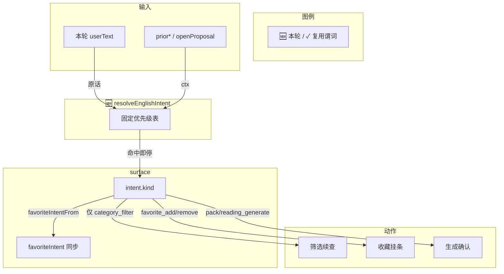

# 语境意图总路由

> **文档角色**：本轮落地主文档（确定性总路由）  
> **日期**：2026-10-31  
> **延伸阅读**：[规划态](../ideas/english/语境意图总路由.md)、[Agent复合意图通用化](./Agent复合意图通用化.md)（复合问法补丁与 IntentFrame 方案）、[收藏意图总闸](./收藏意图总闸.md)、[筛选卡续答与整类收藏](./筛选卡续答与整类收藏.md)
>
> 后继更新（2026-11-01）：[英语Agent意图帧](./英语Agent意图帧.md)——本文的 `resolveEnglishIntent` 已改名 `resolveEnglishIntentLegacy`（`EL_INTENT_FRAME=0` 回退用），默认路径改为 `resolveIntentFrame → intentFromFrame`；surface 绑定收口为 `bindEnglishIntentSurface`，本文的 `bindIntent` 代码块对应改前版本。

## 1. 背景与目标

长对话里「关于」既可能是库内筛选，也可能是生成主题或收藏复合句；旧链路各闸各自 `if`，生成/查询易误进筛选续查或错误挂确认。本轮新增单一入口 `resolveEnglishIntent`，收尾与分类工具只认 `kind`。

## 2. 改动范围

- `apps/backend/src/services/agent/tools/english/english-intent.ts`（**新增**）
- `apps/backend/src/services/agent/tools/english/spill.ts`（`ElListSurface.intent`）
- `apps/backend/src/services/agent/agent.service.ts`（`bindIntent`、筛选续查闸）
- `apps/backend/src/services/agent/tools/english/domain-tools.ts`（建工具时绑 intent；`pickLibraries` / 分类 list）

## 3. 实现思路

- **确定性优先**：固定优先级 cancel → query → generate → add → category → inventory → chat；不用每轮 LLM 意图主闸。
- **兼容旧字段**：`favoriteIntentFrom` 回填 `favoriteIntent`，未改完的路径仍可读。
- **互斥点**：仅 `category_filter` 才跑 `shouldFilterContinue` / 分类库选择。



**读图要点**：一轮一种 `kind`；生成/查询不会再因句内「关于」走进筛选续查。

## 4. 关键实现（改动前 / 改动后对比 + 注释）

### 4.1 `resolveEnglishIntent`（纯新增）

**对比范围**：整文件主符号；基线无此文件。

**改动前** · 无对应文件（基线不存在 `english-intent.ts`）

```typescript
// 基线无总路由模块；收尾用散落 isCategoryAsk / isPackGenerateAsk / resolveFavoriteIntent 各自判断
```

**改动后** · `apps/backend/src/services/agent/tools/english/english-intent.ts`（当前，约 L1–L85）

```typescript
// 从收藏域导入侧写类型与谓词，总路由只编排不重写规则
import {
	// FavoriteIntent 用于回填旧 surface 字段
	type FavoriteIntent,
	// 收藏+关于类是否要先出筛选卡
	favoriteNeedsFilterCards,
	// 查询收藏夹说法
	isFavoriteQuery,
	// 收藏域 add/remove/null 总闸
	resolveFavoriteIntent,
	// 省略取消（无英文词）
	unfavoriteFromCards,
} from './favorite-ask';
// 从 spill 导入生成/筛选/整库谓词，保持与既有闸一致
import {
	// 库内关于类
	isCategoryAsk,
	// 词句包生成（互斥筛选）
	isPackGenerateAsk,
	// 自选阅读生成
	isReadingGenerateAsk,
	// 整库 inventory
	listIntent,
} from './spill';

// 一轮唯一主意图枚举，避免多闸并行打架
export type EnglishIntentKind =
	// 查询已收藏，禁止挂添加确认
	| 'favorite_query'
	// 取消收藏，含省略取消
	| 'favorite_remove'
	// 添加收藏，可带 needsFilterCards
	| 'favorite_add'
	// 词句生成，互斥库内筛选续查
	| 'pack_generate'
	// 阅读生成，同样禁止继承旧库筛选
	| 'reading_generate'
	// 库内关于/有关分类
	| 'category_filter'
	// 整库列出
	| 'inventory'
	// 默认聊天与其它 el_*
	| 'chat';

// 总路由输出形状：主 kind + 可选侧写
export type EnglishIntent = {
	// 本轮唯一主意图
	kind: EnglishIntentKind;
	// 单词 / 语句 / 两侧 / 卡片指代
	side?: 'vocab' | 'classic' | 'both' | 'card';
	// 添加且句内含关于类时先筛后藏
	needsFilterCards?: boolean;
};

// 语境特征包：复用 ElListSurface 字段，不新持久化
export type EnglishIntentContext = {
	// 本轮之前用户句
	priorUserTexts: string[];
	// 历史库卡摘要
	priorLibraryCards: { title: string; contentKind?: string }[];
	// 未关闭提案，避免打架
	openProposalKind?: string | null;
};

// 把主意图压回旧 FavoriteIntent，兼容尚未改读 kind 的路径
export function favoriteIntentFrom(intent: EnglishIntent): FavoriteIntent {
	// 取消 → remove
	if (intent.kind === 'favorite_remove') {
		// side 缺省 both，与 unfavoriteFromCards 一致
		return { action: 'remove', side: intent.side ?? 'both' };
	}
	// 添加 → add
	if (intent.kind === 'favorite_add') {
		// side 缺省 card（指代上述）
		return { action: 'add', side: intent.side ?? 'card' };
	}
	// 查询/生成/筛选等对收藏挂条视为无操作
	return { action: null, side: 'card' };
}

// 固定优先级总入口；ctx 预留继承策略，M1 判定只靠原话
export function resolveEnglishIntent(
	// 本轮用户原话
	userText: string,
	// 历史表面；签名先对齐以便后用
	_ctx: EnglishIntentContext = {
		// 单测可只传原话
		priorUserTexts: [],
		// 默认无历史库卡
		priorLibraryCards: [],
	},
): EnglishIntent {
	// 统一 trim，后续正则打同一文本
	const text = userText.trim();
	// 空句不当业务意图
	if (!text) return { kind: 'chat' };

	// 1 取消优先，避免省略取消断收藏回扫窗
	const cancel = unfavoriteFromCards(text);
	// 命中则直接返回，不再看关于/生成
	if (cancel) return { kind: 'favorite_remove', side: cancel };

	// 2 查询优先于 soft-add，避免「当前收藏了哪些」挂确认
	if (isFavoriteQuery(text)) return { kind: 'favorite_query' };

	// 3 词句生成先于 isCategoryAsk，避免「生成关于…」进筛选
	if (isPackGenerateAsk(text)) return { kind: 'pack_generate' };
	// 3b 阅读生成同级互斥筛选
	if (isReadingGenerateAsk(text)) return { kind: 'reading_generate' };

	// 4 添加收藏：复用收藏域总闸
	const fav = resolveFavoriteIntent(text);
	// 仅 add 进入 favorite_add；query/remove 已在上方处理
	if (fav.action === 'add') {
		// 复合「收藏…关于…」需要先筛
		return {
			kind: 'favorite_add',
			side: fav.side,
			needsFilterCards: favoriteNeedsFilterCards(text),
		};
	}

	// 5 纯库内关于类
	if (isCategoryAsk(text)) return { kind: 'category_filter' };
	// 6 整库列出
	if (listIntent(text) === 'inventory') return { kind: 'inventory' };
	// 其余交给模型
	return { kind: 'chat' };
}
```

**变更摘要**：新增总路由与兼容回填；优先级把生成/查询放在「关于」筛选之前。

### 4.2 `bindIntent` + 筛选续查闸（`agent.service.ts`）

**对比范围**：建 `elSurface` 与 `finalizeTurn` 内筛选续查条件（摘录，同一符号上下文）。

**改动前** · `apps/backend/src/services/agent/agent.service.ts`（基线，约 L827–L834 建 surface；续查侧基线尚无 intent 字段，靠散落谓词）

```typescript
// 基线只建最小 surface，无 intent / favoriteIntent / prior*
const elSurface: ElListSurface = {
	// 本轮用户原话，供工具与外溢读取
	userText: dto.content,
	// 索引类 list 外溢全量
	libraryLists: [],
	// 是否已挂过资源卡
	presented: false,
	// 本轮已挂库 id，防重复
	shownLibraryIds: new Set(),
	// 库名目录，供匹配
	catalog: [],
};
```

**改动后** · `apps/backend/src/services/agent/agent.service.ts`（当前，约 L896–L1058）

```typescript
// 把总路由结果写入 surface，并同步旧 favoriteIntent
const bindIntent = (surface: ElListSurface) => {
	// 用当前 prior* 与提案状态解析主意图
	const intent = resolveEnglishIntent(surface.userText, {
		priorUserTexts: surface.priorUserTexts,
		priorLibraryCards: surface.priorLibraryCards,
		openProposalKind: surface.openProposalId ?? null,
	});
	// 供收尾 / 工具读 kind
	surface.intent = intent;
	// 兼容仍读 favoriteIntent.action 的路径
	surface.favoriteIntent = favoriteIntentFrom(intent);
};
// 本轮英语表面状态：清单、分类任务、意图
const elSurface: ElListSurface = {
	// 本轮原话
	userText: dto.content,
	// 历史用户句，灌完再 bind
	priorUserTexts: [],
	// 历史库卡标题
	priorLibraryCards: [],
	// 带类别的历史分类卡
	labeledCards: [],
	// 外溢库列表
	libraryLists: [],
	// 词句一起收藏时的单词卡窗口
	vocabLists: [],
	// 是否已出卡
	presented: false,
	// 已挂库 id
	shownLibraryIds: new Set(),
	// 目录
	catalog: [],
	// 同库分类去重
	categoryJobs: new Map(),
};
// 先绑一次，工具建图前就有 kind
bindIntent(elSurface);

// ...（灌 prior* 后再次 bindIntent，未改动其它收尾）

// finalizeTurn：仅 category_filter 才准备继承与续查
if (
	// 本轮还没出卡
	!elSurface.presented &&
	// 主意图必须是库内筛选
	elSurface.intent?.kind === 'category_filter' &&
	// 还没有目录
	!elSurface.catalog.length
) {
	// ...（inheritedKind + fetchAllPages 装目录，未改动细节）
}
// 分类侧：classic 目录则按语句库续查
const filterKind =
	elSurface.catalogKind === 'classic' ? 'classic' : 'vocab';
// 生成 / 收藏意图禁止继承旧库做关于类续查
const lib =
	elSurface.intent?.kind === 'category_filter'
		? shouldFilterContinue(
				elSurface.userText,
				elSurface.catalog,
				elSurface.presented,
				continuePrior,
			)
		: null;
```

**变更摘要**：surface 带 `intent`；筛选续查双闸都要求 `kind === 'category_filter'`。

### 4.3 `pickLibraries` 分类入口（`domain-tools.ts`）

**对比范围**：`pickLibraries` 开头意图闸（改动前用三谓词 AND）。

**改动前**（基线等价逻辑；本轮前已有 generate 互斥补丁时形态）

```typescript
// 旧：本轮原话必须是关于类，且不是阅读/词句生成
if (
	!isCategoryAsk(text) ||
	isReadingGenerateAsk(text) ||
	isPackGenerateAsk(text)
) {
	// 不是分类问法时拒绝选库
	return elFail('not_found', `这句不是${noun}分类`);
}
```

**改动后** · `apps/backend/src/services/agent/tools/english/domain-tools.ts`（当前，约 L3173–L3180）

```typescript
// 按 kind 选词汇库或语句库目录
const pickLibraries = async (
	// vocab | classic
	kind: 'vocab' | 'classic',
): Promise<ElEnvelope | { id: string; title: string }[]> => {
	// 原话仍用于库名匹配
	const text = deps.surface.userText;
	// 失败文案用中文「词汇/语句」
	const noun = kind === 'classic' ? '语句' : '词汇';
	// 只认总路由 category_filter，不再散落三谓词
	if (deps.surface.intent?.kind !== 'category_filter') {
		// 生成/收藏等意图不得进分类选库
		return elFail('not_found', `这句不是${noun}分类`);
	}
	// ...（loadCatalog / matchLibraries 未改动）
```

**变更摘要**：分类选库单一条件对齐总路由。

## 5. 行为变化与兼容性

- 「生成关于…的语句」→ `pack_generate`：确认生成，不继承旧库空筛选卡盖正文。
- 「当前收藏了哪些」→ `favorite_query`：不挂添加确认。
- 「找出…关于…」→ `category_filter`：筛选续查仍可用。
- 旧 `favoriteIntent` 仍由 `favoriteIntentFrom` 同步，兼容过渡。

## 6. 测试与回归建议

| 用例 | 期望 |
|------|------|
| 生成关于努力的语句 10 句 | 仅生成确认；无三年级空卡 replace |
| 我当前收藏了哪些单词和语句 | 查询；无添加确认 |
| 找出三年级语句库中关于家庭的语句 | 仍分类出卡 |
| 那帮我取消 | `favorite_remove` |

## 7. 相关源码路径

| 说明 | 路径 |
|------|------|
| 总路由 | `apps/backend/src/services/agent/tools/english/english-intent.ts` |
| 绑 intent / 续查 | `apps/backend/src/services/agent/agent.service.ts` |
| 工具建图 / pickLibraries | `apps/backend/src/services/agent/tools/english/domain-tools.ts` |
| 谓词 | `apps/backend/src/services/agent/tools/english/spill.ts`、`favorite-ask.ts` |

---

（若与仓库最新源码不一致，以源码为准）
