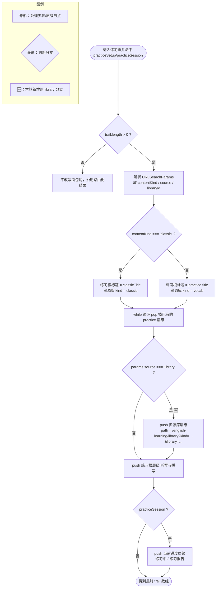

# 资源库入练习的面包屑回跳

## 延伸阅读

- 资源库入口与返回导航（`source=library`、`EnglishPracticeEntry`）：[`练习入口导航.md`](./练习入口导航.md)
- 资源库词条列表续读与分页：[`资源库词条续读.md`](./资源库词条续读.md)
- 资源库列表虚拟滚动/虚拟网格：[`资源库列表单向虚拟滚动.md`](./资源库列表单向虚拟滚动.md)、[`资源库虚拟网格.md`](./资源库虚拟网格.md)
- 域总览：[`README.md`](./README.md)

---

## 1. 背景与问题

从**英语学习 > 资源库**进入某库的「听写 / 拼写」练习后，顶栏面包屑此前只展开到「英语学习 > 听写与拼写（练习配置）」，**缺少「资源库」这一级**。用户在练习设置页/作答页想回到刚才那个库列表时，只能反复点浏览器返回或重新从侧栏进入资源库，路径不可靠。

本轮为 `source === 'library'` 的练习入口补上资源库层级：

- **改动前**：面包屑为 `英语学习 > 听写与拼写`（无资源库级），无法一键回库。
- **改动后**：面包屑为 `英语学习 > 资源库 > 听写与拼写 >（练习中 | 练习报告）`，「资源库」级可一键跳回原库列表（并带上 `kind` 与 `library` 参数定位到同一个库）。

## 2. 改动范围

单文件改动：

| 路径 | 说明 |
| ---- | ---- |
| `apps/frontend/src/components/design/Header/index.tsx` | 顶栏面包屑：`isClassic` 局部变量提取（纯重构）；`source === 'library'` 时向面包屑数组 push 资源库层级项 |

无后端改动，无数据库/接口改动。

## 3. 实现思路

1. **在既有练习面包屑分支内做增量，不新增分支**：资源库层级只在 `(practiceSetup || practiceSession)` 的既有分支里追加，避免影响报告列表、今日记词等其它面包屑拼装。
2. **先 pop 再有序 push**：原逻辑会先把路由树里的 `/english-learning/practice*` 层级 `pop` 掉，再按 `资源库 → 听写与拼写 →（练习中）` 顺序 push，保证层级顺序正确、无重复。
3. **`isClassic` 提取为局部变量**：`params.get('contentKind') === 'classic'` 既要决定练习根标题，又要决定资源库链接里的 `kind=classic|vocab`，提取一次供两处复用，避免重复判断。
4. **回库链接携带定位参数**：资源库级 `path` 拼成 `/english-learning/library?kind=...&library=...`，其中 `kind` 按 `isClassic` 映射为 `classic|vocab`，`library` 取当前查询串的 `libraryId`（去空格后非空才带），从而点面包屑能回到**同一个库**而非默认列表。
5. **不引入通用「来源回退」机制**：没有为所有 `source` 值做「自动补上一级来源」的通用规则。原因是各入口（home / history / pack / favorites / library）回跳目标语义不同，通用推断易误跳；本轮只按确定的产品诉求给 `library` 加显式分支，其余 `source` 分支保持原样。

**Mermaid（source 分支 → 面包屑数组）**



**读图要点**：`source === 'library'` 分支是唯一新增节点（🆕），插在「pop 掉旧 practice 层级」与「push 练习根层级」之间，因此资源库级稳定落在练习级之前；`libraryId` 为空时只带 `kind`，仍回资源库列表。

## 4. 关键代码对比与注释

### 4.1 面包屑计算的 `useMemo`（`apps/frontend/src/components/design/Header/index.tsx`）

**对比范围**：`Header` 组件内 `const { breadcrumbTrail, headerTitle } = useMemo(...)` 的**完整符号**。因该 `useMemo` 体量较大（约 220 行），仅保留声明、练习分支与依赖数组闭合；内部工具函数、报告/今日记词分支及尾部多路 `return` 用**对称的 `// ...（未改动）`** 省略，改动前/后切口一致，便于对齐 diff 焦点行。

**改动前** · `apps/frontend/src/components/design/Header/index.tsx`（基线 `13ad5797`，约 L63–L279）

```tsx
// 组件内 useMemo：按路径与查询参数推导面包屑数组；解构出链条与单层标题
const { breadcrumbTrail, headerTitle } = useMemo(() => {
	// 构建本次渲染用到的全量路由树（含插件注入），供后续按 pathname 解析层级
	const routes = buildRoutes();
	// 内层工具函数 labelOf / resolveAbsolute / findRouteTitle / dedupeAdjacent / findBreadcrumbTrail 与基线相同，此处对称省略
	// ...（未改动）
	// 由路由树收集从根到当前 pathname 的原始层级链，缺省为空数组兜底
	const rawTrail =
		findBreadcrumbTrail(routes, location.pathname, '', []) ?? [];
	// 合并相邻同名层级（如 layout 与 index），得到后续可增删的 trail
	const trail = dedupeAdjacent(rawTrail);
	// 判定是否命中练习配置页，决定是否改写练习相关面包屑
	const practiceSetup = location.pathname === '/english-learning/practice';
	// 判定是否命中练习作答页或结算报告页
	const practiceSession =
		location.pathname === '/english-learning/practice/session' ||
		location.pathname === '/english-learning/practice/summary';
	// 仅在练习相关页且已有路由层级时才进入改写逻辑
	if ((practiceSetup || practiceSession) && trail.length > 0) {
		// 取当前 URL 查询参数，用于判定 contentKind 与拼装子链接
		const params = new URLSearchParams(location.search);
		// 依 contentKind 选择练习根标题：经典句用 classicTitle，否则通用 title
		const practiceRootLabel =
			params.get('contentKind') === 'classic'
				? t('route.englishLearning.practice.classicTitle')
				: t('route.englishLearning.practice.title');
		// 复制一份参数用于生成配置页链接，后续要单独删掉 run
		const setupParams = new URLSearchParams(params);
		// 删除 run：回配置页时应停在设置态而非直接开跑
		setupParams.delete('run');
		// 序列化得到配置页查询串
		const setupQuery = setupParams.toString();
		// 拼出练习根层级应指向的配置页路径（有查询串才带 ?）
		const setupPath = setupQuery
			? `/english-learning/practice?${setupQuery}`
			: '/english-learning/practice';
		// 先从 trail 尾部移除路由树里已有的 practice 层级，避免与新拼层级重复
		while (
			trail.length > 0 &&
			(trail[trail.length - 1].path === '/english-learning/practice' ||
				trail[trail.length - 1].path.startsWith(
					'/english-learning/practice/',
				))
		) {
			// 逐项弹出命中的 practice 层级，为下一步重建干净的尾部
			trail.pop();
		}
		// 追加练习根层级（听写与拼写 / 经典句听写），点击可回配置页
		trail.push({ label: practiceRootLabel, path: setupPath });
		// 作答/结算页再追加一层当前进度
		if (practiceSession) {
			trail.push({
				// 结算页显示「练习报告」，其余显示「练习中」
				label: location.pathname.endsWith('/summary')
					? t('englishLearning.practice.summaryTitle')
					: t('englishLearning.practice.sessionCrumb'),
				// 当前页 + 原查询串，保证点该层仍停在同阶段
				path: `${location.pathname}${location.search}`,
			});
		}
	}
	// 练习报告列表/详情、今日记词分支，以及单/多层标题的多路 return，与基线相同，此处对称省略
	// ...（未改动）
	// 依赖：路径/查询、插件注入 epoch、语言与 t 变化时重算面包屑
}, [location.pathname, location.search, routeEpoch, locale, t]);
```

**改动后** · `apps/frontend/src/components/design/Header/index.tsx`（当前源码，约 L63–L290）

```tsx
// 组件内 useMemo：按路径与查询参数推导面包屑数组；解构出链条与单层标题
const { breadcrumbTrail, headerTitle } = useMemo(() => {
	// 构建本次渲染用到的全量路由树（含插件注入），供后续按 pathname 解析层级
	const routes = buildRoutes();
	// 内层工具函数 labelOf / resolveAbsolute / findRouteTitle / dedupeAdjacent / findBreadcrumbTrail 与基线相同，此处对称省略
	// ...（未改动）
	// 由路由树收集从根到当前 pathname 的原始层级链，缺省为空数组兜底
	const rawTrail =
		findBreadcrumbTrail(routes, location.pathname, '', []) ?? [];
	// 合并相邻同名层级（如 layout 与 index），得到后续可增删的 trail
	const trail = dedupeAdjacent(rawTrail);
	// 判定是否命中练习配置页，决定是否改写练习相关面包屑
	const practiceSetup = location.pathname === '/english-learning/practice';
	// 判定是否命中练习作答页或结算报告页
	const practiceSession =
		location.pathname === '/english-learning/practice/session' ||
		location.pathname === '/english-learning/practice/summary';
	// 仅在练习相关页且已有路由层级时才进入改写逻辑
	if ((practiceSetup || practiceSession) && trail.length > 0) {
		// 取当前 URL 查询参数，用于判定 contentKind 与拼装子链接
		const params = new URLSearchParams(location.search);
		// 提取「是否经典句」为局部变量：练习根标题与资源库 kind 都要用它，避免重复判断
		const isClassic = params.get('contentKind') === 'classic';
		// 依 isClassic 选择练习根标题：经典句用 classicTitle，否则通用 title
		const practiceRootLabel = isClassic
			? t('route.englishLearning.practice.classicTitle')
			: t('route.englishLearning.practice.title');
		// 复制一份参数用于生成配置页链接，后续要单独删掉 run
		const setupParams = new URLSearchParams(params);
		// 删除 run：回配置页时应停在设置态而非直接开跑
		setupParams.delete('run');
		// 序列化得到配置页查询串
		const setupQuery = setupParams.toString();
		// 拼出练习根层级应指向的配置页路径（有查询串才带 ?）
		const setupPath = setupQuery
			? `/english-learning/practice?${setupQuery}`
			: '/english-learning/practice';
		// 先从 trail 尾部移除路由树里已有的 practice 层级，避免与新拼层级重复
		while (
			trail.length > 0 &&
			(trail[trail.length - 1].path === '/english-learning/practice' ||
				trail[trail.length - 1].path.startsWith(
					'/english-learning/practice/',
				))
		) {
			// 逐项弹出命中的 practice 层级，为下一步重建干净的尾部
			trail.pop();
		}
		// 资源库入口：英语学习 > 资源库 > 听写与拼写 > …
		// 仅当来源为资源库时，在练习层级之前插入资源库级，支持一键回原库
		if (params.get('source') === 'library') {
			// 新建参数量只放回库定位信息，避免把练习参数带进资源库 URL
			const libraryParams = new URLSearchParams();
			// kind 与练习类型对齐：经典句回经典句库，其余回单词库
			libraryParams.set('kind', isClassic ? 'classic' : 'vocab');
			// 读取当前库 id；trim 后为空则视为未指定库
			const libraryId = params.get('libraryId')?.trim();
			// 有库 id 才带 library 参数，使面包屑定位到同一个库
			if (libraryId) libraryParams.set('library', libraryId);
			// push 资源库层级：点击即跳回资源库列表（并选中对应库）
			trail.push({
				// 资源库级标题取 i18n 中资源库路由标题
				label: t('route.englishLearning.library.title'),
				// 组合回库路径与查询串（kind[/library]）
				path: `/english-learning/library?${libraryParams.toString()}`,
			});
		}
		// 追加练习根层级（听写与拼写 / 经典句听写），点击可回配置页
		trail.push({ label: practiceRootLabel, path: setupPath });
		// 作答/结算页再追加一层当前进度
		if (practiceSession) {
			trail.push({
				// 结算页显示「练习报告」，其余显示「练习中」
				label: location.pathname.endsWith('/summary')
					? t('englishLearning.practice.summaryTitle')
					: t('englishLearning.practice.sessionCrumb'),
				// 当前页 + 原查询串，保证点该层仍停在同阶段
				path: `${location.pathname}${location.search}`,
			});
		}
	}
	// 练习报告列表/详情、今日记词分支，以及单/多层标题的多路 return，与基线相同，此处对称省略
	// ...（未改动）
	// 依赖：路径/查询、插件注入 epoch、语言与 t 变化时重算面包屑
}, [location.pathname, location.search, routeEpoch, locale, t]);
```

**变更摘要**：把 `params.get('contentKind') === 'classic'` 从练习根标题三元表达式中**提取**为 `isClassic` 局部变量（供标题与资源库 `kind` 复用）；在 `pop` 旧 practice 层级之后、`push` 练习根层级之前，新增 `source === 'library'` 分支，向 `trail` 插入可一键回原库的「资源库」层级。其余分支与依赖数组未变。

## 5. 兼容性与影响

- **无破坏性**：新增分支仅在 `source === 'library'` 时触发，其它入口（home / history / pack / favorites）面包屑与返回行为不变。
- **路径参数面**：仅前端 Header 内部拼接的导航 URL 变化，不涉及接口与落库；`libraryId` 缺失时只带 `kind`，仍能回资源库列表。
- **回归建议**：
  1. 资源库 → 某单词库「听写 / 拼写」→ 设置页，面包屑出现「资源库」并可一键回该库；
  2. 经典句库 →「拼写」练习，面包屑「资源库」链接应带 `kind=classic` 且带 `library`；
  3. 首页/历史抽屉/词包/收藏入口进入练习，面包屑**不**出现资源库级。

## 6. 相关源码路径

| 说明 | 路径 |
| ---- | ---- |
| 顶栏面包屑 | `apps/frontend/src/components/design/Header/index.tsx` |
| 练习入口构造（`source=library`） | `apps/frontend/src/views/englishLearning/library/VocabularyLibraryListPanel.tsx` |
| 练习 URL 工具 | `apps/frontend/src/views/englishLearning/practice/utils/paths.ts` |

---

（若与仓库最新源码不一致，以源码为准）
