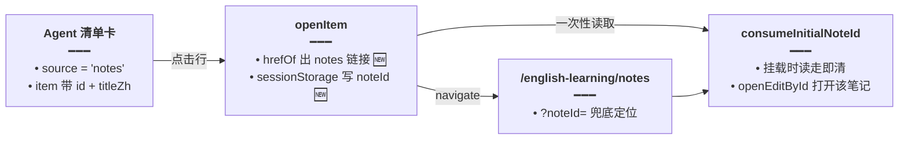

# 资源清单卡笔记源

> 延伸阅读：
> - [Agent大结果旁路展示.md](./Agent大结果旁路展示.md)：`ResourceListBlock` 清单卡的前序实现（虚拟滚动 / 过滤 / 朗读）。
> - [学习笔记独立弹窗.md](./学习笔记独立弹窗.md)：笔记独立窗口 `consumeInitialNoteId` 的消费端约定。

## 1. 背景与目标

Agent 外溢清单卡（`ResourceListBlock`）原本只为**词条 / 语句 / 日推 / 词包**四类来源设计。接入**学习笔记**来源（`source === 'notes'`）后，直接复用旧逻辑出了三个问题：

1. **朗读乱播**：`speakOf` 会把笔记的去标签正文当英文句子朗读——笔记正文是中文混排，不该进 TTS。
2. **行文案错**：`rowOf` 按 `english / word` 取主文案，笔记 item 的这些字段是去标签正文碎片，行上显示成一团乱码。
3. **点击无反应**：`hrefOf` 没有 notes 分支，点笔记行不跳转；即使跳转到笔记页，也无法定位到具体那一篇。

目标：清单卡对 `source === 'notes'` 单独处理——**不朗读、行上只亮标题、点击跳笔记页并定位打开该笔记**。

## 2. 改动范围

| 路径 | 改动 |
|------|------|
| `apps/frontend/src/components/design/Assistant/ResourceListBlock.tsx` | `speakOf` / `rowOf` 加 `source` 参并对 notes 短路；`hrefOf` 加 notes 分支；`openItem` 写 `sessionStorage` 再跳转；`ListRow` 透传 `source`；`filteredRows` 过滤用同一口径 |

## 3. 实现思路

1. **source 一路透传**：从 `block.source` → 两处 `ListRow` 调用 → 行内 `rowOf` / `speakOf`，以及 `filteredRows` 的过滤回调——所有取文案 / 判定可朗读的入口都拿到同一来源标记，不会出现「行上显示标题、朗读却播正文」的错位。
2. **notes 三短路**：`speakOf` 直接 `null`（行上不出现喇叭）；`rowOf` 只取 `titleZh → title → lead` 作为唯一行文案；`hrefOf` 返回 `/english-learning/notes?noteId=<id>`。
3. **定位靠 sessionStorage 接力**：`openItem` 在 `navigate` 前把笔记 id 写入 `dnhyxc_ln_popout_note_id`；笔记页挂载时 `consumeInitialNoteId → openEditById` 读走并清除——跨页面的「打开指定笔记」用一次性存储传递，不污染路由参数（路由上只有 `noteId` 查询参数做兜底）。
4. **写入失败静默**：`sessionStorage.setItem` 包 `try/catch`——隐私模式写失败时仍正常跳转笔记页，只是不自动打开编辑。

### 数据流（改动后）



## 4. 关键实现（改动前 / 改动后对比 + 注释）

### 4.1 `speakOf`：notes 不朗读

来源：`apps/frontend/src/components/design/Assistant/ResourceListBlock.tsx`（**改动前**，约 L44–L57，diff `-` 侧）

```ts
/** 只朗读词面或英文句子，库名、标题不播。 */
// 无来源参：笔记正文会被当成「英文句子」塞进 TTS
function speakOf(item: unknown): { text: string; sentence: boolean } | null {
	// 非对象直接不可播
	if (!item || typeof item !== 'object') return null;
	// 收窄成可索引的记录类型，后面按字段名取值
	const o = item as Record<string, unknown>;
	// 只收字符串字段
	const text = (v: unknown) => (typeof v === 'string' ? v.trim() : '');
	// 词面优先
	const word = text(o.word);
	// 命中词面即播词：sentence=false 走单词读音
	if (word) return { text: word, sentence: false };
	// 英文句子次之：笔记的 english 字段是去标签正文，会在这里误命中
	const english = text(o.english);
	// 命中句子播整句：sentence=true 走句子语调
	if (english) return { text: english, sentence: true };
	// 词面和句子都取不到：行上不出现喇叭
	return null;
}
```

来源：`apps/frontend/src/components/design/Assistant/ResourceListBlock.tsx`（**改动后**，约 L44–L58）

```ts
/** 只朗读词面或英文句子，库名、标题、笔记正文不播。 */
// 加来源参：notes 源整体禁播
function speakOf(
	// 行数据：未知结构，函数内部收窄后再取字段
	item: unknown,
	// 来源标记：可选，旧调用不传时行为与改版前一致
	source?: ElResourceBlock['source'],
	// 返回待播文本与是否整句；null 表示该行不可播
): { text: string; sentence: boolean } | null {
	// 笔记一律不播：正文是中文混排，进 TTS 又慢又错
	if (source === 'notes') return null;
	// 非对象直接不可播
	if (!item || typeof item !== 'object') return null;
	// 收窄成可索引的记录类型，后面按字段名取值
	const o = item as Record<string, unknown>;
	// 只收字符串字段
	const text = (v: unknown) => (typeof v === 'string' ? v.trim() : '');
	// 词面优先
	const word = text(o.word);
	// 命中词面即播词：sentence=false 走单词读音
	if (word) return { text: word, sentence: false };
	// 英文句子次之
	const english = text(o.english);
	// 命中句子播整句：sentence=true 走句子语调
	if (english) return { text: english, sentence: true };
	// 词面和句子都取不到：行上不出现喇叭
	return null;
}
```

### 4.2 `rowOf`：notes 只亮标题

来源：`apps/frontend/src/components/design/Assistant/ResourceListBlock.tsx`（**改动前**，约 L60–L91，diff `-` 侧；词条 / 语句取字段段未改动，对称省略）

```ts
// 无来源参：笔记 item 走通用取字段链，en 变成正文碎片
function rowOf(item: unknown): {
	// 主文案（行上大字）
	en: string;
	// 副文案：中文释义，可选
	zh?: string;
	// 音标，可选
	ipa?: string;
	// 词性，可选
	pos?: string;
	// 函数体：先兜底非对象入参，再按字段链取文案
} {
	// 非对象入参先兜底
	if (!item || typeof item !== 'object') {
		// 把原始值字符串化当行文案，保证渲染层拿到字符串
		return { en: String(item ?? '') };
	}
	// 收窄成可索引的记录类型，后面按字段名取值
	const o = item as Record<string, unknown>;
	// 只收字符串字段
	const text = (v: unknown) => (typeof v === 'string' ? v.trim() : '');
	// 主文案取字段链：english → word → …（笔记的 english 是正文，行上是一团）
	// ...（词条 / 语句取字段段未改动，对称省略）
}
```

来源：`apps/frontend/src/components/design/Assistant/ResourceListBlock.tsx`（**改动后**，约 L60–L92；词条 / 语句取字段段未改动，对称省略）

```ts
// 加来源参：notes 走独立取字段
function rowOf(
	// 行数据：未知结构，函数内部收窄后再取字段
	item: unknown,
	// 来源标记：可选，旧调用不传时行为与改版前一致
	source?: ElResourceBlock['source'],
	// 返回值：行上各槽位的文案结构
): {
	// 主文案（行上大字）
	en: string;
	// 副文案：中文释义，可选
	zh?: string;
	// 音标，可选
	ipa?: string;
	// 词性，可选
	pos?: string;
	// 函数体：先兜底非对象入参，再按来源分路取文案
} {
	// 非对象入参先兜底
	if (!item || typeof item !== 'object') {
		// 把原始值字符串化当行文案，保证渲染层拿到字符串
		return { en: String(item ?? '') };
	}
	// 收窄成可索引的记录类型，后面按字段名取值
	const o = item as Record<string, unknown>;
	// 只收字符串字段
	const text = (v: unknown) => (typeof v === 'string' ? v.trim() : '');
	// 笔记卡只亮标题；english 是去标签正文，不能当行文案或副标题
	if (source === 'notes') {
		// 标题链：中文标题 → 英文标题 → 导语；副标题 / 音标 / 词性一律不给
		return { en: text(o.titleZh) || text(o.title) || text(o.lead) };
	}
	// 主文案取字段链：english → word → …
	// ...（词条 / 语句取字段段未改动，对称省略）
}
```

### 4.3 `hrefOf`：notes 跳笔记页

来源：`apps/frontend/src/components/design/Assistant/ResourceListBlock.tsx`（**改动前**，约 L93–L117，diff `-` 侧，节选日推与 pack 两分支之间）

```ts
/** 日推行 → 阅读详情；词句生成历史行 → stream 页。词条行本身不跳。 */
function hrefOf(block: ElResourceBlock, item: unknown): string | null {
	// ...（日推 daily-reading 分支未改动，对称省略）
	// 没有 notes 分支：笔记行取不到链接，点击无反应
	if (block.source === 'pack') {
		// ...（pack 分支未改动，对称省略）
	}
	// 无匹配来源：词条等不可跳的行返回 null，点击无反应
	return null;
}
```

来源：`apps/frontend/src/components/design/Assistant/ResourceListBlock.tsx`（**改动后**，约 L93–L118；相邻分支未改动，对称省略）

```ts
/** 日推行 → 阅读详情；笔记行 → 笔记页；词句生成历史行 → stream 页。词条行本身不跳。 */
function hrefOf(block: ElResourceBlock, item: unknown): string | null {
	// ...（日推 daily-reading 分支未改动，对称省略）
	// 笔记行：跳笔记列表页并用 noteId 查询参数定位
	if (block.source === 'notes') {
		// 拼笔记页链接：noteId 编码进查询串，防特殊字符截断
		return `/english-learning/notes?noteId=${encodeURIComponent(id)}`;
	}
	// 词包行：跳词包详情（分支体未改动，省略）
	if (block.source === 'pack') {
		// ...（pack 分支未改动，对称省略）
	}
	// 无匹配来源：词条等不可跳的行返回 null，点击无反应
	return null;
}
```

### 4.4 `openItem`：跳转前写 sessionStorage

来源：`apps/frontend/src/components/design/Assistant/ResourceListBlock.tsx`（**改动前**，约 L346–L352，diff `-` 侧）

```ts
	// 行点击回调：出链接即跳
	const openItem = useCallback(
		// 回调入参为被点击的行数据
		(item: unknown) => {
			// 出链接即跳：笔记页无法知道要打开哪一篇
			const href = hrefOf(block, item);
			// 有链接才跳：词条等无链接行点击无反应
			if (href) navigate(href);
		},
		// 依赖块配置与导航函数：任一变化重建回调
		[block, navigate],
	);
```

来源：`apps/frontend/src/components/design/Assistant/ResourceListBlock.tsx`（**改动后**，约 L346–L365）

```ts
	// 行点击回调：跳转前按来源把笔记 id 写进一次性存储
	const openItem = useCallback(
		// 回调入参为被点击的行数据
		(item: unknown) => {
			// 先取跳转链接：notes 行在这里拿到笔记页地址
			const href = hrefOf(block, item);
			// 无链接直接返回：与跳转逻辑解耦，早退后再处理来源差异
			if (!href) return;
			// 笔记行：跳转前把 id 存进一次性存储
			if (block.source === 'notes' && item && typeof item === 'object') {
				// 只收字符串 id：其它类型视为无 id 跳过
				const id =
					// id 必须是字符串才采信
					typeof (item as { id?: unknown }).id === 'string'
						// 是字符串：去首尾空白后作为待传 id
						? (item as { id: string }).id.trim()
						// 非字符串：置空，后面跳过写入
						: '';
				// 插件挂载时 consumeInitialNoteId → openEditById
				if (id) {
					// 隐私模式写 sessionStorage 可能抛错，包 try/catch 保证仍跳转
					try {
						// 写一次性 key：笔记页读走即清，不残留
						sessionStorage.setItem('dnhyxc_ln_popout_note_id', id);
					// 写失败静默：不弹错不阻断，跳转照常
					} catch {
						/* ignore */
					}
				}
			}
			// 写完（或跳过写入）后统一跳转
			navigate(href);
		},
		// 依赖块配置与导航函数：任一变化重建回调
		[block, navigate],
	);
```

### 4.5 `ListRow` 透传与 `filteredRows` 同口径

来源：`apps/frontend/src/components/design/Assistant/ResourceListBlock.tsx`（**改动前**，约 L120–L145 与 L369–L378，diff `-` 侧，两处节选）

```tsx
// ListRow 无 source prop：行内取文案 / 判朗读都用无来源版本
function ListRow({
	// 行序号：用于播放 key 与位置样式
	index,
	// 行数据：原始 item，行内再取字段
	item,
	// 是否末行：控制分隔线
	last,
	// 当前播放中的行 key：驱动喇叭动效
	playingKey,
	// 点击喇叭的回调
	onPlay,
	// ...（其余 props 未改动，对称省略）
}: {
	// 行序号
	index: number;
	// 行数据：未知结构，由 rowOf / speakOf 收窄
	item: unknown;
	// 是否末行
	last: boolean;
	// ...（其余类型未改动，对称省略）
}) {
	// 行文案 / 可播判定：拿不到来源，notes 行也按词条逻辑渲染
	const row = rowOf(item);
	// 可播判定：非 null 才显示喇叭
	const speak = speakOf(item);
	// ...（渲染未改动，对称省略）
}

// 过滤回调同样用无来源版 rowOf：搜索匹配字段与行上显示不一致
	const filtered = useMemo(() => {
		// 数据兜底：items 为空时按空数组处理
		const rows = items ?? [];
		// 搜索词去空白并转小写：大小写不敏感匹配
		const needle = q.trim().toLowerCase();
		// 空搜索词不过滤：直接返回全部行
		if (!needle) return rows;
		// 逐行判定是否命中搜索词
		return rows.filter((item) => {
			// 取行文案：与行上显示同一份
			const row = rowOf(item);
			// 主文案或副文案命中即保留该行
			return (
				// 主文案命中
				row.en.toLowerCase().includes(needle) ||
				// 副文案命中：无中文时按空串处理
				(row.zh ?? '').toLowerCase().includes(needle)
			);
		});
	// 依赖数据与搜索词：任一变化重算过滤
	}, [items, q]);
```

来源：`apps/frontend/src/components/design/Assistant/ResourceListBlock.tsx`（**改动后**，约 L120–L146 与 L371–L380，两处节选）

```tsx
// ListRow 加 source prop：来源一路透传到行内
function ListRow({
	// 行序号：用于播放 key 与位置样式
	index,
	// 行数据：原始 item，行内再取字段
	item,
	// 来源标记：从块级透传进来
	source,
	// 是否末行：控制分隔线
	last,
	// 当前播放中的行 key：驱动喇叭动效
	playingKey,
	// 点击喇叭的回调
	onPlay,
	// ...（其余 props 未改动，对称省略）
}: {
	// 行序号
	index: number;
	// 行数据：未知结构，由 rowOf / speakOf 收窄
	item: unknown;
	// 来源标记：可选，不传时按旧行为渲染
	source?: ElResourceBlock['source'];
	// 是否末行
	last: boolean;
	// ...（其余类型未改动，对称省略）
}) {
	// 带来源取行文案：notes 行只亮标题
	const row = rowOf(item, source);
	// 带来源判可播：notes 行返回 null，喇叭不出现
	const speak = speakOf(item, source);
	// ...（渲染未改动，对称省略）
}

// 过滤与行渲染同一口径：搜「标题」命中的就是行上显示的那段
	const filtered = useMemo(() => {
		// 数据兜底：items 为空时按空数组处理
		const rows = items ?? [];
		// 搜索词去空白并转小写：大小写不敏感匹配
		const needle = q.trim().toLowerCase();
		// 空搜索词不过滤：直接返回全部行
		if (!needle) return rows;
		// 逐行判定是否命中搜索词
		return rows.filter((item) => {
			// 带来源取行文案：与 ListRow 内一致
			const row = rowOf(item, block.source);
			// 主文案或副文案命中即保留该行
			return (
				// 主文案命中
				row.en.toLowerCase().includes(needle) ||
				// 副文案命中：无中文时按空串处理
				(row.zh ?? '').toLowerCase().includes(needle)
			);
		});
	// 依赖数据 / 搜索词 / 来源：notes 源取字段不同，必须进 deps
	}, [items, q, block.source]);
```

变更摘要：另有两处 `ListRow` 调用点（虚拟滚动分支约 L469、平铺分支约 L507）各加一行 `source={block.source}`，把来源从块级透传进行级；`filteredRows` 的 deps 同步补 `block.source`。

## 5. 行为变化与兼容性

- **新增能力**：笔记源清单卡可点击——跳笔记页并自动打开该笔记编辑；行上只显示标题；无朗读按钮。
- **不变**：词条 / 语句 / 日推 / 词包四源的显示、朗读、跳转行为逐行不变（`source` 参数均可选，旧调用为零改动）。
- **一次性语义**：`dnhyxc_ln_popout_note_id` 由笔记页挂载时读走并清除，重复进入笔记页不会误开旧笔记。

## 6. 测试与回归建议

1. Agent 问出笔记清单卡 → 行上只有标题，无喇叭按钮；搜索框按标题过滤。
2. 点击笔记行 → 跳笔记页并自动打开该笔记编辑态。
3. 点击词条行 / 日推行 → 行为与旧版一致（词条不跳、日推跳阅读详情）。
4. 无痕 / 隐私模式点笔记行 → 仍跳笔记页（只是不自动打开编辑）。

## 7. 相关源码路径

- `apps/frontend/src/components/design/Assistant/ResourceListBlock.tsx`（全部改动）
- 消费端约定：学习笔记插件 `consumeInitialNoteId`（见 [学习笔记独立弹窗.md](./学习笔记独立弹窗.md)）

> 若与仓库最新源码不一致，以源码为准。
