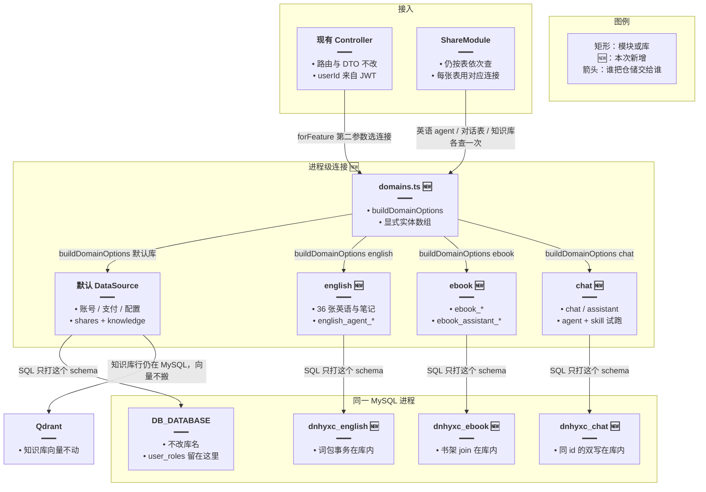
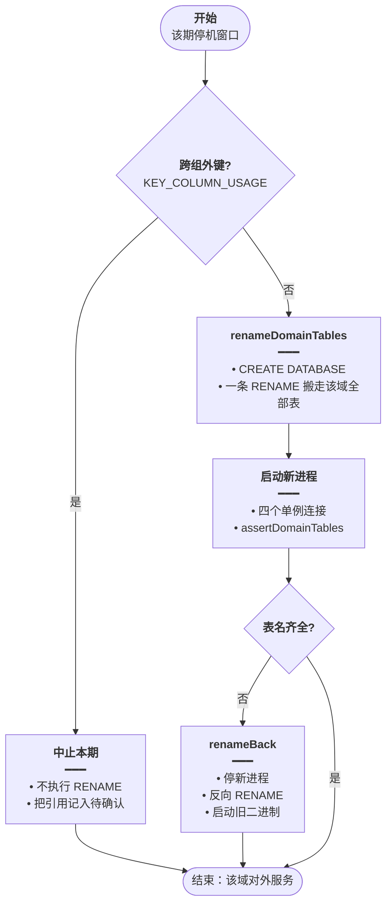
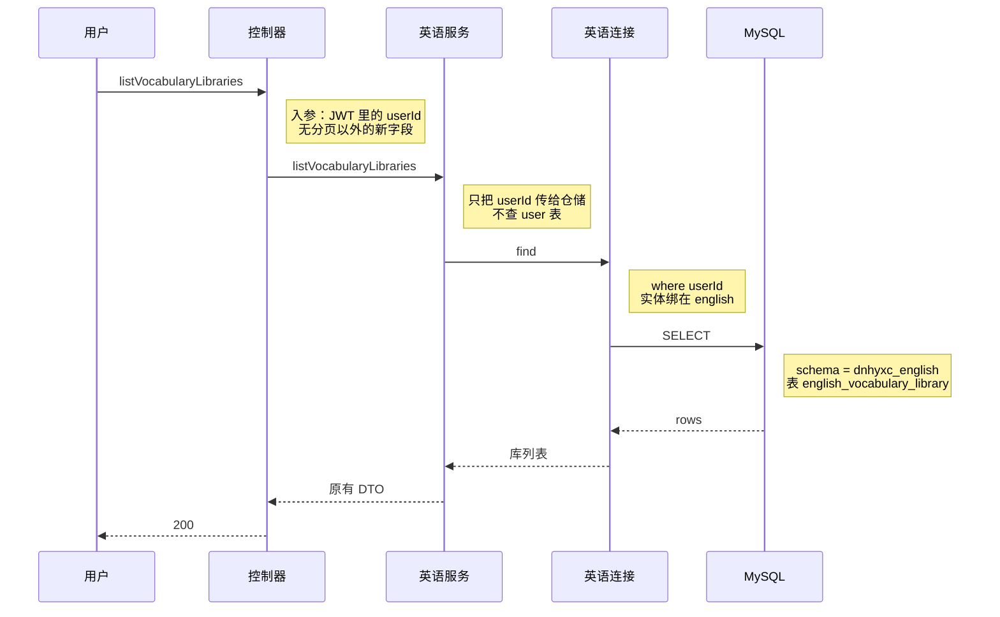

# MySQL 按域拆库 — 实现思路

> **状态**：规划（未实现）  
> **日期**：2026-11-14  
> **需求摘要**：后端只有一个 MySQL schema 承载全部业务表，要把它拆开，使每个库只留一个事务闭包，现有接口行为保持不变。  
> **一句话方案（预告）**：仍用现在这一个 MySQL 进程，按事务闭包拆成四个 schema；默认库留下账号、支付、配置、分享和知识库，英语、电子书、对话各用一个进程级 DataSource，停机后用一条 `RENAME TABLE` 搬表，按英语 → 电子书 → 对话三次上线。

## 延伸阅读

- 主仓 `wiki/Share分表路由与Assistant改造.md`：分享按表路由，本方案不把这些表合成一张
- 本目录 [分享链接持久化.md](./分享链接持久化.md)：`shares` 留在默认库
- 主仓 `apps/backend/src/database/typeorm-config.service.ts`：现有「按请求切端口」不能当作拆库手段

---

## 0. 读本文你将得到什么

- 要解决的是**一个 schema 里业务表过多、且一个 DataSource 扫完全部实体**，不是 MySQL 撑不住 75 张表
- 比对后选定：**同一实例四个 schema**，总表张数不减，每个库的表数下降
- 改动在后端连接、实体注册和一次停机搬表；前端接口不变
- 分三期：M1 英语、M2 电子书、M3 对话；每期做完都能单独对外
- 最大风险是搬表和发版错开半拍，应用会连到空库或找不到已搬走的表

---

## 1. 需求与边界

### 1.1 用户故事

| 角色 | 场景 | 行为 | 期望结果 |
|------|------|------|----------|
| 维护者 | 打开 Adminer / 跑迁移 / 备份 | 面对 `dnhyxc_ai_db` | 一个库里不再同时有账号、英语、电子书、对话全部表 |
| 英语学习用户 | 打开单词库 | 调用现有列表接口 | 数据仍在，响应形状不变 |
| 分享用户 | 打开一条 agent 分享 | 服务按现有顺序查会话 | 英语、Skill 试跑、遗留 agent 仍能各自命中 |
| 值班 | 搬表后发现少表 | 启动核对失败 | 进程不对外；按回滚把表 `RENAME` 回默认库 |

### 1.2 范围

| 在范围内 | 不在范围内（非目标） |
|----------|----------------------|
| 同一 MySQL 进程上新建 schema，并把现有表搬过去 | 再起 MySQL 容器，或按用户 id 水平分片 |
| 显式实体名单，去掉 `**/*.entity.ts` 扫描 | 把六套会话表或词/句镜像表合并成一张 |
| 进程启动时建立命名 DataSource | 用 `?version=v1` 按请求切库 |
| 停机窗口内 `RENAME TABLE` | 双写、按行复制、改前端 |
| 跨库只保留现在这种「先查业务行，再按 `user_id` 查用户」 | 为删用户补一套跨库级联（今天就没有这条外键） |

### 1.3 约束与依赖

- 必须沿用 TypeORM + `mysql2`，不新增数据库中间件
- 库内已有事务不能拆到两个连接：英语词包三张表（`english-learning.service.ts` 约 1958 行及另外三处）、助手删会话（`assistant.service.ts` 约 520 行）、知识库与回收站（`knowledge.service.ts`）
- 电子书书架的 `leftJoin` 只发生在 `ebook_book` 与 `ebook_progress` 之间（`ebook.service.ts`）
- `SkillService.createTrySession` 用同一个 id 先后写 `agent_sessions` 与 `skill_try_sessions`，这两张表必须同库
- 时间列继续 `timezone: 'Z'`，与 `apps/backend/ormconfig.ts` 一致
- 向量仍在 Qdrant，不随知识库三张表搬迁

---

## 2. 背景

- **谁、在什么场景、卡在哪**：后端进程只有一条默认连接。`apps/backend/ormconfig.ts` 用 `**/*.entity.{ts,js}` 把 74 个实体扫进 `DB_DATABASE`（compose 里的库名是 `dnhyxc_ai_db`）。英语相关 36 张，对话 13 张，电子书 10 张，账号与其余 15 张，外加联结表 `user_roles`。
- **现状缺口**：表还在继续按实体增加；迁移文件全在 `apps/backend/src/migrations/` 一条历史里；备份和 Adminer 一次看到所有产品。`TypeOrmConfigService` 会按请求里的 `version=v1` 把**整条连接**换到另一个端口，域和「第二套环境」缠在一起。`Prompt` 实体写了 `schema: DB_DB1_NAME`（示例值 `db1`），对应的 `forFeature` 第二连接被注释掉，拆库没有真正接上。
- **不解决会怎样**：新表默认掉进同一个库、同一份迁移、同一次 `synchronize` 风险面。英语仍是增长最快的一块（规划文档集中在 `wiki/ideas/english/`）。
- **硬约束**：MySQL 默认 `table_open_cache` 远大于 75，本需求不是调这个参数。跨表 SQL 只允许留在下面 §3 已确认的闭包内。用户接口、分享的三级查表顺序、Qdrant 都不改。

---

## 3. 现状与复用

| 能力 | 仓库中已有 | 本需求中的用法 |
|------|------------|----------------|
| 单连接扫全部实体 | `apps/backend/ormconfig.ts`、`typeorm-config.service.ts` | 扩展：改成显式名单；默认连接只留核心实体 |
| 按请求切到 `DB_DB1_PORT` | `typeorm-config.service.ts` 读 `query.version` / `body.version` | 新建连接时不复用；仓库内没有第二处调用方 |
| Prompt 指向另一 schema | `prompt.entity.ts` 的 `schema`；`prompt.module.ts` 里第二连接已注释 | 扩展：去掉 `schema`，表回到默认库（先确认实际位置） |
| 第二只 MySQL 容器 | `docker-compose.yml` 的 `db1`（端口 3092，库名仍是 `dnhyxc_ai_db`） | 直接复用主机即可，本方案不新增容器，也不把域拆进 `db1` |
| 用户外键闭包 | `user.entity.ts` 关联 `Logs`、`Roles`、`Profile`；`roles` 再关联 `Menus` | 直接复用：这些表留在默认库 |
| 英语事务 | `english-learning.service.ts` 的 `dataSource.transaction` | 直接复用：相关表一起进 `dnhyxc_english` |
| 助手删会话事务 | `assistant.service.ts` 同一事务删摘要、消息、会话 | 直接复用：三张表一起进 `dnhyxc_chat` |
| 知识库事务 | `knowledge.service.ts` | 直接复用：三张表留在默认库，不为三张表单开连接 |
| 书架 join | `ebook.service.ts` 的 `leftJoin(EbookProgress)` / `leftJoin(EbookBook)` | 直接复用：电子书表进 `dnhyxc_ebook` |
| 笔记作者名 | `learning-notes.service.ts` 的 `authorMap`：先查笔记，再 `userRepo.find` | 扩展：笔记走英语连接，`User` 仍走默认连接，保持两次查询 |
| 分享分表路由 | `share.service.ts` 顺序查英语 agent、skill 试跑、agent | 直接复用查找顺序；`InjectRepository` 换成对应连接名 |
| Skill 同 id 双写 | `skill.service.ts` `createTrySession` | 直接复用两次 `save`；两张表同进对话库 |
| 关闭时销毁连接 | `app.module.ts` 的 `connections` Map + `TypeOrmDestroyService` | 扩展：Map 改记四个命名连接 |

**实体归属（74 个带 `@Entity` 的类；`Ocr` 没有 `@Entity`，不计入）：**

| 目标 schema | 张数 | 表 |
|-------------|------|----|
| `DB_DATABASE`（默认，不改名） | 15 个实体 + `user_roles` | `User`、`Profile`、`Roles`、`Menus`、`Logs`（类名即表名，见待确认）、`user_wechat`、`membership_payment_grant`、`llm_runtime_config`、`minimax_tts_user_config`、`plugin_user_prefs`、`Prompt`、`shares`、`knowledge`、`knowledge_trash`、`knowledge_category` |
| `dnhyxc_chat` | 13 | `ChatSessions`、`ChatMessages`、`Attachments`（类名即表名）、`assistant_sessions`、`assistant_messages`、`assistant_session_summaries`、`agent_sessions`、`agent_messages`、`agent_session_summaries`、`skill`、`skill_try_sessions`、`skill_try_messages`、`skill_try_session_summaries` |
| `dnhyxc_ebook` | 10 | `ebook_book`、`ebook_chapter`、`ebook_progress`、`ebook_category`、`ebook_highlight`、`ebook_thought`、`ebook_user_prefs`、`ebook_assistant_sessions`、`ebook_assistant_messages`、`ebook_assistant_session_summaries` |
| `dnhyxc_english` | 36 | 全部 `english_*`，含 `english_agent_*`、`english_learning_note`、`english_learning_note_attachment`、`english_learning_note_pending_upload` |

**调研结论**：业务表之间的 TypeORM 关系都在「会话↔消息」「库↔条目」「用户↔资料/角色/日志」里面。跨域联系是整型 `user_id`，笔记和电子书作者都是第二条查询，不是 SQL JOIN。因此可以按闭包搬表，而不改服务里的查询语句。候选方案都接在这些路径上：连接仍从 `ormconfig.ts` / `AppModule` 出去，仓储仍是现在的 `Repository`。

---

## 4. 方案比对与最终方案

### 4.1 候选方案

#### 方案 A：同一实例按闭包拆成四个 schema（扩展）

- **做法**：在现有 `db` 容器里 `CREATE DATABASE dnhyxc_english / dnhyxc_ebook / dnhyxc_chat`。默认库名继续用 `DB_DATABASE`。`AppModule` 注册四个进程级 DataSource。每个连接一份显式实体数组，删掉 `**/*.entity.ts`。停机后按域执行一条 `RENAME TABLE 旧库.t TO 新库.t`。`forFeature` 为搬走的实体带上连接名；`User` 仍注册在默认连接。分享、Agent、笔记、电子书模块按实体拆成多次 `forFeature`。
- **能工作的原因**：§3 的事务和 join 都落在单个目标库内。跨库读用户已经是第二次查询。MySQL 允许同一条 `RENAME` 把表挪到同一实例的另一个 schema，数据文件不重写。
- **主要代价**：三次短停机；`share.module.ts`、`agent.module.ts` 要声明多个连接；连接池从 1 个变成 4 个。

#### 方案 B：只把英语 36 张表拆出去（扩展，改动更小）

- **做法**：同样去掉 glob，默认连接改成显式名单。只新增 `dnhyxc_english`。`english-learning.module.ts`、`learning-notes.module.ts` 以及 `agent.module.ts` / `share.module.ts` 里的 `EnglishAgent*` 改走 `'english'`。对话、电子书、账号留在默认库。
- **能工作的原因**：英语事务和 `english_agent_*` 的会话关系都不依赖默认库里的其他表。M1 的代码量与方案 A 的第一期相同。
- **主要代价**：默认库仍有约 38 个实体（74 − 36）。`AgentModule` 继续把 assistant、agent、skill 试跑注册在默认连接上，下一张会话表还会进原库。

#### 方案 C：合并平行表，让总张数下降（新增模型）

- **做法**：新建 `conversation_sessions`、`conversation_messages`、`conversation_summaries`，用 `surface` 区分 `chat`、`assistant`、`agent`、`ebook_assistant`、`english_agent`。`INSERT ... SELECT` 灌入后删旧表。`ShareService` 的三级查表改成按 `surface` 查这一套。词库与语句库的收藏、错题、库、条目各收成一张，加 `content_kind`。`skill_try_sessions` 不并进这套会话表：它和 `agent_sessions` 是同一个 id 的两行，合成一行会丢掉其中一种含义。
- **能工作的原因**：这些表的主键都是应用生成的 id，分享今天也是分三次查、再在内存里映射成同一种消息。历史行可以按 `surface` 拷过去。
- **主要代价**：助手有 `applied_skills`，电子书助手有 `book_id`，部分消息有 `search_organic`，合并后变成大宽表或 JSON。拷贝窗口比 `RENAME` 长。`createTrySession` 的双行模型还在，总张数下降有限。

### 4.2 比对

| 维度 | 方案 A 四库 | 方案 B 只拆英语 | 方案 C 合并平行表 |
|------|-------------|-----------------|-------------------|
| 正确性 | 现有事务、书架 join、Skill 双写各留在一个连接里；分享仍三次查询 | 与 A 的英语部分相同；对话和电子书事务仍在默认库，也正确 | 列已分叉，空列或 JSON 容易把某一面的字段写到另一面；Skill 双行若误并会丢行 |
| 复用 / 与现状契合 | 复用现有实体类和 Repository；改的是连接名和表所在 schema | 复用面更大：对话、电子书模块的 `forFeature` 不用动 | 实体要重写；`share.service.ts` 的路由要改成单表 |
| 改动面 | `AppModule`、三个域模块、分享、Agent、笔记、电子书、ormconfig、一次 SQL | 只动英语相关模块和 Agent/分享里的三张英语 agent 表 | 会话读写路径（assistant、agent、chat、ebook-assistant、english agent、share）都要改 |
| 复杂度 | 4 个连接、3 个新库名、显式实体数组 | 2 个连接 | 新表结构、灌数脚本、读写双份一段时间或一次停机拷贝 |
| 体验 | 接口不变；每期一次短停机（元数据改名） | 接口不变；只有一期停机 | 接口可以不变，但拷贝期间更长；写错 `surface` 用户会看到空分享 |
| 风险 | 发版与 `RENAME` 必须同一窗口；回滚是反向 `RENAME` | 风险面是 A 的第一期；原库膨胀问题还在 | 拷贝中断会留下半份新表；回滚要停在旧表还没删的时刻 |
| 可维护性 | 新英语表只登记英语数组，新对话表只登记对话数组；迁移按目录分开 | 英语不再挤进默认库；对话和电子书仍共用一份迁移历史 | 少约十张会话表，但宽表以后每加一列都要考虑五个 surface |

### 4.3 综合考量

本需求的权重顺序是：事务和现有查询不能被拆错，然后才是默认库不再继续变大，最后才是少改几个模块。方案 B 在改动面上更好，它少两次停机、少两个连接池，并且 M1 的代码和 A 的第一期几乎一样。这个优点抵不过短板：做完 B 之后默认库仍有大约 38 个实体，`agent.module.ts` 仍把三套会话注册在默认连接上，下一个会话表还会掉回原库，也就是「一个库表太多」只解决了英语那一半。

方案 C 的优点是全实例表张数会下降，以后新的会话面不必再加三张表。这个优点抵不过列已经分叉、以及 `skill_try_sessions` 与 `agent_sessions` 同 id 双行不能合成一行。分享路由今天是按表存在性分支的，改成 `surface` 会把这条已上线的路径重写一遍。

因此选定方案 A。用三次独立的 `RENAME` 把单次风险收成「只动一个闭包」。M1 结束时系统已经是两库，可以停在那里运行；M2、M3 只是按同一办法再搬两个闭包，不推翻 M1。

### 4.4 最终方案

#### 背景

74 个实体被 `ormconfig.ts` 的 glob 装进一个 schema。真正带外键或同事务的组是：用户—资料—角色—菜单—日志、英语词包与笔记、电子书与进度、助手三张表、agent 与 skill 试跑。知识库只有三张表，再单开一个连接不值得。`version=v1` 切的是整库端口，仓库里没有业务调用方，不能用来当域路由。Prompt 的 `schema: DB_DB1_NAME` 也没有配上第二连接。

#### 具体思路

1. 模块仍是现有 Nest 模块。新增 `apps/backend/src/database/domains.ts` 放三个域的库名和实体数组；默认库的实体数组放在同文件，替换 glob。
2. 数据原地搬迁：行不复制。`user_id` 继续是整型，不建跨库外键。笔记作者、电子书里按 id 查用户，仍是第二条 SQL，分别走英语/电子书连接和默认连接。
3. 连接是进程级单例，放在 `AppModule` 启动时。不放请求对象里，避免每个 HTTP 请求重建工厂。业务状态仍在各自的表里，没有新的前端或 MobX 状态。
4. 启动时拿实体表名和 `information_schema` 比对，少表就拒绝启动。搬表前先查跨组外键，查到就停在当次，不执行 `RENAME`。一个域的表写在同一条 `RENAME` 里，库内已有外键会一起改名。

#### 实现方案

**一句话**：仍用现在这一个 MySQL 进程，按事务闭包拆成四个 schema；默认库留下账号、支付、配置、分享和知识库，英语、电子书、对话各用一个进程级 DataSource，停机后用一条 `RENAME TABLE` 搬表，按英语 → 电子书 → 对话三次上线。

| 步骤 | 谁 | 做什么 | 输入 → 输出 |
|------|----|--------|-------------|
| 1 | `database/domains.ts` | 列出四个库的实体，默认库不再扫描目录 | 实体类 → `DomainName` 与表名数组 |
| 2 | `AppModule` + `buildDomainOptions` | 按环境变量建四个单例；`synchronize: false` | 主机、库名、实体 → `DataSource` |
| 3 | 各 `*.module.ts` | 搬走的实体 `forFeature(entities, 连接名)`；`User` 仍无连接名 | 模块 → 正确的 `Repository` |
| 4 | 停机后的迁移 SQL | `CREATE DATABASE` + 一条 `RENAME TABLE` | 旧库表 → 新 schema 同名表 |
| 5 | `assertDomainTables` | 启动时核对表是否齐全 | 期望表名 → 缺表则抛错，进程不监听 |

环境变量加在 `apps/backend/src/factorys/app-config.factory.ts`：`DB_ENGLISH_DATABASE`、`DB_EBOOK_DATABASE`、`DB_CHAT_DATABASE`，缺省分别为 `dnhyxc_english`、`dnhyxc_ebook`、`dnhyxc_chat`。不复用 `DB_DB1_NAME`。

已执行过的迁移文件留在 `apps/backend/src/migrations/*.ts`，只由默认 DataSource 加载（glob 改成不递归子目录）。某库搬完之后，该库的新迁移放在 `apps/backend/src/migrations/<domain>/`，只由该 DataSource 扫描。

#### 选定原因

1. **正确性**：事务和 join 的分组与四个库一致。牺牲：总表张数不减少，Adminer 要打开四个库才看全。
2. **复用**：实体类、Repository、分享的查找顺序都留下。牺牲：每个搬走的 `InjectRepository` 要多写连接名。
3. **改动面**：比方案 C 窄，比方案 B 宽。牺牲：电子书和对话模块要在 M2、M3 改 `forFeature`，方案 B 可以不改它们。
4. **复杂度**：没有新中间件，也没有宽表。牺牲：运维要记住四个库名，而不是一个。
5. **体验**：用户请求路径不变。牺牲：上线需要三次短停机，方案 B 只有一次。
6. **风险**：`RENAME` 是元数据操作，回滚是反向改名。牺牲：窗口内必须先停进程再搬表，不能边写边搬。
7. **可维护性**：新表必须登记到某个数组里，glob 不再把整库实体吸进默认连接。牺牲：少了「丢一个 entity 文件就自动建表」的便利。

#### 优势

- 相对方案 B：M2、M3 之后默认库只留 15 个实体加 `user_roles`。对话表再增加时只改对话数组和 `dnhyxc_chat` 的迁移目录，不会再堆回账号库。
- 相对方案 C：`assistant_messages`、`ebook_assistant_sessions`、`english_agent_messages` 保持现在的列和分享里的三次查询；`createTrySession` 继续写两行同 id 的记录，不需要发明合并规则。

#### 怎么实现

1. 在 `domains.ts` 写四个实体数组和表名清单（无 `@Entity('name')` 的类，表名等于类名，以 `information_schema` 核对后再写入清单）。
2. `AppModule` 对 `english`、`ebook`、`chat` 各 `forRootAsync` 一次，工厂只注入 `ConfigService`。默认连接同样改成显式实体，并去掉 `TypeOrmConfigService` 里的 `REQUEST`。
3. M1 把英语模块、笔记实体、`EnglishAgent*` 的 `forFeature` 和对应 `@InjectRepository` 第二参数写成 `'english'`。笔记和电子书里的 `User` 仍不写连接名，继续默认库。
4. 停进程，跑该期的 `RENAME`（一个域一条语句），再启动新进程。
5. `assertDomainTables` 在监听端口之前执行；缺表则抛错。回滚是停新进程、反向 `RENAME`、启动旧二进制。

主要实现代码见 §9。

### 4.5 其他关键决策

下面两件事会改变连接的生命周期和数据怎么搬，单独比对。库拆成几个已经在 §4 选定，不再单列。

#### 4.5.1 连接何时创建

##### 候选

**方案 D：进程启动时四个单例（扩展现有 Map）**

- **做法**：`forRootAsync` 的工厂只注入 `ConfigService`。`app.module.ts` 里已有的 `connections` Map 记下 `default`、`english`、`ebook`、`chat`。`TypeOrmDestroyService` 照旧在关机时 `destroy`。
- **能工作的原因**：DataSource 本来就该跨请求复用。现有 Map 已经按 `version` 缓存过连接，改成按域名缓存即可。
- **主要代价**：`?version=v1` 整库切到 3092 的行为消失。

**方案 E：继续用请求级 `TypeOrmConfigService`，域乘在 version 上**

- **做法**：保留 `@Inject(REQUEST)`。`version` 为空走 3090，`v1` 走 3092；每个端口上再为四个 schema 建连接。缓存键变成 `版本:域名`。
- **能工作的原因**：现有类已经会按版本建 DataSource，域只是多一个后缀。两个端口上各有一套四个库时，请求仍能选中其中一套。
- **主要代价**：TypeORM 模块保持 request-scoped。域和「第二套部署」乘在一起，最多 8 个连接，而且每个请求都进工厂。

##### 比对

| 维度 | 方案 D 进程单例 | 方案 E 请求级 × 版本 |
|------|-----------------|----------------------|
| 正确性 | 一个进程连一套库，请求之间不会换库 | 调用方一旦带上 `version=v1`，四个域会一起换端口；漏建 `db1` 上的 schema 就读空 |
| 复用 | 复用 `connections` Map 和 `TypeOrmDestroyService` | 复用 `TypeOrmConfigService` 的版本分支 |
| 改动面 | 删掉 `REQUEST` 注入，工厂改读环境变量 | 在现有类上把缓存键从 2 个变成 8 个 |
| 复杂度 | 4 个单例 | 版本 × 域 |
| 体验 | 与现在未带 `version` 的请求一致 | 多一次按请求选库，延迟体现在工厂而不是 SQL |
| 风险 | 若有外部客户端传 `version=v1`，会从「切到 db1」变成「忽略该字段」 | 两个容器都要做同一套 `RENAME`，容易只搬了 3090 |
| 可维护性 | 换环境靠改端口环境变量、重启进程 | 以后每加一个域都要记得两个端口 |

##### 综合考量

权重在正确性和风险。方案 E 的优点是现有 `version=v1` 分支可以留着，第二只容器不用从配置里退休。仓库内只有 `typeorm-config.service.ts` 读取这个字段，前端没有发送处。把未证实的外部调用留在请求路径上，会让四个库的搬表要做两遍。选定 D。第二套环境如果还要，用另一个进程配另一组 `DB_PORT`，而不是同一个进程里按请求切换。

##### 最终方案（连接生命周期）

**背景**：`TypeOrmConfigService` 注入了 `REQUEST`，又用模块级 Map 按 `version` 缓存整库连接。拆成四个 schema 之后，若仍按请求建工厂，域切换和端口切换会叠在同一次请求上。

**具体思路**：连接在 `AppModule` 启动时创建，键是域名。端口、账号、库名只来自环境变量。关机仍走 `TypeOrmDestroyService`。

**实现方案**：`TypeOrmModule.forRootAsync({ name: 'english', inject: [ConfigService], useFactory: ... })`，ebook、chat 各一份；默认连接去掉 `useClass: TypeOrmConfigService`。

**选定原因**：

1. **正确性**：一个进程只连一套四个库。牺牲：不能在同一个进程里用查询参数换库。
2. **风险**：搬表只针对当前进程的那台 MySQL。牺牲：依赖 `version=v1` 的外部调用（若有）要改成独立部署。
3. **复杂度**：缓存键保持四个名字。牺牲：删掉已经写好的版本分支。

**优势**：

- 相对方案 E：不用在 `db` 和 `db1` 上各做一次 `RENAME`，也没有 8 个池子。

**怎么实现**：见 §9.2 的 `buildDomainOptions`。`typeorm-config.service.ts` 在默认连接改为工厂后不再被 `forRootAsync` 引用。

#### 4.5.2 表怎么从旧库到新库

##### 候选

**方案 F：同一条 `RENAME TABLE`（用现有实例的能力）**

- **做法**：停进程。`CREATE DATABASE IF NOT EXISTS` 目标库。一个域的全部表写在同一条 `RENAME TABLE a.t TO b.t, ...`。然后启动带新连接名的进程。
- **能工作的原因**：MySQL 在同一文件系统上把表改到另一个 schema 只改数据字典。compose 里数据目录是一块卷。一条语句是原子的。
- **主要代价**：窗口内旧进程不能写；新进程必须在改名之后才启动。

**方案 G：`mysqldump` 单表导出再导入新库**

- **做法**：按表 `mysqldump` 默认库，导入新 schema，核对行数，改连接，再删旧表。
- **能工作的原因**：不依赖 `RENAME` 跨库限制；导入结果是普通表，应用侧同样只换连接名。
- **主要代价**：36 张英语表要拷贝数据和索引。停机时间随行数变长。删旧表之前两份数据会短暂并存，进程若仍写旧库，新库就是过期副本。

##### 比对

| 维度 | 方案 F `RENAME` | 方案 G dump / 导入 |
|------|-----------------|-------------------|
| 正确性 | 行、索引、自增值原样留下 | 行数核对通过才正确；漏一张表或中途写入会不一致 |
| 复用 | 用 MySQL 自身的改名，不新加工具 | 用已有的 `mysqldump` |
| 改动面 | 一支 SQL，由默认库迁移的 `up()` 执行 | dump 脚本、导入、校验、删旧表 |
| 复杂度 | 一条语句 | 按表循环加校验 |
| 体验 | 停机等于改数据字典的时间 | 停机等于拷贝最大的那几张表 |
| 风险 | 跨库外键未先查清时，这条语句会失败并整体不生效 | 拷到一半进程崩溃要重来；删旧表后才能确认切干净 |
| 可维护性 | `down()` 用反向 `RENAME`，仅限还没有在新库上跑后续迁移 | 回滚是再导回去，脚本要留着 |

##### 综合考量

权重在风险和停机时间。方案 G 的优点是不依赖「两个 schema 在同一数据目录」这一条，即使以后把库放到另一台机器也能用。当前目标就是同一只容器，这条优点用不上。拷贝还会把停机拉长，并多一个「删旧表」的不可逆点。选定 F。跨库外键检查放在 `RENAME` 之前：查到跨组引用就中止本次，不改用 G 硬拷。

##### 最终方案（搬表）

**背景**：表已经在 `dnhyxc_ai_db` 里，目标 schema 是空的。需要把表挪走，而不是复制一份再让应用猜该写哪边。

**具体思路**：一个域一次停机、一条 `RENAME`、一次启动核对。反向语句只在该域还没有新的结构迁移时使用。

**实现方案**：M1/M2/M3 各有一支迁移，`up()` 只包含该域的 `CREATE DATABASE` 与 `RENAME`。迁移挂在默认 DataSource 上执行，因为它在改名完成前仍然连着旧库，并且有权访问同实例的其他 schema。

**选定原因**：

1. **风险**：语句失败则整条不生效，旧库表还在。牺牲：必须先停写，不能在线双写过渡。
2. **体验**：停机不随行数增长。牺牲：操作者要接受短时不可用，而不是后台慢慢导。
3. **正确性**：自增和索引原样保留。牺牲：不能借搬表的机会改列。

**优势**：

- 相对方案 G：没有第二份数据，回滚不必再导一遍行。

**怎么实现**：`renameDomainTables` 见 §9.2。执行顺序写在 §6。失败时调用 `renameBack`。

---

## 5. 架构图



**图内方法说明**：

| 方法 | 功能 |
|------|------|
| `buildDomainOptions(env, database, entities)` | 用同一主机账号生成一个 TypeORM 配置，`database` 决定 schema，`synchronize` 固定关闭。`AppModule` 启动时为三个新库各调一次，默认库用同一函数 |
| `TypeOrmModule.forFeature(entities, name)` | 把实体的 `Repository` 绑到命名连接。不写 `name` 时走默认库，所以 `User` 的注入保持原样 |
| `assertDomainTables(source, expected)` | 启动监听前比较 `information_schema` 和期望表名，缺表抛错。图中由各 DataSource 在第一次接查询前完成，避免连上空库 |

**读图要点**：

- 四个连接都在一个进程里，下面是同一个 MySQL，不是四台机器。
- 分享和业务 Controller 不直接持有连接字符串，只通过 `domains.ts` 的注册拿到仓储。
- 知识库三张表留在默认库，Qdrant 仍单独存放向量，拆库不改检索。

---

## 6. 主流程图



**图内方法说明**：

| 方法 | 功能 |
|------|------|
| `collectCrossForeignKeys()` | 查 `information_schema.KEY_COLUMN_USAGE`。若一张本期要搬的表引用了留下的表，或反过来，返回这些行并中止。避免 `RENAME` 做到一半才因外键失败 |
| `renameDomainTables(from, to, tables)` | 拼出一条 `RENAME TABLE`。同一域的表在同一条语句里改名，已有的库内外键一起更新 |
| `assertDomainTables(source, expected)` | 新进程里按期望表名核对目标 schema。缺任何一张就抛错，进程不进入监听 |
| `renameBack(from, to, tables)` | 把 `to.table` 改回 `from.table`。只在该域还没有后续结构迁移时调用，然后换回旧进程 |

**读图要点**：

- 入口是停机，不是用户点击。旧进程在 `RENAME` 之前退出，新进程在 `RENAME` 之后进入。
- 外键检查失败和核对失败都结束本期，不自动改走导出导入。
- 三期各自走一遍这张图；上一期已经搬走的表不再出现在下一期的 `tables` 里。

---

## 7. 核心时序图

Happy path：M1 之后用户打开单词库。用户行在默认库，单词库在英语库，中间没有 JOIN。



**图内方法说明**：

| 方法 | 功能 |
|------|------|
| `listVocabularyLibraries` | 控制器入口在 `english-learning.controller.ts`，服务实现在 `english-learning.service.ts` 约 2605 行。按当前用户列出单词库。拆库后仍是这一个方法，仓储改为英语连接 |
| `find` | `Repository.find`，条件是 `userId`。表在 `dnhyxc_english`，不跟默认库的 `User` 做 JOIN |
| `SELECT` | 英语连接发出的查询，库名是该 DataSource 的 `database`。返回单词库行，供服务装成现有 DTO |

**读图要点**：

- 发起方仍是现有英语接口，响应形状不变，所以前端不用改。
- 用户身份在 JWT 里，列表查询不需要为了「库拆开了」再读一遍 `User`。
- 笔记作者名、分享跨表那些路径仍是多次 `find`，时序与这张图相同：每条 SQL 只进一个 schema。

---

## 8. 状态机

本方案没有运行时状态机。停机、改名、启动是一次性上线步骤，做完就留在新库上，不进入产品里的模式切换。

---

## 9. 具体实现（主链路代码）

### 9.1 模块一览

| 模块 | 职责 | 新增/改动 | 预估路径 |
|------|------|-----------|----------|
| 域注册 | 库名、实体、表名 | 新增 | `apps/backend/src/database/domains.ts` |
| 根模块 | 四个 `forRootAsync`，去掉请求级工厂 | 改动 | `apps/backend/src/app.module.ts` |
| 环境校验 | 三个新库名 | 改动 | `apps/backend/src/factorys/app-config.factory.ts` |
| CLI 数据源 | 默认 glob 改为不递归；各域一份文件 | 改动 | `apps/backend/ormconfig.ts` 与 `apps/backend/src/database/datasource-english.ts`（ebook、chat 同形） |
| 英语 / 笔记 | 实体走 `english`，用户走默认 | 改动 | `english-learning.module.ts`、`learning-notes.module.ts` |
| Agent / 分享 | 按实体拆 `forFeature` | 改动 | `agent.module.ts`、`share.module.ts` |
| 电子书 | M2 走 `ebook` | 改动 | `ebook.module.ts`、`ebook-assistant.module.ts` |
| 对话 | M3 走 `chat` | 改动 | `chat.module.ts`、`assistant.module.ts`、`skill.module.ts` |
| Prompt | 去掉 `schema` | 改动 | `prompt.entity.ts` |
| 搬表 | 每期一条 SQL | 新增 | `apps/backend/src/migrations/` 下该期文件，只挂默认连接 |

### 9.2 主链路实现

```typescript
// 对应 §4.4 步骤 1。连接名集中定义，避免模块里手写字符串对不上 forRoot 的 name
export const domainNames = ['english', 'ebook', 'chat'] as const;

// 域名字面量，工厂和启动核对共用，调用方不能传入临时拼出来的库名
export type DomainName = (typeof domainNames)[number];

// 对应 §4.4 步骤 2。同一主机只换 schema，这样 RENAME 才可以跨库
export function buildDomainOptions(
	env: {
		// 与默认库相同的主机，四个连接不许各写一个 host
		host: string;
		// 来自 DB_PORT，不读请求里的 version
		port: number;
		// 与默认库相同的账号，搬表语句也用这个账号执行
		username: string;
		// 同一密码，避免为新 schema 再维护一套口令
		password: string;
	},
	// 目标 schema，例如 dnhyxc_english
	database: string,
	// 只含本库实体；放进默认库会在旧 schema 里再同步出空表
	entities: Function[],
): TypeOrmModuleOptions {
	// 返回给 forRootAsync 的工厂；四个库只在 database 和 entities 上不同
	return {
		// 驱动与现有 ormconfig 一致，不换客户端
		type: 'mysql',
		// 必须和执行 RENAME 的实例是同一台
		host: env.host,
		// 部署环境决定端口；db1 的 3092 不参与域选择
		port: env.port,
		// 账号与默认库相同，新 schema 不另建 MySQL 用户
		username: env.username,
		// 密码与默认库相同，搬表和业务查询用同一权限
		password: env.password,
		// DataSource 建立后，未写库前缀的 SQL 都落在这个 schema
		database,
		// 显式列表来自 domains.ts，替代 **/*.entity.ts
		entities,
		// 表已存在，打开同步会在空窗里按实体再建一份
		synchronize: false,
		// 与现有连接相同，按 UTC 读写 TIMESTAMP
		timezone: 'Z',
		// mysql2 驱动参数；与上面的 timezone 成对，缺一个会在读写上差八小时
		extra: {
			// 驱动层时区，避免拆库后时间少八小时
			timezone: 'Z',
			// 四个池各 10 条，合计约 40，低于 MySQL 默认 max_connections
			connectionLimit: 10,
		},
	};
}
```

```typescript
// 对应 §4.4 步骤 5。监听端口前核对，缺表就拒绝启动，避免把空库当成新环境继续写
export async function assertDomainTables(
	// 刚刚 initialize 的那个域连接
	source: DataSource,
	// 本期应出现在该 schema 的物理表名
	expected: string[],
): Promise<void> {
	// DATABASE() 使用该连接的默认 schema，不会扫到另外三个库
	const rows: Array<{ name: string }> = await source.query(
		// 只取表名；多出来的 migrations 表不视为失败
		'SELECT table_name AS name FROM information_schema.tables WHERE table_schema = DATABASE()',
	);
	// 用集合判断缺表，表多出来不失败，以免 migrations 历史表导致误报
	const actual = new Set(rows.map((row) => row.name));
	// 期望里有、库里没有的名字；顺序保持清单顺序，方便对照
	const missing = expected.filter((name) => !actual.has(name));
	// 有缺表就拒绝启动；一张都不能少，否则业务会在第一条 SQL 才暴露
	if (missing.length > 0) {
		// 带上 schema 和缺的表名，值班不用再连库核对
		throw new Error(
			// database 在配置里是字符串，显式转成字符串避免对象被打成 [object Object]
			`schema ${String(source.options.database)} missing ${missing.join(',')}`,
		);
	}
}
```

```typescript
// 对应 §4.4 步骤 3。命名连接上的实体，注入时必须再写一次连接名，否则 Nest 仍去默认库要仓储
constructor(
	// 第二参数把笔记仓储绑到英语连接，省略则会去默认库找这张表
	@InjectRepository(EnglishLearningNote, 'english')
	// 保存和列表都走这份仓储
	private readonly noteRepo: Repository<EnglishLearningNote>,
	// 附件与笔记同库，删除笔记时要能删到对象存储引用
	@InjectRepository(EnglishLearningNoteAttachment, 'english')
	// 与 noteRepo 同一个连接，避免附件还留在默认库
	private readonly attachmentRepo: Repository<EnglishLearningNoteAttachment>,
	// 未落库上传也在英语库，回收任务不能再扫默认库
	@InjectRepository(EnglishLearningNotePendingUpload, 'english')
	// 按会话清理临时图时用这份仓储
	private readonly pendingRepo: Repository<EnglishLearningNotePendingUpload>,
	// 不写连接名：用户表留在默认库
	@InjectRepository(User)
	// authorMap 用它做第二次查询，只取 id 和用户名
	private readonly userRepo: Repository<User>,
) {}
```

```typescript
// 对应 §4.4 步骤 4。一个域拼成一条 RENAME，失败则整句不生效
export function renameDomainTables(
	// 搬之前的 schema，M1 是当前 DB_DATABASE
	fromSchema: string,
	// 搬之后的 schema，例如 dnhyxc_english
	toSchema: string,
	// 该域全部物理表名，顺序无关，但必须一次列全
	tables: string[],
): string {
	// 空清单说明分期名单没填，不能发出没有表的 RENAME
	if (tables.length === 0) {
		// 直接失败，避免执行一条语法不完整的 SQL
		throw new Error('rename list is empty');
	}
	// 每一对都带库名，MySQL 才把它当成跨 schema 改名而不是同库改名
	const pairs = tables.map(
		// 反引号包住库名和表名，类名表（如 ChatSessions）也不会被当成标识符相减
		(table) => `\`${fromSchema}\`.\`${table}\` TO \`${toSchema}\`.\`${table}\``,
	);
	// 逗号接在同一条语句里，这一域的外键随整句提交
	return `RENAME TABLE ${pairs.join(', ')}`;
}

// 对应 §6 失败分支。核对失败时把表改回原库，方向与搬走相反
export function renameBack(
	// 搬走前的 schema
	fromSchema: string,
	// 搬走后的 schema
	toSchema: string,
	// 与本期搬走时相同的表名清单
	tables: string[],
): string {
	// 复用同一条语句，只交换方向，避免回滚 SQL 和搬走 SQL 各写一套
	return renameDomainTables(toSchema, fromSchema, tables);
}
```

`collectCrossForeignKeys` 在生成 `renameDomainTables` 之前执行，SQL 为：

```sql
SELECT table_name, referenced_table_name
FROM information_schema.key_column_usage
WHERE table_schema = DATABASE()
  AND referenced_table_name IS NOT NULL;
```

结果里只要「本期表」和「留下的表」互相引用，就中止。`Prompt` 若实际在 `db1` 而不是默认库，先单独 `RENAME TABLE db1.prompt TO <默认库>.prompt`，再去掉实体上的 `schema` 选项。

### 9.3 数据模型

不新增列、不新增业务表。变的是表所在 schema。

| 字段/实体 | 来源 | 存储 | 说明 |
|-----------|------|------|------|
| 74 个现有实体 | 现有 `*.entity.ts` | 四个 schema 之一 | 归属见 §3 表 |
| `user_roles` | `User` 与 `Roles` 的 `@JoinTable` | 默认库 | 跟着用户闭包，不单列实体文件 |
| `user_id` | 各业务表已有列 | 各域自己的表 | 仍是整型，不改成跨库外键 |
| 迁移历史 | TypeORM `migrations` 表 | 每个 DataSource 各一张 | 旧记录留在默认库；新库从本期之后才有自己的记录 |
| Qdrant 向量 | 现有 collection | Qdrant | 不搬 |

---

## 10. 分阶段实现步骤

| 阶段 | 目标 | 交付物 | 依赖 |
|------|------|--------|------|
| M1 | 英语 36 张表进入 `dnhyxc_english`，默认连接不再扫描全部实体 | 两库可运行；单词库、笔记、英语 agent 读写与搬表前一致 | 外键检查通过；Prompt 实际所在库已确认 |
| M2 | 电子书 10 张表进入 `dnhyxc_ebook` | 书架 join、阅读助手会话仍可用 | M1 |
| M3 | 对话 13 张表进入 `dnhyxc_chat` | 主聊天、助手、agent、Skill 试跑、分享的非英语分支可用 | M2 |

### M1 英语

- [ ] `domains.ts` 写全英语表名；默认连接改为显式核心实体，glob 改为不递归
- [ ] 去掉 `TypeOrmConfigService` 的请求级注册；`english` 用 `buildDomainOptions` 启动
- [ ] `english-learning.module.ts`、笔记三张表、`EnglishAgent*`（含 `agent.module.ts` 与 `share.module.ts`）使用 `'english'`
- [ ] 停机，确认无跨组外键，执行英语这一条 `RENAME`，启动后 `assertDomainTables` 通过
- [ ] 打开单词库列表、写一条笔记并看到作者名、分享一条英语 agent 会话

### M2 电子书

- [ ] 注册 `ebook` 连接，实体含 `ebook_*` 与 `ebook_assistant_*`
- [ ] `ebook.module.ts` 的书本实体走 `'ebook'`，其中的 `User` 仍走默认连接；`ebook-assistant.module.ts` 与分享里的电子书助手仓储走 `'ebook'`
- [ ] 停机并 `RENAME` 这 10 张表，核对通过
- [ ] 书架分页（含进度 join）和一本电子书的助手会话能打开

### M3 对话

- [ ] 注册 `chat` 连接，覆盖 chat、assistant、agent、skill 共 13 张表
- [ ] `chat` / `assistant` / `skill` 模块，以及 `agent.module.ts`、`share.module.ts` 里剩余实体改走 `'chat'`
- [ ] 停机并 `RENAME`，核对通过
- [ ] 新建一条 Skill 试跑，确认 `agent_sessions` 与 `skill_try_sessions` 是同一个 id；助手删除会话后摘要和消息一并消失

---

## 11. 风险、边界与待确认

| 项 | 等级 | 说明 | 缓解 |
|----|------|------|------|
| 发版早于改名 | 高 | 新进程连空的 `dnhyxc_english`，或旧进程在表已经搬走后启动 | 先停旧进程，再 `RENAME`，再启动新进程；核对失败则 `renameBack` |
| 跨组外键 | 高 | `synchronize` 若曾给 `user_id` 建过指向 `User` 的外键，`RENAME` 会失败或拆坏约束 | `collectCrossForeignKeys` 为前置条件，查到就停 |
| 类名表名 | 中 | `User`、`Profile`、`Roles`、`Menus`、`Logs`、`ChatSessions`、`ChatMessages`、`Attachments` 没有 `@Entity('name')`，物理名可能就是类名 | 清单以 `information_schema.tables` 为准再写入 `expected` |
| Prompt 所在库 | 中 | 实体 `schema` 指向 `DB_DB1_NAME`（示例 `db1`），第二连接被注释 | 先 `SHOW TABLES`，有行则先搬回默认库，再删 `schema` |
| `version=v1` | 中 | 改为进程单例后，查询参数不再切换 3092 | 仓库内无调用方；上线前在接入层日志搜一次 `version=v1` |
| 连接数 | 低 | 四池若各 10 条，约 40，低于 MySQL 默认 `max_connections` 151 | 每个池写明 `connectionLimit: 10` |
| 反向改名过晚 | 中 | 新库上又跑了结构迁移后再 `renameBack`，旧代码不认识新列 | `down()` 只允许在该域还没有后续迁移时执行 |
| 删用户 | 低 | 今天业务表就没有指向 `user` 的外键，拆库不增加孤儿，也不自动清理 | 不在本期做跨库删除 |

**待确认**：

- [ ] 八个未写表名的实体在库里的实际表名（验证：`SELECT table_name FROM information_schema.tables WHERE table_schema = DATABASE()`）
- [ ] 是否存在跨组外键（验证：§9.2 的 `KEY_COLUMN_USAGE` 查询）
- [ ] `prompt` 表在 `db1` 还是在 `dnhyxc_ai_db`（验证：两个 schema 分别 `SHOW TABLES LIKE 'prompt'`，并看有没有行）
- [ ] 线上是否有人传 `version=v1`（验证：接入日志或网关）
- [ ] `docker-compose.yml` 的 `db1` 是否仍被使用（验证：问维护者；本方案不删除该容器）

---

## 12. 验收清单

| # | 用例 | 步骤 | 期望 |
|---|------|------|------|
| AC1 | 单词库列表 | M1 后登录，打开单词库 | 行数与搬表前一致，接口路径不变 |
| AC2 | 笔记作者 | 打开一篇公开笔记 | 正文来自英语库，作者名来自默认库的第二次查询 |
| AC3 | 英语 agent 分享 | 分享一条英语 agent 会话 | 仍先命中 `english_agent_sessions`，消息完整 |
| AC4 | 书架 | M2 后打开书架第一页 | `ebook_book` 与 `ebook_progress` 的排序与搬表前一致 |
| AC5 | Skill 试跑 | M3 后新建试跑会话 | 两张表同一 id，且都在 `dnhyxc_chat` |
| AC6 | 助手删除 | 删除一条助手会话 | 摘要、消息、会话在同一事务中消失 |
| AC7 | 缺表拒绝启动 | 从期望清单临时去掉一张已存在的表名再启动 | 进程抛错，不监听端口 |
| AC8 | 跨组外键中止 | 在预检结果里造一条跨组引用（或在发现真引用时） | 不执行 `RENAME`，旧库表仍在 |

---

## 13. 预估改动面（实现阶段参考）

| 类型 | 路径（预估） |
|------|----------------|
| 后端 | `apps/backend/src/database/`、`apps/backend/src/app.module.ts`、`apps/backend/ormconfig.ts`、`apps/backend/src/factorys/app-config.factory.ts`、各域 `*.module.ts`、`prompt.entity.ts`、三支搬表迁移 |
| 前端 | 无 |
| 文档（实现后） | `remote-docs/wiki/` 下按实际上线结果归档；本文保持规划态直到代码落地 |

---

（本文档为规划态实现思路；落地后以源码与 remote-docs wiki 专题为准）
