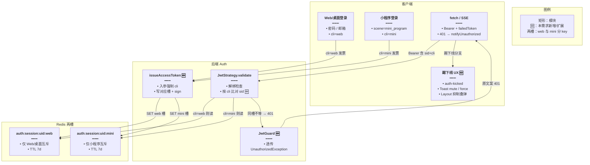
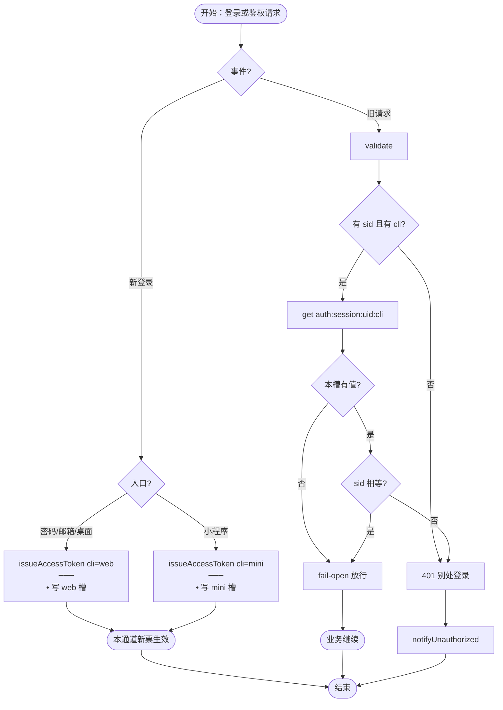
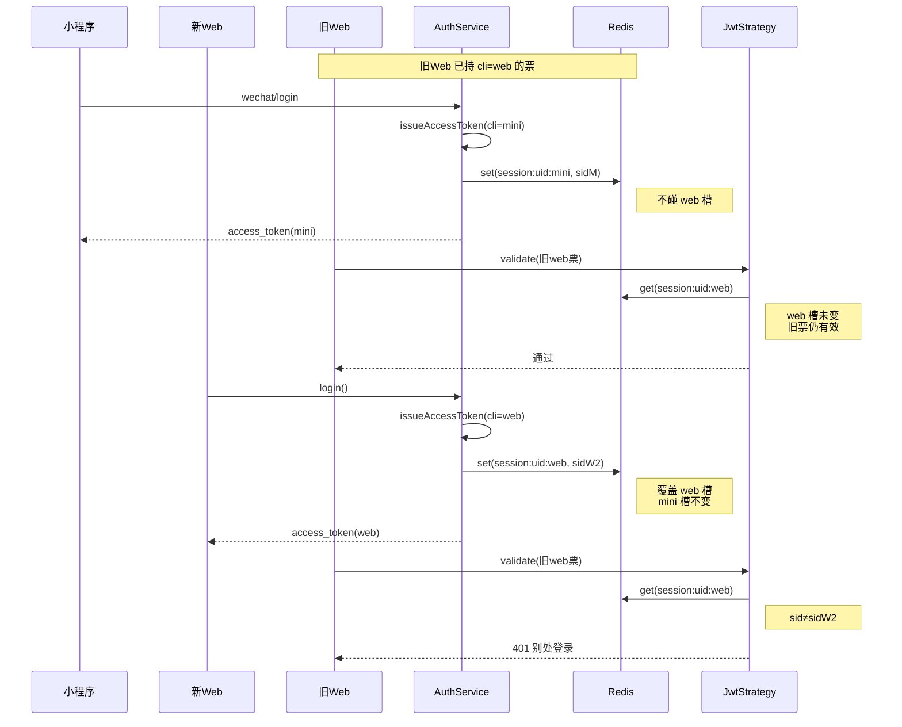
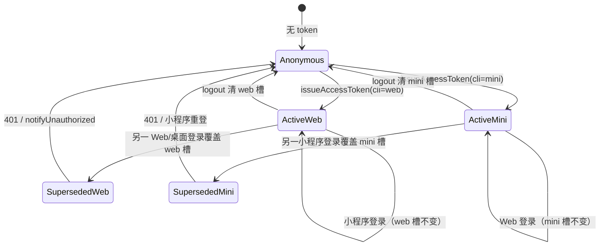

# 登录互斥踢下线 — 实现思路

> **状态**：核心已落地（M1–M3；前端多 tab / Toast / 跳转补丁已合入）  
> **日期**：2026-11-04（落地补充同日）  
> **需求摘要**：同一账号在 Web/桌面端别处再登录时踢掉同通道旧会话；微信小程序登录与 Web/桌面互不踢。  
> **一句话方案（预告）**：JWT 带 `sid` + `cli`（`web` | `mini`），Redis 按 `auth:session:{userId}:{cli}` 分槽存当前 sid；同槽覆盖即踢，跨槽并存；前端 `notifyUnauthorized` + `auth-kicked` / Toast 静默窗处理多 tab 与叠 Toast。

## 延伸阅读

- 仓库内可对照：`auth.strategy.ts`、`auth-session.ts`、`jwt.guard.ts`；前端 `authSession.ts`、`authToastMute.ts`、`authPaths.ts`（`AUTH_KICKED_KEY`）、`layout/index.tsx`
- 正式实现归档：可另写 `<WIKI_ROOT>/auth/` 专题；本文已含落地相对规划的增补（§4.5 决策 4、§14）

---

## 0. 读本文你将得到什么

- 要解决：Web/桌面同账号多处登录时旧端仍持有效 JWT；同时**不能**因小程序登录把 Web/桌面踢下线。
- 选定方案：JWT `sid` + `cli` + Redis **分通道**当前会话；校验只比对本票 `cli` 对应槽。
- 主要改动：后端发票 / `validate` / `JwtGuard` 保留踢下文案；前端 401 清态、多 tab 保票、Toast 静默、踢下线必跳登录。
- 分阶段：M1–M3 已落地；前端体验补丁见 §4.5 决策 4 与 §14。
- 最大风险：标错 `cli` 串槽；同浏览器多 tab 共享 `localStorage`（须按失效票比对 + `sessionStorage` 本 tab 踢标记）。

---

## 1. 需求与边界

### 1.1 用户故事

| 角色 | 场景 | 行为 | 期望结果 |
|------|------|------|----------|
| 用户 A | 已在浏览器登录 | 在另一台电脑 / Tauri 用密码或邮箱再登录 | 新 Web/桌面端可用；旧 Web/桌面端下次请求 401 并回登录页 |
| 用户 A | 已在 Web/桌面登录 | 用微信小程序登录同一账号 | **两边都保持登录**；小程序不踢 Web/桌面，Web/桌面也不因小程序登录而失效 |
| 用户 A | 已在小程序登录 | 另一台设备再开小程序登录同一账号 | 新小程序端可用；旧小程序端被踢（同槽互斥） |
| 用户 A | 旧 Web 端打开需登录页 | 被同槽踢后触发任意 API / SSE | 提示「账号已在别处登录」，而非笼统「请先登录」 |
| 攻击者/家人 | 拿到已被同槽覆盖的旧 Web 页 | 继续调业务 API | 无法用旧 JWT 读写用户数据 |

### 1.2 范围

| 在范围内 | 不在范围内（非目标） |
|----------|----------------------|
| Web / 桌面（密码、邮箱）共用 `cli=web` 单活跃会话 | Web 与小程序跨通道互踢 |
| 微信小程序（`scene=mini_program`）共用 `cli=mini` 单活跃会话 | 允许多设备白名单 / N 端任意并存 |
| 新登录只覆盖**本通道** Redis sid，同槽旧 JWT 失败 | 引入 refresh token 双票体系 |
| 被踢端被动感知（下次请求 401） | WebSocket / 服务端主动推送「立刻踢」 |
| 前端区分踢下线文案；多 tab 保新票；叠 Toast 抑制；踢下线必跳登录 | 设备管理页、会话列表、远程踢指定设备 |
| 主动 `logout` 清除**本票 cli 对应槽**（M3） | 改 JWT 全局过期策略（仍保持 `7d`） |

### 1.3 约束与依赖

- 须复用：`CACHE_MANAGER`、`JwtStrategy.validate`、`notifyUnauthorized` / `performLogout`。
- JWT 现全局 `expiresIn: '7d'`；各槽 Redis TTL 对齐 7d。
- Ponytail：不新建会话表；只多一个 `cli` 维度（两槽），不引入设备指纹。
- 现网 `WechatAuthService.login` 仅支持 `scene === 'mini_program'` → 微信登录入口固定标 `cli=mini`；密码 / 邮箱 / Tauri Web 登录标 `cli=web`。
- **硬约束（产品已拍板）**：小程序登录不得踢 Web/桌面；Web/桌面互斥不得误伤小程序会话。

---

## 2. 背景

- **谁、在什么场景、卡在哪**：用户同一账号可在多处登录；服务端只签无状态 JWT（payload 仅 `sub` + `username`，微信票多 `wechat`），**没有「当前会话」概念**，旧票在 7 天内一直有效。
- **现状缺口**：已有「微信解绑 → Redis 标记 → `validate` 拒票」先例，但登录成功路径不会作废先前签发的 token；若做成「账号一把锁」，会违反「小程序不踢 Web/桌面」。
- **不解决会怎样**：换电脑登录后旧浏览器仍可读写会员/学习数据；或反过来，通勤用小程序登录却把家里桌面端踢掉，体验不可接受。
- **硬约束**：不能破坏现有 `JwtGuard` + Bearer；前端 401 已有统一清态；互斥必须**按通道分槽**。

---

## 3. 现状与复用

| 能力 | 仓库中已有 | 本需求中的用法 |
|------|------------|----------------|
| 密码 / 邮箱登录发 JWT | `apps/backend/src/services/auth/auth.service.ts` | **扩展**：签发 `sid` + `cli:'web'`，写入 Redis web 槽 |
| 微信小程序登录发 JWT | `wechat-auth.service.ts`（`issueToken`；仅 `mini_program`） | **扩展**：签发 `sid` + `cli:'mini'`，写入 Redis mini 槽 |
| JWT 校验入口 | `auth.strategy.ts`（`JwtStrategy.validate`） | **扩展**：按 payload.cli 读对应槽比对 sid |
| Redis 吊销先例 | `wechatUnbindCacheKey` + 7d TTL | **直接复用模式**：`authSessionCacheKey(userId, cli)` |
| JWT 模块配置 | `auth.module.ts`（`expiresIn: '7d'`） | **直接复用** |
| 路由守卫 | `jwt.guard.ts` | **扩展**：`UnauthorizedException` 原文案透传（勿盖成「请先登录」） |
| 会话分槽工具 | `auth-session.ts` 🆕 | **新建**：`AuthClient` / key / `assertSessionActive` |
| 前端存票 | `localStorage.token` | **直接复用**；清态时按「失效票 === storage」才删 |
| 本 tab 踢标记 | `authPaths.ts`（`AUTH_KICKED_KEY`）🆕 | **新建**：`sessionStorage`；`hasValidAuthToken` 见标记则 false |
| 401 清态 / 跳转 | `authSession.ts`（`notifyUnauthorized`） | **扩展**：踢下线 Toast + 跳登录 + 多 tab |
| Toast 静默窗 | `authToastMute.ts` + `sonner.tsx` `force` 🆕 | **新建**：401 后约 3s 吞业务 error/warning |
| Layout 鉴权 Toast | `layout/index.tsx` | **扩展**：`consumeSuppressAuthRedirectToast`；监听 `userInfoChanged` |
| HTTP / SSE 401 汇聚 | `fetch.ts`、各类 `*Sse.ts` | **扩展**：传 `failedToken`；401 打 `__authCleared`；silent 仍清态 |
| User 表 | `user.entity.ts` | **不适用**：不增列 |
| 登出 | `performLogout` + `POST /auth/logout` | **扩展**（M3）：logout 只删本票 cli 槽 |

**调研结论**：鉴权横切已齐；微信登录入口已能从 `scene` 区分小程序。缺口是「发票登记会话 + 校验比对」，且 key **必须带通道**，不能账号单槽。

---

## 4. 方案比对与最终方案

### 4.1 候选方案

#### 方案 A：JWT `sid` + `cli` + Redis 分通道会话（扩展现状）

- **做法**：登录时 `sid = randomUUID()`，`cli = 'web' | 'mini'`；`cache.set(auth:session:{userId}:{cli}, sid, 7d)`；JWT 含 `sid`/`cli`。`validate`：用 payload.cli 取槽，有值且 ≠ sid → 401。密码/邮箱 → `web`；小程序 `issueToken` → `mini`。
- **能工作的原因**：同槽覆盖踢人；跨槽各写各的 key，天然互不干扰；对齐微信解绑 Redis 模式。
- **主要代价**：每鉴权多一次 Redis GET；发票必须标对 cli。

#### 方案 B：User 表双版本号（`webTokenVersion` / `miniTokenVersion`）

- **做法**：User 增两列（或 JSON）；各通道登录自增对应版本；JWT 带 `cli`+`tv`；validate 查对应版本。
- **能工作的原因**：分通道正确；DB 真源。
- **主要代价**：迁移 + 写库；热路径查库或再套缓存，复杂度高于 A。

#### 方案 C：登录会话表（多设备管理向）

- **做法**：`user_sessions` 含 `client` 字段；同 client 撤销旧行；JWT 带 sessionId。
- **能工作的原因**：可细到设备列表。
- **主要代价**：新表与 CRUD；本需求只需两槽互斥，过剩。

### 4.2 比对

| 维度 | 方案 A（sid + cli + Redis） | 方案 B（双 tokenVersion） | 方案 C（会话表） |
|------|----------------------------|---------------------------|------------------|
| 正确性 | 同槽互斥、跨槽并存；无 sid/cli 可强制拒绝；Redis 丢 key fail-open | 分通道版本正确；DB 事务清晰 | 按 client 撤销正确；并发需小心 |
| 复用 / 与现状契合 | 扩 `JwtStrategy` + CACHE；微信入口已有 scene | 需迁移与查库 | 无现成表 |
| 改动面 | 发票 + validate + 前端文案 | entity + migration + 发票 + validate | 新模块 + 发票 + validate |
| 复杂度 | 两槽 key + payload 两字段 | 两版本语义 + 缓存一致性 | 表模型 / GC / 设备字段 |
| 体验 | 同槽下次请求即踢；小程序与 Web 可同时用 | 同左 | 同左 + 未来会话列表（本需求不用） |
| 风险 | 标错 cli 会串槽；Redis 故障短暂失互斥 | 迁移与发版；热路径延迟 | 运维成本高 |
| 可维护性 | 与现吊销惯例一致 | 两套真源易漂 | 登录域变厚 |

### 4.3 综合考量

权重：**产品边界（小程序不踢 Web）正确性**、**与现状契合**、**改动面**。方案 A 用 `cli` 分槽一次满足互斥与共存；方案 B/C 都能做分通道，但成本更高。**放弃** B 的落库耐久、C 的会话列表，保留 Redis 两槽。

### 4.4 最终方案

#### 背景

无状态 JWT 无法在新登录时作废旧票；账号单槽又会误伤「小程序 ∥ Web」共存。需要**通道级**当前 sid，且密码/邮箱走 web、小程序走 mini。

#### 具体思路

1. **模块**：后端横切扩 auth（`auth-session` + Guard 透传）；前端 401 清态 + 多 tab / Toast / 跳转（D4）。
2. **数据**：JWT 含 `sid`、`cli`；Redis `auth:session:{userId}:{cli}`；不写 User 表；本 tab 另用 `sessionStorage auth-kicked`。
3. **状态**：权威在对应槽；浏览器/小程序存 `access_token`（跨 tab 共享时清态须比对 failedToken）。
4. **边界**：无 sid 或无 cli → 拒；本槽无 key → fail-open；本槽有 key 且不等 → 拒；logout 只 del 本槽且仅 sid 匹配时删。

#### 实现方案

**一句话**：按 `cli` 分槽登记 sid；同槽覆盖踢旧票，跨槽并存；校验只读本票通道。

| 步骤 | 谁 | 做什么 | 输入 → 输出 |
|------|----|--------|-------------|
| 1 | `issueAccessToken(user, { cli, wechat? })` 🆕 | 生成 sid、写本槽 Redis、sign | `User`+cli → `{ access_token, … }` |
| 2 | `login` / `loginByEmail` | 调步骤 1 且 `cli:'web'` | DTO → 登录响应 |
| 3 | 微信 `issueToken` | 调步骤 1 且 `cli:'mini'` | User → 登录响应 |
| 4 | `assertSessionActive` in `validate` | 按 cli 比对 sid | payload → user 或 401 |
| 5 | 前端 `notifyUnauthorized` | 踢下线 Toast + D4 多 tab / mute / 跳转 | 401 message + failedToken → 清态 |

#### 选定原因

1. **正确性**：分槽满足「小程序不踢 Web」。牺牲：不是账号全局单点。
2. **复用**：对齐微信解绑 Redis 模式。牺牲：无 DB 真源。
3. **改动面**：只动发票与 validate。牺牲：无会话列表。
4. **复杂度**：两常量通道即可。牺牲：发票必须标对 cli。

#### 优势

- 相对方案 B：零迁移；热路径一次 Redis GET。
- 相对方案 C：不建会话域就能满足双通道互斥 + 共存。

#### 怎么实现

1. 定义 `AuthClient = 'web' | 'mini'` 与 `authSessionCacheKey(userId, cli)`。
2. `issueAccessToken` 写入对应槽；web/mini 入口传不同 cli。
3. `validate` 按 payload.cli 比对（保留微信解绑检查）。
4. M2 文案 + Guard 透传；M3 logout 只清本槽；M4 见决策 4。

主链路代码见 §9；落地坑见 §14。

### 4.5 其他关键决策

#### 决策 1：被踢感知方式

##### 候选

- **D1-A**：通用 401 + `notifyUnauthorized`；M2 用固定 message 区分 Toast。
- **D1-B**：SSE/WebSocket 主动推 `session_revoked`。

##### 比对

| 维度 | D1-A | D1-B |
|------|------|------|
| 正确性 | 下次请求必踢 | 在线端即时；离线仍靠 401 |
| 复用 | 现有 401 管线 | 需推送与连接注册 |
| 改动面 | 文案 + 少量分支 | 网关、连接表、扇出 |
| 复杂度 | 低 | 高 |
| 体验 | 非实时但一操作即知 | 即时 |
| 风险 | 闲置页晚感知 | 双通道一致性 |
| 可维护性 | 一处 | 两处 |

##### 综合考量

安全由拒票保证；选 **D1-A**，放弃即时推送。

##### 最终方案（六块摘要）

- **背景**：已有 401 清态，缺可识别文案。
- **具体思路**：固定中文 message + 前端映射 Toast。
- **实现方案**：`UnauthorizedException('账号已在别处登录')`。
- **选定原因**：复用 / 改动面；牺牲即时性。
- **优势**：相对 D1-B 无长连接基建。
- **怎么实现**：M1 先 401；M2 接文案。

#### 决策 2：上线时无 `sid`/`cli` 旧票

##### 候选

- **D2-A**：无 `sid` 或无 `cli` 一律拒绝（强制一次重登）。
- **D2-B**：缺字段放行（灰度兼容）。

##### 比对

| 维度 | D2-A | D2-B |
|------|------|------|
| 正确性 | 上线后双槽互斥立即生效 | 旧票最多 7 天仍可多端 |
| 复用 | 分支简单 | 兼容分支 |
| 改动面 | 相同 | + 兼容逻辑 |
| 复杂度 | 低 | 中 |
| 体验 | 可能全员重登一次 | 无感但不完整 |
| 风险 | 登录流量尖峰 | 假互斥窗口 |
| 可维护性 | 无灰度债 | 日后要删兼容 |

##### 综合考量

选 **D2-A**；发版说明需重新登录。

##### 最终方案（六块摘要）

- **背景**：旧 JWT 无 sid/cli。
- **具体思路**：缺一即拒。
- **实现方案**：`assertSessionActive` 开头校验。
- **选定原因**：正确性；牺牲一次重登。
- **优势**：无假互斥窗口。
- **怎么实现**：见 §9.2。

#### 决策 3：通道划分（产品已确认）

##### 候选

- **D3-A**：账号单槽 `auth:session:{userId}`（小程序与 Web 互踢）。
- **D3-B**：双槽 `web` / `mini`（小程序与 Web/桌面互不踢；槽内各自互斥）。
- **D3-C**：三槽 `web` / `desktop` / `mini`（浏览器与 Tauri 也互不踢）。

##### 比对

| 维度 | D3-A 单槽 | D3-B 双槽 web|mini | D3-C 三槽 |
|------|-----------|-------------------|-----------|
| 正确性（相对产品） | 违反「小程序不踢 Web」 | 符合；Web↔桌面仍互踢 | Web 与桌面可并存（产品未要求） |
| 复用 | 最简单 | 发票按入口标 cli；现网微信仅 mini_program | 需 Tauri 单独标 desktop |
| 改动面 | 最小 | +1 字段与 key 维 | 再多一端识别 |
| 复杂度 | 最低 | 两常量 | 三常量 + 桌面识别 |
| 体验 | 通勤开小程序踢掉家里网页 | 小程序∥Web；换电脑仍踢旧浏览器 | 浏览器与桌面可同时在线 |
| 风险 | 产品不符 | 标错 cli | 过度拆分、识别易漏 |
| 可维护性 | 一处 | 两槽清晰 | 三槽运维面更大 |

##### 综合考量

产品已明确：**小程序不踢 Web/桌面**。未要求浏览器与 Tauri 并存，且二者同属「大前端」密码/邮箱登录，继续共用 `web` 更简单。选 **D3-B**，放弃 A 的单槽简单性、C 的桌面独立槽。

##### 最终方案（六块）

###### 背景

若账号单槽，小程序一登录就会覆盖 Web sid，直接违背确认边界。现网微信登录仅 `mini_program`，天然可映射 `mini`；密码/邮箱/桌面同走 `web`。

###### 具体思路

1. `AuthClient = 'web' | 'mini'`。
2. Redis key 带 cli；JWT payload 带 cli，validate 禁止用「默认 web」猜（缺 cli 直接拒，见 D2-A）。
3. 微信 `issueToken` 写死 `cli:'mini'`；其余登录写死 `cli:'web'`。

###### 实现方案

**一句话**：两槽分治——同槽互斥，跨槽并存。

| 登录入口 | cli | Redis key |
|----------|-----|-----------|
| `/auth/login`、`/auth/loginByEmail`（含 Tauri） | `web` | `auth:session:{uid}:web` |
| `/auth/wechat/login`（mini_program） | `mini` | `auth:session:{uid}:mini` |

###### 选定原因

1. **正确性**：对齐产品。牺牲：非全局单点登录。
2. **复杂度**：两槽够用。牺牲：不做 desktop 独立。
3. **复用**：微信 scene 已区分小程序。牺牲：将来若开放非小程序微信登录，需再映射 cli。

###### 优势

- 相对 D3-A：不会误踢 Web/桌面。
- 相对 D3-C：不增加 Tauri 识别与第三套 key。

###### 怎么实现

`issueAccessToken` 强制入参 `cli`；`authSessionCacheKey(userId, cli)`；校验只读本票 cli。见 §9。

#### 决策 4：同浏览器多 tab 与踢下线 UX（落地补丁）

##### 候选

- **D4-A**：401 无条件 `localStorage.removeItem('token')` + 业务 catch 各自 Toast。
- **D4-B**：仅当 storage 票 === 本次 401 票才清 storage；本 tab `sessionStorage auth-kicked`；全局 Toast 静默窗；Layout 抑制叠 Toast。

##### 比对

| 维度 | D4-A | D4-B |
|------|------|------|
| 正确性 | Tab2 新票会被 Tab1 清态误删；叠「加载失败」 | 他 tab 新票保留；本 tab 仍能跳登录 |
| 复用 | 原 notifyUnauthorized | 扩 authSession / authPaths / Toast |
| 改动面 | 小 | 中（横切 Toast + Layout） |
| 复杂度 | 低 | 中（failedToken / mute / kicked 标记） |
| 体验 | 双 Toast；Tab2 也被踢；或只 Toast 不跳转 | 单条踢下线 Toast + 跳登录 |
| 风险 | 误伤同浏览器合法会话 | mute 窗误吞短时业务 Toast（可接受） |
| 可维护性 | 各 catch 易漏 | 静默窗覆盖全站 Toast 入口 |

##### 综合考量

同浏览器 tab 共享 `localStorage`，HttpClient 内存票与 storage 可不一致。选 **D4-B**。

##### 最终方案（六块摘要）

- **背景**：Tab1 内存旧票 401 清 storage 会删掉 Tab2 新票；业务 catch 与 Layout「请先登录」叠踢下线 Toast；不清 storage 时 Layout 仍认已登录不跳转。
- **具体思路**：① `clearLocalAuthState(failedToken)` 仅 storage===failedToken 才删；② `markAuthKicked()`（sessionStorage，按 tab）；③ `beginAuthClearToastMute` + Toast `force`；④ Layout `consumeSuppressAuthRedirectToast` + 听 `userInfoChanged`；⑤ 踢下线短延迟硬跳 `/login` 兜底。
- **实现方案**：见 §9.2 前端块与 §14。
- **选定原因**：正确性 / 体验；牺牲 mute 窗口内少量业务 Toast。
- **优势**：相对 D4-A 不误伤同浏览器新登录端。
- **怎么实现**：`fetch` 传 Authorization 里的 failedToken；登录成功 `clearAuthKicked()`。

---

## 5. 架构图



**图内方法说明**：

| 方法 / 模块入口 | 功能 |
|-----------------|------|
| `issueAccessToken(user, { cli, wechat? })` | 按 cli 覆盖对应 Redis 槽并签发含 sid/cli 的 JWT |
| `authSessionCacheKey(userId, cli)` | 拼 `auth:session:{userId}:{cli}` |
| `JwtStrategy.validate(payload)` | 解绑检查后按 cli 比对 sid；跨槽互不影响 |
| `JwtGuard.handleRequest` | 透传 validate 的「别处登录」文案 |
| `notifyUnauthorized(reason, failedToken?)` | 按票比对清 storage；踢下线 Toast + auth-kicked + 跳登录 |

**读图要点**：

- 互斥权威按通道拆成两个 Redis key，跨槽箭头不相交覆盖。
- 小程序登录只写 mini 槽，不会改 web 槽。
- 业务 API 仍无感，只经 `validate`。

---

## 6. 主流程图



**图内方法说明**：

| 方法 | 功能 |
|------|------|
| `issueAccessToken(..., { cli })` | 只覆盖本通道槽，另一通道会话保持 |
| `assertSessionActive` / `validate` | 只读本票 cli 槽；跨槽旧票不受影响 |
| `notifyUnauthorized(reason, failedToken?)` | 同槽被踢后：本 tab 清态 / Toast / 跳转；勿误删他 tab 新票 |

**读图要点**：

- 登录分支按入口选 cli，决定写哪一槽。
- 鉴权失败只发生在「同槽 sid 不匹配」。
- 小程序登录路径不会进入「覆盖 web 槽」。
- 前端 FE 节点在同浏览器多 tab 时还要走 D4（failedToken / auth-kicked）。

---

## 7. 核心时序图



**图内方法说明**：

| 方法 | 功能 |
|------|------|
| `wechat/login` → `issueAccessToken(cli=mini)` | 只登记小程序槽 |
| `login()` → `issueAccessToken(cli=web)` | 只覆盖 Web/桌面槽 |
| `validate(payload)` | 按 payload.cli 读槽比对 |
| `cache.set` / `cache.get` | 分 key 读写，跨槽隔离 |

**读图要点**：

- 先演示小程序登录后旧 Web 仍通过，再演示同槽 Web 互踢。
- 无主动推送；旧 Web 在第二次请求才感知。
- mini 与 web 的 Redis key 生命周期独立。

---

## 8. 状态机



**图内方法说明**：

| 方法 | 功能 |
|------|------|
| `issueAccessToken(cli=web\|mini)` | 进入对应 Active；只令**同槽**旧票进入 Superseded |
| `validate`（同槽 sid 不匹配） | 触发该通道旧端感知被踢 |
| `notifyUnauthorized` / logout | 回 Anonymous（本 tab 可走 auth-kicked）；logout 仅删本票 cli 槽 |

---

## 9. 具体实现（主链路代码）

### 9.1 模块一览

| 模块 | 职责 | 新增/改动 | 路径 |
|------|------|-----------|------|
| 通道常量 / assert | cli、key、TTL、比对 | 新建 | `apps/backend/src/services/auth/auth-session.ts` |
| 发票 / 清会话 | issueAccessToken、clearSession | 改动 | `auth.service.ts` |
| 微信发票 | 固定 `cli:'mini'` | 改动 | `wechat/wechat-auth.service.ts` |
| JWT 策略 | 按 cli 比对；返回 sid/cli | 改动 | `auth.strategy.ts` |
| JwtGuard | 透传 UnauthorizedException 文案 | 改动 | `apps/backend/src/guards/jwt.guard.ts` |
| logout API | POST `/auth/logout` | 新增 | `auth.controller.ts` |
| 前端 401 / 踢下线 | notifyUnauthorized、failedToken | 改动 | `authSession.ts`、`fetch.ts`、SSE |
| 本 tab 踢标记 | AUTH_KICKED_KEY | 新建/扩 | `authPaths.ts` |
| Toast 静默 | beginAuthClearToastMute、force | 新建/扩 | `authToastMute.ts`、`components/ui/sonner.tsx` |
| Layout | 抑制叠 Toast；听 userInfoChanged | 改动 | `layout/index.tsx` |

### 9.2 主链路实现

```typescript
// 对应 §4.4 步骤 1 / §4.5 D3-B。两通道写死，避免自由字符串污染 Redis key
export type AuthClient = 'web' | 'mini';

// 对应 §4.4 步骤 1。key 带 cli，保证小程序与 Web 分槽、互不覆盖
export const authSessionCacheKey = (userId: number, cli: AuthClient) =>
	`auth:session:${userId}:${cli}`;

// 对应 §4.4 步骤 1。TTL 对齐 JwtModule 7d
const AUTH_SESSION_TTL_MS = 7 * 24 * 60 * 60 * 1000;

// 对应 §4.4 步骤 1。cli 必传：密码/邮箱传 web，小程序传 mini
async function issueAccessToken(
	jwt: JwtService,
	cache: Cache,
	user: { id: number; username: string; password?: string; [k: string]: unknown },
	// cli 决定写哪一槽；wechat 标记保留给解绑校验
	opts: { cli: AuthClient; wechat?: boolean },
) {
	// 每次登录新 sid，仅作废同槽旧票
	const sid = randomUUID();
	// 只 SET 本通道：小程序登录不会动 web 槽
	await cache.set(
		authSessionCacheKey(user.id, opts.cli),
		sid,
		AUTH_SESSION_TTL_MS,
	);
	const { password: _pw, ...userInfo } = user;
	// payload 同时带 sid 与 cli，validate 禁止猜默认通道
	const access_token = await jwt.signAsync({
		username: userInfo.username as string,
		sub: user.id,
		sid,
		cli: opts.cli,
		...(opts.wechat ? { wechat: true } : {}),
	});
	return { access_token, ...userInfo };
}
```

```typescript
// 对应 §4.4 步骤 4 / D2-A / D3-B。只比对本票通道，跨槽天然隔离
async function assertSessionActive(
	cache: Cache,
	payload: { sub: number; sid?: string; cli?: AuthClient },
) {
	// 缺字段的旧票一律拒绝，避免未分槽时代的假互斥
	if (!payload.sid || (payload.cli !== 'web' && payload.cli !== 'mini')) {
		throw new UnauthorizedException('账号已在别处登录');
	}
	// 严格按 cli 取槽，绝不用「默认 web」回退
	const current = await cache.get<string>(
		authSessionCacheKey(payload.sub, payload.cli),
	);
	// fail-open：本槽缺失不误杀（另一槽是否存在无关）
	if (current == null || current === '') return;
	// 同槽被后登录覆盖
	if (current !== payload.sid) {
		throw new UnauthorizedException('账号已在别处登录');
	}
}
```

```typescript
// 对应 §4.4 步骤 2～3。入口标死 cli，防止漏传串槽
// 密码 / 邮箱（含 Tauri WebView）
return issueAccessToken(this.jwt, this.cache, user, { cli: 'web' });

// 微信小程序 issueToken
return issueAccessToken(this.jwt, this.cache, user, {
	cli: 'mini',
	wechat: true,
});
```

```typescript
// 对应 §4.4 步骤 5 / §4.5 D4-B。JwtGuard 须透传「账号已在别处登录」，勿统一改成「请先登录」
handleRequest(err: any, user: any) {
	if (err instanceof UnauthorizedException) throw err;
	if (err || !user) throw new UnauthorizedException('请先登录后再试');
	return user;
}
```

```typescript
// 对应 §4.4 步骤 5 / D4-B。failedToken：本次 401 实际带的票；仅 storage 仍是该票才删 localStorage
function clearLocalAuthState(failedToken?: string): void {
	const stored = (localStorage.getItem('token') || '').trim();
	const failed = (failedToken || '').trim();
	const clearStorage = !failed || !stored || stored === failed;
	if (clearStorage) {
		localStorage.removeItem('token');
		localStorage.removeItem('userInfo');
	}
	resetUserState();
	window.dispatchEvent(new Event('userInfoChanged'));
	void import('@/utils/fetch').then(({ http }) => http.setAuthToken(''));
	void import('@/store/user').then((m) => m.default.clearUserInfo());
}

export function notifyUnauthorized(reason?: string, failedToken?: string): void {
	if (typeof window === 'undefined' || handlingUnauthorized) return;
	handlingUnauthorized = true;
	const kicked = Boolean(reason?.includes('别处登录'));
	beginAuthClearToastMute(3000);
	if (kicked) {
		markAuthKicked(); // sessionStorage，本 tab；他 tab 的 localStorage 票可保留
		suppressAuthRedirectToast = true;
	}
	clearLocalAuthState(failedToken);
	if (kicked) {
		Toast({
			type: 'error',
			title: '账号已在别处登录，请重新登录',
			force: true, // 绕过静默窗
		});
	}
	const path = window.location.pathname;
	const shouldRedirect =
		path !== '/login' && (kicked || requiresAuthForPath(path));
	if (!shouldRedirect) {
		handlingUnauthorized = false;
		return;
	}
	// Layout 听 userInfoChanged 可 SPA 跳转；短延迟硬跳兜底 + 给 Toast 绘制时间
	window.setTimeout(() => {
		if (window.location.pathname !== '/login') {
			window.location.replace('/login');
			return;
		}
		handlingUnauthorized = false;
	}, kicked ? 400 : 0);
}
```

```typescript
// fetch：silent 仍须 notifyUnauthorized；401 打 __authCleared，且不再弹 fetch 笼统 Toast
if (isUnauthorized) {
	notifyUnauthorized(unauthorizedReason, failedTokenFromAuthorizationHeader);
}
if (!finalConfig.silent && !isUnauthorized) {
	Toast({ type: 'error', title: resolveRequestErrorToastTitle(requestError) });
}
```

### 9.3 数据模型

| 字段/实体 | 来源 | 存储 | 说明 |
|-----------|------|------|------|
| `sid` | 登录 `randomUUID()` | JWT | 本票会话 id |
| `cli` | 登录入口写死 | JWT | `web` \| `mini` |
| `auth:session:{uid}:web` | web 登录写入 | Redis | Web/桌面当前合法 sid |
| `auth:session:{uid}:mini` | 小程序登录写入 | Redis | 小程序当前合法 sid |
| `access_token` | 登录响应 | localStorage（跨 tab 共享） | 清态须比对 failedToken |
| `auth-kicked` | 踢下线时写入 | sessionStorage（按 tab） | `hasValidAuthToken` 见则 false |
| `wechat` | 小程序发票 | JWT | 解绑吊销用；与 cli 并存 |

---

## 10. 分阶段实现步骤

| 阶段 | 目标 | 交付物 | 依赖 | 状态 |
|------|------|--------|------|------|
| M1 | 双槽互斥 + 跨槽共存 | `issueAccessToken` + 按 cli validate；两入口标 cli | 无 | 已落地 |
| M2 | 同槽踢下文案 | 固定 401 message + Web Toast + Guard 透传 | M1 | 已落地 |
| M3 | 登出清本槽 | `POST /auth/logout`；`performLogout` 先调后清 | M1 | 已落地 |
| M4 | 多 tab / 叠 Toast / 必跳登录 | D4-B：failedToken、auth-kicked、mute、Layout | M2 | 已落地 |

**M1**

- [x] 增加 `AuthClient`、`authSessionCacheKey(userId, cli)`、TTL（`auth-session.ts`）
- [x] `issueAccessToken`；密码/邮箱 → `web`；微信 → `mini`
- [x] `validate` 调 `assertSessionActive`；缺 sid/cli 拒绝
- [x] 验收：双浏览器互踢；小程序登录后 Web 仍可用；双小程序互踢

**M2**

- [x] 统一 message：`账号已在别处登录`
- [x] `JwtGuard` 透传 `UnauthorizedException`
- [x] fetch/SSE 把 message + failedToken 传给 `notifyUnauthorized`
- [x] M2 先写死中文踢下线 Toast（未做 i18n）

**M3**

- [x] logout：`del` 仅当 Redis[cli]==本票 sid
- [x] Web `performLogout` 先调 logout；失败仍清本地

**M4（落地补丁）**

- [x] storage 仅在票匹配时清除；`markAuthKicked` / `clearAuthKicked`
- [x] `authToastMute` + Toast `force`；Layout 抑制「请先登录」叠弹
- [x] Layout 听 `userInfoChanged`；踢下线兜底硬跳 `/login`

---

## 11. 风险、边界与待确认

| 项 | 等级 | 说明 | 缓解 |
|----|------|------|------|
| 发版强制重登 | 中 | 无 sid/cli 旧票失效 | 发版公告 |
| 标错 cli | 高 | 小程序误标 web 会踢桌面 | 入口写死常量 |
| Redis 故障 fail-open | 中 | 本槽互斥短暂失效 | 监控；恢复后下次登录锁死 |
| 同浏览器多 tab | 高 | 共享 localStorage；内存票与 storage 不一致 | D4-B failedToken + auth-kicked |
| 叠 Toast | 中 | 业务「加载失败」+ 踢下线 + Layout「请先登录」 | mute 窗 + suppress + `isAuthClearedError` |
| 只 Toast 不跳转 | 中 | 不清 storage 时 Layout 仍认已登录 | auth-kicked + 硬跳兜底 |
| SSE 长连接 | 中 | 同槽被踢后流可能晚一点断 | 现有 401 处理可接受 |
| logout 误删 | 低 | 旧端延迟 logout | 仅 sid 匹配才 del 本槽 |
| 将来非小程序微信登录 | 低 | 需再映射 cli | 当前 login 仅 mini_program |

**待确认**：

- [x] Web/桌面与小程序是否互踢？→ **不互踢**（已确认，D3-B）
- [x] Toast 是否必须 i18n？→ **M2 先写死中文**（已选）

---

## 12. 验收清单

| # | 用例 | 步骤 | 期望 |
|---|------|------|------|
| AC1 | Web 同槽互踢 | A 浏览器登录 → B 浏览器同账号登录 → A 再请求 | A 401；B 正常 |
| AC2 | 桌面与 Web 同槽 | Tauri 登录后浏览器再登录（或反之） | 先登录的 Web/桌面端被踢 |
| AC3 | 小程序不踢 Web | Web 已登录 → 小程序登录同账号 → Web 再请求 | **Web 仍 200**；小程序正常 |
| AC4 | Web 不踢小程序 | 小程序已登录 → Web 再登录 → 小程序再请求 | **小程序仍可用**；旧 Web 若同槽被新 Web 踢另论 |
| AC5 | 小程序同槽互踢 | 设备1 小程序登录 → 设备2 小程序登录 → 设备1 请求 | 设备1 401 |
| AC6 | 无 sid/cli 旧票 | 发版前 JWT 调受保护 API | 401 |
| AC7 | 踢下文案（M2） | 触发 AC1 | **仅** Toast「账号已在别处登录…」，无「加载失败 / 请先登录」叠弹 |
| AC8 | fail-open | 删掉 `…:web` key 后持匹配 web 票请求 | 成功 |
| AC9 | logout 本槽（M3） | Web logout 后用该票请求；小程序票仍在 | Web 401；小程序仍可用 |
| AC10 | 同浏览器两 tab | Tab1 登录 → Tab2 登录 → 回 Tab1 触发请求 → 再回 Tab2 | Tab1 被踢并进登录页；**Tab2 仍登录** |
| AC11 | 踢下线必跳登录 | 任意需登录页（或踢下线策略覆盖页）触发踢下线 | 有踢下线 Toast 且进入 `/login` |

---

## 13. 预估改动面（实现阶段参考）

| 类型 | 路径 |
|------|------|
| 前端 | `router/authSession.ts`；`router/authPaths.ts`；`router/authToastMute.ts`；`utils/fetch.ts`；各类 `*Sse.ts`；`layout/index.tsx`；`components/ui/sonner.tsx`；`views/login/login-form.tsx` / `login-by-email-form.tsx`；英语学习若干 catch（`isAuthClearedError`） |
| 后端 | `auth-session.ts`；`auth.service.ts`；`auth.strategy.ts`；`auth.controller.ts`（logout）；`wechat/wechat-auth.service.ts`；`guards/jwt.guard.ts` |
| 文档 | 本文 `ideas/auth/登录互斥踢下线.md`；正式专题可选 `<WIKI_ROOT>/auth/` |

---

## 14. 落地补充（相对初版规划）

规划阶段未写清、实现中补上的要点：

| # | 问题现象 | 根因 | 做法 |
|---|----------|------|------|
| 1 | Tab2 登录后 Tab1 被踢，再切回 Tab2 也掉登录 | Tab1 401 无条件清共享 `localStorage` | `clearLocalAuthState(failedToken)` 仅票匹配才删 storage |
| 2 | 踢下线同时弹「列表/词条加载失败」 | 业务 catch 笼统 Toast；`silent` 曾跳过清态 | 401 一律 `notifyUnauthorized`；`__authCleared`；`authToastMute` 静默窗 |
| 3 | 踢下线 +「请先登录后再访问」双 Toast | Layout 鉴权 effect 叠弹 | `suppressAuthRedirectToast` + Layout `consume…`；鉴权 Toast 用 `force` |
| 4 | 有踢下线 Toast 但不跳登录页 | 保留他 tab 票时 Layout 仍 `hasValidAuthToken()` | `sessionStorage auth-kicked`；Layout 听 `userInfoChanged`；硬跳兜底 |
| 5 | 401 message 变成「请先登录后再试」 | `JwtGuard.handleRequest` 吞掉 validate 文案 | 若已是 `UnauthorizedException` 则原样抛出 |
| 6 | Guard / 发票 / 校验拆分 | — | 会话逻辑集中 `auth-session.ts`；微信走 `AuthService.issueAccessToken` |

登录成功须 `clearAuthKicked()`（密码 / 邮箱表单已接）。

---

（核心能力已落地；细节以仓库源码为准。正式专题可另迁 `<WIKI_ROOT>/auth/`。）
