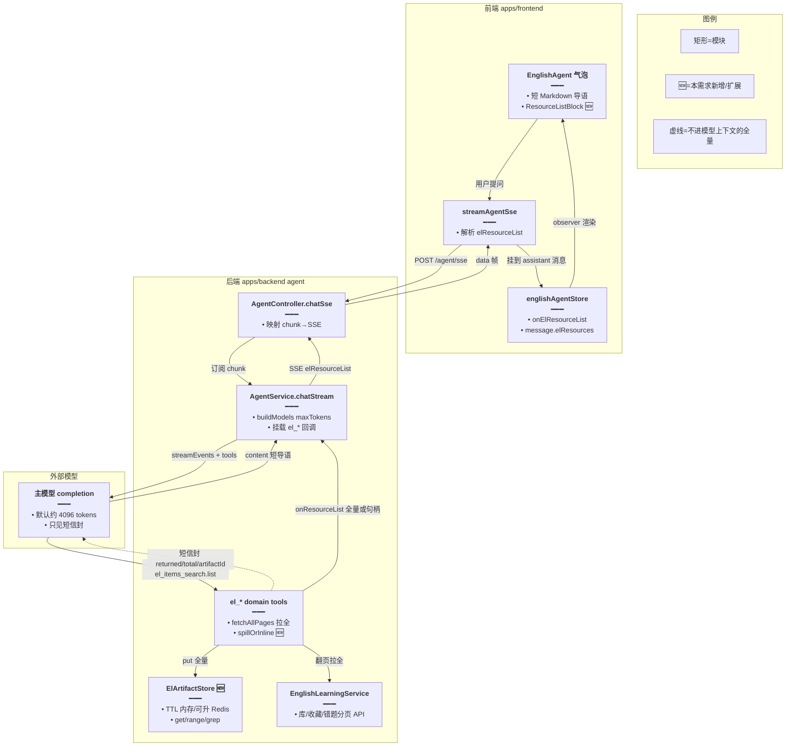
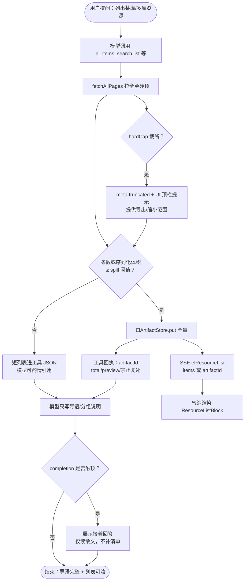
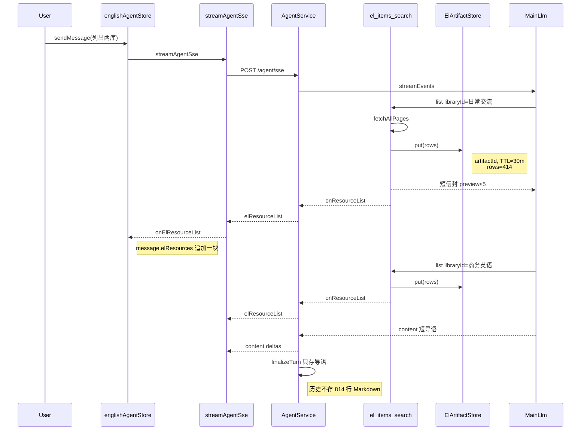
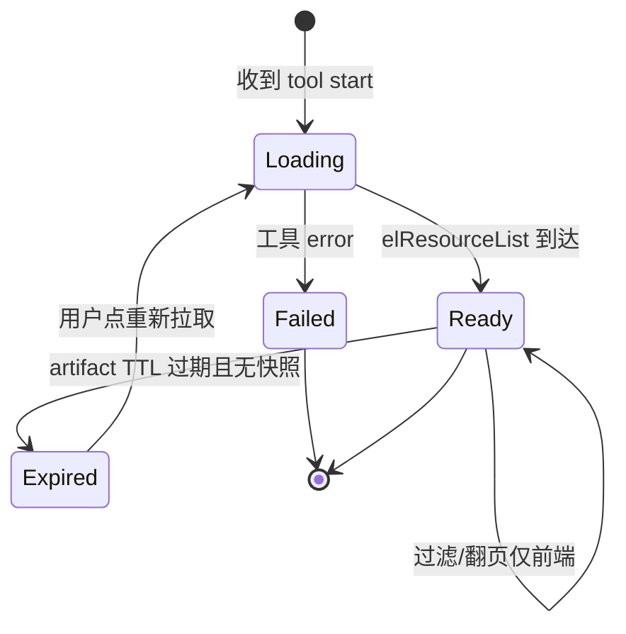

# Agent 大结果旁路展示 — 实现思路

> **状态**：规划（未实现；可复用 `el_*` 全量拉取、`searchOrganic` SSE、`ElProposalStore`、Chat `maxTokensReached` 续答）  
> **日期**：2026-10-26  
> **需求摘要**：英语 Agent 已能一次拉全词库/语料库/收藏等大数据，但模型把数百～上千条复述进 Markdown 时会撞上 `maxTokens≈4096` 中途截断；最优解是 **全量旁路 UI + 模型只写短导语**，而不是继续抬输出上限或逼模型分页复述。

## 延伸阅读

- [英语Agent关联侧栏.md](./英语Agent关联侧栏.md) — `el_*` 工具地图与提案写
- 本仓现象：工具 `el_items_search op=list` 已返回 414+400，主模型 `defaultMaxTokens: 4096` 导致回复断在半句
- 业界对照：Trigger.dev「large tool payloads → ID 引用」；OpenAI Codex「spill to artifact + preview」；LangChain「专用 ToolCard、勿 dump JSON」

---

## 0. 读本文你将得到什么

- **问题**：全量已在工具层，失败点在 **模型 completion 复述**（输出 token），不是 DB 分页。
- **一句话方案**：工具结果 **外溢（spill）** 为带 TTL 的 artifact → SSE 推结构化清单 → 气泡旁专用可滚动列表；回给模型的仅是 **摘要 + artifactId**，并禁止复述全表。
- **改哪些层**：后端 `el_*` 回执形态 + ArtifactStore + SSE 事件；前端 Message 字段 + 列表组件；提示词；可选轻度抬高 `maxTokens` 仅服务导语。
- **阶段**：M0 阈值与提示词止血 → M1 旁路 SSE+UI → M2 持久化/续聊 → M3 导出与多库合并。
- **最大风险**：模型仍无视禁令 dump 全文；或全量塞进历史消息再次撑爆上下文。

---

## 1. 需求与边界

### 1.1 用户故事

| 角色 | 场景 | 行为 | 期望结果 |
|------|------|------|----------|
| 英语学习者 | 问「日常交流 + 商务英语相关语料」 | Agent 定位两库并拉全 814 条 | 气泡内可浏览/搜索全部条目，**不被截断**；导语完整可读 |
| 学习者 | 只要「给几条例句跟读」 | Agent sample / 短表 | 不弹出巨型列表；少量示例即可 |
| 学习者 | 刷新或切回历史会话 | 打开含大列表的旧消息 | 仍能看到清单（或明确「已过期请重查」） |
| 开发者 | DeepSeek / GLM / SiliconFlow 等当前配置模型 | 默认 `maxTokens` 约 4k～8k | 方案不依赖某家超大 completion |

### 1.2 范围

| 在范围内 | 不在范围内（非目标） |
|----------|----------------------|
| `el_libraries` / `el_items_search` / `el_favorites` / `el_mistakes` / `el_daily_memo` / `el_daily_reading` 的 **大 list 结果展示** | 改主站 Chat 全站默认 `maxTokens` 策略 |
| Artifact 旁路 + SSE + 气泡 UI | 让模型在一轮里用 Markdown **原样打印** 上千行 |
| 提示词与工具 message 约束「禁止复述」 | 向量检索替代列表浏览（可后续） |
| 触顶 `truncated` 的诚实提示 + 可选导出 | 无限硬顶、无上限灌入上下文 |

### 1.3 约束与依赖

- 模型族：项目现用 `deepseek-chat` / `glm-4.7-flash` / SiliconFlow GLM 等，Agent 主模型默认 **`maxTokens: 4096`**（`agent.service.ts` `buildModels`）。
- 必须复用：`fetchAllPages`、`EL_FULL_LIST_MAX`、`searchOrganic` SSE 形态、`ElProposalStore` TTL 思路、Chat 的 `finishReason.maxTokensReached` +「接着回答」。
- 体验底线：814 条须 **可滚动浏览**；首屏 ≤2s 出导语+列表壳；单条 SSE 不宜塞爆浏览器（可 artifactId + 二次拉取）。
- Ponytail：先旁路，不先上异步 Job；硬顶沿用现有常量。

---

## 2. 方案总览（一句话 + 要点）

**一句话方案**：把「全量数据」从 **模型口中** 挪到 **消息附属 UI**（artifact + SSE），模型只负责定位、摘要与导读；必要时再用小工具按页/按关键词取子集。

| # | 设计要点 | 理由 |
|---|----------|------|
| 1 | **旁路展示优先于抬 `maxTokens`** | 抬到 16k～32k 仍可能不够、贵、慢，且下一轮历史仍会爆 |
| 2 | **工具对模型回短信封，对 UI 推全量** | 业界共识（ID-reference / artifact spill）；避免 completion 复述 |
| 3 | **禁止静默截断唯一副本** | Codex 结论：lossy 截断最差；全量须可恢复（UI 或 artifact_get） |
| 4 | **阈值分流**：小结果仍可进模型；超阈强制 spill | 问候类 10 条不必上 artifact |
| 5 | **续答按钮只管散文** | `maxTokensReached` 续写不能替代清单 UI；清单靠滚动/分页组件 |

### 2.1 为何不是「只提高 maxTokens」

| 方案 | 短期 | 中期失败模式 |
|------|------|----------------|
| 仅 `defaultMaxTokens: 16384` | 部分会话能写完 | 多库合并、收藏 2000 条仍截断；账单↑；历史上下文被旧回复占满 |
| 逼模型「分多轮输出」 | 偶发可用 | 不可靠；用户感知为「又断了」；工具调用额度（`ENGLISH_EL_TOOL_RUN_LIMIT`）易耗尽 |
| **旁路 UI（本方案）** | 与模型上限解耦 | 需做存储/SSE/组件；模型违规 dump 时仍要 strip |

---

## 3. 现状与复用

| 能力 | 仓库中已有 | 本需求用法 |
|------|------------|------------|
| 全量翻页拉取 | `english-learning-domain-tools.ts` `fetchAllPages` + 各 list 硬顶 | **直接复用** 作为 spill 前数据源 |
| 信封体积裁剪 | `el-envelope.ts` `EL_DATA_MAX_CHARS` / `shrinkLargestArray` | **扩展**：对模型可见 data 强制「摘要形态」，全量不进 `stringifyEnvelope` 主路径 |
| 提案短 TTL 存储 | `el-proposal.store.ts` | **扩展** 出 `ElArtifactStore`（或同文件泛化） |
| SSE 旁路数据 | `searchOrganic` / `domainMutation`（controller + `agentSse.ts`） | **扩展** `elResourceList`（或 `artifactReady`）事件 |
| 消息附属渲染 | `Message.searchOrganic` + `SearchOrganics`；日推曾试验 `readingList` | **扩展** `Message.elResources[]` + 列表块 |
| 输出截断提示 | Chat `finishReason.maxTokensReached` + 接着回答 | **直接复用** 于 Agent 散文截断；清单场景不依赖它 |
| DOCX 全量导出 | 英语学习导出 Word 链路 | **复用**：UI「导出全部」走导出 API，不经模型 |

**调研结论**：工具层「拉全」已基本到位；缺口是 **展示契约**——当前默认仍让模型把 `items` 写进回复。业界最优默认是 **spill + 引用 + UI**，与本仓 `searchOrganic` 旁路同构。会话内曾试验 `contentReplace`/`ReadingListBlock`，方向对，但应推广为统一 artifact，而不是每个域一套 Markdown 表。

---

## 4. 架构图



**图内方法说明**：

| 方法 | 功能 |
|------|------|
| `streamAgentSse(...)` | 消费 Agent SSE；扩展解析 `elResourceList`，回调 store 挂载清单 |
| `AgentController.chatSse` | 将 `AgentStreamChunk` 映成前端可识别的 `data` JSON 帧 |
| `AgentService.chatStream` | 编排模型流、工具与旁路回调；`buildModels` 设定 completion 上限 |
| `buildModels(userId, opts)` | 创建主/摘要 LLM；主模型默认 `maxTokens` 4096（可按 assistMode 微调） |
| `buildEnglishLearningDomainTools(...)` | 注册 `el_*`；list 类在超阈时 spill |
| `fetchAllPages(pageSize, hardCap, fetchPage)` | 翻页直至硬顶或耗尽，返回 `truncated` |
| `spillOrInline(payload)` 🆕 | 小于阈值则 items 回模型；否则写入 Artifact 并只回摘要 |
| `ElArtifactStore.put/get` 🆕 | 短 TTL 存全量；供 SSE 即时推或 HTTP 补拉 |

**读图要点**：

- 全量走 **虚线旁路**，不进模型上下文；模型只吃短信封。
- 与 `searchOrganic` 同构：结构化 SSE → Message 附属字段 → 专用组件。
- 新增重心是 ArtifactStore + spill 阈值 + ResourceListBlock，不是新 LLM。

---

## 5. 主流程图



**图内方法说明**：

| 方法 | 功能 |
|------|------|
| `el_items_search` `op=list` | 按 `libraryId` 拉全库条目（硬顶内），触发 spill 判定 |
| `fetchAllPages` | 组装全量 `items` 与 `truncated` |
| `ElArtifactStore.put` | 持久本轮全量，返回 `artifactId` |
| `subscriber.next({ type: 'elResourceList' })` | 立即推 UI，不等模型说完 |
| `stripDumpedList(modelText)` 可选 | 流结束若检测到模型又贴长表则剔除，避免双份 |

**读图要点**：

- 判定点在 **工具返回后**，不在用户点击时。
- 截断分两种：**硬顶 truncated**（数据层）与 **maxTokens**（散文层），提示与补救不同。
- UI 推送与模型生成并行：列表可先于导语出现。

---

## 6. 核心时序图



**图内方法说明**：

| 方法 | 功能 |
|------|------|
| `sendMessage` | 创建占位 assistant 行并启动 SSE |
| `fetchAllPages` | 服务端翻页拉全 |
| `ElArtifactStore.put` | 外溢全量，生成句柄 |
| `onResourceList` / SSE | 把清单推到当前 assistant 消息 |
| `finalizeTurn` | 落库导语；`elResources` 快照策略见 §8.3 |

**读图要点**：

- 多库 = 多次 list = **多块** ResourceList（或合并为 Tab），不必等两库都完再渲染第一块。
- 落库策略与 SSE 即时展示解耦：先保证当轮体验，再定持久化。

---

## 7. 状态机（清单块）



**图内方法说明**：

| 方法 | 功能 |
|------|------|
| `reloadArtifact(artifactId)` | TTL 过期后按 id 再调只读工具或 HTTP 补拉 |
| `setResourceFilter(q)` | 前端过滤，不消耗模型 token |

---

## 8. 模块职责与接口草图

### 8.1 模块一览

| 模块 | 职责 | 新增/改动 | 预估路径 |
|------|------|-----------|----------|
| ElArtifactStore | TTL 全量缓存 | 新增 | `apps/backend/src/services/agent/el-artifact.store.ts` |
| spill 策略 | 阈值、短信封、回调 | 扩展 | `english-learning-domain-tools.ts` |
| SSE 类型 | `elResourceList` | 扩展 | `agent.service.ts` / `agent.controller.ts` / `agentSse.ts` |
| ResourceListBlock | 可滚动/搜索/导出入口 | 新增 | `apps/frontend/src/components/design/Assistant/` |
| Message 类型 | `elResources` | 扩展 | `types/chat.ts` + englishAgent store |
| 提示词 | 禁止复述全表 | 改动 | `agent.prompt.ts` |

### 8.2 关键接口（草图）

```typescript
// 外溢后给模型看的短回执：避免 completion 复述上千行
type ElListToolReply = {
	// 供后续 grep/range 或 UI 二次拉取
	artifactId: string;
	// 人类可读标题（库名/收藏等）
	title: string;
	// 真实总数（含硬顶外未拉到的用 truncated 表达）
	totalCount: number;
	returned: number;
	truncated: boolean;
	// 仅若干条样例，满足「举例」类需求
	preview: Array<{ en: string; zh?: string }>;
};

// 写入旁路存储；TTL 防止内存涨死
function putArtifact(
	// 归属用户，防串号
	userId: number,
	// 结构化全量行
	payload: { kind: string; title: string; items: unknown[] },
): { artifactId: string };

// SSE：工具一返回就推，列表先于导语出现
type ElResourceListChunk = {
	type: 'elResourceList';
	data: {
		artifactId: string;
		title: string;
		totalCount: number;
		truncated: boolean;
		// 小体积可内联；过大则 items 空，前端凭 artifactId GET
		items?: unknown[];
	};
};
```

### 8.3 数据模型

| 字段/实体 | 来源 | 存储 | 说明 |
|-----------|------|------|------|
| `artifactId` | put | 内存 Map（可升 Redis） | TTL 建议 30～120 分钟 |
| `elResources` | SSE | 当轮 MobX；可选 JSON 列 | 续聊：优先消息快照；过期则提示重查 |
| 工具短信封 | list 返回 | 进入模型上下文 | 禁止带全量 `items` |
| 导语 `content` | 模型流 | `english_agent_messages.content` | 不含 814 行表 |

### 8.4 建议阈值（可配置）

| 指标 | 建议默认 | 超阈动作 |
|------|----------|------------|
| 条数 | ≥ 30 | spill + 短信封 |
| JSON 字符 | ≥ 4_000（模型可见） | 同上 |
| 硬顶 | 沿用 `EL_FULL_LIST_MAX` / 日推 200 | `truncated: true` + UI 提示导出 |
| 单帧 SSE | items 内联 ≤ ~200 条或 ≤ 100KB | 超则只推句柄，HTTP 分页拉 |

---

## 9. 分阶段实现步骤

| 阶段 | 目标 | 交付物 | 依赖 |
|------|------|--------|------|
| M0 | 止血 | 提示词+工具 message 禁止复述；可选 english_learning `defaultMaxTokens` 提到 8192 **仅改善导语** | 无 |
| M1 | 旁路可用 | ArtifactStore + SSE + ResourceListBlock；`el_items_search.list` / 日推 list 接入 | M0 |
| M2 | 续聊与多块 | 消息快照落库或补拉 API；多库多 Tab；前端过滤 | M1 |
| M3 | 边界打磨 | 模型 dump 的 strip；导出 Word；过期重拉；通用到 favorites/mistakes/memo | M2 |

### M0

- [ ] 更新 `ENGLISH_LEARNING_SYSTEM_APPEND`：大列表「禁止逐条复述，说明见下方清单卡片」
- [ ] list 工具 `message` 固定带同一禁令
- [ ] （可选）`assistMode===english_learning` 时 `defaultMaxTokens` 8192

### M1

- [ ] 实现 `ElArtifactStore`（内存 TTL，接口对齐 ProposalStore）
- [ ] `spillOrInline` + `onResourceList` 回调
- [ ] SSE / FE 解析 / `ResourceListBlock`（虚拟列表或 `max-h` + 窗口化）
- [ ] 验收：814 条可滚完，导语不被截断到半句（或触顶仅影响导语且有续答）

### M2

- [ ] `updateAssistantContent` 支持 `elResources` 快照（或独立表）
- [ ] 多 artifact 块 UI；过滤与「仅英文/双语」切换
- [ ] artifact 过期空态 + 一键重查

### M3

- [ ] finalize 前 `stripDumpedList`
- [ ] 「导出全部」接现有 DOCX
- [ ] favorites/mistakes/memo/daily_reading 统一走 spill

---

## 10. 关键决策与备选方案

| 决策 | 选用 | 备选 | 为何不选备选 |
|------|------|------|--------------|
| 大数据如何进 UI | Artifact + SSE 旁路 | 只抬 maxTokens | 治标不治本，历史与费用差 |
| 模型可见内容 | 短信封 + preview | 全量 items 进工具 JSON | 撑爆上下文；模型仍会 dump |
| 全量放哪 | TTL Store + 可选消息快照 | 只 SSE 不落盘 | 刷新即丢；体验差 |
| 超大 SSE | 句柄 + HTTP 分页 | 单帧塞 2000 行 | 易卡顿/断流 |
| 用户要「全部明文」 | 列表 UI + 导出 | 逼模型写完 Markdown | 不可靠且触顶 |

---

## 11. 风险、边界与待确认

| 项 | 等级 | 说明 | 缓解 |
|----|------|------|------|
| 模型无视禁令仍 dump | 高 | 又触 `maxTokens`，列表已在但导语乱 | strip + 强化 message；UI 仍完整 |
| 历史上下文被旧 dump 污染 | 高 | 旧会话已存超长 content | 旁路上线后新消息不再存全表；旧消息可选清理 |
| Artifact TTL 过期 | 中 | 刷新后列表空 | 消息快照或「重新拉取」 |
| 多库并行 SSE 乱序 | 中 | 两块列表顺序与导语不一致 | 按 tool_call 序或带 `seq` |
| 硬顶 truncated | 中 | 真有 >2000 条 | UI 顶栏说明 + 导出/缩小 kind |
| 仅抬 token 被误当成结案 | 中 | 回归 814 截断 | 验收以「可滚完全量」为准 |
| 安全串号 | 高 | artifactId 猜测 | put 绑 userId；get 校验 |
| 移动端长列表 | 低 | 卡顿 | 虚拟列表 / 窗口化 |

**待确认**：

- [ ] `elResources` 是否落 DB JSON 列，还是仅当轮内存？（验证：刷新历史会话是否必须看见 814 条）
- [ ] english_learning 默认 `maxTokens` 是否提到 8192？（验证：各供应商实际上限与超时）
- [ ] 内联 SSE 条数阈值最终值（验证：低端机 200 条滚动帧率）

---

## 12. 验收清单

| # | 用例 | 步骤 | 期望 |
|---|------|------|------|
| AC1 | 双库全量 | 问日常交流+商务英语相关并要求列出 | 出现两块清单，条数≈414 与 400；可滚到底；导语无半截英文 |
| AC2 | 小列表 | 问「随便给 5 句问候」 | 无巨型旁路卡（或卡内仅 5 条）；走 sample/短列表 |
| AC3 | 触顶散文 | 人为把导语写很长 | 可出现「超出最大输出长度 / 接着回答」；清单不丢 |
| AC4 | 硬顶 | 模拟 >HARD_CAP | `truncated` 提示可见；不假装已列完 |
| AC5 | 禁 dump | 检查落库 content | 无 800+ 行 Markdown 表 |
| AC6 | 过期 | TTL 后打开快照策略约定场景 | 有快照则仍可见；否则可重拉 |
| AC7 | 导出 | 点导出全部 | 不经模型，DOCX/JSON 含全量（硬顶内） |

---

## 13. 预估改动面（实现阶段参考）

| 类型 | 路径（预估） |
|------|--------------|
| 后端 | `el-artifact.store.ts`、`english-learning-domain-tools.ts`、`el-envelope.ts`、`agent.service.ts`、`agent.controller.ts`、`agent.prompt.ts`、（可选）english message entity JSON 列 |
| 前端 | `agentSse.ts`、`englishAgent.ts`、`types/chat.ts`、`ResourceListBlock.tsx`、`ChatAssistantMessage` |
| 文档（实现后） | remote-docs `wiki/english/` 归档；更新 [英语Agent关联侧栏.md](./英语Agent关联侧栏.md) 状态 |

---

## 附录 A. 现象复盘（本次 814 条截断）

| 层 | 是否成功 | 证据 |
|----|----------|------|
| DB/Service 分页拉全 | 成功 | `el_items_search op=list` 两次 ok；文案称未截断 |
| 工具→模型 | 过重 | 全量 items 进入上下文，诱导复述 |
| 模型 completion | **失败点** | 主模型 `maxTokens: 4096`；断在 `"The` |
| 前端渲染 | 被动 | 只显示流式文本，无旁路清单 |

结论：继续「拉全 + 让模型打印」必然复发；**旁路展示才是与当前模型上限匹配的最优解**。

---

（本文档为规划态实现思路；落地后以源码与 wiki 正式专题为准）
