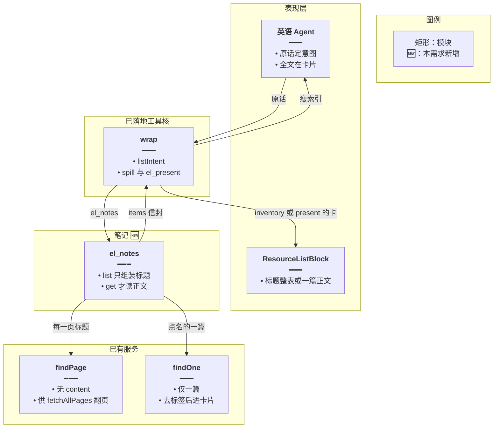
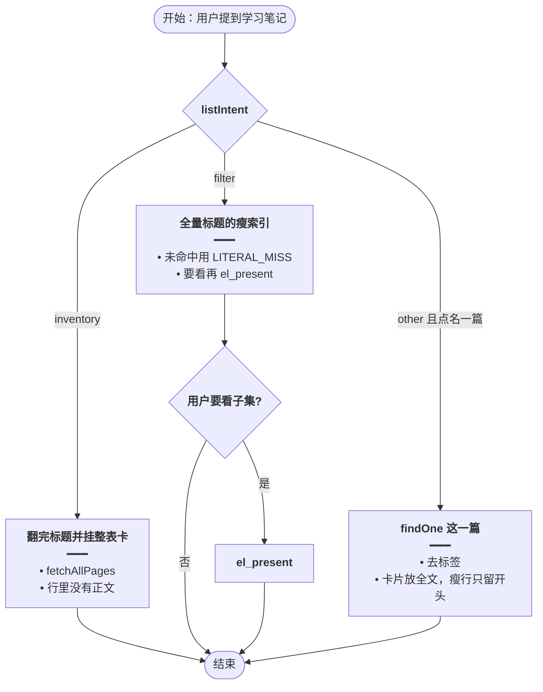
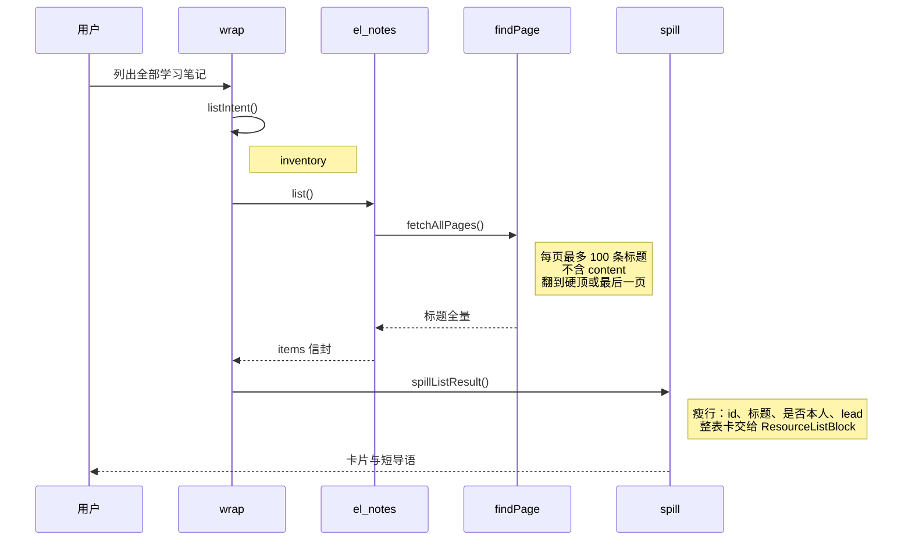

# Agent 笔记检索 — 实现思路

> **状态**：规划（修订：对齐已落地的列表意图、全量拉取和卡片；笔记分页已有，可复用）  
> **日期**：2026-10-26  
> **需求摘要**：英语 Agent 查找学习笔记时，与词库、收藏、日推一样先拉全量标题索引，再按意图出整表卡或瘦索引。打开一篇才读正文，正文进卡片，模型只看瘦字段。

## 延伸阅读

- [英语Agent关联侧栏.md](./英语Agent关联侧栏.md)（工具必须走 `wrap`）
- [意图决定出卡.md](./意图决定出卡.md)、[清单索引可筛选.md](./清单索引可筛选.md)
- [Agent词句生成.md](./Agent词句生成.md)（词句是另一种资源，出卡规则相同）
- [学习笔记全面实现.md](../notes/学习笔记全面实现.md)

---

## 0. 读本文你将得到什么

- 要解决的问题：笔记还没进 Agent。若列表只给 20 条标题、打开就塞 1200 字 HTML，会和其他模块的全量索引、意图出卡不一致。
- 一句话方案：`el_notes` 走现有 `wrap`。`list` 用 `fetchAllPages` 翻完 `findPage`；inventory 挂整表卡，filter 给瘦索引再 `el_present`。单篇正文放进卡片，模型只看标题和开头。
- 改动层：一个工具登记进索引表。不改笔记编辑和列表 SQL 的列。
- 一个阶段：list 与 get 都回到现有外溢。
- 最大风险：为了「全量」把每篇 HTML 都拉进索引。索引只许标题行，正文只在打开那一篇时出现。

---

## 1. 需求与边界

### 1.1 用户故事

| 角色 | 场景 | 行为 | 期望结果 |
|------|------|------|----------|
| 登录用户 | 要全部笔记 | 「列出全部学习笔记」 | 硬顶内标题全部进索引或整表卡，不是只给 20 条 |
| 登录用户 | 按题目找 | 「找出关于定语从句的笔记」 | filter：瘦索引是拉到的全量标题；字面未命中也不说没有 |
| 登录用户 | 打开一篇 | `el_present` 或 get 这一篇 | 卡片里是该篇纯文本；模型回执仍是瘦字段加开头，不贴整篇 HTML |
| 登录用户 | 公开笔记 | 列表里有他人公开篇 | 瘦行标明不是本人。不能改 |
| 未登录 | 调工具 | 请求 | 401 |

### 1.2 范围

| 在范围内 | 不在范围内 |
|----------|------------|
| 标题全量索引、按意图出卡、打开一篇 | 新建、修改、删除、上传图片、导出 DOCX |
| `findPage` 已有的标题 `LIKE` | 为了搜索去扫全部 HTML |
| 单篇正文进卡片 | 把每篇 content 放进 list 的 items |

### 1.3 约束与依赖

- `findPage` 的 select 没有 content，必须保持。全量指的是把每一页标题翻完，不是改 SQL 去取正文。
- `findPage` 单页最大 100。Agent 用 `fetchAllPages` 按这个页大小翻到 `EL_FULL_LIST_MAX`。
- 工具走 `wrap`，从而得到 `pageIndex`、`spillListResult`、`listIntent` 和 `el_present`。
- 打开一篇用 `findOne`，去标签后作为该卡片的一条长文本。模型瘦行只留标题和开头 24 字，与日推 `lead` 相同。

---

## 2. 方案总览（一句话 + 要点）

**一句话方案**：笔记列表就是又一份索引。翻页拉全标题，意图和卡片与其他 `el_*` 相同；只有点名的那一篇才读正文，而且正文在卡片里，不在模型的长上下文里。

| # | 设计要点 | 理由 |
|---|----------|------|
| 1 | `list` 登记为 `isIndexOp` | 与日推 list、收藏 list 同一条出卡规则 |
| 2 | `fetchAllPages` 翻 `findPage` | 笔记可能超过一页。只取 20 条会让「全部笔记」漏数据 |
| 3 | 索引行只有 id、标题、时间、是否本人 | `findPage` 已经不选 content。全量拉取不能破坏这一点 |
| 4 | inventory 挂 `ResourceListBlock` | 不新做笔记卡片壳 |
| 5 | filter 用 `LITERAL_MISS` | 标题没对上时，索引仍是全量，禁止说没有笔记 |
| 6 | get / present 一篇才 `findOne` | 正文成本只发生在点名的那篇 |
| 7 | 不做写操作 | 查找不需要把编辑器状态放进 Agent |

---

## 3. 现状与复用

| 能力 | 仓库中已有 | 本需求中的用法 |
|------|------------|----------------|
| 分页 | `LearningNotesService.findPage` | 作为 `fetchAllPages` 的单页函数。`pageSize` 用它允许的最大值 100 |
| 查询列 | select 仅 id、title、userId、isPublic、时间 | 不改。Agent 禁止另写一条带 content 的列表 |
| 标题条件 | `QueryLearningNoteDto.title` | filter 的关键词。未命中时仍先有全量索引再说明字面未命中 |
| 单篇 | `findOne` | 仅 get 或 `el_present` 一篇时调用 |
| 工具外壳 | `wrap`、`spillListResult`、`listIntent`、`slimRow` | 直接复用。笔记瘦行走已有的 titleEn / titleZh / lead 形状 |
| 卡片 | `ResourceListBlock` | 标题列表和单篇纯文本都作为 items |
| 开头截断 | 日推瘦行 `lead` 24 字 | 单篇给模型的开头与此相同，全文留给卡片 |

**调研结论**：笔记服务的列表已经是瘦的。和现有 Agent 不一致的只是还没有翻完所有页，也没有接意图和卡片。不需要为笔记再设计一套 20 条或 1200 字的专用协议。

---

## 4. 架构图



**图内方法说明**：

| 方法 | 功能 |
|------|------|
| `wrap` | 已有外壳。`el_notes` 必须经过它，出卡规则才和词库、收藏一致 |
| `listIntent` | 已有。「列出全部笔记」为 inventory；「找出 / 相关」为 filter |
| `fetchAllPages` | 已有。对 `findPage` 逐页取标题，直到硬顶或最后一页 |
| `findPage` | 已有列表。保持不选 content |
| `findOne` | 已有单篇。只有打开时调用 |
| `spillListResult` | 已有。标题列表变成瘦索引；整表卡带上全部标题行 |
| `el_present` | 已有。筛选后只展示点名的那几篇；若只点一篇且要正文，卡片 items 放去标签后的正文 |
| `slimRow` | 已有。笔记标题映射成 title 与 24 字 lead，不把 HTML 放进瘦行 |

**读图要点**：

- 全量发生在标题分页，不发生在正文。
- 卡片和模型看到的详细程度，由已有外溢决定，笔记不单独规定字数上限协议。
- 单篇 HTML 只读一次，并且留在卡片数据里。

---

## 5. 主流程图



**图内方法说明**：

| 方法 | 功能 |
|------|------|
| `listIntent` | 决定整表卡还是瘦索引。笔记不再用「最多 20 条」代替这个判断 |
| `fetchAllPages` | inventory 和 filter 都先翻完标题页 |
| `findPage` | 单页数据源。Agent 不改它的 select |
| `findOne` | 仅点名一篇时取正文 |
| `el_present` | 把筛选命中的 id 挂成卡片。需要正文时，这一步才带上纯文本 |
| `spillListResult` | 把标题数组拆成模型可见瘦行和卡片全量 |

**读图要点**：

- 「全部笔记」和「找出某类笔记」拉到的标题一样多，差在出卡。
- 不在筛选未命中时改去扫描所有 HTML。
- 打开一篇是 other 或 present，不是把 list 的每一行都换成正文。

---

## 6. 核心时序图



**图内方法说明**：

| 方法 | 功能 |
|------|------|
| `listIntent()` | 判定整表。筛选句不会走这条挂卡 |
| `list()` | 只收集标题页，不调用 `findOne` |
| `fetchAllPages()` | 按 `findPage` 的页大小翻完 |
| `findPage()` | 返回一页标题。查询列保持无正文 |
| `spillListResult()` | 生成瘦索引和卡片载荷 |
| `findOne()` | 本图不调用。用户点名一篇时才读 HTML |

**读图要点**：

- 和日推 list 的时序相同：先全量瘦资源，再外溢。
- 正文不在这条时序里，所以列全部笔记不会按篇数乘 HTML 体积计费。
- 点开一篇是另一次工具调用，卡片拿全文，模型拿 lead。

---

## 7. 状态机

不单列。笔记内容不因查找改变。出卡状态沿用 inventory、filter 和已 present。

---

## 8. 模块职责与接口草图

### 8.1 模块一览

| 模块 | 职责 | 新增/改动 | 预估路径 |
|------|------|-----------|----------|
| 工具 | list、get，走 `wrap` | 新增 | `english-learning-domain-tools.ts` |
| 登记 | `el_notes` + `list` 进入 `isIndexOp` | 扩展 | `el-spill.ts` |
| 去标签 | 单篇 HTML 变成卡片文本 | 新增小函数 | 工具文件内 |
| 笔记查询 | 保持无 content 的列表 | 不改 | `learning-notes.service.ts` |
| 提示 | 与其他清单相同的复述禁令 | 扩展 | `agent.prompt.ts` |

### 8.2 关键接口

```typescript
// 列表单页沿用 findPage 允许的最大页，再交给 fetchAllPages 翻到硬顶
const NOTE_PAGE = 100;

// 瘦行开头与日推 lead 相同，避免笔记单独发明一个 1200 字模型正文
const NOTE_LEAD = 24;

// list 不读 content。打开一篇时才 findOne，全文进卡片 items
function listNoteTitles(userId: number): Promise<{ id: string; title: string }[]> {
	// 占位。落地时改为 fetchAllPages 串起 findPage，返回值仍只有标题
	return Promise.resolve([]);
}
```

### 8.3 数据模型

| 字段 | 来源 | 给模型 | 给卡片 |
|------|------|--------|--------|
| id、title、isPublic、updatedAt | `findPage` 全页 | 瘦行 | inventory 时的全部标题行 |
| content | `findOne` 一篇 | 开头 24 字 | 该篇去标签全文 |
| 关键词 | 原话 | 不落库 | 不展示 |

---

## 9. 分阶段实现步骤

| 阶段 | 目标 | 交付物 | 依赖 |
|------|------|--------|------|
| M1 | 笔记列表和单篇都走现有清单链路 | `el_notes`、登记、去标签 | 无 |

### M1

- [ ] `el_notes` 用 `wrap`。`list` 写入 `INDEX_TOOL_OP`。
- [ ] `list` 对 `findPage` 做 `fetchAllPages`，不改 select。
- [ ] inventory 挂 `ResourceListBlock`；filter 只给瘦索引，未命中用 `LITERAL_MISS`。
- [ ] `get` 或 present 一篇时 `findOne`，去标签全文进卡片，瘦行 lead 24 字。
- [ ] 自检：列出全部不是只返回 20 条；筛选句 `listIntent` 为 filter；瘦行不含 `<` 和 `http`。

---

## 10. 关键决策与备选方案

| 决策 | 选用 | 备选 | 为何不选备选 |
|------|------|------|--------------|
| 列表范围 | 翻完所有标题页 | 固定 20 条 | 其他模块的「全部」是硬顶内全量 |
| 出卡 | `listIntent` + `el_present` | 一搜就贴正文 | 和意图出卡冲突，也浪费 token |
| 正文 | 只在点名的一篇，放卡片 | 每篇 HTML 进索引 | 全量应是标题全量，不是正文全量 |
| 模型可见正文 | 24 字 lead，与日推相同 | 单独 1200 字 | 会变成笔记专用协议 |
| 写入 | 不做 | Agent 保存 HTML | 超出查找，且现有写操作走提案，笔记未要求 |

---

## 11. 风险、边界与待确认

| 项 | 等级 | 说明 | 缓解 |
|----|------|------|------|
| 标题对不上正文里的词 | 中 | 本阶段不扫 HTML | 回执说明是按标题。未命中仍保留全量标题索引 |
| 「主题」触发 filter | 低 | `FILTER_RE` 含主题 | 与词库相同，筛选不出整表 |
| 公开笔记被说成自己的 | 中 | `findPage` 含公开篇 | 瘦行带是否本人 |
| 硬顶截断 | 低 | 笔记极多时与其他列表一样 | 使用现有「已达硬顶，未穷尽」 |

**待确认**：

- [ ] 无。`findPage` 不选 content、`wrap` 的 inventory 出卡，均已在源码核对。

---

## 12. 验收清单

| # | 用例 | 步骤 | 期望 |
|---|------|------|------|
| AC1 | 全部笔记 | 「列出全部学习笔记」 | 翻完各页标题；挂整表卡；回执无 HTML |
| AC2 | 超过一页 | 笔记多于 100 篇 | `fetchAllPages` 继续翻，直到硬顶或最后一页 |
| AC3 | 筛选 | 「找出关于定语从句的笔记」 | 瘦索引来自全量标题；不自动整表 |
| AC4 | 未命中 | 标题都没有这个词 | `LITERAL_MISS`，不说没有笔记 |
| AC5 | 打开一篇 | 点名 id | 卡片有去标签全文；模型只有标题和 24 字开头 |
| AC6 | 公开笔记 | 列表含他人公开篇 | 标明不是本人，无保存操作 |
| AC7 | 笔记页 | 打开同一篇页面 | 仍是完整编辑器内容 |
| AC8 | 翻页索引 | 瘦行超过一页 | `artifactId` + `offset` 走现有 `pageIndex` |

---

## 13. 预估改动面

| 类型 | 路径 |
|------|------|
| 后端 | `apps/backend/src/services/agent/english-learning-domain-tools.ts` |
| 后端 | `apps/backend/src/services/agent/el-spill.ts` |
| 后端 | `apps/backend/src/services/agent/agent.prompt.ts` |
| 不改 | `learning-notes.service.ts` 的列表查询列、编辑器、导出 |

---

（本文档为规划态实现思路；落地后以源码为准）
