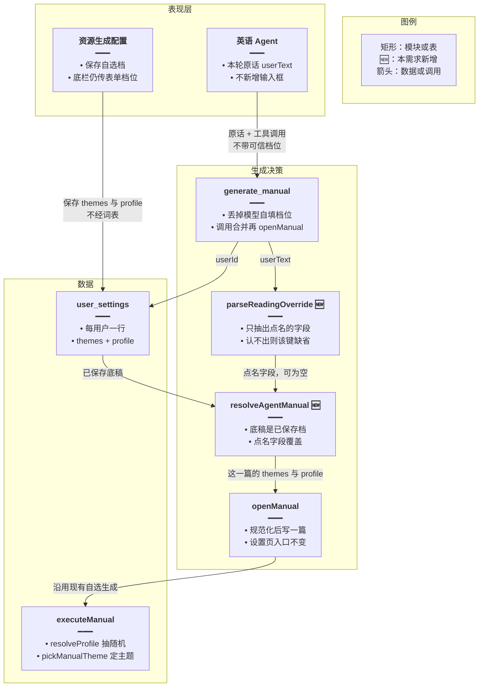
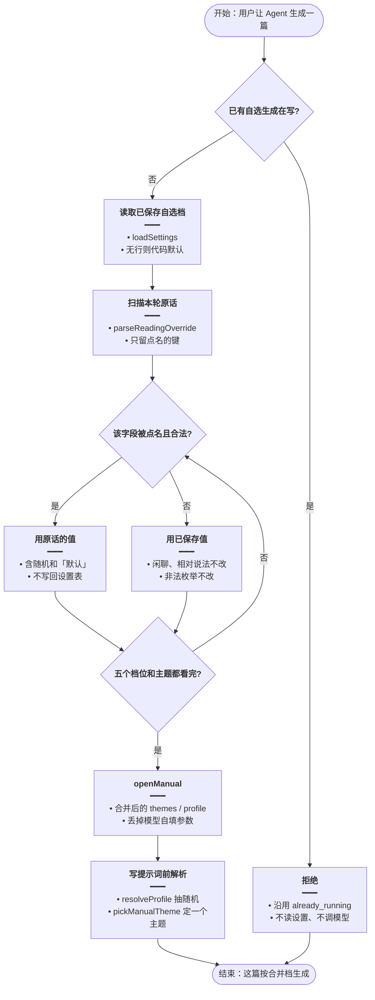
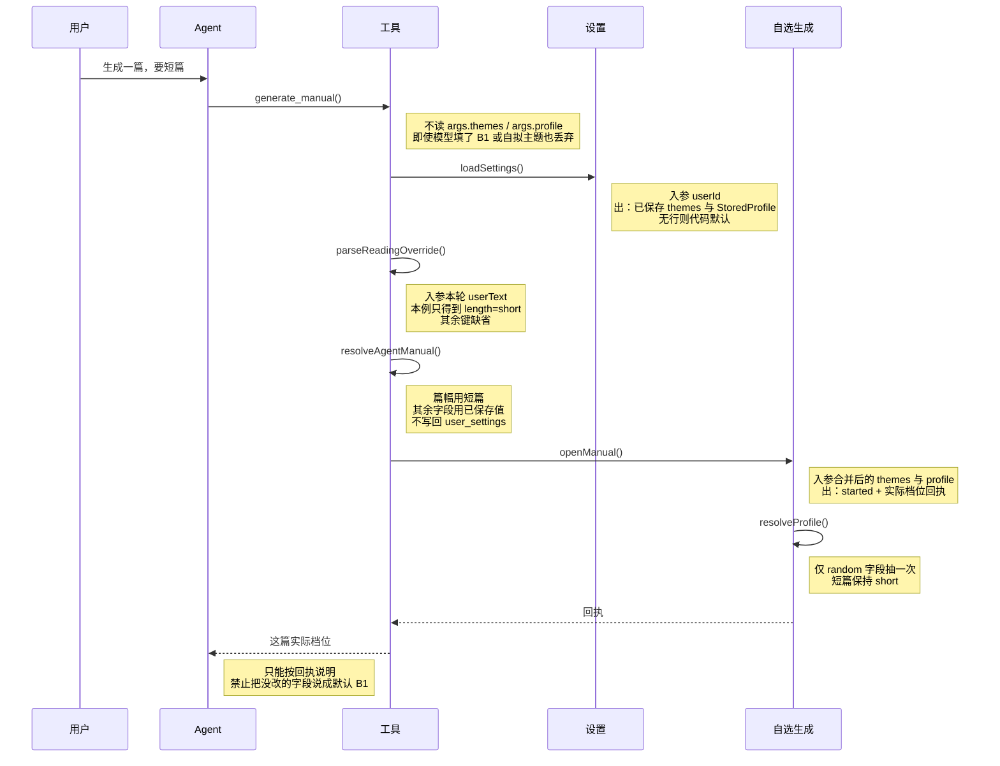

# Agent 自选认配置 — 实现思路

> **状态**：规划（未实现；自选生成、按用户保存的自选档、Agent 的 `generate_manual` 已有，可复用）  
> **日期**：2026-10-26  
> **需求摘要**：用户在英语 Agent 里发起自选生成时，原话没点名的档位用「自选生成配置」里已保存的值；点名了的字段以这句话为准。不触发系统日推，不读自动生成配置，不入定时队列。

## 延伸阅读

- [每日阅读手动生成.md](./每日阅读手动生成.md)（设置页自选生成：另插一篇，`slot` 不是 `day`）
- [每日阅读超管配置.md](./每日阅读超管配置.md)（自选档与自动档分表；本需求只读自选档）
- [阅读档位随机.md](./阅读档位随机.md)（`random` 留在设置里，写提示词前再抽一次）
- [英语Agent关联侧栏.md](./英语Agent关联侧栏.md)（`generate_manual` 已经能开一次自选生成）
- [自选沿用上一篇.md](./自选沿用上一篇.md)（「同样再来一篇」沿用本会话上一篇已生效档；冷启动仍用本文的已保存配置）

---

## 0. 读本文你将得到什么

- 要解决的问题：Agent 发起自选生成时不读「自选生成配置」，模型没传的档位被收成代码默认（B1、中篇、只读短文、不出题、联网）。
- 总体方案：只走现有 `generate_manual` → `openManual`。底稿是该用户已保存的自选档，原话点名的字段才覆盖。
- 主要改后端工具和档位词表。设置页按钮、系统日推、自动生成配置、定时队列、SSE 都不改。
- 分两阶段：M1 合并档位并生成；M2 回执锁住模型复述。
- 最大风险：把「短文」「关于我的设置」误认成篇幅或主题。

---

## 1. 需求与边界

### 1.1 用户故事

| 角色 | 场景 | 行为 | 期望结果 |
|------|------|------|----------|
| 登录用户 | 自选生成配置已保存 C1、长篇、附词汇、3 题、关闭智能搜索 | 对 Agent 说「自选生成一篇」，不提档位 | 新的自选篇用上述已保存值；主题从已保存主题列表里抽一个。系统日推那一行不动 |
| 登录用户 | 同上 | 说「生成一篇，要短篇，主题用美食」 | 只把篇幅改成短篇、主题改成美食；难度、侧重、题数、联网仍是已保存值 |
| 登录用户 | 已保存档含「随机」 | 原话不提该字段 | 仍保存 `random`，由现有 `resolveProfile` 在写提示词前抽一次 |
| 登录用户 | 原话写「用默认配置生成」 | 点名了默认 | 这一篇用代码默认档和默认主题，不改库里的保存值 |
| 登录用户 | 原话同时写「附词汇」和「附语法」 | 两个侧重都点到 | 这一篇侧重为附词汇加语法（`both`） |
| 登录用户 | 已有一次自选生成在写 | 再让 Agent 生成 | 仍拒绝，不新开一篇，也不去补系统日推 |
| 未登录 | 调 Agent | 请求 | 与现有英语 Agent 一样 401 |

### 1.2 范围

| 在范围内 | 不在范围内（非目标） |
|----------|----------------------|
| Agent 的 `generate_manual`，最终进入 `openManual`（自选篇，`slot` 为本次 runId） | `ensurePassage`、`claim`、Bull 队列、`slot = day` 的系统日推 |
| 读取「自选生成配置」`english_daily_reading_user_settings` | 读取或改写「自动生成配置」、到点入队、补生成、尝试表 |
| 本轮原话 `dto.content` 上的词表 | 再调一次模型做抽取；翻历史句找「刚才说的 B2」 |
| 难度、篇幅、侧重、理解题、联网、主题 | 把覆盖结果写回设置表 |
| 回执写明这次自选实际用的档 | 设置页底栏按钮的入参（仍传当前表单）；SSE 信息条新增档位事件 |

### 1.3 约束与依赖

- 须登录。界面文案是「自选生成 / 自选生成配置」。库表仍是 `english_daily_reading_user_settings`。没有行时 `loadSettings` 回代码默认，不插行。
- 只复用自选这条：`loadSettings`、`normalizeProfile`、`resolveProfile`、`pickManualTheme`、`openManual`、`executeManual`。禁止接到 `loadAutoSettings` 或定时工人。
- 识别规则与整库出卡同一原则：服务端决定这篇用哪套档，不把决定权交给模型是否记得传参。
- 「语义」在这里指覆盖设置页文案和常见说法的词表。认不出的说法不改该字段，避免把闲聊收成默认档。
- 体验底线：没点名的字段必须和设置页已保存值一致；点名的字段不能被模型另传的 B1/中篇盖掉。

---

## 2. 方案总览（一句话 + 要点）

**一句话方案**：自选生成仍只走 `generate_manual` → `openManual`。先读该用户已保存的自选生成配置，再用本句原话逐字段覆盖，然后交给现有 `openManual`。模型参数里的 `themes` / `profile` 丢弃。不入系统日推队列。

| # | 设计要点 | 理由 |
|---|----------|------|
| 1 | 底稿永远是 `loadSettings` | 没传档位时今天会落到 `DEFAULT_PROFILE`，不是用户保存值 |
| 2 | 只覆盖原话点名的字段 | 「要短篇」不应把已保存的 C1、3 题、关联网一起改掉 |
| 3 | 不用模型传入的 themes/profile | 工具现在强制要 themes，模型会自填主题并漏掉 profile，漏掉的键又被收成默认 |
| 4 | 词表放在 `daily-reading.rules.ts`，和 `normalizeProfile` 并列 | 枚举只有这一处；设置页不走这条解析 |
| 5 | 回执带合并后的档 | 模型只能照回执说明，不能把默认 B1 说成用户的设置 |
| 6 | 覆盖不写库 | 这一篇的临时主题或短篇不能改掉设置页 |

---

## 3. 现状与复用

| 能力 | 仓库中已有 | 本需求中的用法 |
|------|------------|----------------|
| 设置页按表单生成 | `GenerateBar` → `englishDailyReadingStore.startRun(themes, profile)` → `POST daily-readings/manual/stream` | 不改。这条已经带上表单里的主题和档位 |
| 已保存自选档 | `english-daily-reading.service.ts` 的 `loadSettings` / `readingSettings`；表 `english_daily_reading_user_settings` | 直接复用：Agent 生成前读这一行 |
| 缺行时的默认 | `themesForSettings`、`normalizeProfile`、`DEFAULT_PROFILE`（B1、中篇、只读、0 题、联网） | 仅当用户从未保存，或原话明确说「默认」时使用 |
| 随机档 | `resolveProfile`，在 `executeManual` 入口抽一次 | 直接复用：合并结果里的 `random` 不要提前抽成具体档 |
| 主题抽取 | `pickManualTheme` | 直接复用：只在自选候选里抽一个，避开今天系统日推已经用过的主题名，不改那一行 |
| Agent 开稿 | `english-learning-domain-tools.ts` 里 `op === 'generate_manual'`，现为 `openManual(userId, { themes, profile: args.profile, runId })` | 扩展：入参改为合并结果，不再读 `args.themes` / `args.profile` |
| 本轮原话 | `agent.service.ts` 把 `dto.content` 放进 `elSurface.userText` | 直接复用：词表只扫这一句 |
| 进行中互斥 | `peekManualRun` / `openManual` 已有则拒绝或只订阅 | 直接复用 |
| 设置页文案 | `apps/frontend/src/i18n/locales/zh-CN/englishLearning.ts` 的 `dailyReading.*` | 词表与这些中文对齐：短篇/中篇/长篇、只读短文、附词汇、附语法、不出题、开启/关闭智能搜索 |
| 自动生成配置 | `loadAutoSettings`，只给系统日推 | 不读、不写 |

**调研结论**：设置页和 Agent 共用 `openManual`，但只有设置页会把档位放进请求体。Agent 工具说明只要求 `themes`，`profile` 缺省时 `normalizeProfile` 把每个字段收成默认。`readingSettings` 已经能读出用户保存值，`generate_manual` 没有调用它。不需要新表、新接口或前端改动。

---

## 4. 架构图



**图内方法说明**：

| 方法 | 功能 |
|------|------|
| `parseReadingOverride(userText)` | 扫描本轮原话，按词表产出可选的难度、篇幅、侧重、题数、联网和主题；没点到的键不出现 |
| `resolveAgentManual(saved, userText)` | 以 `loadSettings` 的结果为底，把点名的字段盖上去，得到这一篇的 `themes` 与 `StoredProfile` |
| `loadSettings(userId)` | 读取该用户自选档；没有行时回主题默认列表和 `normalizeProfile` 的默认档，不插入行 |
| `generate_manual` | Agent 工具分支：忽略 `args.themes` / `args.profile`，用合并结果调用 `openManual` |
| `openManual(userId, input, emit)` | 规范化主题和档位后启动自选生成；设置页仍直接传表单，不经过词表 |
| `executeManual(...)` | 已有生成：入口 `resolveProfile` 把 `random` 抽成具体档，再检索和写提示词 |
| `resolveProfile(stored)` | 每个标了 `random` 的字段均匀抽一次；同一次生成的重试沿用这次结果 |
| `pickManualTheme(themes, avoid)` | 从这一篇的主题列表抽一个，并尽量避开当天定时篇的主题 |

**读图要点**：

- 设置页和 Agent 在 `openManual` 汇合，只有 Agent 多一步合并。
- 新增的只有词表和合并；落库、SSE、模型提示词仍走现有自选生成。
- 自动档不进这张图。定时篇继续读 `loadAutoSettings`。

---

## 5. 主流程图



**图内方法说明**：

| 方法 | 功能 |
|------|------|
| `peekManualRun(userId)` | 该用户已有自选生成则返回 runId 与阶段；有则本轮直接失败，不合并档位 |
| `loadSettings(userId)` | 提供底稿。无行时的默认只表示「用户还没存过」，不是「原话没说就改用默认」 |
| `parseReadingOverride(userText)` | 从原话抽出点名字段。同一字段后出现的合法说法覆盖先出现的；附词汇与附语法同时出现则为 `both` |
| `normalizeThemeList(input)` | 主题候选仍走现有校验：空项丢掉、超长或含尖括号则整列作废，作废时退回已保存主题 |
| `openManual(...)` | 用合并结果插 pending 行并调用模型；Agent 这条的 emit 仍是空函数 |
| `resolveProfile(stored)` | 合并完成之后才抽随机，避免词表阶段就把「随机」收成某一个具体档 |
| `pickManualTheme(themes, avoid)` | 在合并后的主题列表上抽一个，避开当天 `slot = day` 的主题 |

**读图要点**：

- 入口仍是用户这句话触发的 `generate_manual`，不是设置页按钮。
- 判断按字段做：一句话可以只改篇幅，其它字段留在已保存档。
- 失败只有「已在生成」这一条既有路径；词表失败不会中止生成，只会少覆盖。

---

## 6. 核心时序图



**图内方法说明**：

| 方法 | 功能 |
|------|------|
| `generate_manual()` | 模型发起的开稿。参数可以空着；实现不采用模型填的主题和档位 |
| `loadSettings()` | 按用户读自选档，作为这一篇的底稿 |
| `parseReadingOverride()` | 只从原话识别点名配置。上例「要短篇」只产生篇幅 |
| `resolveAgentManual()` | 底稿加覆盖，得到交给 `openManual` 的输入 |
| `openManual()` | 启动一次自选生成，并把合并后的档位写进工具回执。不入定时队列 |
| `resolveProfile()` | 生成开始时把仍为 `random` 的字段抽成具体档，供提示词和 `extras` 使用 |

**读图要点**：

- 用户只说「短篇」时，设置服务返回整份已保存档，词表只改篇幅。
- 回执发生在模型写最终说明之前，所以复述可以跟这篇实际档位对齐。
- 没有第二轮模型调用。识别是本进程里的词表。

---

## 7. 状态机

不单列状态图。这篇没有播放、编辑这类模式切换：档位在 `openManual` 之前定完，生成过程中不改。每个字段「用原话还是用已保存值」已在 §5 的菱形里。

---

## 8. 模块职责与接口草图

### 8.1 模块一览

| 模块 | 职责 | 新增/改动 | 预估路径 |
|------|------|-----------|----------|
| 词表 | 从原话抽出点名字段 | 新增 | `apps/backend/src/services/english-learning/daily-reading.rules.ts` |
| 自检 | 没点名不覆盖、点名只覆盖该字段、短文不当事篇幅 | 新增 | 同目录 `daily-reading.rules.check.ts` |
| 合并 | 底稿加覆盖，供 Agent 调用 | 新增 | `english-daily-reading.service.ts` 上的小函数，或规则文件内纯函数 |
| 工具 | 生成前合并，回执写实际档 | 扩展 | `apps/backend/src/services/agent/english-learning-domain-tools.ts` |
| 提示 | 禁止模型用自填档冒充用户设置 | 扩展 | `apps/backend/src/services/agent/agent.prompt.ts` |
| 设置页 / 定时篇 | 保持现状 | 不改 | `GenerateBar.tsx`、`loadAutoSettings` |

### 8.2 关键接口（伪代码）

```typescript
// Agent 专用合并。设置页不调用，避免表单档位被原话再改一遍
function resolveAgentManual(saved: Saved, userText: string): ManualInput {
	// 词表只放点名的键。缺省键不能填默认档，否则会盖掉已保存的 C1
	const said = parseReadingOverride(userText);
	// 返回这一篇的入参，不写回 user_settings
	return {
		// 原话给出合法主题才换候选，否则仍从已保存列表里抽
		themes: said.themes ?? saved.themes,
		// 五个档位各自留在这一篇的 profile 里
		profile: {
			// 难度只在原话点了等级或随机时改，避免一句「短篇」把 C1 收成 B1
			level: said.level ?? saved.profile.level,
			// 篇幅单独覆盖；单独的「短文」不会进入 said.length
			length: said.length ?? saved.profile.length,
			// 侧重单独覆盖；附词汇和附语法同时出现时词表已收成 both
			focus: said.focus ?? saved.profile.focus,
			// 题数单独覆盖；只说「理解题」却没有道数时该键不出现
			questions: said.questions ?? saved.profile.questions,
			// 联网单独覆盖；没说开或关就留已保存的开关
			useWeb: said.useWeb ?? saved.profile.useWeb,
		},
	};
}
```

### 8.3 词表

只认下表。同一字段后一个合法说法覆盖前一个。附词汇和附语法都出现时，侧重为 `both`，不用「后说的覆盖先说的」。主题若被「不要 / 别 / 不是」紧挨着否定，这条主题不算点名。

| 字段 | 原话里算点名 | 不算点名 |
|------|----------------|----------|
| 难度 | `A2` `B1` `B2` `C1`（大小写不论）；初级→A2，中级→B1，中高级→B2，高级→C1；「难度随机」 | 「难一点」「简单些」这类没有目标档的相对说法 |
| 篇幅 | 短篇、中篇、长篇、长文；英文 short / medium / long | 单独的「短文」。产品里短文就是这一篇阅读，不是短篇幅 |
| 侧重 | 只读短文→`reading`；附词汇或只要词汇→`vocab`；附语法→`grammar`；两个都要→`both`；侧重随机 | 只说「单词」「语法讲解」但没有「附」或「只要」 |
| 理解题 | 不出题 / 不要题→0；2 题 / 两道→2；3 题 / 三道→3；题数随机 | 只说「理解题」却没有道数 |
| 联网 | 开启智能搜索、要联网→true；关闭智能搜索、不要联网、别搜→false | 只说「搜索」 |
| 主题 | 「主题是/用/为/改成」后面 1～16 字；或原话包含某条已保存主题全文 | 「关于我的设置」；整句当主题 |
| 整份默认 | 「默认配置」「恢复默认」 | 没提配置。这时用已保存档，而不是代码默认 |

主题列作废（空、过长、含 `<>`）时，这一篇退回已保存主题列表，不失败。

### 8.4 数据模型

| 字段/实体 | 来源 | 存储 | 说明 |
|-----------|------|------|------|
| `themes` / `profile` | 设置页保存 | `english_daily_reading_user_settings` | 底稿。本需求不更新 |
| 点名覆盖 | 本轮 `userText` | 不落库 | 只活在这一次 `openManual` 入参 |
| `extras` | `resolveProfile` 之后的具体档 | 已发布的阅读行 | 仍是生成当时的快照，旧篇不改 |
| 工具回执 | 合并结果 | 只在这一轮工具消息里 | 给模型复述，不另建表 |

---

## 9. 分阶段实现步骤

| 阶段 | 目标 | 交付物 | 依赖 |
|------|------|--------|------|
| M1 | 没点名走已保存档，点名只改该字段 | 词表、合并、`generate_manual` 改调用 | 无 |
| M2 | 模型说明与这篇实际档一致 | 回执文案、系统提示一句 | M1 |

### M1

- [ ] 在 `daily-reading.rules.ts` 增加 `parseReadingOverride`，返回值的每个键都是可选的。
- [ ] 增加 `resolveAgentManual`：底稿来自 `loadSettings`，覆盖来自词表。
- [ ] `generate_manual` 不再要求 `themes`，不再读取 `args.profile`；进行中仍走现有 `already_running`。
- [ ] `daily-reading.rules.check.ts` 用断言覆盖：空话不产生键；「短篇」只改篇幅；「短文」不改篇幅；附词汇加附语法为 `both`；「不要校园」不选中已保存主题「校园」；「默认配置」得到 `DEFAULT_PROFILE`。

### M2

- [ ] 工具回执列出合并后的主题候选和五个档位，并写明未点名字段来自已保存设置。
- [ ] `ENGLISH_LEARNING_SYSTEM_APPEND` 里 `el_daily_reading` 改为：生成时不要自填档位；说明只能照回执，禁止把默认 B1 说成用户设置。
- [ ] 工具描述删掉「`generate_manual` 需 themes」。

---

## 10. 关键决策与备选方案

| 决策 | 选用 | 备选 | 为何不选备选 |
|------|------|------|--------------|
| 谁决定这篇档位 | 服务端：已保存档 + 原话词表 | 让模型先调 `settings`，再把结果填进 `generate_manual` | 当前故障就是模型不传 `profile`，传了也常写成默认 B1，会盖掉已保存的 C1 |
| 识别方式 | 与设置页文案对齐的词表 | 再请求一次模型，抽出 JSON 档位 | 多一次费用和等待，仍可能编出用户没说的档。整库出卡已把同类决定从模型收回到规则 |
| 部分点名 | 逐字段覆盖 | 原话一旦提到任一配置，整份改用模型理解的结果 | 用户只说短篇时，其余档会被模型补成默认 |
| 主题 | 显式「主题…」或命中已保存主题全文 | 把「关于…」到句号都当成新主题 | 「关于我的设置生成一篇」会变成主题名 |
| 是否写回设置 | 不写 | 点名后顺便 `saveSettings` | 用户没有说保存。设置页仍是唯一保存入口 |
| 设置页未保存的表单 | Agent 只读库 | Agent 去读浏览器里还没保存的表单 | 服务端看不到未提交表单。自选生成读的是已保存配置 |

---

## 11. 风险、边界与待确认

| 项 | 等级 | 说明 | 缓解 |
|----|------|------|------|
| 「短文」被当成短篇 | 高 | 用户常说「生成一篇短文」 | 词表不把单独的「短文」映射到 `short`，自检固定这条 |
| 已保存主题是常见词 | 中 | 主题「工作」会出现在无关句里 | 只做全文包含；紧挨「不要/别/不是」则跳过。不从自由文本新造主题，除非写了「主题是/用/为/改成」 |
| 模型仍在说明里写 B1 | 中 | 提示约束不是硬闸 | 回执写实际档；M1 已经保证生成本身不用模型参数 |
| 多轮「用刚才的 B2」 | 低 | 只扫本轮 `dto.content` | 本阶段不读历史。用户需在这一句里再说档位 |
| 被当成系统日推 | 低 | 文件名或「每日阅读」容易和到点自动写的那篇混在一起 | 只走 `generate_manual` → `openManual`。回执写「自选生成」。不调用 `ensurePassage` |

**待确认**：

- [ ] 无。自选档表、`loadSettings` 无行行为、`generate_manual` 现参，均已在源码核对。

---

## 12. 验收清单

| # | 用例 | 步骤 | 期望 |
|---|------|------|------|
| AC1 | 不点名 | 在自选生成配置保存 C1、长篇、附词汇、3 题、关闭智能搜索后，对 Agent 说「自选生成一篇」 | 新的自选篇 `extras` 为上述档位；`slot` 不是 `day`。当天系统日推行不变 |
| AC2 | 只点名篇幅和主题 | 在 AC1 的保存值上说「要短篇，主题用美食」 | 篇幅为短篇，主题为美食；难度、侧重、题数、联网仍是 AC1 的保存值 |
| AC3 | 模型自填默认档 | 工具参数里带 `profile.level=B1` 且原话没提难度 | 生成仍用已保存难度，不用 B1 |
| AC4 | 短文不是短篇 | 原话只有「生成一篇短文」 | 篇幅保持已保存值 |
| AC5 | 随机保留 | 难度保存为随机，原话不提难度 | 库里的 profile 仍是 `random`；这一篇 `extras.level` 是 A2/B1/B2/C1 之一 |
| AC6 | 明确要默认 | 原话「用默认配置生成一篇」 | 这一篇为 B1、中篇、只读、0 题、联网，主题来自默认列表；设置页保存值不变 |
| AC7 | 设置页回归 | 在设置页改表单后点自选生成 | 仍按该次表单生成，不跑 Agent 词表 |
| AC8 | 进行中 | 已有自选生成时再让 Agent 生成 | 返回已有自选生成进行中，不新插行，也不入系统日推队列 |
| AC9 | 不碰系统日推 | Agent 完成一次自选生成 | 不调用 `ensurePassage` / `claim`，不写尝试表，`slot = day` 的行不变 |

---

## 13. 预估改动面（实现阶段参考）

| 类型 | 路径（预估） |
|------|----------------|
| 后端 | `apps/backend/src/services/english-learning/daily-reading.rules.ts` |
| 后端 | `apps/backend/src/services/english-learning/daily-reading.rules.check.ts` |
| 后端 | `apps/backend/src/services/agent/english-learning-domain-tools.ts` |
| 后端 | `apps/backend/src/services/agent/agent.prompt.ts` |
| 前端 | 无 |
| 文档（实现后） | 不在本规划篇改写；落地后再按已改 diff 另写实现归档 |

---

（本文档为规划态实现思路；落地后以源码为准）
