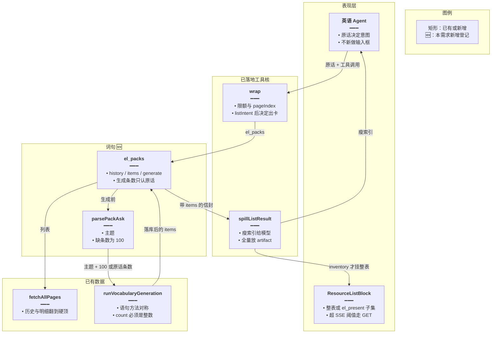
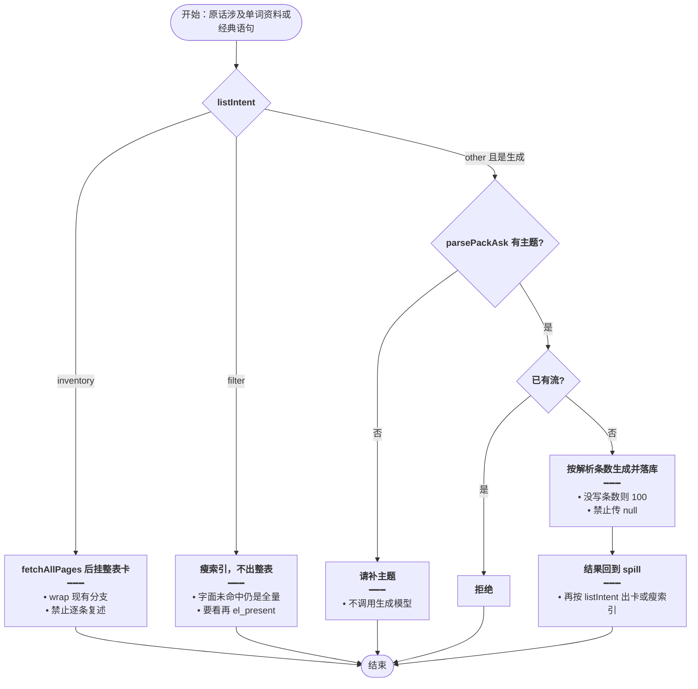
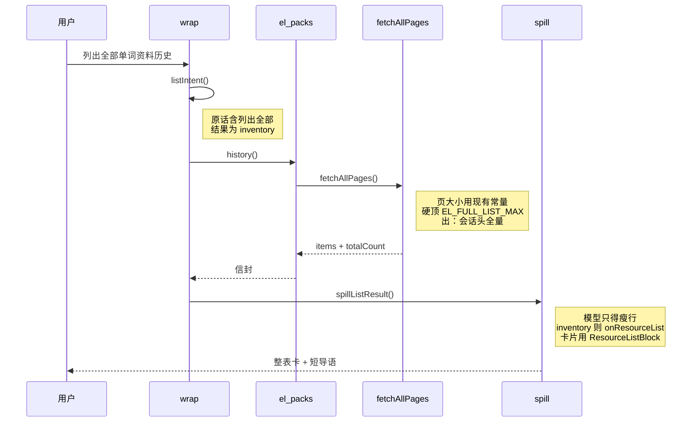

# Agent 词句生成 — 实现思路

> **状态**：规划（修订：对齐已落地的 `el_*` 意图、外溢和整表卡；生成管线已有，可复用）  
> **日期**：2026-10-26  
> **需求摘要**：英语 Agent 生成单词资料（词书）和经典语句时，主题从原话提炼，词数和条数没写则是 100。历史、明细和生成结果的拉取、意图和卡片，与词库、收藏、日推已经接入的方式相同。

## 延伸阅读

- [英语Agent关联侧栏.md](./英语Agent关联侧栏.md)（`wrap`、限额、信封、提案；本篇只加一种资源，不新开一条旁路）
- [清单索引可筛选.md](./清单索引可筛选.md)、[意图决定出卡.md](./意图决定出卡.md)、[整库全量出卡.md](./整库全量出卡.md)（瘦索引、`listIntent`、整表卡）
- [Agent笔记检索.md](./Agent笔记检索.md)（笔记走同一套 list / 外溢 / `el_present`）
- [Agent自选认配置.md](./Agent自选认配置.md)（生成参数只认原话，不认模型自填）
- [Agent词句认意图.md](./Agent词句认意图.md)（原话槽位：正则优先，认不准再用 glm-4.7-flash，并做子串校验）

---

## 0. 读本文你将得到什么

- 要解决的问题：单词资料和经典语句还没进 Agent。若另做「只回 5 条」的协议，会和词库、收藏、日推的意图、卡片、全量拉取不一致。
- 一句话方案：新工具仍进现有 `wrap`。列表用 `fetchAllPages` 拉到硬顶；`listIntent` 决定整表卡还是瘦索引；生成条数单独从原话读取，没写就是 100，生成完的结果再走同一套外溢。
- 改动层：`el_packs` 接进现有工具工厂，并登记 `isIndexOp` / `sourceOf`。不新写一套卡片组件。
- 分两阶段：M1 历史和明细走现成列表链路；M2 原话生成，结果仍交回这条链路。
- 最大风险：生成时把 count 留空，现有解析会变成 12000 或 6000，而不是 100。

---

## 1. 需求与边界

### 1.1 用户故事

| 角色 | 场景 | 行为 | 期望结果 |
|------|------|------|----------|
| 登录用户 | 要整份历史 | 「列出全部单词资料历史」 | 与「列出全部错题」一样：拉全量后挂整表卡，模型不逐条抄 |
| 登录用户 | 在历史里找 | 「找出关于旅行的单词资料」 | 筛选意图：瘦索引给出全部会话头，卡片等 `el_present` |
| 登录用户 | 只说主题 | 「生成旅行相关的单词」 | 词书主题旅行，词数 100。落库后的明细按整表规则出卡 |
| 登录用户 | 点了条数 | 「经典语句，关于友谊，30 条」 | 条数 30。展示仍走外溢，不另定预览条数 |
| 登录用户 | 没给主题 | 「帮我生成一些单词」 | 不调用生成模型，请用户补主题 |
| 登录用户 | 打开某一次 | 筛选后 `el_present` 传 streamId | 卡片是该次全部已落库行，和收藏卡同一块组件 |
| 未登录 | 调工具 | 请求 | 与现有英语 Agent 一样 401 |

### 1.2 范围

| 在范围内 | 不在范围内 |
|----------|------------|
| 单词资料 / 词书：现有生成管线。主题 + 词数，缺词数为 100 | 新建词书表，或另一套卡片 |
| 经典语句：主题 + 条数，缺条数为 100 | 系统日推、自选阅读 |
| 历史和明细：`fetchAllPages` + `spillListResult` + `listIntent` | 自造 5 条预览或 20 条历史上限 |
| 筛选后 `el_present` | 筛选题也自动挂整表 |
| 库内同主题已够则沿用现有跳过生成模型 | 为了省 token 把用户要的 100 条改成 5 条 |

### 1.3 约束与依赖

- 须登录。数据仍是当前用户的 pack session。
- 工具必须用 `buildEnglishLearningDomainTools` 里的 `wrap`，才能带上限额、`pageIndex`、白名单、外溢和整表卡。
- 复用 `fetchAllPages`、`listIntent`、`spillListResult`、`isIndexOp`、`el_present`、`ResourceListBlock`。
- 复用 `runVocabularyGeneration`、`runClassicQuotesGeneration`、`saveVocabularyPackBatch`、两侧 history / items 列表。
- 页面按钮仍可省略 count（今天会到 12000 / 6000）。Agent 生成调用必须传入解析后的正整数。
- 同一用户已在 `EnglishLearningStreamAbortRegistry` 里有流时，不再开第二路。

---

## 2. 方案总览（一句话 + 要点）

**一句话方案**：`el_packs` 只是又一个 `el_*`。拉数、意图、出卡和翻页索引都走侧栏模块已落地的那条；只有「主题和生成条数」按原话另算，缺条数为 100。

| # | 设计要点 | 理由 |
|---|----------|------|
| 1 | 词书就是单词资料会话 | 历史抽屉已经是这一次拉取，不新做实体 |
| 2 | `history` / `items` 登记为 `isIndexOp` | 与日推 list、收藏 list 一样：先瘦索引，整表只在 inventory |
| 3 | 全量用 `fetchAllPages`，硬顶 `EL_FULL_LIST_MAX` | 不另写分页循环，也不把历史截成 20 条 |
| 4 | inventory 由 `wrap` 里现有分支 `onResourceList` | 整表卡、同一 id 不挂两次、导语禁止逐条复述，都已有 |
| 5 | filter 不出整表，等 `el_present` | `FILTER_RE` 已含「找出 / 相关 / 主题」 |
| 6 | 字面未命中仍返回全量索引，消息用现成 `LITERAL_MISS` | 与日推、错题一致，禁止宣称没有 |
| 7 | 生成条数默认 100，且必须传入数字 | 空 count 会掉进 12000 / 6000。这只影响生成参数，不影响列表硬顶 |
| 8 | 生成结束后把 items 放进同一次工具信封 | 外溢和出卡不用第二套「5 条预览」 |

---

## 3. 现状与复用

| 能力 | 仓库中已有 | 本需求中的用法 |
|------|------------|----------------|
| 工具外壳 | `english-learning-domain-tools.ts` 的 `wrap` | 直接套上。自动处理限额、翻页、外溢、inventory 出卡 |
| 全量拉取 | 同文件 `fetchAllPages` | 历史和某次明细都用它，页大小沿用 `PAGE_USER_ROWS` 或 `PAGE_LIB_ITEMS` |
| 意图 | `el-spill.ts` 的 `listIntent` | 直接复用。列出全部 / 所有 → inventory；找出 / 相关 / 主题 → filter |
| 外溢与瘦行 | `spillListResult`、`slimRow` | 词条已认 `word` / `english` / `translationZh`。历史行补 `topic`、条数进瘦字段 |
| 索引登记 | `INDEX_TOOL_OP`、`sourceOf`、`TOOL_TITLE` | 扩展：`el_packs` 的 list 类 op，source 用 `other` 或新增 `pack`，标题「单词资料 / 经典语句」 |
| 卡片 | `ResourceListBlock` | 直接复用。items 在 artifact 里；SSE 超过 `EL_SSE_INLINE_MAX_ITEMS` 时现有 GET 补拉 |
| 筛选出卡 | `el_present` | 直接复用。筛选命中的 streamId 或词面由它挂子集 |
| 单词生成 | `runVocabularyGeneration` | 直接复用。`dto.count` 用解析值，禁止 null |
| 语句生成 | `runClassicQuotesGeneration` | 直接复用。库内已满则现有逻辑跳过生成模型 |
| 落库 | 控制器里的 `saveVocabularyPackBatch` 及语句对称保存 | Agent 生成结束走同一保存，历史才看得到 |
| 流互斥 | `EnglishLearningStreamAbortRegistry` | 已有则拒绝 |

**调研结论**：侧栏模块的「拉全、按意图出卡、模型看瘦索引」已经在 `wrap` 里。词句不要平行再做预览协议。要新增的只有原话里的主题和条数，以及把 pack 的 list 登记进索引表。

---

## 4. 架构图



**图内方法说明**：

| 方法 | 功能 |
|------|------|
| `wrap(...)` | 已有工具外壳。新工具必须走它，才能和词库、收藏共享限额、翻页和外溢 |
| `listIntent(userText)` | 已有三分法。inventory 挂整表；filter 只给瘦索引；生成请求本身是 other，生成完的列表再按原话意图出卡 |
| `fetchAllPages(pageSize, hardCap, fetchPage)` | 已有翻页。历史和明细拉到 `EL_FULL_LIST_MAX`，不足一页就停 |
| `spillListResult(tool, env, put, opts)` | 已有外溢。模型看瘦行，全量进 artifact |
| `parsePackAsk(userText)` | 仅生成使用。抽出主题；词数或条数没写则 100。不替代 `listIntent` |
| `runVocabularyGeneration` / `runClassicQuotesGeneration` | 已有生成。Agent 传入解析后的 count，不用 null |
| `el_present` | 已有。筛选后的子集由它出卡，不在 `el_packs` 里再写一种卡片 |
| `isIndexOp` | 已有登记表。`el_packs` 的 history 与 items 要登记进去，search 语义的过滤才不会自动整表 |

**读图要点**：

- 新增的是 `el_packs` 和主题条数解析，不是另一条从工具到卡片的通道。
- 全量在 `fetchAllPages` 和 artifact。模型侧仍是现有瘦索引。
- 生成条数 100 只决定写多少条，不决定卡片怎么拉。

---

## 5. 主流程图



**图内方法说明**：

| 方法 | 功能 |
|------|------|
| `listIntent(userText)` | 先区分整表、筛选、其他。生成属于其他，但不能因此绕开生成结果的出卡规则 |
| `fetchAllPages` | inventory 和 filter 都先拉全。差别只在出卡，不在少拉 |
| `spillListResult` | filter 与未达外溢阈值的小结果走瘦索引；inventory 由 `wrap` 推卡片 |
| `parsePackAsk` | 只在生成分支读主题和条数。缺条数为 100 |
| `el_present` | 筛选用户说「要看」之后挂子集卡 |
| `EnglishLearningStreamAbortRegistry.register` | 生成开始登记。已有流则拒绝 |

**读图要点**：

- 拉全量是列表的默认，不是生成完毕后的可选项。
- 出卡与否由已有意图决定，词句不再单独规定「永远 5 条」。
- 没有主题只挡住生成，不挡住历史列表。

---

## 6. 核心时序图



**图内方法说明**：

| 方法 | 功能 |
|------|------|
| `listIntent()` | 把「列出全部」判成 inventory，从而挂整表而不是只给索引 |
| `history()` | `el_packs` 的列表操作。内部只组数据，不出卡 |
| `fetchAllPages()` | 按现有硬顶翻完历史。不在这里截成 20 条 |
| `spillListResult()` | 拆成模型瘦索引和卡片全量。出卡决定已在 `wrap` 里做完 |
| `el_present()` | 本图不调用。若原话是「找出旅行相关」，走 filter，等用户要看再由它出子集 |

**读图要点**：

- 时序和收藏 list、错题 list 相同，只是数据来自 pack history。
- 生成时序是在 `history()` 之前多一次 `parsePackAsk` 和 `runVocabularyGeneration`，落库后的信封仍进入这张图的 `spill`。
- 语句把 history 的数据源换成经典句历史即可。

---

## 7. 状态机

不单列。出卡状态就是现有的 inventory / filter / 已挂过。生成只有「未开始 / 流进行中 / 已落库」。

---

## 8. 模块职责与接口草图

### 8.1 模块一览

| 模块 | 职责 | 新增/改动 | 预估路径 |
|------|------|-----------|----------|
| 工具 | history、items、generate，走 `wrap` | 新增 | `english-learning-domain-tools.ts` |
| 索引登记 | list 类 op 进入 `isIndexOp` | 扩展 | `el-spill.ts` 的 `INDEX_TOOL_OP`、`TOOL_TITLE`、`slimRow` |
| 原话条数 | 主题与 100 | 新增 | `pack-ask.ts` 与 `pack-ask.check.ts` |
| 卡片 | 不新做 | 复用 | `ResourceListBlock.tsx` |
| 页面生成缺省 | 保持拉满上限 | 不改 | `generate-vocabulary.dto.ts` |

### 8.2 关键接口

```typescript
// 只有生成用。列表硬顶仍是 EL_FULL_LIST_MAX，两套数字不能混
const AGENT_PACK_COUNT = 100;

// 没写词数或条数时用 100。主题空则该侧不生成，避免打空模型
type PackAsk = {
	// 只提到单词时才有。count 已解析，调用 run 时不能再改成 null
	vocab?: { topic: string; count: number };
	// 只提到语句时才有。与单词分开，避免一句请求打两套生成
	classic?: { topic: string; count: number };
};

// 不读模型参数。listIntent 仍单独判断出卡，本函数不算意图
function parsePackAsk(userText: string): PackAsk {
	// 占位。落地时按原话填两侧，这里只固定返回形状
	return {};
}
```

### 8.3 和意图的分工

| 原话 | `listIntent` | 生成参数 | 卡片 |
|------|----------------|----------|------|
| 列出全部历史 / 所有单词资料 | inventory | 不生成 | `wrap` 挂整表 |
| 找出、相关、主题筛选 | filter | 不生成 | 瘦索引；`el_present` 才出子集 |
| 生成旅行单词 | other | 主题旅行，词数 100 | 落库后的 items 再按当时意图；未出现「列出全部」则瘦索引，不自动整表 |
| 生成并列出全部 | inventory | 同上 | 生成结果挂整表卡 |
| 没有主题的生成 | other | 不调用 run | 无卡 |

字面筛选未命中时，回执使用已有 `LITERAL_MISS`，索引仍是拉到的全量。

### 8.4 数据模型

| 字段 | 来源 | 存储 | 说明 |
|------|------|------|------|
| 会话头 | `listVocabularyHistory` / `listClassicQuotesHistory` | 已有表 | `fetchAllPages` 翻完再进信封 |
| 明细 | `listVocabularyPackItems` / `listClassicQuotesPackItems` | 已有表 | 同上。瘦行沿用 `word` / `english` |
| 生成条数 | `parsePackAsk` | 写入现有 session.targetCount | 缺省 100，不写 null |
| artifact | `spillListResult` | 现有内存 artifact | SSE 超 200 条时现有 GET 补拉 |

---

## 9. 分阶段实现步骤

| 阶段 | 目标 | 交付物 | 依赖 |
|------|------|--------|------|
| M1 | 历史和明细与其他列表一致 | `el_packs` 的 list、登记、卡片 | 无 |
| M2 | 原话生成，结果回到同一信封 | `parsePackAsk`、generate | M1 |

### M1

- [ ] `el_packs` 用 `wrap` 注册。history 与 items 写入 `INDEX_TOOL_OP`。
- [ ] 两种历史、两种明细都 `fetchAllPages`，硬顶 `EL_FULL_LIST_MAX`。
- [ ] 瘦行能表达 topic、targetCount、word 或 english。不把检索网页正文放进瘦行。
- [ ] inventory 能挂上 `ResourceListBlock`；filter 必须再 `el_present` 才有卡。
- [ ] 自检：`listIntent('列出全部单词资料')` 为 inventory；`listIntent('找出关于旅行的单词资料')` 为 filter。

### M2

- [ ] `parsePackAsk`：无数字为 100；「30 条」为 30；只有单词时没有 classic；无主题不生成。
- [ ] generate 把解析出的 count 传进 run，断言不是 null。库内已满仍走现有跳过。
- [ ] 已有流则拒绝。落库后的 items 放进同一次 `elOk`，交给 `spillListResult`。
- [ ] 提示写明：出卡规则与词库、收藏相同；禁止把省略条数说成 12000 或 6000。

---

## 10. 关键决策与备选方案

| 决策 | 选用 | 备选 | 为何不选备选 |
|------|------|------|--------------|
| 列表怎么拉 | `fetchAllPages` 到现有硬顶 | 历史只给 20 条、明细只给 5 条 | 和其他模块不一致，筛选会漏掉没拉到的行 |
| 何时出卡 | `listIntent` + `wrap` | 生成完总是挂整表 | 筛选题会违反「意图决定出卡」 |
| 卡片组件 | `ResourceListBlock` | 词句专用预览块 | 全量、过滤、双语、导出已经在这块里 |
| 生成条数 | 原话，没有则 100 | 模型填 count，或省略交给 resolve | 省略会变成 12000 / 6000 |
| 词书 | 现有单词资料会话 | 新表 | 历史已经是词书记录 |

---

## 11. 风险、边界与待确认

| 项 | 等级 | 说明 | 缓解 |
|----|------|------|------|
| 空 count 拉满上限 | 高 | 页面函数对 null 返回 12000 / 6000 | Agent 只传整数；自检覆盖 |
| 生成结果被当成筛选 | 中 | 「主题」二字会让 `FILTER_RE` 先命中 filter | 生成分支看 `parsePackAsk`，不因为 filter 就拒绝生成。出卡仍服从 filter：不自动整表 |
| 硬顶小于用户历史 | 低 | 与词库、收藏同一硬顶 | 回执沿用现有「已达硬顶，未穷尽」 |
| 100 条生成仍要多轮模型 | 中 | 每轮约 20 条 | 这是生成成本。列表展示不再把全文塞进之后每一轮对话 |

**待确认**：

- [ ] 无。`wrap`、`listIntent`、`fetchAllPages`、`spillListResult`、count 的 null 行为均已在源码核对。

---

## 12. 验收清单

| # | 用例 | 步骤 | 期望 |
|---|------|------|------|
| AC1 | 整表历史 | 「列出全部单词资料历史」 | `fetchAllPages` 拉完硬顶内会话；挂整表卡；导语不逐条抄 |
| AC2 | 筛选 | 「找出关于旅行的单词资料」 | 瘦索引含全部会话头；不自动整表；`el_present` 后才有子集卡 |
| AC3 | 未命中 | 筛选词在主题里都不出现 | 回执是 `LITERAL_MISS`，不说「没有历史」 |
| AC4 | 只给主题 | 「生成旅行相关的单词」 | 目标 100。落库。出卡服从意图，不另给 5 条协议 |
| AC5 | 点条数 | 「友谊的经典语句 30 条」 | 传入 run 的 count 是 30，不是 null，也不是 6000 |
| AC6 | 无主题 | 「生成一些单词」 | 不调用 `runVocabularyGeneration` |
| AC7 | 只说单词 | 「单词主题是厨房」 | 不生成经典语句 |
| AC8 | 两侧 | 「单词用机场，语句用道歉」 | 两次落库，条数都是 100 |
| AC9 | 库内已有 | 同主题已不少于目标 | 沿用跳过生成模型 |
| AC10 | 页面回归 | 单词资料页不填数量 | 仍是今天的上限，不受 100 影响 |
| AC11 | 翻页 | 瘦索引超过一页 | `artifactId` + `offset` 走现有 `pageIndex` |

---

## 13. 预估改动面

| 类型 | 路径 |
|------|------|
| 后端 | `apps/backend/src/services/agent/english-learning-domain-tools.ts` |
| 后端 | `apps/backend/src/services/agent/el-spill.ts` |
| 后端 | `apps/backend/src/services/agent/agent.prompt.ts` |
| 后端 | 新建 `pack-ask.ts`、`pack-ask.check.ts` |
| 前端 | 无新卡片。`source` 若新增枚举，只让 `ResourceListBlock` 认出 pack 行 |
| 不改 | `resolveVocabularyPackTargetCount` 对 null 的页面语义 |

---

（本文档为规划态实现思路；落地后以源码为准）
