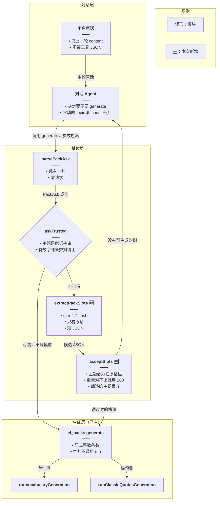
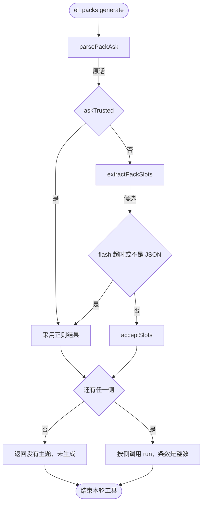
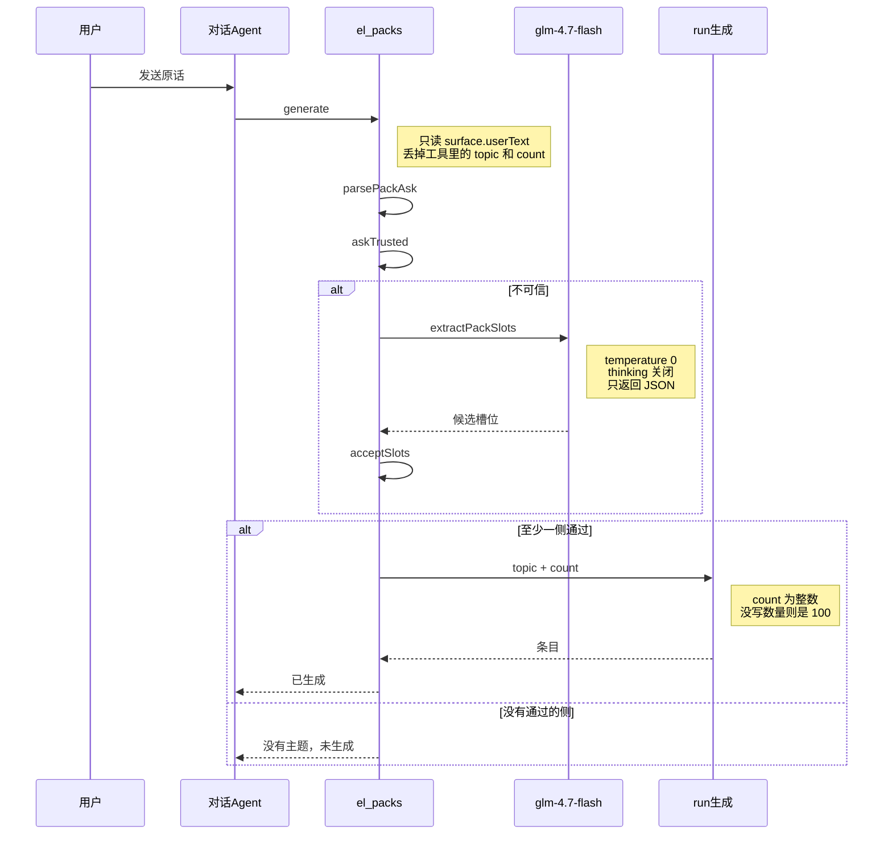
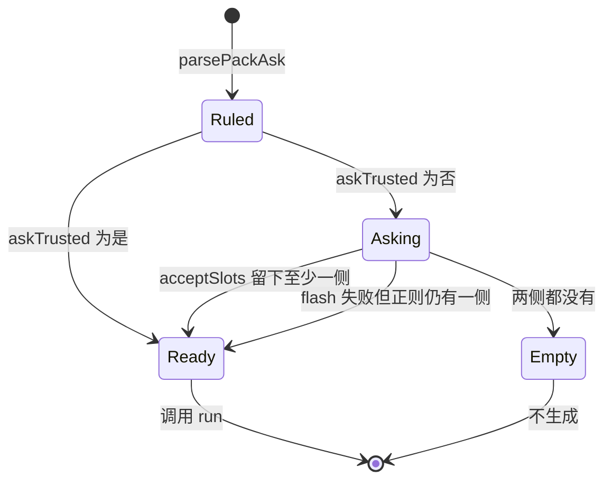

# Agent 词句认意图 — 实现思路

> **状态**：规划  
> **日期**：2026-10-27  
> **需求摘要**：英语 Agent 生成单词或语句时，从用户原话抽出主题和条数；说法对得上就用现有正则，对不上再用 `glm-4.7-flash` 抽槽位，并通过「必须出现在原话里」的校验后才生成。

## 延伸阅读

- [../通用决策封装.md](../通用决策封装.md)（`decide()`：固定 `glm-4.7-flash` 的无会话决策。本篇只做它的第一个调用方）
- [Agent词句生成.md](./Agent词句生成.md)（生成管线、默认 100、禁止把空条数当成 12000 / 6000）
- [Agent自选认配置.md](./Agent自选认配置.md)（同一原则：只认原话，不认对话模型自填的参数）
- [英语Agent关联侧栏.md](./英语Agent关联侧栏.md)（`el_packs` 所在的工具工厂）

---

## 0. 读本文你将得到什么

- 要解决的问题：`parsePackAsk` 只覆盖写死的说法。书名号、`5 句`、`还是生成校园` 这类原话会漏主题、把条数当成 100，或把指令词算进主题。
- 一句话方案：正则仍然先跑；只有结果对不上原话时，才经通用 `decide()` 用 `glm-4.7-flash` 做一次短 JSON 抽槽，服务端再核对主题和数字确实来自原话。
- 改动层：只动后端 `el_packs` 的 `generate`。不改对话模型的工具参数，不改词库页「不填条数就是 12000 / 6000」。
- 分两阶段：M1 加上校验和 flash 补漏；M2 把已经踩过的原话收进检查，避免回归。
- 最大风险：flash 编一个原话里没有的主题。校验不通过就当没生成，不能拿去调生成接口。

---

## 1. 需求与边界

### 1.1 用户故事

| 角色 | 场景 | 行为 | 期望结果 |
|------|------|------|----------|
| 学习者 | 说法规整 | 「生成旅行相关的单词」 | 不调 flash。主题「旅行」，条数 100 |
| 学习者 | 说法规整且写了数量 | 「帮我生成 5 句关于英语学习的语句」 | 不调 flash。主题「英语学习」，5 句 |
| 学习者 | 正则没盖住 | 「主题『旅游』、10 个词」一类变体，或指令词贴在主题前 | 正则结果不可信时调 flash；主题和数字必须能在原话里找到 |
| 学习者 | 没给主题 | 「生成一些单词」 | 不生成。flash 也不许补一个主题 |
| 学习者 | 两侧一起说 | 「单词用机场，语句用道歉」 | 两侧各自的主题都保留，不互相覆盖 |

### 1.2 范围

| 在范围内 | 不在范围内 |
|----------|------------|
| `el_packs` `generate` 的主题、侧（单词 / 语句）、条数 | 词库页按钮省略条数时的 12000 / 6000 |
| 只读本轮用户原话 `surface.userText` | 对话模型填进工具 JSON 的 `topic` / `count` |
| 默认条数仍是 `AGENT_PACK_COUNT = 100` | 自选阅读的档位识别（见《Agent自选认配置》） |
| 列出、筛选、笔记、出卡 | 不改 `listIntent`，不改卡片 |

### 1.3 约束与依赖

- 生成条数必须是显式整数再传入 `runVocabularyGeneration` / `runClassicQuotesGeneration`。空值会落到词库页的 12000 / 6000。
- flash 只在 `op === 'generate'` 且正则结果不可信时调用。列表和普通聊天不走这条。
- 关思考链，温度 0，输出限在很短的 JSON。凭证用现有 `GLM_*`，模型名默认 `glm-4.7-flash`（`DEFAULT_GLM_MODEL_NAME`）。不要用英语词句正文那次硅基流动大模型。
- 超时或 flash 失败：退回正则结果。正则也是空的，就维持现在的「没有主题，未生成」。

---

## 2. 方案总览（一句话 + 要点）

**一句话方案**：先用 `parsePackAsk`；主题不是原话里的连续片段，或原话里有数字却仍落到默认 100，才请 `glm-4.7-flash` 抽槽，抽完仍要用同一套核对，对不上就不生成。

| # | 设计要点 | 理由 |
|---|----------|------|
| 1 | 正则留下当快路径 | 已经有 `pack-ask.check.ts`。简单句不该多一次模型和几百毫秒 |
| 2 | 对话模型的工具参数继续丢弃 | 它会编主题。槽位必须另开一次只看原话的调用 |
| 3 | flash 只补漏，不替换全部 | 业界对固定槽位的做法是「规则覆盖高频，模型处理长尾」，不是每句都问模型 |
| 4 | 主题必须是原话子串，数量必须能在原话里对上 | 这是防编造的闸门。模型输出只是候选 |
| 5 | 没写数量才用 100 | 和《Agent词句生成》一致。flash 返回空数量时由服务端填 100，不许它自己猜一个数 |

### 2.1 市面做法，以及为什么不照单全收

| 做法 | 常见出处 | 对本需求 |
|------|----------|----------|
| 只加正则 | 本仓 `parsePackAsk`；早期语音指令 | 快、可单测。每来一种新说法就要改规则，已经反复漏 |
| 让正在聊天的模型填 `topic` / `count` | 很多 Agent 示例 | 否决。本仓已经规定不读模型填的主题 |
| 单独小模型 + JSON 结构 + 服务端核对 | OpenAI Structured Outputs、Instructor、Outlines；智谱 `response_format` 的 JSON | **选用的补漏层**。模型只提议，代码验收 |
| 微调意图分类器 | Rasa、Dialogflow | 槽位少、说法变得快，标数据比一次 flash 贵，先不做 |

核对这一步不能省。只换模型、不核对，会把「没有主题」换成「生成了一个原话里没有的主题」。

---

## 3. 现状与复用

| 能力 | 仓库中已有 | 本需求中的用法 |
|------|------------|----------------|
| 原话抽槽 | `apps/backend/src/services/agent/pack-ask.ts` 的 `parsePackAsk` | 快路径。不可信时才升级 |
| 生成入口 | `english-learning-domain-tools.ts` 里 `el_packs` 的 `generate` | 在这里决定用正则还是 flash，再把整数条数传给 `run*` |
| 默认条数 | `AGENT_PACK_COUNT = 100` | flash 没给出数量时仍用它 |
| 条数上限 | `ENGLISH_VOCAB_GENERATION_MAX` / `ENGLISH_CLASSIC_QUOTES_GENERATION_MAX` | 夹紧，和现在一样 |
| flash 模型名 | `apps/backend/src/utils/create-llm.ts` 的 `DEFAULT_GLM_MODEL_NAME` | 槽位调用固定这个名字，除非环境变量 `GLM_MODEL_NAME` 另有配置 |
| 关思考 | 同文件 `GLM_THINKING_DISABLED_KWARGS` | 槽位调用带上，避免思考链拖时间和把推理写进 JSON |
| 建模型 | `createLlm` | 可用它，但 `modelName` 必须覆盖成 flash，不能沿用 `englishLearning` 预设的正文模型 |
| 单测样式 | `pack-ask.check.ts` | M2 把漏过的原话加进去；flash 路径用固定假返回测校验，不在单测里打真网 |

**调研结论**：生成侧已经只信原话，缺的是「原话对不上规则时怎么办」。不必新开 Agent，也不必把 `el_packs` 的工具说明改成让模型报主题。补一次受控的 flash，加上和正则共用的验收即可。

---

## 4. 架构图



**图内方法说明**：

| 方法 | 功能 |
|------|------|
| `parsePackAsk(userText)` | 用现有正则从原话抽出单词侧和语句侧。生成入口在决定要不要问 flash 之前调用它 |
| `askTrusted(userText, ask)` | 判断正则结果能不能直接用：每一侧主题都是原话里的连续片段；原话里若有阿拉伯数字或中文数字，条数必须对得上，不能悄悄变成 100 |
| `extractPackSlots(userText)` | 正则不可信时调用通用 `decide()`，任务说明和子串验收仍在本模块。不自己创建模型客户端 |
| `acceptSlots(userText, raw)` | 验收 flash 的 JSON。主题不是原话子串就丢掉；数量在原话里找不到就改成服务端默认 100；两侧都空则不生成 |
| `el_packs generate` | 已有工具分支。拿到验收后的 `PackAsk` 后，用显式 `count` 调用生成 |
| `runVocabularyGeneration` | 已有单词生成。只接收验收后的主题和整数条数 |
| `runClassicQuotesGeneration` | 已有语句生成。约束与单词侧相同 |

**读图要点**：

- 对话 Agent 仍然只负责「要生成」。主题和条数不从它的工具参数读。
- flash 是旁路，挂在正则后面，不替换 `el_packs` 的其它 op。
- 两条路汇合到同一个 `PackAsk`，生成函数看不到「这是正则还是 flash」。

---

## 5. 主流程图



**图内方法说明**：

| 方法 | 功能 |
|------|------|
| `parsePackAsk(userText)` | 流程图入口之后的第一跳，给出快路径候选 |
| `askTrusted(userText, ask)` | 菱形判断。为否才花钱调 flash |
| `extractPackSlots(userText)` | 不可信时的唯一模型调用 |
| `acceptSlots(userText, raw)` | 把模型候选收成和正则同一形状的 `PackAsk`；非法侧删掉 |
| `runVocabularyGeneration` / `runClassicQuotesGeneration` | 仅当对应侧还在时调用。`count` 已经是 1 以上的整数 |

**读图要点**：

- 可信的正则结果不会进入 flash。
- flash 挂了不会升级成「让对话模型自己编」。能用的正则结果还可以用；两边都空才是「没有主题」。
- 「还有任一侧」为否，是唯一不生成的出口。

---

## 6. 核心时序图



**图内方法说明**：

| 方法 | 功能 |
|------|------|
| `generate` | 工具入口。时序里 Agent 到 Packs 的这一跳不携带可信任的主题 |
| `parsePackAsk(userText)` | Packs 自己算快路径，不回问 Agent |
| `askTrusted(userText, ask)` | 决定要不要出现 Flash 参与者 |
| `extractPackSlots(userText)` | 发往 flash 的那条消息。失败则没有这条返回，改走正则回退 |
| `acceptSlots(userText, raw)` | Flash 返回之后、`run` 之前的闸门 |
| `runVocabularyGeneration` / `runClassicQuotesGeneration` | 图中的 `run生成`。按通过的侧各调用一次 |

**读图要点**：

- Flash 不是每轮对话的参与者，只在 `askTrusted` 为否时出现。
- `run` 看不到模型原文，只看到已经核对过的主题和整数条数。
- 回给对话 Agent 的仍是现在的工具回执，前端不用改。

---

## 7. 状态机



**图内方法说明**：

| 方法 | 功能 |
|------|------|
| `parsePackAsk(userText)` | 进入 `Ruled`。还没有决定信不信 |
| `askTrusted(userText, ask)` | `Ruled` 的两条出边 |
| `acceptSlots(userText, raw)` | `Asking` 到 `Ready` 或 `Empty` |

**读图要点**：

- `Ready` 表示可以生成，不表示条数来自模型。默认 100 也是 `Ready`。
- `Empty` 不会调用 `run`。

---

## 8. 模块职责与接口草图

### 8.1 模块一览

| 模块 | 职责 | 新增/改动 | 预估路径 |
|------|------|-----------|----------|
| `parsePackAsk` | 快路径 | 不改行为，只被调用 | `apps/backend/src/services/agent/pack-ask.ts` |
| `askTrusted` / `acceptSlots` | 子串和数字核对 | 新增 | 同文件或紧邻的 `pack-slot.ts` |
| `extractPackSlots` | 调通用 `decide()` | 新增 | 同上。客户端、超时和模型名见 [通用决策封装](../通用决策封装.md) |
| `el_packs generate` | 把决策接到生成 | 改动 | `apps/backend/src/services/agent/english-learning-domain-tools.ts` |
| `pack-ask.check.ts` | 快路径回归 | 补用例 | 同目录 |

### 8.2 关键接口

```typescript
// 和现在的 PackAsk 相同，避免生成函数再认一种形状
type PackAsk = {
	// 没这一侧就是不生成单词
	vocab?: { topic: string; count: number };
	// 没这一侧就是不生成语句
	classic?: { topic: string; count: number };
};

// 正则结果能否直接用；不能用才值得打 flash
function askTrusted(userText: string, ask: PackAsk): boolean;

// 正则不可信时调用通用 decide()；失败返回 null，调用方退回正则
function extractPackSlots(userText: string): Promise<PackAsk | null>;

// 丢掉不在原话里的主题；数量对不上则改成 100，而不是相信模型
function acceptSlots(userText: string, raw: unknown): PackAsk;
```

`askTrusted` 为否的两种情况：

- 某一侧被正则判成要生成，但主题为空，或主题不是原话里的连续文字。
- 原话里有阿拉伯数字或「十、五」这类中文数字，但该侧条数仍是默认 100。这说明数量没认出来。

原话里没有数字、主题也干净，就是可信的，条数 100，不调 flash。

### 8.3 数据模型

| 字段 | 来源 | 存储 | 说明 |
|------|------|------|------|
| `userText` | 本轮用户消息 | 不落库 | `surface.userText` |
| 候选 JSON | flash | 不落库 | 只活在这次工具调用里 |
| `topic` / `count` | 验收后的 `PackAsk` | 生成会话上已有的主题和 `targetCount` | 不新表 |

---

## 9. 分阶段实现步骤

| 阶段 | 目标 | 交付物 | 依赖 |
|------|------|--------|------|
| M1 | 不可信才问 flash，并且拦下编造 | `askTrusted`、`acceptSlots`、`extractPackSlots` 接到 `generate` | 现有 `parsePackAsk` |
| M2 | 长尾说法不再回归 | 检查用例覆盖已漏过的原话；flash 用假 JSON 测验收 | M1 |

### M1

- [ ] `askTrusted`：主题必须是原话的连续片段；原话有数字而条数仍是 100，则不可信。
- [ ] `extractPackSlots`：调用通用 `decide()`，不要在本模块创建客户端。模型、关思考和超时以 [通用决策封装](../通用决策封装.md) 为准。
- [ ] 提示词只包含原话，并写明：主题必须摘自原话；没写数量就留空，由服务端填 100；不要解释。
- [ ] `acceptSlots` 与 `askTrusted` 共用「是不是原话子串」和「数字对不对得上」。
- [ ] `generate`：可信用正则；不可信用 flash；flash 失败再用正则；仍为空则维持「没有主题，未生成」。
- [ ] 超时约 2 秒。超时当 flash 失败，不卡住整轮生成。

### M2

- [ ] 快路径用例保持现有 `pack-ask.check.ts` 全部通过，确认简单句没有去调模型。
- [ ] 用假返回覆盖：主题不在原话里被丢掉；数量不在原话里变成 100；两侧都非法则空。
- [ ] 补一条真实漏过的说法进快路径或补漏说明，避免只存在于对话里。

---

## 10. 关键决策与备选方案

| 决策 | 选用 | 备选 | 为何不选备选 |
|------|------|------|--------------|
| 谁抽槽 | 正则优先，不可信再用 `glm-4.7-flash` | 每句都问 flash | 简单句变慢、多花钱，还把已经测过的规则闲置 |
| 谁抽槽 | 同上 | 只继续加正则 | 说法空间是开的，已经多次漏。规则留作快路径，不再当唯一手段 |
| 谁抽槽 | 同上 | 相信对话模型的工具参数 | 会编主题。和《Agent词句生成》《Agent自选认配置》相反 |
| 模型 | 通用 `decide()`，固定 `glm-4.7-flash` | 在本模块里直接 `createLlm` | 会员档会换成硅基。超时和 JSON 解析再抄一份，下一处决策也会分叉 |
| 模型 | 同上 | 英语正文用的大模型 | 槽位只要几十个字。大模型更慢，也更容易写进解释 |
| 防编造 | 主题必须是原话子串 | 只靠提示词约束 | 提示词挡不住。对不上就丢 |
| 没写数量 | 服务端填 100 | 让 flash 猜一个数 | 猜数会再次出现「要 5 句却生成 100」的反面：没要数量却生成一个怪数 |

---

## 11. 风险、边界与待确认

| 项 | 等级 | 说明 | 缓解 |
|----|------|------|------|
| 编造主题 | 高 | flash 给出原话里没有的词 | `acceptSlots` 要求连续子串，否则该侧作废 |
| 延迟 | 中 | 补漏多一次往返 | 只在不可信时调用；2 秒超时回退 |
| 思考链 | 中 | flash 把推理写进正文，JSON 解析失败 | `GLM_THINKING_DISABLED_KWARGS`，失败当 null |
| 默认 100 误伤 | 中 | 原话有无关数字（年份）被当成「有数字但条数没认到」 | 只把紧挨「个 / 条 / 句 / 词」的数字算作数量信号。待确认的年份句子进 M2 用例 |
| 凭证打到大模型 | 中 | `createLlm` 的 `englishLearning` 预设不是 flash | 显式 `modelName`，走 `GLM_*`，代码评审时对一下实际请求的模型名 |

**待确认**：

- [ ] `createLlm` 在 `modelName` 覆盖为 `glm-4.7-flash` 时，Base URL 是否仍是智谱兼容地址，而不是硅基流动的正文模型。（验证方式：M1 打一条日志，只打印模型名和是否超时，不打印原文。）

---

## 12. 验收清单

| # | 用例 | 步骤 | 期望 |
|---|------|------|------|
| AC1 | 快路径不调 flash | 「生成旅行相关的单词」 | 主题「旅行」，100；无 flash 请求 |
| AC2 | 数量认得出 | 「帮我生成 5 句关于英语学习的语句」 | 主题「英语学习」，5；无 flash 请求 |
| AC3 | 正则不可信 | 主题写在引号或指令词里，且 `askTrusted` 为否 | 调用 flash；通过子串校验后才生成 |
| AC4 | 编造被拦住 | flash 返回原话中不存在的主题 | 该侧丢弃；两侧都丢则「没有主题，未生成」 |
| AC5 | 没写数量 | 原话只有主题 | 条数 100，不是 12000 或 6000 |
| AC6 | 无主题 | 「生成一些单词」 | 不生成，flash 也不补主题 |
| AC7 | 词库页 | 页面上不填条数点击生成 | 仍是 12000 / 6000，本需求不改变它 |
| AC8 | flash 挂了 | 超时或非 JSON | 退回正则；正则也空则不生成 |

---

## 13. 预估改动面（实现阶段参考）

| 类型 | 路径（预估） |
|------|----------------|
| 后端 | `apps/backend/src/services/agent/pack-ask.ts`、`english-learning-domain-tools.ts` 的 `generate` 分支。模型调用走 `apps/backend/src/utils/glm-decide.ts`，见 [通用决策封装](../通用决策封装.md) |
| 检查 | `apps/backend/src/services/agent/pack-ask.check.ts` |
| 前端 | 无。回执文案不变 |
| 文档（实现后） | 落地后再按实现归档写，不在本篇展开 |

---

（本文档为规划态实现思路；落地后以源码为准）
