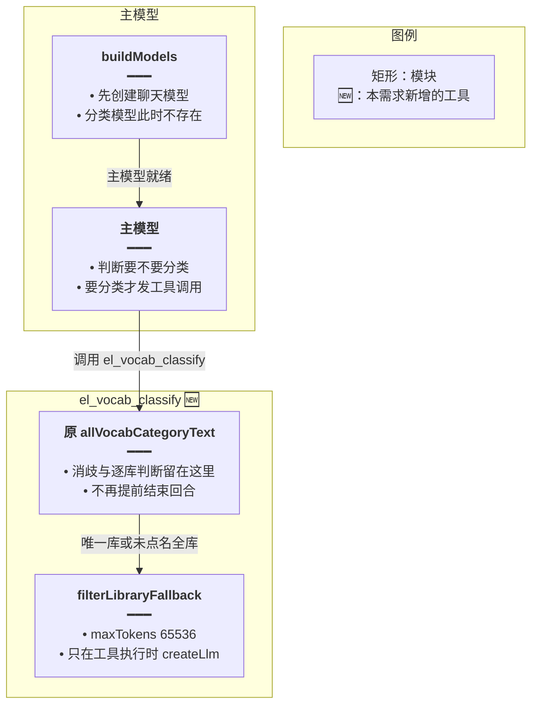
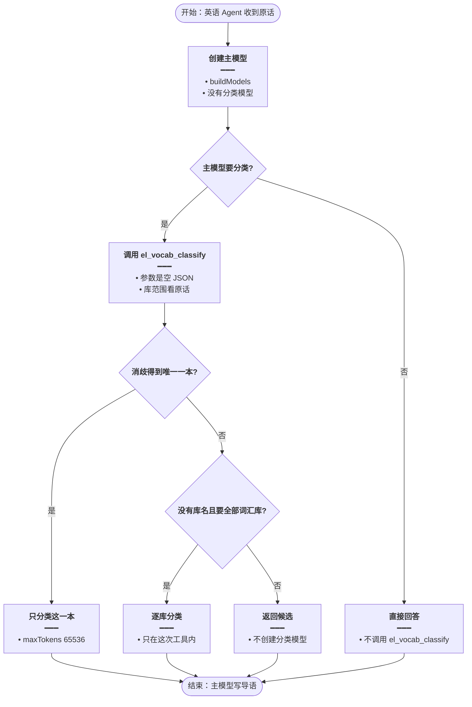
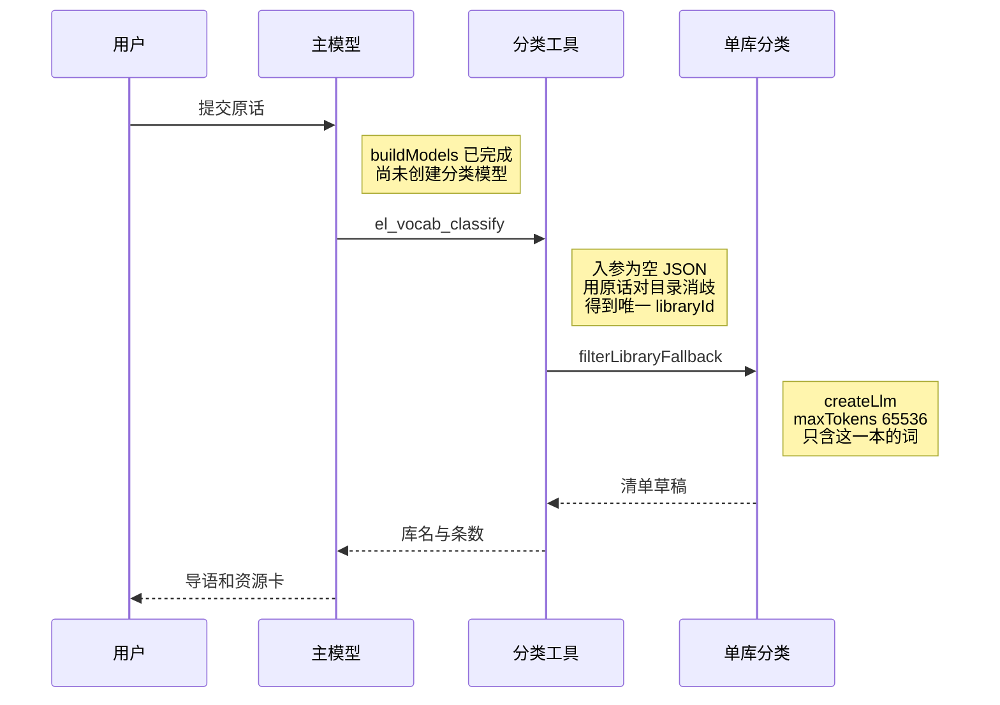
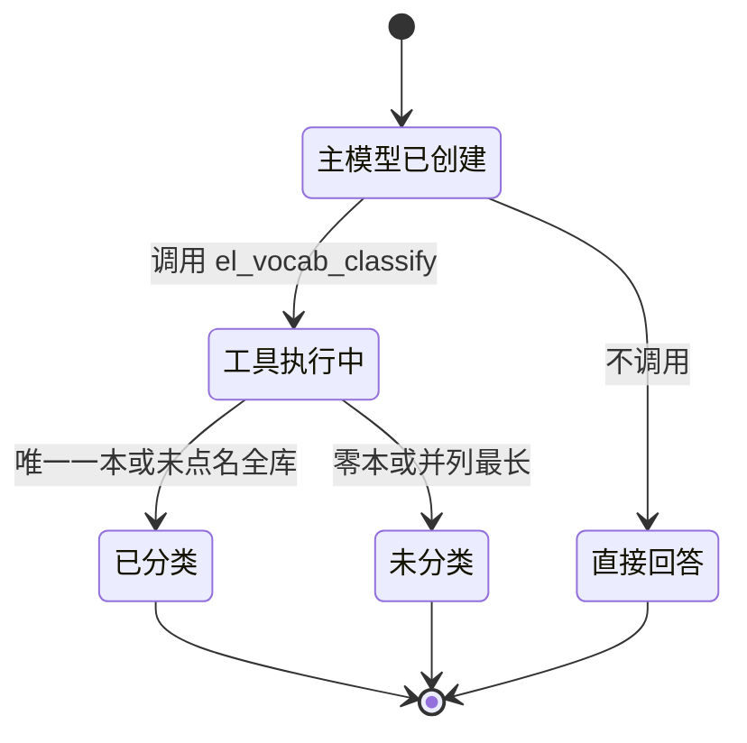

# 主模型后再分类 — 实现思路

> **状态**：规划（未实现 / `allVocabCategoryText`、消歧与 `wrap` 可复用）  
> **日期**：2026-10-28  
> **需求摘要**：把进主模型之前的词汇分类收成工具 `el_vocab_classify`，主模型决定调用后才分类；分类输出用该模型的最大输出 65536，不再用 1500。  
> **一句话方案（预告）**：删掉 `buildModels` 之前的调用；`allVocabCategoryText` 的分类逻辑放进 `el_vocab_classify`，分类模型的 `maxTokens` 改为 65536。

## 延伸阅读

- [点名库先定位](./点名库先定位.md)：库名消歧留下，进主模型之前就分类的做法由本文撤掉
- [分类截断续批](./分类截断续批.md)：输出仍被掐断时，从最后一个完整词续批；本文把掐断上限从 1500 提高到模型最大输出
- [库内筛选不中断](./库内筛选不中断.md)：主模型结束后的整段标题补卡仍留在 `finalizeTurn`
- [关于类一次出卡](./关于类一次出卡.md)：`el_items_search` 上的关于类劫持保留，不承担这次「要不要分类」的决定

---

## 0. 读本文你将得到什么

- `allVocabCategoryText` 现在在主模型之前就分类，并因 `maxTokens: 1500` 把词表写不完
- 选定方案：它变成工具 `el_vocab_classify`，主模型调用后才跑；分类输出改为 65536
- 只改后端英语 Agent 的入口、领域工具和分类器常量；前端卡片不变
- 分三阶段：工具注册、删掉提前调用、把 1500 换成 65536
- 最大风险是主模型不调用这个工具，这一轮就没有分类卡

---

## 1. 需求与边界

### 1.1 用户故事

| 角色 | 场景 | 行为 | 期望结果 |
|------|------|------|----------|
| 已登录用户 | 英语学习 Agent | 问「将小学三年级词汇库中所有与动物相关的单词进行分类，并列出来」 | 先有主聊天模型；它调用 `el_vocab_classify` 之后才创建分类模型 |
| 同一用户 | 不需要查词库 | 问语法或翻译 | 主模型直接回答，不出现分类模型 |
| 同一用户 | 一本库里的词较多 | 分类结果要一次写完 | 分类请求的 `maxTokens` 是 65536，不再是 1500 |

### 1.2 范围

| 在范围内 | 不在范围内（非目标） |
|----------|----------------------|
| 把 `allVocabCategoryText` 的分类逻辑做成 `el_vocab_classify` | 新前端、新表 |
| 删掉 `buildModels` 之前的调用和提前结束 | 改抽槽 `decide()` 的 400 token |
| `CATEGORY_MAX_TOKENS` 改为 65536 | 把上下文窗口 262144 填进 `maxTokens` |
| 提示词写明何时调用该工具 | 让主模型自己编 `libraryId` |

### 1.3 约束与依赖

- 工具注册沿用 `domain-tools.ts` 的 `wrap`，回执沿用 `elOk` / `elFail`
- 消歧仍用 `resolveLibraryCue`、`resolveNamedLibrary`、`matchLibraries`
- 分类模型仍是 `Qwen/Qwen3.6-35B-A3B`（`DECIDE_MODEL_NAME`），经 `decideLlmOptions`
- 同一轮同一库仍走 `categoryJobs`
- 输出被 65536 掐断时，[分类截断续批](./分类截断续批.md) 的「最后一个完整词再续」仍生效
- 不新增依赖

---

## 2. 背景

- **谁、在什么场景、卡在哪**：点名一本词汇库并要求按类列出时，`runChatStream` 在 `buildModels` 之前调用 `allVocabCategoryText`。它消歧、调用 `filterLibraryFallback`，创建 `maxTokens: 1500` 的分类模型，然后返回固定导语并结束回合。主模型和工具调用都不会出现。
- **现状缺口**：分类是否发生不由主模型决定。1500 是分类器自己写死的输出上限（`category-propose.ts` 的 `CATEGORY_MAX_TOKENS`），不是 `Qwen/Qwen3.6-35B-A3B` 的最大输出。词一多，接口就以 `length` 结束，只能靠续批。
- **不解决会怎样**：日志里继续只有分类模型、没有主模型。完整词表仍可能被 1500 切断。
- **硬约束**：工具调用的顺序是先有主模型，再由它发出调用（ReAct、LangGraph 的 agent 节点再到 tools 节点）。`max_tokens` 是最终回答长度，不是上下文窗口。该模型上下文 262144；公开的最大输出是 65536。硅基文档要求不要把 `max_tokens` 设到窗口上沿，输入还要留余量。本仓库英语 JSON 子模型把输出夹在 32768（`english-learning.service.ts` 的 `Math.min(32768, …)`），那是仓库里的实用顶，不是这个模型的最大输出。

---

## 3. 现状与复用

| 能力 | 仓库中已有 | 本需求中的用法 |
|------|------------|----------------|
| 进主模型前的分类 | `apps/backend/src/services/agent/agent.service.ts` 的 `allVocabCategoryText` | 扩展：逻辑搬进工具；`runChatStream` 里的调用删除 |
| 主模型 | 同文件 `buildModels` | 直接复用，必须先于分类模型 |
| 领域工具注册 | `apps/backend/src/services/agent/tools/english/domain-tools.ts` 的 `wrap` | 直接复用，新增一个名字 |
| 库名消歧 | `spill.ts` 的 `resolveLibraryCue`、`resolveNamedLibrary`、`matchLibraries` | 直接复用，只在工具内调用 |
| 单库分类 | `category-propose.ts` 的 `classifyChunkOnce`，经 `filterLibraryFallback` | 扩展：`decideLlmOptions` 的 `maxTokens` 从 1500 改为 65536 |
| 卡片与同库去重 | `onResourceList`、`categoryJobs` | 直接复用 |
| 提示词 | `agent.prompt.ts` 的 `ENGLISH_LEARNING_SYSTEM_APPEND` | 扩展一条工具说明 |
| 主模型结束后的补卡 | `finalizeTurn` 里的 `shouldFilterContinue` | 直接复用，不搬到工具注册时 |

**调研结论**：分类、消歧、工具壳都有。缺的是把分类从「主模型之前的私有方法」改成「主模型可调用的工具」，并把分类输出上限换成该模型的最大输出 65536。`decide()` 的 400 只抽库名，不改。

---

## 4. 方案比对与最终方案

### 4.1 候选方案

#### 方案 A：把 `allVocabCategoryText` 收成 `el_vocab_classify`（扩展现有逻辑）

- **做法**：删除 `runChatStream` 里对 `allVocabCategoryText` 的调用。在 `buildEnglishLearningDomainTools` 里用 `wrap` 注册 `el_vocab_classify`。工具不接收库 id；读 `elSurface.userText` 和词汇库目录，走现在的四段判断：非关于类且不是全库则返回 `not_found` 且不分类；整段标题恰好一本、或线索消歧得到唯一一本，只滤那一本；没有库名且 `resolveAllVocabAsk` 为真才逐库；零本或并列最长返回 `ambiguous`，不创建分类模型。卡片用现有的 `onResourceList`。回执只给库名和条数。`CATEGORY_MAX_TOKENS` 改为 65536。提示词写明：用户要把词库里某一类词挑出来、分类或列出来时调用它；语法和翻译不要调用。
- **能工作的原因**：分类模型的 `createLlm` 只在工具函数执行到 `filterLibraryFallback` 时发生。主模型不调用，1500 或 65536 都不会出现。库范围仍由原话和目录决定。
- **主要代价**：主模型若漏调用，这一轮没有分类卡，只能靠结束后的整段标题补卡。工具表多一个名字。

#### 方案 B：保持 `allVocabCategoryText` 在主模型之前执行（复用现状）

- **做法**：不注册新工具。关于类在 `buildModels` 之前消歧并分类，返回导语后 `return`。只把 `CATEGORY_MAX_TOKENS` 改成 65536。
- **能工作的原因**：点名成功时不依赖主模型记工具，输出也不再被 1500 切断。
- **主要代价**：主模型仍然不会出现。用户要的「先识别再调用」没有发生。

#### 方案 C：不新工具，把这段逻辑塞进 `el_items_search`（扩展现有劫持）

- **做法**：删掉提前调用。关于类时主模型调用已有的 `el_items_search`，在它内部做消歧和分类。`maxTokens` 同样改为 65536。
- **能工作的原因**：少一个工具名，主模型已经认识 `el_items_search`。
- **主要代价**：列词、搜索和分类挤在同一个工具里。主模型要先分清这次是整库 list 还是按类分类。`allVocabCategoryText` 的四段判断要拆进另一个函数的分支。

### 4.2 比对

| 维度 | 方案 A | 方案 B | 方案 C |
|------|--------|--------|--------|
| 正确性（失败路径、边界、数据是否会错） | 不调用就不分类；调用后只滤消歧结果 | 进主模型前就分类，主模型无法改判 | 主模型可能把分类调用成普通 list，或停在列库 |
| 复用 / 与现状契合 | 复用 `allVocabCategoryText` 的分支、`wrap`、消歧、分类器 | 复用现在的私有方法 | 复用 `el_items_search` 劫持 |
| 改动面（要动哪些路径） | 删提前调用；`wrap` 一个工具；改一个常量；补提示词 | 只改常量 | 删提前调用；改 `el_items_search` 和提示词 |
| 复杂度（新概念、新状态、新依赖） | 多一个工具名，无新状态 | 无新概念 | 无新名字，分支更挤 |
| 体验（延迟、步骤数、失败时用户看到什么） | 先有主模型，再出卡。漏调用时可能只有文字 | 最快出卡，但没有主模型 | 主模型要选对已有工具，选错就不出分类卡 |
| 风险（迁移、互斥、并发、回滚） | 漏调用则没有卡。65536 若被供应商拒绝要降到它接受的最大输出 | 继续出现「只有分类模型」 | 和现有 list 劫持抢同一入口 |
| 可维护性（以后改一处还是改多处） | 分类入口就是这一个工具 | 入口仍在回合开头 | 分类规则分在 list 和搜索两条分支 |

### 4.3 综合考量

权重是两件已经说死的事：主模型决定要不要分类；分类输出用这个模型的最大输出，而不是 1500。方案 B 的优点是不依赖主模型记工具，出卡稳；这个优点抵不过分类仍发生在主模型之前。方案 C 的优点是不增加工具名；这个优点抵不过分类和列词共用入口，主模型更容易叫错。选定方案 A。放弃方案 B 的提前出卡，也放弃方案 C 的少一个名字。

### 4.4 最终方案

#### 背景

`allVocabCategoryText` 在 `buildModels` 之前完成消歧、分类、推卡片和导语，然后结束回合。分类请求把 `maxTokens` 写成 1500。`Qwen/Qwen3.6-35B-A3B` 的最大输出是 65536，上下文是 262144。1500 会把正常词表标成截断。

#### 具体思路

1. 模块只动后端：`domain-tools.ts` 增加工具；`agent.service.ts` 删除提前调用；`category-propose.ts` 改常量；`agent.prompt.ts` 加一句说明。
2. 数据从用户原话进主模型，主模型发出 `el_vocab_classify`，工具读原话和目录，得到一个或一批 `libraryId`，再 `filterLibraryFallback`。卡片走现有 SSE。主模型根据回执写导语。
3. 消歧结果只活在这次工具执行里，不进前端 store，不落库。
4. 主模型不调用：不创建分类模型。零本或并列最长：返回 `ambiguous`，不创建分类模型。用户停止沿用主模型这轮已有的 `AbortSignal`，传进 `filterLibraryFallback`。

#### 实现方案

**一句话**：删掉 `buildModels` 之前的调用；`allVocabCategoryText` 的分类逻辑放进 `el_vocab_classify`，分类模型的 `maxTokens` 改为 65536。

| 步骤 | 谁 | 做什么 | 输入 → 输出 |
|------|----|--------|-------------|
| 1 | `runChatStream` | 不再调用 `allVocabCategoryText` | 原话 → `buildModels` |
| 2 | 主模型 | 需要分类时调用 `el_vocab_classify` | 原话 → 空 JSON 参数 |
| 3 | `el_vocab_classify` | 执行现在的消歧和滤库，推卡片 | 原话 + 目录 → 回执里的库名和条数 |
| 4 | `classifyChunkOnce` | `decideLlmOptions(signal, 65536)` | 一批词行 → 命中词面 |

#### 选定原因

1. **正确性**：分类只在工具被调用后发生，库 id 仍来自原话消歧。牺牲：漏调用时这一轮没有卡。
2. **体验**：日志顺序是主模型，然后才是分类模型；词表不再被 1500 切断。牺牲：比提前分类多一次主模型往返，单次分类输出更长、更贵。
3. **复用**：四段判断、`wrap`、卡片、`categoryJobs` 都不重写。牺牲：提示词要多一个工具名。
4. **可维护性**：分类入口集中在一个工具。牺牲：`el_items_search` 上的旧劫持还在，关于类若走错工具仍会分类；提示词要写明走新工具。

#### 优势

- 相对方案 B：主模型先存在。它不调用 `el_vocab_classify`，就不会创建分类模型。
- 相对方案 C：分类有单独的工具说明，主模型不用在 list 和分类之间猜同一个名字。

#### 怎么实现

1. 用 `wrap('el_vocab_classify', …)` 注册工具。处理函数调用抽出的分类函数，传入 `elSurface.userText` 和主模型这轮的 `AbortSignal`。
2. 删除 `runChatStream` 里 `allVocabCategoryText` 的调用，以及「有导语就 complete 并 return」。
3. 把 `CATEGORY_MAX_TOKENS` 改成 65536。`decide()` 仍是 400。
4. 在 `ENGLISH_LEARNING_SYSTEM_APPEND` 的工具地图加一行。主要代码见 §9。

### 4.5 其他关键决策

#### 决策：分类模型的 `maxTokens` 填多少

##### 候选

###### 方案 A2：填该模型的最大输出 65536

- **做法**：`CATEGORY_MAX_TOKENS = 65536`，传给 `decideLlmOptions`。输入仍按现有的 12000 字一批。输出若仍返回 `finish_reason = length`，续批逻辑不变。
- **能工作的原因**：65536 是 `Qwen/Qwen3.6-35B-A3B` 的最大输出。一批词的命中列表用得完。输入加上这段输出仍低于上下文 262144。
- **主要代价**：单次输出比 1500 贵。供应商若拒绝 65536，要改成它接受的最大输出。

###### 方案 B2：保持 1500

- **做法**：工具照做，常量不动。
- **能工作的原因**：现在的续批就是为这个上限写的，请求短。
- **主要代价**：一本稍长的库仍会被标成截断，分类模型要创建多次。

###### 方案 C2：沿用仓库里的 32768

- **做法**：常量改为 32768，与 `english-learning.service.ts` 里英语 JSON 子模型的上限相同。
- **能工作的原因**：这个数已经在硅基 JSON 模式里用过，接口接受的把握更大。
- **主要代价**：比模型最大输出少一半。用户要的是模型最大输出，不是仓库里的实用顶。

##### 比对

| 维度 | 方案 A2 | 方案 B2 | 方案 C2 |
|------|---------|---------|---------|
| 正确性 | 正常词表一次写完；真截断仍续批 | 经常截断，靠续批拼 | 多数词表一次写完，极端长回答仍可能截断 |
| 复用 | 只改常量，续批代码不动 | 常量不动 | 只改常量 |
| 改动面 | 一处常量 | 无 | 一处常量 |
| 复杂度 | 此项相同 | 此项相同 | 此项相同 |
| 体验 | 少几次分类模型创建 | 创建次数随截断次数增加 | 介于两者之间 |
| 风险 | 供应商拒绝 65536 时要下调 | 低 | 低，但不是模型最大输出 |
| 可维护性 | 常量旁边注明模型名和 65536 的来源 | 1500 的原因继续和模型能力脱节 | 要解释为什么不用模型最大输出 |

##### 综合考量

用户要的是分类输出用模型的最大 token。方案 B2 的优点是请求短、续批已经写好；这个优点抵不过词表被 1500 切断后反复 `createLlm`。方案 C2 的优点是 32768 已在本仓库打过硅基；这个优点抵不过它不是 `Qwen/Qwen3.6-35B-A3B` 的最大输出。上下文 262144 不能填进 `maxTokens`：硅基把 `max_tokens` 定义成最终回答长度，并要求给输入留余量。选定 A2。

##### 最终方案

###### 背景

`classifyChunkOnce` 把 `decideLlmOptions` 的第二个参数写成 1500。这个模型和抽槽共用 `DECIDE_MODEL_NAME`，但抽槽只需要 400。分类要写下命中词面，输出上限应该用模型最大输出。

###### 具体思路

只改分类这条调用的 `maxTokens`。`decide()` 保持 400。续批仍认 `length` / `max_tokens`。不把 262144 写进请求。

###### 实现方案

**一句话**：分类模型的 `maxTokens` 改为 65536。

| 步骤 | 谁 | 做什么 | 输入 → 输出 |
|------|----|--------|-------------|
| 1 | `classifyChunkOnce` | `decideLlmOptions(signal, 65536)` | 一批词行 → 更长的 JSON 回答 |

###### 选定原因

1. **正确性**：输出上限等于模型最大输出。牺牲：单次分类更贵。
2. **风险**：若接口拒绝，改成供应商接受的最大输出，不改回 1500，也不改成 262144。牺牲：上线前要打一次真实请求确认。

###### 优势

- 相对方案 B2：一本库的命中词通常一次写完，分类模型不会按截断次数连着创建。
- 相对方案 C2：用的是这个模型公布的最大输出，而不是另一处业务碰巧用过的 32768。

###### 怎么实现

`CATEGORY_MAX_TOKENS` 改为 65536，注释写明模型名和「这是最大输出，不是上下文窗口」。见 §9.2。

---

## 5. 架构图



**图内方法说明**：

| 方法 | 功能 |
|------|------|
| `buildModels` | 创建主聊天模型和摘要模型；完成前不分类 |
| `el_vocab_classify` | 主模型调用的分类工具。内部是现在的 `allVocabCategoryText` 判断，回执给主模型，不结束整段流 |
| `filterLibraryFallback` | 按库拉词并分类。分类模型在这里以 `maxTokens: 65536` 创建 |
| `resolveNamedLibrary` | 由工具调用，把原话收成唯一库，或判定不能收 |

**读图要点**：

- 主模型在工具左边。分类模型只出现在工具被调用之后。
- 工具不接收主模型编的库 id，范围仍由原话和目录决定。
- 65536 只写在分类模型上，抽槽的 400 不在这张图里。

---

## 6. 主流程图



**图内方法说明**：

| 方法 | 功能 |
|------|------|
| `buildModels` | 每句英语对话先创建主模型 |
| `el_vocab_classify` | 主模型决定分类后进入。内部做消歧 |
| `resolveNamedLibrary` | 判断「消歧得到唯一一本」 |
| `resolveAllVocabAsk` | 没有库名时判断是不是全部词汇库 |
| `filterLibraryFallback` | 「只分类这一本」和「逐库分类」里实际创建分类模型 |

**读图要点**：

- 示例句走「创建主模型 → 调用工具 → 唯一一本 → 只分类这一本」。
- 主模型不调用时，流程在「直接回答」结束。
- 对不上库名时不逐库，避免点名句扫完全部库。

---

## 7. 核心时序图



**图内方法说明**：

| 方法 | 功能 |
|------|------|
| `buildModels` | 用户消息进入主模型前创建聊天模型 |
| `el_vocab_classify` | 主模型发出的工具。内部消歧，推卡片，把条数回给主模型 |
| `filterLibraryFallback` | 工具确认范围之后拉词并分类 |
| `decideLlmOptions` | 为分类模型填 `maxTokens: 65536`，不改抽槽的 400 |

**读图要点**：

- 第一条模型侧参与者是主模型。分类是工具下游。
- 65536 出现在 `filterLibraryFallback` 的 `createLlm`，不是主模型的 `maxTokens`。
- 主模型不发出这个工具时，时序在主模型处结束。

---

## 8. 状态机



**图内方法说明**：

| 方法 | 功能 |
|------|------|
| `el_vocab_classify` | 驱动「主模型已创建 → 工具执行中」 |
| `resolveNamedLibrary` | 驱动「工具执行中 → 已分类 / 未分类」 |
| `filterLibraryFallback` | 「已分类」里创建 `maxTokens: 65536` 的分类模型 |

**读图要点**：

- 没有「主模型尚未创建就已经分类」的状态。
- 未分类不会去扫其余库。

---

## 9. 具体实现（主链路代码）

### 9.1 模块一览

| 模块 | 职责 | 新增/改动 | 预估路径 |
|------|------|-----------|----------|
| 分类工具 | 原 `allVocabCategoryText` 的判断与挂卡 | 新增工具名 | `apps/backend/src/services/agent/tools/english/domain-tools.ts` |
| 回合入口 | 不再提前分类 | 删除调用 | `apps/backend/src/services/agent/agent.service.ts` |
| 分类输出上限 | 1500 改为 65536 | 改常量 | `apps/backend/src/services/agent/tools/english/category-propose.ts` |
| 提示词 | 何时调用 | 补一句 | `apps/backend/src/services/agent/agent.prompt.ts` |

### 9.2 主链路实现

```typescript
// 对应 §4.4 步骤 2、步骤 3。工具不收库 id，避免主模型编一本不存在的库
wrap(
	// 名字进主模型的工具表，提示词用同一串
	'el_vocab_classify',
	// 说明只覆盖「从词库按类挑词」。语法和翻译不要走这里
	'从词汇库按用户原话的类别分类并列出。用户要分类、筛选或列出某一类单词时调用。参数为 {}。不要传 libraryId。',
	async () => {
		// 原话来自本轮 surface，不用主模型复述的库名
		const text = deps.surface.userText;
		// 目录只含 id 和 title。词行要等消歧之后再拉
		const libs = await loadVocabTitles(deps.userId);
		// 复用现在的消歧：唯一一本、未点名全库、或不能分类
		const picked = await pickLibraries(text, libs);
		// 对不上或并列最长时不创建分类模型，把候选交回主模型
		if (picked.kind !== 'ready') {
			// 候选放在回执里，这次不调用 filterLibraryFallback，分类模型不会创建
			return elFail(picked.kind, '没有唯一词汇库。请让用户选定库名', { candidates: picked.candidates });
		}
		// 唯一一本或未点名的全库都在这次工具调用里分类
		const cards = await filterLibraries(picked.libs, text, signal);
		// 回执只留库名和条数，词表在卡片里，主模型不要逐条复述
		return elOk({ titles: cards.map((card) => card.title), count: cards.reduce((sum, card) => sum + card.count, 0) }, { message: '卡片已列出。禁止逐条复述。' });
	},
);
```

```typescript
// 对应 §4.5。65536 是 Qwen/Qwen3.6-35B-A3B 的最大输出，不是上下文窗口 262144
const CATEGORY_MAX_TOKENS = 65_536;

// 对应 §4.4 步骤 4。只有工具执行到这里才 createLlm；第二个参数是分类输出，抽槽仍是 400
const llm = await createLlm(config, decideLlmOptions(signal, CATEGORY_MAX_TOKENS));
```

### 9.3 数据模型

| 字段/实体 | 来源 | 存储 | 说明 |
|-----------|------|------|------|
| 工具调用 | 主模型 | 本轮消息 | 没有这条调用就不创建分类模型 |
| `libraryId` | 工具内消歧 | 请求内存 | 工具参数里没有这个字段 |
| 清单草稿 | `filterLibraryFallback` | 现有 artifact | 与现在的资源卡相同 |
| `maxTokens` | 常量 65536 | 分类请求 | 不写入主模型请求 |

---

## 10. 分阶段实现步骤

| 阶段 | 目标 | 交付物 | 依赖 |
|------|------|--------|------|
| M1 | 分类只在工具内发生 | `el_vocab_classify`，并删掉提前调用 | 无 |
| M2 | 输出用模型最大输出 | `CATEGORY_MAX_TOKENS = 65536` | M1 |
| M3 | 主模型知道何时调用 | 提示词一行 | M1 |

### M1

- [ ] 用 `wrap` 注册 `el_vocab_classify`，处理函数使用现在的消歧和滤库
- [ ] 删除 `runChatStream` 里对 `allVocabCategoryText` 的调用和提前 `return`
- [ ] 工具不结束整段流；卡片走 `onResourceList`
- [ ] 零本或并列最长返回 `ambiguous`，分类模型创建次数为 0

### M2

- [ ] `CATEGORY_MAX_TOKENS` 改为 65536，注释标明模型最大输出，不是 262144
- [ ] `decide()` 的 400 不变
- [ ] `finish_reason` 为 `length` 时续批仍在

### M3

- [ ] 提示词写明：按类从词库挑词时调用 `el_vocab_classify`，参数为 `{}`
- [ ] 示例句的日志先出现主聊天模型，工具调用之后才出现分类模型，且 `maxTokens` 为 65536
- [ ] 语法或翻译问题不出现分类模型

---

## 11. 风险、边界与待确认

| 项 | 等级 | 说明 | 缓解 |
|----|------|------|------|
| 主模型不调用工具 | 高 | 点名句只有文字 | 提示词写明工具名；整段标题恰好一本时 `finalizeTurn` 仍可补卡 |
| 65536 被供应商拒绝 | 中 | 分类请求失败 | 改成该账号接受的最大输出，不改回 1500，也不改成 262144 |
| 单次输出变贵 | 中 | 65536 比 1500 贵 | 只有工具被调用才创建；不需要分类的句子没有这笔费用 |
| 旧劫持仍会分类 | 低 | 主模型若调用带库 id 的 `el_items_search`，关于类劫持还在 | 提示词指定新工具；劫持不在进模型前运行 |

**待确认**：

- [ ] 当前硅基账号对 `Qwen/Qwen3.6-35B-A3B` 是否接受 `max_tokens: 65536`（验证方式：工具上线前打一次分类请求，看 HTTP 是否 400；若拒绝，读取错误里的上限再改常量）

---

## 12. 验收清单

| # | 用例 | 步骤 | 期望 |
|---|------|------|------|
| AC1 | 点名一本 | 发送「将小学三年级词汇库中所有与动物相关的单词进行分类，并列出来」 | 先有主聊天模型；出现 `el_vocab_classify` 之后才有分类模型；`maxTokens` 为 65536；只滤消歧出的那一本 |
| AC2 | 不需要查库 | 问语法或翻译 | 有主模型；没有分类模型 |
| AC3 | 库名对不上 | 库名片段匹配 0 本或两本等长 | 工具返回 `ambiguous`；这次调用不创建分类模型 |
| AC4 | 未点名全库 | 发送「将词汇库中所有与动物相关的单词进行分类，并全部列出来」 | 主模型先创建；只有调用 `el_vocab_classify` 之后才逐库 |
| AC5 | 输出上限 | 看分类那次 `createLlm` 日志 | `maxTokens` 为 65536；抽槽若发生仍是 400 |

---

## 13. 预估改动面（实现阶段参考）

| 类型 | 路径（预估） |
|------|----------------|
| 前端 | 无 |
| 后端 | `apps/backend/src/services/agent/agent.service.ts`、`apps/backend/src/services/agent/tools/english/domain-tools.ts`、`apps/backend/src/services/agent/tools/english/category-propose.ts`、`apps/backend/src/services/agent/agent.prompt.ts` |
| 文档（实现后） | `wiki/english/` 下的实现归档 |

---

（本文档为规划态实现思路；落地后以源码与 remote-docs wiki 专题为准）
