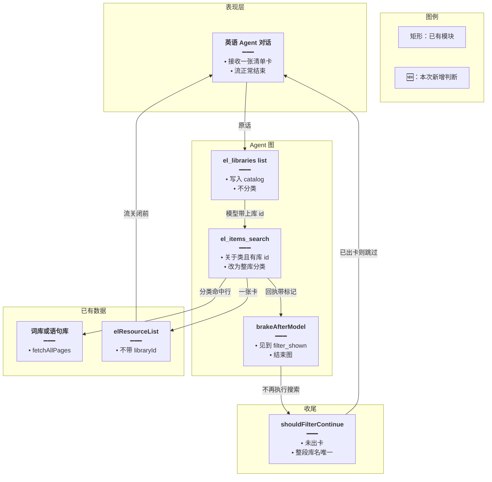
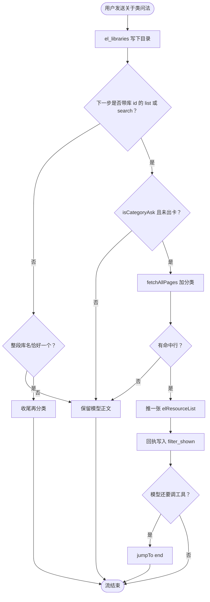
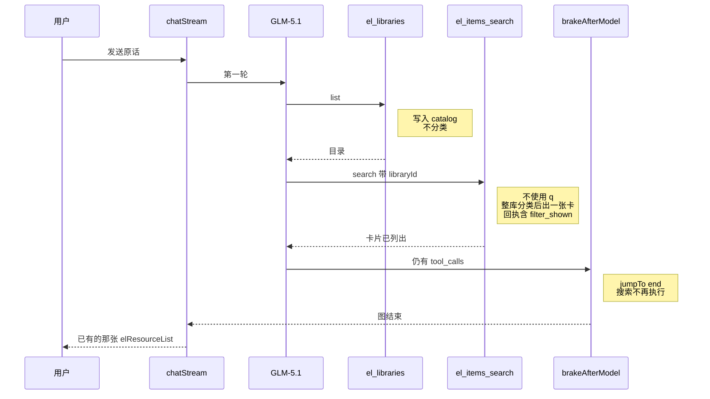
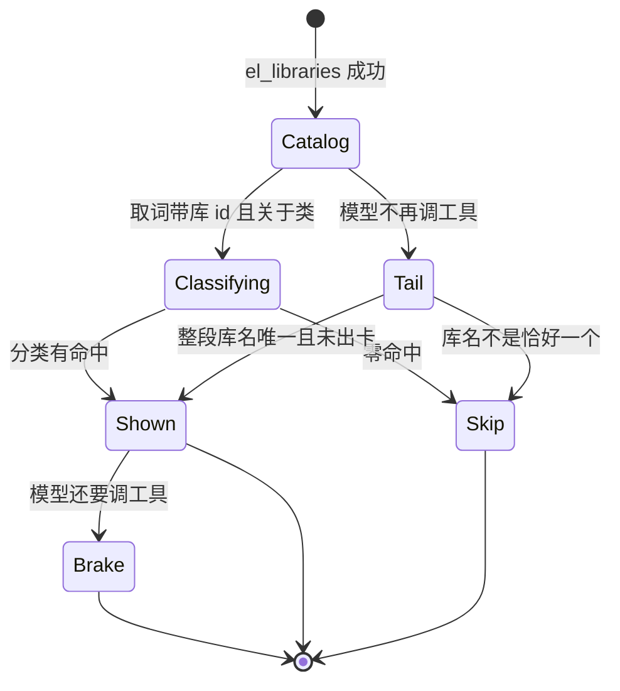

# 关于类一次出卡 — 实现思路

> **状态**：规划（未实现）
> **日期**：2026-10-28
> **需求摘要**：用户让英语 Agent 从语句库里列出「关于某一类」的句子时，模型用关键词连着搜索并拆成多张单条卡，图步耗尽后整轮报错。要改成一张卡，并且流正常结束。
> **一句话方案（预告）**：关于类问法第一次带上库 id 取词时，服务端改为整库分类并只挂一张卡；下一轮还要调工具就结束图，不再执行搜索。

## 延伸阅读

- [库内筛选不中断.md](./库内筛选不中断.md)（单词库、模型在第一次 `el_libraries` 后就停的那条）
- [英语Agent侧栏融合.md](../../english/英语Agent侧栏融合.md)

---

## 0. 读本文你将得到什么

- 报错原因：关于类问法被拆成多次字面 `search`，每一轮工具要走 5 个图节点，按 2 节点估算的 64 步不够用。
- 选定方案：第一次带库 id 的取词改成整库分类，只出一张卡；模型还想再搜就在工具执行前结束图。
- 改动在后端工具回执、分类器字段和收束闸。前端清单卡沿用，不新开接口。
- 分两阶段：先刹住语句库这句，再把图步上限改成按 5 个节点计算，让已有的 24 次空转闸真能执行到。
- 最大风险：模型选错库 id 时，卡会跟错库；原话对不上整段库名时，不会在服务端另猜一个库。

---

## 1. 需求与边界

### 1.1 用户故事

| 角色 | 场景 | 行为 | 期望结果 |
|------|------|------|----------|
| 已登录用户 | 英语学习 Agent，模型是 GLM-5.1 | 问「列出小学三年级语句库中关于打招呼的语句」 | 一张卡里是该库被判成打招呼的句子，流正常结束 |
| 同一用户 | 模型是 glm-4.7-flash，原话里的库名与库标题整段一致 | 问「找出某单词库中关于动物的单词」 | 仍由收尾续查出一张卡，不因为新闸再扫一遍 |

### 1.2 范围

| 在范围内 | 不在范围内 |
|----------|------------|
| 原话含「关于 / 相关 / 有关 / 属于」，且不是整库问法 | 把 `recursionLimit` 调到很大来换更多次关键词搜索 |
| 单词库与语句库 | 收藏确认、错题、日推、笔记 |
| 第一次带 `libraryId` 的 `el_items_search` list/search，以及模型停在目录后的收尾续查 | `sample`、没有 `libraryId` 的跨库搜索 |
| 图步公式与空转闸对齐 | 更换用户选中的模型、改思考开关 |

### 1.3 约束与依赖

- 分类仍走 `buildCategoryProposal`：命中行必须来自库内原行。
- 筛选卡不能带 `libraryId`。前端见到库 id 会按整库重新拉词，筛出来的行会被整库盖掉。
- 本轮已经出过卡就不再补第二张。
- 零命中或失败批没有句子时不挂空卡，也不把开场白改成「库里没有」。
- 库名仍用整段包含（`matchLibraries`）。原话写「语句库」、库标题是「上册」时，服务端不另做模糊匹配。

---

## 2. 背景

- **谁、在什么场景、卡在哪**：英语学习 Agent 使用 `Pro/zai-org/GLM-5.1`。用户问「列出小学三年级语句库中关于打招呼的语句」。界面先写出找到了「小学三年级上册」，再出现两张各 1 条的「打招呼相关语句」。终端随后是 `GRAPH_RECURSION_LIMIT` / `chatStream failed`。
- **现状缺口**：日志是 1 次 `el_libraries` list、9 次 `el_items_search` search、2 次 `el_present`，然后报错。`search` 只做字面 `q`。「打招呼」对不上 `Hello` / `Hi`，模型就换关键词再搜。每次搜索回执都写「未出卡片，要看再 el_present」，于是两句被拆成两次出卡。空转闸要到第 25 次工具调用才拦，这次到不了。`stop_tools` 只认提案。
- **不解决会怎样**：关于类问法在强模型上先打转再报错，用户看到的是多张单条卡加一轮失败。只把步数调大，搜索和拆卡还在。
- **硬约束**：图在抛错前不会走到 `finalizeTurn`，所以只加长收尾续查盖不住这次报错。语句行的字段是 `english`，现有分类器只读 `word`。

---

## 3. 现状与复用

| 能力 | 仓库中已有 | 本需求中的用法 |
|------|------------|----------------|
| 图步上限 | `agent-middleware.ts` 的 `agentStreamRecursionLimit` | 英语学习是 `24 * 2 + 16 = 64`。注释按模型节点 + 工具节点两步估算 |
| 实际图节点 | `createAgent` 的中间件链 | 一轮是摘要 `before_model`、模型、提案闸 `after_model`、空转闸 `after_model`、工具，共 5 步。约 12 轮工具就接近 64 |
| 空转闸 | `quietRoundMiddleware` | 第 25 次仍要调工具才收束。步数先耗尽，闸不会运行 |
| 提案闸 | `brakeAfterModel` | 看到 `"code":"stop_tools"` 且下一轮还有 `tool_calls` 时 `jumpTo: 'end'`。搜索和出卡不带这个码 |
| 字面搜索 | `domain-tools.ts` 的 `el_items_search` search | 调用 `searchClassicQuotesLibraryItems` / `searchVocabularyLibraryItems`，`q` 是子串 |
| 问法 | `spill.ts` 的 `listIntent`、`shouldFilterContinue` | 「列出…关于…」不含 `FILTER_RE`（有「相关」没有「关于」），判成 `other`。续查还要求 `listIntent === 'filter'`，这句进不去 |
| 库名 | `matchLibraries` | 标题必须整段出现在原话里。模型回执中的库名是「小学三年级上册」，原话是「小学三年级语句库」，对不上。待确认：库表 `title` 是否就是「小学三年级上册」。验证：看该轮 `el_libraries` 回执里的 `title` |
| 收尾续查 | `filterLibraryFallback` | 只拉单词库。`finalizeTurn` 在 `catalogKind === 'classic'` 时直接跳过 |
| 分类器 | `category-propose.ts` 的 `chunkLines` / `bodiesFromHits` | 只认 `row.word`。语句行没有 `word`，批内容是空的 |
| 出卡 | `onResourceList` / `forSse` | 筛选卡已约定不带 `libraryId` |

**调研结论**：缺的是「关于类 + 已有库 id」时把取词改成一次分类，并在下一轮工具前结束图。目录、翻页、分类器、出卡、`jumpTo end` 都已存在。收尾续查盖不住图内报错，也不能读语句的 `english`。

---

## 4. 方案比对与最终方案

### 4.1 候选方案

#### 方案 A：只把图步改成按 5 个节点计算（扩展现有上限）

- **做法**：`agentStreamRecursionLimit` 的英语分支改为 `ENGLISH_QUIET_ROUNDS * 5 + 16`。工具、回执、分类都不动。空转闸仍在第 25 次工具调用时收束。
- **能工作的原因**：这次大约 12 轮就撞上 64。按 5 步算，上限约为 136，空转闸会先于图步报错执行，`chatStream failed` 不再出现。
- **主要代价**：模型仍会先做多次字面搜索和多次 `el_present`。用户等到第 25 轮，看到的仍是多张单条卡。

#### 方案 B：只扩展收尾续查（扩展已落地的 `filterLibraryFallback`）

- **做法**：`shouldFilterContinue` 改为认「关于」类、不再要求 `listIntent === 'filter'`；`filterLibraryFallback` 增加语句库分支；`finalizeTurn` 不再跳过 `classic`。分类器补上 `english`。图步和搜索路径不动。
- **能工作的原因**：模型若在目录之后自己停住，收尾能挂上一张卡。单词库精确库名的 flash 路径继续可用。
- **主要代价**：这次图在 `finalizeTurn` 之前就抛错，续查不会运行。即便先加上方案 A 让图正常结束，两张单条卡已经挂出，`presented` 为真，收尾也不会再补一张完整卡。

#### 方案 C：第一次取词改为分类，下一轮工具前结束图（扩展工具回执 + 现有闸）

- **做法**：原话是关于类且带了 `libraryId` 时，`el_items_search` 的 list/search 不走字面 `q`。改为 `fetchAllPages` + `buildCategoryProposal`，用 `onResourceList` 挂一张不带 `libraryId` 的卡，回执 message 带标记 `filter_shown`。`brakeAfterModel` 见到该标记且模型还要 `tool_calls` 时 `jumpTo: 'end'`，搜索不再执行。收尾续查保留给「目录之后模型自己停、且库名整段命中」的单词/语句路径，并同样认关于类、同样能读 `english`。
- **能工作的原因**：分类发生在第一次取词工具内部，不占额外模型轮次。闸在工具节点之前结束图，步数停在大约两轮（目录 + 一次取词）再加一次被拦住的模型调用，远低于 64。`presented` 已为真，收尾不会再挂第二张。
- **主要代价**：模型选错 `libraryId` 时，卡跟的是它选的库。原话与库标题不一致时，若模型根本不调用取词工具，收尾仍对不上库，用户只看到开场白。

### 4.2 比对

| 维度 | 方案 A 只加图步 | 方案 B 只扩展收尾 | 方案 C 取词改分类并刹停 |
|------|-----------------|-------------------|-------------------------|
| 正确性 | 报错可消失。字面搜索和拆卡还在。语句分类没有发生 | 图抛错时续查不到。已出两张卡后也不会再补全量 | 一次分类、一张卡、图正常结束。库 id 以模型这次传入的为准 |
| 复用 / 与现状契合 | 只改上限公式 | 复用收尾和分类器，但主故障路径走不到收尾 | 复用翻页、分类器、`onResourceList`、`jumpTo end` |
| 改动面 | `agent-middleware.ts` 一个返回值 | `spill.ts`、`filterLibraryFallback`、`category-propose.ts`、收尾判断 | 上述文件，再加 `el_items_search` 入口和提案闸的标记 |
| 复杂度 | 无新状态 | 语句字段一套映射 | 一个回执标记。无新表 |
| 体验 | 仍要等很多次搜索，多张 1 条卡 | 报错还在时用户看不到完整卡 | 目录之后一次分类，一张卡，然后流结束 |
| 风险 | 失控循环能跑更久才停 | 与本次日志路径错开 | 模型传错库 id 会筛错库 |
| 可维护性 | 上限与真实节点数一致，但产品行为不变 | 两套「关于类」：图内搜索和收尾各写各的 | 图内和收尾共用同一次分类函数 |

### 4.3 综合考量

这次权重大的是正确性：日志已经说明模型不会在目录之后停手，图也走不到收尾。方案 B 的优点是改动集中在已经落地的续查上，这个优点抵不过「报错路径根本不会调用它」。

方案 A 能单独消掉 `GRAPH_RECURSION_LIMIT`，优点是零分类成本。这个优点抵不过用户仍要看多张单条卡，而且第 25 次空转收束前搜索还在发生。

选定方案 C。高权重的正确性靠「第一次取词就出完整筛选卡，并且不再执行后续搜索」。复用靠现有分类器和 `jumpTo end`。代价是相信模型传入的 `libraryId`，以及库名对不上且模型不再取词时仍然没有卡。

### 4.4 最终方案

#### 背景

GLM-5.1 对「列出…语句库中关于…」连续调用字面 `search` 和 `el_present`，约 12 轮后触发 `GRAPH_RECURSION_LIMIT`。`finalizeTurn` 不会执行。现有续查不处理语句库，也不把「列出…关于」当成筛选。分类器不读 `english`。空转闸和提案闸都不会在这次搜索上收束。

#### 具体思路

1. 目录查询保持原样。分类放在第一次带 `libraryId` 的 list/search 里，不新开工具。
2. 库 id 用模型这次参数，不从原话模糊猜标题。标题从 `elSurface.catalog` 或分页结果里的库标题取，用来写卡片标题。
3. `presented` 仍放在这一轮的 `elSurface`。回执标记只活在工具消息里，不进数据库。
4. 边界：没有 `libraryId`、整库问法、`sample`、已经出卡，都走原来的搜索或出卡。零命中不挂卡。失败批仍有命中时，标题带「有批未能判断」，`truncated` 为真。

#### 实现方案

**一句话**：关于类问法第一次带上库 id 取词时，服务端改为整库分类并只挂一张卡；下一轮还要调工具就结束图，不再执行搜索。

| 步骤 | 谁 | 做什么 | 输入 → 输出 |
|------|----|--------|-------------|
| 1 | `el_libraries` list | 与现在相同，写下 `catalog` | 原话 → 目录 |
| 2 | `el_items_search` list/search | 关于类且有 `libraryId` 时改为分类出卡，回执带 `filter_shown` | 库 id + 原话 → 一张卡或空 |
| 3 | `brakeAfterModel` | 见到标记且仍有 `tool_calls` 时结束图 | 上一则工具消息 → 不再执行工具 |
| 4 | `finalizeTurn` | 仅当未出卡且库名整段唯一命中时续查 | `elSurface` → 补一张或跳过 |

#### 选定原因

1. **正确性**：搜索在执行前被停掉，分类不依赖图能撑过 12 轮。牺牲：模型选错库 id 时卡跟错库。
2. **复用**：翻页、分类器、出卡、结束图都是现成的。牺牲：取词工具多一个关于类分支。
3. **体验**：用户不再等 9 次搜索和两张 1 条卡。牺牲：分类要数秒，发生在第一次取词里面。
4. **可维护性**：图内和收尾共用 `filterLibraryFallback`。牺牲：读代码时要同时看工具入口和闸。

#### 优势

- 相对方案 A：报错消失的同时，结果是一张筛选卡，而不是更多次关键词搜索。
- 相对方案 B：图抛错之前就能出卡并正常结束，不依赖收尾。

#### 怎么实现

1. `spill.ts` 增加 `isCategoryAsk`：不是整库问法，且原话含「关于|相关|有关|属于」。`shouldFilterContinue` 改用它，去掉 `listIntent === 'filter'`。
2. `chunkLines` / `bodiesFromHits` 在没有 `word` 时用 `english`。语句行保留 `english`、`translationZh`、`source`、`noteZh`。
3. `filterLibraryFallback` 增加 `kind`。`classic` 时调用已有的 `listClassicQuotesLibraryItems`。
4. `el_items_search` 在 list/search 开头：`isCategoryAsk` 且有 `libraryId` 且未出卡，则调用该函数，`onResourceList` 推卡，`presented = true`，返回带 `filter_shown` 的成功回执。
5. `brakeAfterModel` 增加对 `filter_shown` 的判断，行为与 `stop_tools` 相同：补一条工具消息并 `jumpTo: 'end'`。
6. `finalizeTurn` 按 `catalogKind` 把 `vocab` / `classic` 传进续查，不再整段跳过语句库。已出卡时 `shouldFilterContinue` 返回空。

### 4.5 库 id 从哪来

这会改变筛选数据属于哪一个库。

#### 方案 A：只认原话里的整段库名

- **做法**：继续只用 `matchLibraries`。对不上就不筛。
- **能工作的原因**：不会把「上册」和「下册」并错。
- **主要代价**：这次原话是「小学三年级语句库」，模型找到的标题是「小学三年级上册」。整段对不上，图内搜索仍会发生。

#### 方案 B：用第一次取词参数里的 `libraryId`

- **做法**：模型已经在 `el_items_search` 里传入库 id。分类用这个 id。收尾续查仍只在整段库名唯一命中时运行。
- **能工作的原因**：日志里的搜索能发生，说明模型已经选定了库。服务端不用再猜标题。
- **主要代价**：模型选错 id 时，卡是那个库的筛选结果。

#### 方案 C：标题与原话做片段重叠

- **做法**：例如双方都含「小学三年级」就算命中。多个命中则放弃。
- **能工作的原因**：模型不取词时，收尾也可能对上「上册」。
- **主要代价**：上册、下册、复习册会一起命中或命中错本，服务端分不出用户指的是哪一本。

| 维度 | 整段库名 | 取词参数里的库 id | 片段重叠 |
|------|----------|-------------------|----------|
| 正确性 | 这次对不上，故障还在 | 与模型已经选中的库一致 | 可能把上下册并成一次或选错 |
| 复用 | 现成 `matchLibraries` | 工具入参里已有 `libraryId` | 要新写重叠规则 |
| 改动面 | 无 | 取词入口读入参 | 匹配函数 |
| 复杂度 | 无新规则 | 无新规则 | 一套新启发式 |
| 体验 | 仍会连搜 | 第一次取词就出卡 | 模型不取词时也可能出卡 |
| 风险 | 低 | 传错 id | 选错库且难解释 |
| 可维护性 | 规则已有 | 与工具入参同一字段 | 两套库名规则 |

综合：这次日志证明库 id 已经在取词参数里，整段库名对不上。片段重叠能多盖住「模型不再取词」的句子，但上下册选错的代价更大。选定取词参数里的库 id。整段库名只留在收尾，给原话写全了标题、模型却停在目录的情况。放弃的是片段重叠在「模型不取词」时多出一张卡的能力。

#### 背景

用户原话和库标题不是同一串字。模型列出目录后自己选了库，再拿这个 id 去搜索。

#### 具体思路

图内分类只读工具参数的 `libraryId`。收尾不读工具参数，只读 `catalog` 和原话。两处不共用一套猜测。

#### 实现方案

**一句话**：图内用模型传入的库 id；收尾仍只在原话整段包含唯一库名时补卡。

| 步骤 | 谁 | 做什么 | 输入 → 输出 |
|------|----|--------|-------------|
| 1 | `el_items_search` | 读取 `libraryId` | 参数 → 一个库 |
| 2 | `shouldFilterContinue` | 整段库名不唯一则返回空 | 原话 + catalog → 空或一个库 |

#### 选定原因

**正确性**：与这次实际选中的库一致。牺牲：不纠正模型选错的 id。

#### 优势

相对整段库名：这句原话对不上「小学三年级上册」时仍能出卡。相对片段重叠：不会把上册和下册并成一个命中。

#### 怎么实现

取词分支要求 `libraryId` 非空。没有 id 的 search 保持今天的字面搜索。收尾函数签名不变，仍接收 `matchLibraries` 的那一个库。

### 4.6 图步按几个节点计

这会改变空转闸和图报错谁先发生。

#### 方案 A：保持 `24 * 2 + 16`

- **做法**：不改 `agentStreamRecursionLimit`。关于类靠方案 C 在两轮内结束，不再碰到 64。
- **能工作的原因**：这次路径的步数远小于 64。
- **主要代价**：其它工具若连着调，仍会在大约 12 轮图步报错。写明的第 25 次空转闸到不了。

#### 方案 B：改为 `24 * 5 + 16`

- **做法**：英语学习上限按摘要节点、模型、两道 `after_model`、工具这 5 步计算，再留 16 步给收束后的正文。
- **能工作的原因**：第 25 次工具调用时的空转闸会先执行，图不会先抛 `GRAPH_RECURSION_LIMIT`。
- **主要代价**：闸没拦住的循环能多跑一段时间才失败。

| 维度 | 保持 64 | 按 5 步计算 |
|------|---------|-------------|
| 正确性 | 关于类被方案 C 拦住。其它长循环仍报错 | 空转闸与上限的先后与注释一致 |
| 复用 | 现公式 | 同一函数，只改乘数 |
| 改动面 | 无 | 一个返回值 |
| 复杂度 | 此项相同 | 此项相同 |
| 体验 | 非关于类的长工具链仍可能整轮失败 | 长工具链先收到「停止调用工具」 |
| 风险 | 低 | 失控循环更久 |
| 可维护性 | 注释与图节点数不一致 | 注释可以写成 5 步 |

综合：方案 C 已经让这句关于类到不了 12 轮。留下 64 的优点是失控循环死得快，但空转闸等于没接上，以后同类报错还会出现。选定按 5 步计算。放弃的是「错误循环更早抛错」这一点。

#### 背景

`agentStreamRecursionLimit` 的注释写两步一轮。英语学习图上还有摘要 `before_model` 和两道 `after_model`，实际是 5 步。64 步大约只够 12 次工具。

#### 具体思路

关于类的刹停不依赖这个上限。上限改成与节点数一致，让已经写好的空转闸能在第 25 次工具调用时运行。

#### 实现方案

**一句话**：英语学习的图步上限改为 `24 * 5 + 16`。

| 步骤 | 谁 | 做什么 | 输入 → 输出 |
|------|----|--------|-------------|
| 1 | `agentStreamRecursionLimit` | 英语分支乘 5 | profile → 136 |

#### 选定原因

**正确性**：空转闸先于图报错。牺牲：未被闸住的循环更久才失败。

#### 优势

相对保持 64：非关于类的连续工具调用会先被空转闸收束，而不是 `chatStream failed`。

#### 怎么实现

只改英语分支的乘数和旁边注释。默认 profile 仍返回 40。代码见 §9。

---

## 5. 架构图



**图内方法说明**：

| 方法 | 功能 |
|------|------|
| `el_libraries` list | 列出当前用户的库，把 `{id,title}` 写入 `catalog` |
| `el_items_search` | 关于类且有库 id 时不走字面搜索，改为整库分类并出卡 |
| `brakeAfterModel` | 上一则回执含 `filter_shown` 且本轮还有工具调用时结束图 |
| `shouldFilterContinue` | 收尾是否补卡：未出卡、关于类、库名整段恰好一个 |
| `fetchAllPages` | 按页把该库翻完 |
| `elResourceList` | 已有 SSE，前端画清单卡 |

**读图要点**：

- 分类在第一次取词工具里完成，不在目录工具里，也不等到图抛错之后。
- 闸结束的是图，不是整轮对话；收尾仍会跑，但已出卡就不再取词。
- 卡片通道不变，筛选结果不带库 id，避免前端按整库重拉。

---

## 6. 主流程图



**图内方法说明**：

| 方法 | 功能 |
|------|------|
| `isCategoryAsk` | 原话含关于类字样，且不是整库问法 |
| `fetchAllPages` | 按页取完该库词条或语句 |
| `buildCategoryProposal` | 分批判断哪些原行符合原话 |
| `jumpTo end` | 不再进入工具节点 |
| `shouldFilterContinue` | 图中「整段库名恰好一个」的判断 |

**读图要点**：

- 模型已经选出库 id 时走左侧，一次分类后刹停。
- 模型停在目录、且原话写全了库名时走右侧收尾。
- 两条路径都会在已出卡后汇合到结束，不会各挂一张。

---

## 7. 核心时序图



**图内方法说明**：

| 方法 | 功能 |
|------|------|
| `chatStream` | 跑图；图正常结束后才收尾 |
| `el_libraries` list | 只提供目录 |
| `el_items_search` | 这次调用内部完成分类和出卡 |
| `brakeAfterModel` | 阻止下一次搜索或 `el_present` 进入工具节点 |

**读图要点**：

- 时序在第二次模型还想调工具时结束，所以不会出现第 3 到第 12 次搜索。
- 卡片在取词工具里已经推送，结束图不会把卡收回。
- 收尾看到 `presented` 为真，不再取词。

---

## 8. 状态机



**图内方法说明**：

| 方法 | 功能 |
|------|------|
| `isCategoryAsk` | `Catalog` 到 `Classifying` 的问法条件 |
| `filterLibraryFallback` | `Classifying` 和收尾 `Tail` 上的取词与分类 |
| `brakeAfterModel` | `Shown` 到 `Brake`：结束图 |

**读图要点**：

- `Shown` 之后的工具调用进入 `Brake`，不会回到 `Classifying`。
- `Skip` 不挂空卡。

---

## 9. 具体实现（主链路代码）

### 9.1 模块一览

| 模块 | 职责 | 新增/改动 | 预估路径 |
|------|------|-----------|----------|
| `isCategoryAsk` | 关于类且非整库 | 新增 | `apps/backend/src/services/agent/tools/english/spill.ts` |
| `shouldFilterContinue` | 收尾门闩改用关于类 | 扩展 | 同上 |
| `chunkLines` / `bodiesFromHits` | 语句行用 `english` | 扩展 | `apps/backend/src/services/agent/tools/english/category-propose.ts` |
| `filterLibraryFallback` | 按 kind 拉单词库或语句库 | 扩展 | `apps/backend/src/services/agent/tools/english/domain-tools.ts` |
| `el_items_search` | 关于类改为分类出卡 | 扩展 | 同上 |
| `brakeAfterModel` | 认出 `filter_shown` | 扩展 | `apps/backend/src/services/agent/agent-middleware.ts` |
| `agentStreamRecursionLimit` | 英语分支乘 5 | 扩展 | 同上 |
| `finalizeTurn` | 语句库也可续查 | 扩展 | `apps/backend/src/services/agent/agent.service.ts` |

### 9.2 关于类判断

```typescript
// 对应 §4.4 步骤 1。整库问法仍交给 inventory，避免「列出全部」被分类
export function isCategoryAsk(userText: string): boolean {
	// 整库句要挂整库卡，不能改成筛选
	if (listIntent(userText) === 'inventory') return false;
	// 「列出…关于…」不是 filter，但同样是在要某一类
	return /关于|相关|有关|属于/.test(userText);
}
```

`shouldFilterContinue` 里把 `listIntent(userText) !== 'filter'` 换成 `!isCategoryAsk(userText)`。唯一库名和 `presented` 两道判断保留。

### 9.3 第一次取词改为分类

```typescript
// 对应 §4.4 步骤 2，以及 §4.5。放在 el_items_search 的 list/search 分支最前面
const libraryId = asString(args.libraryId)?.trim();
// 关于类才改道，字面搜索和 sample 仍走原分支
if (
	// 没有库 id 时不能整库分类，避免扫全部库
	libraryId &&
	// 整库问法由 isCategoryAsk 排除
	isCategoryAsk(deps.surface.userText) &&
	// 已经出过卡就不要再分类一次
	!deps.surface.presented &&
	// sample 仍是抽样，不在这次改道里
	(op === 'list' || op === 'search')
) {
	// 标题优先用目录里的整段名称，卡片标题不拿库 id 充数
	const known = deps.surface.catalog.find((row) => row.id === libraryId);
	// 单词库和语句库共用这一次分类
	const draft = await filterLibraryFallback(
		// 与左侧库列表同一个服务
		deps.learning,
		// 分类器要建 decide 模型
		deps.config,
		// 只查当前用户的库
		deps.userId,
		// 库 id 来自模型这次参数，标题来自目录
		{ id: libraryId, title: known?.title ?? libraryId },
		// 原话交给分类器，不用搜索词 q
		deps.surface.userText,
		// 与 Agent 同一条 Winston 日志
		deps.logger,
		// vocab 或 classic，决定翻哪张表
		kind,
	);
	// 零命中不挂卡，但仍告诉模型不要改用关键词再搜
	if (!draft) {
		// 带回执标记，下一轮工具会被闸停住
		return elOk(
			// 让模型看到是哪一个库没有命中
			{ libraryId, matched: 0 },
			// filter_shown 给闸认，中文给模型看
			{ message: '没有可展示的行。禁止再 search。filter_shown' },
		);
	}
	// 卡片要有 artifactId，刷新后才能再拉行
	const artifactId = await deps.artifacts.put(deps.userId, draft);
	// 拼上 id 再推给前端
	const payload = { ...draft, artifactId };
	// 收尾见到已出卡就不再补第二张
	deps.surface.presented = true;
	// 同一库本轮不再挂整库卡
	deps.surface.shownLibraryIds.add(libraryId);
	// 用现有清单事件画卡
	deps.onResourceList?.(payload);
	// 成功也带标记，禁止模型再 el_present 拆成多张
	return elOk(
		// 回执只给 id 和条数，不把全表塞进上下文
		{ artifactId, totalCount: payload.totalCount },
		// 中文禁止再出卡，filter_shown 让下一轮闸停住
		{ message: '卡片已列出。禁止再 search 或 el_present。filter_shown' },
	);
}
```

`filterLibraryFallback` 增加参数 `kind: 'vocab' | 'classic'`。`classic` 时 `fetchAllPages` 调用已有的 `listClassicQuotesLibraryItems`，行里保留 `english`。卡片 `contentKind` 与 `kind` 一致，并且仍然不写 `libraryId`。

### 9.4 下一轮工具前结束图

```typescript
// 对应 §4.4 步骤 3。与 stop_tools 同一处 afterModel，避免两套结束图
const FILTER_SHOWN_MARK = 'filter_shown';
// 上一则工具回执已经出过筛选卡，本轮不该再进工具节点
if (!messageText(row).includes(FILTER_SHOWN_MARK)) return;
// 结束图发生在工具节点之前，搜索不会再执行
return {
	// 与提案闸相同，直接离开循环
	jumpTo: 'end' as const,
	// 必须补上工具回执，否则这条 tool_call 没有对应消息
	messages: [
		// closed 是按每个 tool_call 造好的 ToolMessage
		...closed,
		// 留给用户的一句，不再发起新的搜索
		new AIMessage('筛选卡片已经列出。'),
	],
};
```

`closed` 与现有 `stop_tools` 分支相同：为每个 `tool_call` 补一条 `ToolMessage`，否则模型侧的工具调用没有回执。

### 9.5 图步上限

```typescript
// 对应 §4.6。一轮含摘要、模型、两道 after_model 和工具
export function agentStreamRecursionLimit(
	// 英语学习才乘 5，其它 Agent 保持原来的 40
	profile?: 'default' | 'english_learning',
// 返回本轮 streamEvents 的 recursionLimit
): number {
	// 非英语路径不改，避免把普通对话的步数一起放大
	if (profile !== 'english_learning') return 40;
	// 5 步一轮，第 25 次空转闸才会落在上限之前
	return ENGLISH_QUIET_ROUNDS * 5 + 16;
}
```

---

## 10. 分阶段步骤

### M1 刹住关于类

- [ ] `isCategoryAsk`、分类器认 `english`、`filterLibraryFallback` 支持语句库
- [ ] `el_items_search` 的 list/search 在关于类且有库 id 时改道出卡
- [ ] `brakeAfterModel` 认出 `filter_shown`
- [ ] 用「列出小学三年级语句库中关于打招呼的语句」在 GLM-5.1 上验证：只有一张卡，日志没有第 3 次及以后的 `el_items_search`，没有 `GRAPH_RECURSION_LIMIT`

### M2 图步与收尾

- [ ] 英语学习 `recursionLimit` 改为 `24 * 5 + 16`
- [ ] 原话写全库名、模型停在目录时，单词库和语句库收尾仍能补一张卡
- [ ] 已出卡的同一句不会再补第二张

---

## 11. 风险与回滚

| 风险 | 缓解 | 回滚 |
|------|------|------|
| 模型传入错误的库 id | 只筛它传入的那一个库，不再模糊猜 | 去掉取词入口的关于类分支 |
| 分类漏句或超时 | 失败批不说成「没有」；零命中只记日志 | 同上 |
| 闸把正常的第二次工具也停了 | 标记只在关于类出卡或明确禁搜的回执里出现 | 去掉 `filter_shown` 判断 |
| 上限变大后失控循环更久 | 空转闸仍在第 25 次收束 | 乘数改回 2 |

---

## 12. 验收清单

- [ ] GLM-5.1 问「列出小学三年级语句库中关于打招呼的语句」：流正常结束，只有一张语句卡，卡内是多条打招呼语句，不是两张各 1 条。
- [ ] 终端没有 `GRAPH_RECURSION_LIMIT`。`el_items_search` 不超过 1 次。
- [ ] 卡片里的句子都能在该库原行里找到。分类器编出来的句子不会出现。
- [ ] 「我有哪些单词库」和「列出某库的全部单词」仍走目录或整库卡，不触发关于类分类。
- [ ] 原话写全了单词库标题、模型只调用了 `el_libraries` 时，收尾仍出一张动物词卡。
- [ ] 已经出过卡的强模型路径不会再挂第二张。

---

## 13. 待确认

- 模型回执中的库名「小学三年级上册」是否就是库表 `title`。验证：复现时看 `el_libraries` 回执的 `items[].title`。方案不依赖这句话和标题整段相等，但收尾续查依赖整段相等。

（若与仓库最新源码不一致，以源码为准）
