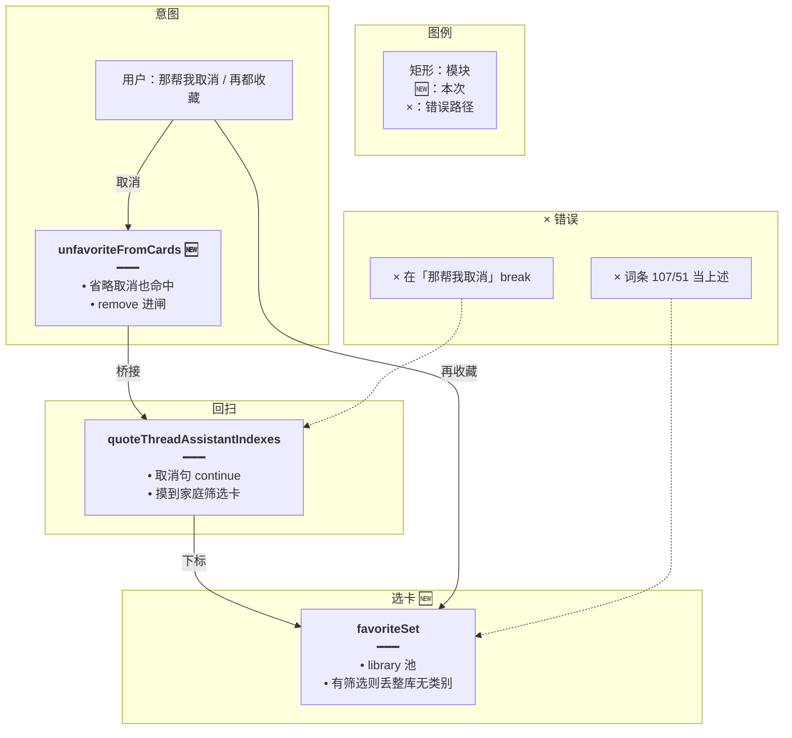
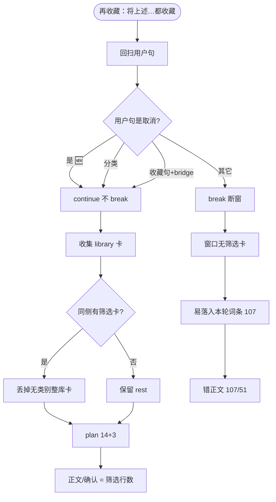
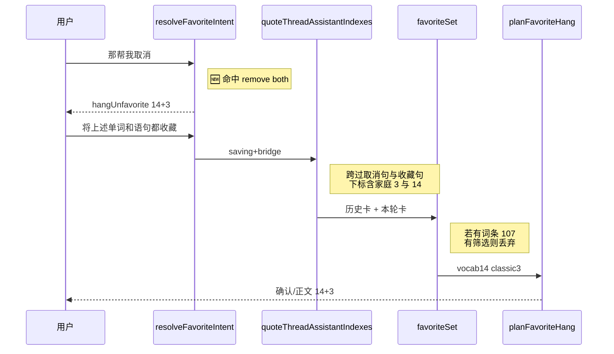

# 再收藏不断窗 — 实现思路

> **状态**：规划（M1 工作区已落地）  
> **日期**：2026-10-30  
> **需求摘要**：用户先分类出家庭语句 3、单词 14，再「都收藏」→「那帮我取消」→ 再「将上述单词和语句都收藏」时，确认/正文必须仍是 **14 词 + 3 句**（「上述」= 分类筛选卡），不能变成整库「词条：107 个词 / 词条：51 条语句」。  
> **一句话方案（预告）**：把「那帮我取消」等省略取消句纳入取消意图与回扫桥接；选卡在有筛选卡时丢掉无类别整库卡；取消仍走服务端 `hangUnfavorite`，禁止模型用 list 全量冒充「上述」。

## 延伸阅读

- [取消沿用上次收藏](./取消沿用上次收藏.md)：取消范围 = 上次收藏圈定。本文修**省略取消句**漏认导致断窗
- [取消正文跟确认条](./取消正文跟确认条.md)：取消正文与确认条同源（已落地）。本文管取消句进闸与下一句「上述」选卡
- [收藏确认跟卡片](./收藏确认跟卡片.md)：窗口本应跨过取消句；「取消吧」已能跨，「那帮我取消」不能
- [收藏意图总控](./收藏意图总控.md)：`resolveFavoriteIntent`；取消闸要能认出省略说法
- [收藏只收库卡](./收藏只收库卡.md)：只要 `library`；本文再收紧——有筛选卡时不要整库 `词条` 卡
- [收藏先出筛选卡](./收藏先出筛选卡.md)：复合句自包含「收藏+关于」时应本轮出卡，不能只靠加宽窗口摸旧卡

---

## 0. 读本文你将得到什么

- 为何前几轮「共 3 条 / 共 14 条 / 已在收藏 / 取消」看着对，最后一句「都收藏」却变成 107+51
- **不是**对话记忆丢了，而是：**省略取消句未进闸 + 回扫在该句断窗 + 本轮整库卡顶替「上述」**
- 选定方案：扩取消识别并桥接窗口；`favoriteSet` 优先筛选卡、丢整库无类别卡；取消强制服务端挂条
- 改动集中在 `favorite-ask.ts`、`quoteThreadAssistantIndexes`、`favoriteSet`/`richest` 策略；不改前端记忆表
- 最大风险：过宽的「取消」误伤「取消，然后找出…」——沿用现有 `CANCEL_TOPIC_RE` 挡新话题

---

## 1. 需求与边界

### 1.1 用户故事

| 角色 | 场景 | 行为 | 期望结果 |
|------|------|------|----------|
| 登录用户 | 已出家庭语句卡 3、单词卡 14 | 「将上述单词和语句都收藏」 | 14+3（或已在收藏说明） |
| 同上 | 刚收藏过 | 「那帮我取消」 | 进取消意图；确认/正文按上次 14+3；**不切断**后续回扫 |
| 同上 | 取消完成后 | 再「将上述单词和语句都收藏」 | 仍选家庭筛选卡 14+3，**不是**整库 107+51 |
| 登录用户 | 「取消吧，找出有关问候的单词」 | 混合句 | 仍不当纯取消（现有规则） |

### 1.2 范围

| 在范围内 | 不在范围内 |
|----------|------------|
| 省略取消意图识别 | 换 LLM / 加向量记忆 |
| `quoteThreadAssistantIndexes` 桥接 | 改分类器、改库缓存条数 |
| 选卡丢整库无类别卡 | 「清空全部收藏」产品 |
| 取消强制 hangUnfavorite | 前端 message 树重构 |

### 1.3 约束与依赖

- 复用 `resolveFavoriteIntent`、`unfavoriteFromCards`、`quoteThreadAssistantIndexes`、`favoriteSet`、`hangUnfavorite`
- 「上述」= 窗口内**筛选卡** `items`，不是模型散文、不是整库 list
- Ponytail：最少改意图闸 + 回扫桥 + 选卡过滤

---

## 2. 背景

### 2.1 复现对话（用户实录）

| 序 | 用户 | 助手（用户所见） | 判定 |
|----|------|------------------|------|
| 1 | 找出小学三年级语句库中有关家庭的所有语句，分好类给出来 | 小学三年级上册：共 3 条。 | 对 |
| 2 | 找出小学三年级语句库中有关家庭的所有单词，分好类给出来 | 小学三年级上册英语单词：共 14 条。 | 对（题面写语句库但出了单词卡，另题） |
| 3 | 将上述单词和语句都收藏 | 这 14 个词、3 条语句已在收藏里。 | 对 |
| 4 | 那帮我取消 | 模型长文列 14 词 + 1 句…；后「已取消收藏 14 个。」 | 半对：范围飘、正文未完全服务端化 |
| 5 | 将上述单词和语句都收藏 | **词条：107 个词。词条：51 条语句。** | **错** |

库缓存侧：三年级单词库约 107、语句库约 51（与错文案一致）。标题「词条」来自 `spill` 对 `el_items_search` 的默认名，是**整库/检索卡**，不是分类筛选卡标题。

### 2.2 现状缺口（根因链，非「记忆丢失」）

问题**主要不在**会话表没存历史，而在**服务端选卡窗口与意图闸**：

1. **省略取消未进闸**  
   `unfavoriteFromCards` / `CANCEL_RE` 只认 `取消收藏|…|取消吧` 等。  
   **「那帮我取消」不含「收藏」也不含「取消吧」→ 返回 null**。  
   `resolveFavoriteIntent` 又要求原话含「收藏」才谈添加/取消 → **action 仍为 null**。

2. **取消被模型接管**  
   因 intent 不是 `remove`，`propose_remove` **不会** deferred；模型可 list 收藏夹后自己挂取消确认（故出现「1 条语句」、只报「已取消 14 个」等漂移）。

3. **回扫在「那帮我取消」处断窗**  
   `quoteThreadAssistantIndexes(..., saving=true, bridgeFavorites=true)` 对用户句：  
   - 分类句 → 继续；  
   - `unfavoriteFromCards` 命中 → 继续；  
   - `favoriteAsk` 命中 → 继续；  
   - **否则 break**。  
   「那帮我取消」三者都不命中 → **break**。  
   再收藏时窗口**摸不到**更早的家庭筛选卡（3 与 14）。

4. **本轮整库卡顶上「上述」**  
   窗口空或只有无关助手卡时，本轮若 `el_items_search` / list 挂出 title=`词条`、行数=整库 107/51 的 `source=library` 卡，`favoriteSet` 照单全收（`favoriteEligibleCard` 只查 library）。  
   `richest` 对**无** `categoryLabels` 的卡进 `rest` **互不覆盖**，筛选卡若还在也会被**加总**；本复现里筛选卡已断窗外，于是正文只剩 107+51。

5. **与记忆系统的关系**  
   `englishTableMemory` / `elResources` 仍在历史消息里；断窗是**故意缩短回扫**，不是行没落库。调大 LLM context 或「增强记忆」**解决不了**这条确定性 bug。

### 2.3 不解决会怎样

任意「分类 → 收藏 → 口语化取消 → 再都收藏」都会把「上述」理解成整库或模型 list，确认条/正文与用户看见的筛选卡脱节。

### 2.4 硬约束

- 「上述」优先窗口内 `filtered` + `categoryLabels` 的库卡。  
- 省略取消必须与「取消吧」同等：进 `remove`、桥接回扫、服务端挂条。  
- 不把整库卡当「上述」收藏集合。

---

## 3. 现状与复用

| 能力 | 仓库中已有 | 本需求用法 |
|------|------------|------------|
| 取消识别 | `unfavoriteFromCards` + `CANCEL_RE` | **扩展**省略取消 |
| 意图总闸 | `resolveFavoriteIntent` | 取消优先走 `unfavoriteFromCards`（扩后自动带上） |
| 回扫 | `quoteThreadAssistantIndexes` | 桥接条件与取消识别对齐 |
| 选卡 | `favoriteSet` + `richest` + `favoriteEligibleCard` | **扩展**：有筛选则丢整库无类别 |
| 整库判定 | `quoteCardIsFull`（domain-tools） | 选卡复用或近似：无 filtered 且行数过大/无 label |
| 取消挂条 | `hangUnfavorite` + `unfavoriteHangCopy` | intent=remove 时已走；扩识别后自然启用 |
| 添加正文 | `favoriteReplyText` / `plan.reply` | 选对卡后自动正确 |

**调研结论**：记忆里有筛选卡；断在取消短句与选卡策略。候选必须改意图/桥接/选卡，而不是加记忆层。

---

## 4. 方案比对与最终方案

### 4.1 候选方案

#### 方案 A：只扩 prompt，让模型「记住上述是 14+3」

- **做法**：system/工具回执强调不要 list 整库、取消用上次确认数。
- **能工作原因**：偶发对齐。
- **代价**：仍偶发；与「名单不信散文」冲突；断窗后服务端仍选 107。

#### 方案 B：扩取消识别 + 回扫桥接 + 选卡丢整库（服务端确定性）

- **做法**：  
  1. `CANCEL_RE`（或并列规则）认「那帮我取消」「帮我取消」「取消」（无英文、无 `CANCEL_TOPIC_RE`）。  
  2. `quoteThreadAssistantIndexes` 对命中取消的用户句一律 continue（与现逻辑一致，识别扩了即断窗消失）。  
  3. `favoriteSet`/`richest`：若某 `contentKind` 存在带 `categoryLabels`（或 `filtered`）的 library 卡，则**丢掉**同侧无类别的整库卡（title 词条、无 label）。  
  4. 取消 intent=remove → 已有 deferred + `hangUnfavorite`。
- **能工作原因**：再收藏窗口能摸到 14+3；即使本轮挂出 107，选卡也会丢掉。
- **代价**：取消正则需挡「取消后再找出…」（已有 topic 闸）。

#### 方案 C：仅把「上述」绑死到「最近一次双方都成功的收藏 proposal」

- **做法**：session 存 `lastFavoriteAddSnapshot`（14+3 的 ids），再收藏/取消只读快照。
- **能工作原因**：不依赖回扫。
- **代价**：新状态；与多轮「又分类另一类」易陈旧；改动面大于 B。

### 4.2 比对

| 维度 | 方案 A | 方案 B | 方案 C |
|------|--------|--------|--------|
| 正确性 | 偶发；断窗仍错 | 断窗+整库顶替双修 | 快照对，陈旧风险 |
| 复用 | 低 | 扩现有闸/回扫/选卡 | 新会话状态 |
| 改动面 | prompt | favorite-ask + quote + set | service + store |
| 复杂度 | 低但不稳 | 低～中 | 中 |
| 体验 | 107 文案仍现 | 与筛选卡一致 | 快照对时稳 |
| 风险 | 高 | 取消过宽（有 topic 闸） | 快照与新分类不一致 |
| 可维护性 | 差 | 与「取消吧」对称 | 多一条真相源 |

### 4.3 综合考量

权重：**正确性**（「上述」= 筛选卡）与 **复用现有回扫模型**。  
选定 **B**。放弃 A（不解决断窗）。放弃 C 的「少依赖窗口」优点，因 B 修识别后窗口模型已够用，避免双真相。若 B 落地后仍有「无卡可扫」边角，再考虑 C 作 M3。

### 4.4 最终方案

#### 背景

实录最后一句错文案 107/51，与整库缓存条数、默认标题「词条」吻合。根因是「那帮我取消」未进取消闸 → 回扫 break → 家庭筛选卡出窗 → 本轮整库 library 卡被当成「上述」。不是 memory 没存。

#### 具体思路

1. **意图**：省略取消与「取消吧」同等，使 `resolveFavoriteIntent` → `remove`，工具 defer，轮末 `hangUnfavorite`。  
2. **回扫**：取消句继续被 skip，分类助手下标保留。  
3. **选卡**：同侧有筛选卡时丢无 `categoryLabels` 的整库卡，防止 107 与 14 加总或单独冒充。  
4. **数据**：仍读 `elResources`；不新表。

#### 实现方案

**一句话**：扩省略取消识别并桥接窗口；有筛选卡则丢整库无类别卡；取消走服务端挂条。

| 步骤 | 谁 | 做什么 |
|------|----|--------|
| 1 | `unfavoriteFromCards` | 认「那帮我取消」等 |
| 2 | `quoteThreadAssistantIndexes` | 依赖 1，取消句 continue |
| 3 | `favoritePreferFiltered` / 调整 `richest` 或 set 后过滤 | 丢整库无类别 |
| 4 | 单测 | 断窗复现 → 14+3；取消短句进闸 |

#### 选定原因

1. **正确性**：对齐「上述」= 筛选卡。牺牲：不引入 snapshot。  
2. **复用**：沿用回扫+intent，不新记忆子系统。牺牲：要小心取消正则。  
3. **改动面**：小于 C。牺牲：不一次解决所有口语取消同义词（可迭代加词）。  
4. **可维护性**：与已有「取消吧」故事一致。

#### 优势

- 相对 A：服务端确定，不靠模型记数。  
- 相对 C：无第二套快照状态；新分类后「上述」仍跟卡走。

#### 怎么实现

见 §9。验收固定为：同序对话最后一句正文/确认 = 14 词 + 3 句（或已在收藏 14+3），不得出现 107/51。

### 4.5 其他关键决策

#### 4.5.1 省略取消怎么认

##### 候选

**A**：只加 `那帮我取消|帮我取消` 白名单。  
**B**：在无英文、无 topic 时，含「取消」且（可选）句短 / 无「收藏」以外的收藏动词冲突 → 视为取消。

##### 比对

| 维度 | A | B |
|------|---|---|
| 正确性 | 本复现够 | 覆盖「给我取消」「取消谢谢」 |
| 风险 | 低 | 略高，靠 CANCEL_TOPIC_RE |
| 复用 | 加串 | 扩 CANCEL_RE |

##### 综合考量

选定 **B 的收紧版**：`CANCEL_RE` 增加 `(?:帮我)?取消(?:吧|掉|了)?$` 或句末「取消」，且保留「必须像取消、不能像新分类」的 topic/英文闸。白名单 A 作单测用例，规则走 B。

##### 最终方案六块（摘要）

- **背景**：只认「取消吧」漏「那帮我取消」。  
- **思路**：与 unfavoriteFromCards 同一函数扩。  
- **实现**：改 `CANCEL_RE` + 单测。  
- **原因**：正确性；牺牲极短「取消」在奇怪上下文的误触（topic 闸缓解）。  
- **优势**：相对 A 少维护词表。  
- **怎么实现**：§9.2。

#### 4.5.2 整库卡如何丢

##### 候选

**A**：有任一 `categoryLabels`/`filtered` 卡时，丢掉同 `contentKind` 且无 label 的卡。  
**B**：调用 `quoteCardIsFull` 需库总数（要异步查库）。

##### 比对

| 维度 | A | B |
|------|---|---|
| 正确性 | 本复现够（词条卡无 label） | 更严 |
| 改动面 | 纯内存 | 要 count |
| 风险 | 无 label 的合法小卡被丢 | 依赖 count |

##### 综合考量

选定 **A**（M1）。B 作可选加强。

---

## 5. 架构图



**图内方法说明**：

| 方法 | 功能 |
|------|------|
| `unfavoriteFromCards` | 判定纯取消；扩省略说法后返回 both/vocab/classic |
| `resolveFavoriteIntent` | 取消优先；依赖上一函数 |
| `quoteThreadAssistantIndexes` | 回扫助手下标；取消句不 break |
| `favoriteSet` | 合并历史+本轮库卡；过滤整库无类别 |
| `hangUnfavorite` | remove 时按上次范围挂条 |

**读图要点**：记忆里的筛选卡一直在；断窗与整库顶替是闸与选卡问题。

---

## 6. 主流程图



**图内方法说明**：

| 方法 | 功能 |
|------|------|
| `unfavoriteFromCards` | 决定 CancelHit |
| `quoteThreadAssistantIndexes` | Scan / break |
| `favoritePreferFiltered`（名可定） | Pref / Drop |
| `planFavoriteHang` | 生成正文与 label |

**读图要点**：先保证不 break，再保证不收整库卡，两道闸缺一都会回到 107。

---

## 7. 核心时序图



**图内方法说明**：

| 方法 | 功能 |
|------|------|
| `resolveFavoriteIntent` | 取消/添加进闸 |
| `quoteThreadAssistantIndexes` | 产出助手下标 |
| `favoriteSet` | 过滤后两侧卡 |
| `planFavoriteHang` | label/reply |

**读图要点**：取消进闸既修取消体验，也为下一句回扫铺路。

---

## 8. （可选）状态机

意图：`null → remove → add`，无新长期状态。跳过独立状态图。

---

## 9. 具体实现（主链路代码）

### 9.1 模块一览

| 模块 | 职责 | 类型 | 路径 |
|------|------|------|------|
| `unfavoriteFromCards` | 省略取消 | 扩展 | `favorite-ask.ts` |
| `quoteThreadAssistantIndexes` | 桥接（随识别自动） | 复用 | `domain-tools.ts` |
| `dropFullLibraryCards` | 有筛选丢整库 | 新增 | `favorite-ask.ts` |
| `favoriteSet` | 调用过滤 | 扩展 | 同上 |
| 单测 | 复现序 | 扩展 | `favorite-ask.scope.spec.ts` |

### 9.2 省略取消

```typescript
// 在无英文、无新话题时，口语「那帮我取消」也要进取消闸，否则下一句「上述」会断窗
const CANCEL_RE =
	/取消收藏|移除收藏|不要收藏|别收藏|取消吧|(?:那)?(?:帮我)?取消(?:吧|掉|了)?$/;

export function unfavoriteFromCards(
	userText: string,
): 'both' | 'vocab' | 'classic' | null {
	const text = userText.trim();
	// 点名英文仍走工具点名删
	if (!text || /[A-Za-z]{2,}/.test(text)) return null;
	// 「取消，再找出关于…」当新话题，不断成纯取消
	if (CANCEL_TOPIC_RE.test(text) || !CANCEL_RE.test(text)) return null;
	const classic = CLASSIC_RE.test(text);
	const vocab = VOCAB_RE.test(text);
	if (vocab && !classic) return 'vocab';
	if (classic && !vocab) return 'classic';
	return 'both';
}
```

### 9.3 选卡丢整库

```typescript
// 同侧已有分类筛选卡时，无类别的整库「词条」卡不能冒充「上述」
function dropFullLibraryCards(cards: ScopeCard[]): ScopeCard[] {
	const hasFiltered = (kind: string) =>
		cards.some(
			(card) =>
				card.contentKind === kind &&
				(card.categoryLabels?.length ?? 0) > 0,
		);
	return cards.filter((card) => {
		const kind = card.contentKind ?? '';
		// 没有筛选参照则整库卡暂时保留（真·整库收藏另议）
		if (!hasFiltered(kind)) return true;
		// 有筛选时：无类别的库卡视为整库噪音
		return (card.categoryLabels?.length ?? 0) > 0;
	});
}

// favoriteSet 内 richest 之后
const full = dropFullLibraryCards(richest([...fromHistory, ...fromTurn]));
```

### 9.4 复现单测（要点）

```typescript
// 分类 3 + 14 → 收藏 →「那帮我取消」→ 再都收藏，窗口仍见筛选卡且丢掉词条 107
expect(unfavoriteFromCards('那帮我取消')).toBe('both');
const indexes = quoteThreadAssistantIndexes(messages, undefined, true, true);
// indexes 须含挂 3 与 14 的助手下标
const set = favoriteSet(messages, '将上述单词和语句都收藏', prior, [
	card('vocab', 107, { title: '词条' }),
	card('classic', 51, { title: '词条' }),
]);
expect(set?.vocab[0].items).toHaveLength(14);
expect(set?.classic[0].items).toHaveLength(3);
```

---

## 10. 分阶段实现步骤

| 阶段 | 目标 | 交付物 |
|------|------|--------|
| M1 | 省略取消进闸 + 回扫不断 + 丢整库卡 | 正则、drop、单测 |
| M2 | 取消轮减少模型 list 散文闪烁 | 可选弱化 list（另文可合并） |

M1

- [x] `unfavoriteFromCards('那帮我取消') === 'both'`
- [x] 含该句的 messages 回扫仍含家庭筛选助手
- [x] 本轮 107/51 词条卡 + 历史 14/3 → set 为 14/3
- [x] 「取消吧，找出有关问候的单词」仍 null

---

## 11. 风险、边界与待确认

| 项 | 等级 | 说明 | 缓解 |
|----|------|------|------|
| 「取消」过宽 | 中 | 短句误触 | 保留英文闸 + CANCEL_TOPIC_RE |
| 无筛选只有整库 | 低 | drop 不生效 | 产品若禁止整库收藏再加 quoteCardIsFull |
| 题面「语句库」却出单词卡 | 低 | 用户第 2 句 | 分类路由另文，非本文 |

**待确认**：

- [ ] 「取消」单字是否允许（验证：产品是否接受句末「取消」= 取消上次收藏）

---

## 12. 验收清单

| # | 用例 | 步骤 | 期望 |
|---|------|------|------|
| AC1 | 实录序 | 分类句→分类词→都收藏→那帮我取消→都收藏 | 最后正文/确认含 14 与 3，不含 107/51 |
| AC2 | 意图 | 「那帮我取消」 | `resolveFavoriteIntent.action === 'remove'` |
| AC3 | 回扫 | 构造含「那帮我取消」的 messages | 助手下标含筛选卡消息 |
| AC4 | 选卡 | 历史筛选 + 本轮词条 107 | set 只有筛选行数 |
| AC5 | 回归 | 「还是取消吧」+ 再收藏 | 不回归已有 scope 单测 |

---

## 13. 预估改动面

| 类型 | 路径 |
|------|------|
| 后端 | `apps/backend/src/services/agent/tools/english/favorite-ask.ts` |
| 后端 | `apps/backend/src/services/agent/tools/english/domain-tools.ts`（仅当桥接条件需显式扩） |
| 测试 | `favorite-ask.scope.spec.ts` |
| 前端 / 记忆表 | 不改 |
| 文档 | README + 与取消/收藏确认文互链 |

---

（本文档为规划态；落地后以源码为准）
