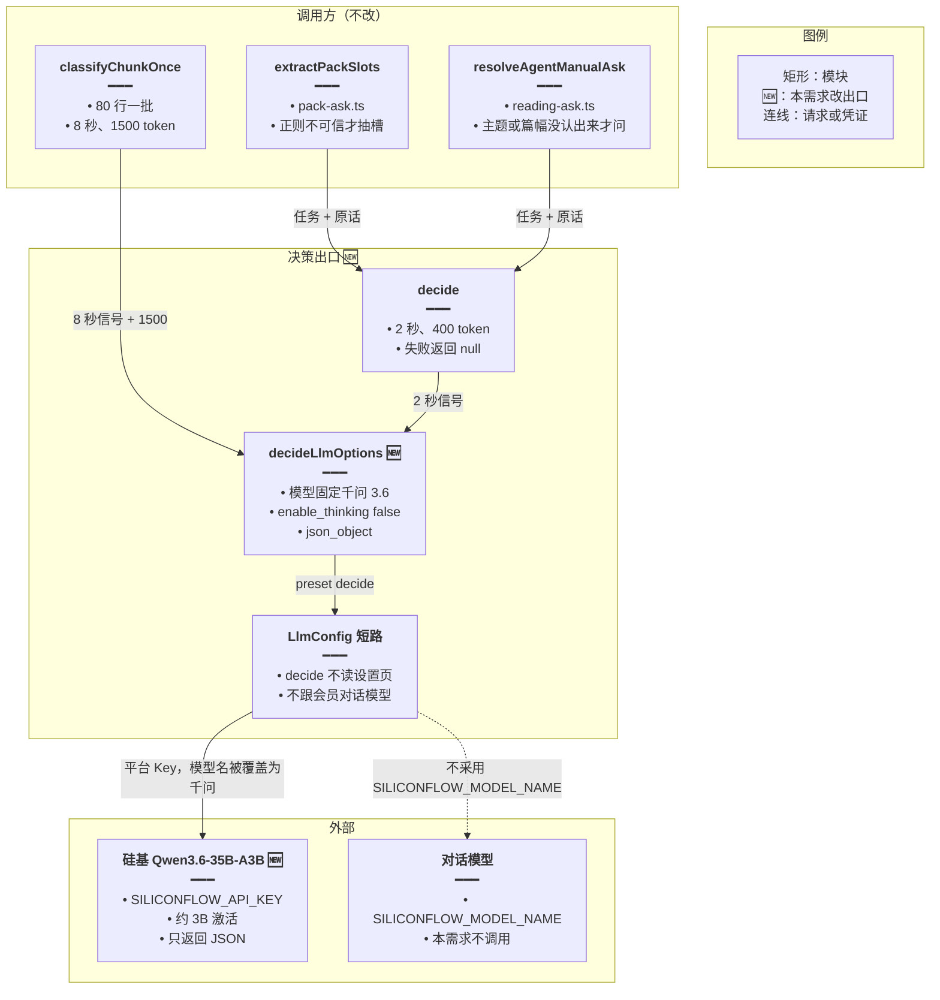
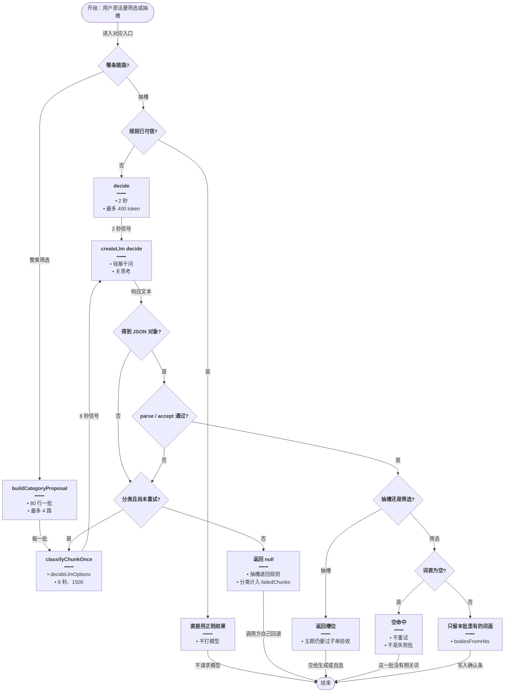

# 决策改用千问 — 实现思路

> **状态**：规划（未实现）  
> **日期**：2026-10-28  
> **需求摘要**：英语 Agent 的整类筛选和短决策不再打智谱 `glm-4.7-flash`，改打硅基流动 `Qwen/Qwen3.6-35B-A3B` 并关闭思考；分批、解析、验收和回退保持原样，4 路分类不再卡在免费档 1 并发上。  
> **一句话方案（预告）**：`decide` 档整档改走平台 `SILICONFLOW_API_KEY`，模型名固定千问 3.6，请求只带 `enable_thinking: false`；分类器改为调用同一份 `decideLlmOptions`。

## 延伸阅读

- [通用决策封装.md](../通用决策封装.md)（`decide()` 的任务 / 原文 / `parse` / `accept` 契约。本篇只改它的供应商和模型，不改这层契约。该文「会员不切硅基」指的是不要跟着对话模型走，不是永远留在智谱）
- [english/Agent词句认意图.md](./Agent词句认意图.md)（正则可信则不调用 `decide()`；失败仍退回正则）
- [english/整类词一次收藏.md](./整类词一次收藏.md)、[english/大批收藏稳落库.md](./大批收藏稳落库.md)（分类器的分批、失败重试一次、确认条形状。本篇不改这些规则）

---

## 0. 读本文你将得到什么

- 要解决的问题：整类筛选用 `glm-4.7-flash` 一次 4 路并发，免费档只有 1 路并发，请求被 1302 限流后整批变成「未能判断」。
- 比对后的方案：决策档改打硅基 `Qwen/Qwen3.6-35B-A3B`，关闭思考；短决策和分类共用这一份请求参数。
- 改动层：只动后端 `create-llm` 的 `decide` 档、`glm-decide.ts`、`category-propose.ts` 和 `llm-config` 上的一句说明。前端、对话模型、OCR 不动。
- 分两阶段：M1 换供应商并让分类走同一份选项；M2 用一次真实请求确认关思考和 JSON 外壳不会 400。
- 最大风险：硅基不接受 `enable_thinking` 或 `json_object` 时，本批会被现有的 `catch` 收成 `null`，用户看到的是「有批未能判断」，而不是新的报错文案。

---

## 1. 需求与边界

### 1.1 用户故事

| 角色 | 场景 | 行为 | 期望结果 |
|------|------|------|----------|
| 英语用户 | 对一个词库说「收藏关于旅行的词」 | 服务端按 80 行一批、最多 4 路同时筛选 | 命中词仍进同一张确认条；不再因为智谱 1 并发把多批判失败 |
| 英语用户 | 说「生成 20 个旅行单词」，正则对不上主题或数量 | `decide()` 抽一次槽位 | 2 秒内得到 JSON 或退回正则，生成条数和主题规则不变 |
| 会员 | 对话模型已是硅基 `GLM-5.1` 或设置页自定义模型 | 同一次筛选或抽槽 | 这次请求不跟着对话模型走，固定千问 3.6 |
| 维护者 | 以后再加一处短决策 | 只传任务、原文、`parse` | 自动用同一供应商、同一模型和关思考参数 |

### 1.2 范围

| 在范围内 | 不在范围内（非目标） |
|----------|----------------------|
| `decide` 档的 API Key、Base URL、模型名、思考开关 | 对话、知识库、英语正文生成、日推释义、OCR 的模型 |
| `decide()`（词句抽槽、自选阅读抽槽）和 `classifyChunkOnce`（整类筛选） | 改写分类提示词、每批 80 行、4 路并行、失败再判一次 |
| 输出仍是 JSON 对象，形状仍由现有 `parse` / `accept` 把关 | 新增环境变量、新依赖、前端开关、按用户记账 |
| 缺 Key、超时、非 JSON、形状不对仍返回 `null` | 限流后做指数退避，或把 429 展示成新错误码 |

### 1.3 约束与依赖

- 平台已有 `SILICONFLOW_API_KEY` / `SILICONFLOW_BASE_URL`（默认 `https://api.siliconflow.cn/v1`）。分类和短决策用这把平台 Key，不读用户设置页。
- 必须复用 `createLlm`、`decide()`、`decideLlmOptions`、`buildCategoryProposal`。不新建客户端。
- 智谱免费 `glm-4.7-flash` 的并发是 1。分类器 `CATEGORY_PARALLEL = 4`，所以换模型必须换出口，不能只改模型名字。
- 体验底线：短决策仍是 2 秒 / 最多 400 token；分类仍是 8 秒 / 最多 1500 token。思考过程不能占用这份额度。
- 与对话 Agent 的工具循环互斥只在「这次请求不进会话、不带历史」。工具本身仍由现有 `propose_add` / 日推自选调用。

---

## 2. 背景

- **谁、在什么场景、卡在哪**：用户在英语 Agent 里按类别收藏或筛选词库时，`classifyChunk` 把清单切成约 80 行一批，最多 4 路同时请求 `glm-4.7-flash`。智谱免费档同一时刻只处理 1 个请求，多出来的请求返回 1302。`decide()` 的词句抽槽和阅读抽槽也打同一个模型，和分类抢这一路并发。
- **现状缺口**：`preset: 'decide'` 在非会员表和会员表都解析 `GLM_API_KEY`。`LlmConfigService` 对 `decide` 还有短路，故意不走用户自定义模型和会员对话模型。模型名写死在 `DECIDE_MODEL_NAME`。缺口是出口和思考字段仍是智谱的：`thinking: { type: 'disabled' }` 不能拿到硅基的高并发，只改名字会把千问的模型 id 打到 `open.bigmodel.cn`。
- **不解决会怎样**：失败批被收成 `null`，重试一次仍失败就计入 `failedChunks`。整类收藏要么没有可确认的词，要么确认条标题带「有批未能判断」。抽槽超时则悄悄退回正则，主题和数量跟用户原话对不齐。
- **硬约束**：任务文案、`{"words":[...]}` 解析、空数组表示没有命中、`null` 才重试、词面必须来自本批、正则快路径和子串验收都不能改。对话用的 `SILICONFLOW_MODEL_NAME`（默认 `Pro/zai-org/GLM-5.1`）不能被这次替换牵动。OCR 继续固定智谱视觉模型。

---

## 3. 现状与复用

| 能力 | 仓库中已有 | 本需求中的用法 |
|------|------------|----------------|
| 统一建客户端 | `apps/backend/src/utils/create-llm.ts` 的 `createLlm` | 扩展：`decide` 档的 Key / Base URL 改为硅基；`modelName` 覆盖逻辑直接复用 |
| 短决策 | `apps/backend/src/utils/glm-decide.ts` 的 `decide` / `decideLlmOptions` | 扩展：模型名改为千问；`modelKwargs` 改为关思考 + JSON 外壳；`maxTokens` 允许分类传入 |
| 不跟用户凭证 | `apps/backend/src/services/llm-config/llm-config.service.ts` 里 `preset === 'decide'` 的短路 | 直接复用：仍然不读设置页快照、不按会员切对话模型；短路指向的档位内容改成硅基千问 |
| 整类筛选 | `apps/backend/src/services/agent/tools/english/category-propose.ts` 的 `classifyChunkOnce` | 扩展：删掉自己拼的一份 `CreateLlmOptions`，改调 `decideLlmOptions` |
| 分批与验收 | 同文件 `buildCategoryProposal`、`retryChunkHit`、`bodiesFromHits` | 直接复用 |
| 词句抽槽 | `apps/backend/src/services/agent/tools/english/pack-ask.ts` 的 `extractPackSlots` | 直接复用：仍调用 `decide()`，失败退回正则 |
| 阅读抽槽 | `apps/backend/src/services/agent/tools/english/reading-ask.ts` 的 `resolveAgentManualAsk` | 直接复用：失败沿用规则和已保存档 |
| 筛选入口 | `apps/backend/src/services/agent/tools/english/domain-tools.ts` 里两处 `buildCategoryProposal` | 直接复用 |
| 对话关思考 | `GLM_THINKING_DISABLED_KWARGS`（`thinking: { type: 'disabled' }`） | 不适用：只留给仍走智谱的对话 / 记忆 / OCR 以外的正文链路；决策请求不再展开它 |
| 日推释义认 flash | `apps/backend/src/services/english-learning/daily-reading.rules.ts` 的 `FLASH_GLOSS_MODELS` | 不适用：那是正文生成模型的分支，不是这次决策 |

**调研结论**：分类和短决策已经收在 `preset: 'decide'`，而且 `decide()` 不传 `userId`、不传 resolver。要换的是这个档的供应商和一份请求参数，不是再包一层客户端。`classifyChunkOnce` 现在把同一份选项抄了一遍，模型名和思考字段必须收回到 `decideLlmOptions`，否则只改一处，另一处仍会把智谱字段打到硅基。`createLlm` 在没有 resolver 时只用非会员表；`LlmConfigService` 对 `decide` 也固定读这张表。两张表的 `decide` 项要一起改，避免以后有人拿会员表拼请求时又回到智谱。

---

## 4. 方案比对与最终方案

### 4.1 候选方案

#### 方案 A：维持智谱 glm-4.7-flash（复用现状）

- **做法**：`DECIDE_MODEL_NAME` 仍是 `glm-4.7-flash`。`siliconFlowResolvePresets.decide` 和会员表的 `decide` 继续 `buildGlmEnvPresetOptions`。`classifyChunkOnce` 继续自己拼 `GLM_THINKING_DISABLED_KWARGS`。4 路并发和失败再判一次保持不动。
- **能工作的原因**：免费档在只有 1 个在途请求时能返回 JSON。`parse` / `accept` / 正则回退已经能消化超时和坏 JSON。单用户慢慢筛小词库时，排队后的请求有时能在 8 秒内完成。
- **主要代价**：4 路里多出来的请求立刻 1302。重试又打向同一条 1 并发的队列，失败批变多，整类收藏变空或带「未能判断」。抽槽和分类互相堵住。

#### 方案 B：决策档整档换硅基千问（扩展现有档）

- **做法**：新增 `buildDecideEnvPresetOptions`，Key / Base URL 用已有的 `SILICONFLOW_*`，模型名固定 `Qwen/Qwen3.6-35B-A3B`，不读 `SILICONFLOW_MODEL_NAME`。非会员表和会员表的 `decide` 都指向它。`LlmConfigService` 的短路保留，只改注释。`decideLlmOptions` 去掉智谱 `thinking`，改为 `enable_thinking: false` 加现有的 `response_format: { type: 'json_object' }`，并接受 `maxTokens`。`classifyChunkOnce` 改为 `createLlm(config, decideLlmOptions(signal, CATEGORY_MAX_TOKENS))`。`decide()` 仍不传 resolver。
- **能工作的原因**：硅基按账户给 RPM/TPM（新账户约 1000 RPM、4 万 TPM），4 路可以同时在飞。千问 3.6 是约 35B 总参、约 3B 激活的 MoE，和 `glm-4.7-flash`（30B 总参、3B 激活）同一档，中文指令遵循够做「原话 + 词面 | 释义 → 词表」。关掉思考后，输出额度仍留给 JSON。短路还在，设置页里的 DeepSeek 或对话用的 `GLM-5.1` 进不了这次请求。
- **主要代价**：这次调用从智谱免费变成平台硅基余额。非会员做整类筛选也会消耗这把 Key。输入侧那 80 行词表的 token 省不掉。

#### 方案 C：只迁分类器，短决策仍用免费 Flash

- **做法**：`category-propose.ts` 单独建一组硅基选项（千问、关思考、8 秒、1500 token）。`glm-decide.ts` 和 `decide` 档保持智谱 `glm-4.7-flash`。词句抽槽、阅读抽槽仍走免费模型。
- **能工作的原因**：限流主要来自 4 路分类，不来自偶尔一次 2 秒抽槽。分类换出口后，收藏确认条不再被 1302 打空。抽槽继续不花钱，正则回退也还在。
- **主要代价**：两套请求参数。分类若漏写 `enable_thinking: false`，不会被 `decide()` 的单测路径挡住。抽槽仍占智谱那 1 路并发；用户同一句里既生成又筛选时，抽槽会继续超时并退回正则。和「整档替代 glm-4.7-flash」不一致。

### 4.2 比对

| 维度 | 方案 A | 方案 B | 方案 C |
|------|--------|--------|--------|
| 正确性（失败路径、边界、数据是否会错） | 1302 被收成 `null`，重试后仍失败就计入 `failedChunks`，可能把「有这类词」说成没有可确认的词 | 同一 `parse` / 空数组 / `null` 重试。关思考后 1500 token 留给词表，截断变少。供应商 400 仍走现有 `catch` | 分类路径与 B 相同。抽槽仍会在 1 并发上超时，正则回退可能用上对不齐原话的主题 |
| 复用 / 与现状契合 | 零改动，完全是今天的 `decide` 档 | 复用 `createLlm`、短路、`decide()`、分批函数。只改档位内容和一处选项工厂 | 分类器新写一份选项，和已经存在的 `decideLlmOptions` 分叉 |
| 改动面（要动哪些路径） | 无 | `create-llm.ts`、`glm-decide.ts`、`category-propose.ts`、`llm-config.service.ts` 注释 | 主要是 `category-propose.ts`；`glm-decide.ts` 不动 |
| 复杂度（新概念、新状态、新依赖） | 无新概念 | 无新服务、无新表、无新依赖。请求体多一个硅基字段 `enable_thinking` | 两套「关思考」写法并存，阅读代码时要记住哪条链路走哪家 |
| 体验（延迟、步骤数、失败时用户看到什么） | 4 路排队，8 秒内失败批变多，确认条变空或带未能判断 | 4 路真正并行，用户仍看同一张确认条。抽槽仍是 2 秒，失败仍退回正则 | 筛选变快。抽槽体验与 A 相同 |
| 风险（迁移、互斥、并发、回滚） | 无迁移风险，限流继续发生 | 平台 Key 余额、硅基 TPM、关思考字段是否被接受。回滚是把档位改回 `buildGlmEnvPresetOptions` 并恢复智谱思考字段 | 分类的字段风险与 B 相同，外加两处回滚。智谱 Key 仍会被抽槽打满 |
| 可维护性（以后改一处还是改多处） | 选项已经抄在 `decideLlmOptions` 和 `classifyChunkOnce` 两处 | 供应商、模型名、思考开关只留在档位和 `decideLlmOptions` | 以后换模型要改两处，和这次要修的分叉是同一类问题 |

### 4.3 综合考量

这次替换里权重大的是正确性和体验：失败批不能被当成「库里没有这类词」，4 路筛选必须真的并行。这两项都靠换掉智谱免费档的 1 并发，所以方案 A 不符合这次需求。

方案 B 在这两项上和 C 一样能让分类离开智谱，并且抽槽也离开，2 秒预算不再和分类抢同一路。可维护性也站在 B：现在的 bug 就是选项抄了两份。C 少改 `glm-decide.ts`、短决策继续免费，这是它真实的优点。这个优点抵不过分叉——分类一旦漏关思考，1500 token 会被思考过程吃掉，词表被截断后又变回 `failedChunks`。用户要求的是整档替代，不是只救收藏这一条。

因此选定方案 B。放弃 A 的零成本和零迁移。放弃 C 的「短决策仍不花钱」和更小的 diff。

### 4.4 最终方案

#### 背景

整类筛选和两处抽槽都通过 `preset: 'decide'` 打智谱 `glm-4.7-flash`。免费档 1 并发，分类器固定 4 路，1302 被收成 `null`。只改 `DECIDE_MODEL_NAME` 而 Key 仍是 `GLM_API_KEY` 时，千问的模型 id 会打到智谱。对话模型 `SILICONFLOW_MODEL_NAME` 和设置页自定义模型不能被拉进这次请求，否则筛选质量会跟着用户的对话配置变。OCR 必须留在智谱。

#### 具体思路

1. 模块仍切在现有三处：`create-llm.ts` 管凭证，`glm-decide.ts` 管一次短调用的参数，`category-propose.ts` 管分批。不新增模块。
2. 数据流不变：系统消息是任务说明，用户消息是原文或「原话 + 词面 | 释义」。返回文本 `JSON.parse` 后走原来的 `parse` / `accept`。变的是 HTTP 发往 `api.siliconflow.cn`，模型为 `Qwen/Qwen3.6-35B-A3B`。
3. 不新增状态。没有 MobX、没有表。在途请求仍由 `AbortSignal.timeout` 控制。`failedChunks` 仍只在内存里累计这一次提案。
4. 边界沿用：缺 Key、超时、非 JSON、形状不对 → `null`；空词数组是没有命中，不重试；`null` 再判一次；词面不在本批里的丢掉。思考字段只用硅基认识的 `enable_thinking: false`，不附带智谱的 `thinking` 对象，避免 400 被收成整批失败。

#### 实现方案

**一句话**：`decide` 档整档改走平台 `SILICONFLOW_API_KEY`，模型名固定千问 3.6，请求只带 `enable_thinking: false`；分类器改为调用同一份 `decideLlmOptions`。

| 步骤 | 谁 | 做什么 | 输入 → 输出 |
|------|----|--------|-------------|
| 1 | `glm-decide.ts` 的 `decideLlmOptions` | 固定模型名和关思考的 JSON 参数；`maxTokens` 可传入 | `AbortSignal` + 可选 token 上限 → `CreateLlmOptions` |
| 2 | `create-llm.ts` 的 `buildDecideEnvPresetOptions` | 两张凭证表的 `decide` 都改用硅基 Key / Base URL，模型名用同一个常量 | 环境变量 → `{ apiKey, baseURL, modelName }` |
| 3 | `category-propose.ts` 的 `classifyChunkOnce` | 不再自己拼选项，调用步骤 1，超时仍是 8 秒、上限 1500 | 一批行 + 用户原话 → `ChunkHit` |
| 4 | `llm-config.service.ts` | 保留 `decide` 短路，不读设置页快照；注释改为「固定硅基千问，OCR 仍固定智谱」 | `preset === 'decide'` → 步骤 2 的凭证 |
| 5 | 现有 `decide()` / `buildCategoryProposal` | 不改解析和回退 | 与今天相同的 `T \| null` 或 `{ bodies, failedChunks }` |

#### 选定原因

1. **正确性**：4 路不再打向 1 并发，1302 变少，`failedChunks` 才更接近「模型真的没看懂」而不是「排队失败」。牺牲：平台硅基余额替代免费额度。
2. **复用**：短路、`createLlm`、`decide()`、分批函数都留着。牺牲：要改两张表的 `decide` 项，不能只改非会员表就当会员表不存在。
3. **改动面**：四个后端文件，没有前端。牺牲：比方案 C 多改 `glm-decide.ts` 和凭证表。
4. **复杂度**：没有新预设名，仍叫 `decide`。牺牲：调用方看到的档名仍像智谱决策，注释必须写明出口已是硅基。
5. **体验**：分类并行、抽槽仍是 2 秒；失败时用户看到的文案不变。牺牲：不在这次做退避，TPM 打满时仍会有失败批。
6. **风险**：回滚是把 `decide` 档改回 `buildGlmEnvPresetOptions` 并恢复智谱思考字段，调用方不用改。牺牲：上线前必须打一发真实请求，确认硅基同时接受 `enable_thinking: false` 和 `json_object`。
7. **可维护性**：思考开关和模型名只有一份。牺牲：分类的 1500 token 要作为参数传入，`decideLlmOptions` 的签名多一个数。

#### 优势

- 相对方案 A：同样 80 行一批时，4 个请求可以同时在飞，确认条不再被免费档并发打空。关掉思考后，输出 token 是词表而不是排队失败后的第二次整批重试。
- 相对方案 C：抽槽和分类共用一个出口，同一句里的生成和筛选不会再抢智谱那 1 路。以后改模型只改 `DECIDE_MODEL_NAME` 和档位，不会出现分类已换、抽槽仍带 `thinking.type` 的分叉。

#### 怎么实现

1. 在 `create-llm.ts` 增加常量 `DECIDE_MODEL_NAME = 'Qwen/Qwen3.6-35B-A3B'`，并写 `buildDecideEnvPresetOptions`。两张表的 `decide` 改为调用它。`glm-decide.ts` 改为从这里引入并再导出，避免 `create-llm` 去引用 `glm-decide` 形成循环。
2. `decideLlmOptions(signal, maxTokens = 400)` 的 `modelKwargs` 改为 `enable_thinking: false` 与 `response_format: { type: 'json_object' }`。不再展开 `GLM_THINKING_DISABLED_KWARGS`。
3. `classifyChunkOnce` 用 `AbortSignal.timeout(8_000)` 调用 `decideLlmOptions(signal, 1500)`，后面的 `invoke`、`parseWords`、`catch → null` 保持原样。
4. `decide()` 继续不传 `userId` 和 resolver。缺 `SILICONFLOW_API_KEY` 时 `createLlm` 抛错，被 `decide()` 和 `classifyChunkOnce` 的 `catch` 收成 `null`。
5. `LlmConfigService.resolveSiliconFlowCredentials` 里 `ocr || decide` 的短路保留，这样设置页快照盖不到这次请求。

主链路代码见 §9。

### 4.5 其他关键决策：硅基上用哪一个模型

凭证已经定为平台硅基 Key 之后，模型 id 仍会改变输出 token 量和 2 秒抽槽是否来得及。这是数据流决策，单独比对。

#### 4.5.1 候选

##### 模型甲：Qwen/Qwen3.6-35B-A3B，并关闭思考

- **做法**：`DECIDE_MODEL_NAME` 写成这个 id。请求带 `enable_thinking: false`。不读 `SILICONFLOW_MODEL_NAME`。
- **能工作的原因**：约 35B 总参、约 3B 激活，和 `glm-4.7-flash` 同档。硅基文档写明该模型支持思考与非思考切换，`enable_thinking` 是对话补全里的字段。国内站标价约输入 ¥1.80 / 百万 token、输出 ¥10.80 / 百万 token；思考关掉后输出只有 JSON，输出高单价乘不上来。
- **主要代价**：输出单价高于「看起来便宜」的小模型。若硅基拒绝这个字段，整批失败，需要在 M2 用真实请求确认。

##### 模型乙：deepseek-ai/DeepSeek-V4-Flash，并关闭思考

- **做法**：同一套硅基 Key，模型 id 换成 `deepseek-ai/DeepSeek-V4-Flash`，同样传 `enable_thinking: false`。
- **能工作的原因**：硅基 OpenAI 兼容接口能调这个 id。文档写明它支持 `enable_thinking`，默认思考强度是 high。关掉之后也能出 JSON。白天价格约输入 ¥3、输出 ¥9 / 百万 token。
- **主要代价**：总参约 284B、激活约 13B，短决策的 2 秒更紧。默认思考一旦没关掉，思考 token 按输出计价，并挤占 400 / 1500 的上限，JSON 被截断后调用方只能当失败。

##### 模型丙：跟随 SILICONFLOW_MODEL_NAME

- **做法**：`decide` 档直接用 `buildSiliconFlowEnvPresetOptions`，模型名跟对话默认值（当前是 `Pro/zai-org/GLM-5.1`）。不再写死千问。
- **能工作的原因**：Key、Base URL、模型解析函数都是现成的，diff 最短。会员对话已经在用这把 Key，限流额度是同一账户。
- **主要代价**：激活参数约 40B，输入约 ¥6–8、输出约 ¥24–28 / 百万 token。改对话模型的环境变量会悄悄改掉分类器。`GLM-5.1` 的思考模式不适合 2 秒抽槽。

#### 4.5.2 比对

| 维度 | 模型甲 | 模型乙 | 模型丙 |
|------|--------|--------|--------|
| 正确性 | 3B 激活、关思考后，1500 token 留给词表；同档指令遵循够做词面筛选 | 关思考时形状相同。13B 激活更容易撞上 2 秒，抽槽更常退回正则 | 能力足够，但思考或超长输出会截断 JSON，失败路径变多 |
| 复用 / 与现状契合 | 延续「决策模型不跟对话模型名」：今天不跟 `GLM_MODEL_NAME`，换供应商后也不跟 `SILICONFLOW_MODEL_NAME` | 同样写死一个 id，不跟对话模型 | 复用对话模型环境变量，和 `glm-decide.ts` 现有注释相反 |
| 改动面 | 一个常量 | 一个常量，与甲相同 | 少一个常量，改的是档位是否调用现成的硅基模型解析 |
| 复杂度 | 一个固定 id | 一个固定 id | 无新常量，但分类质量变成环境变量的隐式行为 |
| 体验 | 3B 激活，4 路和 2 秒抽槽都落在现有时限里 | 激活更大，抽槽超时后用户得到的是正则结果 | 单次更慢更贵，筛选整库的等待变长 |
| 风险 | 须确认 `enable_thinking: false` 不被 400 | 默认 high 思考；漏关字段时 token 和截断风险高于甲 | 有人把对话模型改成推理模型时，筛选一起变慢 |
| 可维护性 | 换分类模型要改常量，对话模型随便换 | 与甲相同 | 对话和分类锁死在一个环境变量上，不能单独换 |

#### 4.5.3 综合考量

模型这一层的权重是「2 秒抽槽还来得及」和「输出 token 里没有思考过程」。甲的激活参数和今天的 flash 同档，并且文档写明可以关思考。乙也能关思考，激活参数大约是甲的四倍，2 秒预算更易超时，这是它比甲差的地方；它的优点是输出单价略低（¥9 对 ¥10.80），但只有两边都不思考、输出一样短时才成立。丙完全复用对话配置，diff 最小，这个优点抵不过「改对话模型就改筛选」——现有代码特意不让决策跟随 `GLM_MODEL_NAME`，换到硅基后这条约束还在。

选定模型甲。放弃乙略低的输出单价和更大的通用能力。放弃丙少写一个常量。

#### 4.5.4 最终方案

##### 背景

`decide` 档如果只换成硅基、模型却跟着 `SILICONFLOW_MODEL_NAME`，分类会打到 `GLM-5.1`。DeepSeek-V4-Flash 默认为高推理强度，思考 token 会占满 `decide()` 的 400 和分类的 1500。硬约束是输出必须是短 JSON，时限不能加。

##### 具体思路

1. 模型 id 放在 `create-llm.ts` 的常量里，`decideLlmOptions` 再写进 `modelName` 覆盖，双保险：档位解析和调用参数是同一个字符串。
2. 不新增环境变量。要换模型就改常量，和今天写死 `glm-4.7-flash` 的方式一样。
3. 没有单独的状态。关思考是请求字段，不是运行时开关。
4. 若 M2 发现该 id 拒绝 `enable_thinking`，不要改回附带智谱 `thinking` 对象；先确认字段名，仍失败则整档回滚到方案 A，而不是半关思考。

##### 实现方案

**一句话**：决策模型固定为 `Qwen/Qwen3.6-35B-A3B`，请求带 `enable_thinking: false`，不读取对话模型环境变量。

| 步骤 | 谁 | 做什么 | 输入 → 输出 |
|------|----|--------|-------------|
| 1 | `DECIDE_MODEL_NAME` | 写死千问 id | 无输入 → 模型字符串 |
| 2 | `decideLlmOptions` | `modelKwargs.enable_thinking = false` | 选项对象带这个字段 |
| 3 | `createLlm` | `modelName` 参数覆盖凭证里的名字 | 最终请求的 model 为千问 |

##### 选定原因

1. **正确性**：3B 激活加上关思考，词表不被思考截断。牺牲：输出单价高于 DeepSeek-V4-Flash 的标价，短 JSON 下总价仍然更低。
2. **复用**：沿用「决策模型写死、不跟对话模型」的现有约定。牺牲：对话若以后也用千问，两处仍各写各的 id。
3. **体验**：2 秒和 8 秒维持原值。牺牲：不把超时放宽去迁就更大的模型。
4. **风险**：字段是否 400 留在 M2 验证。牺牲：上线前多一次手工请求。
5. **可维护性**：一个常量。牺牲：换模型要发版，不能只改环境变量。
6. **改动面 / 复杂度**：此项与乙相同，都是一个常量；相对丙多一个常量，用来换「不跟对话模型」。

##### 优势

- 相对模型乙：激活参数约 3B 而不是约 13B，抽槽更可能在 2 秒内返回；默认不会进入 high 推理。输入 ¥1.80 低于 Flash 的 ¥3，思考关掉后输出只有词表，¥10.80 的输出单价乘的是几百 token 而不是一段思考。
- 相对模型丙：改 `SILICONFLOW_MODEL_NAME` 不会改变筛选结果。不会把约 40B 激活、输出 ¥24 以上的对话模型拿来对 80 行词表做 4 路调用。

##### 怎么实现

常量、`modelKwargs` 和 `modelName` 覆盖写在 §9.2，对应 §4.4 步骤 1 和步骤 2。不另写一套客户端。

---

## 5. 架构图



**图内方法说明**：

| 方法 | 功能 |
|------|------|
| `extractPackSlots` | 正则对不上主题或数量时调用 `decide()`，抽出单词/语句槽位；返回 `null` 时调用方退回正则 |
| `resolveAgentManualAsk` | 原话里的主题或篇幅没被规则认全时调用 `decide()`；失败则沿用规则和已保存档 |
| `classifyChunkOnce` | 把一批「词面 \| 释义」和用户原话交给决策模型，解析出 `{ words }`；超时或坏 JSON 返回 `null` |
| `decideLlmOptions` | 拼出 `createLlm` 的选项：硅基千问、温度 0、关思考、JSON 外壳；分类可传入更大的 `maxTokens` |
| `decide` | 用 `decideLlmOptions` 发一次非流式请求，`JSON.parse` 后交给调用方的 `parse` / `accept`；任何失败返回 `null` |
| `resolveSiliconFlowCredentials` | `preset === 'decide'` 时不读用户快照，直接用决策档的环境凭证 |

**读图要点**：

- 三个调用方都进同一份选项，分类不再自己拼思考字段。
- 短路仍挡在设置页和对话模型前面，硅基 Key 是平台的，模型 id 不是 `SILICONFLOW_MODEL_NAME`。
- 对话模型画出来是为了标出边界：它和决策出口只有「同账户 Key」这层关系，没有调用关系。

---

## 6. 主流程图



**图内方法说明**：

| 方法 | 功能 |
|------|------|
| `decide` | 短决策一次往返；失败返回 `null`，词句和阅读模块各自退回规则，不在这里重试 |
| `buildCategoryProposal` | 把清单切成 80 行的批，最多 4 个 worker 调用分类函数，汇总命中词和失败批数 |
| `classifyChunkOnce` | 对一批调用 `decideLlmOptions` 后的模型；空行批直接 `{ words: [] }`，异常返回 `null` |
| `decideLlmOptions` | 提供千问、关思考和 token 上限，供 `decide` 与 `classifyChunkOnce` 共用 |
| `createLlm` | 按 `decide` 档取硅基 Key，再用选项里的模型名覆盖，发出非流式补全 |
| `retryChunkHit` | 仅当结果为 `null` 时再跑一次；空词数组视为没有命中，不重试 |
| `parseWords` | 要求顶层是 `{ words: string[] }`，否则返回 `null` 以便重试 |
| `bodiesFromHits` | 用命中词面回查清单原行，模型编出来的词进不了确认条 |

**读图要点**：

- 抽槽在规则可信时根本不打模型；筛选没有这条快路径，每一批都打。
- 空词数组和 `null` 在分类上走不同的边：前者是没有命中，后者才重试并可能变成失败批。抽槽一旦验收通过就返回槽位，不进入词表是否为空的判断。
- 重试只有分类有，而且只多一次。抽槽失败直接退回规则，避免 2 秒预算翻倍。

---

## 7. 核心时序图

```mermaid
sequenceDiagram
  participant U as 用户
  participant Tool as 领域工具
  participant Cat as 分类器
  participant Opt as 决策选项
  participant SF as 硅基千问

  U->>Tool: 收藏某一类词
  Tool->>Cat: buildCategoryProposal()
  Note right of Cat: 入参：清单行 + 用户原话<br/>切成 80 行一批，最多 4 路
  Cat->>Opt: decideLlmOptions()
  Note right of Opt: 入参：8 秒 AbortSignal、maxTokens 1500<br/>出：preset decide、模型千问、enable_thinking false
  Opt->>SF: createLlm + invoke()
  Note right of SF: 系统消息：只返回 words JSON<br/>用户消息：原话 + 词面竖线释义<br/>出：一段 JSON 文本
  SF-->>Cat: 文本
  Cat->>Cat: parseWords()
  Note right of Cat: 形状不对则 null，再判一次<br/>通过后丢掉不在本批的词面
  Cat-->>Tool: bodies + failedChunks
  Note right of Tool: 有命中则一张确认条<br/>失败批只计数，不当成没有这类词
  Tool-->>U: 确认条
```

**图内方法说明**：

| 方法 | 功能 |
|------|------|
| `buildCategoryProposal` | 领域工具把已取出的清单行送进分类；不增加图步，分批都在这一次提案里完成 |
| `decideLlmOptions` | 把 8 秒信号和 1500 token 收成 `createLlm` 选项，带上千问和关思考 |
| `createLlm` | 用决策档的硅基 Key 建非流式客户端，模型名强制为千问 |
| `invoke` | 发送系统消息和用户消息；超时或 HTTP 错误抛出，由分类器收成 `null` |
| `parseWords` | 把模型文本收成 `{ words: string[] }` 或 `null` |

**读图要点**：

- 用户不直接选模型。确认条仍由领域工具挂上，分类只替换这一次补全的出口。
- 4 路是 `buildCategoryProposal` 里面的 worker，时序图只画一批的往返，避免把并行画成串行依赖。
- 短决策的时序是同一条 `decideLlmOptions → createLlm → invoke`，差别只是 2 秒和 400 token，不另画一张。

---

## 9. 具体实现（主链路代码）

### 9.1 模块一览

| 模块 | 职责 | 新增/改动 | 预估路径 |
|------|------|-----------|----------|
| 决策模型常量与凭证 | 硅基 Key、固定千问 id | 扩展 | `apps/backend/src/utils/create-llm.ts` |
| 决策参数 | 关思考、token 上限、一次补全 | 扩展 | `apps/backend/src/utils/glm-decide.ts` |
| 整类分类 | 改调同一份选项 | 扩展 | `apps/backend/src/services/agent/tools/english/category-propose.ts` |
| 凭证短路 | 继续挡设置页 | 只改注释 | `apps/backend/src/services/llm-config/llm-config.service.ts` |
| 抽槽调用方 | 任务与验收 | 直接复用 | `pack-ask.ts`、`reading-ask.ts` |

### 9.2 主链路实现

```typescript
// 对应 §4.4 步骤 1，也是 §4.5 的模型 id。不读 SILICONFLOW_MODEL_NAME，避免分类跟着对话模型变成 GLM-5.1
export const DECIDE_MODEL_NAME = 'Qwen/Qwen3.6-35B-A3B';

// 对应 §4.4 步骤 1。只放硅基认识的字段，不展开智谱 thinking，避免不认识的字段让整批 400
export const DECIDE_JSON_KWARGS = {
	// 千问 3.6 可以思考；关掉后 400 和 1500 的额度都留给 JSON
	enable_thinking: false,
	// 只要 JSON 外壳。字段是否合法仍由调用方 parse，这里不写业务规则
	response_format: { type: 'json_object' as const },
};

// 对应 §4.4 步骤 1。分类和短决策共用这份选项，避免一处换了模型、另一处仍带智谱字段
export function decideLlmOptions(
	// 短决策用 2 秒的 AbortSignal，分类用 8 秒，超时都由调用方掌握
	signal: AbortSignal,
	// 缺省 400，够一个槽位对象；分类传入 1500，避免命中词被截断
	maxTokens: number = DECIDE_MAX_TOKENS,
	// 返回 createLlm 已有的选项类型，调用方不用再包一层客户端
): CreateLlmOptions {
	// 一份选项同时约束供应商档位、模型名和思考开关
	return {
		// decide 档解析硅基平台 Key，不走用户设置页
		preset: 'decide',
		// createLlm 会用这个名字覆盖凭证里的模型，即使档位解析出错也不会打到 GLM-5.1
		modelName: DECIDE_MODEL_NAME,
		// 要一整段 JSON。流式半截文本会让 JSON.parse 失败
		streaming: false,
		// 筛选和抽槽要稳定，不采样
		temperature: 0,
		// 不传 temperature 时也不要落到 createLlm 默认的 0.3
		defaultTemperature: 0,
		// 调用方决定额度：抽槽 400，分类 1500
		maxTokens,
		// 关思考 + JSON 外壳。不再带 thinking.type
		modelKwargs: DECIDE_JSON_KWARGS,
		// 和 invoke 使用同一个信号，到点即取消
		abortSignal: signal,
	};
}
```

```typescript
// 对应 §4.4 步骤 2。决策档单独拼凭证，不能复用 buildSiliconFlowEnvPresetOptions，那个函数会读对话模型名
function buildDecideEnvPresetOptions(): ResolveSiliconFlowOptions {
	// 缺 Key 时走 onMissingApiKey，不在这里抛 HttpException
	return {
		// 与知识库、会员对话同一把平台 Key，不使用 GLM_API_KEY
		apiKeyEnvKeys: SILICONFLOW_ENV_API_KEY_KEYS,
		// 默认 https://api.siliconflow.cn/v1，允许环境变量覆盖网关
		baseUrlEnvKeys: SILICONFLOW_ENV_BASE_URL_KEYS,
		// 环境变量没写 Base URL 时用硅基国内站，避免回落到智谱默认根路径
		defaultBaseUrl: DEFAULT_SILICONFLOW_BASE_URL,
		// 固定千问。不用 resolveSiliconFlowModelNameFromEnv，那个默认是 GLM-5.1
		resolveModelName: () => DECIDE_MODEL_NAME,
		// 缺 Key 时抛普通 Error，由 decide 和分类的 catch 收成 null，不打成用户可见的 503 对话错误
		missingApiKeyMessage: '未配置 SILICONFLOW_API_KEY，无法做决策',
		// 与今天 decide 档一样抛 Error，而不是 HttpException
		onMissingApiKey: throwSiliconFlowError,
	};
}
```

```typescript
// 对应 §4.4 步骤 3。一批的失败收成 null，空行批收成空词表，两者不能混
async function classifyChunkOnce(
	// 只为读环境变量里的硅基 Key，不传 userId
	config: ConfigService,
	// 约 80 行清单。词面和中文释义在函数内拼成用户消息
	chunk: Array<Record<string, unknown>>,
	// 用户原话，用来判断「要哪一类」，不附带对话历史
	userText: string,
	// null 表示这批失败；空词数组表示没有命中，调用方据此决定要不要重试
): Promise<ChunkHit> {
	// 没有词面的批不必打模型，空数组表示没有命中，调用方不会重试
	const lines = chunkLines(chunk);
	// 空批直接结束，避免把空字符串送给模型再解析失败
	if (!lines) return { words: [] };
	// 原话和词表放在同一条用户消息里，系统消息仍是文件顶部的 TASK
	const input = `用户原话：${userText}\n\n${lines}`;
	// 往返失败不能抛出，否则整次提案中断，而不是只把这一批计为失败
	try {
		// 8 秒到点取消。不沿用 decide() 的 2 秒，80 行一轮需要更长往返
		const signal = AbortSignal.timeout(CATEGORY_TIMEOUT_MS);
		// 1500 和关思考都来自共用选项，这里不再写 modelKwargs
		const llm = await createLlm(
			// 不传 resolver，设置页快照不会替换这把平台 Key
			config,
			// 8 秒信号配 1500 token，与 decide() 的 2 秒 / 400 区分开
			decideLlmOptions(signal, CATEGORY_MAX_TOKENS),
		);
		// 两条消息：任务说明 + 这一批原文。signal 同时交给客户端
		const message = await llm.invoke(
			// 系统消息固定 TASK，用户消息是这一批词表，不附历史
			[new SystemMessage(TASK), new HumanMessage(input)],
			// 与建客户端时是同一个信号，到点两边一起停
			{ signal },
		);
		// 非字符串内容没法 JSON.parse，当成这批失败
		const text = typeof message.content === 'string' ? message.content : '';
		// 空白回复和坏 JSON 一样返回 null，让 retryChunkHit 再判一次
		if (!text.trim()) return null;
		// 形状不对也是 null；空 words 数组会原样返回，表示没有命中
		return parseWords(text);
	// 超时、缺 Key、HTTP 400/429 进这里，不把供应商错误抛进对话
	} catch {
		// 收成 null。外层 retryChunkHit 只会再跑一次，不会在这里循环
		return null;
	}
}
```

```typescript
// 对应 §4.4 步骤 4。短路必须留下，否则设置页里的自定义 Base URL 会把千问模型名打到别的供应商
if (preset === 'ocr' || preset === 'decide') {
	// ocr 仍是智谱视觉模型；decide 经步骤 2 变成硅基千问。两者都不读用户快照
	return resolveEnvSiliconFlowCredentials(
		// 环境变量来自 ConfigService，不读用户行
		config,
		// decide 走步骤 2 的硅基档；ocr 仍走智谱视觉档
		siliconFlowResolvePresetsForPreset(preset)(config),
	);
}
```

### 9.3 数据模型

| 字段/实体 | 来源 | 存储 | 说明 |
|-----------|------|------|------|
| `DECIDE_MODEL_NAME` | 源码常量 | 无 | `Qwen/Qwen3.6-35B-A3B` |
| `SILICONFLOW_API_KEY` / `SILICONFLOW_BASE_URL` | 环境变量 | 进程环境 | 已有，不新增键 |
| `enable_thinking` | 请求体 | 不落库 | `false` |
| `ChunkHit` | 模型 JSON | 仅这一次提案的内存 | `null` 失败；`{ words: [] }` 没有命中 |
| 确认条 `bodies` | 清单原行 | 现有提案存储 | 只收本批词面能对上的行 |

不新增表，不改前端 DTO。

---

## 10. 分阶段实现步骤

| 阶段 | 目标 | 交付物 | 依赖 |
|------|------|--------|------|
| M1 | 决策档改到硅基千问，分类和抽槽走同一份选项 | 四个后端文件的改动；现有 `parse` / 回退不变 | 平台已配置 `SILICONFLOW_API_KEY` |
| M2 | 确认供应商接受关思考和 JSON 外壳 | 一次真实补全的记录：无思考字段、正文是 JSON | M1 |

### M1

- [ ] `create-llm.ts` 增加 `DECIDE_MODEL_NAME` 与 `buildDecideEnvPresetOptions`，两张凭证表的 `decide` 都改用它
- [ ] `glm-decide.ts` 的 `decideLlmOptions` 改用 `DECIDE_JSON_KWARGS`，并接受 `maxTokens`
- [ ] `classifyChunkOnce` 改为调用 `decideLlmOptions(signal, CATEGORY_MAX_TOKENS)`，删除本地的智谱 `thinking` 展开
- [ ] `llm-config.service.ts` 只改短路注释，`if (preset === 'ocr' || preset === 'decide')` 不删
- [ ] 确认 `pack-ask.ts`、`reading-ask.ts`、`buildCategoryProposal` 无 diff

### M2

- [ ] 用平台 Key 对 `Qwen/Qwen3.6-35B-A3B` 发一条带 `enable_thinking: false` 和 `response_format.json_object` 的请求，状态码不是 400
- [ ] 响应正文是 JSON，没有思考文本占用 `max_tokens`
- [ ] 用一小批「词面 | 释义」跑 `classifyChunkOnce`：命中词都在本批内；故意写坏 Key 时得到 `null` 而不是抛进对话
- [ ] 若字段被拒，整档回滚到智谱，不把智谱 `thinking` 对象和硅基字段叠在一起再试

---

## 11. 风险、边界与待确认

| 项 | 等级 | 说明 | 缓解 |
|----|------|------|------|
| `enable_thinking` 或 `json_object` 被 400 | 高 | 400 被 `catch` 成 `null`，用户看到未能判断，和限流长得一样 | M2 先打一发。失败则回滚整档，不叠两个厂商的思考字段 |
| 硅基 TPM | 中 | 新账户约 4 万 TPM。几千词的库、4 路、每批约两三千 token，一分钟内可能 429 | 保持 4 路。429 仍走现有的一次重试。验收若稳定 429，再把 `CATEGORY_PARALLEL` 降到 2，那是后续，不在本篇改 |
| 平台 Key 余额 | 中 | 非会员的筛选也走这把 Key，不再用智谱免费额度 | 输入仍是 80 行一批。关思考避免输出侧放大。不把对话模型的高单价拉进来 |
| 质量偏差 | 中 | 千问和 glm-4.7-flash 对「关于某一类」的召回可能不完全相同 | 词面必须在本批内，编造进不了确认条。抽槽仍有子串验收。不改提示词，便于和今天的结果对照 |
| 短路被误删 | 低 | 删掉后设置页 Base URL 会接到千问模型名上 | 步骤 4 明确保留 `if`。代码注释写明原因 |

**待确认**：

- [ ] 硅基 `Qwen/Qwen3.6-35B-A3B` 是否同时接受 `enable_thinking: false` 与 `response_format: { type: "json_object" }`（验证方式：M2 的一条真实补全，看状态码和正文）
- [ ] 约 2000 词的库、4 路并发时是否出现 429（验证方式：对一个实库跑一次整类筛选，看 `failedChunks` 和硅基用量）

---

## 12. 验收清单

| # | 用例 | 步骤 | 期望 |
|---|------|------|------|
| AC1 | 整类筛选命中 | 对一个有旅行相关词的库说收藏该类 | 确认条里的词都来自清单原行；请求打到硅基千问，不是 `glm-4.7-flash` |
| AC2 | 空命中 vs 失败 | 原话描述库里不存在的类；另把 Key 配错再跑一次 | 前者 `failedChunks === 0` 且没有可收藏的词；后者 `failedChunks > 0`，文案仍是有批未能判断，不说这个库里没有这类词 |
| AC3 | 不跟对话模型 | 设置页改成别的 Base URL 和模型，再做一次筛选 | 决策请求仍是平台硅基 Key + `Qwen/Qwen3.6-35B-A3B` |
| AC4 | 抽槽回退 | 说一句规则对不上数量的生成请求；让模型超时 | 超时退回正则结果，不抛到对话里；成功时主题仍须是原话子串 |
| AC5 | 关思考 | 看 M2 那次响应 | 正文是 JSON 词表或槽位，没有思考段把 `max_tokens` 吃满 |
| AC6 | 旁路不动 | 发一条普通对话、做一次 OCR | 仍走原来的对话模型和智谱视觉模型 |

---

## 13. 预估改动面（实现阶段参考）

| 类型 | 路径（预估） |
|------|----------------|
| 前端 | 无 |
| 后端 | `apps/backend/src/utils/create-llm.ts`、`apps/backend/src/utils/glm-decide.ts`、`apps/backend/src/services/agent/tools/english/category-propose.ts`、`apps/backend/src/services/llm-config/llm-config.service.ts`（注释） |
| 文档（实现后） | 落地后再用实现归档写到 remote-docs wiki 的 english 或 llm 专题；本篇保持规划 |

---

（本文档为规划态实现思路；落地后以源码与 remote-docs wiki 专题为准）
