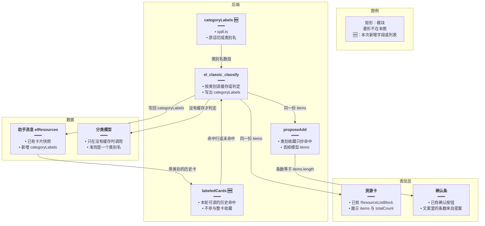
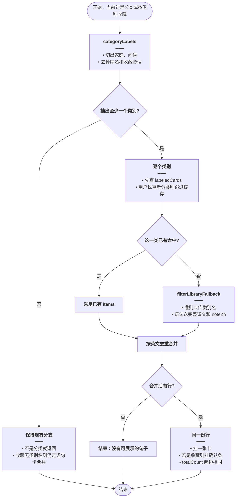
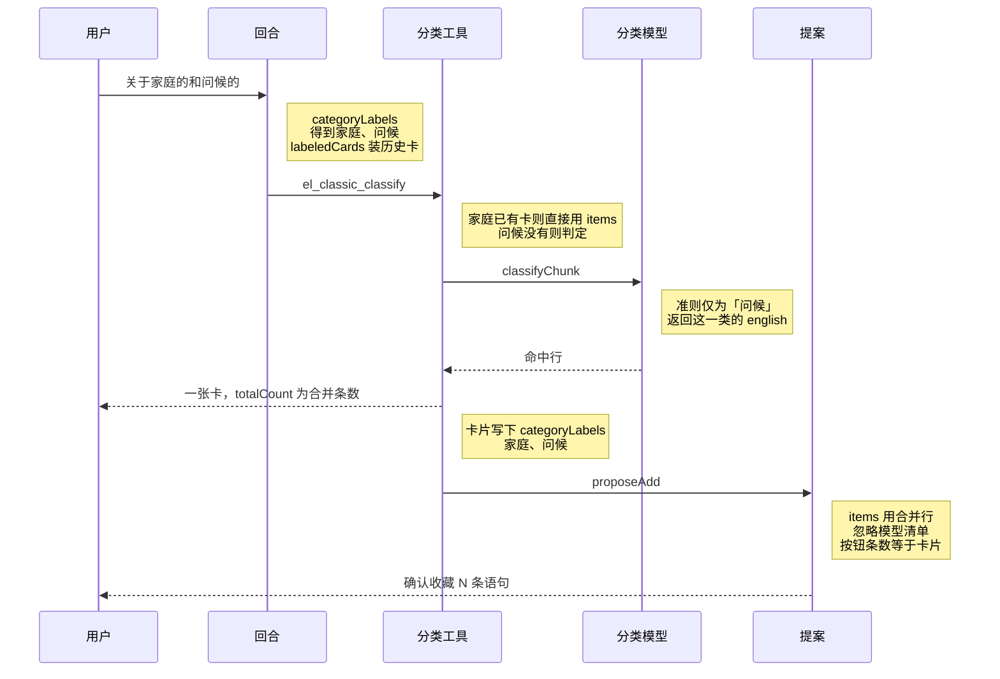
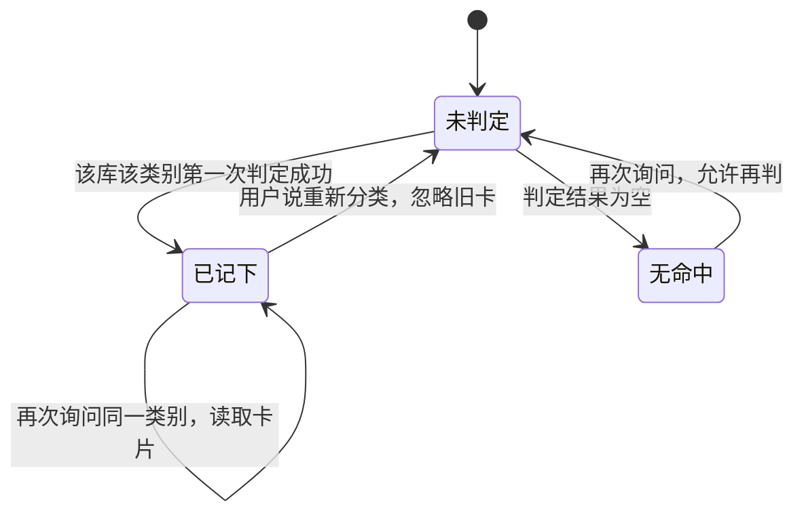

# 分类命中前后一致 — 实现思路

> **状态**：规划（未实现）  
> **日期**：2026-10-29  
> **需求摘要**：同一本库、同一个类别，再次询问或拿去收藏时，句子集合要和卡片一致，不能一次 9 条、一次 12 条，也不能同一类「问候」一会儿 6 条、一会儿 3 条。  
> **一句话方案（预告）**：从原话抽出类别名，按「库 + 类别」只判一次并记在卡片上；多个类别分开判再合并。确认条只抄这份命中，不采用主模型自己写的句子清单。

## 延伸阅读

- [续问沿用原库](./续问沿用原库.md)（没点库名时沿用上一本；本文不改选库）
- [语句整类一次收藏](./语句整类一次收藏.md)（没点类别、只要收藏卡片上的句子；本文管的是点了类别名的那条路）
- [语句库分类列出](./语句库分类列出.md)（`el_classic_classify` 与单词分类分开）
- [分类截断续批](./分类截断续批.md)（大批截断后续批；小学三年级上册约五十条，装得进一批，不是这次条数跳动的原因）

---

## 0. 读本文你将得到什么

- 提案写 9 条、卡片却是 12 条，以及「问候」再问变成另一批句子，是两条数据各写各的，加上分类每次都用整句原话重判。
- 选定做法：类别名做键，命中记在卡片上，确认条抄同一份命中。
- 改动在后端分类和收藏提案；前端卡片组件不用改。
- 先做语句库（M1），同一套再套到单词分类（M2）。
- 最大风险是第一次判错会被记住；用户说「重新分类」才允许再判。

---

## 1. 需求与边界

### 1.1 用户故事

| 角色 | 场景 | 行为 | 期望结果 |
|------|------|------|----------|
| 学习者 | 已经看过「小学三年级上册」里关于家庭、关于问候的句子 | 说「帮我将关于家庭的和问候的进行收藏」 | 确认条的条数、句子和下面那张卡是同一份；不把「生日快乐」这类没点到的类别收进去 |
| 学习者 | 刚查过家庭，接着说「我还需要关于问候的」 | 再查一次问候 | 和上一次「问候」的命中相同；正文不要说这些句子已经在家庭那张卡里 |
| 学习者 | 同一类连续问了两遍 | 第二遍不再换一批句子 | 直接用已记下的命中，不再叫分类模型 |

### 1.2 范围

| 在范围内 | 不在范围内（非目标） |
|----------|----------------------|
| 语句分类、单词分类的命中稳定 | 改收藏确认的 HTTP 提交，不另开一轮对话 |
| 一句里多个类别拆开再合并 | 恢复 40 / 400 / 2000 条数顶，或提高递归上限 |
| 确认条与卡片使用同一份行 | 给分类工具加 `libraryId` 参数 |
| 用户明确说「重新分类」时允许再判 | 用投票打三次模型来压随机性 |

### 1.3 约束与依赖

- 分类模型仍是硅基 `Qwen/Qwen3.6-35B-A3B`，`decideLlmOptions` 里 `temperature` 已经是 0。
- 选库仍走 [续问沿用原库](./续问沿用原库.md)：当前句点名优先，否则沿用上一本。
- 没点类别、只说「将这些进行收藏」时，仍走语句卡合并，不把历史上所有分类卡都收进收藏。
- 小学三年级上册这一次大约五十条，低于 `CATEGORY_MAX_ROWS`（600）和 `CATEGORY_BATCH_CHARS`（48000），分批游标不是这次丢句的原因。

---

## 2. 背景

截图里同一次回答出现了两份句子。用户说「帮我将关于家庭的和问候的进行收藏」。正文和确认按钮写的是 9 条（家庭 3 条 + 问候 6 条）。下面的「小学三年级上册」卡片写的是 12 条，看得见的第 12 条是 `Happy birthday!`，它不在那 9 条里。确认按钮的文案是「确认收藏 9 条语句」，所以即将写入的是 9 条，不是卡片上的 12 条。

另一次对话里，先问家庭，卡片是 3 条（奶奶、家庭、弟弟）。接着问「我还需要关于问候的」，卡片变成另外 3 条（Nice to meet you.、Nice to meet you too.、Good morning, Mike!）。这 3 条对不上收藏提案里的 6 条问候（少了 Hello! I'm Mike Black.、Hi! My name is Wu Binbin.、Good morning! Come in.）。正文还说这 3 条「已经包含在刚才的卡片中」，刚才那张卡是家庭，并没有这些问候。

不处理的话，用户会按卡片理解范围，却按另一份清单点确认；同一类再问，又得到第三份句子。

硬约束：不能把「这些进行收藏」的整卡合并改掉；不能为了稳定去扫所有库；分类仍只看当前句里的类别，不把上一句的「家庭」拼进这一句的「问候」。

---

## 3. 现状与复用

| 能力 | 仓库中已有 | 本需求中的用法 |
|------|------------|----------------|
| 语句整库分类 | `el_classic_classify`，`apps/backend/src/services/agent/tools/english/domain-tools.ts` | 扩展：先取类别名，再按类别取命中 |
| 单词整库分类 | 同文件 `el_vocab_classify` | M2 用同一套键 |
| 把一批行交给分类模型 | `classifyChunk` / `buildCategoryProposal`，`category-propose.ts` | 复用。送进模型的文本从「整句原话」改成「一个类别名」 |
| 分类温度 | `decideLlmOptions`，`apps/backend/src/utils/glm-decide.ts`，`temperature: 0` | 直接复用，不再调温度 |
| 进行中的分类 | `elSurface.categoryJobs`，键是 `` `${kind}:${libraryId}` `` | 键加上类别名，避免同一轮「家庭」和「问候」共用一次判定 |
| 语句卡合并收藏 | `rowsFromQuoteCards`，`domain-tools.ts` | 点了类别名时不走「把看到的卡全部收进来」；只收本次类别的命中 |
| 主模型自带的 items | `collectProposeBodies`，`propose-bodies.ts` | 类别收藏时不采用。这是 9 条的来源 |
| 上一张助手消息上的语句卡 | `agent.service.ts` 回合开始时写入 `libraryLists`，并标 `fromPrior` | 扩展成扫本会话已有分类卡，但只用于按类别取回命中，不全部拿去收藏 |
| 卡片快照 | `ElResourceListPayload`，`artifact.store.ts`；消息上的 `elResources` | 增加 `categoryLabels`，命中跟消息一起留下 |
| 释义截断 | `GLOSS_CHARS = 40`，`category-propose.ts` 的 `rowLine` | 语句这一批改送完整 `translationZh` 和 `noteZh`。单词仍截 40 字 |

**调研结论**：条数对不上，是因为确认条和卡片不是同一份行。9 条来自主模型写进 `propose_add` 的 `items`（按钮文案用 `items.length`）。12 条来自 `filterLibraryFallback` 把用户整句交给 `classifyChunk` 之后的命中，其中包含生日句。同一类前后不一致，是因为每次分类的用户文本不同（「有关家庭的所有语句」/「我还需要关于问候的」/「关于家庭的和问候的」），而且 `categoryJobs` 只在本轮按库 id 去重，下一轮必定再叫一次模型。温度已经是 0，同一输入仍可能因模型服务不完全稳定而有出入，所以不能只靠温度。五十条的库不会走到截断续批。

---

## 4. 方案比对与最终方案

### 4.1 候选方案

#### 方案 A：只约束主模型原文（复用现有提示）

- **做法**：在 `ENGLISH_LEARNING_SYSTEM_APPEND` 里写明「句子只以卡片为准，不要另列清单，不要说上一张卡已经包含这一类」。`propose_add` 仍在没有语句卡时接受模型传来的 `items`。分类仍把 `surface.userText` 整句送给 `classifyChunk`。
- **能工作的原因**：截图 2 里「已经包含在刚才的卡片中」是主模型编的，提示能压住这类句子。模型如果先等卡片再提案，确认条有机会抄到卡片。
- **主要代价**：模型仍可能先提案再分类。先提案时 `libraryLists` 里还没有这张卡，`rowsFromQuoteCards` 为空，就会落到 `collectProposeBodies`，9 条照样写入提案。下一轮「问候」仍用新原话重判，3 条和 6 条还会再出现。

#### 方案 B：按整句原文缓存分类结果（扩展 `categoryJobs`）

- **做法**：缓存键改成 `` `${kind}:${libraryId}:${userText}` ``。同一轮、甚至进程内，完全相同的原话不再叫模型。命中仍由当次 `filterLibraryFallback` 产生。收藏仍优先语句卡，没有卡就用模型 `items`。
- **能工作的原因**：用户把同一句话再发一次，会得到同一批行。实现只改键，不动选库和提案形状。
- **主要代价**：「我还需要关于问候的」和「关于家庭的和问候的」不是同一串文本，缓存对不上，问候仍会是两批句子。一整句里的「家庭的和问候的」仍是一次判定，生日句还会混进 12 条里。确认条和卡片仍可能各写各的。

#### 方案 C：类别名做键，命中只保留一份（扩展卡片快照和提案）

- **做法**：从当前句抽出类别名（家庭、问候）。每个类别单独判定或读取已记下的命中，多个类别按英文句子去重后合并。卡片和确认条都用这份合并结果。主模型传来的 `items` 在抽到类别名时丢弃。命中和类别名写在 `ElResourceListPayload.categoryLabels` 上，随消息快照留下。下一轮同一库、同一类别名直接读历史卡片，不再调用 `classifyChunk`。
- **能工作的原因**：两次「问候」的键都是 `classic:<库 id>:问候`，和原话怎么措辞无关。收藏按钮的条数等于卡片 `totalCount`。生日句不会因为整句里同时出现「家庭」和「问候」就被一次宽松判定收进来；它只有在单独的「家庭」或「问候」判定里命中才会出现。
- **主要代价**：第一次判错会被以后的查询沿用，直到用户说「重新分类」。类别名要靠原话里的「关于 / 有关 / 相关」切出来，切错就会查错类。

### 4.2 比对

| 维度 | 方案 A | 方案 B | 方案 C |
|------|--------|--------|--------|
| 正确性（失败路径、边界、数据是否会错） | 压不住「先提案、后出卡」。9 条和 12 条仍会同时出现 | 只有原话逐字相同时稳定。类别相同、句子不同时仍然两批结果 | 同一库、同一类别名只有一份命中。确认条抄这份命中，条数和卡片相同 |
| 复用 / 与现状契合 | 只改 `agent.prompt.ts` | 复用 `categoryJobs` 和 `classifyChunk` | 复用 `classifyChunk`、消息上的 `elResources`、`rowsFromQuoteCards` 的去重 |
| 改动面（要动哪些路径） | 一个提示字符串 | `domain-tools.ts` 的任务键 | `spill.ts` 抽类别、`artifact.store.ts` 加字段、`domain-tools.ts` 的分类与提案、`agent.service.ts` 装入历史分类卡 |
| 复杂度（新概念、新状态、新依赖） | 无新状态 | 键变长，仍是本轮或进程内 Map | 卡片上多一个 `categoryLabels`。不建新表，不加模型 |
| 体验（延迟、步骤数、失败时用户看到什么） | 每次仍等一次分类。正文可能仍和卡片不一致 | 相同原话变快。换一种说法仍要等分类，而且结果可能换一批 | 第二次问同一类不再等分类。第一次仍等。抽不到类别名时保持现在的歧义提示 |
| 风险（迁移、互斥、并发、回滚） | 几乎无迁移风险，也修不住数据 | 缓存键含整句，内存里留下用户原话 | 旧消息没有 `categoryLabels`，读到就当没有缓存，重新判一次并写上。不会把旧卡全部拿去收藏 |
| 可维护性（以后改一处还是改多处） | 提示和工具结果两处都会漂 | 单词、语句两处键都要记得拼上原文 | 抽类别、读缓存、写提案三处，但单词和语句共用抽类别和缓存形状 |

### 4.3 综合考量

这次权重大的是正确性，其次是和现有卡片快照的契合。用户已经同时看到两份句子，只改提示或只缓存整句，都留着「另一份清单」这条路。

选定方案 C。它让卡片成为唯一的命中来源，确认条不能再另写一套。

放弃方案 A 的优点：改动只有一段提示，上线快。这段提示挡不住工具已经收下的 9 条 `items`。放弃方案 B 的优点：相同原话不必改数据结构就能复现。用户换一种说法问同一类，正是截图里发生的事，整句缓存对不上。

### 4.4 最终方案

#### 背景

确认条的 9 条是主模型放进 `propose_add` 的 `items`，按钮用这个长度写「确认收藏 9 条语句」。卡片的 12 条是 `filterLibraryFallback` 用整句「关于家庭的和问候的进行收藏」叫 `classifyChunk` 得到的，里面有不属于这两类的生日句。问候再问一次时，原话变成「我还需要关于问候的」，模型又判了一批，只剩 3 条。`categoryJobs` 的键不含类别，下一轮是空的，一定会重判。温度已经是 0，不能靠再把温度调低来让不同原话得到同一批句子。

#### 具体思路

1. 抽类别放在 `spill.ts`，分类和收藏都调用它。选库逻辑不改。
2. 数据从原话里的类别名出发，到「这一库、这一类」的句子行，再同时进入卡片和提案。
3. 命中放在消息快照的卡片上（`categoryLabels` + 已有的 `items`）。不放新表，也不只放本轮 `categoryJobs`：本轮 Map 到下一句就没了，对不上「再问一次」。
4. 抽不到类别名时，分类仍返回现在的「没有唯一库 / 这句不是分类」，不猜。用户说「重新分类」时，这一次不读历史卡片，判完用新结果盖住同一键。历史卡片不会整批进入「将这些进行收藏」。

#### 实现方案

**一句话**：从原话抽出类别名，按「库 + 类别」只判一次并记在卡片上；多个类别分开判再合并。确认条只抄这份命中，不采用主模型自己写的句子清单。

| 步骤 | 谁 | 做什么 | 输入 → 输出 |
|------|----|--------|-------------|
| 1 | `categoryLabels`（`spill.ts`） | 从当前句切出类别名 | 「关于家庭的和问候的」→ `['家庭','问候']` |
| 2 | 回合开始（`agent.service.ts`） | 把本会话里带 `categoryLabels` 的分类卡装进 `labeledCards` | 历史 `elResources` → 只供按类别读取的列表 |
| 3 | `el_classic_classify` / `el_vocab_classify` | 每个类别先读 `labeledCards`，没有再调用 `filterLibraryFallback`，准则只用类别名 | 库 id + 类别名 → 一份命中，写入 `categoryLabels` |
| 4 | `proposeAdd` 的语句分支 | 抽到类别名时，用步骤 3 的合并结果挂确认条 | 命中行 → `确认收藏 N 条语句`，N 等于卡片条数 |
| 5 | 主模型正文 | 只报条数，不另列句子 | 提示里写明清单以卡片为准 |

#### 选定原因

1. **正确性**：确认条和卡片共用一份行，所以 9 和 12 不会同时成为「要收藏的集合」。牺牲：主模型临时补的一句如果没出现在命中里，不会进确认条。
2. **复用**：命中仍由 `classifyChunk` 产生，快照仍写在现有 `elResources`。牺牲：旧快照没有类别名，第一次会再判一遍。
3. **体验**：同一类的第二次查询不再打模型。牺牲：第一次判错会一直被沿用，直到「重新分类」。
4. **风险**：不新增表，回滚只是不再读 `categoryLabels`。牺牲：换一台机器后，只要消息还在，命中还在；消息删了就要重判。这和现在的卡片快照一样。
5. **可维护性**：单词和语句共用抽类别和卡片字段。牺牲：两处分类工具都要改键，不能只改语句。

#### 优势

- 相对方案 A：服务器不再收下与卡片不一致的 `items`，不依赖模型是否遵守提示。
- 相对方案 B：类别名相同即命中，不必要求用户把原话再说一遍；「家庭和问候」会拆成两次判定再合并，而不是用整句宽松地选出 12 条。

#### 怎么实现

1. `categoryLabels` 用「关于 / 有关 / 相关」后面的片段，再按「和 / 与 / 、 / 以及」切开，去掉结尾的「的」。不要把库名、收藏、找出、分好类送进分类模型。
2. 回合开始除了现有的上一张语句卡（给「将这些进行收藏」用），再扫本会话全部分类卡，装进 `labeledCards`。这张列表不参与整库兜底，也不参与「没点类别就把卡上所有句子收藏」。
3. 分类工具对每个类别：`labeledCards` 里已有同一 `libraryId` 且 `categoryLabels` 包含该名，并且用户没说「重新分类」，就直接用那些 `items`。否则 `filterLibraryFallback` 的准则改成这一个类别名。语句行送完整译文和 `noteZh`。任务键改为 `` `${kind}:${libraryId}:${label}` ``。
4. 多个类别的命中按英文小写去重，合成一张卡（或单词一张卡），`categoryLabels` 写下全部类别名，`totalCount` 用合并后的长度。
5. `proposeAdd` 在 `categoryLabels(userText)` 非空且是收藏时，只用这份合并行建提案。行数为 0 就返回没有可收藏的句子，不调用 `collectProposeBodies`。
6. 系统提示加一句：分类结果以卡片条数为准，不要另写句子清单，不要声称新结果已经在上一张其他类别的卡里。

### 4.5 其他关键决策

缓存放在哪里，会改变状态归哪一层。

#### 方案 A：只放本轮 `categoryJobs`

- **做法**：键改成库 id + 类别名，Map 仍挂在 `ElListSurface`。下一句新的 surface 是空的。
- **能工作的原因**：同一轮里「家庭」和「问候」不会共用一次判定。
- **主要代价**：截图里的第二次提问是新的一轮，Map 已经丢了，还是会重判。

#### 方案 B：写在消息卡片上

- **做法**：`ElResourceListPayload` 增加 `categoryLabels?: string[]`。行已经在 `items` 里。下一轮从历史消息读出来放进 `labeledCards`。
- **能工作的原因**：消息本来就会存 `elResources`。第二次问「问候」读到上一张问候卡的行。
- **主要代价**：要扫多张历史消息，不能只看上一张助手消息。只看上一张的话，中间插了别的回答，更早的「家庭」卡就找不到。

#### 比对

| 维度 | 只放本轮 Map | 写在消息卡片上 |
|------|----------------|----------------|
| 正确性 | 跨轮仍会重判，问候仍可能从 6 条变成 3 条 | 跨轮读到同一份 `items` |
| 复用 | 复用 `categoryJobs` | 复用已落库的 `elResources` |
| 改动面 | `domain-tools.ts` | 再加 `artifact.store.ts` 的类型和 `agent.service.ts` 的装载 |
| 复杂度 | 无新字段 | 一个可选字段 |
| 体验 | 每轮第一次仍等模型，下一轮也等 | 下一轮同一类不再等模型 |
| 风险 | 无迁移 | 旧卡没有该字段时重判一次 |
| 可维护性 | 进程一重启，本轮之外的稳定也没了 | 和卡片存亡一致，不另养一份缓存 |

#### 综合考量

跨轮一致是这次的主要现象，本轮 Map 留不住它。消息卡片已经是命中的持久副本，再写一份数据库会和快照分叉。选定写在消息卡片上，本轮 Map 只负责同一轮并发时不要打两次模型。放弃「只改 Map」少改一个类型的优点，因为少改的那一版修不住第二轮。

#### 最终方案（缓存位置）

**背景**：`categoryJobs` 活在一次 `runChatStream` 的 `elSurface` 上，流结束就丢。历史卡片已经随助手消息保存。

**具体思路**：持久命中放在卡片字段上；本轮 Map 只做同键去重。`labeledCards` 不并进 `libraryLists`，避免「将这些进行收藏」把以前每一类都收进去。

**实现方案**：`categoryLabels` 存在 `ElResourceListPayload`。回合开始扫描该会话助手消息里 `source === 'library'` 且 `filtered` 且带 `categoryLabels` 的卡，放入 `elSurface.labeledCards`。

**选定原因**：正确性靠跨轮还能读到行。牺牲一次历史扫描。体验上第二次不再调用分类模型。

**优势**：相对只放 Map，第二轮「关于问候」不会再打出另一批 3 条。

**怎么实现**：见 §9.2 的读取和 §9.3 的字段。本轮任务键与持久字段用同一个 `` `${libraryId}:${label}` `` 对应关系。

---

## 5. 架构图



**图内方法说明**：

| 方法 | 功能 |
|------|------|
| `categoryLabels(userText)` | 从当前句切出类别名。分类和收藏共用，避免一边用整句、一边用模型清单 |
| `labeledCards` | 回合开始从历史消息装入的分类卡。只按库 id 和类别名查找，不进入收藏合并 |
| `el_classic_classify` | 对每个类别名读取缓存或调用分类；把合并后的行挂成卡片并写下 `categoryLabels`。单词分类做同一件事 |
| `proposeAdd` | 当前句能抽出类别名时，用刚得到的命中行创建收藏提案，不读取模型传来的 `items` |
| `classifyChunk` | 仅缓存未命中时调用。输入里的准则是单个类别名，不是整句用户原话 |

**读图要点**：

- 卡片和确认条都从同一次合并结果往下走，中间没有主模型的第二份清单。
- `labeledCards` 和现有的 `libraryLists` 分开，历史分类卡不会在「将这些进行收藏」时被整卡收走。
- 分类模型只在这个库、这个类别还没有卡片时出现。

---

## 6. 主流程图



**图内方法说明**：

| 方法 | 功能 |
|------|------|
| `categoryLabels(userText)` | 判断这句是不是在点类别。抽空则不进入新路径 |
| `filterLibraryFallback(...)` | 缓存没有这一类时，只按该类别名筛这一本库，返回带 `filtered` 的行 |
| 合并去重 | 把多个类别的 `english` 按小写并成一份，避免同一句既算家庭又算问候时出现两次 |

**读图要点**：

- 「重新分类」走判定分支，不走「已有命中」。
- 收藏和只查询在合并之后才分叉：查询只挂卡，收藏同时挂确认条，行是同一份。
- 抽不到类别名时不猜，避免把收藏套话送进分类模型。

---

## 7. 核心时序图



**图内方法说明**：

| 方法 | 功能 |
|------|------|
| `categoryLabels` | 回合里把原话变成类别名列表，供分类和提案共用 |
| `el_classic_classify` | 按类别读历史或调用模型，挂出一张合并卡 |
| `classifyChunk` | 只对还没有缓存的那个类别调用一次 |
| `proposeAdd` | 用合并行写入收藏提案。模型若另传 9 条 items，不进入提案 |

**读图要点**：

- 用户只看到一张卡和一个条数，条数来自合并后的行，不来自主模型正文里的分组标题。
- 分类模型不是每个类别都调用；已经记在历史卡上的类别不再出现在这条时序里。
- 提案在卡片行确定之后创建，避免先收下 9 条、后画出 12 条。

---

## 8. 状态机



**图内方法说明**：

| 方法 | 功能 |
|------|------|
| `categoryLabels` 含「重新分类」 | 这句话不读 `labeledCards`，判定结束后用新行覆盖这一键的展示 |
| 读取历史卡 | 同一 `libraryId` 且 `categoryLabels` 包含该类名时停留在「已记下」，不调用模型 |

无命中不写入可复用卡片，避免一次空结果把以后的查询钉死。

---

## 9. 具体实现（主链路代码）

### 9.1 模块一览

| 模块 | 职责 | 新增/改动 | 预估路径 |
|------|------|-----------|----------|
| 抽类别 | 原话 → 类别名 | 新增函数 | `apps/backend/src/services/agent/tools/english/spill.ts` |
| 卡片类型 | 记下这份命中属于哪些类别 | 扩展字段 | `apps/backend/src/services/agent/tools/english/artifact.store.ts` |
| 装载历史 | 供按类别读取，不供整卡收藏 | 扩展回合开始 | `apps/backend/src/services/agent/agent.service.ts` |
| 分类与提案 | 分类别判定、合并、确认条抄命中 | 扩展 | `apps/backend/src/services/agent/tools/english/domain-tools.ts` |
| 语句行文本 | 分类时看到完整译文和备注 | 扩展 `rowLine` 的语句分支 | `apps/backend/src/services/agent/tools/english/category-propose.ts` |
| 提示 | 禁止另写一份句子清单 | 加一句 | `apps/backend/src/services/agent/agent.prompt.ts` |

### 9.2 主链路实现

```typescript
// 对应 §4.4 步骤 1。切出来的名字要能当缓存键，库名和套话不能算成一类
export function categoryLabels(userText: string): string[] {
	// 重新分类由调用方单独判断；这里只负责名字，避免一个函数同时改缓存政策
	const labels: string[] = [];
	// 同一句里「家庭和问候」只能各留下一次，后面的合并才不会重复判定
	const seen = new Set<string>();
	// 非贪婪吃到第一个「的」，「有关家庭的所有语句」只留下「家庭」
	const marked = userText.matchAll(/(?:关于|有关|相关)(.+?)的/gu);
	// 一句里可以有多处「关于」，家庭和问候都要留下
	for (const match of marked) {
		// 片段里可能还有「和」，要拆开，不能把「家庭的和问候」当成一个类别名
		const parts = (match[1] ?? '').split(/和|与|、|以及/u);
		// 每个片段单独收成一个类别名
		for (const part of parts) {
			// 去掉空白和残留的「的」，键才能在两轮之间对上
			const label = part.replace(/的/gu, '').trim();
			// 空串和过长片段多半是没切干净的整句，不当作类别
			if (label.length < 1 || label.length > 8 || seen.has(label)) continue;
			// 先占位，同一句后面再出现同一个名字就跳过
			seen.add(label);
			// 按出现顺序保留，合并时家庭仍在问候前面
			labels.push(label);
		}
	}
	// 按原话顺序返回，调用方据此逐类查找，不再把整句送进模型
	return labels;
}
```

```typescript
// 对应 §4.4 步骤 3 和 §4.5。同一库、同一类别已有卡片就不再调用模型
function cachedCategoryItems(
	cards: ElResourceListPayload[],
	libraryId: string,
	label: string,
): Record<string, unknown>[] | null {
	// 从新到旧找，同一类若曾经判过两次，以最近一张为准，不再折中
	for (let i = cards.length - 1; i >= 0; i -= 1) {
		// 新卡在数组末尾，先看它，避免更早一次判错的结果盖住最近一次
		const card = cards[i];
		// 别的库的句子不能冒充这一本库的类别
		if (card.libraryId !== libraryId) continue;
		// 整库卡没有类别标记，收进来会把几十条都当成「问候」
		if (!card.filtered || !card.categoryLabels?.includes(label)) continue;
		// 快照里偶发的空行丢掉，免得确认条数和看得见的句子不一致
		const items = (card.items ?? []).filter(
			(row): row is Record<string, unknown> =>
				!!row && typeof row === 'object' && !Array.isArray(row),
		);
		return items;
	}
	// 没有历史卡时返回空，调用方才会去判定，而不是把「没查过」当成「这一类是空的」
	return null;
}
```

```typescript
// 对应 §4.4 步骤 4。点了类别名时，确认条的行必须就是卡片的行
async function proposeCategoryQuotes(
	userText: string,
	labeledCards: ElResourceListPayload[],
	libraryId: string,
): Promise<Record<string, unknown>[]> {
	// 没写出类别就返回空，调用方继续走「将这些进行收藏」的原合并，不在这里猜
	const labels = categoryLabels(userText);
	// 空名单表示这句不是按类别收藏，不能在这里造出一份句子
	if (!labels.length) return [];
	// 按类别顺序叠放，去重前先收齐，避免边收边丢时打乱类别顺序
	const rows: Record<string, unknown>[] = [];
	// 每个类别只取自己的命中，不把同一张历史卡上的其他类拼进来
	for (const label of labels) {
		// 缓存未命中用空数组，这一类不贡献行，也不改去读模型传来的 items
		const hit = cachedCategoryItems(labeledCards, libraryId, label) ?? [];
		rows.push(...hit);
	}
	// 一句同时落在两类里只收藏一次，条数才不会比卡片多
	return dedupeEnglish(rows);
}
```

### 9.3 数据模型

| 字段/实体 | 来源 | 存储 | 说明 |
|-----------|------|------|------|
| `categoryLabels` | `categoryLabels(userText)` 的结果 | 消息 `elResources` 与 artifact | 这张卡的行是哪些类别判出来的。旧卡没有此字段 |
| `labeledCards` | 历史消息里带 `categoryLabels` 的库卡 | 本轮内存，不落新表 | 只供查找。不放进 `libraryLists` |
| `categoryJobs` 的键 | `` `${kind}:${libraryId}:${label}` `` | 本轮内存 | 同一轮两个类别不会共用一次判定 |
| 分类准则 | 单个类别名 | 只出现在当次模型输入 | 不再传入「进行收藏」「分好类给出来」 |

语句送入分类模型的一行改为 `english | 完整译文 | noteZh`。单词仍用现有 40 字释义，避免大词库把批次撑满。`CATEGORY_MAX_ROWS` 和 `CATEGORY_BATCH_CHARS` 不改。

---

## 10. 分阶段实现步骤

| 阶段 | 目标 | 交付物 | 依赖 |
|------|------|--------|------|
| M1 | 语句：同一类同一份命中，收藏条数等于卡片 | 抽类别、历史卡查找、语句分类与提案 | 现有 `el_classic_classify` |
| M2 | 单词走同一套键和字段 | `el_vocab_classify` 与单词收藏不另写清单 | M1 的字段和 `categoryLabels` |

### M1

- [ ] `spill.ts` 增加 `categoryLabels`，并用「关于家庭的和问候的」「我还需要关于问候的」做一次可运行断言：分别得到 `['家庭','问候']` 和 `['问候']`。
- [ ] `ElResourceListPayload` 增加可选 `categoryLabels`。`ElListSurface` 增加 `labeledCards`。回合开始扫本会话助手消息装入，不写入 `libraryLists`。
- [ ] `el_classic_classify` 按类别读取或判定。判定准则只用类别名。语句 `rowLine` 带上完整译文和 `noteZh`。任务键含类别名。合并后一张卡，`totalCount` 为合并长度。
- [ ] 当前句能抽出类别名时，`proposeAdd` 只用这份合并行。不用 `collectProposeBodies`。没抽出类别名时，保留现在的语句卡合并。
- [ ] 原话含「重新分类」时不读 `labeledCards`。
- [ ] 提示写明不要另列句子，不要把这一类说成已经在另一类的卡里。

### M2

- [ ] `el_vocab_classify` 使用同一 `categoryLabels`、`labeledCards` 和带类别名的任务键。
- [ ] 单词收藏在抽到类别名时同样只抄命中行。单词释义仍截 40 字。

---

## 11. 风险、边界与待确认

| 项 | 等级 | 说明 | 缓解 |
|----|------|------|------|
| 第一次判错被记住 | 中 | 缓存让错误稳定下来 | 「重新分类」跳过缓存；空结果不写入可复用卡 |
| 类别名切错 | 中 | 「关于……的」切得太宽会变成错误的键 | 名字长于 8 个字就丢弃；断言覆盖截图里的两句 |
| 历史卡被拿去收藏 | 高 | 若把 `labeledCards` 推进 `libraryLists`，「将这些进行收藏」会收进以前每一类 | 两个列表分开。M1 用断言保证收藏合并函数读不到 `labeledCards` |
| 旧消息没有字段 | 低 | 上线前的卡无法命中缓存 | 当作没有缓存，判一次并写下字段 |
| 主模型仍写 9 条正文 | 低 | 用户仍可能看到文字和卡片不一致 | 确认条和卡片已是同一份；提示禁止另列。正文与卡片不一致时以卡片和按钮为准 |

**待确认**：

- [ ] 小学三年级上册里 `Happy birthday!` 的译文是否含「家庭」或「问候」。验证方式：看该行的 `translationZh` 和 `noteZh`。若不含，它只是整句混合判定的误收，拆开类别后不应再出现。若含，单独的「家庭」判定仍可能收进它，这是分类质量，不是两份清单。

---

## 12. 验收清单

| # | 用例 | 步骤 | 期望 |
|---|------|------|------|
| AC1 | 一句两个类别 | 在只有「小学三年级上册」的上下文里说「帮我将关于家庭的和问候的进行收藏」 | 卡片条数等于确认按钮里的 N。按钮不出现另一份更短的清单。`Happy birthday!` 不在结果里，除非单独判「家庭」或「问候」时译文本身命中 |
| AC2 | 同一类再问 | 先问家庭，再问「我还需要关于问候的」，把这句问候再发一次 | 第二次问候不调用分类模型。两张问候卡的英文句子相同。正文不声称它们已经在家庭卡里 |
| AC3 | 和截图里的 6 条对齐 | 第一次问候判定得到一组句子后，换一种说法再问问候，并收藏问候 | 收藏的句子就是这一组，不是主模型另写的 Hello / Hi / Come in，除非它们就在这组命中里 |
| AC4 | 重新分类 | 同一类已经有卡，再说「关于问候的，重新分类」 | 会再调用一次模型，新卡替换这一类的可复用结果 |
| AC5 | 不点类别的收藏 | 卡片已经在上面，只说「将这些进行收藏」 | 仍只收当前语句卡，不会把会话里更早的其他类别一并收进确认条 |
| AC6 | 单词 | 对同一本词汇库连问两次「关于动物的」 | 两次命中相同，第二次不调用分类模型 |

---

## 13. 预估改动面（实现阶段参考）

| 类型 | 路径（预估） |
|------|----------------|
| 前端 | 无。卡片仍读 `items` 和 `totalCount` |
| 后端 | `apps/backend/src/services/agent/tools/english/spill.ts` |
| 后端 | `apps/backend/src/services/agent/tools/english/artifact.store.ts` |
| 后端 | `apps/backend/src/services/agent/tools/english/domain-tools.ts` |
| 后端 | `apps/backend/src/services/agent/tools/english/category-propose.ts` |
| 后端 | `apps/backend/src/services/agent/agent.service.ts` |
| 后端 | `apps/backend/src/services/agent/agent.prompt.ts` |
| 文档（实现后） | `remote-docs/wiki/english/` 下的实现归档，不在本规划里改 |

---

（本文档为规划态实现思路；落地后以源码与 remote-docs wiki 专题为准）
