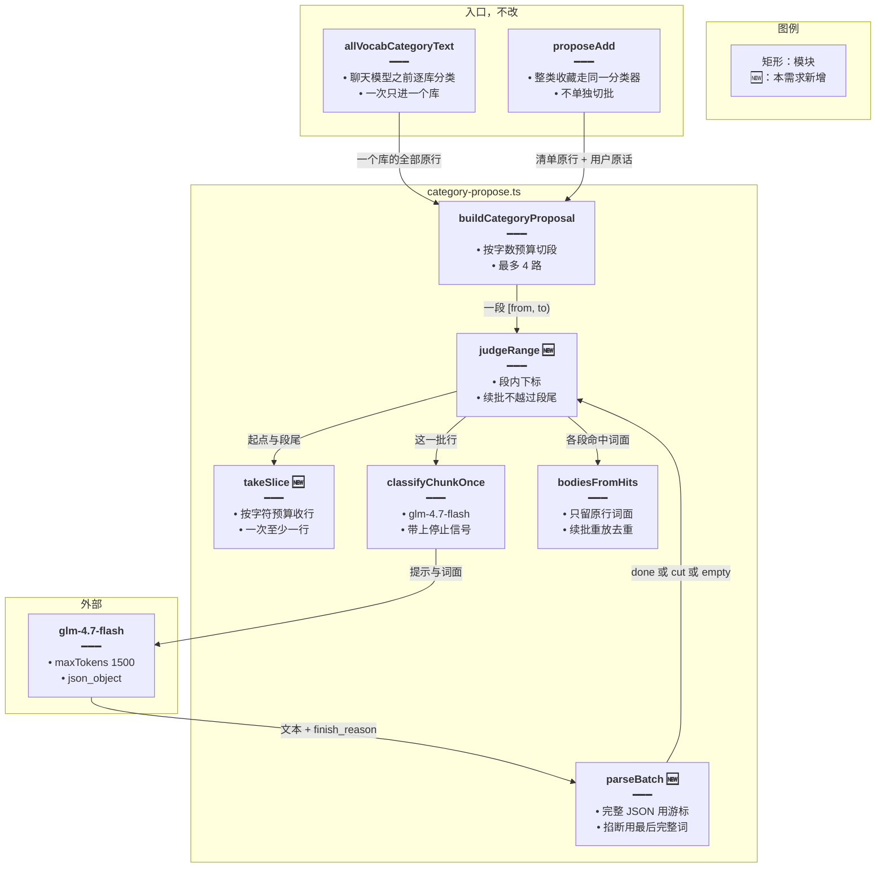
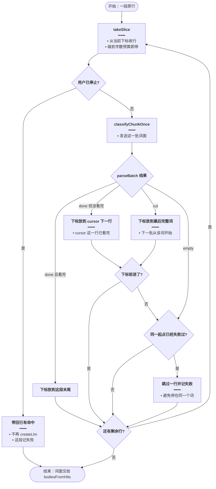
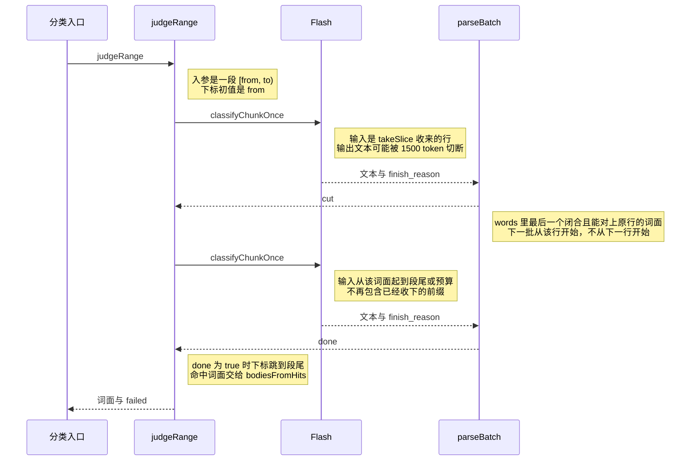
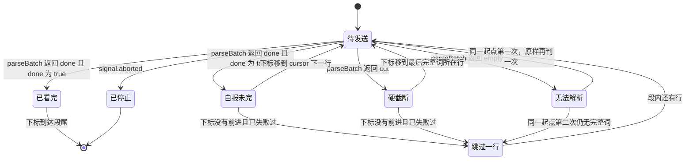

# 分类截断续批 — 实现思路

> **状态**：规划（未实现）
> **日期**：2026-10-28
> **需求摘要**：整库分类不再按固定 80 行切批；一批装不下或输出被掐断时，下一批从被切断的那个词面重新开始，已经读完的命中保留。
> **一句话方案（预告）**：用输入字数预算代替 80 行硬切；模型在还能写完 JSON 时自己报「看到哪」；接口把输出掐断时，服务端取最后一个完整词面，下一批从该词开始。

## 延伸阅读

- [所有词库一次分类.md](./所有词库一次分类.md)（全库入口和固定导语不动；该文写明当时不改 80 行，本文专门改这一刀）
- [同库分类只扫一次.md](./同库分类只扫一次.md)（同库仍只跑一次，续批发生在这一次内部）
- [大批收藏稳落库.md](./大批收藏稳落库.md)（收藏提案走同一个 `buildCategoryProposal`，续批对它同样生效）

---

## 0. 读本文你将得到什么

- 80 行偏少，是调用次数上偏少；只把 80 改大，输出一被 1500 token 掐断，整批命中会丢掉。
- 选定方案：输入按字数预算组批；模型写得完就自报游标；写不完由服务端从最后一个完整词面续批。
- 改动只在 `apps/backend/src/services/agent/tools/english/category-propose.ts`。全库入口、停止信号、卡片形状不动。
- 分三阶段：先认截断，再在一段内续批，最后把固定 80 行换成预算切段。
- 最大风险：下一批起点不往前走时会再次打满 `createLlm`。同一起点第二次仍不前进就跳过一行并记失败。

---

## 1. 需求与边界

### 1.1 用户故事

| 角色 | 场景 | 行为 | 期望结果 |
|------|------|------|----------|
| 已登录用户 | 问「将词汇库中所有与动物相关的单词进行分类，并全部列出来」 | 服务端逐库分类 | 词多的库不再按每 80 行各打一次 `glm-4.7-flash`；命中仍只来自原行 |
| 同一用户 | 某一批命中太多，输出在词面 a 处被掐断 | 服务端组下一批 | 下一批从 a 开始；a 之前已经闭合的命中保留 |
| 同一用户 | 中途点停止 | 停止信号在下一次调用前被看到 | 不再为后面的续批创建模型 |

### 1.2 范围

| 在范围内 | 不在范围内 |
|----------|------------|
| `buildCategoryProposal` 的组批、截断识别、续批起点 | 更换 `glm-4.7-flash`，或把 `CATEGORY_MAX_TOKENS` 从 1500 再加大 |
| 全库分类和整类收藏提案，二者都调用 `buildCategoryProposal` | 全库问法的认定、`decide()`、逐库串行、`categoryJobs` |
| 硬截断时从最后一个完整词面重放 | 用半个 token、前缀猜测（`a` 对上 `apple`）来定起点 |
| 同一起点无法前进时跳过一行 | 恢复已删除的 `spill.spec.ts`；改前端卡片 |

### 1.3 约束与依赖

- 必须复用现有 `lineKey`、`bodiesFromHits`、`retryChunkHit`、`CATEGORY_PARALLEL`、调用方已经传入的 `AbortSignal`。
- 命中词面仍然必须出现在本批输入里，分类器编出来的词不能进卡片或提案。
- 续批不能把「下一批仍从 a 开始」打成死循环。这是相对当前日志的硬约束。
- 单库内部最多 4 路同时判断。这个上限写在 `CATEGORY_PARALLEL`，注释说明再慢就按段落提案，而不是加大路数。

---

## 2. 背景

- **谁、在什么场景、卡在哪**：用户要从全部词汇库里分出某一类词。分类在聊天模型之前发生。每个词库先拉全表，再按 80 行切段，每段新建一次 `glm-4.7-flash`（`maxTokens: 1500`、`json_object`）。库大时日志会一直刷 `createLlm`，聊天模型还没创建。
- **现状缺口**：批大小是固定行数，和这一行有多长、这一批会命中多少词无关。输出被 1500 token 切断时，`parseWords` 整段返回 null，整段命中作废，只再判一次同样的 80 行。没有「从切断的词接着看」的起点。
- **不解决会怎样**：把 80 改成更大的固定行数，调用次数下降，但一旦命中名单写不下，丢掉的是更大的一段。让模型在被掐断之后自己说「我停在 a」，做不到：接口停生成时，模型已经没有机会把这句话写进 JSON。
- **硬约束**：不换模型、不加输出 token 上限、不改全库短路和停止信号。续批必须让下标前进，否则就是另一条无限 `createLlm`。

---

## 3. 现状与复用

| 能力 | 仓库中已有 | 本需求中的用法 |
|------|------------|----------------|
| 80 行预切 + 4 路工人 | `apps/backend/src/services/agent/tools/english/category-propose.ts` 的 `CATEGORY_CHUNK`、`buildCategoryProposal` | 扩展：预切改为字数预算；工人改跑 `judgeRange` |
| 一批失败再判一次 | 同文件 `retryChunkHit` | 直接复用：只有「一个完整词都没有」时再判一次。已经能取出完整词面时不把同一大段再打一遍 |
| 词面只认原行 | 同文件 `lineKey`、`bodiesFromHits` | 直接复用：游标和命中都必须对上原行；续批重放的词面由 `bodiesFromHits` 去重 |
| 超时与停止 | 同文件 `classifyChunkOnce` 的 `AbortSignal.any`；`filterLibraryFallback` 把用户停止信号传进来 | 直接复用：每次续批前看 `signal.aborted` |
| 输出是否因 token 上限停住 | `apps/backend/src/services/agent/agent.service.ts` 的 `readFinishReason`（认 `length` / `max_tokens`） | 扩展：分类这条非流式 `invoke` 同样读 `response_metadata.finish_reason`。逻辑与 `readFinishReason` 相同，不把 Agent 流式函数搬过来 |
| 全库在聊天模型之前分类 | `apps/backend/src/services/agent/agent.service.ts` 的 `allVocabCategoryText` | 不改调用顺序。续批仍在这一次 `filterLibraryFallback` 里面 |
| 整类收藏走同一分类器 | `apps/backend/src/services/agent/tools/english/domain-tools.ts` 里 `proposeAdd` 对 `buildCategoryProposal` 的调用 | 直接复用：不单独为收藏再写一套切批 |

**调研结论**：切批和解析都在 `category-propose.ts`。两个调用方只负责把行和原话交进来。游标放在一次 `judgeRange` 的局部下标里，不进 `elSurface`、不进数据库。缺的是「这批有没有被掐断、下一批从哪一行开始」。

---

## 4. 方案比对与最终方案

### 4.1 候选方案

#### 方案 A：维持 80 行硬切（复用现状）

- **做法**：不改 `buildCategoryProposal`。`CATEGORY_CHUNK = 80`，工人对每段调用 `classifyChunk`。JSON 解析失败则 `retryChunkHit` 再打一次同样的 80 行，仍失败则 `failedChunks += 1`，这段没有命中。
- **能工作的原因**：80 行的命中名单多数情况下写得进 1500 token，`parseWords` 能拿到完整 JSON。现有全库出卡和收藏提案都靠这条路径。
- **主要代价**：词数除以 80 就是 `createLlm` 次数。全库分类在 `buildModels` 之前做完，所以聊天模型还没出现，日志里已经全是 `glm-4.7-flash`。

#### 方案 B：只把固定行数加大

- **做法**：把 `CATEGORY_CHUNK` 改成一个更大的常数（例如 400），预切和 4 路工人不动，解析仍是「完整 JSON 才算数」。截断后的重试仍是同一段再打一遍。
- **能工作的原因**：段数变少，命中不多的库几乎一次就能写完 `{"words":[...]}`。调用点还是 `buildCategoryProposal`，两个调用方不用改。
- **主要代价**：动物类在大库里命中一多，400 行的名单比 80 行更容易顶满 1500 token。顶满后整段作废，丢掉的行数是现在的数倍。模型仍然没有机会声明自己停在哪个词。

#### 方案 C：预算组批，写得完自报游标，掐断则从最后完整词续批

- **做法**：仍在 `category-propose.ts`。先按输入字数预算把一个词库切成互不重叠的段，段与段最多 4 路。每一段内串行调用分类。任务要求返回 `{"done":true|false,"cursor":"本批输入里的词面","words":["命中"]}`。JSON 完整且 `done` 为 false 时，下一次从 `cursor` 的下一行开始。`finish_reason` 为 `length` / `max_tokens`，或 JSON 不完整时，从 `words` 里取最后一个已经闭合、并且能在本段输入对上的词面，下一次从该行本身开始。起点两次不前进则跳过一行并记这段失败。
- **能工作的原因**：命中少时，一大段一个完整 JSON 就结束，调用次数下降。命中多时，掐断点之前的闭合词面留下，没看完的尾巴变成下一次的输入，而不是整段重来或整段丢弃。
- **主要代价**：段内不能再并行。分类提示要多两个字段。硬掐断时模型来不及自报，起点靠服务端从残缺 JSON 里抠，可能把最后一个完整词再判一遍。

### 4.2 比对

| 维度 | 方案 A | 方案 B | 方案 C |
|------|--------|--------|--------|
| 正确性（失败路径、边界、数据是否会错） | 截断则整段作废，命中会少；不会把半个词当成起点 | 与 A 相同，丢的段更大 | 闭合命中保留；半个词不当起点；起点不前进就跳过一行。多判的词由 `bodiesFromHits` 去重 |
| 复用 / 与现状契合 | 零改动 | 只改 `CATEGORY_CHUNK` 一个数 | 复用 `lineKey`、`bodiesFromHits`、`retryChunkHit`、4 路上限和停止信号。改的是组批和解析 |
| 改动面（要动哪些路径） | 无 | `category-propose.ts` 一个常数 | 仍是 `category-propose.ts`。两个调用方继续把 `classifyChunk` 当回调 |
| 复杂度（新概念、新状态、新依赖） | 无新状态 | 无新状态 | 段内多一个下标。不下库、不进 `elSurface` |
| 体验（延迟、步骤数、失败时用户看到什么） | 大库在出卡前打很多轮 Flash，聊天模型一直不出现 | 命中少时更快；命中多时更容易整段失败，卡片写「有批未能判断」或直接没有行 | 命中少时次数下降；命中多时多几次续批，但已闭合的词还在。用户停止后不再续 |
| 风险（迁移、互斥、并发、回滚） | 无 | 放大现有的「截断即失败」 | 续批若不下标会无限 `createLlm`。用「同一起点只再试一次」封住。段与段不重叠，4 路不会抢同一行 |
| 可维护性（以后改一处还是改多处） | 此项相同，逻辑仍在一个函数 | 此项相同 | 此项相同。游标规则集中在 `parseBatch` 和 `judgeRange` |

### 4.3 综合考量

权重大的是正确性和调用次数。全库分类发生在聊天模型之前，80 行一轮会把等待全部花在 Flash 上；只加大行数又会在命中多的时候丢更多词。方案 A 的优点是行为已经在线上，截断不会认错起点。方案 B 的优点是改动只有一个常数。这两项都抵不过「掐断就丢掉整段」：用户要的是从切断的词继续，而不是少打几次然后少一截结果。

选定方案 C。放弃 A 的零改动，也放弃 B 的「不引入游标」。模型自报只用于它还能把 JSON 写完的时候；接口硬掐断由服务端处理。这是 C 相对「完全交给模型判断」多出来的半步，不把它算成第四个方案，因为它离开了 C 就没有可运行的掐断路径。

### 4.4 最终方案

#### 背景

固定 80 行让每个词库的 `createLlm` 次数等于行数除以 80，而且这些调用发生在 `buildModels` 之前。80 行能工作，是因为一小段命中通常写得进 1500 token。批一大，输出更容易被掐断；现有 `parseWords` 一失败就整段作废。模型在生成被停掉之后不能再输出「停在 a」。续批起点如果永远是 a，又会变成新的无限创建。

#### 具体思路

1. 模块只动分类器。`buildCategoryProposal` 仍是唯一入口。`allVocabCategoryText`、`filterLibraryFallback`、`proposeAdd` 不改组批。
2. 数据从词库原行进来，命中从 `bodiesFromHits` 出去。中间多一种回复：完整批或硬截断。
3. 游标是 `judgeRange` 的局部下标，跟着这一段的输入走。不放进本轮 `elSurface`，因为下一批只依赖这一段里还没看完的行，别的库和别的段用不到它。
4. 完整 JSON 用模型给的 `cursor`（该行已看完，下一批从下一行开始）。硬截断用最后一个闭合词面（该行可能没写完，下一批从该行开始）。对不上原行的游标不算数。同一起点第二次仍不前进，就跳过一行并让这段 `failed` 为 true。用户停止则立刻返回已有命中。

#### 实现方案

**一句话**：用输入字数预算代替 80 行硬切；模型在还能写完 JSON 时自己报「看到哪」；接口把输出掐断时，服务端取最后一个完整词面，下一批从该词开始。

| 步骤 | 谁 | 做什么 | 输入 → 输出 |
|------|----|--------|-------------|
| 1 | `buildCategoryProposal` | 按字数预算把行切成互不重叠的段，最多 4 路，每路调用 `judgeRange` | 全表行 → 每段 `[from, to)` |
| 2 | `takeSlice` | 从下标起往下收行，直到字数预算或段尾 | 起点、段尾 → 这一次要发给模型的行和下一次的默认终点 |
| 3 | `classifyChunkOnce` | 调 Flash。提示改为要 `done`、`cursor`、`words` | 行文本 → 回复文本 + `finish_reason` |
| 4 | `parseBatch` | 完整 JSON 走游标；掐断或坏 JSON 走 `lastCompleteWord` | 文本、结束原因、本批行 → `done` 或 `cut` 或 `empty` |
| 5 | `judgeRange` | 按解析结果移动下标；不前进则跳过一行 | 段范围 → 命中词面、这段是否失败 |
| 6 | `bodiesFromHits` | 只留原行里有的词面，并去重 | 命中词面 → 卡片或提案行 |

字数预算放在 `category-propose.ts`，与现有 `CATEGORY_CHUNK` 并列，初值 12000 个字符，且一次至少一行。80 这个常数不再参与切批。预算是否要按真实释义长度再调，见 §11。

#### 选定原因

1. **正确性**：硬截断不再整段丢弃，半个词也不当起点。牺牲：最后一个完整词会再判一次。
2. **体验**：命中少的大段只打一次模型，全库分类的 `createLlm` 次数下降。牺牲：命中特别多时一段内仍要续批，不是保证每库只打一次。
3. **风险**：同一起点只允许不前进一次，封住无限创建。牺牲：这一行在两次都失败时不会出现在卡片里，段标题仍可能是「有批未能判断」。
4. **复用**：两个调用方和停止信号不动。牺牲：分类提示和 `classifyChunk` 的返回形状要改，旧的「只返回 words」提示作废。

#### 优势

- 相对方案 A：同样的库不再按行数除以 80 创建模型；输出被掐断时已经闭合的命中还在。
- 相对方案 B：批变大之后，顶满 1500 token 不会把整段命中清掉，下一批从切断的词面继续。

#### 怎么实现

1. `buildCategoryProposal` 用 `takeSlice` 切出互不重叠的段，工人不再按 80 行 `slice`。
2. `classifyChunkOnce` 把 `invoke` 的文本和 `finish_reason` 交给 `parseBatch`，自己不调用 `parseWords`。
3. `parseBatch` 区分写完和掐断。写完且 `done === false` 时，`judgeRange` 把下标放到 `cursor` 的下一行。掐断时下标放到最后一个闭合词面所在行。
4. `judgeRange` 在发模型前看停止信号。下标不前进的第二次把下标加一，并在段结束时带回 `failed: true`。
5. 各段词面仍交给现有的允许集过滤和 `bodiesFromHits`。`failedChunks` 按「段」计数，不按续批次数计数。

### 4.5 其他关键决策

#### 决策一：段内续批，还是整库一个游标

##### 候选

**方案 A：整库一个游标（复用「一次只扫一个库」的串行）**

- **做法**：一个词库只有一个下标，从 0 扫到最后。下一批永远接着上一批，不再预切，也不使用 `CATEGORY_PARALLEL`。
- **能工作的原因**：续批起点只有一处，不会和另一路工人重叠。实现比分段短。
- **主要代价**：`CATEGORY_PARALLEL` 的注释写明几千条串行会把确认条拖到超时。整类收藏走的就是这条分类器。全库分类也会把一个大库的等待拉成单链。

**方案 B：预算切成互不重叠的段，段内串行续批，段间最多 4 路**

- **做法**：先切段，工人各拿一段。续批只移动这段内部的下标，不许越过段尾，也不许读取别的段。
- **能工作的原因**：下一批的词面 a 一定落在本段已经发给模型的那些行里，别的路不会同时发送 a。4 路上限保持不变。
- **主要代价**：切段是按字数预算预估的，不是模型现场决定的。某一段特别容易命中时，只有这一段在续批，其它段不能把空闲的并发借给它。

##### 比对

| 维度 | 整库一个游标 | 段内续批 |
|------|----------------|----------|
| 正确性 | 不会两路处理同一行 | 段不重叠，同样不会两路处理同一行 |
| 复用 | 放弃 `CATEGORY_PARALLEL` | 继续用 4 路上限 |
| 改动面 | `buildCategoryProposal` 删掉工人 | `buildCategoryProposal` 改切段单位 |
| 复杂度 | 只有一个下标 | 每段一个下标，结构与现在的工人相同 |
| 体验 | 大库和收藏提案的等待变成单链 | 多段仍同时进行；续批只拖住自己那段 |
| 风险 | 确认条超时的旧问题回来 | 段界切错时最多多判段尾，不会串段 |
| 可维护性 | 并发和续批分成两种结构 | 并发模型与现在一致，只换切段依据 |

##### 综合考量

正确性两项相同。权重大的是收藏提案已经依赖 4 路，以及全库分类不能把一个大库打成单链。整库游标更简单，但简单换来的是已经写明要避开的串行超时。选定段内续批，放弃「只有一个下标」这件更省事的事。

##### 最终方案

- **背景**：续批要求下一批的起点依赖上一批的回复，固定 80 行那种「先切完再各跑各的」不能直接照搬，但 4 路不能删。
- **具体思路**：段与段之间没有游标传递。游标只活在 `judgeRange` 里。段尾是预切时算好的，续批到段尾为止。
- **实现方案**：`buildCategoryProposal` 先得到 `[from, to)` 列表，再以最多 4 个工人跑 `judgeRange(items, from, to)`。
- **选定原因**：体验上保住 4 路；正确性上段不重叠。牺牲：不能把并发动态借给正在续批的那一段。
- **优势**：相对整库一个游标，大库和收藏提案不必退回单链。
- **怎么实现**：见 §4.4 步骤 1 和 §9.3。工人循环的骨架留在 `buildCategoryProposal`，循环体从「判一段 80 行」换成 `judgeRange`。

---

## 5. 架构图



**图内方法说明**：

| 方法 | 功能 |
|------|------|
| `allVocabCategoryText` | 全库问法在创建聊天模型之前逐库调用分类；本需求不改变它的库顺序和提前返回 |
| `proposeAdd` | 整类收藏或错题在确认前调用 `buildCategoryProposal`；本需求不改提案形状 |
| `buildCategoryProposal` | 把全表切成互不重叠的段，最多 4 路调用 `judgeRange`，再把词面交给 `bodiesFromHits` |
| `judgeRange` | 在一段的 `[from, to)` 内串行续批，移动局部下标，停止或无法前进时返回已有词面 |
| `takeSlice` | 从当前下标向段尾收行，碰到字符预算就停，保证至少一行 |
| `parseBatch` | 完整 JSON 读 `done` 和 `cursor`；输出被掐断时读最后一个闭合词面 |
| `classifyChunkOnce` | 创建一次 Flash 并 `invoke`；停止信号和 8 秒超时合成一个 `AbortSignal` |
| `bodiesFromHits` | 命中词面必须存在于原行，同一词面只留一行 |

**读图要点**：

- 新增的只有段内游标和解析，入口仍是原来的两个调用方。
- 游标不离开 `judgeRange`，所以全库的 `categoryJobs` 和收藏提案的存储都不用加字段。
- Flash 仍是 1500 token。批变大之后，装不下就靠 `parseBatch` 把尾巴留在同一段里，而不是换一个更大的输出上限。

---

## 6. 主流程图



**图内方法说明**：

| 方法 | 功能 |
|------|------|
| `takeSlice` | 按字符预算从当前下标截出下一次要发送的行 |
| `classifyChunkOnce` | 对这批行调用 Flash，带回文本和结束原因 |
| `parseBatch` | 把回复分成看完、没看完、硬截断、无法解析四类 |
| `bodiesFromHits` | 段跑完后只保留能对上原行的词面 |

**读图要点**：

- 模型自报游标和接口硬掐断是两条不同的前进方式：前者跳过已看完的词，后者从被切断的词再开始。
- 下标不前进只允许一次。第二次改为跳过一行，这段不再继续打同一个请求。
- 用户停止不补完剩余行，已经闭合的命中仍然往下交。

---

## 7. 核心时序图



**图内方法说明**：

| 方法 | 功能 |
|------|------|
| `judgeRange` | 持有段内下标，按 `parseBatch` 的结果决定下一次 `classifyChunkOnce` 的起点 |
| `classifyChunkOnce` | 把当前起点到预算或段尾的行发给 Flash |
| `parseBatch` | 第一次返回 `cut` 时给出要重放的词面；第二次返回 `done` 表示这段剩余行已经看完 |
| `bodiesFromHits` | 入口在拿到各段词面后去重并还原原行。时序末步由 `buildCategoryProposal` 调用，不在 `judgeRange` 内写卡片 |

**读图要点**：

- 这是一段里发生截断的主路径：第一次没写完，第二次从切断的词面覆盖到段尾。
- 第二次如果又是 `cut`，`judgeRange` 会再续，直到段尾、停止，或同一起点无法前进。
- 入口不关心游标，只收词面和这段算不算失败。

---

## 8. 状态机



**图内方法说明**：

| 方法 | 功能 |
|------|------|
| `parseBatch` | 状态迁移的唯一依据：完整 JSON、硬截断、或没有可用词面 |
| `judgeRange` | 执行迁移并保存下标；`signal.aborted` 时进入已停止，不再调用 Flash |

**读图要点**：

- 「自报未完」和「硬截断」都会回到待发送，但下标落点不同。
- 「跳过一行」是死循环防护，不是正常的续批路径。
- 已停止不再回到待发送。

---

## 9. 具体实现（主链路代码）

### 9.1 模块一览

| 模块 | 职责 | 新增/改动 | 预估路径 |
|------|------|-----------|----------|
| `takeSlice` / `parseBatch` / `judgeRange` | 预算组批、识别截断、段内移动下标 | 新增 | `apps/backend/src/services/agent/tools/english/category-propose.ts` |
| `classifyChunkOnce` | 返回文本和 `finish_reason`，提示增加 `done` 与 `cursor` | 扩展 | 同上 |
| `buildCategoryProposal` | 按预算切段并调用 `judgeRange` | 扩展 | 同上 |
| `CATEGORY_CHUNK` | 不再用于切批 | 删除使用点 | 同上 |

### 9.2 主链路实现

```typescript
// 对应 §4.4 步骤 4。完整 JSON 与硬掐断分开放，避免把残缺输出整段当成失败
type BatchReply =
	| {
			// done 表示模型把这一次送去的行都看完了，下标可以直接跳到 takeSlice 的终点
			kind: 'done';
			// false 表示只看完 cursor 这一行，下一批必须从它的下一行开始
			done: boolean;
			// 必须是本批输入里的词面。模型编的游标不能用来移动下标
			cursor: string;
			// 这一次已经写完的命中，后面还要经过原行允许集
			words: string[];
	  }
	| {
			// cut 表示输出被 token 上限切断，或 JSON 没有闭合
			kind: 'cut';
			// 切断前已经闭合、并且能在本批输入对上的命中。半个词不在这里
			kept: string[];
			// 下一批从这一行本身开始。它是最后一个闭合词面，不是它的下一行
			cutWord: string;
	  }
	| {
			// empty 表示连一个可用词面都没有，交给 retryChunkHit 再判一次
			kind: 'empty';
	  };

// 对应 §4.4 步骤 4。只认已经写上引号的词面，切断的半个字符串丢弃
function completeWords(text: string, allowed: Set<string>): string[] {
	// 残缺 JSON 不能 JSON.parse。闭合引号里的才是写完的词面
	const found = text.match(/"((?:\\.|[^"\\])*)"/g) ?? [];
	// 按出现顺序收集，最后一个留给续批起点，前面的先收下
	const words: string[] = [];
	for (const token of found) {
		// 去掉两侧引号。词面本身不应含引号，不做转义展开
		const word = token.slice(1, -1).trim().toLowerCase();
		// 字段名 done、cursor、words 不在原行里，不能当成命中或起点
		if (allowed.has(word)) words.push(word);
	}
	return words;
}

// 对应 §4.4 步骤 4。模型只有在 JSON 写完时才可信；length 表示它没机会自己声明停在哪
function parseBatch(
	text: string,
	finish: string | undefined,
	allowed: Set<string>,
): BatchReply {
	// 接口因 token 上限停住时，就算碰巧剩下的括号能解析，也按掐断处理
	const cutOff = finish === 'length' || finish === 'max_tokens';
	// 解析失败时留空，和「文本不是对象」走同一条续批判断
	let raw: unknown;
	// 坏 JSON 是硬掐断的常态，不能让异常冒出去中断这一段
	try {
		// 只有整段括号闭合时这里才成功；写到一半会落到下面的空值
		raw = JSON.parse(text);
	} catch {
		// 解析不了就当成没有对象，后面用闭合引号去抠词面
		raw = undefined;
	}
	// 解析失败或明确被掐断：最后一个完整词面是下一批起点，它前面的词先留下
	if (cutOff || raw === undefined) {
		// 半个词不在这个数组里，所以起点一定是引号已经闭合的词面
		const hits = completeWords(text, allowed);
		// 一个能对上原行的词都没有，交给上层用同一起点再发一次
		if (!hits.length) return { kind: 'empty' };
		// 最后一个词自己还要重放，避免它正好写在切断的边界上却被当成已经看完
		const cutWord = hits[hits.length - 1];
		// kept 不含起点词。下一批从 cutWord 这一行重新开始
		return { kind: 'cut', kept: hits.slice(0, -1), cutWord };
	}
	// 不是对象就没有 done 和 cursor，不能猜下标
	if (!raw || typeof raw !== 'object' || Array.isArray(raw)) {
		// 没有可用游标，让上层用同一起点再发一次
		return { kind: 'empty' };
	}
	// 收到字段再逐个看类型，缺省的 done 不能当成整段已经看完
	const body = raw as { done?: unknown; cursor?: unknown; words?: unknown };
	// done 和 cursor 缺一不可，否则无法区分「看完」和「停在半路」
	if (typeof body.done !== 'boolean' || typeof body.cursor !== 'string') {
		return { kind: 'empty' };
	}
	// words 里混进非字符串就整批不认，避免把数字或对象写进卡片
	if (!Array.isArray(body.words) || body.words.some((w) => typeof w !== 'string')) {
		return { kind: 'empty' };
	}
	// 游标必须是本批原行。编出来的 cursor 会把下标移出这段
	if (!allowed.has(body.cursor.trim().toLowerCase())) return { kind: 'empty' };
	return {
		// 完整对象才走模型自报，硬掐断不会进这个分支
		kind: 'done',
		// true 表示这次送出的行都看过了
		done: body.done,
		// 去掉空白后再拿去对行号，避免模型多打一个空格就对不上
		cursor: body.cursor.trim(),
		// 命中仍会在 buildCategoryProposal 里过原行允许集
		words: body.words,
	};
}
```

```typescript
// 对应 §4.4 步骤 5。下标只在这一段里移动，续批不会把旁边并行段的行再发一遍
async function judgeRange(
	items: Array<Record<string, unknown>>,
	from: number,
	to: number,
	userText: string,
	signal: AbortSignal | undefined,
	classify: (
		rows: Array<Record<string, unknown>>,
		userText: string,
	) => Promise<{ text: string; finish?: string }>,
): Promise<{ words: string[]; failed: boolean }> {
	// 段内命中先攒着，跨段去重仍交给 bodiesFromHits
	const words: string[] = [];
	// 下一次发送的第一行。硬截断时它停在被切断的词上
	let cursor = from;
	// 这段有过跳行才对调用方报失败，跳行之后的行仍要看
	let failed = false;
	// 同一起点只再发一次。第二次仍不前进才跳过那一行
	let stalled = 0;
	while (cursor < to) {
		// 停止发生在创建下一次模型之前，已经在飞的那一次由 classify 里的信号中断
		if (signal?.aborted) return { words, failed: true };
		// 记住这次发出的起点。回复若还停在这里，就是没有前进
		const sentFrom = cursor;
		// 预算在段尾处截断，续批不会把下一段的行带进来
		const packed = takeSlice(items, cursor, to);
		// 一次 Flash。返回文本和结束原因，解析不放在这次调用里
		const reply = await classify(packed.rows, userText);
		// 只允许本批原行里的词面当游标或命中
		const allowed = new Set(
			packed.rows
				.map((row) => lineKey(row).toLowerCase())
				.filter((word) => word.length > 0),
		);
		// 分成看完、掐断、无法解析，后面只根据这三种移动下标
		const parsed = parseBatch(reply.text, reply.finish, allowed);
		// 默认不前进。只有解析给出更后的行，才把下标往段尾推
		let next = sentFrom;
		if (parsed.kind === 'done') {
			// 模型声明写完的命中可以留下。游标那一行是否重发由 next 决定
			words.push(...parsed.words);
			// 看完这次发送的全部行就跳到 takeSlice 的终点；否则停在 cursor 的下一行
			next = parsed.done
				? packed.end
				: indexAfter(items, parsed.cursor, cursor, packed.end);
		} else if (parsed.kind === 'cut') {
			// 切断前的完整词面先收下，最后一个词不在 kept 里，留给下一批重放
			words.push(...parsed.kept);
			// 下一批从该词所在行开始。对不上原行时保持原地，走下面的跳行防护
			const at = indexOfLine(items, parsed.cutWord, cursor, packed.end);
			next = at >= sentFrom ? at : sentFrom;
		}
		// 下标前进说明这一次缩小了剩余行，同一起点的失败计数清掉
		if (next > sentFrom) {
			stalled = 0;
			cursor = next;
			continue;
		}
		// 第一次停在原地：不跳行，让循环用同一起点再发一次
		stalled += 1;
		if (stalled > 1) {
			// 第二次仍是同一个词：跳过它并记这段失败，避免无限 createLlm
			failed = true;
			cursor = sentFrom + 1;
			stalled = 0;
		}
	}
	return { words, failed };
}
```

`takeSlice`、`indexOfLine`、`indexAfter` 与 `judgeRange` 放在同一文件。`indexAfter` 找到 `cursor` 所在行后返回下一行下标；找不到时返回当前下标，让 `next > sentFrom` 不成立，从而走「同一起点再发一次」。`classifyChunkOnce` 用与 `readFinishReason` 相同的字段读取 `response_metadata.finish_reason`，不复用 Agent 流式函数本身。同一起点的再发一次就在 `judgeRange` 里，不再套 `retryChunkHit`，避免一段被打四次。

### 9.3 数据模型

| 字段/实体 | 来源 | 存储 | 说明 |
|-----------|------|------|------|
| 段 `[from, to)` | `takeSlice` 预算预切 | 一次调用的内存 | 段间不重叠，续批不能越过 `to` |
| `cursor` 下标 | `judgeRange` | 函数局部变量 | 不进 `elSurface`，不落库 |
| `done` / `cursor` / `words` | 模型 JSON | 不存储 | `cursor` 必须是本批原行词面 |
| `finish_reason` | `invoke` 的 `response_metadata` | 不存储 | `length` 或 `max_tokens` 视为硬掐断 |
| 命中行 | `bodiesFromHits` | 现有卡片或提案 | 形状不变 |

---

## 10. 分阶段实现步骤

| 阶段 | 目标 | 交付物 | 依赖 |
|------|------|--------|------|
| M1 | 能认出掐断并从最后完整词面续上 | `parseBatch`、`judgeRange`，仍先用较小的段验证续批 | 无 |
| M2 | 用字数预算替换 80 行，4 路改为按段 | `buildCategoryProposal` 切段 | M1 |
| M3 | 两个调用方在停止和失败时行为与现在一致 | 全库分类与收藏提案各走一遍 | M2 |

### M1

- [ ] `classifyChunkOnce` 返回文本和 `finish_reason`，提示要求 `done`、`cursor`、`words`。
- [ ] `parseBatch` 对坏 JSON 和 `length` 走 `completeWords`，半个引号内的片段不当词面，最后一个完整词面之前的命中先留下。
- [ ] `judgeRange` 在硬截断时从该词所在行重发，并在同一起点第二次不前进时跳过一行。

### M2

- [ ] `takeSlice` 以 12000 字符为预算，一次至少一行。
- [ ] `buildCategoryProposal` 按预算切出互不重叠的段，工人调用 `judgeRange`。
- [ ] `failedChunks` 按失败的段计数，续批次数不累加进「有批未能判断」。

### M3

- [ ] 全库分类点停止后，下一次续批不再 `createLlm`。
- [ ] 收藏提案仍只提交原行里有的词面，续批重放不产生两行。
- [ ] 删掉 `CATEGORY_CHUNK` 的切批使用点。

---

## 11. 风险、边界与待确认

| 项 | 等级 | 说明 | 缓解 |
|----|------|------|------|
| 续批起点不前进 | 高 | 每次都从同一个 a 开始会再次无限 `createLlm` | 同一起点第二次仍不前进则跳过一行并结束这段 |
| 模型不按输入顺序写命中 | 中 | 硬截断时最后一个闭合词面不一定是扫描位置，它前面没写出来的命中会靠重放补，它后面的行会进入下一批 | 提示要求按输入顺序写；重放该词，`bodiesFromHits` 去重 |
| 游标对不上原行 | 中 | 模型编一个不在本批里的 `cursor` | `parseBatch` 直接返回 `empty`，不移动到段外 |
| 字数预算不合适 | 低 | 释义很长时 12000 字符仍可能只有几十行；释义很短时一段会远大于 80 行 | 预算是一个常数，M2 用一库真实行看段数再改常数，不改规则 |
| 收藏提案超时 | 中 | 续批让一段的调用次数大于 1 | 段间仍是 4 路；失败段计入现有的「有批未能判断」，不新开提示文案 |

**待确认**：

- [ ] 12000 字符在现有词库上一段大约是多少行（验证方式：对一个真实词库的 `词面 | 释义` 文本按该预算切一次，看段数是否明显少于行数除以 80）。

---

## 12. 验收清单

| # | 用例 | 步骤 | 期望 |
|---|------|------|------|
| AC1 | 命中不多的大库 | 对超过 80 行的词库做一次分类，输出是完整 JSON 且 `done` 为 true | `createLlm` 次数按预算段数，而不是行数除以 80；命中仍只来自原行 |
| AC2 | 输出在词面 a 被掐断 | 让这一批的 `finish_reason` 为 `length`，残缺 JSON 里 a 的引号已闭合 | 下一次输入从 a 开始；a 之前已闭合且在原行里的词面保留；半个词不作为起点 |
| AC3 | 同一起点不能前进 | 连续两次回复都无法把下标移过 a | 第二次后跳过 a 这一行并继续后面的行；不再为 a 创建模型；这段计为失败 |
| AC4 | 用户停止 | 续批过程中停止信号变为已中止 | 下一次 `classifyChunkOnce` 不执行 |
| AC5 | 整类收藏 | 走 `proposeAdd` 的同一分类器，一批发生续批 | 提案行没有重复词面，也没有模型编出来的词 |

---

## 13. 预估改动面（实现阶段参考）

| 类型 | 路径（预估） |
|------|--------------|
| 前端 | 无 |
| 后端 | `apps/backend/src/services/agent/tools/english/category-propose.ts` |
| 文档（实现后） | `/Users/dnhyxc/Documents/code/micro-apps/remote-docs/wiki/english/` 下的分类专题。本文保持规划态 |

---

（本文档为规划态实现思路；落地后以源码与 remote-docs wiki 专题为准）
