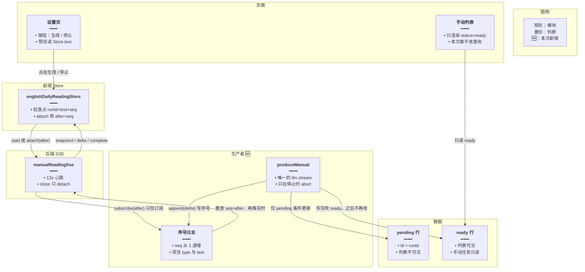
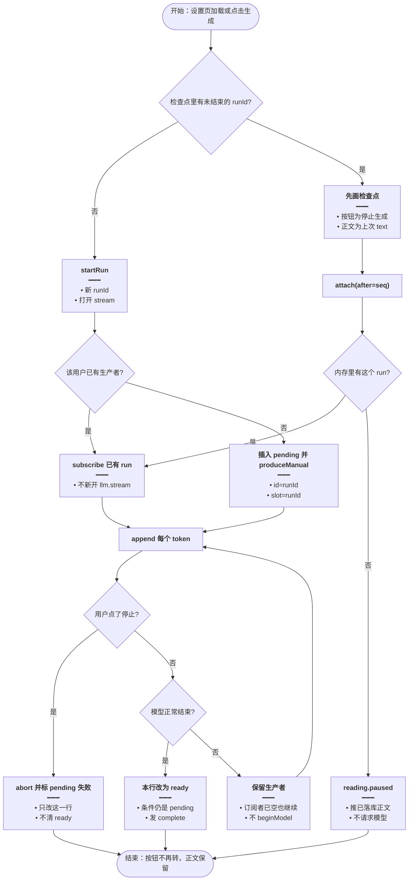
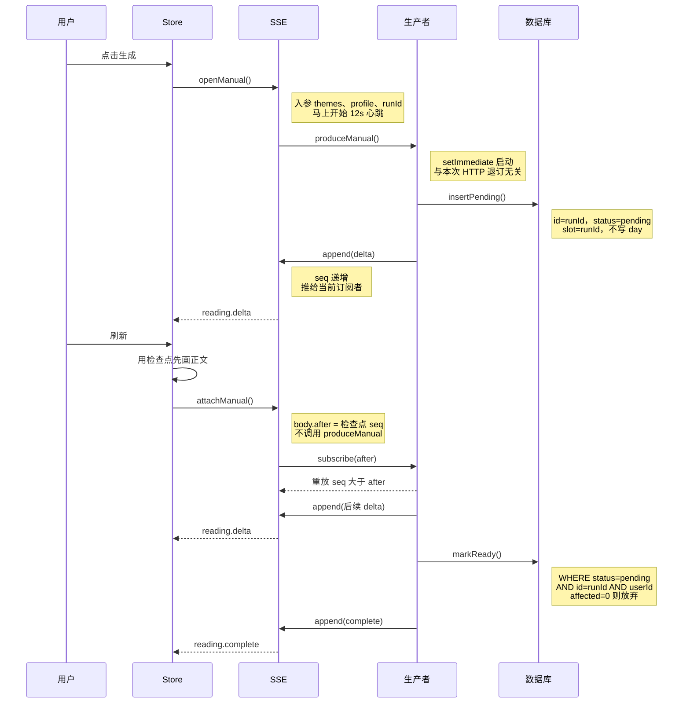
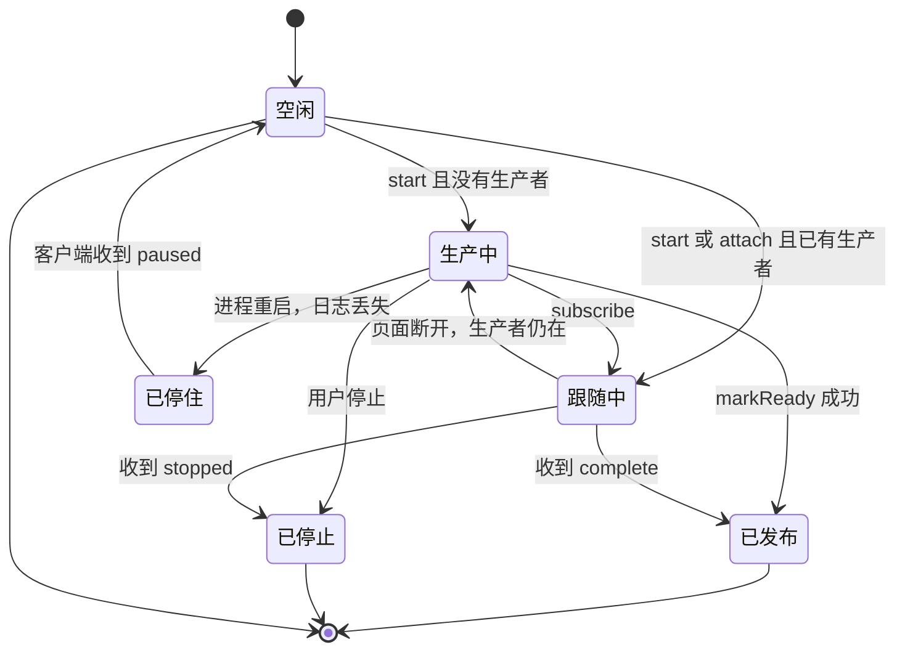

# 刷新续接生成流 — 实现思路

> **状态**：规划（流式手动生成已有一版，刷新后续接和已发布文章保护未达成）  
> **日期**：2026-10-17  
> **需求摘要**：手动生成还没结束时刷新页面，按钮保持「停止生成」，已写出的正文留着并继续增长，直到这一次模型调用自然结束；已在列表里的文章不能被清掉或改掉。

## 延伸阅读

- [每日阅读流式生成](./每日阅读流式生成.md)（SSE、离开页面不断流、禁止用 pending 轮询维持按钮）
- [每日阅读手动生成](./每日阅读手动生成.md)（另插一篇，不覆盖定时篇）
- [手动阅读按用户隔离](./手动阅读按用户隔离.md)（手动篇只属于当前用户）

业界对照（本方案对齐的是算法，不引入它们的运行时）：

- Vercel AI SDK [Chatbot Resume Streams](https://ai-sdk.dev/docs/ai-sdk-ui/chatbot-resume-streams)：生产者在客户端断开后继续写，Redis 记下 `activeStreamId`，刷新后按这个 id 重放再接着听。
- [vercel/resumable-stream](https://github.com/vercel/resumable-stream)：同一 `streamId` 第二次订阅时，先把缓冲块推完，再推新块；第一个读者离开也不结束生产者。
- OpenAI [Background mode](https://developers.openai.com/api/docs/guides/background/)：`background` + `stream` 时，断线后用 `starting_after=<上次序号>` 从同一条响应接着收；序号过期就取已落库的结果，不再假装流还活着。
- SSE 标准：事件带递增 `id`，重连带上上次 id，服务端只补这个 id 之后的事件。

---

## 0. 读本文你将得到什么

- 要解决的问题：刷新后按钮仍是「停止生成」，预览停在刷新前的正文；attach 的 EventStream 只有一条快照和后续 `reading.keepalive`，没有新的 `reading.delta`。同时一次失败会按主键把正文清空，列表只显示 `ready`，原来那条就从列表消失。
- 一句话方案：模型调用是独立的生产者，页面 SSE 只是可丢弃的订阅者；刷新用序号重放已有输出再接着听，并且手动任务只能改自己那条 `pending` 行。
- 改哪些层：手动生成服务里的 run 与写库、SSE 控制器、前端 Store 的检查点。设置页按钮文案和列表查询条件保持现状。
- 分三阶段：M1 生产者与连接拆开并按序号续上；M2 写库围栏，已发布行和定时篇不可被手动任务改写；M3 进程重启后的诚实停住，不偷偷再请求一次模型。
- 最大风险：进程重启会丢掉内存里的生产者。这时不能把按钮伪装成还在收 token，也不能为了「续上」再开一次模型把预览从 `{` 重写。

---

## 1. 需求与边界

### 1.1 用户故事

| 角色 | 场景 | 行为 | 期望结果 |
|------|------|------|----------|
| 登录用户 | 手动生成写到一半 | 刷新设置页 | 按钮首屏就是「停止生成」；预览是刷新前的正文，并且继续增长 |
| 登录用户 | 同上 | 看 Network 里的 attach | 先收到一条当前全文快照，随后是新的 `reading.delta`，直到 `reading.complete` |
| 登录用户 | 生成中 | 只点「停止生成」 | 这一次模型调用取消；再刷新按钮回到「生成阅读资源」 |
| 登录用户 | 列表里已经有手动篇或今日定时篇 | 另一篇正在生成时刷新或失败 | 已有列表项还在，标题和正文不变 |
| 登录用户 | 生成成功且人还在设置页 | 流结束 | 进入手动列表，新的一篇是 `ready`，旧篇仍在 |
| 登录用户 | 服务进程在生成中重启 | 再打开设置页 | 看到已落库的半成品和停住说明；不自动再请求模型，不改已发布行 |

### 1.2 范围

| 在范围内 | 不在范围内（非目标） |
|----------|----------------------|
| 手动生成这一条流的刷新续接 | 用轮询 pending 接口维持按钮（[每日阅读流式生成](./每日阅读流式生成.md) 已排除） |
| 断线只取消订阅，停止才取消模型 | 套接字一断就 abort 模型（词汇包那条路） |
| 已发布行与 `slot=day` 定时篇的写保护 | 改系统日推列表的 5 秒补拉（`List.tsx` 里 `todayStatus === 'generating'` 那一段保持 5 秒、最多 8 次） |
| 单进程内的序号日志 | 为这一篇单独上 Redis、消息队列或新的 npm 包 |
| 进程死后的停住态 | 进程死后自动再调一次模型，从 `{` 重写预览 |

### 1.3 约束与依赖

- 英语学习接口要登录。手动篇按 `userId` 隔离，定时篇 `slot` 固定 `day`、`userId` 为空。
- 开发机是单进程：nginx 转到 `127.0.0.1:9226`。内存 Map 只在这一进程有效；多实例要另做，见 §10。
- 模型是硅基流动上的 GLM，走现有 `createLlm` + `llm.stream()`。不能改用 OpenAI Responses 的 `background` 参数。
- 按钮文案继续用现有 i18n：`generate` / `stopGenerate`。
- 预览在没 token 时显示「正在生成」，有 token 后显示已累积文本。
- 心跳仍用 `PACK_SSE_KEEPALIVE_INTERVAL_MS`（12 秒），避免代理空闲超时。心跳不是正文。

---

## 2. 方案总览（一句话 + 要点）

**一句话方案**：一次生成一个生产者，把 token 追加进带序号的日志；刷新只新建一个订阅者，从上次序号之后重放再实时听；写库语句必须带 `status='pending'`，碰到已发布行就什么都不改。

| # | 设计要点 | 理由 |
|---|----------|------|
| 1 | 生产者在 `setImmediate` 里启动，不挂在 SSE 的 Observable 生命周期上 | 浏览器刷新会让 Nest 在请求 `close` 时退订 SSE。退订只能删订阅者 |
| 2 | 日志项 `{ seq, type, text }`，SSE 的 `id` 就是 `seq` | 与 SSE 的 Last-Event-ID、OpenAI 的 `starting_after` 是同一件事：续传靠游标，不靠「再请求一次模型」 |
| 3 | attach 先重放 `seq > cursor`，再把这个 emit 放进订阅者集合 | 现在的 attach 只推一条内存快照。生产者若已退出，后面就只剩心跳 |
| 4 | 禁止在 attach / 重放路径调用 `beginModel` | `beginModel` 会发 `text: ''` 且 `reset: true`，预览被清掉后从头再写 |
| 5 | `markRowFailed` 与正文落库都加上 `id + userId + status='pending' + slot!=day` | 现有 `markRowFailed` 只按主键更新，并把标题正文改成空串。列表查询只要 `status='ready'`，这一行就从列表消失 |
| 6 | 进程里没有生产者时发 `reading.paused`，按钮结束生成中 | 上游 HTTP 已经不在了。再调 `llm.stream()` 是新的一次生成，不是原来那条流 |

---

## 3. 现状与复用

| 能力 | 仓库中已有 | 本需求中的用法 |
|------|------------|----------------|
| 手动生成 SSE 起停 | `apps/backend/src/services/english-learning/english-learning.controller.ts` 的 `streamManualReading` / `attachManualReading` / `manualReadingSse` | 扩展：心跳里不要只发 keepalive；订阅者按序号补事件 |
| 内存 run、join、detach | `english-daily-reading.service.ts` 的 `manualRuns`、`joinRun`、`detachManual`、`executeManual` | 扩展：run 上增加序号日志；`executeManual` 改成不被 SSE 退订结束的生产者 |
| 模型流式读取 | 同文件 `askModel` / `readStream` / `createLlm` | 直接复用读取循环；`AbortSignal` 只在用户点击停止时 `abort`，不传给「页面断开」 |
| 刷新后的按钮与正文 | `apps/frontend/src/store/englishDailyReading.ts` 的 sessionStorage 检查点 `el-daily-reading-run` | 扩展：检查点增加 `seq`；attach 带上这个序号 |
| SSE 帧解析 | `apps/frontend/src/utils/dailyReadingSse.ts` | 扩展：读出 SSE `id` 作为序号；`reading.paused` 不把已有正文清掉 |
| 列表只显示已发布 | `list()` 中 `row.status = 'ready'` | 直接复用。保护列表的办法是别把 `ready` 改成 `failed`，而不是改列表查询 |
| 词汇包断线即停 | `wireEnglishLearningSseAbort` | 不适用。每日阅读手动生成不能走这条 |
| 定时篇失败清空 | `markFailed(publishDate)` 更新 `slot=day` 并清空标题正文 | 不适用。手动路径禁止调用它 |
| 半成品正文 | `rememberText` / `flushText`，条件含 `status: 'pending'` | 直接复用这道条件，并把它用到所有手动更新上 |

**调研结论**：按钮、检查点、attach 路由、心跳都已经有了。缺的是「生产者独立于订阅者」和「按序号重放」。当前 `joinRun` 只发一条快照；`executeManual` 在连接类错误里 `return`，`finally` 把 `live` 置为 false，之后 attach 只能心跳。`markRowFailed` 按主键把 `titleEn` / `bodyEn` / `bodyZh` 写成空串且不限制 `status`，列表随即不再返回这一行。刷新续接不要再开第二次 `llm.stream()`，也不要在这条路径上调用 `beginModel`。

当前失败在 Network 上的样子：attach 的第 1 条是 `reading.snapshot`（刷新前的 JSON），第 2 条起全是 `reading.keepalive`。预览停在 `"Soon, reading"` 一类半句上，按钮仍是「停止生成」。这说明订阅还在，生产者没有再 `publish` delta。

---

## 4. 架构图



**图内方法说明**：

| 方法 | 功能 |
|------|------|
| `produceManual(userId, run)` | 唯一的模型生产者。在 SSE 订阅之外跑完检索、草稿、可选补释义；每段 token 调用 `append`。只在 `run.ac.abort()`（用户停止）时结束上游读取 |
| `append(run, frame)` | 把一帧推进该 run 的日志，`seq` 加一，并推给当前所有订阅者。刷新前后的订阅者拿到的是同一条日志 |
| `subscribe(run, emit, after)` | 把这条 SSE 的 emit 加入订阅者，先按顺序重放 `seq > after` 的帧，之后的 `append` 实时送给它。不调用模型，也不发送 `reset` |
| `manualReadingSse(...)` | 建立一条带心跳的 SSE。请求结束时的清理函数只调用 `detach`，不 abort 生产者 |
| `englishDailyReadingStore.attachRun()` | 刷新后用检查点里的 `runId` 和 `seq` 调用 attach。先把检查点正文画出来，再按服务端重放校正 |

**读图要点**：

- 页面和 SSE 都在消费者一侧，可以随时拆掉再建。
- 生产者和序号日志在请求之外。列表只读 `ready`，和这条还在写的 `pending` 行不是同一行。
- 🆕 是序号日志和 `subscribe(after)`。`produceManual` 由现在的 `executeManual` 收紧而来，不是第二条模型入口。

---

## 5. 主流程图



**图内方法说明**：

| 方法 | 功能 |
|------|------|
| `startRun(themes, profile)` | 用户点击生成时写新检查点并 POST stream。若 Store 已是生成中则直接返回，避免第二篇 |
| `attach(after)` | 刷新后续订。`after` 是检查点里的最后序号，服务端不重放已经画过的 delta，避免正文重复拼接 |
| `produceManual` | 见 §4。图中「插入 pending 并 produceManual」只在该用户没有生产者时发生 |
| `subscribe(run, emit, after)` | 见 §4。开始和刷新的成功分支都走到这里 |
| `reading.paused` | 进程里已经没有生产者时的终态帧。客户端保留正文、关掉按钮旋转，不调用 `beginModel`，也不发第二次生成 |
| `abort` | `stopManual` 里对这一 run 的 `AbortController.abort()`。这是上游 `llm.stream` 唯一允许结束的原因 |

**读图要点**：

- 刷新走右侧 attach，不走「插入 pending」。所以不会再插一篇，也不会把预览清成空再重写。
- 「订阅者已空也继续」是为了对上本次截图：心跳还在，说明连接没断，缺的是生产者继续 `append`。
- `reading.paused` 是失败终态，给进程重启用。它不把已发布列表项改成失败。

---

## 6. 核心时序图



**图内方法说明**：

| 方法 | 功能 |
|------|------|
| `openManual()` | 第一次生成。若该用户已有生产者，只 `subscribe`，不插入第二行 |
| `produceManual()` | 见 §4。图中只在 open 且没有生产者时调用 |
| `insertPending()` | 插入本次 `runId` 的 pending 行，供崩溃后留下半成品。列表查不到它 |
| `append(delta)` | 见 §4。刷新前和刷新后的 SSE 都从这里收帧 |
| `attachManual()` | 刷新入口。按 `userId` 找到生产者后 `subscribe`。找不到则 `reading.paused` |
| `subscribe(after)` | 见 §4。`after` 来自客户端上次确认的序号 |
| `markReady()` | 把这一行从 pending 改为 ready 并写入定稿字段。条件不匹配时不更新任何行 |

**读图要点**：

- 刷新之后的箭头里没有第二次 `produceManual`，也没有 `beginModel`。
- 写库出现两次：开始时插入自己的 pending 行，结束时在 pending 条件下改为 ready。中间的 delta 只进内存日志，正文落库沿用现有 400ms 防抖，且同样带 pending 条件。
- `reading.complete` 仍由生产者发出。设置页若还挂着，沿用现有 `setOnReady` 跳到手动列表。

---

## 7. 状态机



**图内方法说明**：

| 方法 | 功能 |
|------|------|
| `start` | `openManual` / `startRun`。有生产者则进入跟随，没有才进入生产 |
| `subscribe` | 把当前页面接上已有日志。生产中的页面断开后状态仍停在生产中，新页面再进入跟随 |
| `markReady` | 见 §6。成功后列表能看到这一篇，旧的 ready 行不变 |
| `paused` | `reading.paused`。客户端离开「生成中」，保留已有正文 |

**读图要点**：

- 「页面断开」停在生产中，不进入已停止。已停止只来自用户点击停止。
- 已发布和已停住都不会去改其他 ready 行。已停住不是失败清空。

---

## 8. 模块职责与接口草图

### 8.1 模块一览

| 模块 | 职责 | 新增/改动 | 预估路径 |
|------|------|-----------|----------|
| 序号日志 + subscribe | 重放与实时转发 | 扩展 | `apps/backend/src/services/english-learning/english-daily-reading.service.ts` |
| 生产者 | 唯一模型循环，脱离 SSE 退订 | 扩展 | 同上，收紧 `executeManual` |
| 写库围栏 | pending 条件更新，拒绝改 ready / day | 扩展 | 同上 `markRowFailed`、`rememberText`、完成时的 `repo.update` |
| SSE | 心跳与 detach；把 `after` 传给 subscribe | 扩展 | `apps/backend/src/services/english-learning/english-learning.controller.ts` |
| 检查点 | 多存 `seq`；paused 时结束旋转 | 扩展 | `apps/frontend/src/store/englishDailyReading.ts` |
| 帧解析 | 读取 SSE id；识别 paused | 扩展 | `apps/frontend/src/utils/dailyReadingSse.ts` |
| 设置页 / 列表 | 按钮与列表查询 | 直接复用 | `Settings.tsx`、`List.tsx` |

### 8.2 关键接口（伪代码）

```typescript
// 一帧日志。seq 同时作为 SSE id，刷新时用来跳过已画出的部分
type ReadingEvent = {
	// 本 run 内严格递增，重放按它过滤
	seq: number;
	// snapshot / delta / complete / stopped / paused
	type: string;
	// delta 是增量；snapshot 是当前全文，且不带 reset
	text?: string;
};

// 刷新续订：只读日志，不启动模型
function subscribe(runId: string, after: number, emit: (e: ReadingEvent) => void): void {
	// after 之前的帧已经在检查点里，再推会重复拼接
	// emit 之后仍留在订阅者里，后面的 append 继续送给它
}
```

```typescript
// 手动任务唯一允许的更新条件。ready 与定时篇不在此列
function pendingOnly(runId: string, userId: number) {
	// 主键、主人、未发布、非 day，四条一起才更新
	return { id: runId, userId, status: 'pending' as const, slot: runId };
}
```

### 8.3 数据模型

| 字段/实体 | 来源 | 存储 | 说明 |
|-----------|------|------|------|
| `runId` | 前端 `crypto.randomUUID()` | 行主键，且 `slot=runId` | 与已有文章的 id 无关。不复用列表里某一行的 id |
| `seq` | 生产者 `append` | 内存日志；检查点里记最后一号 | 进程重启后日志没了，检查点 seq 只用于展示，不能用来假装流还在 |
| `text` | delta 拼接 | 内存 `run.text`；400ms 写入该行 `bodyEn` | 写入条件用 §8.2 的 `pendingOnly` |
| `status` | 生产者结束时 | `pending` → `ready` 或 `failed` | 从 `ready` 改回 `failed` 不在本路径。失败也不把标题正文写成空串 |
| 检查点 | Store | `sessionStorage` `el-daily-reading-run` | JSON：`runId`、`text`、`phase`、`seq`。完成、停止、paused 时删掉 |

不改表结构。`english_daily_readings` 的唯一索引仍是 `(publish_date, slot)`。手动行的 `slot` 继续等于自己的 id，因此不会撞上 `day`。

---

## 9. 分阶段实现步骤

| 阶段 | 目标 | 交付物 | 依赖 |
|------|------|--------|------|
| M1 | 刷新后同一生产者继续推 delta | 序号日志、`subscribe(after)`、生产者脱离 SSE | 现有 stream/attach |
| M2 | 已发布列表项不会被手动任务清掉 | `pendingOnly` 用到每一处手动 `update` | M1 |
| M3 | 进程死后按钮不空转，也不自动重开模型 | `reading.paused` 与检查点清理 | M1 |

### M1

- [ ] `produceManual` 用 `setImmediate` 启动；SSE 清理函数只 `detach`。
- [ ] `append` 写 `seq`，SSE `id` 用这个数。
- [ ] `attachManual` 接收 `after`，只 `subscribe`。没有生产者时不要调用 `executeManual` / `beginModel` / 第二次 `llm.stream`。
- [ ] `readStream` 的 `AbortSignal` 仅由 `stopManual` abort。页面 `close` 不调用 `abort`。
- [ ] 检查点增加 `seq`。delta 到达后更新它。attach 的 body 带上 `after`。
- [ ] 验收 AC1、AC2。

### M2

- [ ] `markRowFailed`、完成更新、`rememberText`、`flushText`、`stopManual` 的更新条件都换成 `pendingOnly`。
- [ ] `affected === 0` 时只打日志，不换一个 id 再更新。
- [ ] 手动路径删除对 `markFailed(publishDate)` 的调用可能（现在手动路径本来就不该调用它；实现时加断言或代码检索确认没有调用）。
- [ ] 失败时保留该 pending 行已写入的 `bodyEn`，不把标题正文更新成空串。
- [ ] 验收 AC4、AC5。

### M3

- [ ] 内存没有 run 时，attach 发送 `reading.paused`，正文用该 `runId` 的 pending.`bodyEn`（没有则为检查点正文）。
- [ ] 客户端收到 paused：`generating=false`，不清 `text`，删检查点。不自动 `startRun`。
- [ ] 用户再点「生成阅读资源」才是新的 `runId`、新的 pending 行。
- [ ] 验收 AC3、AC6。

---

## 10. 关键决策与备选方案

| 决策 | 选用 | 备选 | 为何不选备选 |
|------|------|------|--------------|
| 续传模型 | 进程内序号日志，刷新 `subscribe(after)` | 刷新后再 `llm.stream()`，用 `beginModel` 清空重写 | 那是新的一次生成。预览会从 `{` 重来，也多一次计费。用户要的是还没停止的那一条 |
| 缓冲放哪 | 单进程内存日志 | 引入 `resumable-stream` + Redis | 算法相同，但本部署只有一个 Node 进程。多一次 Redis 往返换不来正确性。多实例时再把同一日志搬到现有 BullMQ 所用的 Redis |
| 游标 | SSE `id` = `seq`，attach body 带 `after` | 只发一条全文 snapshot | 快照在生产者已停时看起来像「接上了」，随后只剩心跳。序号能区分「还在写」和「已经停」 |
| 断线 | detach 订阅者 | `wireEnglishLearningSseAbort` | 词汇包用它在套接字关闭时 abort 模型。用在这里会重现「刷新后没有新 token」 |
| 按钮状态 | 有生产者才保持「停止生成」 | 无生产者也靠心跳把按钮留在 loading | 心跳只证明这条 HTTP 还开着。截图里就是这样：按钮在转，正文不增长 |
| 已发布行 | `pendingOnly` 更新 | 按主键 `markRowFailed` 并清空正文 | 主键更新会把 `ready` 改成 `failed` 并擦掉标题正文。列表条件是 `status=ready`，该行从列表消失 |
| 进程重启 | `reading.paused`，等用户再点生成 | 用 `extras.hold` 自动再跑 `executeManual(resume)` | 自动再跑会 `beginModel` 清预览，且不是原来那次 HTTP。OpenAI 在序号过期时也是改为读取已存储结果，而不是重开一条伪装成原流的新流 |
| 列表 | 继续只查 `ready` | 生成中的 pending 也进列表 | 半成品 JSON 会变成一条坏文章。pending 保持不可见 |

---

## 11. 风险、边界与待确认

| 项 | 等级 | 说明 | 缓解 |
|----|------|------|------|
| 进程重启丢日志 | 高 | `nest --watch` 或部署重启会清 `manualRuns`。上游 HTTP 无法在新进程里接着读 | M3 的 paused。不自动重开模型 |
| 多实例 | 中 | 两个 Node 进程各有一份 Map，attach 可能打到没有生产者的那一个 | 当前 nginx 只指向一个端口。扩容前把日志搬到 Redis，接口仍是 `subscribe(after)` |
| 序号与检查点不一致 | 中 | 检查点 200ms 才写，刷新时 `after` 可能略小于服务端 | 重放 `seq > after` 把缺口补上。客户端对 snapshot 以服务端全文为准，避免把缺口再拼接一遍 |
| 停止晚于下一 token | 低 | 停止要等到当前 chunk 的 `return()` | `stopManual` 仍立刻 `abort` 并 `iterable.return()`。下一帧不再 `append` |
| 列表「消失」的历史数据 | 中 | 已经被 `markRowFailed` 清空的行，本方案不能把正文变回来 | 只阻止再发生。若库里有 `failed` 且正文为空、用户确认是误伤，再单独做数据修复，不放进本功能 |

**待确认**：

- [ ] 消失的那一条是手动栏还是系统日推栏（验证方式：复现时看 URL 的 `origin`，以及该行 `slot` 是 `day` 还是 uuid）。两条都由 M2 挡住：手动更新碰不到 `ready`，也碰不到 `slot=day`。
- [ ] 硅基流动在「页面 SSE 已断开、上游 AbortSignal 未 abort」时是否仍继续吐 token（验证方式：M1 后刷新，服务端日志应继续 `append`，且没有第二行 `createLlm`）。若上游自己断开，走 paused，不重开。

---

## 12. 验收清单

| # | 用例 | 步骤 | 期望 |
|---|------|------|------|
| AC1 | 刷新后续写 | 生成到预览出现半句 JSON，刷新 | 按钮为「停止生成」；原文还在；EventStream 在快照之后出现 `reading.delta`；服务端没有第二行 `createLlm` |
| AC2 | 写完 | 停在设置页等到结束 | `reading.complete` 后进入手动列表；这一篇为 ready；刷新前列表里的其他篇还在 |
| AC3 | 只停一次 | 生成中点停止，再刷新 | 按钮为「生成阅读资源」；不再 attach 出心跳空转 |
| AC4 | 不删旧篇 | 列表已有至少一篇 ready。再生成一篇，生成中刷新，并让这次失败或停止 | 旧篇标题、正文、条数不变。数据库里旧行 `status` 仍为 `ready` |
| AC5 | 不碰定时篇 | 今日系统日推已 ready。手动生成中刷新 | 日推那一行 `slot=day` 的标题正文不变 |
| AC6 | 进程重启 | 生成中重启后端，再打开设置页 | 按钮不保持旋转；不自动出现第二篇；已有 ready 列表不变 |
| AC7 | 离开页面 | 生成中去别的英语学习页再回到设置页 | 与 AC1 相同，仍是同一个 `runId` |

---

## 13. 预估改动面（实现阶段参考）

| 类型 | 路径（预估） |
|------|--------------|
| 后端 | `apps/backend/src/services/english-learning/english-daily-reading.service.ts` |
| 后端 | `apps/backend/src/services/english-learning/english-learning.controller.ts` |
| 前端 | `apps/frontend/src/store/englishDailyReading.ts` |
| 前端 | `apps/frontend/src/utils/dailyReadingSse.ts` |
| 不改 | `apps/frontend/src/views/englishLearning/dailyReading/List.tsx` 的 5 秒补拉 |
| 不改 | `apps/frontend/src/views/englishLearning/dailyReading/Settings.tsx` 的按钮文案与跳转 |
| 文档（实现后） | `wiki/english/` 下的实现归档，不在本规划里改业务源码 |

（本文档为规划态实现思路；落地后以源码为准）
