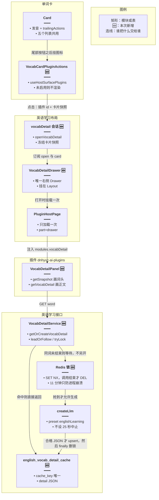
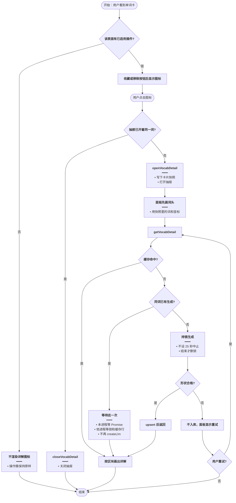
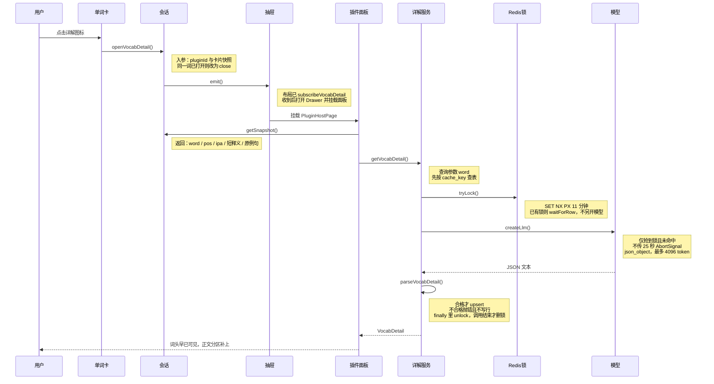
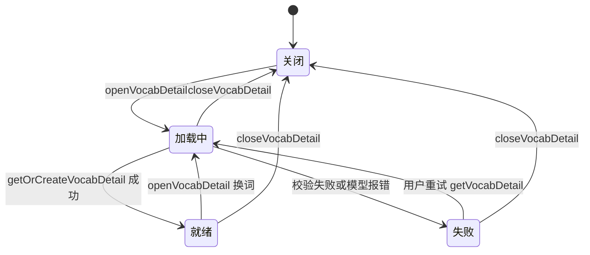

# 单词详解插件 — 实现思路

> **状态**：已落地（2026-11-11）。实现细节与逐行代码见 [单词详解缓存与抽屉.md](../../english/单词详解缓存与抽屉.md)。
> **日期**：2026-11-10  
> **需求摘要**：用户在插件中心启用「单词详解」后，单词卡在收藏按钮后面多一枚图标；点开右侧面板，看到该词的词根词缀、记忆方式、详细中文释义和带译文的例句。同一个词在模型调用结束前再点，不再另开一次模型。  
> **一句话方案（预告）**：单词卡只多一枚注册表图标；英语学习布局上挂唯一抽屉并加载一次插件；详解按词条全局缓存，未命中时用现有英语学习模型生成一份 JSON。这次生成不设 25 秒中止；同词再点只等这一次，Redis 锁在调用结束后才删。

> [!IMPORTANT]
> **2026-11-14 当前落地迁移说明**：本规划中的后端缓存、同词在途复用与 Remote 正文思路已经落地；前端宿主接入则从规划时的 `VocabCardPluginActions`、专属 `vocabDetail/session.ts`、`api.modules.vocabDetail` 和 `modules:vocabDetail`，演进为通用 **HostPoint + `points/catalog.ts` + `points/session.ts` + `api.modules.point` + `modules:point`**。现行宿主总览见 [学习页扩展点](../../english/学习页扩展点.md)，通用协议见 [声明式扩展点](../../plugins/声明式扩展点.md)。
>
> 当前卡片 action 由 `HostPoint` 渲染，未启用或槽位不匹配时不占位；详解、列表和导入由声明式槽位协调，列表统计使用 `stats` signal，页面上下文按目录白名单发布，导入按钮仍要求匹配插件存在且当前库可编辑。Remote 详解面板现在读取 `drawer` 槽位载荷，列表读取词库上下文并调用 `openCard`，导入面板读取 `import-drawer` 载荷并调用 `pickJsonFile / openCard` command。
>
> **以下全文保留 2026-11-10 规划时的方案比对、推理、图、代码与验收口径**，其中专属宿主会话和桥接名称是历史方案记录，不代表 2026-11-14 的现行接入；本节只追加落地迁移索引，不改写原方案。

## 延伸阅读

- 业务页插件槽的现成写法：`packages/federation-kit/docs/plugin-guide/表面槽位接入.md`（`host.surface` + `PluginHostSurface`）
- 阅读页已在用的抽屉槽：`apps/frontend/src/views/ebook/read.tsx` 里的 `PluginHostSurface surface="ebook.read"`
- 句内标注的全局缓存（本需求照这个形状新开一张表，不复用那张表的行）：`apps/backend/src/services/english-learning/entity/english-sentence-word-annotation-cache.entity.ts`
- 词根词缀静态教材（覆盖的是词缀条目和少量例词，不能当任意词的详解源）：`apps/frontend/src/views/englishLearning/reference/morphology/dataSource.ts`

---

## 0. 读本文你将得到什么

- 插件启用后，单词卡收藏星后面为什么会出现详解图标，以及点下去面板从哪来。
- 选定方案：宿主画图标和抽屉，插件只画正文；详解 JSON 按词全局缓存，未命中再调英语学习模型。同词并发用进程内 Promise 加 Redis 锁，锁等到这次调用结束才释放，生成本身不设 25 秒中止。
- 改动落在单词卡、英语学习布局、联邦模块桥、插件包 `dnhyxc-ai-plugins`、英语学习接口和一张新缓存表。
- 分三阶段：先打通「启用 → 图标 → 抽屉 → 一次生成」；再补面板分区和失败重试；最后收验收和缓存形状。
- 最大风险是模型拆词或释义不稳定。坏结果不入库，面板给出重试，避免把错误详解变成以后的命中。

---

## 1. 需求与边界

### 1.1 用户故事

| 角色 | 场景 | 行为 | 期望结果 |
|------|------|------|----------|
| 已登录用户 | 插件中心已打开「单词详解」 | 浏览词库、单词包、日推记录里的单词卡 | 发音按钮和收藏星后面多一枚详解图标 |
| 已登录用户 | 同上 | 点击该图标 | 右侧面板打开，先看到卡片上的词头，再看到词根词缀、记忆、详细释义、例句 |
| 已登录用户 | 面板已开着 | 再点另一张卡的详解图标 | 抽屉不关，正文换成新词；命中缓存时几乎立刻换完 |
| 已登录用户 | 面板已开着这个词 | 再点同一张卡的详解图标 | 面板关闭 |
| 已登录用户 | 收藏夹或错题本的单词卡 | 查看操作簇 | 详解图标仍在，排在该卡现有尾部按钮（移除）之后 |
| 未启用插件的用户 | 任意单词卡 | 浏览列表 | 操作簇与现在一致，没有详解图标 |

### 1.2 范围

| 在范围内 | 不在范围内（非目标） |
|----------|----------------------|
| `components/vocab/Card` 的五处列表：词库、单词包、日推记录、收藏夹、错题本 | 经典句卡片、练习填空槽、每日记词答题词头、Agent 资源卡 |
| 插件中心可开关；关掉后图标和抽屉一起消失 | 给插件做侧栏入口或独立整页 |
| 词根词缀、一句记忆、分词性的详细中文释义、2～4 条中英例句 | 图片助记、例句朗读、社区例句、用户改详解、写回单词库行 |
| 有数据才显示的派生词、常见搭配、近义、考试标签 | 单独接词典厂商或把静态词缀表做成拆词器 |
| 同一词条全站共用一份详解缓存 | 用户点「重新生成」覆盖别人的缓存 |

### 1.3 约束与依赖

- 必须登录。英语学习控制器整组挂了 `JwtGuard`，插件通过宿主 `api.http` 带当前账号凭证。
- 启用状态沿用插件中心：`persistPluginEnabled` 只写 `plugin_user_prefs.enabledIds`。单词卡用 `useHostSurfacePlugins`，内部是 `isPluginEnabled`，和阅读页抽屉是同一条判断。
- 图标样式跟收藏星同一套：`h-7 w-7`、`ghost`、细边框。图标文件走 registry `host.icon`，用现成 `PluginIcon` 内联 SVG。
- 列表是虚拟滚动。不能在每个可见格子里挂一份 `PluginHostPage`。
- 详解生成走 `createLlm({ preset: 'englishLearning', userId })` 的 JSON 模式，和句内标注同一条模型配置。不走 `decide()`：那条链路超时 2 秒、输出上限约 400 token，装不下这份详解。
- 不改收藏、错题、日推和单词库字段。卡片上的音标、短释义、原例句仍以库内快照为准。

---

## 2. 背景

- **谁、在什么场景、卡在哪**：学单词的人在词库、单词包和日推记录里看卡片。卡片已经有词、音标、音节、一行中文和一条英文例句，还有发音和收藏。想看这个词怎么拆、怎么记、一词多义怎么分、例句中文是什么，现在没有入口。
- **现状缺口**：收藏星是各页面写进 `Card` 的 `trailingActions`，没有第二个动作位。插件系统能在「某一页的顶栏或抽屉」挂远程组件，不能把远程组件塞进虚拟列表的每一格。词根词缀页是一本按词缀编排的静态教材，例词覆盖不到 `toilsome` 这种任意词。句内标注缓存只存「词性 / 音标 / 一行释义」，没有词根、记忆和对照例句。
- **不解决会怎样**：用户只能离开列表去外部词典，收藏和发音的学习闭环在这一步断开。若把详解写进主站页面，又没法随插件开关整块出现或消失。
- **硬约束**：启用前界面不变；点开后列表滚动位置还在；同一词反复打开不能每次都打模型；模型输出不合格不能变成下次的命中；插件正文不能自己再套一层 Drawer，避免冲出样式隔离。

---

## 3. 现状与复用

| 能力 | 仓库中已有 | 本需求中的用法 |
|------|------------|----------------|
| 单词卡 | `apps/frontend/src/views/englishLearning/components/vocab/Card.tsx` | 扩展：尾部按钮后增加详解图标 |
| 收藏星 | 词库 `library/vocabulary/index.tsx`、单词包 `pack/vocabulary/index.tsx`、日推记录 `daily/records/index.tsx` 的 `trailingActions` | 直接复用：星仍然由各页传入，详解图标跟在它后面 |
| 收藏夹 / 错题本尾部按钮 | `favorites/vocabulary/index.tsx`、`mistakes/vocabulary/VocabularyMistakesPanel.tsx` 传入移除按钮 | 直接复用：详解图标跟在该尾部按钮后面 |
| 插件表面槽 | `useHostSurfacePlugins` + `PluginHostSurface`；类型里 `slot` 已是 `'drawer' \| 'toolbar' \| (string & {})` | 扩展：新增表面 `english.vocab.card`、槽位 `card-action`。页面级 `PluginHostSurface` 不负责这个槽 |
| 插件启用 | `apps/frontend/src/federation/enabled/prefs.ts` 与 `persistPluginEnabled` | 直接复用：用户在插件中心打开后，`isPluginEnabled('vocabDetail')` 为真 |
| 插件加载与样式隔离 | `PluginHostPage`（`part="drawer"`） | 直接复用：全布局只挂一次 |
| 右侧抽屉 | `apps/frontend/src/components/design/Drawer/index.tsx` | 直接复用：英语学习布局里挂一个 |
| 插件调宿主接口 | `api.http`，权限 `http:plugin-api`；宿主实现是 `apps/frontend/src/utils/fetch` 的 `http` | 直接复用 |
| 按权限注入模块 | `apps/frontend/src/federation/runtime/index.ts` 的 `buildModules` | 扩展：增加 `modules:vocabDetail` |
| 英语学习 JSON 模型 | `EnglishLearningService.annotateMissesAdaptive` 里的 `createLlm({ preset: 'englishLearning', response_format: json_object })` | 直接复用调用方式；新逻辑放独立服务，不往这个已有大服务里再塞 |
| 全局 JSON 缓存 | `english_sentence_word_annotation_cache`：`cache_key` 唯一、`schema_version`、`upsert` | 扩展出新表。旧表的列是句内标注，不能混放详解 |
| 短决策 `decide()` | `apps/backend/src/utils/glm-decide.ts` | 不适用：超时和 token 上限装不下详解 |
| 词根词缀教材 | `reference/morphology/dataSource.ts` | 不适用作数据源：按词缀编排，只有少量例词 |
| 插件包 | `micro-apps/dnhyxc-ai-plugins`，`vite.config.ts` 的 `exposes`，端口 9008 | 扩展：新增 `./VocabDetail` |
| 注册表 | `apps/backend/uploads/remotes/plugins-registry.json` | 扩展：追加一条，`entry` 与现有插件相同 |

**调研结论**：图标必须由宿主画在 `Card` 上，因为虚拟列表不能每格加载远程模块。面板正文适合做成插件，并用现成的 `PluginHostPage` 只加载一次。详解内容库里没有，需要一次 JSON 生成；缓存形状抄句内标注，表单独建。静态词缀教材和 `decide()` 都接不上这份面板。

---

## 4. 方案比对与最终方案

### 4.1 候选方案

#### 方案 A：卡片图标 + 布局层唯一抽屉 + 插件只画正文（扩展现有槽与桥）

- **做法**：registry 声明 `host.surface = "english.vocab.card"`、`host.slot = "card-action"`。`Card` 在 `trailingActions` 后渲染 `VocabCardPluginActions`，内部 `useHostSurfacePlugins('english.vocab.card')`，没有已启用插件就返回 `null`。点击调用 `openVocabDetail(pluginId, card)`，把词、词性、音标、短释义、原例句写进模块级会话。`englishLearning/Layout.tsx` 订阅这个会话，打开一枚 `@design/Drawer`，抽屉体是 `<PluginHostPage pluginId part="drawer" />`。插件 `activate` 不负责插按钮。插件面板用 `api.modules.vocabDetail.getSnapshot()` 读当前词，再 `api.http.get` 拉详解。
- **能工作的原因**：启用判断、远程加载、样式隔离、登录后的 HTTP 都是现成的。虚拟列表里只有一枚本地按钮。抽屉挂在五个列表共同的路由壳上，从词库走到收藏夹也不会拆掉面板状态。
- **主要代价**：宿主要认识新槽位名，并维护一份「当前打开的词」会话。插件不能单独完成按钮。

#### 方案 B：点卡片后进入插件整页路由（复用现有路由注入）

- **做法**：registry `injectRoute: true`，`routePath` 例如 `/english-learning/vocab-detail`。单词卡上的按钮由宿主渲染，点击 `navigate(\`/english-learning/vocab-detail?word=${encodeURIComponent(word)}\`)`。插件页面自己请求详解。不新增抽屉，不改 `Layout`。
- **能工作的原因**：`createPluginRoute` 已经会给 `injectRoute !== false` 的插件挂路由。刷新和复制链接都能回到这个词。
- **主要代价**：用户离开单词列表，虚拟滚动位置依赖浏览器历史返回。词头上的音标和原例句进不了短 query，面板抬头容易和刚才那张卡不一致。插件中心会把它算成带路由的插件；若同时保留 `host`，`catalogKind` 仍因 `host` 归到「插件」标签，这一点不影响功能，但整页和「在卡片上唤起面板」不是同一种操作。

#### 方案 C：每个可见卡片挂一份工具栏形态的 `PluginHostPage`（扩展现有 toolbar 槽）

- **做法**：`host.slot = "toolbar"`。`Card` 的尾部直接渲染 `<PluginHostPage pluginId part="toolbar" />`。插件暴露物就是那枚图标，点击后再调宿主打开抽屉。远程模块第一次加载后会进联邦缓存，随后的格子主要是多挂 React 实例。
- **能工作的原因**：按钮的文案和图表可以完全留在插件仓库。表面上更符合「功能都在插件子项目里」。
- **主要代价**：虚拟滚动每次换一批格子都要经过 `PluginHostPage` 的加载壳、样式域和错误边界。一屏四列时同时存在多份。按钮的点击仍然得回调宿主，否则插件按文档不能自己再套 Drawer。宿主改动并没有少，列表成本变高。

### 4.2 比对

| 维度 | 方案 A | 方案 B | 方案 C |
|------|--------|--------|--------|
| 正确性（失败路径、边界、数据是否会错） | 词快照留在宿主会话里，面板抬头和卡片一致。插件未加载完时点击已写进会话，加载后 `getSnapshot()` 读得到，不会丢第一次点击 | query 只有词面。音标和原例句丢失后，面板抬头可能和卡片不一致 | 格子卸载时若请求还挂在该格的插件实例上，滚走再滚回会重入。快照若只放在该格的 props 里，抽屉还得再拷一份，和方案 A 的会话重复 |
| 复用 / 与现状契合 | 复用 `useHostSurfacePlugins`、`PluginHostPage`、`Drawer`、插件 HTTP。新槽位名落在已开放的 `slot` 字符串上 | 复用路由注入和插件页，不复用阅读页那种「业务页内打开」 | 复用 `PluginHostPage` 的 toolbar 形态，但 toolbar 设计给的是页面顶栏的一块，不是列表格子 |
| 改动面（要动哪些路径） | `Card`、英语学习 `Layout`、`buildModules`、插件 expose、registry 一条 | `Card` 加导航、插件整页、registry 的 `injectRoute`。列表滚动保持要另做 | `Card` 每格挂远程容器、插件按钮、宿主抽屉会话。三处都要动 |
| 复杂度（新概念、新状态、新依赖） | 一个模块级会话：打开的插件 id + 卡片快照。无新依赖 | 无新会话。词面进 query，和英语学习页已有的 `session`、`kind` 查询参数并列 | 远程实例数量随可见格子变化，再加一份抽屉会话 |
| 体验（延迟、步骤数、失败时用户看到什么） | 停在列表上。图标是本地按钮，出现不需要等远程包。正文加载失败留在抽屉里重试 | 多一次页面切换。返回才能看到原卡片。失败在新页面 | 图标要等该格远程容器就绪，快速滚动时按钮会闪加载态 |
| 风险（迁移、互斥、并发、回滚） | 关掉插件偏好后 `useHostSurfacePlugins` 变空，图标消失；布局里抽屉发现插件不在列表就关闭。回滚是删 registry 条目 | 路由留在历史栈里。关插件后深链还在，需要路由层自己处理未启用 | 与虚拟滚动的挂载/卸载叠在一起，样式域和 portal 收编次数变多 |
| 可维护性（以后改一处还是改多处） | 按钮外观在宿主一处；正文分区在插件一处；五个列表不用各写一次 | 五个列表仍共用 `Card`，这点和 A 一样。整页和卡片的上下文要各自维护 | 按钮在插件、容器在每张卡、抽屉在布局，三处一起改 |

### 4.3 综合考量

权重放在两件事上：列表不能变重，以及点开的词必须还是刚才那张卡。这两条来自 §1 的约束和 §3 的虚拟滚动、`Card` 单点插入。

方案 A 在这两条上都成立：图标不加载远程模块，快照在点击时冻结。方案 B 少一个会话对象，也少改 `Layout`，这是它真实的优点；放弃它，是因为离开列表和丢掉音标/原例句，直接违背「在卡片上唤起面板」。方案 C 把按钮源码完全放进插件仓库，这是它真实的优点；放弃它，是因为可见区里的多份 `PluginHostPage` 会在滚动时闪加载壳，而点击路径最后仍然回到宿主抽屉。

### 4.4 最终方案

#### 背景

单词卡的操作簇已经有发音和收藏（或移除）。插件启用是账号偏好，不是在卡片上写死一个永远可见的按钮。远程面板只能加载一次，而且必须知道用户点的是哪一张卡上的词、词性和音标。现有页面槽只解决「这一页有一个触发器」，解决不了「每一张卡有一个触发器、全页共用一个面板」。

#### 具体思路

1. 宿主负责图标和抽屉，插件负责正文。五个列表都走 `Card`，所以只改这一处，尾部按钮后面插入图标。
2. 数据从卡片快照进宿主会话，再由插件读会话并请求 `GET /english-learning/vocab-detail`。详解正文不写进单词库行。
3. 「现在开着哪个词」放在联邦模块级会话里，不放 MobX 业务 store，也不放 URL。英语学习各页已经有自己的 store 和 query，这个面板的生命周期只跟布局一样长。
4. 插件还没加载完时，快照已经在会话里，面板挂上后主动 `getSnapshot()`。模型失败不写缓存。再点同一个词则关闭。用户关掉插件时，布局发现该 id 已不在表面列表里，主动关抽屉。

#### 实现方案

**一句话**：单词卡只多一枚注册表图标；英语学习布局上挂唯一抽屉并加载一次插件；详解按词条全局缓存，未命中时用现有英语学习模型生成一份 JSON。

| 步骤 | 谁 | 做什么 | 输入 → 输出 |
|------|----|--------|-------------|
| 1 | registry 条目 `vocabDetail` | 声明表面、槽位、expose、权限 | 插件中心出现可开关的「单词详解」 |
| 2 | `VocabCardPluginActions` | 读已启用的 `english.vocab.card` 插件，画在收藏或移除按钮后面 | 无插件 → `null`；有插件 → 一枚图标按钮 |
| 3 | `openVocabDetail` | 写入或关闭会话 | 插件 id + `CardData` → `{ open, pluginId, card }` |
| 4 | `Layout` 里的 `VocabDetailDrawer` | 订阅会话，渲染 `Drawer` + `PluginHostPage` | 会话 → 右侧抽屉 |
| 5 | 插件 `VocabDetailPanel` | 读快照并请求详解，按区分块渲染 | 快照 → 词头立即可见；正文来自接口 |
| 6 | `getOrCreateVocabDetail` | 查缓存或生成 | 词面 → `VocabDetail` JSON |

registry 条目按现有阅读页插件的形状追加，`remoteName` 用新别名，避免 `registerRemotes({ force: true })` 把别的插件的别名改指到这份暴露：

```json
{
  "id": "vocabDetail",
  "remoteName": "dnhyxc-ai-vocab-detail",
  "expose": "./VocabDetail",
  "title": { "zh-CN": "单词详解", "en-US": "Word details" },
  "description": {
    "zh-CN": "在单词卡上查看词根词缀、记忆、详细释义和例句。",
    "en-US": "Open roots, a memory hook, fuller meanings, and example sentences from a word card."
  },
  "routePath": "/english-learning/vocab-detail",
  "entry": "http://127.0.0.1:9008/mf-manifest.json",
  "version": "1.0.0",
  "hostApiRange": "^1.0.0",
  "injectRoute": false,
  "host": {
    "surface": "english.vocab.card",
    "slot": "card-action",
    "icon": "<上传后的 SVG URL>",
    "order": 10
  },
  "permissions": ["ui:toast", "http:plugin-api", "modules:vocabDetail"],
  "preload": "idle",
  "enabled": false,
  "trust": "first-party"
}
```

`enabled: false` 与当前仓库里的学习笔记、全书想法一致：文件里的这个字段不是卡片开关。卡片开关是用户在插件中心打开后写入的 `enabledIds`。`routePath` 只满足描述符必填，`injectRoute: false` 保证不进侧栏、不占整页。

#### 选定原因

1. **正确性**：点击时把整张卡的快照冻结进会话，面板抬头不靠模型重写音标。牺牲：宿主多一份会话，插件不能从 URL 单独恢复。
2. **复用**：启用、加载、隔离、抽屉、HTTP 都用现成模块，只加一个槽位名和一份会话。牺牲：按钮 JSX 留在宿主，不在插件仓库。
3. **体验**：图标不等远程包；面板不把用户带离列表。牺牲：没有可收藏的详解页链接。
4. **风险**：关插件只走已有的偏好订阅。牺牲：要在布局里加一次「插件已不在列表则关闭」的判断。
5. **可维护性**：五个列表共用 `Card` 的插入点，正文分区只改插件。牺牲：改图标尺寸要发宿主，改文案分区只发插件。

#### 优势

- 相对方案 B：用户留在单词列表里，面板抬头使用点击时的词、词性、音标和原例句。
- 相对方案 C：一屏多张卡只有本地按钮，远程模块和样式域在整个英语学习布局里只有一份。

#### 怎么实现

1. 在 `plugins-registry.json` 追加 §4.4 的 `vocabDetail` 条目。插件包 `exposes` 增加 `'./VocabDetail': './src/views/vocab-detail/index.ts'`，入口第一行 `import '@/styles.css'`。
2. `Card` 的 `CardActionButtons` 在 `{trailingActions}` 后面渲染 `<VocabCardPluginActions card={data} />`。该组件没有已启用插件时返回 `null`，因此未启用时操作簇宽度不变。
3. 点击图标调用 `openVocabDetail`。同一插件、同一规范化词面再次点击则 `closeVocabDetail`。
4. `Layout` 渲染 `VocabDetailDrawer`：会话开着且该插件仍在 `useHostSurfacePlugins('english.vocab.card')` 中时，抽屉里挂 `PluginHostPage`。
5. 插件用 `getSnapshot()` 画词头，并用 `subscribeVocabDetail` 在换词时重新请求。请求走 `api.http.get('/english-learning/vocab-detail?word=...')`。
6. 服务端 `getOrCreateVocabDetail` 按 §4.5.1 返回 JSON。插件按区块渲染：词根词缀、记忆、释义、例句；派生、搭配、近义、标签有数组才渲染。

主链路代码见 §9.2、§9.3。

### 4.5 其他关键决策

下面两件事会改变数据落点和状态归属，单独比对。

#### 4.5.1 详解从哪来

##### 候选

**方案 A：按词全局缓存的英语学习 JSON 模型（扩展句内标注的缓存方式）**

- **做法**：新表 `english_vocab_detail_cache`。`cache_key = sha256(schemaVersion + '\\0' + lemma)`，`lemma` 是小写、合并空白后的词面。命中直接返回 `detail` JSON。未命中用 `createLlm({ preset: 'englishLearning', userId, streaming: false, temperature: 0.3, maxTokens: 4096, response_format: json_object })` 生成，不传 `AbortSignal.timeout`。`parseVocabDetail` 通过才 `upsert`。同一个词在调用结束前不再另开模型，见 §4.5.3。
- **能工作的原因**：账号已经有英语学习模型配置。句内标注证明「JSON 模式 + 唯一键 + 不合格不入库」能跑。词根、记忆、多条释义和对照例句可以装进一次输出。
- **主要代价**：第一次打开一个新词要等模型，大约数秒。模型可能拆错词或写出生硬例句，所以必须有形状校验。

**方案 B：外接词典，模型只补记忆和词根（新增数据源）**

- **做法**：服务端先查开源词库或词典 HTTP，拿到音标、释义、例句和考试标签，再让模型只写记忆钩子和词根拆分。词典结果和模型结果拼成同一份 `VocabDetail` 再缓存。
- **能工作的原因**：释义和例句有词典出处，考试标签比模型稳。记忆和词根仍然由模型补上，面板栏目能齐。
- **主要代价**：仓库没有词典客户端，也没有词库文件。要新增密钥或一份需自行确认许可证的数据文件，并处理词典无此词时的整段回退。

**方案 C：每次点击现算，不落库（复用模型、不新增表）**

- **做法**：接口只调 §A 的同一次模型，校验后返回，不写表、不加唯一键。
- **能工作的原因**：没有迁移。实现就是一个控制器方法加一次 `createLlm`。失败重试也自然成立。
- **主要代价**：词库、收藏、日推都会打开同一个词，每次都付 token，而且前后两次措辞会变，面板不像词典。

##### 比对

| 维度 | 方案 A | 方案 B | 方案 C |
|------|--------|--------|--------|
| 正确性 | 校验失败不入库，下次仍会重试。入库后全站看到同一份，不会在同一次浏览里自己变 | 词典释义更稳。词典没有的词要整段回退到模型，面板来源会混。词根仍可能拆错 | 每次都可能变。没有「坏结果被缓存」的问题，也没有「好结果被记住」 |
| 复用 / 与现状契合 | 复用 `createLlm` 的 `englishLearning` 预设和句内标注的 `sha256 + upsert` 形状 | 模型调用能复用。词典是仓库里没有的新上游 | 只复用模型调用 |
| 改动面 | 一张表、一个服务、一个 GET | 一张表、一个服务、再加词典客户端或数据文件 | 一个 GET，无表 |
| 复杂度 | 规范化词面、形状校验，外加 §4.5.3 的同词合并 | 两个上游的超时和「词典空、模型成功」组合 | 一次调用加校验 |
| 体验 | 第一次数秒，同词之后是一次数据库读。等待时词头已经在 | 词典快、模型仍要等记忆和词根，总等待不一定更短 | 每次都是数秒，连着点同一个词也要等 |
| 风险 | 跨进程重复生成由 §4.5.3 的锁挡住。锁的过期只留给进程崩溃 | 许可证、密钥、词典服务不可用。回退路径要单独测 | token 随打开次数涨。没有迁移风险 |
| 可维护性 | 改栏目就升 `schemaVersion`，旧行不再命中。启动后第一次请求清掉旧版本，做法与句内标注相同 | 词典字段和面板字段两套映射，改一栏要动两处 | 无版本问题。提示词一改，线上看到的详解立刻全部换一套 |

##### 综合考量

这里权重大的是「同一词反复打开要稳、要快」，以及「不引入仓库里没有的上游」。用户会从词库点进收藏再点一次，方案 C 在这条路径上每次都重新生成。方案 B 的释义出处更稳，这是它真实的优点；放弃它，是因为记忆和词根反正要模型，而词典客户端和许可证是本需求额外的故障点。方案 A 把第一次的等待换成以后的命中，坏 JSON 不入库，和现有标注缓存的失败方式一致。

同词在生成结束前不能再开一次模型。进程内 Map 只管本进程；跨进程用 Redis 锁，并且调用没结束就不释放。比对和选定写法在 §4.5.3。

##### 最终方案

**背景**

卡片上的一行中文和一条英文例句不够填面板。静态词缀表查不到任意词。`decide()` 的 2 秒和约 400 token 会把 JSON 截断，截断结果会被校验丢掉，等于每次都失败。

**具体思路**

1. 生成和缓存放在新的 `VocabDetailService`，控制器只加一个 GET。不把逻辑写进已经很大的 `EnglishLearningService`。
2. 词面进服务端后规范化，再算 `cache_key`。展示用的大小写仍用点击时的卡片原文，不使用缓存里的小写 lemma 当标题。
3. 缓存行在数据库。同词合并见 §4.5.3：进程内 Promise 在这次调用结束时删掉；Redis 锁也在这次调用的 `finally` 里删，不在中途按短超时放开。
4. `parseVocabDetail` 要求记忆、至少一条释义、至少一条中英例句、至少一段构词。派生、搭配、近义、标签可空。失败抛错，控制器返回 502 一类的可重试错误，插件展示重试。不写行。

**实现方案**

**一句话**：详解按规范化词面全局缓存一份 JSON；未命中时用英语学习模型生成，形状合格才入库。

| 步骤 | 谁 | 做什么 | 输入 → 输出 |
|------|----|--------|-------------|
| 1 | `normalizeVocabLemma` | 去空白、合并空格、转小写、限制长度 | 原始词面 → lemma 或空 |
| 2 | `getOrCreateVocabDetail` | 按 `cache_key` 查表 | 命中 → `VocabDetail` |
| 3 | 进程内 Map + Redis 锁 | 合并同词并发，见 §4.5.3 | 已有生成则等待；没有则持锁生成，结束才解锁 |
| 4 | `createLlm` + `parseVocabDetail` | 生成并校验，不设 25 秒中止 | 合格 → `upsert` 后返回；不合格 → 抛错且不写行 |

`VocabDetail` 的形状：

| 字段 | 必须 | 面板 |
|------|------|------|
| `morphology.parts[]`：`form`、`kind`（`prefix` / `root` / `suffix` / `base`）、`meaningZh` | 1～8 段 | 词根词缀 |
| `morphology.storyZh` | 可空 | 拆词下面的一两句说明 |
| `memory.hookZh` | 必须，非空 | 记忆方式 |
| `senses[]`：`pos`、`glossZh`、可空的 `nuanceZh` | 1～6 条 | 详细中文释义 |
| `examples[]`：`en`、`zh` | 1～4 条 | 例句 |
| `family[]` / `collocations[]` / `synonyms[]` | 可空，各最多 6 条 | 派生、搭配、近义 |
| `tags[]` | 可空，最多 4 个短标签 | 如 CET-4，没有就不画 |

提示词要求：用中文解释；例句必须自带中文；拆不开时 `parts` 只给一段 `kind: "base"`，不要编造不存在的前后缀；释义要写清词性和适用场合，不要只重复卡片上的那一行短译。卡片快照里的短释义和原例句作为提示词里的「已有材料」传给模型，避免生成反义，但不放进 `cache_key`。同一个词在不同卡片上短译略有差别时，仍然共用一份详解。

**选定原因**

1. **体验**：同词第二次打开是读库。牺牲：第一名打开这个词的人要等生成。
2. **正确性**：不合格不入库。牺牲：模型偶发失败时用户看到重试，而不是一份残缺面板。
3. **复用**：模型和缓存手法都是英语学习里现成的。牺牲：详解质量取决于该预设模型，没有词典校对层。
4. **改动面**：一张新表加一个服务。牺牲：要做一次迁移。
5. **风险**：同词并发按 §4.5.3 收成一次调用。牺牲：进程崩溃时锁要等过期，不能立刻再生成这个词。

**优势**

- 相对方案 B：不增加词典密钥、词库文件和许可证，面板栏目仍能一次生成齐。
- 相对方案 C：同一个词从词库、收藏和日推打开，命中后不再打模型，措辞也不再每次变化。

**怎么实现**

1. `normalizeVocabLemma` 得到 lemma；空或超过 120 字返回 400。
2. 计算 `cache_key` 并 `findOne`。
3. 未命中则按 §4.5.3 合并同词：本进程已有任务就等它；否则抢 Redis 锁，抢到才 `generateAndStore`。
4. 生成结果交给 `parseVocabDetail`，通过后按 `cacheKey` `upsert`。调用结束（成功或失败）才在 `finally` 里删锁。
5. 词根词缀教材不参与这条链路。

代码见 §9.3。

#### 4.5.3 同词还在生成时再点一次

##### 候选

**方案 A：只靠进程内 Map，生成设 25 秒中止（原先的写法）**

- **做法**：`vocabDetailInflight` 把本进程的第二次点击挂到同一个 Promise。`llm.invoke` 传 `AbortSignal.timeout(25_000)`。不设 Redis 锁。多实例靠表的唯一键把两次写入收成一行。
- **能工作的原因**：单进程连点不会打两次模型。25 秒到了请求结束，不会把半截 JSON 写入缓存。
- **主要代价**：GLM 先推理再出 JSON，一次详解经常靠近或超过 25 秒，中止后接口变成 502，缓存仍是未命中。另一台机器在这 25 秒里仍会再开一次模型。

**方案 B：Redis 锁跟着 25 秒走，大约 45 秒过期（中途放开）**

- **做法**：`SET NX PX 45000`。注释按「比 25 秒模型超时多留建连和写库」。生成结束在 `finally` 里删锁；没删掉则 45 秒后键自己消失。跟随者轮询到锁没了或行出现为止，最长等这 45 秒。
- **能工作的原因**：45 秒内另一进程抢不到锁，不会并行打模型。进程崩溃后不用等太久，这个词可以再生成。
- **主要代价**：调用一旦超过 45 秒，锁先没了，后一次点击会再 `createLlm`。25 秒中止还在，慢的一次仍然 502。

**方案 C：不设这次调用的 25 秒中止；锁等到调用结束才删（当前源码）**

- **做法**：`createLlm` / `invoke` 都不传 `AbortSignal`。本进程用 `vocabDetailInflight`，在 `await` 之前写入，结束才 `delete`。跨进程用 `SET key token NX PX`，`PX` 为 11 分钟。抢到锁的进程在 `finally` 里用 token 比对后 `DEL`。没抢到的进程每 400 毫秒查一次缓存行，锁还在就继续等，不另开模型。关抽屉不删锁。
- **能工作的原因**：同词再点只是再等这一次。调用没结束时锁还在，后一次 `SET NX` 失败。成功、校验失败或模型报错都会走到 `finally`，然后才删锁。
- **主要代价**：进程若在 `finally` 之前崩溃，这个词要等 11 分钟过期才能再生成。OpenAI 客户端仍有默认 10 分钟超时，活着的进程会先结束调用再删锁，正常路径不会靠这 11 分钟放开。

##### 比对

| 维度 | 方案 A | 方案 B | 方案 C |
|------|--------|--------|--------|
| 正确性 | 本进程不双开。超时被 SDK 写成 `Request was aborted`，缓存不写。跨进程仍可能双开 | 45 秒内不双开。超过 45 秒锁消失，第二次点击会再开模型 | 调用未结束不双开，结束后才删锁。崩溃才靠 11 分钟过期 |
| 复用 / 与现状契合 | 只用进程内 Map，和句内标注的 single-flight 接近 | 复用现有 Cache 的 Redis 客户端做 `SET NX` | 同样复用 Cache 的 Redis 客户端。11 分钟对齐客户端默认 10 分钟，避免调用中途掉锁 |
| 改动面 | 一个 Map 加一个 `AbortSignal` | Map 加锁、跟随等待、45 秒常量 | 去掉两处 `AbortSignal.timeout(25_000)`，锁常量改为 11 分钟，等待循环用同一常量 |
| 复杂度 | 最低 | 多一把会中途过期的锁 | 多一把锁和轮询。没有续期定时器 |
| 体验 | 慢词经常 502，再点又重新等一次生成 | 慢词先 502，锁过期后的再点还会再打一次模型 | 慢词可以等完。再点看到的是同一次结果，不是新的 502 |
| 风险 | 多实例双付 token | 锁过期和调用超时叠在一起，用户以为重试会接着等，实际开了新调用 | 崩溃后这个词最多空等 11 分钟。Redis 不可用时退回本进程 Map |
| 可维护性 | 超时数字和真实耗时绑在一起，换更慢的模型就要改秒数 | 25 秒和 45 秒要一起改，漏一个就会中途解锁 | 生成路径上没有业务超时。崩溃过期单独写成注释，和 `finally` 解锁分开 |

##### 综合考量

权重在两件事：同词再点不能再 `createLlm`，以及调用没结束不能把锁放开。方案 A 的本进程合并是要留下的，它盖不住另一进程。方案 B 的真实优点是崩溃后很快能重试；放弃它，是因为 45 秒短于一次带推理的生成，锁会在调用还活着时消失，后一次点击变成新的模型调用。方案 C 把「结束才解锁」放在 `finally`，11 分钟只处理进程死掉、删锁代码没跑到的情况。

##### 最终方案

**背景**

详解走 `zai-org/GLM-5.3` 时会先推理再输出 JSON，非流式要等整段结束。25 秒的 `AbortSignal.timeout` 到点后，OpenAI SDK 丢掉 `TimeoutError: The operation was aborted due to timeout`，日志只剩 `Request was aborted`，接口变成 502，缓存仍未命中。原先 45 秒的 Redis 过期又短于这次调用，锁会先没，再点同一词会再开一次模型。

**具体思路**

1. 本进程的合并继续用 Map：`get` 到在飞的 Promise 就直接返回，第二次点击不进 `createLlm`。
2. 跨进程用 Redis `NX`。抢到的才生成；没抢到的只查缓存行。关抽屉、换词都不删这把锁。
3. 删除发生在 `leadOrFollow` 的 `finally`，成功和失败都算这次调用结束。
4. `PX` 设为 11 分钟，只给进程崩溃。它长于 OpenAI 客户端默认的 10 分钟，所以活着的调用会先结束并执行 `finally`，不会被这把过期掐断。
5. 不在 `createLlm` 或 `invoke` 上传 25 秒 `AbortSignal`。

**实现方案**

**一句话**：同词生成中再点只等这一次；Redis 锁在这次调用的 `finally` 里删除，11 分钟过期只留给进程崩溃。

| 步骤 | 谁 | 做什么 | 输入 → 输出 |
|------|----|--------|-------------|
| 1 | `getOrCreateVocabDetail` | 查 `vocabDetailInflight` | 已有 Promise → 直接等待 |
| 2 | `tryLock` | `SET NX PX 11 分钟` | `OK` → 本进程生成；否则 `busy` |
| 3 | `waitForRow` | 锁还在就每 400 毫秒查表 | 有行 → 返回详解；锁没了且没行 → 允许再抢一次 |
| 4 | `generateAndStore` | 不带 25 秒中止地生成并 `upsert` | 合格 JSON 入库；不合格抛错且不写行 |
| 5 | `unlock` | `finally` 里 token 一致才 `DEL` | 调用结束 → 锁消失 |

**选定原因**

1. **正确性**：再点同一词不会在调用未结束时进入 `createLlm`。牺牲：崩溃后要等过期，不能马上重生成这个词。
2. **体验**：慢的一次可以跑完，不再被 25 秒切成 502。牺牲：用户可能多等，面板停在加载，直到这次调用结束或客户端默认 10 分钟到点。
3. **复用**：锁用现成 Cache 里的 Redis 客户端，不新加锁库。牺牲：Redis 连不上时只剩本进程 Map，别的进程仍可能各打一次。
4. **可维护性**：业务路径上不再放一个和模型耗时绑在一起的秒数。牺牲：要记得 11 分钟是崩溃兜底，不是调用超时。

**优势**

- 相对方案 A：另一进程在锁还在时不会再打模型，慢词也不会被 25 秒中止。
- 相对方案 B：调用超过 45 秒时锁还在，再点仍然是等这一次，而不是新开一次。

**怎么实现**

1. `getOrCreateVocabDetail` 在 `await` 之前把 Promise 放进 Map。
2. `leadOrFollow` 抢锁；`busy` 则 `waitForRow`，最多再抢一轮。
3. 持锁者 `resolveVocabDetail`：有缓存行就返回，否则 `generateAndStore`。
4. `finally` 里按 token 删锁。Map 的 `finally` 同时丢掉 in-flight。
5. `generateAndStore` 的 `createLlm` 与 `invoke` 都不传 `abortSignal` / `signal`。

代码见 §9.3。

#### 4.5.2 打开中的词放在哪

##### 候选

**方案 A：宿主模块级会话（新增一份小 store）**

- **做法**：`apps/frontend/src/federation/modules/vocabDetail/session.ts` 保存 `{ open, pluginId, card }`。`buildModules` 在权限通过时把 `getSnapshot` 和 `subscribeVocabDetail` 放进 `api.modules.vocabDetail`。布局和插件都订阅这份会话。
- **能工作的原因**：点击发生在插件加载之前，会话先记下快照，面板挂载后第一次就能读到。换词只改这份数据，抽屉不卸载。
- **主要代价**：刷新页面后面板关闭。这是一块查词面板可以接受的。

**方案 B：写进英语学习路由的 query**

- **做法**：点击执行 `setSearchParams`，加上 `vocabDetail` 和 `word`。布局读 query 决定抽屉开关。音标等长字段仍要另存，否则抬头不全。
- **能工作的原因**：刷新和前进后退能恢复开关。实现上是路由状态，没有新 store。
- **主要代价**：英语学习首页已用 `session`，收藏页已用 `kind`。再叠加详解参数后，分享出去的列表链接会把抽屉一并打开。音标和原例句要么进 query 变得很长，要么仍然要一份内存快照，store 并没有省掉。

**方案 C：给 `PluginHostPage` 增加 `snapshot` 属性**

- **做法**：布局持有 React state，把快照作为 props 传进 `PluginHostPage`，再想办法传给远程组件。
- **能工作的原因**：数据流都在 React 树上，读代码时能看到 props。
- **主要代价**：`PluginHostPage` 是阅读页、笔记、视频插件共用的壳。为单词快照加 props，会让无关插件的类型出现在公共壳上。联邦加载层今天只传 `api` 和 `plugin`，要改桥的 props 才能把快照送进远程组件。

##### 比对

| 维度 | 方案 A | 方案 B | 方案 C |
|------|--------|--------|--------|
| 正确性 | 插件晚于点击挂载时仍能读到快照。换词通知通过订阅送到已挂载的面板 | query 能恢复词面。音标若不进 query，刷新后的抬头缺字段 | props 在面板已挂载时能更新。公共壳若丢了这份 props，远程组件没有第二次读取的地方 |
| 复用 / 与现状契合 | 和 `buildModules` 注入 `learningNotes`、`ebook` 的方式一致 | 复用路由 query。和现有 `session`、`kind` 挤在一起 | 要改所有插件共用的 `PluginHostPage` |
| 改动面 | 一个小文件 + `buildModules` 一个分支 + 布局订阅 | 各英语页的 query 读写，或在布局里统一改 `searchParams` | `PluginHostPage`、联邦加载 props、布局 state |
| 复杂度 | 一个可变会话加监听集合 | query 编解码，再加一份补音标的内存 | 公共组件新增一条只给一个插件用的通道 |
| 体验 | 换词抽屉不闪。刷新后关闭 | 刷新能恢复。复制列表链接会把抽屉带给别人 | 换词不闪。刷新后关闭，和方案 A 相同 |
| 风险 | 布局卸载时会话还在内存里。离开 `/english-learning` 时布局调用 `closeVocabDetail`，避免下次进来抽屉自己开着 | 和现有 query 互相覆盖。返回列表时要记得删参数，否则抽屉又开 | 公共壳改动影响到阅读页插件的加载约定 |
| 可维护性 | 单词快照的类型只出现在 `vocabDetail` 模块 | 每个带 query 的英语页都要知道这个参数 | 以后每个「点了某条业务数据再开插件」都会想往公共壳加 props |

##### 综合考量

权重在「点击不能丢」和「不要改公共插件壳」。方案 A 用订阅补上插件晚挂载的窗口，类型也留在自己的模块里。方案 B 能刷新恢复，这是它真实的优点；放弃它，是因为列表链接会被详解参数污染，而且音标最终还是要一份内存。方案 C 的数据流看起来更像普通 React，这是它真实的优点；放弃它，是因为单词快照会进所有插件共用的壳。

##### 最终方案

**背景**

触发器在每一张卡上，面板在布局里只有一个，远程组件的挂载晚于第一次点击。会话必须在这三方之间，而且不能写进阅读页也在用的插件壳。

**具体思路**

1. 会话是模块级变量，不是某个页面的 `useState`，这样词库页卸载后抽屉还在布局上时状态还在。
2. 插件只得到读接口。打开和关闭留在宿主，避免插件再套一层抽屉。
3. 离开英语学习路由时布局卸载，卸载清理函数调用 `closeVocabDetail`。
4. 偏好把插件关掉时，抽屉发现表面列表里没有这个 id，同样关闭。

**实现方案**

**一句话**：当前词的快照放在 `vocabDetail` 宿主会话里；插件只订阅和读取，布局负责开关抽屉。

| 步骤 | 谁 | 做什么 | 输入 → 输出 |
|------|----|--------|-------------|
| 1 | `openVocabDetail` / `closeVocabDetail` | 改会话并通知监听者 | 卡片快照或空 |
| 2 | `VocabDetailDrawer` | 订阅会话，决定 `Drawer` 的 `open` | 会话 → 抽屉开关 |
| 3 | `api.modules.vocabDetail` | 对插件暴露 `getSnapshot` 与 `subscribeVocabDetail` | 插件挂载后读到最新快照 |

**选定原因**

1. **正确性**：先写会话再挂远程组件，第一次点击不会丢。牺牲：刷新不恢复面板。
2. **复用**：注入方式和笔记、电子书模块相同。牺牲：多一个小模块文件。
3. **风险**：不碰 `PluginHostPage` 的 props。牺牲：读代码时要知道面板数据在桥的 `modules` 里，而不是在组件 props 里。
4. **可维护性**：快照类型只属于这个功能。牺牲：不能把「打开抽屉」通用化成所有插件的框架能力；本次只有这一个卡片槽，不做通用框架。

**优势**

- 相对方案 B：收藏页的 `kind` 和首页的 `session` 不用为详解让位，分享列表链接也不会自动把抽屉打开。
- 相对方案 C：阅读页和其他插件的 `PluginHostPage` 调用方式不变。

**怎么实现**

1. 实现会话的 open / close / subscribe。
2. `buildModules` 在 `allow.has('modules:vocabDetail')` 时挂上只读接口。
3. 布局订阅；插件在 `useEffect` 里订阅。
4. 布局卸载时关闭。

代码见 §9.2。

---

## 5. 架构图

图画的是 §4.4 与 §4.5 选定方案。



**图内方法说明**：

| 方法 | 功能 |
|------|------|
| `useHostSurfacePlugins('english.vocab.card')` | 读已启用且声明了该表面的插件；用户在插件中心开关后，订阅会让图标出现或消失 |
| `openVocabDetail(pluginId, card)` | 把这次点击的卡片快照写入宿主会话；同一词再次点击则关闭 |
| `PluginHostPage` | 按插件 id 加载远程 `./VocabDetail`，并套上抽屉用的加载态、错误态和样式隔离 |
| `getSnapshot()` | 插件读取当前卡片快照，用来画词头，不等待模型 |
| `getVocabDetail(word)` | 插件通过 `api.http.get` 请求详解 JSON |
| `getOrCreateVocabDetail(word, userId)` | 服务端按规范化词面查缓存；未命中时本进程已有生成就等它，否则抢锁后再生成 |
| `tryLock` / `unlock` | 用 Redis `SET NX` 占住这个词；只有这次调用的 `finally` 按 token 删除。11 分钟过期只在进程崩溃时生效 |
| `waitForRow` | 锁被别的进程占着时轮询缓存行，不另开模型 |
| `parseVocabDetail(raw, lemma)` | 检查模型 JSON 的必填栏目；不合格返回 null，调用方不写缓存 |
| `createLlm(...)` | 按英语学习预设创建非流式 JSON 模型客户端；只有缓存未命中才调用 |

**读图要点**：

- 图标在列表里，远程模块在布局里，两者通过会话而不是通过每一格的 props 相连。
- 新增的是图标、会话、抽屉壳、插件面板、详解服务和缓存表。`Card`、`PluginHostPage`、`createLlm` 保持原职责。
- 模型箭头只在抢到锁且缓存未命中时发生。同词再点走到锁或进程内 Promise，不走到第二次 `createLlm`。
- 锁的删除在写入之后。11 分钟不是调用超时，调用中途不会靠它解锁。

---

## 6. 主流程图



**图内方法说明**：

| 方法 | 功能 |
|------|------|
| `useHostSurfacePlugins('english.vocab.card')` | 判断图标是否该出现；列表为空则这张卡没有详解入口 |
| `openVocabDetail(pluginId, card)` | 打开抽屉并冻结本次卡片快照，供词头和后续请求使用 |
| `closeVocabDetail()` | 清空打开状态；再次点击同一词，或离开英语学习布局时调用 |
| `getVocabDetail(word)` | 插件向 `GET /english-learning/vocab-detail` 要这份详解 |
| `getOrCreateVocabDetail(word, userId)` | 未命中时若本进程或 Redis 锁上已有这次生成，就等待；只有抢到锁才生成。调用结束才解锁，不设 25 秒中止 |
| `parseVocabDetail(raw, lemma)` | 生成结果缺少记忆、释义或对照例句时判失败，防止残缺 JSON 被写进缓存 |

**读图要点**：

- 入口是卡片上的本地图标，不是插件加载完成之后才出现的按钮。
- 同一词的第二次点击是关闭，换词才是替换快照并重新请求。
- 失败停在面板重试，不写缓存；成功才进入「按区块画出详解」。
- 「同词已有生成」走等待，不进入持锁生成。锁在成功或失败的 `finally` 才删。

---

## 7. 核心时序图

第一次打开某个未缓存的词。命中缓存时，服务在查库之后直接返回，下面的模型步骤不发生。



**图内方法说明**：

| 方法 | 功能 |
|------|------|
| `openVocabDetail()` | 卡片点击后写入会话，并调用 `emit` 通知已订阅的抽屉 |
| `emit()` | 把会话变更告诉抽屉和面板。监听者在挂载时通过 `subscribeVocabDetail` 注册 |
| `PluginHostPage` | 抽屉打开时按插件 id 加载 `./VocabDetail`，全布局只挂这一次 |
| `getSnapshot()` | 面板挂载时读取快照。点击早于挂载，所以不能只靠当时还没有监听者的事件 |
| `subscribeVocabDetail()` | 抽屉和面板注册监听；换词、关闭都会再走 `emit` |
| `getVocabDetail()` | 插件发起 GET。面板用返回值画词根、记忆、释义和例句 |
| `getOrCreateVocabDetail()` | 服务端查缓存或生成。时序图把未命中的那条画了出来 |
| `tryLock()` / `unlock()` | 抢 Redis 锁；没抢到就等缓存行。`unlock` 只在这次调用的 `finally` 执行 |
| `createLlm()` | 创建英语学习 JSON 客户端并完成一次非流式调用。这次调用不挂 25 秒中止 |
| `parseVocabDetail()` | 在写入缓存之前检查必填栏目 |

**读图要点**：

- 用户点的是单词卡，不是已经加载好的插件。会话是卡片和面板之间的缓冲。
- 词头来自 `getSnapshot()`，正文来自接口，所以生成较慢时面板也不会空白。
- 模型只出现在未命中且抢到锁的这次。同词再点若锁还在，时序停在 `tryLock` / `waitForRow`，不会再出现 `createLlm`。
- 删锁在 `parseVocabDetail` 和 upsert 之后。生成变慢也不会在 25 秒或 45 秒被这把锁放开。

---

## 8. 状态机

面板在布局里的状态。图标本身没有状态，未启用时根本不渲染。



**图内方法说明**：

| 方法 | 功能 |
|------|------|
| `openVocabDetail` | 从关闭进入加载中；已就绪时换词也回到加载中，词头同时换成新快照 |
| `closeVocabDetail` | 从加载中、就绪或失败回到关闭。同一词再点、离开英语学习、插件被关掉都会走到这里 |
| `getOrCreateVocabDetail` | 成功进入就绪。失败停在失败态，缓存里没有新行 |
| `getVocabDetail` | 用户在失败态点击重试时再次请求；若此时另一请求已经写进缓存，重试会直接命中 |

**读图要点**：

- 换词不经过关闭，抽屉外壳保持打开，避免列表上的滚动和焦点被抽屉开关打断。
- 失败是一个稳定状态，不会自动再打模型，直到用户重试或关闭。

---

## 9. 具体实现（主链路代码）

### 9.1 模块一览

| 模块 | 职责 | 新增/改动 | 预估路径 |
|------|------|-----------|----------|
| 卡片图标 | 按表面插件画按钮 | 新增，并改 `Card` 一处 | `apps/frontend/src/views/englishLearning/components/vocab/PluginActions.tsx` |
| 会话 | 保存打开中的卡片快照 | 新增 | `apps/frontend/src/federation/modules/vocabDetail/session.ts` |
| 模块桥 | 把只读会话交给插件 | 改 `buildModules` | `apps/frontend/src/federation/runtime/index.ts` |
| 抽屉 | 布局上唯一的面板壳 | 新增，并挂到布局 | `apps/frontend/src/views/englishLearning/components/vocab/DetailDrawer.tsx`、`Layout.tsx` |
| 插件面板 | 词头、分区、重试 | 新增 | `micro-apps/dnhyxc-ai-plugins/src/views/vocab-detail/` |
| 详解服务 | 规范化、缓存、生成、校验 | 新增 | `apps/backend/src/services/english-learning/vocab-detail.service.ts` |
| 缓存表 | 全局一份详解 | 新增实体和迁移 | `entity/english-vocab-detail-cache.entity.ts` |
| 注册表 | 让插件中心能开关 | 追加一条 | `apps/backend/uploads/remotes/plugins-registry.json` |

### 9.2 主链路实现

```typescript
// 对应 §4.4 步骤 2～3，以及 §4.5.2。会话先于远程组件存在，第一次点击才不会丢
type VocabCardSnapshot = {
	// 标题用卡片原文，不用缓存里的小写 lemma，避免大小写和用户刚看到的不一致
	word: string;
	// 词头词性来自卡片。模型的多词性放在正文，不覆盖这里
	pos?: string | null;
	// 音标以库内快照为准，生成结果即使带了音标也不拿来改词头
	ipa?: string | null;
	// 短释义传给模型当已有材料，并在正文未返回前让面板有一行可读中文
	translationZh?: string | null;
	// 原例句同样只作提示和占位，详细例句以接口返回的中英对照为准
	example?: string | null;
};

type VocabDetailSession = {
	// 抽屉是否开着。布局只读这个字段决定 Drawer 的 open
	open: boolean;
	// 当前表面可能有多个卡片槽插件时，抽屉加载被点击的那一个
	pluginId: string | null;
	// 未打开时没有快照，插件 getSnapshot 得到 null 就显示空态
	card: VocabCardSnapshot | null;
};

// 对应 §4.5.2 步骤 1。模块级变量跟英语学习布局一样长，不跟某一张列表页一起卸载
let session: VocabDetailSession = { open: false, pluginId: null, card: null };
// 布局和插件各注册一个监听。用 Set 避免同一订阅者被通知两次
const listeners = new Set<() => void>();

// 与后端 normalizeVocabLemma 同一规则，只用来判断「是不是又点了同一个词」
function sameLemma(a: string, b: string): boolean {
	// 合并空白再小写，Toilsome 和 toilsome 算同一个打开项
	const left = a.trim().replace(/\s+/g, ' ').toLowerCase();
	// 右侧用同一规则，避免只规范化一边导致再点同一个词关不掉
	const right = b.trim().replace(/\s+/g, ' ').toLowerCase();
	// 空词不算相同，否则两张空卡会互相关闭
	return left.length > 0 && left === right;
}

function emit(): void {
	// 拷贝一份再通知，避免监听者在回调里退订导致 Set 迭代出错
	for (const listener of [...listeners]) listener();
}

// 对应 §4.4 步骤 3。再次点击同一插件的同一个词就关闭，换词则替换快照
export function openVocabDetail(pluginId: string, card: VocabCardSnapshot): void {
	// 空词面没有详解可请求，按钮侧也应禁用；这里再挡一次防止调用方漏判
	if (!card.word.trim()) return;
	// 同一插件且词面相同：再点一次是关闭，不是重新打开
	if (
		session.open &&
		session.pluginId === pluginId &&
		session.card &&
		sameLemma(session.card.word, card.word)
	) {
		closeVocabDetail();
		return;
	}
	// 打开时冻结一份快照。之后列表行被虚拟滚动回收，面板词头仍然是这次点击的卡
	session = { open: true, pluginId, card: { ...card } };
	// 通知布局开抽屉、通知已挂载的面板换词
	emit();
}

export function closeVocabDetail(): void {
	// 保留对象形状，订阅者不用判断 session 是否为 null
	session = { open: false, pluginId: null, card: null };
	// 抽屉订阅者据此把 open 设为 false
	emit();
}

export function getSnapshot(): VocabCardSnapshot | null {
	// 返回副本，插件改局部字段不会写回宿主会话
	return session.card ? { ...session.card } : null;
}

export function subscribeVocabDetail(listener: () => void): () => void {
	// 先登记再由调用方立刻 getSnapshot，避免登记前的 emit 丢失
	listeners.add(listener);
	// 返回退订，组件卸载时必须调用，否则布局关掉后仍会通知旧面板
	return () => listeners.delete(listener);
}
```

```tsx
// 对应 §4.4 步骤 2。插在 CardActionButtons 的 trailingActions 后面，五个列表一起生效
function VocabCardPluginActions({ card }: { card: CardData }) {
	// 和阅读页同一个 hook：账号偏好里没有这个插件时列表为空
	const plugins = useHostSurfacePlugins('english.vocab.card').filter(
		(plugin) => plugin.host?.slot === 'card-action',
	);
	if (plugins.length === 0) return null;
	return (
		<>
			{plugins.map((plugin) => {
				// 无障碍名用注册表标题，宿主不必为这个插件再加一套 i18n
				const label = pickPluginLocaleText(plugin.title, locale) || plugin.id;
				return (
					<Button
						key={plugin.id}
						type="button"
						variant="ghost"
						size="sm"
						// 空词无法请求详解，禁用以免打开一个永远失败的面板
						disabled={!card.word.trim()}
						className="h-7 w-7 shrink-0 rounded-md border border-theme/10 p-0 text-textcolor/55 hover:border-theme/20 hover:bg-theme/10 hover:text-teal-600"
						aria-label={label}
						onClick={() =>
							openVocabDetail(plugin.id, {
								word: card.word,
								pos: card.pos,
								ipa: card.ipa,
								translationZh: card.translationZh,
								example: card.example,
							})
						}
					>
						<PluginIcon name={plugin.host?.icon} className="size-3.5" />
					</Button>
				);
			})}
		</>
	);
}
```

```tsx
// 对应 §4.4 步骤 5。词头跟快照走，正文跟接口走，所以生成慢的时候面板也有词可看
function VocabDetailPanel({ api }: { api: HostBridgeProps['api'] }) {
	const bridge = api.modules?.vocabDetail as
		| {
				getSnapshot: () => VocabCardSnapshot | null;
				subscribeVocabDetail: (listener: () => void) => () => void;
		  }
		| undefined;
	const [card, setCard] = useState<VocabCardSnapshot | null>(null);
	const [detail, setDetail] = useState<VocabDetail | null>(null);
	const [error, setError] = useState<string | null>(null);

	useEffect(() => {
		if (!bridge) return;
		// 挂载时先读一次。点击发生在这次 effect 之前，只订阅会错过已经写好的快照
		const pull = () => setCard(bridge.getSnapshot());
		pull();
		return bridge.subscribeVocabDetail(pull);
	}, [bridge]);

	useEffect(() => {
		const word = card?.word.trim();
		if (!word) return;
		// 换词时清掉上一词的正文和错误，避免新词头配旧释义
		setDetail(null);
		setError(null);
		let cancelled = false;
		void getVocabDetail(api, word)
			.then((next) => {
				if (!cancelled) setDetail(next);
			})
			.catch((cause: unknown) => {
				if (!cancelled) {
					setError(cause instanceof Error ? cause.message : '详解加载失败');
				}
			});
		// 快速换词时丢掉过期响应，不让慢的那次覆盖新词
		return () => {
			cancelled = true;
		};
	}, [api, card?.word]);

	return (
		<div className="flex h-full min-h-0 flex-col gap-4 overflow-auto p-4">
			<WordHead card={card} />
			{error ? <RetryHint message={error} onRetry={() => setCard(bridge?.getSnapshot() ?? null)} /> : null}
			{detail ? <DetailSections detail={detail} /> : null}
		</div>
	);
}
```

`getVocabDetail` 只做一件事：`api.http.get('/english-learning/vocab-detail?word=' + encodeURIComponent(word))`，取出 `data.detail`。重试通过把快照重新 set 一次来重跑上面的 effect；若快照引用没变，重试按钮改为直接再调 `getVocabDetail`。落地时二选一，不要两套加载状态。

`buildModules` 增加：

```typescript
// 对应 §4.5.2 步骤 2。没有权限的插件拿不到会话，避免任意远程模块读当前单词
if (allow.has('modules:vocabDetail')) {
	modules.vocabDetail = {
		// 只给读。打开和关闭留在宿主按钮和布局，插件不必也不能自己关一层抽屉
		getSnapshot,
		subscribeVocabDetail,
	};
}
```

### 9.3 数据模型

| 字段/实体 | 来源 | 存储 | 说明 |
|-----------|------|------|------|
| `VocabCardSnapshot` | 点击时的 `CardData` | 宿主内存 | 面板词头。不入库 |
| `english_vocab_detail_cache.cache_key` | `sha256(version + lemma)` | 数据库，唯一 | 升版本后旧行不再命中 |
| `schema_version` | 常量 `v1` | 数据库 | 栏目或提示词约定变化时改成 `v2` |
| `lemma` | 规范化词面 | 数据库 | 排查用，不拿来当面板标题 |
| `detail` | 校验后的 JSON | 数据库 `json` | 面板正文 |
| 用户 id | 当前登录用户 | 只进入 `createLlm` 的 `userId` | 缓存行不按用户拆，详解不是私有笔记 |

```typescript
// 对应 §4.5.1 步骤 4。必填栏目缺失就返回 null，调用方不得 upsert
function parseVocabDetail(raw: unknown, lemma: string): VocabDetail | null {
	// 模型有时会返回数组或字符串，那种结果没有栏目可画
	if (!raw || typeof raw !== 'object' || Array.isArray(raw)) return null;
	const body = raw as Record<string, unknown>;
	// 构词至少一段。拆不开时提示词要求给一段 base，这里不接受空数组
	const morphology = asRecord(body.morphology);
	const parts = asList(morphology?.parts)
		.map(parsePart)
		.filter((part) => part !== null)
		.slice(0, 8);
	if (parts.length === 0) return null;
	// 记忆是面板的独立区块，空钩子视为这次生成没有完成
	const memory = asRecord(body.memory);
	const hookZh = asText(memory?.hookZh);
	if (!hookZh) return null;
	// 详细释义至少一条，并且中文非空。只有词性没有解释，面板该区是空的
	const senses = asList(body.senses)
		.map(parseSense)
		.filter((sense) => sense !== null)
		.slice(0, 6);
	if (senses.length === 0) return null;
	// 例句必须中英都在。只有英文则达不到「详细例句」
	const examples = asList(body.examples)
		.map(parseExample)
		.filter((example) => example !== null)
		.slice(0, 4);
	if (examples.length === 0) return null;
	return {
		// lemma 用服务端规范化结果，避免模型回写一个不同的词
		lemma,
		morphology: { parts, storyZh: asText(morphology?.storyZh) ?? '' },
		memory: { hookZh },
		senses,
		examples,
		// 下面三项可空。解析失败就给空数组，不因此否决整份详解
		family: asList(body.family).map(parseFamily).filter((row) => row !== null).slice(0, 6),
		collocations: asList(body.collocations)
			.map(parseCollocation)
			.filter((row) => row !== null)
			.slice(0, 6),
		synonyms: asList(body.synonyms).map(parseFamily).filter((row) => row !== null).slice(0, 6),
		tags: asList(body.tags).map(asText).filter((tag) => tag !== null).slice(0, 4),
	};
}
```

```typescript
// 对应 §4.5.3 步骤 1。调用结束才从 Map 删除，失败后的重试才能再打一次模型
const vocabDetailInflight = new Map<string, Promise<VocabDetail>>();
// 只在进程崩溃时过期。活着的调用由 finally 删锁，11 分钟长于客户端默认 10 分钟
const VOCAB_DETAIL_LOCK_MS = 11 * 60 * 1000;

async function getOrCreateVocabDetail(word: string, userId: number): Promise<VocabDetail> {
	// 先规范化再算 key，大小写不同的同一词才共用一次生成
	const lemma = normalizeVocabLemma(word);
	// 空词不进模型。按钮侧已禁用，这里挡住直接打接口的调用
	if (!lemma) throw new BadRequestException('单词为空');
	// 用原文长度判断，避免把一句整句截成假词再入库
	if (word.trim().length > 120) throw new BadRequestException('单词过长');
	// 版本放进 key，改栏目约定后旧行自然失效
	const cacheKey = createHash('sha256')
		.update(`${VOCAB_DETAIL_CACHE_VERSION}\0${lemma}`, 'utf8')
		.digest('hex');
	// 本进程已有这次生成就等它，再点不会第二次 createLlm
	const pending = vocabDetailInflight.get(cacheKey);
	if (pending) return pending;
	const job = leadOrFollow(lemma, userId, cacheKey).finally(() => {
		// 成功或失败都去掉 in-flight，否则这个词再也无法重试
		vocabDetailInflight.delete(cacheKey);
	});
	// 必须在 await 之前写入，否则并发的第二次请求看不到这次任务
	vocabDetailInflight.set(cacheKey, job);
	return job;
}

async function leadOrFollow(lemma: string, userId: number, cacheKey: string): Promise<VocabDetail> {
	// 锁键跟着 cacheKey，别的进程抢的是同一个词
	const lockKey = `vocab-detail:lock:${cacheKey}`;
	// 最多两轮：第一轮在等，锁中途因崩溃消失才允许再抢一次
	for (let attempt = 0; attempt < 2; attempt++) {
		// token 用来删锁时比对，避免删掉别的进程后来加上的锁
		const token = randomUUID();
		const hold = await tryLock(lockKey, token);
		if (hold === 'busy') {
			// 锁还在就只查缓存行，不另开模型
			const detail = await waitForRow(cacheKey, lockKey);
			if (detail) return detail;
			continue;
		}
		try {
			// 持锁者再查一次库，命中就不生成
			return await resolveVocabDetail(lemma, userId, cacheKey);
		} finally {
			// 调用结束才删。关抽屉不走到这里之前的删除
			if (hold === 'redis') await unlock(lockKey, token);
		}
	}
	throw new BadGatewayException('详解生成失败，请重试');
}

async function generateAndStore(lemma: string, userId: number, cacheKey: string): Promise<VocabDetail> {
	// 不传 abortSignal。25 秒中止会在推理还没写完 JSON 时把请求掐掉
	const llm = await createLlm(config, {
		preset: 'englishLearning',
		userId,
		streaming: false,
		temperature: 0.3,
		maxTokens: 4096,
		modelKwargs: { response_format: { type: 'json_object' } },
	});
	// 同样不传 signal。系统提示词固定栏目，用户消息只放 lemma
	const message = await llm.invoke([
		new SystemMessage(VOCAB_DETAIL_TASK),
		new HumanMessage(lemma),
	]);
	// 非字符串内容无法按 JSON 解析，交给下面抛错，不入库
	const text = typeof message.content === 'string' ? message.content : '';
	// 解析失败会抛 SyntaxError，同样不入库；形状失败由下一行挡住
	const parsed = parseVocabDetail(JSON.parse(text), lemma);
	// 形状不对就抛错。外层 finally 仍会删锁和 in-flight，缓存保持未命中
	if (!parsed) throw new Error('vocab detail schema rejected');
	// 按 cacheKey 冲突更新。锁保证正常情况下只有一个进程写到这里
	await repo.upsert(
		{ cacheKey, schemaVersion: 'v1', lemma, detail: parsed },
		['cacheKey'],
	);
	return parsed;
}
```

`parsePart`、`parseSense`、`parseExample` 各自要求对应字符串字段非空，否则返回 `null`，由上面的 `filter` 丢掉。`asRecord` / `asList` / `asText` 是三个类型收窄小函数。提示词常量 `VOCAB_DETAIL_TASK` 写明栏目、条数上限，以及「拆不开就返回一段 base」。

`parseVocabDetail` 仍然要求齐全 JSON 才能入库，缺例句或记忆钩子返回 `null`。当前不另建 `vocab-detail.parse.spec.ts`。

---

## 10. 分阶段实现步骤

### M1 启用后能点开，并看到一份合格详解

- [ ] registry 追加 `vocabDetail`，插件 `exposes` 增加 `./VocabDetail`，入口引入样式
- [ ] `Card` 在尾部按钮后挂上 `VocabCardPluginActions`；未启用时该组件返回 `null`
- [ ] 会话、`buildModules`、布局抽屉接通；同一词再点关闭，换词替换快照
- [ ] `GET /english-learning/vocab-detail` 完成查缓存、生成、校验、`upsert`
- [ ] 生成不传 25 秒 `AbortSignal`；同词未结束再请求只等待，`finally` 才删 Redis 锁
- [ ] 插件面板画出词头、词根词缀、记忆、释义、例句

### M2 面板补齐其余栏目和失败路径

- [ ] 派生、搭配、近义、标签有数据才渲染，空数组不占空标题
- [ ] 生成失败或校验失败时面板有重试，且数据库没有新行
- [ ] 关掉插件偏好后图标消失；若抽屉开着则关闭
- [ ] 离开 `/english-learning` 时 `closeVocabDetail`
- [ ] 插件独立预览路由用 mock 快照能打开面板

### M3 缓存版本和五个列表的验收

- [ ] `schemaVersion` 常量集中在一处；改版本后旧 `cache_key` 不再命中
- [ ] 词库、单词包、日推记录上，图标紧跟收藏星
- [ ] 收藏夹和错题本上，图标紧跟移除按钮
- [ ] 同一词第二次打开不再出现模型调用日志

阶段顺序先交出 §4.4 的主链路。词典、整页路由、每格远程按钮都不做。

---

## 11. 风险、边界与待确认

| 项 | 等级 | 说明 | 缓解 |
|----|------|------|------|
| 模型拆词或例句质量差 | 高 | 第一名用户看到的详解会被缓存给后面的人 | 必填栏目校验；不合格不入库；升 `schemaVersion` 才能整批作废 |
| 第一次打开要等数秒 | 中 | 未命中必须打模型 | 词头立刻显示；同词之后读库 |
| 同词生成中再点又开一次模型 | 中 | 只靠 Map 管不到另一进程；短 TTL 会在调用未结束时掉锁 | 本进程等 Promise；他进程等 Redis 锁。锁在 `finally` 删除，11 分钟只防崩溃 |
| 虚拟列表回收卡片 | 低 | 行组件卸载后若快照只放在行里会丢 | 快照在点击时拷进会话 |
| 收藏夹图标不紧贴「收藏星」 | 低 | 那些卡的尾部按钮是移除，没有星 | 图标仍在操作簇最后。五个列表只保留这一处插入 |
| 短语被当成单词 | 低 | 词条列最长 500。一句整句不适合这份面板 | 规范化后超过 120 字返回 400，面板走失败重试文案 |
| 公共插件壳被改动 | 低 | 若实现时把快照塞进 `PluginHostPage` props | 按 §4.5.2 只走 `modules.vocabDetail` |

**待确认**：

- [ ] 新插件的 `remoteName` 使用独立别名 `dnhyxc-ai-vocab-detail`，`entry` 与现有插件相同。验证：本地打开插件中心并启用后，抽屉能加载 `./VocabDetail` 的 default export。若加载报 expose 找不到，把 `remoteName` 改成与 `vite.config.ts` 里 federation `name` 一致后再试一次。

---

## 12. 验收清单

| # | 用例 | 步骤 | 期望 |
|---|------|------|------|
| AC1 | 未启用没有图标 | 账号偏好不含 `vocabDetail`，打开词库 | 单词卡只有发音和收藏，没有详解图标 |
| AC2 | 启用后出现在收藏星后面 | 插件中心打开「单词详解」，刷新词库、单词包、日推记录 | 三处图标都在收藏星右侧；未启用的其他账号仍然没有 |
| AC3 | 第一次打开生成详解 | 点一个缓存中没有的词 | 右侧抽屉打开，词头立即是该卡的词和音标；随后出现词根词缀、记忆、至少一条中文释义、至少一条中英例句 |
| AC4 | 同词第二次不再生 | 关闭后再点同一个词，或从收藏夹再点 | 栏目内容与第一次相同，服务日志没有新的模型调用 |
| AC4b | 生成未结束时再点 | 第一次请求还在飞时再请求同一个词 | 不出现第二次 `createLlm`。Redis 锁保持到第一次调用的 `finally`，中途不因 25 秒或 45 秒放开 |
| AC5 | 换词不关抽屉 | 面板开着时点另一张卡 | 抽屉保持打开，词头和正文换成新词 |
| AC6 | 再点同一词关闭 | 面板开着时再点该卡图标 | 抽屉关闭 |
| AC7 | 坏 JSON 不入库 | 让模型返回缺少例句的 JSON（单测或临时 stub） | 接口失败，表中没有该 `cache_key`；面板可重试 |
| AC8 | 关掉插件 | 抽屉开着时在插件中心关闭 | 图标消失，抽屉关闭 |
| AC9 | 收藏夹和错题本 | 打开这两个列表 | 详解图标在移除按钮后面，点开的词头对应该行 |
| AC10 | 经典句卡不变 | 打开经典句列表 | 没有详解图标 |

---

## 13. 预估改动面（实现阶段参考）

| 类型 | 路径（预估） |
|------|--------------|
| 宿主前端 | `apps/frontend/src/views/englishLearning/components/vocab/Card.tsx`、`PluginActions.tsx`、`DetailDrawer.tsx`、`Layout.tsx`；`apps/frontend/src/federation/modules/vocabDetail/session.ts`；`apps/frontend/src/federation/runtime/index.ts` |
| 插件 | `micro-apps/dnhyxc-ai-plugins/src/views/vocab-detail/`、`vite.config.ts` 的 `exposes`、插件 i18n、`plugin-info.md` 的 expose 表 |
| 后端 | `apps/backend/src/services/english-learning/vocab-detail.service.ts`、`vocab-detail.parse.ts`、`entity/english-vocab-detail-cache.entity.ts`、一条 migration、`english-learning.module.ts`、`english-learning.controller.ts` 增加一个 GET |
| 注册表 | `apps/backend/uploads/remotes/plugins-registry.json` 追加 `vocabDetail` |
| 文档（实现后） | `micro-apps/remote-docs/wiki/english/` 下的实现专题，不在本规划文上改成「已落地」之前先对照源码 |

（本文档为规划态实现思路；落地后以源码与 remote-docs wiki 专题为准）
