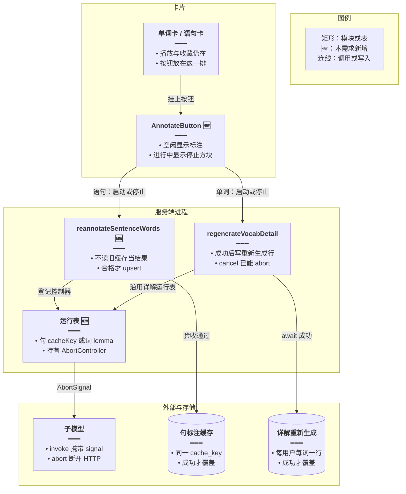
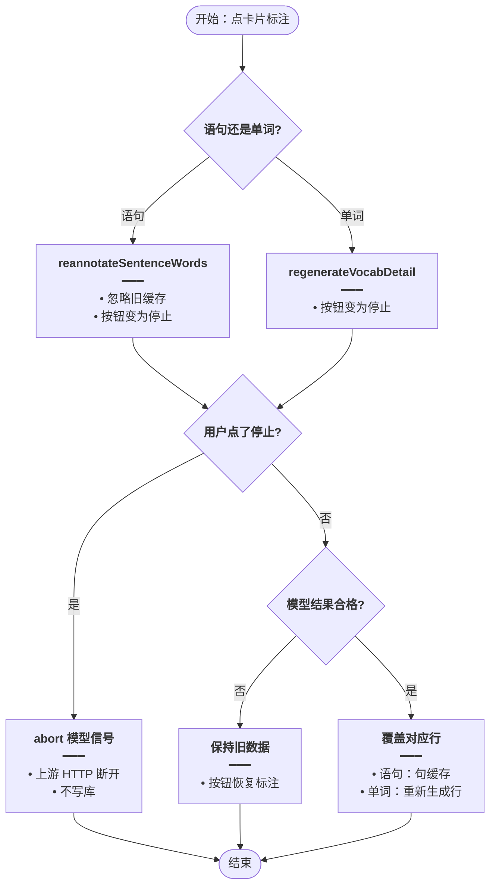
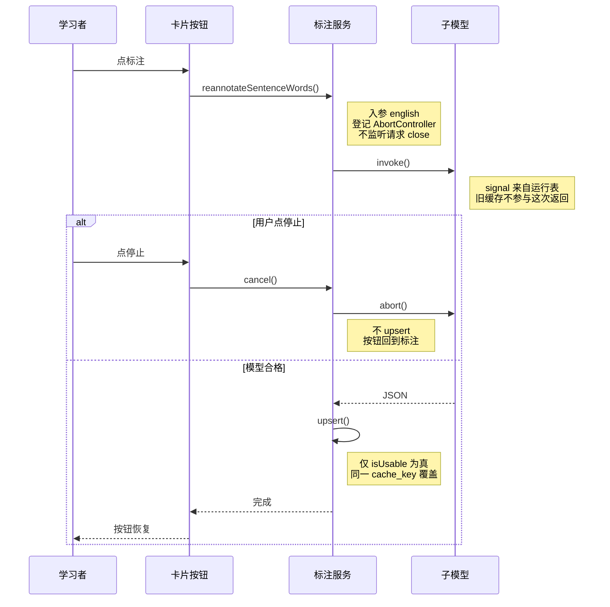
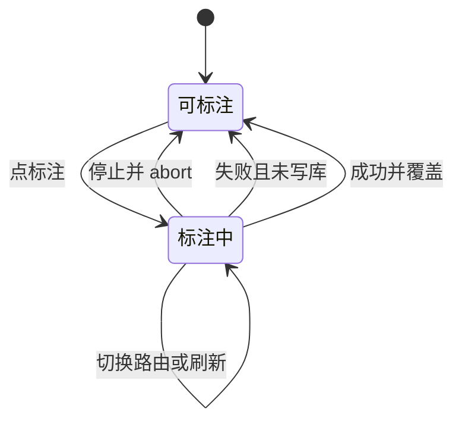

# 卡片单条标注 — 实现思路

> **状态**：已实现（见 [卡片单条重标.md](../../english/卡片单条重标.md)）  
> **日期**：2026-11-23  
> **需求摘要**：单词卡和语句卡右上角各加一枚标注按钮；已有结果只在本次模型成功后覆盖；按钮在进行中变为停止，停止必须断开上游模型请求；切换路由和刷新不停止，任务留在服务端。  
> **一句话方案（预告）**：按钮挂在两张卡片的操作区；语句强制重跑句内词标注并在验收通过后覆盖同一缓存行，单词走已有详解重新生成；任务脱离 HTTP 断连，只有停止按钮 abort 交给模型客户端的 `AbortSignal`。

## 延伸阅读

- [句子成分标识](./句子成分标识.md)（句标注多一个可选 `roleZh`，缺了也不影响命中）
- [句内词标注缓存与批量标注](../../english/句内词标注缓存与批量标注.md)（命中即跳过模型；整集 SSE 随断连 abort）
- [经典句看中写词槽练习](../../english/经典句看中写词槽练习.md)（语句标注的消费方）

---

## 0. 读本文你将得到什么

- 右上角按钮标的是「这一条」，不是整库
- 语句覆盖句标注缓存，单词覆盖该用户的详解重新生成行；都等成功才写
- 停止走现成的模型 `AbortSignal`，切页和刷新不挂这条信号
- 按钮做进两张 `Card`，列表页不用各写一遍
- 最大风险：进程重启后内存里的进行中任务消失，旧数据不会被写坏

---

## 1. 需求与边界

截图里红框是语句卡右上角现有的播放和收藏。新按钮放在这一排，单词卡同一位置。进行中换成停止方块（与播放中的 `Square` 一致）。再点一次才停止。

「已经存在就覆盖」指模型产物，不是词库正文：

| 卡片 | 已有结果放哪 | 成功后写哪 | 失败或停止 |
|------|----------------|------------|------------|
| 语句 | `english_sentence_word_annotation_cache` 同一 `cache_key`（含手动导入） | 验收通过后 `upsert` 这一行 | 不写，旧行保持 |
| 单词 | 单词详解：全站缓存、手动导入、该用户重新生成 | 只 `upsert` 该用户的重新生成行（现有顺序是重新生成优先展示） | 不写，三份旧详解都保持 |

单词不把词条上的 `ipa` / `pos` / `translationZh` 当标注覆盖。那是词库正文，手动导入的词条不能被一次模型调用改掉。

### 1.1 用户故事

| 角色 | 场景 | 行为 | 期望结果 |
|------|------|------|----------|
| 学习者 | 语句卡，这句已有标注或手动导入 | 点标注 | 仍调用模型；成功后这一句的词性、音标、释义、成分被新结果替换 |
| 学习者 | 单词卡，这个词已有详解 | 点标注 | 再打一次模型；成功后自己的重新生成份被替换，打开详解看到新内容 |
| 学习者 | 按钮已是停止图标 | 点停止 | 上游模型 HTTP 被断开；不写入；按钮回到标注 |
| 学习者 | 标注进行中 | 切到别的路由，或刷新 | 服务端继续；回到列表时这张卡仍显示停止，直到结束或自己点停止 |
| 学习者 | 标注失败 | 留在当前页或稍后回来 | 旧标注还在；按钮回到可再点 |

### 1.2 范围

| 在范围内 | 不在范围内（非目标） |
|----------|----------------------|
| `classic/Card` 与 `vocab/Card` 右上角按钮（库、Pack、收藏、错题、用到这两张卡的列表） | 改整集「在线标注 / 手动导入」的断连即停 |
| 语句：跳过缓存短路，成功后覆盖同一 `cache_key` | 升句标注缓存版本、回填旧句成分 |
| 单词：复用详解 `regenerate` / `cancel` | 改词库词条字段；删除别人的手动详解行 |
| 停止时 abort 模型客户端信号；切页、刷新不 abort | 多实例之间转移进行中的模型连接 |
| 回到页面能看出哪几张还在跑 | 卡片上展开词性和成分（结果仍在练习或详解里看） |

### 1.3 约束与依赖

- 句标注合格条件仍是 `isUsableSentenceWordAnnotations`：词数对齐且词性、音标、释义非空。`roleZh` 可空。不合格不 `upsert`。
- 模型调用已经把 `AbortSignal` 放进 `createLlm` 的 `abortSignal` 和 `llm.invoke` 的 `signal`（`invokeEnglishPackSubModelJson`）。停止必须走这条，不能只在写库前丢弃结果。
- 整集标注的 `clientDisconnectSignal` 会在请求 `close` 时 abort。单卡任务禁止接它，否则刷新就会停。
- 单词详解已有 `vocabRuns.stop`：`abort()` 交给模型客户端，取消不写重新生成行。
- 按钮样式对齐现有 `h-7 w-7` 幽灵按钮。组件用 `@/components/ui` 的 `Button`。

---

## 2. 背景

- **谁、在什么场景、卡在哪**：学习者在单词卡或语句卡上想重标这一条。语句今天只在库或 Pack 顶栏做整集标注，有合格缓存（含手动导入）就直接当命中，不会再打模型。单词详解可以重新生成，但入口在详解插件里，不在卡片右上角。
- **现状缺口**：没有单卡按钮。整集接口把「客户端断开」当成停止。单卡若复用该接口，一切路由或刷新就会把模型停掉，和本需求相反。
- **不解决会怎样**：手动导入过的句子无法从卡片上刷新标注；停止若只丢弃回包，第三方请求仍会计费跑完；刷新后面板上的停止图标也会丢。
- **硬约束**：覆盖发生在成功之后。停止必须通知到模型客户端。切页和刷新不是停止。

---

## 3. 现状与复用

| 能力 | 仓库中已有 | 本需求中的用法 |
|------|------------|----------------|
| 语句卡右上角 | `apps/frontend/src/views/englishLearning/components/classic/Card.tsx` 的 `CardActionButtons` | 扩展：播放与收藏之间加标注按钮 |
| 单词卡右上角 | `components/vocab/Card.tsx` 的 `CardActionButtons` | 扩展：同一位置 |
| 收藏星 | 各列表把 `trailingActions` 传进 `Card` | 直接复用：星仍由列表传入，标注不塞进每个列表 |
| 句标注命中短路 | `english-learning.service.ts` 的 `annotateSentenceWords` | 不适用单卡重跑：命中会跳过模型 |
| 句标注写入 | 同文件 `annotateSentenceWordsViaLlmAndCache`，验收后 `upsert` | 扩展：抽出「不读旧行、成功才写」 |
| 断连即停 | `english-learning.controller.ts` 的 `clientDisconnectSignal` | 不适用：单卡禁止接上 |
| 模型信号 | `invokeEnglishPackSubModelJson` 把 `signal` 交给 `createLlm` 与 `llm.invoke` | 直接复用：停止时 `abort()` |
| 单词详解重跑与停止 | `vocab-detail.service.ts` 的 `regenerateVocabDetail`、`cancelVocabDetail`、`vocab-detail-run.ts` 的 `createVocabRuns` | 直接复用：单词按钮只包这一对 |
| 详解展示顺序 | 重新生成、手动导入、全站缓存 | 直接复用：成功写入重新生成行后，打开详解即看到新内容 |
| 整集任务表 | `english_annotate_source_task` | 不适用：一行代表整库，并绑 SSE |
| 练习内存缓存 | `clearSentenceWordAnnotationCache` | 扩展：语句成功后清掉该句内存，避免练习还用旧标注 |

**调研结论**：语句要一条不看缓存的重跑，写入时机已经是「验收之后」。单词重跑和「abort 上游」已经在详解里。缺的是卡片按钮，以及一条不随 HTTP 断开的运行登记，好让刷新后仍能显示停止并点中同一次调用。

---

## 4. 方案比对与最终方案

### 4.1 候选方案

#### 方案 A：单条任务脱离请求，语句强制重跑，单词复用详解重新生成

- **做法**：两张 `Card` 增加标注 / 停止按钮。`POST` 启动后把 `Promise` 和 `AbortController` 留在进程内，响应可以先返回，控制器不监听 `req.close`。语句调用新的 `reannotateSentenceWords`：不走命中短路，提取与现在相同，`isUsableSentenceWordAnnotations` 通过才 `upsert`。单词调用现有 `regenerateVocabDetail` 与 `cancelVocabDetail`。列表重新挂载时 `GET` 当前用户正在跑的键，把对应按钮画成停止。
- **能工作的原因**：`llm.invoke(..., { signal })` 已经会在 `abort` 时断开上游 HTTP。不把 `clientDisconnectSignal` 接进来，刷新只是浏览器那条 HTTP 没了，进程里的 `Promise` 还在。写库点在成功之后，停止和失败都到不了 `upsert`。
- **主要代价**：进行中状态在内存里。进程一重启，按钮不再显示停止，那一次上游调用也随进程结束；旧行因为没写过而还在。

#### 方案 B：单卡也走整集 SSE 任务，并把断连改成不停止

- **做法**：为这一句或这一词插入 `english_annotate_source_task` 的一行，前端照整集那样订 SSE。改掉 `clientDisconnectSignal`，让 `close` 不 `abort`。停止按钮另调取消接口。语句仍要加一个忽略缓存的分支，否则有手动导入时 SSE 会立刻报命中。
- **能工作的原因**：任务行在刷新后还在，进度页也能看到。模型调用只要不把断开当成 abort，就会在后台跑完并在成功时写缓存。
- **主要代价**：单卡被装进整库任务模型（`libraryId` / `streamId`、进度 JSON、SSE）。收藏和错题里的卡片没有「当前库任务」这层，还得再造一个不依赖库 id 的任务。SSE 在刷新后本来就会断，按钮状态仍要另查状态，SSE 没有省掉查询。

### 4.2 比对

| 维度 | 方案 A | 方案 B |
|------|--------|--------|
| 正确性（失败路径、边界、数据是否会错） | 成功才 `upsert`。`abort` 在写库前抛出。旧行不动 | 只要写库仍放在验收之后，覆盖语义相同。任务行若在启动时就写成 running，失败时要记得改状态，否则刷新后按钮一直停在停止 |
| 复用 / 与现状契合 | 语句复用提取和 `upsert`；单词复用 `regenerate` / `cancel`；停止复用 `createVocabRuns` 这一类登记 | 复用整集 SSE 与任务表，但收藏、错题、Pack 与库的卡片来源不统一，任务表的 `libraryId` 对不上 |
| 改动面（要动哪些路径） | 两张 `Card`、一句重跑方法、一个状态查询、单词按钮接到现有详解接口 | 整集 SSE、任务表、断连策略，外加单卡忽略缓存；断连策略一改，整集标注也会变成关页继续跑 |
| 复杂度（新概念、新状态、新依赖） | 进程内一张运行表，无新表 | 单卡任务和整库任务挤在同一张表，还要维持 SSE |
| 体验（延迟、步骤数、失败时用户看到什么） | 点一下按钮变停止。失败后按钮恢复，旧标注还在 | 此项的等待时间相同。刷新后若只靠已断开的 SSE，停止图标会丢，除非再做状态查询 |
| 风险（迁移、互斥、并发、回滚） | 无表结构变更。同一句两个人同时重跑时后写覆盖先写 | 改断连会让整集标注在关页后继续烧模型额度。回滚要同时收回 SSE 行为 |
| 可维护性（以后改一处还是改多处） | 单卡与整集分开，整集「断连即停」保持原样 | 两条产品规则（整集关页就停、单卡关页不停）堆在同一个 SSE 入口 |

### 4.3 综合考量

权重在「停止必须断上游」和「刷新不能被现有断连逻辑误伤」。方案 A 不碰 `clientDisconnectSignal`，整集标注行为不变，停止仍用已经接上模型客户端的 `AbortSignal`。方案 B 能把任务行留在数据库里，刷新后更容易查出「还在跑」，但为了这个去改整集 SSE，会把关页继续跑的行为带给整库标注，而且收藏页的卡片没有库任务可挂。

选定方案 A。放弃方案 B「刷新后数据库里仍有一条任务记录」这一点。进程还在时，内存登记足够把停止图标画回来；进程没了，旧标注本来就没被提前删掉。

### 4.4 最终方案

#### 背景

语句标注有合格缓存就不会再打模型，手动导入走的是同一张表。整集接口把浏览器断开当成停止。单词详解已经能在成功后覆盖重新生成行，并且 `cancel` 会 `abort` 模型信号，但卡片上没有入口。单卡要的是：强制再跑、成功才覆盖、只有停止按钮断开上游、路由和刷新留在服务端。

#### 具体思路

1. 按钮做在两张 `Card` 的操作区，列表继续只传收藏星。语句和单词各调自己的接口。
2. 语句数据仍进 `english_sentence_word_annotation_cache`。先打模型，验收通过才 `upsert`，不先删旧行。单词数据仍进详解重新生成表，调用现有 `regenerateVocabDetail`（它在 `await` 成功之后才 `upsert`）。
3. 进行中状态放在服务端进程内的 `Map`，不放 MobX 当作唯一真相。页面用本地状态显示停止图标，挂载时用查询对齐服务端。切走时 `useEffect` 不发取消。
4. 停止只 `abort` 这一轮的 `AbortController`。信号就是 `invokeEnglishPackSubModelJson` / 详解 `callModel` 交给模型的那一个。取消、超时、解析失败都不写库。

#### 实现方案

**一句话**：按钮挂在两张卡片的操作区；语句强制重跑句内词标注并在验收通过后覆盖同一缓存行，单词走已有详解重新生成；任务脱离 HTTP 断连，只有停止按钮 abort 交给模型客户端的 `AbortSignal`。

| 步骤 | 谁 | 做什么 | 输入 → 输出 |
|------|----|--------|-------------|
| 1 | `CardActionButtons` | 播放按钮旁渲染标注或停止 | 句文本或词面 → 点击 |
| 2 | `POST .../reannotate` 或现有 `vocab-detail/regenerate` | 登记控制器并开始模型调用，不监听请求关闭 | 句或词 → `{ running: true }` |
| 3 | `reannotateSentenceWords` | 跳过命中；提取；合格才 `upsert` | 句 + 分词 → 新缓存行或抛错 |
| 4 | `cancel` | `abort()` 这一轮信号 | 键 → `{ cancelled: true }`，不写库 |
| 5 | `GET .../running` | 返回该用户仍在跑的键 | 无 → 键列表 |
| 6 | 卡片挂载 | 用键列表把按钮设成停止；成功则清该句练习内存缓存 | 键列表 → 图标 |

#### 选定原因

1. **正确性**：写库在验收之后，`abort` 到不了 `upsert`。牺牲：两个用户同时重跑同一句时，后完成的覆盖先完成的。
2. **复用**：单词整段复用详解重新生成和取消。牺牲：单词按钮更新的是详解重新生成行，不是词条上的音标。
3. **改动面**：整集 SSE 一行不改。牺牲：单卡要新的启动和状态接口，不能只在前端改按钮。
4. **复杂度**：一张进程内 `Map`。牺牲：没有任务表，重启后看不出「刚才还在跑」。
5. **体验**：点一次即变停止，刷新后查询能把图标恢复。牺牲：刷新过程中那零点几秒可能先闪成标注图标，查询返回后再变停止。
6. **风险**：断连逻辑保持只作用于整集。牺牲：单卡任务和整集任务的生命周期规则不同，调用时不能共用同一个 `signal` 工厂。
7. **可维护性**：语句重跑和练习用的「有缓存就返回」分成两个方法。牺牲：提取逻辑要被两个方法调用，不能复制一份 prompt。

#### 优势

- 相对方案 B：收藏、错题、Pack、词库都能用同一颗按钮，不用给没有 `libraryId` 的卡片造任务行；整集标注仍然是关页就停。

#### 怎么实现

1. `classic/Card.tsx` 与 `vocab/Card.tsx` 在播放按钮和 `trailingActions` 之间放入 `AnnotateButton`。语句传入 `english`，单词传入 `word`。
2. 语句 `reannotateSentenceWords` 复制 `annotateSentenceWordsViaLlmAndCache` 的后半：分词用现有 `segmentEnglishSentenceWords`，`signal` 来自运行表而不是 `clientDisconnectSignal`，合格才 `upsert`。命中旧行时不返回。
3. 启动接口把 `runKey` 放进与 `createVocabRuns` 相同形态的表后立刻返回。真正的 `await` 在服务里的 `Promise` 上，不依赖浏览器还连着。
4. 停止接口 `runs.stop`。语句路径在 `upsert` 前若 `signal.aborted` 则抛 `AbortError` 并返回。单词路径继续用 `cancelVocabDetail`。
5. `GET` 返回该用户 `running` 的语句 `cache_key` 与单词 lemma。卡片挂载时对上就显示停止。
6. 语句 `Promise` 成功后调用方无需推 SSE。用户还在页上时，按钮请求的完成回调把图标改回，并 `clear` 这一句的练习内存缓存。用户已经离开时，下次练习按缓存键读到新行。

### 4.5 其他关键决策

单词按钮若写进句标注缓存，练习和卡片都不会读它；若改词条音标，会改掉导入正文。这是数据归属，单独比对。

#### 4.5.1 候选方案

##### 方案 A：单词按钮调用详解重新生成（选定）

- **做法**：`vocab/Card` 的按钮 `POST /vocab-detail/regenerate`，停止 `POST` 现有取消接口。成功后的 `upsert` 已经在 `regenerateVocabDetail` 的 `await` 之后。展示仍按重新生成、手动导入、全站缓存。
- **能工作的原因**：这条链路已经把 `AbortSignal` 交给模型，并且取消不会写行。刷新不取消，是因为取消只在取消接口里发生，详解控制器今天也没有接 `clientDisconnectSignal`。
- **主要代价**：卡片上的「标注」对单词打开的是详解重跑，不是词性音标那一套句标注。词条音标不变。

##### 方案 B：单词也写入句标注缓存，把词面当成只有一个词的句子

- **做法**：用词面做 `english`，分词得到一词，走 `reannotateSentenceWords`，覆盖 `cache_key`。
- **能工作的原因**：和语句共用写库与停止。有缓存也能重跑。
- **主要代价**：单词练习读的是词条 `pos` / `ipa`，不读这张缓存。按钮成功后，词库卡片和拼写都看不出变化，除非再改练习去读缓存。

#### 4.5.2 比对

| 维度 | 方案 A | 方案 B |
|------|--------|--------|
| 正确性（失败路径、边界、数据是否会错） | 失败不写重新生成行，手动导入份还在 | 失败不写句缓存。成功写了也没有画面消费，用户会以为没覆盖 |
| 复用 / 与现状契合 | `regenerate` 与 `cancel` 已存在 | 句标注管道能跑一词，但是单词产品不读它 |
| 改动面（要动哪些路径） | 单词卡只接两个现有接口 | 要再改单词练习或词条，否则结果无处显示 |
| 复杂度（新概念、新状态、新依赖） | 无新存储 | 一词一句的缓存键和真正的句子键可能撞车（词面等于某句时不会，键含分词序列） |
| 体验（延迟、步骤数、失败时用户看到什么） | 成功后打开详解即为新内容 | 成功后卡片无变化 |
| 风险（迁移、互斥、并发、回滚） | 与详解插件的重新生成是同一次运行，重复点会并到同一个 `runKey` | 词库正文不会被改，此项风险低，但等于做了无展示的写入 |
| 可维护性（以后改一处还是改多处） | 停止逻辑只留在详解服务 | 单词和语句两套「标注」名词指同一张表，和详解插件并列，以后难分辨 |

#### 4.5.3 综合考量

用户要的覆盖，是模型结果盖住上一次模型或手动结果，并且成功之后才写。单词侧已经满足这句的是详解重新生成，不是词条，也不是没人读的句缓存。方案 B 的优点是两条卡片共用一个写库函数，但写完没有读者。

选定方案 A。放弃方案 B「单词和语句共用一张标注表」这一点。

#### 4.5.4 最终方案

##### 背景

单词卡和语句卡长得像，右上角都是播放和收藏。语句的标注在句缓存。单词没有这张表，模型产物在详解三份数据里。

##### 具体思路

1. 按钮外观一致，请求分开。
2. 单词只调 `regenerateVocabDetail` 与 `cancelVocabDetail`。
3. 进行中图标靠详解现有的 in-flight，加上 §4.4 的状态查询把 lemma 算进去。
4. 不更新 `english_vocabulary_library_item`。

##### 实现方案

**一句话**：单词卡的标注就是详解重新生成，成功后才覆盖该用户的重新生成行。

| 步骤 | 谁 | 做什么 | 输入 → 输出 |
|------|----|--------|-------------|
| 1 | 单词 `AnnotateButton` | 启动或停止 | `word` → 现有详解接口 |
| 2 | `regenerateVocabDetail` | 模型成功后 `upsert` | lemma → 重新生成行 |
| 3 | `cancelVocabDetail` | `vocabRuns.stop` | lemma → 上游断开，不写 |

##### 选定原因

1. **正确性**：写在 `await` 之后。牺牲：手动导入的详解行还在库里，只是展示让位给重新生成。
2. **复用**：不新做单词模型提示词。牺牲：按钮文案若写「词性标注」，会和详解不符，文案要用「标注」并在停时写「停止标注」。
3. **改动面**：单词服务不改写库顺序。牺牲：单词卡要知道详解接口，不能和语句共用一个 URL。
4. **复杂度**：无新表。牺牲：两种运行键（句 `cache_key`、词 lemma）要在状态查询里并列返回。
5. **体验**：成功后进详解能看到新内容。牺牲：词卡上的音标字符串不会因此改变。
6. **风险**：和详解插件同时点，是同一个 `runKey`，停止会停掉同一次。这是同一轮，不是误伤。牺牲：没有单独的「只停卡片、不停插件」的第二次调用。
7. **可维护性**：取消仍只有 `cancelVocabDetail`。牺牲：卡片和插件两个入口要接受共用一轮。

##### 优势

- 相对方案 B：成功之后用户在详解里看得到新文本，词库导入的音标不会被改掉。

##### 怎么实现

1. 单词按钮不调用 `reannotateSentenceWords`。
2. 启动和停止分别用现有 regenerate 与 cancel。
3. 状态查询把 `vocabDetailRegenInflight` 里属于该用户的 lemma 一并返回。代码见 §9.2。

---

## 5. 架构图



**图内方法说明**：

| 方法 | 功能 |
|------|------|
| `reannotateSentenceWords` | 对一句强制打模型。不把已有缓存当返回值。提取结果合格才覆盖该 `cache_key`，停止和失败不写 |
| `regenerateVocabDetail` | 单词详解再打一次模型，成功后覆盖该用户这一词的重新生成行。卡片启动按钮直接调用 |
| `AnnotateButton` | 按运行状态在标注与停止之间切换。切路由时不调用取消 |

**读图要点**：

- 语句和单词的写库目标不同，停止都落在进程内那张运行表的 `AbortSignal` 上。
- 整集 SSE 和 `clientDisconnectSignal` 不在这张图里。
- 句缓存和详解重新生成都是成功之后才写入。

---

## 6. 主流程图



**图内方法说明**：

| 方法 | 功能 |
|------|------|
| `reannotateSentenceWords` | 语句分支的模型调用与验收。旧行只在合格时被 `upsert` 盖住 |
| `regenerateVocabDetail` | 单词分支。内部在模型返回后才写重新生成行 |
| `abort` | 停止分支。作用在交给 `createLlm` / `llm.invoke` 的 `AbortSignal` 上，不是只丢掉响应 |

**读图要点**：

- 切路由和刷新不出现在判断里，它们不进入停止分支。
- 不合格与停止都落到「不写库」，只是停止多了一次上游断开。
- 合格才覆盖，所以手动导入在新结果出来之前一直还在。

---

## 7. 核心时序图



**图内方法说明**：

| 方法 | 功能 |
|------|------|
| `reannotateSentenceWords` | 语句单卡的启动。即使缓存里已有手动导入也调用模型 |
| `invoke` | 子模型请求。`signal` 中止时由客户端断开上游，不等到生成结束再丢弃 |
| `cancel` | 停止按钮。找到这一轮的控制器并 `abort`，随后写库被跳过 |
| `upsert` | 只在合格结果上执行，把新标注写到原 `cache_key` |

**读图要点**：

- 单词把 `reannotateSentenceWords` 换成 `regenerateVocabDetail`，`cancel` 换成 `cancelVocabDetail`，写库换成重新生成行，顺序相同。
- 刷新发生在 `invoke` 期间时，图上的 `UI` 可以不在，`API` 到 `M` 的调用继续，直到完成或另一次 `cancel`。
- 没有「先删旧行再请求」的消息。

---

## 8. 状态机



**图内方法说明**：

| 方法 | 功能 |
|------|------|
| `cancel` | 「停止并 abort」那条迁移。只有它会把模型信号标成 aborted |
| `reannotateSentenceWords` | 「点标注」进入标注中。刷新不重新进入，也不退出，服务端 Promise 仍是同一个 |

**读图要点**：

- 刷新是自环，避免把浏览器卸载写成停止。
- 成功和失败都回到可标注，差别只在有没有写库。

---

## 9. 具体实现（主链路代码）

### 9.1 模块一览

| 模块 | 职责 | 新增/改动 | 预估路径 |
|------|------|-----------|----------|
| 标注按钮 | 图标与点击 | 新增 | `apps/frontend/src/views/englishLearning/components/annotate/Button.tsx` |
| 两张卡 | 放进操作区 | 扩展 | `components/classic/Card.tsx`、`components/vocab/Card.tsx` |
| 语句重跑 | 跳过命中，成功才覆盖 | 新增方法 | `english-learning.service.ts` |
| 运行表 | 句与词的进行中键 | 新增，形态同 `createVocabRuns` | `sentence-annotate-run.ts` |
| 单词 | 启动与停止 | 直接复用 | `vocab-detail.service.ts` 已有方法 |
| 状态查询 | 刷新后恢复停止图标 | 新增 GET | `english-learning.controller.ts` |

### 9.2 主链路实现

```typescript
// 对应 §4.4 步骤 3。与练习接口分开，避免「有缓存就返回」把手动导入挡住
async reannotateSentenceWords(params: {
	userId: number;
	english: string;
	signal: AbortSignal;
}): Promise<{ words: SentenceWordAnnotationDto[] }> {
	// 分词与缓存键和在线标注一致，覆盖才会落在同一行
	const words = segmentEnglishSentenceWords(params.english);
	const englishNorm = params.english.trim().toLowerCase();
	const cacheKey = buildSentenceWordAnnotationCacheKey(englishNorm, words);
	// 不 findOne 旧行。旧行留到下面合格为止
	const annotated = await this.annotateSentenceWordsViaLlmAndCache({
		userId: params.userId,
		english: params.english.trim(),
		englishNorm,
		words,
		cacheKey,
		signal: params.signal,
	});
	return annotated;
}
```

现有 `annotateSentenceWordsViaLlmAndCache` 已在 `isUsableSentenceWordAnnotations` 失败时抛错、在抛错前不 `upsert`。重跑只是不再提前 `return { words: hit.annotations }`。若该方法内部仍会先读缓存，重跑应调用它「调用模型并验收」的那一段，而不是包一层还会短路的 `annotateSentenceWords`。

```typescript
// 对应 §4.4 步骤 4。停止必须打到模型客户端，不能只在写库前 return
function cancelSentenceAnnotate(runKey: string): { cancelled: boolean } {
	// runKey 含 userId 与 cacheKey，避免甲用户的停止拆掉乙用户的另一次调用
	const cancelled = sentenceRuns.stop(runKey, sentenceInflight.has(runKey));
	// stop 内部 abort 的控制器，就是 invoke 的 signal
	return { cancelled };
}
```

```typescript
// 对应 §4.4 步骤 2。启动接口不把浏览器断开接进 signal
@Post('practice/reannotate-sentence-words')
async reannotateSentence(@Req() req: AuthedRequest, @Body() body: { english: string }) {
	// 控制器来自运行表，不来自 clientDisconnectSignal
	const ac = sentenceRuns.arm(runKey(req.user.userId, body.english));
	// 不等浏览器：把 Promise 留在 inflight，请求可以先结束
	const job = this.englishLearningService.reannotateSentenceWords({
		userId: req.user.userId,
		english: body.english,
		signal: ac.signal,
	});
	sentenceInflight.set(runKey(req.user.userId, body.english), job);
	return { running: true };
}
```

```typescript
// 对应 §4.5 步骤 1。单词不进句缓存
function onWordAnnotate(word: string, running: boolean) {
	// 进行中再点就是停止，避免叠两次模型
	if (running) {
		void cancelVocabDetail(word);
		return;
	}
	void regenerateVocabDetail(word);
}
```

`createVocabRuns.stop` 已经 `ac.abort()`。语句运行表按同一函数复制，不要再写一种只改布尔值的取消。

### 9.3 数据模型

| 字段/实体 | 来源 | 存储 | 说明 |
|-----------|------|------|------|
| 句标注行 | 模型 JSON | 现有缓存表，同一 `cache_key` | 成功才覆盖；无新列 |
| 详解重新生成行 | 现有详解 JSON | 现有每用户每词一行 | 成功才覆盖 |
| 运行键 | 服务端 | 进程内存 | 刷新仍在；进程重启清空 |
| 按钮进行中 | `GET` 运行键 | 卡片本地 state | 不是唯一真相 |

---

## 10. 分阶段实现步骤

| 阶段 | 目标 | 交付物 | 依赖 |
|------|------|--------|------|
| M1 | 语句能强制重跑且成功才覆盖 | `reannotateSentenceWords` 与停止 | 无 |
| M2 | 两张卡出现按钮，刷新后仍能停止 | 按钮、状态查询、卸载不取消 | M1 |
| M3 | 单词按钮接到详解 | 单词卡点击 regenerate / cancel | M2 |

### M1

- [ ] `reannotateSentenceWords` 在已有合格缓存时仍调用模型
- [ ] 不合格、抛错、`signal.aborted` 时不 `upsert`，旧行字节级仍在
- [ ] `abort` 使用 `invokeEnglishPackSubModelJson` 的 `signal`，日志能看到模型调用被中止
- [ ] 控制器不调用 `clientDisconnectSignal`

### M2

- [ ] 语句卡播放与收藏之间出现按钮；进行中为停止方块
- [ ] 切到其他路由再回来，请求仍在服务端，按钮为停止
- [ ] 刷新后 `GET` 运行列表，该卡仍为停止；点停止后上游断开且缓存未被新结果覆盖
- [ ] 成功后该句练习内存缓存被清掉

### M3

- [ ] 单词卡同一位置的按钮调用 `regenerateVocabDetail`
- [ ] 停止调用 `cancelVocabDetail`，重新生成行保持停止前的内容
- [ ] 成功后打开详解看到新文本；词条 `ipa` / `pos` 不变

---

## 11. 风险、边界与待确认

| 项 | 等级 | 说明 | 缓解 |
|----|------|------|------|
| 进程重启 | 中 | 内存运行表清空，上游连接随进程断开 | 旧行未预先删除，数据仍是上一份成功结果。不在本需求做任务表 |
| 刷新瞬间图标闪一下 | 低 | 本地 state 先空闲，查询返回后变停止 | 列表挂载即查，不在卸载时取消 |
| 两人同时重跑一句 | 低 | 后完成的 `upsert` 覆盖先完成的 | 接受。停止只作用于自己的 `runKey` |
| 单词按钮和详解插件同一轮 | 低 | 同一个 `runKey` | 停一次就停这一轮，不另开平行请求 |
| 整集标注被误改 | 高 | 若把断连改成不停止，关页会继续烧整库额度 | 单卡新接口，不修改 `clientDisconnectSignal` 的调用点 |

**待确认**：

- [ ] 无。单词不改词条、语句成功才覆盖缓存、停止才断上游、刷新不停，已按现有两套存储定死。

---

## 12. 验收清单

| # | 用例 | 步骤 | 期望 |
|---|------|------|------|
| AC1 | 已有手动导入仍会重跑 | 语句已导入标注，点卡片标注 | 出现模型请求；成功后该 `cache_key` 变为新内容 |
| AC2 | 成功前不覆盖 | 请求飞着时读缓存 | 仍是旧标注 |
| AC3 | 停止断上游 | 进行中点停止 | 模型调用中止日志出现；缓存仍是旧内容；按钮恢复 |
| AC4 | 刷新不停 | 进行中刷新页面 | 服务端任务仍在；回来后按钮是停止 |
| AC5 | 切路由不停 | 进行中打开别的页面再返回 | 同 AC4 |
| AC6 | 失败保持旧数据 | 模型返回不合格 JSON | 不 `upsert`；按钮恢复 |
| AC7 | 单词成功覆盖详解 | 该词已有详解，点单词卡标注并等待成功 | 详解展示新内容；词条音标不变 |
| AC8 | 单词停止不写 | 单词标注进行中点停止 | 重新生成行不变；上游中止 |
| AC9 | 整集行为不变 | 整集在线标注过程中关闭页面 | 仍按今天的断连停止，不因本需求继续跑完 |

---

## 13. 预估改动面（实现阶段参考）

| 类型 | 路径（预估） |
|------|--------------|
| 前端 | `components/classic/Card.tsx`、`components/vocab/Card.tsx`、新建 `components/annotate/Button.tsx`、`service/index.ts` 增加单句重跑与运行查询 |
| 后端 | `english-learning.service.ts` 增加 `reannotateSentenceWords`、`english-learning.controller.ts` 增加启动 / 停止 / 运行列表；新建与 `createVocabRuns` 同形的语句运行表 |
| 不改 | `clientDisconnectSignal` 的整集调用点、`isUsableSentenceWordAnnotations`、词条表、详解三份数据的读取顺序 |
| 文档（实现后） | `micro-apps/remote-docs/wiki/english/` 句内词标注专题补单卡重跑 |

---

（本文档为规划态实现思路；落地后以源码与 remote-docs wiki 专题为准）
