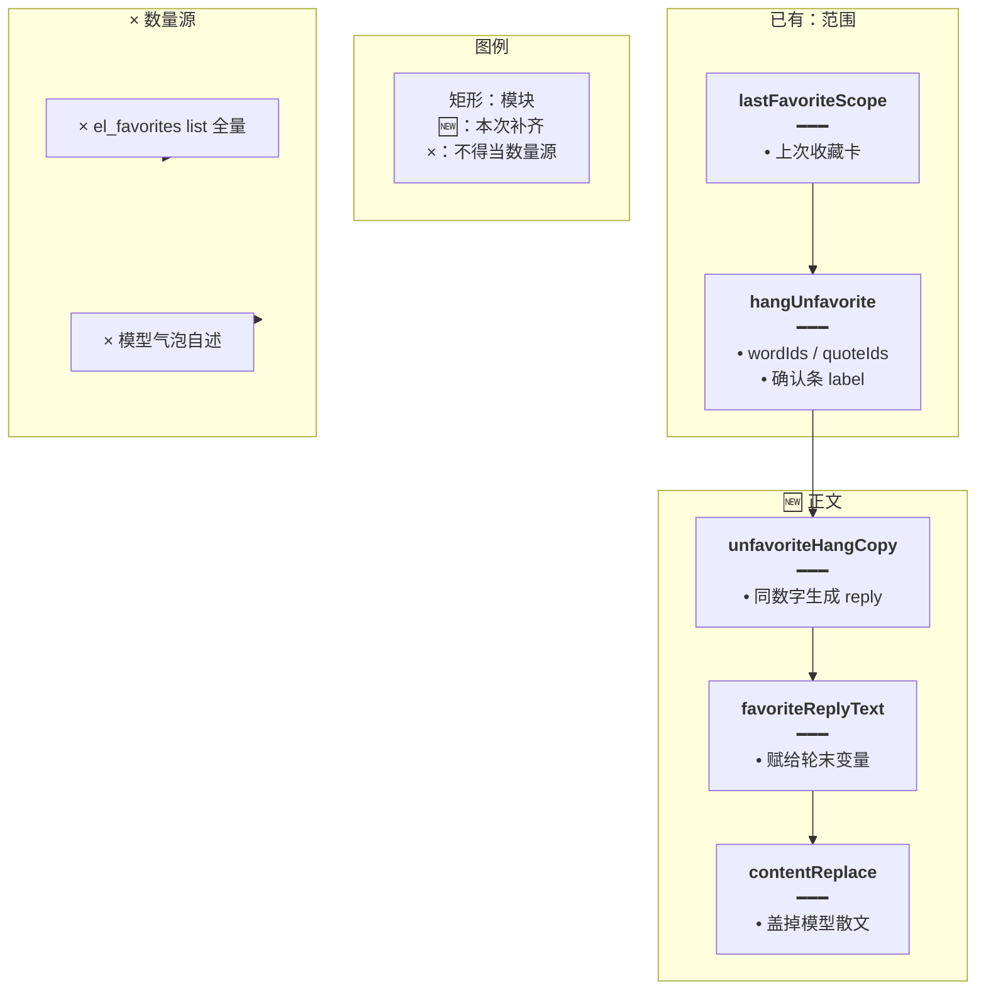
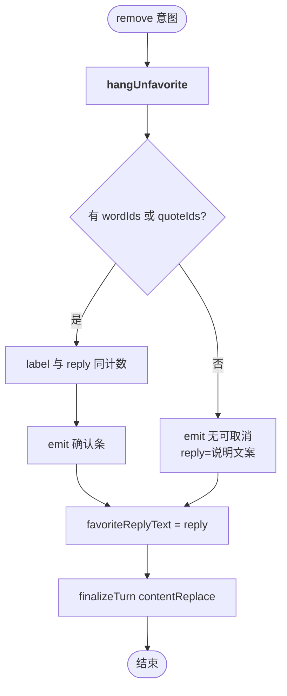
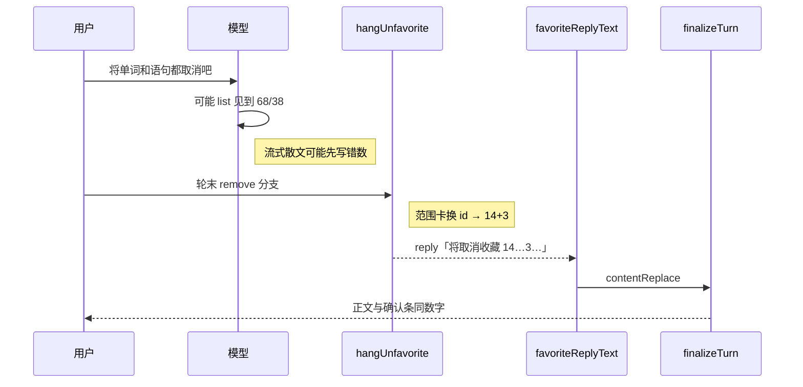

# 取消正文跟确认条 — 实现思路

> **状态**：规划（M1 工作区已落地）  
> **日期**：2026-10-30  
> **需求摘要**：用户说「将单词和语句都取消吧」时，确认条已是上一次收藏范围（如 14 词 + 3 句），气泡正文不得再写整夹总数（如 68 词 + 38 句）。  
> **一句话方案（预告）**：取消轮末与添加一样，用 `hangUnfavorite` 算出的 `wordIds`/`quoteIds` 生成 `favoriteReplyText`，经 `contentReplace` 盖掉模型散文；名单仍只来自上一次收藏范围，不来自 list 全量。

## 延伸阅读

- [取消沿用上次收藏](./取消沿用上次收藏.md)：确认条范围已落地（`lastFavoriteScope`）。本文只补**正文与确认条同源**
- [收藏确认跟卡片](./收藏确认跟卡片.md)：添加路径已有 `favoriteReplyText` + `contentReplace`；取消应对齐同一模式
- [收藏意图总控](./收藏意图总控.md)：`remove` 进闸已落地
- [收藏只收库卡](./收藏只收库卡.md)：添加选卡来源；本文不改选卡
- [再收藏不断窗](./再收藏不断窗.md)：「那帮我取消」未进闸会断窗，再「都收藏」变成整库 107+51。省略取消与丢整库卡由那篇收口

---

## 0. 读本文你将得到什么

- 为什么确认条是 14+3，气泡却写「单词共 68、语句共 38」
- 选定方案：取消也设 `favoriteReplyText`，数字只认挂条用的 id 个数
- 改动在 `favorite-ask.ts`（文案纯函数）+ `agent.service.ts`（`hangUnfavorite` 返回并赋值）
- 一个阶段即可；不改确认条 UI、不改删表
- 最大风险：流式阶段仍短暂看到模型字，轮末 replace 盖掉

---

## 1. 需求与边界

### 1.1 用户故事

| 角色 | 场景 | 行为 | 期望结果 |
|------|------|------|----------|
| 登录用户 | 刚收藏过家庭 14 词 + 若干句；收藏夹里另有很多旧项 | 「将单词和语句都取消吧」 | 确认条与正文均为上次范围行数（如 14+3），不是整夹 68+38 |
| 登录用户 | 上次范围已不在收藏里 | 再说取消 | 正文说明没有可取消的；不挂条；不出现整夹数字 |

### 1.2 范围

| 在范围内 | 不在范围内 |
|----------|------------|
| 取消轮 `favoriteReplyText` + `contentReplace` | 改取消选卡规则、清空全部收藏产品 |
| 文案与确认 `label` 同源计数 | 禁止模型调用 list（可另文） |

### 1.3 约束与依赖

- 复用 `hangUnfavorite`、`favoriteReplyText`、`finalizeTurn` 里已有 replace
- 可取消集合仍 = 上一次收藏 ∩ 仍在表内；**不是** list 全量
- 模型散文永不作为取消数量来源

---

## 2. 背景

- **谁、在什么场景、卡在哪**：用户取消词句收藏。底栏「确认取消收藏 14 个词、3 条语句」正确；气泡写「单词共 68 个，语句共 38 条…全部取消」。
- **现状缺口**：添加轮会设 `favoriteReplyText = plan.reply` 再 replace；取消轮只 `hangUnfavorite` 挂条，**不写** `favoriteReplyText`，`finalizeTurn` 保留模型正文。模型常先 `el_favorites list`，把整夹 68/38 写进散文。`propose_remove` 虽 deferred，挡不住 list 后的胡编。
- **不解决会怎样**：确认条对、用户仍以为要清空整夹，不敢点确认或误点。
- **硬约束**：正文数字必须等于挂条用的 `wordIds.length` / `quoteIds.length`。

---

## 3. 现状与复用

| 能力 | 仓库中已有 | 本需求用法 |
|------|------------|------------|
| 取消范围 | `lastFavoriteScope` / `hangUnfavorite` | 直接复用；已产出正确 label |
| 添加正文覆盖 | `favoriteReplyText` + `contentReplace` | **取消对齐同一变量** |
| 工具 defer | `propose_remove` → deferred | 保持；不解决正文 |

**调研结论**：选卡/挂条已对。缺的是取消路径把计数写进 `favoriteReplyText`。

---

## 4. 方案比对与最终方案

### 4.1 候选

#### 方案 A：加强 prompt，禁止写整夹数字

- **做法**：工具回执 / system 强调「取消数量以确认条为准」。
- **能工作原因**：偶发有效。
- **代价**：仍偶发；与「名单不信散文」原则冲突。

#### 方案 B：取消也设 `favoriteReplyText`（与添加同模式）

- **做法**：`hangUnfavorite` 用已算好的 id 个数生成 reply；调用方赋给 `favoriteReplyText`；无 id 时用「没有还能取消的」覆盖。
- **能工作原因**：`finalizeTurn` 已优先 `favoriteReplyText`。
- **代价**：流式阶段可能短暂闪模型字。

#### 方案 C：取消意图命中后禁止 list

- **做法**：remove 意图下 `el_favorites list` 直接拒或空回执。
- **能工作原因**：模型少看到 68/38。
- **代价**：改工具面更大；不设 replace 时仍可能编数。

### 4.2 比对

| 维度 | 方案 A | 方案 B | 方案 C |
|------|--------|--------|--------|
| 正确性 | 偶发 | 正文=挂条计数，确定 | 减诱因，不保证正文 |
| 复用 | 低 | 复用 favoriteReplyText | 改 domain-tools |
| 改动面 | prompt | hangUnfavorite + 调用方 | 工具闸 |
| 复杂度 | 低但不稳 | 低 | 中 |
| 体验 | 仍可能错 | 轮末对齐 | 仍可能编 |
| 风险 | 高 | 流式闪一下 | 误伤真要看列表 |
| 可维护性 | 差 | 与添加对称 | 多一条工具特例 |

### 4.3 综合考量

权重是**正确性**与**与添加路径对称**。选定 **B**。放弃 A（不稳）。C 可作后续减闪烁，不代替 B。

### 4.4 最终方案

#### 背景

确认条已由 `hangUnfavorite` 按上次收藏挂对；气泡仍是模型读 list 全量后的散文。添加路径已有 `favoriteReplyText` 先例。

#### 具体思路

1. 在 `favorite-ask.ts` 增加纯函数：由 vocab/classic 取消个数生成 `label` + `reply`（与现有 label 字符串一致）。
2. `hangUnfavorite` 挂条时用该函数；返回 `reply`（无行可取消则返回说明文案）。
3. remove 分支：`favoriteReplyText = await hangUnfavorite(...)`。
4. 不改 `finalizeTurn`。

#### 实现方案

**一句话**：取消轮末用挂条同一组 id 个数写入 `favoriteReplyText`，`contentReplace` 盖掉 68/38 类散文。

| 步骤 | 谁 | 做什么 |
|------|----|--------|
| 1 | `unfavoriteHangCopy` | count → `{ label, reply }` |
| 2 | `hangUnfavorite` | 挂条后 return reply |
| 3 | remove 调用方 | 赋 `favoriteReplyText` |

#### 选定原因

1. **正确性**：正文与确认条同一计数源。牺牲：不先禁 list。
2. **复用**：与添加 `favoriteReplyText` 同槽。牺牲：比改一句 prompt 多几行。
3. **改动面**：不碰前端、不碰删表。

#### 优势

- 相对 A：确定对齐，不靠模型听话。
- 相对 C：不扩大工具闸；C 仍可后加。

#### 怎么实现

见 §9。验收：确认条 14+3 时正文不得出现 68/38。

---

## 5. 架构图



**图内方法说明**：

| 方法 | 功能 |
|------|------|
| `lastFavoriteScope` | 已有。圈定上次收藏卡 |
| `hangUnfavorite` | 已有挂条；扩展为返回 reply |
| `unfavoriteHangCopy` | 新增。由两侧个数生成 label/reply |
| `favoriteReplyText` | 已有槽位。取消也写入 |
| `contentReplace` | 已有。轮末替换正文 |

**读图要点**：确认条与正文都从 id 计数出来；list 全量不得进文案。

---

## 6. 主流程图



**图内方法说明**：

| 方法 | 功能 |
|------|------|
| `hangUnfavorite` | 选卡换 id、挂条、返回 reply |
| `unfavoriteHangCopy` | 生成与 label 一致的正文 |
| `finalizeTurn` | 用 favoriteReplyText 替换 accumulated |

**读图要点**：无行可取消也要 replace，避免留下 68/38。

---

## 7. 核心时序图



**图内方法说明**：

| 方法 | 功能 |
|------|------|
| `hangUnfavorite` | 服务端唯一计数源 |
| `favoriteReplyText` | 把 reply 交给轮末 |
| `finalizeTurn` / `contentReplace` | 盖掉模型 68/38 |

**读图要点**：模型 list 可发生，但不决定最终正文。

---

## 8. （可选）状态机

无新长期状态。跳过。

---

## 9. 具体实现（主链路代码）

### 9.1 模块一览

| 模块 | 职责 | 类型 | 路径 |
|------|------|------|------|
| `unfavoriteHangCopy` | label/reply | 新增 | `favorite-ask.ts` |
| `hangUnfavorite` | return reply | 扩展 | `agent.service.ts` |
| remove 调用方 | 赋 favoriteReplyText | 扩展 | 同上 |
| 单测 | 文案数字 | 扩展 | `favorite-ask.scope.spec.ts` |

### 9.2 文案

```typescript
// 取消确认条与正文共用同一组个数，禁止用 list 全量
export function unfavoriteHangCopy(
	// 仍在收藏里、且属于上次范围的单词 id 数
	vocabCount: number,
	// 语句 id 数
	classicCount: number,
): { label: string; reply: string } | null {
	// 两侧都空则不挂条，由调用方用「没有还能取消的」
	if (vocabCount <= 0 && classicCount <= 0) return null;
	// 词句都有：确认条与正文同一对数字
	if (vocabCount > 0 && classicCount > 0) {
		return {
			label: `确认取消收藏 ${vocabCount} 个词、${classicCount} 条语句`,
			reply: `将取消收藏 ${vocabCount} 个词、${classicCount} 条语句。`,
		};
	}
	// 只有单词
	if (vocabCount > 0) {
		return {
			label: `确认取消收藏 ${vocabCount} 个词`,
			reply: `将取消收藏 ${vocabCount} 个词。`,
		};
	}
	// 只有语句
	return {
		label: `确认取消收藏 ${classicCount} 条语句`,
		reply: `将取消收藏 ${classicCount} 条语句。`,
	};
}
```

### 9.3 挂条返回 + 赋值

```typescript
// hangUnfavorite 末尾：用 id 个数生成文案，不再手写两套 label
const copy = unfavoriteHangCopy(wordIds.length, quoteIds.length);
if (!copy) {
	input.emit(none);
	return none.message;
}
input.surface.openProposalId = proposalId;
input.emit({
	ok: true,
	data: { proposalId, count: wordIds.length + quoteIds.length },
	message: '请用户确认后再取消',
	ui: [{ type: 'confirm_proposal', proposalId, label: copy.label }],
});
return copy.reply;

// remove 分支
favoriteReplyText = await this.hangUnfavorite({ ... });
```

### 9.4 数据

| 字段 | 说明 |
|------|------|
| `wordIds` / `quoteIds` | 唯一计数源 |
| `favoriteReplyText` | 轮末盖正文 |

---

## 10. 分阶段

| 阶段 | 目标 | 交付 |
|------|------|------|
| M1 | 正文数字=确认条 | copy 函数 + hang 返回 + 赋值 + 单测 |
| M2（可选） | 减少流式闪错 | remove 下弱化 list 回执 |

M1

- [x] `unfavoriteHangCopy(14, 3).label` 含 14 与 3，reply 不含 68
- [x] remove 后 `favoriteReplyText` 有值
- [x] 无可取消时仍 replace 说明文案

---

## 11. 风险与待确认

| 项 | 等级 | 缓解 |
|----|------|------|
| 流式先闪 68/38 | 低 | M1 replace；M2 可选禁 list |
| 与「取消全部收藏」产品混淆 | 低 | 正文写「将取消」+ 范围数，不写「全部」 |

**待确认**：无。

---

## 12. 验收清单

| # | 用例 | 期望 |
|---|------|------|
| AC1 | 确认条 14+3 的取消轮 | 最终正文含 14 与 3，不含 68/38 |
| AC2 | 无可取消 | 正文为无可取消说明，无整夹数字 |
| AC3 | 添加路径 | 不回归 favoriteReplyText |

---

## 13. 预估改动面

| 类型 | 路径 |
|------|------|
| 后端 | `favorite-ask.ts`、`agent.service.ts` |
| 测试 | `favorite-ask.scope.spec.ts` |
| 文档 | 与 [取消沿用上次收藏](./取消沿用上次收藏.md) 互链 |

---

（规划态；落地后以源码为准）
