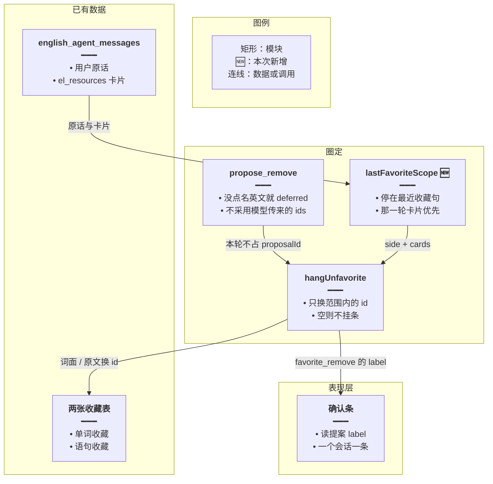
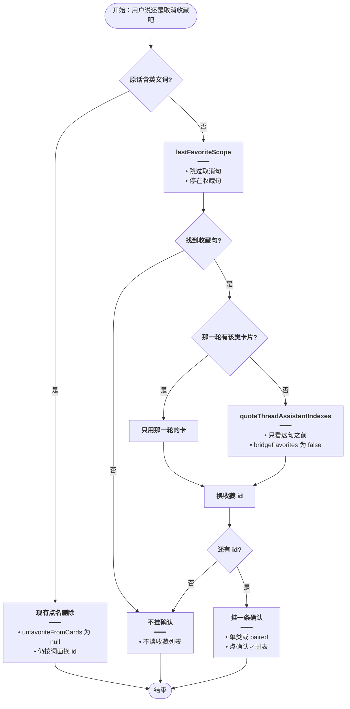
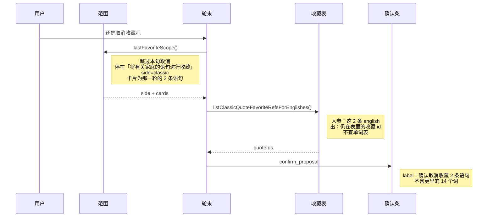

# 取消沿用上次收藏 — 实现思路

> **状态**：规划（工作区已按本文落地）  
> **日期**：2026-10-29  
> **需求摘要**：用户没点名英文、只说「还是取消收藏吧」时，确认条只撤上一次收藏圈定、且现在仍在收藏表里的行。  
> **一句话方案（预告）**：服务端从最近一条「进行收藏」原话取范围和类别，只用那一轮自己挂出的卡片（那一轮没有卡才退回它指着的上一轮分类卡）；本轮工具新拉的收藏列表不参与。点确认仍走现有的分表删除。

## 延伸阅读

- [词句分表收藏](./词句分表收藏.md)：同时点名单词和语句时的添加确认。本文不改那条添加链路
- [语句整类一次收藏](./语句整类一次收藏.md)：「将这些进行收藏」仍只合并语句卡。取消这类收藏时范围与它一致
- [收藏提案直确认](./收藏提案直确认.md)：一条 `proposalId`，一个会话一条确认条
- [语句收藏确认](./语句收藏确认.md)：取消仍先挂确认，点确认才删表
- [收藏确认跟卡片](./收藏确认跟卡片.md)：「还是取消吧」也要认成取消，否则下一句收藏的窗口会在这句断开。取消范围仍按本文，不改成整段分类窗
- [取消正文跟确认条](./取消正文跟确认条.md)：范围挂对后气泡仍可能写整夹 68/38。正文用同一组 id 计数做 contentReplace 由那篇收口
- [再收藏不断窗](./再收藏不断窗.md)：省略取消句未进闸时，取消被模型接管且下一句「上述」回扫断窗

---

## 0. 读本文你将得到什么

- 同一次「还是取消收藏吧」为什么会撤成「14 个词、2 条语句」，另一次又会变成「40 条语句」
- 选定方案：取消范围由上一次收藏原话在服务端圈定，不交给模型重列收藏
- 改动在 `favorite-ask.ts` 的范围函数和 `agent.service.ts` 的 `hangUnfavorite`；确认条组件和两张收藏表的删除接口不动
- 一个阶段即可交出主链路
- 最大风险是上一次收藏那一轮没把卡片写入 `el_resources`，需要退回它前面的分类卡

---

## 1. 需求与边界

### 1.1 用户故事

| 角色 | 场景 | 行为 | 期望结果 |
|------|------|------|----------|
| 登录用户 | 上一句是「将有关家庭的语句进行收藏」，卡片是 2 条语句，回执「已收藏 0 个，已存在 2 个」 | 说「还是取消收藏吧」 | 只撤这 2 条语句。更早的 14 个家庭单词不进确认条 |
| 登录用户 | 上一句收藏同时包含单词和语句，隔了一轮已经取消过一次 | 再说「还是取消收藏吧」 | 仍只对那一次收藏里还没删掉的行挂确认。不把语句收藏整表（约 40 条）算进去 |
| 登录用户 | 上一句是「将上述单词和语句进行收藏」，那一轮助手消息没有卡片 | 说「还是取消收藏吧」 | 用那句所指的分类卡，单词和语句各算各的，仍是一条确认 |
| 登录用户 | 上一句是「将这些进行收藏」 | 说「还是取消收藏吧」 | 只撤那次合并的语句卡，不把单词卡算进去 |
| 登录用户 | 原话写了英文，如「取消收藏 family」 | 点确认 | 仍走现有的点名删除，不套用「上一次收藏」 |
| 登录用户 | 上一次收藏的行已经不在收藏表里 | 再说取消 | 不挂确认条，也不改去扫整本收藏 |

### 1.2 范围

| 在范围内 | 不在范围内（非目标） |
|----------|----------------------|
| 没点名英文的取消：`还是取消收藏吧`、`不要收藏` | 点名英文词句的 `propose_remove` |
| 范围来自上一次 `favoriteAsk` 命中的用户原话，以及那一轮的 `el_resources` | 新表、新缓存键、改收藏表结构 |
| 取消句写了「语句」或「单词」时，在该范围内再收窄到那一类 | 改「将上述单词和语句进行收藏」的添加确认 |
| 确认条、回执、分表删除沿用现有 `paired` 提案 | 让模型自己 list 收藏再决定删哪些 |
| 「将这些进行收藏」的取消仍只含语句 | 分类器、阅读生成、亲属词提示词 |

### 1.3 约束与依赖

- 必须复用 `favoriteAsk`、`favoriteAsksBoth`、`unfavoriteFromCards`、`quoteThreadAssistantIndexes`、`cardItemRows`，以及 `listVocabularyFavoriteRefsForWords` / `listClassicQuoteFavoriteRefsForEnglishes`
- 一个会话仍只有一条确认条、一个 `proposalId`
- 点确认后的删除仍是现有 `applyElProposal` 的 `favorite_remove`：两边都有则单词表、语句表各删各的
- 卡片行以消息上的 `el_resources` 为准。行被收进 artifact 时，沿用现在按 `artifactId` 把 `items` 装回来的做法
- 不新增数据库表。会话历史里已经有用户原话和卡片

---

## 2. 背景

- **谁、在什么场景、卡在哪**：用户在英语 Agent 里先收藏，再说「还是取消收藏吧」。确认条上的条数和上一句收藏对不上。一次把更早的 14 个单词和刚讨论的 2 条语句一起删了；另一次在已经取消过之后再发同一句，确认条变成「确认取消收藏 40 条语句」。
- **现状缺口**：`hangUnfavorite` 没有「上一次收藏」这个指称。它把回扫窗口里所有单词卡、语句卡，再加上本轮工具塞进 `libraryLists` 的清单，拿去对收藏表。窗口本身是为「将这些进行收藏」准备的分类续窗，不是取消的指称。
- **不解决会怎样**：没点名英文的取消会删到用户没在这一次收藏里点过的行。模型正文里写的条数和确认条继续各说各的。
- **硬约束**：添加侧的「词句分表收藏」「将这些进行收藏」不能改行为。点名英文的删除不能改走这条新路径。不能为了取消再让模型扫一遍收藏表来「脑补」名单。

两次失败是同一处缺口的两头：

| 现象 | 上一句用户原话 | 窗口实际扫到的 | 确认条 |
|------|----------------|----------------|--------|
| 多删了 14 个词 | 「将有关家庭的语句进行收藏」（含「有关」，`isCategoryAsk` 为真，`favoriteAsk` 类别是语句） | `quoteThreadAssistantIndexes` 把这句当成分类续问，继续走到更早的家庭单词卡。`unfavoriteFromCards` 对没写类别的取消返回 `both`，单词卡和语句卡都要 | 已取消收藏 14 个词、2 条语句 |
| 扫进整本语句收藏 | 再发一次「还是取消收藏吧」。上一句也是取消，`favoriteAsk` 为 null，窗口在这里断开 | 家庭卡不在窗口里。本轮模型调用 `el_favorites` `list`，`isIndexOp` 把整份语句收藏推进 `libraryLists`。单词侧没有卡，文案只剩语句 | 确认取消收藏 40 条语句 |

40 不是 `FAVORITE_CARD_CAP` 写进文案。文案里的数字是 `quoteIds.length`。语句收藏整表的量级就是几十条，和这次对上的 40 是同一份清单，不是家庭卡上的 2 条。

---

## 3. 现状与复用

| 能力 | 仓库中已有 | 本需求中的用法 |
|------|------------|----------------|
| 收藏原话 | `apps/backend/src/services/agent/tools/english/favorite-ask.ts` 的 `favoriteAsk` / `favoriteAsksBoth` | 直接复用。用来找到「上一次收藏」并决定类别 |
| 取消原话 | 同文件 `unfavoriteFromCards` | 直接复用。只负责认出「这句是没点名英文的取消」。它返回的 `both` 不再当作删除类别 |
| 分类续窗 | `apps/backend/src/services/agent/tools/english/domain-tools.ts` 的 `quoteThreadAssistantIndexes` | 直接复用，且只在「那一轮自己没有卡片」时、对那一句收藏之前的消息调用。`bridgeFavorites` 保持 false，添加路径不改 |
| 关于类判断 | `apps/backend/src/services/agent/tools/english/spill.ts` 的 `isCategoryAsk`（`/关于\|相关\|有关\|属于/`） | 不适用作取消边界。「将有关家庭的语句进行收藏」既是收藏句又是关于类，取消必须在收藏句停下 |
| 轮末取消 | `apps/backend/src/services/agent/agent.service.ts` 的 `hangUnfavorite` | 扩展。改读新的范围函数，不再合并 `vocabLists`、`libraryLists`、`turnCards` |
| 工具占位 | `domain-tools.ts` 里 `propose_remove` 见到 `unfavoriteFromCards` 就返回 `deferred` | 直接复用。模型这一轮即使去 list，也挂不出另一条确认 |
| 收藏列表进表面 | `domain-tools.ts` 对 `isIndexOp` 执行 `libraryLists.push(spilled.full)` | 不适用。这份清单继续可以进表面，但取消不再读它 |
| 按词面/原文找收藏 id | `english-learning.service.ts` 的 `listVocabularyFavoriteRefsForWords`、`listClassicQuoteFavoriteRefsForEnglishes` | 直接复用。只对范围内的行查 id |
| 分表删除和回执 | `apply-proposal.ts` 的 `favorite_remove` 与 `pairedRemoveReceipt` | 直接复用。范围内两边都有 id 时仍是一条确认 |
| 消息上的卡片 | `english_agent_messages.el_resources` | 直接复用。范围的行从这里来，不新加列 |
| 前端确认条 | `apps/frontend/src/store/englishAgent.ts` 用提案 `label` | 直接复用。条数改对之后文案自然跟着变 |

**调研结论**：添加、确认、分表删除都已经按「服务端圈定、模型只叙述」做成了。缺的是取消的圈定。`hangUnfavorite` 把分类续窗和本轮索引清单当成了指称，所以「有关」会把更早的单词卡拖进来，窗口被上一句取消截断时又会落到整本语句收藏上。候选方案都接在这几个现有函数上，不新造提案或表。

---

## 4. 方案比对与最终方案

### 4.1 候选方案

#### 方案 A：继续用现在的回扫窗口（复用现状）

- **做法**：`unfavoriteFromCards` 对「还是取消收藏吧」返回 `both`。`quoteThreadAssistantIndexes(..., bridgeFavorites=true)` 把窗口里的单词卡、语句卡灌进 `vocabLists` / `libraryLists`。`hangUnfavorite` 再并上本轮 `turnCards`，用词面和英文原文去收藏表换 id，一条确认删掉。
- **能工作的原因**：窗口里只要有已经收藏的行，确认条就能挂上，点确认会进现有的 `favorite_remove`。添加路径不用动。
- **主要代价**：窗口不是「上一次收藏」。带「有关」的收藏句会被当成分类续问，更早的单词卡进范围。窗口若停在上一句取消上，本轮 `el_favorites list` 的整表会顶上，条数变成几十条语句。

#### 方案 B：上一次收藏原话圈定卡片（扩展）

- **做法**：新增 `lastFavoriteScope(history)`。从近到远跳过取消句，停在最近一条 `favoriteAsk` 命中的用户原话上；中间如果先碰到既不是取消也不是收藏的用户句，就没有范围。卡片只取这条原话之后、下一条用户句之前的助手消息（那一轮自己挂出的卡）。那一轮没有符合类别的卡时，才对这条原话之前的消息调用现有 `quoteThreadAssistantIndexes`（`bridgeFavorites` 为 false）。类别由这条收藏原话决定：只写语句则只要语句卡，只写单词则只要单词卡，同时写了两类才两边都要，「将这些进行收藏」只要语句卡。`source === 'favorites'` 的清单丢掉。`hangUnfavorite` 只对这些行查收藏 id。查不到就不挂确认，也不再加宽。
- **能工作的原因**：截图里的 2 条语句就在「将有关家庭的语句进行收藏」那一轮的助手卡片上，更早的 14 词卡在这句用户原话之前，不会被收进来。第二次取消仍跳过中间的取消句，停在同一条收藏原话上，本轮新拉的收藏列表不在这段助手消息里。
- **主要代价**：那一轮若没把卡片写入 `el_resources`，必须退回它前面的分类卡。退回后的条数和添加时用的窗口一致，可能多于用户眼前最后一张短卡。这是添加路径已经接受的同一边界。

#### 方案 C：点确认时把提案行记到消息上，取消只读这份记录（新增写入）

- **做法**：`favorite_add` 在 `commit` 时把提案里的 `word` / `english` 写进该条助手消息（塞进 `el_resources` 的一张仅供撤回的快照，不新建表）。下次没点名的取消只读最近一份还没被取消消耗掉的快照，再拿去换收藏 id。
- **能工作的原因**：快照就是用户点过确认的那一批，第二次取消不会去读 `el_favorites list`。带「有关」的语句收藏快照里没有更早的 14 个词。
- **主要代价**：要在落库成功的路径上多写消息。回执是「已收藏 0 个，已存在 2 个」时，若快照只记新插入的 id，取消会得到空集，和「撤掉上一条针对的 2 条」相反。快照若记的是 `dropSaved` 之后的提案，又会丢掉用户在卡片上看到、但添加时被滤掉的已存在行。上一轮用户要的「14+2」正是卡片上仍在收藏表里的行，不是提案滤完之后的子集。

### 4.2 比对

| 维度 | 方案 A | 方案 B | 方案 C |
|------|--------|--------|--------|
| 正确性（失败路径、边界、数据是否会错） | 「有关」收藏句会带上更早单词卡；窗口被取消句截断时会撤整本语句收藏 | 两次截图都停在上一次收藏的卡片上。范围内已经不在表里的行不会另找一份清单来补 | 能避开整表和更早单词卡。只记新插入 id 时，「已存在 2 个」会无条可撤；只记滤后提案时，卡片上已存在的兄弟行会被漏掉 |
| 复用 / 与现状契合 | 就是现在的 `hangUnfavorite` 加分类续窗 | 复用 `favoriteAsk`、`quoteThreadAssistantIndexes`、按原文换 id、`paired` 删除。新增的只是「停在哪一句」 | 删除和确认条复用。圈定改到 commit 写入，和现在「卡片即范围」的添加方式不是同一份数据 |
| 改动面（要动哪些路径） | 不改代码 | `favorite-ask.ts` 增加范围函数；`hangUnfavorite` 改调用；`propose_remove` 的占位文案和 `agent.prompt.ts` 各一句 | 上述之外还要改 `commit` / 消息保存，让每条收藏回执带快照 |
| 复杂度（新概念、新状态、新依赖） | 无新概念，但「窗口 = 指称」这个隐含概念是错的 | 一个函数：最近收藏句 + 那一轮卡片。无新表、无新缓存 | 消息上多一种「撤回快照」状态，还要定义被取消后如何作废 |
| 体验（延迟、步骤数、失败时用户看到什么） | 仍是一条确认。条数会突然变成 14+2 或 40，和上一句对不上 | 仍是一条确认，条数等于上一次收藏里还在表中的行。没有可撤的行时不挂条 | 条数等于快照。用户对着卡片说取消、但那次并没有新插入时，可能没有确认条 |
| 风险（迁移、互斥、并发、回滚） | 继续误删已收藏的其他行 | 那一轮没卡片时退回分类窗，可能比最后一张短卡多几条。点名英文的删除不经过这里 | 旧消息没有快照，上线前的收藏无法取消，还得再做一次回退读卡片。和 B 的回退叠在一起 |
| 可维护性（以后改一处还是改多处） | 添加和取消各用各的窗口，取消的误扫还会再出现 | 取消的范围只在 `lastFavoriteScope`。添加的续窗保持原样 | 范围同时存在于提案快照和卡片上，以后改「哪些行算这一次」要改两处 |

### 4.3 综合考量

这次权重大的是正确性和与现有卡片的契合。用户两次指出的都是「确认条用了不该用的行」：一次是更早的单词卡，一次是本轮拉到的整本语句收藏。模型正文不能当名单，这是添加侧已经定过的约束。

选定方案 B。它在正确性上直接按收藏原话截断，带「有关」也不再往前扫；在契合上，行就是用户已经看到的 `el_resources`，和添加共用分类窗的退路。改动面停在范围函数和 `hangUnfavorite`。

放弃方案 A 的优点是零改动、确认条总能挂上。这个优点抵不过误删。放弃方案 C 的优点是「点过确认的提案行」有一份显式名单，不依赖那一轮有没有把卡片存下来。这个优点抵不过两件事：快照和卡片在「已存在」的行上会分叉，而用户要撤的正是卡片上那 2 条已存在的语句；旧消息还要补快照，B 用现成的 `el_resources` 就够。

### 4.4 最终方案

#### 背景

没点名英文的取消现在没有指称。`hangUnfavorite` 合并分类续窗和本轮 `libraryLists`。续窗遇到「将有关家庭的语句进行收藏」会因为「有关」继续往前，把 14 个单词一起带走。续窗若被上一句「还是取消收藏吧」截断，本轮 `el_favorites list` 的整份语句收藏就会变成那 40 条。添加、确认条和分表删除已经是服务端圈定，取消必须用同一原则，并且不新加表。

#### 具体思路

1. 模块只动后端圈定。`favorite-ask.ts` 增加 `lastFavoriteScope`。`agent.service.ts` 的 `hangUnfavorite` 改成只消费它的返回值。`domain-tools.ts` 的 `propose_remove` 仍在没点名英文时直接 `deferred`，避免模型用 list 的 id 再挂一条。前端确认条不改。
2. 数据从会话历史来：用户原话决定停在哪一句、要哪一类；助手消息的 `el_resources` 提供行。行的收藏 id 仍向两张收藏表换。换到的 id 放进现有 `favorite_remove` 提案。
3. 状态仍在服务端这一轮的提案里，不进前端，也不进新缓存。历史消息已经持久，刷新后同一句取消仍能找到上一次收藏。
4. 边界：范围内没有还在表里的行，就不挂确认，禁止再放宽到整本收藏。点名了英文的取消不进 `lastFavoriteScope`。取消句自己写了「语句」或「单词」时，只在已圈定的卡片里再去掉另一类。

#### 实现方案

**一句话**：服务端从最近一条「进行收藏」原话取范围和类别，只用那一轮自己挂出的卡片（那一轮没有卡才退回它指着的上一轮分类卡）；本轮工具新拉的收藏列表不参与。点确认仍走现有的分表删除。

| 步骤 | 谁 | 做什么 | 输入 → 输出 |
|------|----|--------|-------------|
| 1 | `domain-tools.ts` 的 `propose_remove` | 没点名英文仍返回 `deferred`，文案改为确认条按上一次收藏挂，不要再 `propose_remove` | 用户原话 → 无 `proposalId` |
| 2 | `lastFavoriteScope` | 跳过取消句，停在最近一条收藏原话；取那一轮助手卡片；没有则退回这句之前的分类窗 | `history` → `{ side, cards }` 或 `null` |
| 3 | `cancelSide` | 取消句写了单一类时覆盖 `side`，没写则沿用上一步 | 取消原文 + `side` → `vocab` / `classic` / `both` |
| 4 | `hangUnfavorite` | 只对范围内的行换收藏 id，挂一条确认。id 为空则不挂，不读 `libraryLists` | `cards` → `favorite_remove` 提案或空 |
| 5 | `agent.prompt.ts` | 补一句：没点名英文的取消，名单以确认条为准，禁止用 list 凑名单 | 提示词文本 |

#### 选定原因

1. **正确性**：收藏句是硬边界，所以「有关」带不走更早的 14 个词；取消句被跳过，所以第二次不会改读整本收藏。牺牲：那一轮没有卡片时，退回的分类窗可能比模型后来重搜的短卡多几条。
2. **复用**：行、换 id、一条确认、分表删除都是现成的。牺牲：不把提案滤完后的子集单独存成快照，取消的是卡片上仍在表里的行。
3. **改动面**：只改圈定和轮末组提案。牺牲：`hangUnfavorite` 的入参从 `surface` 换成 `history`，调用处要传历史。
4. **复杂度**：一个范围函数，没有新表。牺牲：读者要分清「那一轮的卡」和「那一轮前面的分类窗」两种来源。
5. **体验**：条数与上一次收藏对齐，没有可撤的行时不出现一条几十条的确认。牺牲：这种时候没有确认条，只靠工具回执说明没有可取消的。
6. **风险**：点名英文的路径不进新函数，添加续窗的 `bridgeFavorites` 不改。牺牲：取消和添加的「窗口」不再是同一个函数的同一次调用，以后改添加窗口不会自动改取消。
7. **可维护性**：误扫只可能出在 `lastFavoriteScope`。牺牲：`quoteThreadAssistantIndexes` 仍留在添加和退路里，两处都要知道它的 `bridgeFavorites` 含义。

#### 优势

- 相对方案 A：同一次取消不会再把更早的家庭单词卡和整本语句收藏算进确认条。范围在收藏原话处截断，本轮 `el_favorites list` 进了 `libraryLists` 也不被读取。
- 相对方案 C：不在 commit 上增加快照。「已收藏 0 个，已存在 2 个」仍能撤那 2 条，因为它们在那一轮的卡片上，并且仍在收藏表里。上线前已经存下的 `el_resources` 不用补写。

#### 怎么实现

1. `propose_remove` 在 `unfavoriteFromCards` 命中时继续直接返回，不查 id。占位文案不再写「单词和语句在同一条里」。
2. `lastFavoriteScope` 按 §9.2 从历史里取出 `{ side, cards }`。`side` 的规则：`favoriteAsksBoth` 为 `both`；`favoriteAsk.kind === 'vocab'` 为 `vocab`；其余（只写语句，或「将这些进行收藏」的 `card`）为 `classic`。
3. `cancelSide` 只在取消原文单独出现「语句/句子/经典句」或「单词/词汇/词书」时改 `side`。两个都没写，沿用步骤 2。
4. `hangUnfavorite` 用 `cardItemRows` 取词面或英文原文，调用现有的两个 refs 接口。两边都有 id 时沿用现在的 `paired` 形状和「确认取消收藏 N 个词、M 条语句」。只有一边就用现有的单类文案。零 id 时发一条没有 `ui` 的工具结果，文案「上一次收藏里没有还能取消的」，`openProposalId` 保持空。
5. 提示词加一句，避免模型把 list 的条数写进正文。确认条仍以步骤 4 的 `label` 为准。

主链路代码在 §9.2、§9.3。

### 4.5 其他关键决策

#### 决策：那一轮没有卡片时，退回分类窗还是直接不取消

##### 4.5.1 候选方案

###### 方案 A：没有卡片就不挂确认（新增的严格截断）

- **做法**：`lastFavoriteScope` 只读收藏句之后、下一条用户句之前的助手 `el_resources`。空则返回 `null`，`hangUnfavorite` 不挂条。
- **能工作的原因**：截图里的 2 条语句就在那一轮，这条路径覆盖这次失败。实现更短。
- **主要代价**：库里已有的「将上述单词和语句进行收藏」那几轮助手消息 `el_resources` 为 null。取消会找不到行，用户刚收藏的 14 个词和语句撤不掉。

###### 方案 B：没有卡片才退回这句之前的分类窗（扩展现有续窗）

- **做法**：那一轮有符合 `side` 的卡片就只用它们。一张都没有时，把历史截到这条收藏原话（含），调用 `quoteThreadAssistantIndexes(slice, undefined, true, false)`，再按 `side` 过滤。`bridgeFavorites` 为 false，所以不会跳过这句收藏去扫更早的收藏句。
- **能工作的原因**：添加侧已经用这个窗口解释「上述」。取消和添加指向同一批卡。截图那一轮自己有 2 条语句卡，不会走到这条退路，14 个词仍被排除。
- **主要代价**：退路上若连续几轮都是关于类，条数会包含这几轮的卡，和添加时一样，可能多于最后一张短卡。

##### 4.5.2 比对

| 维度 | 方案 A | 方案 B |
|------|--------|--------|
| 正确性（失败路径、边界、数据是否会错） | 有卡片的一轮是对的。没写入 `el_resources` 的收藏无法取消 | 有卡片时与 A 相同。没卡片时与添加窗口相同，不会改读整本收藏 |
| 复用 / 与现状契合 | 不调用现有续窗 | 退路直接调用 `quoteThreadAssistantIndexes` |
| 改动面（要动哪些路径） | 只写「那一轮」这一段 | 多一次对截断历史的续窗调用 |
| 复杂度（新概念、新状态、新依赖） | 概念更少 | 多一个「来源是那一轮还是它前面」的分支，没有新状态 |
| 体验（延迟、步骤数、失败时用户看到什么） | 「将上述…」之后说取消，经常没有确认条 | 这种句子仍有确认条，条数与当初添加所依据的卡一致 |
| 风险（迁移、互斥、并发、回滚） | 已落库的词句撤不掉，用户会再发一句，模型又可能去 list | 退路可能带上连续关于类的多张卡。这是添加已经有的行为，且 `bridgeFavorites` 关闭，不会跳过收藏句 |
| 可维护性（以后改一处还是改多处） | 取消永远不碰续窗 | 退路和添加共用续窗函数，过滤仍在 `lastFavoriteScope` |

##### 4.5.3 综合考量

权重在「将上述单词和语句进行收藏」这类已经上线的句子必须还能取消。这类回合的助手消息经常没有 `el_resources`。方案 A 更短，但会把已经能添加的句子变成不能取消。选定方案 B。放弃 A 的优点是少一个分支、绝不会把收藏句之前的卡算进来。这个优点只在「那一轮确有卡片」时有价值，而那一轮有卡片时 B 同样不会往前读。

##### 4.5.4 最终方案

###### 背景

收藏句之后的助手消息才是「这一次挂出来的卡」。历史里有的收藏回合只留下回执、没有 `el_resources`。取消若只认有卡片的回合，这些句子会没有确认条。

###### 具体思路

先取那一轮。符合 `side` 且 `items` 非空的卡存在，就到此为止。否则把消息切到收藏句为止，用现有续窗向更早的关于类收集卡片，再按同一 `side` 过滤，并丢掉 `source === 'favorites'`。

###### 实现方案

**一句话**：那一轮有卡就只用那一轮；没有卡才用这句收藏之前的分类窗。

| 步骤 | 谁 | 做什么 | 输入 → 输出 |
|------|----|--------|-------------|
| 1 | `cardsOf(..., 'after')` | 收藏句下标之后、下一条用户句之前的助手卡片，按 `side` 过滤 | 消息 + 下标 → 卡片数组 |
| 2 | `cardsOf(..., 'before')` | 仅当步骤 1 为空时，对 `messages.slice(0, askIndex + 1)` 做续窗 | 截断历史 → 卡片数组 |

###### 选定原因

1. **正确性**：截图的 2 条卡在步骤 1 就返回，14 个词不进入步骤 2。牺牲：连续关于类的退路会比单张短卡宽。
2. **体验**：「将上述…」之后仍能取消。牺牲：用户看不到「因为没存卡片所以退回了窗口」这句解释，条数直接是窗口里的行。
3. **复用**：步骤 2 就是现有续窗。牺牲：要在调用处把 `bridgeFavorites` 固定为 false，不能复用取消轮现在那次 `bridgeFavorites=true` 的灌卡。

###### 优势

- 相对方案 A：助手消息没存卡片的收藏仍能取消，且不会因此去读本轮的收藏列表。

###### 怎么实现

与 §4.4 步骤 2 是同一个函数。`cardsOf` 的 `'after'` 非空则返回，否则 `'before'`。代码在 §9.2。

---

## 5. 架构图



**图内方法说明**：

| 方法 | 功能 |
|------|------|
| `lastFavoriteScope(messages)` | 在历史里定位最近一条收藏原话，返回类别和卡片。由 `hangUnfavorite` 在轮末调用，不写库 |
| `hangUnfavorite(...)` | 用范围内的行向两张收藏表换 id，有 id 才写入一条 `favorite_remove` 并让确认条显示 label |
| `propose_remove` | 工具入口。没点名英文时立即返回 `deferred`，模型附带的 ids 不进入提案 |

**读图要点**：

- 名单在圈定层从历史算出，确认条只显示已经算好的 label。
- 收藏表只负责把范围内的词面、原文换成 id，不负责决定哪些行属于这一次。
- `propose_remove` 不再和 `hangUnfavorite` 各挂一条。模型 list 到的整表停在工具结果里，到不了确认条。

---

## 6. 主流程图



**图内方法说明**：

| 方法 | 功能 |
|------|------|
| `unfavoriteFromCards(text)` | 判断这句是不是没点名英文的取消。返回 null 时整段新逻辑不跑，仍走点名删除 |
| `lastFavoriteScope(messages)` | 跳过取消句并停在最近收藏句；那一轮有卡就返回那一轮，否则返回收藏句之前的分类窗 |
| `quoteThreadAssistantIndexes(slice, undefined, true, false)` | 只在那一轮没有卡片时调用。第四个参数为 false，避免跳过收藏句去扫更早的话题 |
| `listVocabularyFavoriteRefsForWords` / `listClassicQuoteFavoriteRefsForEnglishes` | 把范围内的词面或原文换成仍在表里的收藏 id。不在表里的行被丢掉，不另找替代行 |

**读图要点**：

- 含英文词的取消在第一个菱形离开，不和「上一次收藏」混用。
- 「那一轮有没有卡」决定 14 个更早的单词会不会进来：有卡就停，没卡才往前，而且往前不再跨过收藏句。
- 换 id 失败或为零时结束在「不挂确认」，不会改道去读整本收藏。

---

## 7. 核心时序图



**图内方法说明**：

| 方法 | 功能 |
|------|------|
| `lastFavoriteScope()` | 轮末调用。用历史把这次取消收成类别和卡片，不访问收藏表 |
| `listClassicQuoteFavoriteRefsForEnglishes()` | 仅当 `side` 含语句时调用。入参是范围内的英文原文，返回收藏记录 id |
| `listVocabularyFavoriteRefsForWords()` | 本时序的 `side` 是 classic，不会调用。`side` 为 vocab 或 both 时才用词面换单词收藏 id |
| `confirm_proposal` | 把提案 id 和 label 交给现有确认条。用户点确认后才执行已有的 `favorite_remove` |

**读图要点**：

- 用户这句话不带名单。名单在 `lastFavoriteScope` 返回时已经定死，随后只做一次 id 查询。
- 这次 `side` 是语句，所以单词表不出现在这条成功路径上。14 个词不会被换 id。
- 确认条发生在删表之前。点确认仍走现有提案，时序里不再展开。

---

## 9. 具体实现（主链路代码）

### 9.1 模块一览

| 模块 | 职责 | 新增/改动 | 预估路径 |
|------|------|-----------|----------|
| `lastFavoriteScope` / `cardsOf` / `inheritedSide` | 从历史圈定类别和卡片 | 新增 | `apps/backend/src/services/agent/tools/english/favorite-ask.ts` |
| `hangUnfavorite` | 换 id、挂一条确认或明确不挂 | 改动 | `apps/backend/src/services/agent/agent.service.ts` |
| `propose_remove` 占位文案 | 避免模型以为两边一定在同一条里 | 改动 | `apps/backend/src/services/agent/tools/english/domain-tools.ts` |
| 提示词一句 | 正文不要另写一份名单 | 改动 | `apps/backend/src/services/agent/agent.prompt.ts` |
| 确认条、分表删除 | 显示 label、点确认删表 | 不改 | 前端 store、`apply-proposal.ts` |

取消轮里现在按 `cancelSide === 'both'` 把续窗灌进 `vocabLists` / `libraryLists` 的那段可以删掉。删掉是为了没有第二个人再从这份宽列表取数。`hangUnfavorite` 改完之后不再读它。

### 9.2 主链路实现

```typescript
// 对应 §4.4 步骤 2。历史里只需要原话和卡片，取消范围不读本轮工具刚推进来的 libraryLists
type ScopeMessage = {
	// 收藏句和取消句都是 user；卡片只挂在 assistant 上
	role: string;
	// 交给 favoriteAsk / unfavoriteFromCards。助手正文不参与圈定，避免模型叙述改范围
	content?: string;
	// 那一轮已经展示过的清单。source 为 favorites 的是收藏列表，不能当「这一次收藏」
	elResources?: ScopeCard[] | null;
};

// 对应 §4.4 步骤 2。一张卡至少要能分出单词或语句，并带上行
type ScopeCard = {
	// vocab 进单词表，classic 进语句表。其他来源在过滤时丢掉
	contentKind?: string;
	// 换 id 只用行里的 word 或 english。没有行的壳子卡不参与
	items?: unknown[];
	// 收藏列表的 spill 会标成 favorites。留下它就会把整本收藏算进取消
	source?: string;
	// 同一库同一类别有多张卡时，和添加一样留行数最多的那张
	libraryId?: string;
	// 与 libraryId 组成去重键。没有类别的卡各自独立，不互相覆盖
	categoryLabels?: string[];
};

// 对应 §4.4 步骤 2。side 是这一次收藏的类别，cards 是唯一允许拿去换 id 的卡
type FavoriteScope = {
	// both 才两边都查。classic 不查单词，从根上排除更早的 14 个词
	side: 'vocab' | 'classic' | 'both';
	// 已按 side 过滤，且不含 source 为 favorites 的清单
	cards: ScopeCard[];
};

// 对应 §4.4 步骤 2。收藏原话决定类别。「将这些进行收藏」没有单词二字，和添加一样只算语句
function inheritedSide(text: string): 'vocab' | 'classic' | 'both' {
	// 同时写了单词和语句才是 both。只写「这些」会落到下面的 classic
	if (favoriteAsksBoth(text)) return 'both';
	// 只点了单词。只点语句或「将这些」都不是 vocab
	if (favoriteAsk(text)?.kind === 'vocab') return 'vocab';
	// card 与 classic 都只撤语句，避免「将这些进行收藏」把单词卡卷进来
	return 'classic';
}

// 对应 §4.4 步骤 3。取消句单独点了某一类时收窄。两个都没写就沿用上一次收藏的 side
function cancelSide(
	// 当前这句取消原文。只从这里看有没有点名「语句」或「单词」
	cancelText: string,
	// 上一次收藏已经定下的类别。取消句没点名时必须原样用它
	inherited: 'vocab' | 'classic' | 'both',
	// 返回值仍是三类之一，调用方不用再解释 unfavoriteFromCards 的 both
): 'vocab' | 'classic' | 'both' {
	// 与 favoriteAsk 同一组词，避免取消和收藏对「语句」的认定不一致
	const classic = /语句|句子|经典句/.test(cancelText);
	// 只写单词才收成 vocab。没写时不能用 unfavoriteFromCards 的 both，否则又会把两类都算上
	const vocab = /单词|词汇|词书/.test(cancelText);
	// 只点语句：即使上一次收藏是 both，这次也只撤语句
	if (classic && !vocab) return 'classic';
	// 只点单词：只撤范围内的单词，不去单词收藏整表
	if (vocab && !classic) return 'vocab';
	// 「还是取消收藏吧」落在这里，类别完全由上一次收藏决定
	return inherited;
}

// 对应 §4.5 步骤 1 和 2。after 是那一轮，before 是这句收藏之前的分类窗
function cardsOf(
	// 完整历史。after 要看到收藏句后面的助手消息，before 再自行截断
	messages: ScopeMessage[],
	// 最近一条收藏原话的下标。范围从这里切开，不从当前取消句切开
	askIndex: number,
	// 已经按收藏原话定好的类别。过滤时不再放宽
	side: 'vocab' | 'classic' | 'both',
	// after 优先。只有那一轮没有合格卡片时，调用方才传 before
	where: 'after' | 'before',
	// 已经按 side 滤过、并按库和类别留过最富卡片的数组
): ScopeCard[] {
	// 先摊平再过滤，避免那一轮和退路各写一套 side 判断
	const loose: ScopeCard[] = [];
	// 那一轮：收藏句之后、下一条用户句之前
	if (where === 'after') {
		// 从收藏句的下一条看到下一句用户原话为止。再往后的取消回合不在这段里
		for (let i = askIndex + 1; i < messages.length; i += 1) {
			// 当前下标上的消息。遇到用户句就结束这一轮
			const row = messages[i];
			// 下一条用户句是边界。第一次「还是取消收藏吧」会把第二次取消时模型拉的列表挡在外面
			if (row.role === 'user') break;
			// 系统或工具消息没有卡片，跳过，避免把空角色算成一轮结束
			if (row.role !== 'assistant') continue;
			// 这轮助手已经挂出的卡。本轮还没落库的工具结果不在历史里，天然进不来
			loose.push(...(row.elResources ?? []));
		}
	} else {
		// 截到收藏句为止，续窗会把这句当成「当前用户句」跳过，只收集它前面的助手卡
		const slice = messages.slice(0, askIndex + 1);
		// bridgeFavorites 固定 false：不能因为这句是收藏就继续跳到更早的收藏或单词卡
		const indexes = quoteThreadAssistantIndexes(slice, undefined, true, false);
		// 续窗给出的是截断数组里的助手下标，卡片仍从这份截断历史取
		for (const index of indexes) {
			// 分类窗里的一张助手消息。没有 el_resources 就等于这张没有行
			loose.push(...(slice[index]?.elResources ?? []));
		}
	}
	// 同一库同一类别留行数最多的一张，短的重搜卡不会把 2 条家庭语句换成更少的行
	return richest(loose.filter((card) => keepCard(card, side)));
}

// 对应 §4.4 步骤 2。收藏列表和类别不符的卡在这里丢掉
function keepCard(card: ScopeCard, side: 'vocab' | 'classic' | 'both'): boolean {
	// 整本收藏的 spill 即使混进历史，也不能成为取消范围
	if (card.source === 'favorites') return false;
	// 没有行就无法换 id。空壳留到添加的重筛，取消不重分类
	if (!card.items?.length) return false;
	// both 两种卡都留。单类时另一类卡整张丢弃，14 个词不会进入语句取消
	if (side === 'both') return card.contentKind === 'vocab' || card.contentKind === 'classic';
	// 单类只留 contentKind 与 side 相同的卡
	return card.contentKind === side;
}

// 对应 §4.4 步骤 2。从近到远只跳过取消句。先碰到别的用户句就说明上一次收藏已经被新话题打断
function lastFavoriteScope(messages: ScopeMessage[]): FavoriteScope | null {
	// 从当前这句往前找。最近的收藏句优先，更老的收藏不参与这次取消
	for (let i = messages.length - 1; i >= 0; i -= 1) {
		// 只在用户句上判断。助手叙述不能把范围改到另一轮
		const row = messages[i];
		// 助手和工具消息继续往前，直到碰到用户原话
		if (row.role !== 'user') continue;
		// 当前这句和更早的「还是取消收藏吧」都跳过，第二次取消仍能找到原来的收藏句
		if (unfavoriteFromCards(row.content ?? '')) continue;
		// 不是收藏句就停止。不再往前捡更老的一次收藏，避免撤错一轮
		if (!favoriteAsk(row.content ?? '')) return null;
		// 类别先定死。后面的卡片过滤和换 id 都用它
		const side = inheritedSide(row.content ?? '');
		// 先拿那一轮自己的卡。有卡就不再读这句前面的单词卡
		const own = cardsOf(messages, i, side, 'after');
		// 那一轮自己有卡就返回。带「有关」的语句收藏因此不会去读它前面的单词卡
		if (own.length) return { side, cards: own };
		// 没存卡片的「将上述…」才退回分类窗
		return { side, cards: cardsOf(messages, i, side, 'before') };
	}
	// 历史里只有取消句、没有收藏句
	return null;
}
```

```typescript
// 对应 §4.4 步骤 4。只换范围内的 id。空结果不改读 libraryLists，从这里堵住 40 条语句
async function hangUnfavorite(input: {
	// 换 id 时只查这个用户的收藏行
	userId: number;
	// 含当前取消句在内的会话历史。范围只从这里算，不从本轮工具表面算
	history: ScopeMessage[];
	// 当前取消原文。用来在范围内再收窄类别
	cancelText: string;
	// 写入现有提案库。返回的 id 就是确认条那一条
	put: (payload: RemovePayload) => Promise<string>;
	// 范围内的词面换成仍在单词收藏表里的 id
	wordIds: (words: string[]) => Promise<string[]>;
	// 范围内的英文原文换成仍在语句收藏表里的 id
	quoteIds: (englishes: string[]) => Promise<string[]>;
	// 有提案就交给确认条。null 表示这轮不挂条
	emit: (ui: { proposalId: string; label: string } | null) => void;
	// 无返回值。确认条是否出现只看 emit 有没有提案
}): Promise<void> {
	// 没有上一次收藏，或中间已被别的话题打断
	const scope = lastFavoriteScope(input.history);
	// 没有范围就不挂条，也不去读收藏列表
	if (!scope) {
		// 调用方据此发「没有还能取消的」，不设置 openProposalId
		input.emit(null);
		// 结束本轮取消。模型后续的 propose_remove 仍被 deferred 挡住
		return;
	}
	// 取消句若写了单一类，在已圈定的卡片上再收窄，而不是改去扫整表
	const side = cancelSide(input.cancelText, scope.side);
	// 语句取消不取词面，更早的单词卡即使混进 cards 也不会被换 id
	const words =
		// classic 时单词侧强制为空
		side === 'classic' ? [] : textsOf(scope.cards, 'vocab', 'word');
	// 单词取消不取原文，避免把同窗口的语句一起撤掉
	const englishes =
		// vocab 时语句侧强制为空
		side === 'vocab' ? [] : textsOf(scope.cards, 'classic', 'english');
	// 没有词面就不打单词收藏表
	const vocab = words.length ? await input.wordIds(words) : [];
	// 没有原文就不打语句收藏表
	const quotes = englishes.length ? await input.quoteIds(englishes) : [];
	// 这些行已经不在收藏表里。禁止再放宽到整本收藏
	if (!vocab.length && !quotes.length) {
		// 与找不到范围同一出口，避免空确认条
		input.emit(null);
		// 不写提案。收藏表保持原样
		return;
	}
	// 两边都有 id 才走 paired。只有语句时确认条不写单词
	const both = vocab.length > 0 && quotes.length > 0;
	// 文案只反映换到的 id 条数，不反映模型正文里的数字
	const label = both
		// 词句同一次收藏的取消，沿用现在的双边文案
		? `确认取消收藏 ${vocab.length} 个词、${quotes.length} 条语句`
		: vocab.length
			// 只剩单词
			? `确认取消收藏 ${vocab.length} 个词`
			// 只剩语句。截图里的 2 条走这里
			: `确认取消收藏 ${quotes.length} 条语句`;
	// 提案形状与现在的 paired 删除相同，点确认后的 apply 不用改
	const proposalId = await input.put(
		// 双边时语句 id 放在外层，单词 id 放在 paired，与现有 favorite_remove 一致
		both
			? { contentKind: 'classic', ids: quotes, pairedIds: vocab }
			// 单类只带一侧 id，contentKind 跟着有行的那一侧
			: { contentKind: vocab.length ? 'vocab' : 'classic', ids: vocab.length ? vocab : quotes },
	);
	// 确认条只出现这一条 label
	input.emit({ proposalId, label });
}
```

`textsOf` 按 `contentKind` 取出 `word` 或 `english`，同一词面只留一次，实现直接用现有的 `cardItemRows`。`richest` 的分组键是 `` `${libraryId}:${categoryLabels?.[0] ?? ''}` ``，组内留 `items.length` 更大的那张，与添加侧 `hangBothFavorites` 的选卡相同。`items` 为空但有 `artifactId` 时，先用现有 artifact 装回行，再进入 `keepCard`。装不回来就当这张卡没有行。

`emit(null)` 的调用处发一条没有 `ui` 的工具结果，`message` 为「上一次收藏里没有还能取消的」。不设置 `openProposalId`。

### 9.3 数据模型

| 字段/实体 | 来源 | 存储 | 说明 |
|-----------|------|------|------|
| 收藏原话 | `english_agent_messages.content`，`role=user` | 已有列 | `favoriteAsk` 的输入。不新加列 |
| 那一轮的卡 | 同表 `el_resources` | 已有 JSON | `items[].word` / `items[].english`。`source=favorites` 的清单排除 |
| 收藏 id | 单词收藏表、语句收藏表 | 已有表 | 只读范围内的键。取消提案里的 `ids` 与现在相同 |
| 确认条 label | `hangUnfavorite` 按 id 条数拼出 | 提案，会话内一条 | 前端不解析卡片 |

不新增表，不新增缓存键。

---

## 10. 分阶段实现步骤

| 阶段 | 目标 | 交付物 | 依赖 |
|------|------|--------|------|
| M1 | 没点名英文的取消只撤上一次收藏的范围 | `lastFavoriteScope` 与改后的 `hangUnfavorite` | 现有历史与收藏表 |

- [ ] 在 `favorite-ask.ts` 实现 `inheritedSide`、`cancelSide`、`cardsOf`、`keepCard`、`lastFavoriteScope`，`bridgeFavorites` 只在退路里以 false 调用
- [ ] `hangUnfavorite` 改为接收 `history` 和当前取消原文，不再读取 `vocabLists`、`libraryLists`、`turnCards`
- [ ] 删掉取消轮把续窗灌进 `vocabLists` / `libraryLists` 的分支
- [ ] `propose_remove` 的 deferred 文案改为「确认条按上一次收藏挂上」，提示词补上「禁止用 list 凑取消名单」
- [ ] 用 §12 的 AC1、AC2 各走一遍：2 条语句不带 14 个词；第二次取消不出现整本语句收藏

不做方案 C 的快照，也不改添加确认。

---

## 11. 风险、边界与待确认

| 项 | 等级 | 说明 | 缓解 |
|----|------|------|------|
| 那一轮没存卡片 | 中 | 「将上述…」退回分类窗，连续关于类会带上多张卡 | 与添加共用同一窗口，且不跨过收藏句。退路不读收藏列表 |
| 那一轮的卡是模型重搜的短卡 | 中 | 短卡行数少于用户记得的分类卡 | 同一库同一类别留行数多的那张。短卡只在它是那一轮唯一一张时生效 |
| 范围内的行已经取消过 | 低 | 第二次再说取消，id 为空 | 不挂确认，不放宽 |
| 模型正文仍写错条数 | 低 | 提示词约束叙述，确认条才是可点的动作 | 条数以 label 为准。deferred 阻止模型另挂一条 |
| 点名英文被误判成范围取消 | 低 | `unfavoriteFromCards` 见到连续英文字母就返回 null | 这条路径不改 |

**待确认**：

- [ ] 收藏句和下一句用户原话之间，若助手消息里同时有一张 2 条的语句卡和一张模型重搜的 1 条语句卡，是否总是留 2 条那张（验证方式：用同一 `libraryId` + 类别「家庭」构造两张卡，看 `richest` 的 `items.length`）

---

## 12. 验收清单

| # | 用例 | 步骤 | 期望 |
|---|------|------|------|
| AC1 | 只撤刚收藏的 2 条语句 | 卡片为家庭 2 条语句，回执「已收藏 0 个，已存在 2 个」，再说「还是取消收藏吧」 | 确认条是「确认取消收藏 2 条语句」。不出现 14 个词 |
| AC2 | 第二次取消不扫整表 | 上一次收藏之后已经说过一次「还是取消收藏吧」，再说一次 | 范围仍是那一次收藏里还在表中的行。不出现约 40 条语句 |
| AC3 | 词句一起收藏之后取消 | 「将上述单词和语句进行收藏」且那一轮没有 `el_resources`，再说取消 | 一条确认，行来自这句之前的分类卡，单词和语句都在，且不是收藏整表 |
| AC4 | 将这些 | 「将这些进行收藏」之后说取消 | 只有语句。窗口里的单词卡不进入提案 |
| AC5 | 点名英文 | 「取消收藏 family」 | 仍按词面删除，不调用 `lastFavoriteScope` |
| AC6 | 已经撤完 | 范围内的行已不在收藏表，再说「还是取消收藏吧」 | 没有确认条，收藏表不变 |
| AC7 | 取消句收窄类别 | 上一次是词句一起收藏，这次说「取消这些语句」 | 只撤那一次范围内的语句，不撤那些单词，也不撤收藏表里的其他语句 |

---

## 13. 预估改动面（实现阶段参考）

| 类型 | 路径（预估） |
|------|--------------|
| 后端 | `apps/backend/src/services/agent/tools/english/favorite-ask.ts` |
| 后端 | `apps/backend/src/services/agent/agent.service.ts` |
| 后端 | `apps/backend/src/services/agent/tools/english/domain-tools.ts` |
| 后端 | `apps/backend/src/services/agent/agent.prompt.ts` |
| 前端 | 无 |
| 文档（实现后） | `micro-apps/remote-docs/wiki/english/` 下的实现归档，不在本规划里写 |

---

（本文档为规划态实现思路；落地后以源码与 remote-docs wiki 专题为准）
