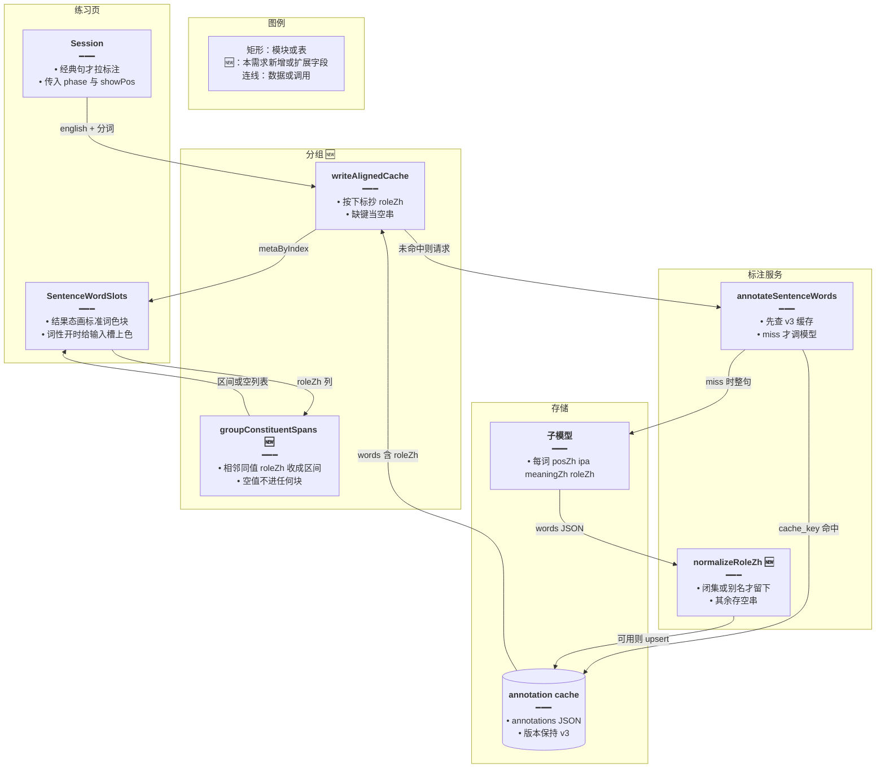
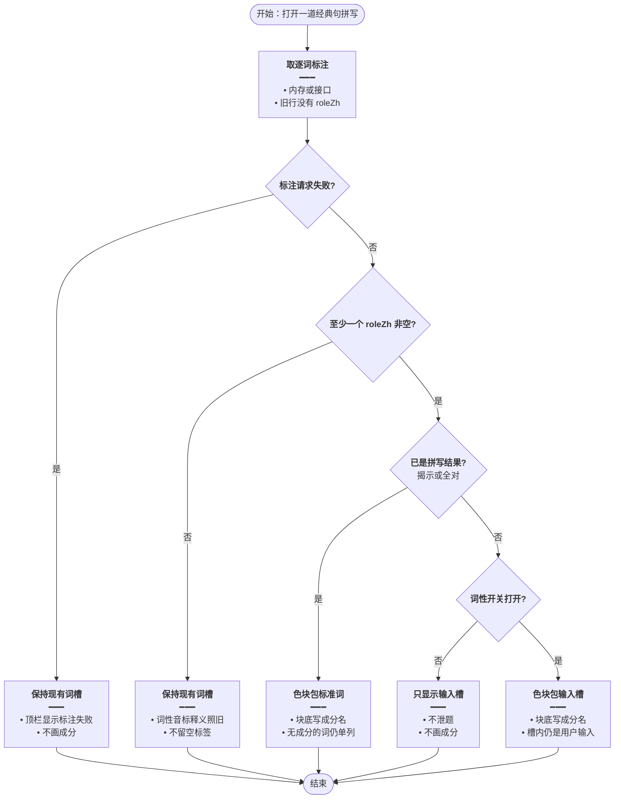
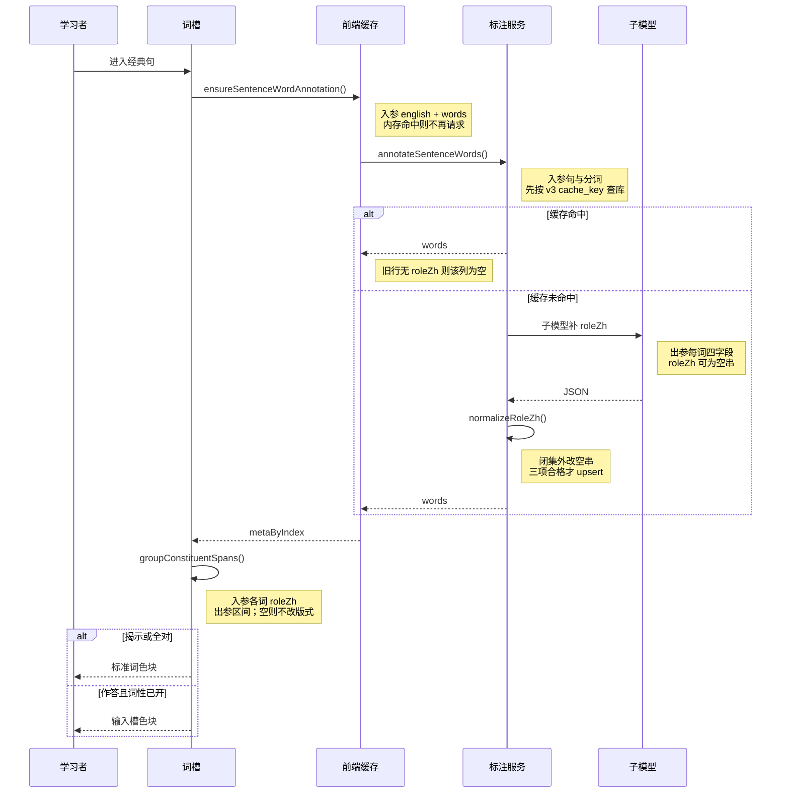
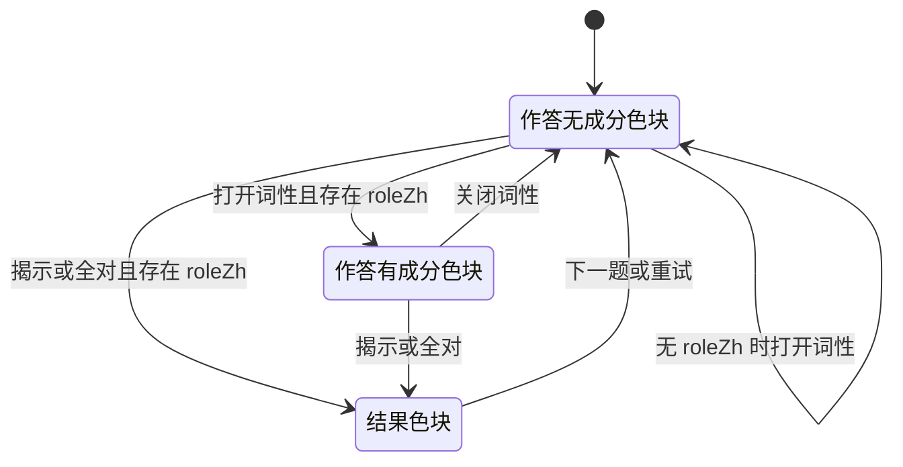

# 句子成分标识 — 实现思路

> **状态**：已实现（见 [句子成分标识.md](../../english/句子成分标识.md)）  
> **日期**：2026-11-23  
> **需求摘要**：经典句拼写在「拼写结果」和「词性提示」上，仅当本句带有成分标注时，把连续同一成分的词收成色块并标出状语、主语和谓语、其他成分等名称；没有标注就不画。  
> **一句话方案（预告）**：在现有句内词标注的每个词上增加可选 `roleZh`，前端按连续相同值分组；结果态画出成分色块，作答中只在打开词性时给输入槽加同一标签，不升缓存版本、不回填旧句。

## 延伸阅读

- [句内词标注缓存与批量标注](../../english/句内词标注缓存与批量标注.md)（缓存键、批量 miss、入库条件）
- [经典句看中写词槽练习](../../english/经典句看中写词槽练习.md)（词槽、揭示态强制展示词性 / 音标 / 释义）
- [练习会话提示](../../english/练习会话提示.md)（旧版「展开提示」；词槽页已不再挂这套正文）

---

## 0. 读本文你将得到什么

- 要补的是句子成分名（状语、主语和谓语等），不是再做一套词性
- 选定做法：可选字段挂在现有逐词标注上，有值才分组上色
- 改标注 prompt / 解析、前端词槽；不改表结构、不升缓存版本
- 分三段：字段进新标注 → 结果态色块 → 作答词性提示
- 最大风险：已经入库的句子不会出现成分，直到该缓存行被覆盖

---

## 1. 需求与边界

图中的标识是色块底部的成分名，不是词上方的「介词 / 名词」。词性、音标、整句中文释义已经在词槽里。本需求只加成分这一层。

图里出现、且要覆盖的成分名：

| 图中例子 | 成分名 | 覆盖的词 |
|----------|--------|----------|
| For lack of a better word. | 其他成分 | For lack |
| 同上 | 状语 | of a better word |
| Why are you smiling? | 状语 | Why |
| 同上 | 主语和谓语 | are you |
| 同上 | 谓语 | smiling |

「等等其他的类型」收成固定闭集，模型不能自造词：主语、谓语、主语和谓语、宾语、表语、定语、状语、补语、同位语、其他成分。闭集外或空字符串视为没有标识。

### 1.1 用户故事

| 角色 | 场景 | 行为 | 期望结果 |
|------|------|------|----------|
| 学习者 | 经典句看中写或听写，答对进入全对揭示，或答错两次 / 点「查看答案」进入揭示 | 看已经填好的标准词 | 连续同一成分的词合成一块浅色底，块底写成分名；词上的词性、音标、释义仍在 |
| 学习者 | 还在作答，或第一次答错后的词槽 | 打开顶栏「词性」 | 输入槽按成分上色并写出成分名；槽里仍是自己输入的字母，不出现标准拼写 |
| 学习者 | 这句没有成分字段，或该词字段为空 | 看结果或打开词性 | 版式与现在一致，不留空标签、不占一行高度 |
| 学习者 | 单词拼写、每日记词 | 作答或看反馈 | 不出现成分色块（这些题不走句标注） |

### 1.2 范围

| 在范围内 | 不在范围内（非目标） |
|----------|----------------------|
| 练习页经典句词槽的揭示 / 全对（语句拼写结果） | 练习报告、结算统计、语句库卡片、Agent 回复 |
| 同一词槽在作答、软揭示时，随「词性」开关出现的成分名（提示） | 把已不挂到词槽页的 `SpellingPromptBody` 重新接上 |
| 单句、批量、整集预热、手动导入这四条写入都带上可选 `roleZh` | 升 `SENTENCE_WORD_ANNOTATION_CACHE_VERSION`、清旧缓存、写回填任务 |
| 闭集归一；非法值当成没有标识 | 改词性闭集（图中的「不定冠词 / 疑问词」仍归现有「冠词」等，不单独立项） |
| 没有 `roleZh` 的旧 JSON 继续当命中 | 为旧句补打模型 |

### 1.3 约束与依赖

- 沿用 `POST /english-learning/practice/annotate-sentence-words` 与 batch、整集预热、导入。缓存表 `english_sentence_word_annotation_cache` 的 `annotations` 已是 JSON，不加列。
- 作答阶段禁止把 `token.raw`（标准词面）画进提示。成分名本身不包含拼写，可以显示。
- 揭示态今天用 `forceMeta` 强制词性 / 音标 / 释义，与顶栏开关无关。成分跟这同一条：结果必显示（有值才显示），提示只跟词性开关。
- 词性色继续走 `posTone` + `ACCENT_COLORS`。成分色块另用一套下标，避免和「介词 / 名词」抢同一颜色语义。
- 每日记词的 `ClassicSpellingBoard` 吃的是词条上的 `pos / ipa`，没有 `roleZh`。共用组件时自然不画，不必为记词再写分支。

---

## 2. 背景

- **谁、在什么场景、卡在哪**：学习者在经典句拼写里看揭示结果，或作答时打开词性。现在每个词只有词性徽章、音标和释义，看不出「Why」是状语、「are you」是主语和谓语。
- **现状缺口**：标注 JSON 只有 `word / posZh / ipa / meaningZh`。`SentenceWordSlots` 按词纵向排这三项，没有跨词色块，也没有成分名。
- **不解决会怎样**：结果和提示停留在词类层，图里那层句法信息出不来。若为此升缓存版本，会把已验收的句子全部打回 miss，和「旧数据不用管」相反。
- **硬约束**：成分缺失时界面必须与现在相同。提示不能泄题。入库是否合格仍只看词性、音标、释义三项非空，缺成分不得让整句标注失败。

---

## 3. 现状与复用

| 能力 | 仓库中已有 | 本需求中的用法 |
|------|------------|----------------|
| 经典句词槽与揭示 | `apps/frontend/src/views/englishLearning/practice/components/slots/SentenceWordSlots.tsx`、`ClassicSpellingBoard.tsx` | 扩展：有成分才包色块 |
| 练习页接线 | `apps/frontend/src/views/englishLearning/practice/Session.tsx` | 直接复用：`phase`、`showPos`、`metaByIndex` 已传入词槽 |
| 拉标注 | `practice/hooks/useSentenceWordAnnotations.ts`、`practice/utils/sentenceWordAnnotationCache.ts` | 扩展：内存行多抄一个 `roleZh` |
| 词性色 | `practice/utils/wordMeta.ts` 的 `posTone` / `posToneStyle` | 直接复用色板；成分用另一张名字表 |
| 单句 / 批量标注 | `apps/backend/src/services/english-learning/english-learning.service.ts` 的 `annotateSentenceWords`、`extractSentenceWordAnnotationsLoose` | 扩展解析；批量走同一个提取函数 |
| Prompt | `apps/backend/src/services/english-learning/prompt.ts` 的 `SENTENCE_WORDS_ANNOTATE_SYSTEM` 与 `SENTENCE_WORDS_ANNOTATE_BATCH_SYSTEM` | 扩展输出字段与闭集 |
| 能否入库 | `sentence-word-annotation-cache.util.ts` 的 `isUsableSentenceWordAnnotations` | 直接复用：不把 `roleZh` 列入必填 |
| 缓存版本 | `constant.ts` 的 `SENTENCE_WORD_ANNOTATION_CACHE_VERSION = 'v3'` | 直接复用：保持 v3，避免 `purgeStaleSentenceWordAnnotationCache` 删旧行 |
| 手动导入 | `dto/import-sentence-word-annotations.dto.ts`、`importSentenceWordAnnotations` | 扩展：`roleZh` 可选 |
| 前端类型 | `apps/frontend/src/service/index.ts` 的 `EnglishSentenceWordAnnotation` | 扩展可选字段 |
| 旧「展开提示」正文 | `practice/components/prompt/SpellingPromptBody.tsx` | 不适用：`Session` 已不渲染它 |
| 单词 / 记词元数据 | `Session.tsx` 的 `vocabMetaByIndex`、`daily/components/DailyCardSession.tsx` | 不适用：不产生 `roleZh`，组件看到空值即跳过 |

**调研结论**：成分是现有逐词标注上缺的一列，不是新接口。展示面只有 `SentenceWordSlots` 一处，练习结果和词性提示都经过它。缓存命中条件若改成「必须有成分」，旧句会整批重打模型，与需求相反。

---

## 4. 方案比对与最终方案

### 4.1 候选方案

#### 方案 A：逐词可选 `roleZh`，前端合并连续同值（扩展现有标注）

- **做法**：prompt 与 `extractSentenceWordAnnotationsLoose` 为每个词增加 `roleZh`。空或闭集外写成 `''`。`SentenceWordMeta` 增加同名字段。`groupConstituentSpans` 把相邻且非空、值相同的下标收成 `[start, end)`。`SentenceWordSlots` 在结果态用标准词画色块；在作答态仅当 `showPos` 时，用同一分组给输入槽上色并写成分名。
- **能工作的原因**：词序列已经与槽位一一对应，成分跟着下标走，不会出现「跨度指向不存在的词」。单句、批量、预热、导入都经过这一个提取或同一 DTO。
- **主要代价**：同一成分要在每个词上重复写一次字符串；模型多输出几个字。

#### 方案 B：同一 JSON 另给 `spans[]`，词数组保持原样

- **做法**：模型除 `words[]` 外再输出 `spans: [{ roleZh, start, end }]`。提取函数校验 `0 ≤ start < end ≤ 词数` 且区间不重叠，合法才写入缓存 JSON。前端直接画 spans，不再合并。
- **能工作的原因**：一块只写一次成分名，和截图的「一块一个名字」同形。词性三项的验收可以完全不动。
- **主要代价**：多一个必须和 `words.length` 对齐的结构。区间重叠、起点错位、漏词时要决定整句失败还是丢掉 spans。导入文件也要带第二段数组。

### 4.2 比对

| 维度 | 方案 A | 方案 B |
|------|--------|--------|
| 正确性（失败路径、边界、数据是否会错） | 下标由数组位置决定，不存在指错词。闭集外变空串，该词不进任何色块。缺字段不影响三项验收 | 区间一旦和词数不一致就要丢整段 spans 或拒收整句。丢 spans 则这句永远没有成分；拒收则会让本可入库的词性标注失败 |
| 复用 / 与现状契合 | 沿用 `words[]` 与 `SentenceWordMeta[]` 的按下标对齐。`writeAlignedCache` 多抄一列 | 缓存 JSON、导入 DTO、前端内存行都要同时维护词列和区间列 |
| 改动面（要动哪些路径） | prompt 两段、提取函数、导入 DTO、前端类型与词槽 | 同上，再加 spans 校验、导入第二数组、前端按区间切片 |
| 复杂度（新概念、新状态、新依赖） | 一个纯函数做游程分组 | 多「区间合法」这一套规则，以及重叠时的失败策略 |
| 体验（延迟、步骤数、失败时用户看到什么） | 仍是现在这一次标注请求。成分解析失败时词性 / 音标 / 释义照常出现，只是没有色块 | 此项相同：同一次请求。若选择「spans 非法则整句失败」，用户会看到今天的「标注失败」，比只少色块更重 |
| 风险（迁移、互斥、并发、回滚） | 旧行没有该键，读取当 `''`。不升版本，不清表 | 旧行同样可缺 spans。回滚时多一段结构要同时忽略 |
| 可维护性（以后改一处还是改多处） | 改闭集只动归一函数和 prompt。分组只在前端一处 | 闭集要在区间校验和 prompt 各写一遍；展示和校验容易各写一套下标 |

### 4.3 综合考量

权重在「和现有按下标对齐的标注一致」以及「缺成分不能弄丢词性标注」。方案 A 在这两项上直接接上 `extractSentenceWordAnnotationsLoose` 和 `SentenceWordMeta[]`。方案 B 少重复几个字符串，但多出的区间校验会把「成分没写对」和「整句标注失败」绑在一起，和「没有标识就不展示」相反。

选定方案 A。放弃方案 B「一块只写一次名字」这一点：重复的是闭集里的短词，token 增量小于再维护一套下标的成本。

作答提示若整块换成图里的标准英文，会在提交前泄题。这一点不单列方案：两条候选都不这样做。提示只加色和成分名，标准词面只出现在揭示和全对。

### 4.4 最终方案

#### 背景

经典句词槽的揭示已经强制展示词性、音标、释义，作答中的语法提示是顶栏词性开关。标注落在全局缓存的 JSON 里，合格条件是每个词的三项非空。缺的是成分名。旧缓存要继续命中，不能因为缺成分重打模型，也不能在界面上留空标签。

#### 具体思路

1. 后端仍是一个标注口。`roleZh` 写在每个词上，与 `posZh` 并列。归一后不在闭集内就存空串。`isUsableSentenceWordAnnotations` 不读这个字段。
2. 数据从模型 JSON 进 `annotations`，经现有接口回到前端内存缓存，再进 `metaByIndex`。不新增 Store。
3. 成分不是独立开关。结果态（`revealed`、`correct_reveal`）只要有值就画。作答和软揭示只在 `showPos === true` 时画。音标开关不带出成分。
4. 空串、缺键、闭集外都不产生色块，也不渲染占位高度。不连续的相同成分保持两块，前端不把中间隔着别的成分的词粘成一块。

#### 实现方案

**一句话**：在现有句内词标注的每个词上增加可选 `roleZh`，前端按连续相同值分组；结果态画出成分色块，作答中只在打开词性时给输入槽加同一标签，不升缓存版本、不回填旧句。

| 步骤 | 谁 | 做什么 | 输入 → 输出 |
|------|----|--------|-------------|
| 1 | `prompt.ts` 两段系统提示 | 要求每个词给出闭集内 `roleZh`，分不清就 `""` | 句 + 词列 → 模型 JSON |
| 2 | `normalizeRoleZh` + `extractSentenceWordAnnotationsLoose` | 归一；三项仍决定整句是否可用 | 原始字符串 → `roleZh` 或 `''` |
| 3 | 缓存 upsert / 导入 | 与三项一起写入 `annotations`；版本保持 `v3` | DTO → 缓存行 |
| 4 | `writeAlignedCache` | 内存行抄上 `roleZh` | 接口 `words[]` → `SentenceWordMeta[]` |
| 5 | `groupConstituentSpans` | 相邻同值且非空收成区间 | `roleZh[]` → `{ start, end, roleZh }[]` |
| 6 | `SentenceWordSlots` | 结果态色块包标准词；词性提示色块包输入槽；零区间则保持今天的排版 | 区间 + `reveal` / `showPos` → 色块或原词槽 |

#### 选定原因

1. **正确性**：下标不会指错词。牺牲：同一成分名在 JSON 里重复出现。
2. **复用**：提取、批量、内存对齐都是现成的按下标循环。牺牲：没有单独的「一块一条」结构，和截图的存储形态不完全相同。
3. **改动面**：展示只改词槽一个组件。牺牲：`SentenceWordSlots` 的横向列表要从「一词一块」变成「普通段 + 成分段」交错，这个组件会变长。
4. **复杂度**：分组是一段游程。牺牲：不在模型侧保证区间不重叠，重叠问题改由「每词一个值」消掉。
5. **体验**：仍一次请求；成分失败不影响词性。牺牲：提示态看起来是上了色的输入槽，不是图里那张已经写满标准词的卡片。
6. **风险**：不升版本，旧行继续命中。牺牲：见 §4.5，已缓存的句子不会自己长出成分。
7. **可维护性**：闭集只在 `normalizeRoleZh` 和 prompt 两处。牺牲：以后若要表达「不连续的同一成分块」，必须改存储，不能只改分组函数。

#### 优势

- 相对方案 B：词数对不上时不会把整句词性标注判失败，也不会引入第二套下标；导入文件仍是 `words[]` 一项。

#### 怎么实现

1. 两段 prompt 的 `words[]` 元素加上 `roleZh`，并写明闭集、连续同值、分不清留空、禁止把词性抄进成分。
2. `normalizeRoleZh` 只接受闭集和少量别名，其余返回 `''`。提取函数写入该字段。可用性判断不改。
3. 导入 DTO 的 `roleZh` 设为可选；缺省按空串入库。同 `cache_key` 仍是整行覆盖（现有行为）。
4. 前端 `EnglishSentenceWordAnnotation` 与 `SentenceWordMeta` 增加可选 `roleZh`。`writeAlignedCache` 使用 `trim`，缺键当 `''`。
5. `groupConstituentSpans` 跳过空值，只合并紧邻的相同非空值。
6. `SentenceWordSlots` 用该区间包一层。`reveal` 时块内是标准词；未揭示且 `showPos` 时块内仍是 `SlotWordInput`。两种情况都只在 `roleZh` 非空时画块底标签。色用 `accentBadgeStyle(ACCENT_COLORS[i])`，下标按闭集顺序固定。

### 4.5 其他关键决策

缓存是否升版本，会改变旧行是继续命中还是被清掉重打。这是数据流决策，单独比对。

#### 4.5.1 候选方案

##### 方案 A：保持 `v3`，`roleZh` 不参与命中条件（选定）

- **做法**：`SENTENCE_WORD_ANNOTATION_CACHE_VERSION` 仍是 `v3`。`buildSentenceWordAnnotationCacheKey` 因此不变。旧行 `findOne` 后仍通过 `isUsableSentenceWordAnnotations`。新 miss 和新导入写入带 `roleZh` 的 JSON。前端读不到键就当没有标识。
- **能工作的原因**：`purgeStaleSentenceWordAnnotationCache` 只删 `schemaVersion !== 当前值` 的行。版本不动，旧行留下来。JSON 列无需迁移。
- **主要代价**：已命中的句子一直没有成分，直到该行被导入覆盖或从库里删掉后再次 miss。

##### 方案 B：升到 `v4`，下次标注请求清掉旧行并重标

- **做法**：版本改为 `v4`，缓存键变化，启动后第一次标注沿现有 purge 删掉全部 `v3`。之后 miss 都带成分。也可把 `roleZh` 非空纳入可用性，逼模型必须给出成分。
- **能工作的原因**：清缓存后每句都会再走现有 LLM 路径，新 prompt 生效。现成 purge 不用新写脚本。
- **主要代价**：语料库里已经预热过的句子会再次占用模型配额；标注任务进度按 miss 重计。若再把成分列入必填，模型漏写成分时整句词性也保存失败。

#### 4.5.2 比对

| 维度 | 方案 A | 方案 B |
|------|--------|--------|
| 正确性（失败路径、边界、数据是否会错） | 旧行三项仍有效。新行成分非法则该词无色块，三项仍在 | 旧行被删后，若新调用失败，这句连词性都暂时没有，比现在更差 |
| 复用 / 与现状契合 | 命中、purge、预热跳过 hit 的逻辑都不用改 | 复用 purge，但预热会把已完成的句子重新算成 miss |
| 改动面（要动哪些路径） | 只改写入字段和读取 | 改版本常量；整集预热、练习开局会大面积 miss |
| 复杂度（新概念、新状态、新依赖） | 无新状态 | 无新状态，但多一轮全量重标 |
| 体验（延迟、步骤数、失败时用户看到什么） | 新句第一次打开仍是现在的等待。旧句立刻沿用词性，只是没有色块 | 旧句也会重新「标注中…」，语料大时预热时间回到首次标注 |
| 风险（迁移、互斥、并发、回滚） | 无清表。回滚只是新字段没人读 | 清表不可只回滚代码：v4 行和已删除的 v3 行对不上，回滚后要再标一次 |
| 可维护性（以后改一处还是改多处） | 以后真要全量刷新，再升一次版本即可，入口还是现有 purge | 此项相同：刷新手段就是升版本 |

#### 4.5.3 综合考量

需求写明不处理老数据、有标识才展示。方案 B 的优点是旧句最终也会有色块，但这是在用全量重标换覆盖率，和「新数据加上就可以」相反，也会让整集预热的 hit 计数掉下去。

选定方案 A。放弃方案 B「旧句打开就能看到成分」这一点。已缓存句子要看到色块，只能靠之后的手动导入覆盖该 `cache_key`，或人工删行后再 miss。本文不新增刷新按钮。

#### 4.5.4 最终方案

##### 背景

缓存键含 schema 版本。升版本会在下一次标注时删掉全部旧行。成分是展示增强，旧行的词性数据仍然正确。

##### 具体思路

1. 版本常量保持 `v3`，不写迁移。
2. 新写入的 JSON 多一个键；旧 JSON 少这个键。
3. 命中条件仍是词数对齐且三项非空。
4. 界面把缺键和空串都当成「不画」。

##### 实现方案

**一句话**：缓存继续用 `v3`，`roleZh` 只影响色块，不影响命中。

| 步骤 | 谁 | 做什么 | 输入 → 输出 |
|------|----|--------|-------------|
| 1 | `isUsableSentenceWordAnnotations` | 保持只检查三项 | 旧行 / 新行 → 是否命中 |
| 2 | 提取与导入 | 新行写入 `roleZh` | 模型或文件 → JSON |
| 3 | 前端对齐 | 缺键 → `''` | 缓存 JSON → `metaByIndex` |

##### 选定原因

1. **正确性**：旧词性不会因为成分缺失被清掉。牺牲：旧句没有色块。
2. **复用**：purge 与预热跳过逻辑不动。牺牲：没有自动刷新入口。
3. **改动面**：不动 `constant.ts` 的版本。牺牲：不能靠发版让全部句子更新。
4. **复杂度**：无清表任务。牺牲：库里会长期并存「有键」和「无键」两种 JSON。
5. **体验**：已预热的练习开局仍然秒开。牺牲：这些句子看不到成分。
6. **风险**：回滚不需要恢复被删的行。牺牲：想统一刷新时要另一次升版。
7. **可维护性**：升版路径留着，这次不用。牺牲：这次文档必须写明「旧句不更新」，避免以后当成漏做。

##### 优势

- 相对方案 B：已预热语料不会在发版后重新排队打模型，练习开局的 cache-only 命中率保持现状。

##### 怎么实现

1. 不修改 `SENTENCE_WORD_ANNOTATION_CACHE_VERSION`。
2. `isUsableSentenceWordAnnotations` 的判断式不增加 `roleZh`。
3. 读取处用可选链，缺键与空白一视同仁。对应代码在 §9.2。

---

## 5. 架构图



**图内方法说明**：

| 方法 | 功能 |
|------|------|
| `annotateSentenceWords` | 按句与分词查缓存；命中直接返回，miss 时调子模型并 upsert。练习页经 HTTP 调用，批量与预热内部复用同一套提取 |
| `normalizeRoleZh` | 把模型给出的成分字符串收成闭集；不在闭集内返回空串，避免界面画出生造词 |
| `writeAlignedCache` | 把接口返回按词下标写入练习页内存，供当前题和开局预热共用；`roleZh` 缺键时写成空串 |
| `groupConstituentSpans` | 只把相邻、非空、文本相同的 `roleZh` 收成左闭右开区间；词槽用它决定哪几格包进同一色块 |

**读图要点**：

- 存储仍是一张缓存表，成分只是 JSON 里的新键。
- 分组在前端，服务端不保存第二份区间。
- 单词题和记词不进 `annotateSentenceWords`，词槽拿不到 `roleZh`。

---

## 6. 主流程图



**图内方法说明**：

| 方法 | 功能 |
|------|------|
| `groupConstituentSpans` | 在「至少一个 roleZh 非空」之后使用：产出区间；返回空数组时走「保持现有词槽」 |
| `SentenceWordSlots` | 按「是否结果态、词性是否打开、区间是否为空」选择标准词色块、输入槽色块或今天的排版 |

**读图要点**：

- 失败和「全句没有成分」走同一套旧界面，避免半截色块。
- 有成分时，结果态不看词性开关；作答态不看音标开关。
- 结束态没有第四种画面：不会在提示里画出标准拼写。

---

## 7. 核心时序图



**图内方法说明**：

| 方法 | 功能 |
|------|------|
| `ensureSentenceWordAnnotation` | 练习页单题入口。同一句已在内存里则直接返回，避免和开局预热各打一次接口 |
| `annotateSentenceWords` | 服务端单句入口。命中返回库内 JSON；未命中才调用模型并写回缓存 |
| `normalizeRoleZh` | 写库前把成分收成闭集。不改变「三项齐全才 upsert」的判断 |
| `groupConstituentSpans` | 词槽拿到 `metaByIndex` 后分组。揭示画标准词，作答且词性打开画输入槽 |

**读图要点**：

- 命中旧缓存时序列在模型之前结束，界面只是少了色块。
- 未命中仍是一次模型调用，不为成分再发第二个请求。
- 色块画在接口返回之后，不在作答过程中补拉。

---

## 8. 状态机



**图内方法说明**：

| 方法 | 功能 |
|------|------|
| `SentenceWordSlots` | 状态由 `phase` 与 `showPos` 决定，组件内不另存一份成分开关。换题时 `Session` 把 `showPos` 置回 false，色块跟着关掉 |

**读图要点**：

- 没有「提示里显示标准词」的状态。
- 无 `roleZh` 时打开词性仍停在无色块，只出现现有的词性徽章。

---

## 9. 具体实现（主链路代码）

### 9.1 模块一览

| 模块 | 职责 | 新增/改动 | 预估路径 |
|------|------|-----------|----------|
| 成分闭集与归一 | 非法值变空串 | 新增函数 | `apps/backend/src/services/english-learning/english-learning.service.ts` |
| 提取 | 写入 `roleZh` | 扩展 | 同上 `extractSentenceWordAnnotationsLoose` |
| Prompt | 教模型输出成分 | 扩展 | `apps/backend/src/services/english-learning/prompt.ts` |
| 导入 | 可选字段 | 扩展 | `dto/import-sentence-word-annotations.dto.ts` |
| 分组 | 相邻同值区间 | 新增 | `apps/frontend/src/views/englishLearning/practice/utils/wordMeta.ts` |
| 词槽 | 两种色块 | 扩展 | `practice/components/slots/SentenceWordSlots.tsx` |
| 内存对齐 | 抄字段 | 扩展 | `practice/utils/sentenceWordAnnotationCache.ts` |
| 类型 | 可选 `roleZh` | 扩展 | `SentenceWordAnnotationDto`、`EnglishSentenceWordAnnotation`、`SentenceWordMeta` |

### 9.2 主链路实现

```typescript
// 对应 §4.4 步骤 2。闭集放在服务端，界面只展示归一后的字，避免模型自造标签
const ROLE_ZH = [
	// 与截图里的「主语和谓语」并列，主谓分开写时仍用主语、谓语
	'主语',
	'谓语',
	'主语和谓语',
	'宾语',
	'表语',
	'定语',
	'状语',
	'补语',
	'同位语',
	// 图中 For lack 这类不好归入主干的片段
	'其他成分',
] as const;

// 对应 §4.4 步骤 2。别名只收明显同义，不把「副词」映成「状语」
const ROLE_ALIAS: Record<string, (typeof ROLE_ZH)[number]> = {
	其他: '其他成分',
	状语成分: '状语',
};

// 对应 §4.4 步骤 2。返回空串表示这个词不参与色块
function normalizeRoleZh(raw: string): string {
	// 空白和缺字段同一结果，旧缓存没有该键时调用方传入空串
	const s = raw.trim();
	if (!s) return '';
	// 已经是教学用词就原样留下，避免再经别名表
	if ((ROLE_ZH as readonly string[]).includes(s)) return s;
	// 别名收成闭集；其余丢弃，不把生造词截断后展示
	return ROLE_ALIAS[s] ?? '';
}
```

```typescript
// 对应 §4.4 步骤 2。从模型行取出成分；三项验收仍用原来的函数，这里不新增失败分支
const roleRaw =
	// 只认 roleZh。不读 pos，防止把「介词」写进成分色块
	typeof r.roleZh === 'string' ? r.roleZh : '';

byIndex.push({
	word,
	posZh: this.normalizePosZhLabel(posZhRaw),
	ipa,
	meaningZh: meaningZh.slice(0, 64),
	// 空串也写入，新老行形状一致，前端不用区分「缺键」和「模型留空」
	roleZh: normalizeRoleZh(roleRaw),
});
```

```typescript
// 对应 §4.4 步骤 5。左闭右开，便于直接 slice 词槽
export type ConstituentSpan = {
	// 第一个带该成分的词下标
	start: number;
	// 区间之后的第一个词，不包含
	end: number;
	// 已经归一的成分名，调用方保证非空
	roleZh: string;
};

// 对应 §4.4 步骤 5。只合并紧邻同值，中间隔了别的成分就分成两块
export function groupConstituentSpans(roles: readonly string[]): ConstituentSpan[] {
	// 返回新数组，词槽渲染时不必担心改到 meta
	const spans: ConstituentSpan[] = [];
	// 下标同时代表词槽顺序
	let i = 0;
	while (i < roles.length) {
		// 空值表示这个词没有标识，不能和前后合成一块
		const role = roles[i]?.trim() ?? '';
		if (!role) {
			i += 1;
			continue;
		}
		// 向后吃掉相同成分，遇到空或不同值停止
		let end = i + 1;
		while (end < roles.length && (roles[end]?.trim() ?? '') === role) {
			end += 1;
		}
		spans.push({ start: i, end, roleZh: role });
		// 下一词可能是另一种成分，或是没有成分的词
		i = end;
	}
	return spans;
}
```

```typescript
// 对应 §4.4 步骤 6。真值时才包色块；结果态不看词性开关，避免全对页还要再点一次
function showConstituentChrome(reveal: boolean, showPos: boolean): boolean {
	// 揭示和全对已经展示标准词，成分和词性一样强制出现
	if (reveal) return true;
	// 作答和软揭示只跟词性开关，音标打开不够
	return showPos;
}
```

```typescript
// 对应 §4.5 步骤 3。缺键与空白都变成空串，分组函数就能跳过
roleZh: w?.roleZh?.trim() ?? '',
```

分组函数旁放三行断言即可自检，不另建测试框架：`['状语','','状语']` 得到两段；`['主语和谓语','主语和谓语']` 得到一段；`['','']` 得到空数组。断言失败说明游程把空值粘进去了。

### 9.3 数据模型

| 字段/实体 | 来源 | 存储 | 说明 |
|-----------|------|------|------|
| `roleZh` | 子模型或导入文件 | `annotations` JSON，无新列 | 可选；空串表示不展示 |
| `schemaVersion` | 现有常量 | 列 `schema_version` | 保持 `v3` |
| `SentenceWordMeta.roleZh` | 接口对齐 | 练习页内存 `Map` | 不进 MobX、不进练习报告 |
| 成分色 | `ACCENT_COLORS` 下标 | 无 | 只在渲染时由闭集顺序取色 |

闭集顺序即色板下标：主语、谓语、主语和谓语、宾语、表语、定语、状语、补语、同位语、其他成分。超出色板长度时用最后一色。块底字色与底色用 `accentBadgeStyle`，词性徽章仍用 `posToneStyle`，两层颜色不要混用同一函数的同一输入。

---

## 10. 分阶段实现步骤

| 阶段 | 目标 | 交付物 | 依赖 |
|------|------|--------|------|
| M1 | 新标注能写下合法成分，旧行仍命中 | prompt、归一、导入可选字段 | 无 |
| M2 | 拼写结果出现色块 | 分组 + 揭示 / 全对渲染 | M1 |
| M3 | 词性提示出现同一标识且不泄题 | 作答 / 软揭示分支 | M2 |

### M1

- [ ] 两段 prompt 增加 `roleZh`、闭集、连续同值、留空规则，并各给一个与截图同构的例子
- [ ] `normalizeRoleZh` 与提取写入；`isUsableSentenceWordAnnotations` 不改
- [ ] 导入 DTO `roleZh` 可选；缺省存 `''`；版本常量保持 `v3`
- [ ] 用一句未缓存的英文打单句接口，确认返回里有闭集值；再读一条旧缓存，确认仍 `cacheHit` 且无该键也不报错

### M2

- [ ] `SentenceWordMeta`、接口类型、`writeAlignedCache` 带上 `roleZh`
- [ ] `groupConstituentSpans` 与三行断言
- [ ] `reveal` 时有区间的词包色块并写块底名称，无区间的词保持单列，无空占位
- [ ] 经典句全对、点「查看答案」两条路径都看到色块；单词题结果没有色块

### M3

- [ ] `showPos` 为真且未揭示时，色块包住输入槽，槽值仍来自用户输入
- [ ] 关闭词性或只开音标时，作答页没有成分名
- [ ] 换题后 `showPos` 回到 false，上一题的色块不留在下一题

---

## 11. 风险、边界与待确认

| 项 | 等级 | 说明 | 缓解 |
|----|------|------|------|
| 旧句没有色块 | 中 | v3 命中不会补 `roleZh` | 接受；要更新只能导入覆盖或删行后 miss。不在本需求加按钮 |
| 导入旧文件覆盖新行 | 中 | 同 `cache_key` 今天就是整行覆盖。旧文件没有 `roleZh` 时会把该句写成空成分 | 导入按文件内容写入。重新导入不含成分的文件会清掉该句色块，与现有「导入即覆盖」一致 |
| 模型把词性写入 `roleZh` | 中 | 「介词」不在闭集，归一后变空，该词无色块 | prompt 写明禁止；空结果不展示，不把词性徽章再画一遍当成分 |
| 提示泄题 | 高 | 若结果态组件被误用到作答，标准词会直接出现 | `showConstituentChrome` 的未揭示分支只包 `SlotWordInput`，不读 `token.raw` 做展示 |
| 长句色块换行 | 低 | 一句里多块浅色底，窄屏会增高 | 沿用词槽现有 `flex-wrap`，不新做横向滚动 |
| 主谓标注不稳定 | 中 | 同一句多次 miss 可能把「are you」标成「主语和谓语」或拆成主语 + 谓语 | 闭集两种都允许。缓存一旦写入就固定，不在前端改写模型结果 |

**待确认**：

- [ ] 无。闭集、不升版本、提示不展示标准词，都已按「有标识才展示、旧数据不回填、不能泄题」定死。若以后要让已预热句子也出现色块，另开一次升版，不在本需求里做。

---

## 12. 验收清单

| # | 用例 | 步骤 | 期望 |
|---|------|------|------|
| AC1 | 新句结果色块 | 对一条从未标注的经典句完成拼写，进入全对 | 连续同一成分为一块，块底有闭集中的名称；词性、音标、释义仍在 |
| AC2 | 揭示路径 | 故意答错两次或在软揭示点「查看答案」 | 与 AC1 同一套色块，标准词可见 |
| AC3 | 没有成分 | 打开一条 v3 旧缓存句，看全对页 | 与发版前的词槽一致，没有空标签、没有额外空白行 |
| AC4 | 部分词有成分 | 构造一句只有后半 `roleZh` 非空 | 只有后半包色块，前半保持单列 |
| AC5 | 提示不泄题 | 作答中打开词性，不提交 | 能看到成分名和色块；槽内没有自动填上标准拼写 |
| AC6 | 提示关闭 | 作答中关闭词性，或只打开音标 | 不出现成分名 |
| AC7 | 单词题 | 单词拼写进入全对，并打开词性 | 没有成分色块 |
| AC8 | 非法成分 | 模型返回 `roleZh: "介词"` | 该词不画色块；同句的词性、音标、释义仍然展示，且该句能入库 |
| AC9 | 旧缓存仍命中 | 标注过的句子再次进入练习 | 请求为缓存命中，不因缺 `roleZh` 重新调用模型 |
| AC10 | 不连续同名 | `状语、谓语、状语` | 两块「状语」，中间谓语单独一块 |

---

## 13. 预估改动面（实现阶段参考）

| 类型 | 路径（预估） |
|------|--------------|
| 前端 | `practice/utils/wordMeta.ts`、`practice/utils/sentenceWordAnnotationCache.ts`、`practice/components/slots/SentenceWordSlots.tsx`、`service/index.ts` 的 `EnglishSentenceWordAnnotation` |
| 后端 | `english-learning/prompt.ts`、`english-learning.service.ts`（提取与导入写入）、`dto/import-sentence-word-annotations.dto.ts`、`SentenceWordAnnotationDto` |
| 不改 | `SENTENCE_WORD_ANNOTATION_CACHE_VERSION`、`isUsableSentenceWordAnnotations` 的三项判断、`SpellingPromptBody.tsx`、练习报告 |
| 文档（实现后） | `micro-apps/remote-docs/wiki/english/` 下的句内词标注专题补一节成分字段 |

---

（本文档为规划态实现思路；落地后以源码与 remote-docs wiki 专题为准）
