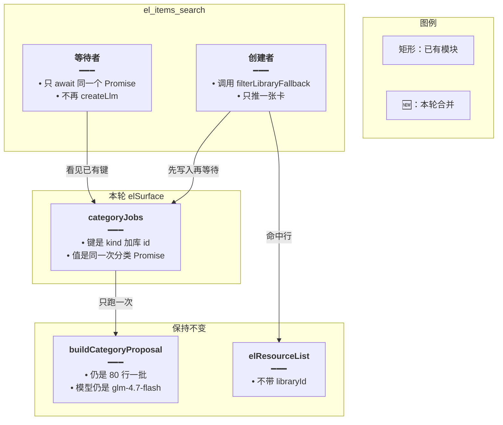
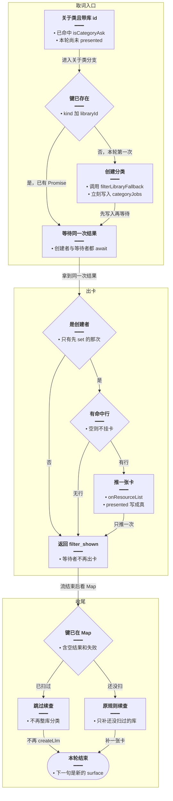
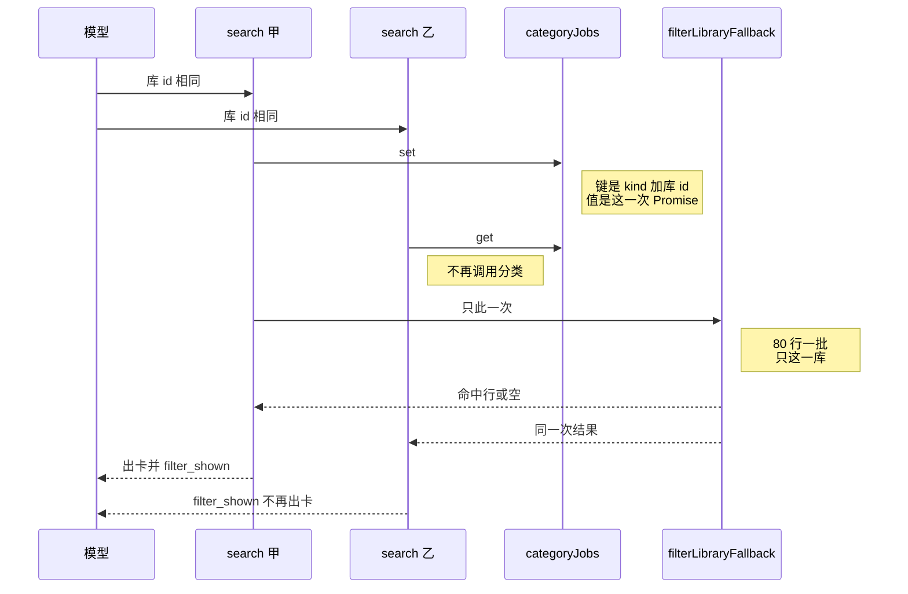
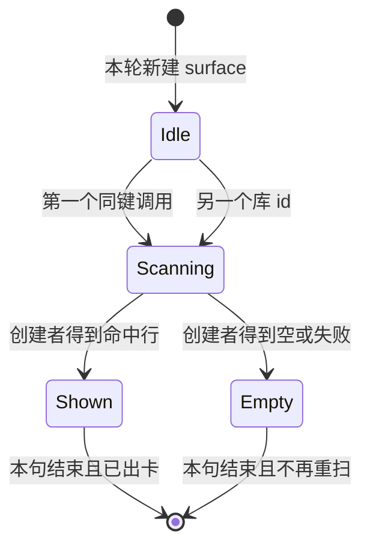

# 同库分类只扫一次 — 实现思路

> **状态**：规划（未实现）
> **日期**：2026-10-28
> **需求摘要**：关于类问法在同一轮里并行取同一个库时，每次都把整库送进分类器。要改成这一轮里同一个库只分类一次，卡片、语句库和收尾续查保持现有行为。
> **一句话方案（预告）**：进行中的分类记在本轮 `elSurface` 上，同一库的后来者等待同一次结果，只有先发起的那次出卡。

## 延伸阅读

- [关于类一次出卡.md](./关于类一次出卡.md)
- [库内筛选不中断.md](./库内筛选不中断.md)

---

## 0. 读本文你将得到什么

- 慢和 token（模型调用量）多，是因为并行的几次 `el_items_search` 在 `presented` 还没写成真时各自扫完整库。
- 选定方案：同一个库共用一个进行中的 Promise（同一次尚未结束的分类），不换分类模型，也不把 80 行一批改掉。
- 改动在本轮状态和取词入口。不同库仍然各扫一次，避免「所有词汇库」漏库。
- 分两阶段：先合并同库并行调用，再让收尾不要把已经扫过的库再扫一遍。
- 最大风险：三次调用若本来就是三个库，token 不会变成一份；那是该列出的范围，不是重复。

---

## 1. 需求与边界

### 1.1 用户故事

| 角色 | 场景 | 行为 | 期望结果 |
|------|------|------|----------|
| 已登录用户 | 问「将词汇库中所有与动物相关的单词进行分类，并全部列出来」 | 模型在同一轮并行发起多次带同一库 id 的 search | 该库只分类一次，只挂一张卡，流正常结束 |
| 同一用户 | 问某一本语句库里关于打招呼的句子 | 只取那一个库 | 仍是一张语句卡，分类字段仍是 `english` |

### 1.2 范围

| 在范围内 | 不在范围内 |
|----------|------------|
| 同一轮、同一 `kind`、同一 `libraryId` 的重复分类 | 更换 `glm-4.7-flash`、改 80 行一批、改 4 路并行 |
| 等待者不再 `createLlm`，也不再推第二张卡 | 把不同库合并成一次分类 |
| 收尾不再扫这一轮已经扫过的库 | 把分类结果写入数据库供下一句复用 |

### 1.3 约束与依赖

- 分类函数仍是 `filterLibraryFallback`，命中行仍必须来自原行。
- 筛选卡仍不带 `libraryId`。`filter_shown` 和结束图的闸保持不动。
- 状态只放在这一轮的 `elSurface`。下一句用户消息会新建 surface，不把上一句的结果借给下一句。
- 零命中仍不挂空卡，也不把开场白改成「库里没有」。

---

## 2. 背景

- **谁、在什么场景、卡在哪**：用户问词汇库里所有与动物相关的词。日志里同一次取词的 `createLlm` 连着出现几十次，参数是分类器那套：`glm-4.7-flash`、`temperature: 0`、`maxTokens: 1500`、`json_object`。三次 `el_items_search` search 的耗时约 330 秒、381 秒、389 秒，起点都在同一秒附近。
- **现状缺口**：关于类分支用 `!presented` 决定要不要扫库。`presented` 要等分类结束、卡片推出去才变成真。并行的另几次在这之前已经进入 `filterLibraryFallback`，于是整库按 80 行一批各扫一遍。`filter_shown` 只在下一轮模型还要调工具时结束图，挡不住同一轮里已经发出的并行调用。
- **不解决会怎样**：同一库的 token 和等待按并行次数乘上去。免费的 flash 也要排队，用户要等数分钟。
- **硬约束**：不能为了省 token 只扫其中一个库。原话是「所有词汇库」时，不同库各扫一次才列得全。

---

## 3. 现状与复用

| 能力 | 仓库中已有 | 本需求中的用法 |
|------|------------|----------------|
| 本轮状态 | `agent.service.ts` 里新建的 `elSurface` | 工具闭包共用这一个对象。进行中的分类放这里 |
| 关于类取词 | `domain-tools.ts` 里 `el_items_search` 的 list/search 分支 | 进入 `filterLibraryFallback` 之前先查进行中的任务 |
| 分类 | `filterLibraryFallback`、`buildCategoryProposal` | 不改分批和模型。同一库只调用一次 |
| 已出卡 | `presented`、`shownLibraryIds` | 仍用来挡顺序上的第二次。并行窗口改由进行中的 Promise 挡住 |
| 收尾续查 | `finalizeTurn` 里的 `shouldFilterContinue` | 这一轮已经扫过的库 id 不再进入续查 |
| 结束图 | `brakeAfterModel` 认 `filter_shown` | 不改。并行调用各自带回执，下一轮仍结束 |

**调研结论**：缺的是「分类已经开始、卡还没挂上」这段窗口的合并。目录、分类器、出卡、闸都不用换。三次调用是否同一个 `libraryId`，现有日志没打出来。待确认：在 `el_tool` 日志里加上 `libraryId` 再复现。若三次 id 不同，本方案只保证每个 id 扫一次。

---

## 4. 方案比对与最终方案

### 4.1 候选方案

#### 方案 A：只靠现有的 `presented`（复用现状）

- **做法**：不新增状态。谁先把卡推完，谁把 `presented` 设为真，后来的 search 走原来的字面搜索或直接返回。
- **能工作的原因**：调用如果是一个接一个，后一个会看到已出卡，不会再分类。打招呼那句在下一轮才想再搜时，闸已经能停。
- **主要代价**：这次三次 search 同时开始，后两个看不到 `presented`。整库仍被扫多遍。

#### 方案 B：本轮按库合并进行中的分类（扩展 `elSurface`）

- **做法**：`elSurface` 增加 `categoryJobs`。键是 `kind + libraryId`。第一次调用创建 `filterLibraryFallback` 的 Promise 并立刻放进 Map，再 `await`。同键的后来者只 `await` 这个 Promise，不新建分类，也不再 `onResourceList`。收尾看到该键已经存在就跳过。
- **能工作的原因**：Map 的写入发生在第一次 `await` 之前。并行工具要等当前函数让出事件循环才轮到下一次，因此后来者能看见已经放进去的 Promise。同一库的模型调用次数等于一批 80 行的次数，不再乘并行次数。
- **主要代价**：不同库仍然各有一条 Promise，墙钟时间由最慢的那一库决定。零命中的库这一轮也不会再扫第二次。

#### 方案 C：这一轮只允许一个库在分类（新增全局锁）

- **做法**：surface 上只有一个 `categoryJob`。第二个库等到第一个结束再开始。
- **能工作的原因**：峰值并发降到一批 4 路，供应商更不容易堵。
- **主要代价**：「所有词汇库」变成串行。token 并不少，墙钟变成各库耗时相加。

### 4.2 比对

| 维度 | 方案 A 只看 presented | 方案 B 按库合并 | 方案 C 整轮一把锁 |
|------|----------------------|-----------------|-------------------|
| 正确性 | 并行同库会扫多次。顺序调用是对的 | 同库一次。不同库仍各一次，不漏库 | 不漏库，但后一个库要等前一个 |
| 复用 | 现成字段 | 复用 `filterLibraryFallback` 和现有出卡 | 复用分类函数，调度是新的 |
| 改动面 | 无 | `ElListSurface`、取词分支、收尾判断 | surface 再加互斥 |
| 复杂度 | 无新状态 | 一个 Map | 一个锁，还要处理等待失败 |
| 体验 | 同库并行时仍要等数分钟 | 同库等待降到一次分类 | 多库更慢 |
| 风险 | 低 | 后来者若也推卡，会多张卡 | 前一个库抛错会拖住后面的库 |
| 可维护性 | 并行窗口仍隐性存在 | 合并规则和出卡规则在同一分支 | 锁和按库去重两套规则 |

### 4.3 综合考量

这次权重大的是正确性和 token：日志已经是三次重叠的整库分类。方案 A 的优点是零改动，这个优点抵不过并行窗口里 `presented` 还是假。

方案 C 能压低同时打到免费 flash 的路数。它放弃的是多库同时分类。token 不减，用户等得更久，和「所有词汇库都要列出来」相反。

选定方案 B。同库的重复调用合成一次分类，不同库保持并行，现有的一张卡、`filter_shown` 和收尾续查都还在。代价是 Map 只活在这一轮，下一句相同的问题会再扫一次。

### 4.4 最终方案

#### 背景

关于类取词在 `presented` 写成真之前就可以被并行进入。每一进入都会 `fetchAllPages` 再按 80 行调用 `glm-4.7-flash`。同一轮的结束图闸看不到这些已经发出的调用。`elSurface` 已经是这些工具共用的对象。

#### 具体思路

1. 分类函数不改。合并放在调用它的入口。
2. Promise 放在 `elSurface.categoryJobs`。键是 `kind` 和 `libraryId`。不进数据库，不跨用户。
3. 先放入 Map，再 `await`。只有创建者推卡片、写 `presented`。等待者只回 `filter_shown`。
4. 分类抛错时 Promise 留在 Map 里直到这句结束，等待者和稍后的同键调用都不再开第二次扫描。下一句是新的 surface。

#### 实现方案

**一句话**：进行中的分类记在本轮 `elSurface` 上，同一库的后来者等待同一次结果，只有先发起的那次出卡。

| 步骤 | 谁 | 做什么 | 输入 → 输出 |
|------|----|--------|-------------|
| 1 | `runChatStream` | 创建空的 `categoryJobs` | 新的一轮 → 空 Map |
| 2 | `el_items_search` | 同键已有 Promise 则等待 | 库 id → 同一次分类结果 |
| 3 | 创建者 | 推一张卡并写 `presented` | 命中行 → `elResourceList` |
| 4 | `finalizeTurn` | Map 里已有的库不再续查 | 键 → 跳过 |

#### 选定原因

1. **正确性**：同库不会在卡挂上之前再扫。牺牲：不同库的 token 仍按库数累加。
2. **复用**：分类、出卡、回执标记都不换。牺牲：surface 多一个字段。
3. **改动面**：只动本轮状态和取词入口。牺牲：要同时改收尾，否则零命中会再扫一次。
4. **复杂度**：一个 Map，没有跨句缓存。牺牲：下一句相同问题会再扫。
5. **体验**：同库并行从数分钟的倍数变成一次分类。牺牲：多库仍要等最慢的那次。
6. **风险**：等待者不推卡，失败的 Promise 留在 Map 里。牺牲：这一句整库抛错时不自动重扫。
7. **可维护性**：合并和「只出一张卡」在同一个分支。牺牲：读代码要看到 Map 先写后等。

#### 优势

- 相对方案 A：三次同时开始的 search 只会打出一批 `createLlm`。
- 相对方案 C：两个不同的库可以同时分类，不会串成两倍时间。

#### 怎么实现

1. `ElListSurface` 增加 `categoryJobs`。`runChatStream` 里初始化为 `new Map()`。
2. 关于类分支用 `` `${kind}:${libraryId}` `` 取任务。没有则创建 `filterLibraryFallback` 并立即 `set`。
3. `await` 之后只有创建者 `put` artifact、`onResourceList`、`presented = true`。
4. 等待者返回带 `filter_shown` 的成功回执，不推卡。
5. `finalizeTurn` 在调用续查前看这个键。已经在 Map 里就不再调用 `filterLibraryFallback`。

### 4.5 失败的扫描要不要再开一次

这会改变同一轮里 token 会不会再花一遍。

#### 方案 A：失败后从 Map 删掉，允许再扫

- **做法**：`finally` 里 `delete`。下一次同键调用重新 `filterLibraryFallback`。
- **能工作的原因**：数据库抖一下之后，同句里的下一次 search 还能出卡。
- **主要代价**：等待者还没 `await` 完时，若创建者已经 `delete`，新来的调用会再开一整库分类。

#### 方案 B：失败的 Promise 留到这句结束

- **做法**：不删除。等待者和同句里稍后的调用都 `await` 同一个拒绝或同一次空结果。
- **能工作的原因**：这一句里同库的模型调用不会乘第二次。下一句 surface 是新的，用户再问会重新扫。
- **主要代价**：这一句里库暂时读失败时，不会自动再试整库。批内失败仍由 `buildCategoryProposal` 重试那一批。

| 维度 | 失败后删除 | 留到这句结束 |
|------|------------|--------------|
| 正确性 | 可能在等待者进场前又扫一遍 | 同句同库只有一次扫描 |
| 复用 | 此项相同 | 此项相同 |
| 改动面 | 多一个 `finally` | 不删除即可 |
| 复杂度 | 要保证 delete 和等待者不打架 | 无额外时序 |
| 体验 | 偶发再等一轮整库 | 整库失败要等用户再问 |
| 风险 | token 回到乘二 | 这一句不出卡 |
| 可维护性 | 删除时机要和并行对齐 | Map 的生命周期等于这句 |

综合：这次要压的就是同句里的第二次整库扫描。失败后立刻删掉，并行窗口会把扫描放回来。批内那一次重试已经在 `classifyChunk` 里。选定把 Promise 留到这句结束。放弃的是同一句里自动再扫整库的能力。

#### 背景

80 行一批的失败会在 `classifyChunk` 里再请求一次。整库再扫是另一层，会把全部批次再打一遍。

#### 具体思路

整库 Promise 一旦放进 Map 就留着。空结果和拒绝都算这句已经扫过。收尾看到键就跳过。

#### 实现方案

**一句话**：同句同库的分类 Promise 不删除，收尾也不再扫这个键。

| 步骤 | 谁 | 做什么 | 输入 → 输出 |
|------|----|--------|-------------|
| 1 | 取词分支 | `set` 之后不再 `delete` | 键 → 留在 Map |
| 2 | `finalizeTurn` | 键存在则跳过续查 | 键 → 不调用分类 |

#### 选定原因

**正确性**：同句不会出现第二次整库 token。牺牲：整库抛错时这一句不自动重扫。

#### 优势

相对失败后删除：等待者进场时不会撞上一次新的 `filterLibraryFallback`。

#### 怎么实现

创建者只 `set`。函数返回前不 `delete`。收尾用 `categoryJobs.has(key)` 决定是否续查。代码见 §9。

---

## 5. 架构图



**图内方法说明**：

| 方法 | 功能 |
|------|------|
| `categoryJobs` | 记下本轮每个库正在进行或已经结束的分类 |
| `filterLibraryFallback` | 翻页并分类一个库，签名和分批都不改 |
| `buildCategoryProposal` | 按 80 行调用分类模型 |
| `elResourceList` | 只由创建者推一次 |

**读图要点**：

- 合并点在取词入口，不在分类器内部。
- 等待者不连到分类模型。
- 不同的库 id 是不同的键，会各有一条箭头进分类器。

---

## 6. 主流程图



**图内方法说明**：

| 方法 | 功能 |
|------|------|
| `isCategoryAsk` | 判断原话是关于类，决定要不要走进这张图 |
| `filterLibraryFallback` | 创建者发起的那一次整库分类 |
| `categoryJobs` | 用 kind 加库 id 记下这一次 Promise |
| `onResourceList` | 创建者把命中行推成一张卡 |
| `createLlm` | 收尾跳过时不再为这个库创建分类模型 |

**读图要点**：

- 先看键，再决定要不要创建分类。
- 等待者绕过「推一张卡」。
- 收尾只补这一轮还没扫过的库。

---

## 7. 核心时序图



**图内方法说明**：

| 方法 | 功能 |
|------|------|
| `categoryJobs` | 让后一个 search 拿到先一个 search 的 Promise |
| `filterLibraryFallback` | 整库分类只执行一次 |
| `search` | 两次工具调用都返回，但只有甲推卡片 |

**读图要点**：

- 甲和乙是同一轮里的并行工具，不是下一轮。
- 乙的返回仍然带 `filter_shown`，下一轮的闸不用改。
- 分类模型只出现在甲到 `filterLibraryFallback` 的那一条线上。

---

## 8. 状态机



**图内方法说明**：

| 方法 | 功能 |
|------|------|
| `categoryJobs.set` | `Idle` 到 `Scanning`，同键不会再走一次 |
| `onResourceList` | `Scanning` 到 `Shown` 时推卡 |
| `filterLibraryFallback` | `Scanning` 上唯一的分类 |

**读图要点**：

- `Empty` 也离开 `Scanning`，同键不会回到 `Idle`。
- 另一个库 id 是另一条 `Scanning`，图上写成从 `Idle` 再进入。

---

## 9. 具体实现（主链路代码）

### 9.1 模块一览

| 模块 | 职责 | 新增/改动 | 预估路径 |
|------|------|-----------|----------|
| `categoryJobs` | 本轮进行中的分类 | 扩展 | `apps/backend/src/services/agent/tools/english/spill.ts` |
| 初始化 | 每句一个空 Map | 扩展 | `apps/backend/src/services/agent/agent.service.ts` |
| 取词分支 | 先取键再决定谁出卡 | 扩展 | `apps/backend/src/services/agent/tools/english/domain-tools.ts` |
| `finalizeTurn` | 已扫过的库不续查 | 扩展 | `apps/backend/src/services/agent/agent.service.ts` |

### 9.2 同库只发起一次

```typescript
// 对应 §4.4 步骤 2。进入关于类分支后、调用分类之前，用键决定这一次是创建还是等待
const jobKey = `${filterKind}:${libraryId}`;
// 取出已有任务；没有表示这一轮还没人扫这个库
let job = deps.surface.categoryJobs.get(jobKey);
// 记下是不是创建者，等待者稍后不能再推第二张卡
const owner = !job;
// 只有第一个调用创建分类，避免并行窗口里 presented 还是假时各扫一遍
if (!job) {
	// 分类函数保持现有签名，分批和模型都不在这里改
	job = filterLibraryFallback(
		// 翻页仍走英语学习服务，不新开查询入口
		deps.learning,
		// 分类模型配置沿用现有 createLlm 预设
		deps.config,
		// 只读当前用户的库，避免串到别的账号
		deps.userId,
		{
			// 卡片标题和取词都认这个库 id
			id: libraryId,
			// 目录里有标题就用标题，没有则退回 id，避免空标题
			title: known?.title ?? libraryId,
		},
		// 分类对照的是用户原话，不是模型改写后的检索词
		deps.surface.userText,
		// 失败日志走这一轮已注入的 logger
		deps.logger,
		// 语句库走 english 字段，词汇库走 word 字段
		filterKind,
	);
	// 先写入再 await，下一个并行调用让出前就能看见同一个 Promise
	deps.surface.categoryJobs.set(jobKey, job);
}
// 创建者和等待者都等这一次结果，等待者不会再打模型
const draft = await job;
// 不是创建者就只回执，避免同一库挂出第二张卡
if (!owner) {
	// 返回成功回执且带 filter_shown，不调用 onResourceList
	return elOk(
		{
			// 回给模型的库 id，方便它知道是哪一次取词
			libraryId,
			// 标明卡已经由创建者负责，本调用没有再挂一张
			alreadyShown: true,
		},
		{
			// 带上 filter_shown，下一轮闸仍能停，且禁止再 search
			message: '卡片已列出。禁止再 search 或 el_present。filter_shown',
		},
	);
}
```

创建者在 `draft` 非空时的 `put`、`onResourceList`、`presented = true` 保持现在的代码。`draft` 为空时仍返回「没有可展示的行」和 `filter_shown`，不把键从 Map 删掉。

### 9.3 收尾不扫第二次

```typescript
// 对应 §4.4 步骤 4，以及 §4.5。放在 shouldFilterContinue 命中之后、调用续查之前
const jobKey = `${filterKind}:${lib.id}`;
// 取词工具已经扫过这个库，空结果也不再花一次 token
if (elSurface.categoryJobs.has(jobKey)) {
	// 跳过即可，presented 与否都不再分类
	return;
}
```

这段写在 `finalizeTurn` 里现有的 `if (lib)` 内部。`categoryJobs` 在创建 `elSurface` 时设为 `new Map()`。

---

## 10. 分阶段步骤

### M1 合并并行取词

- [ ] `ElListSurface.categoryJobs` 与每句初始化
- [ ] 关于类分支按键合并，只有创建者出卡
- [ ] 用同一库 id 并行两次 search：分类模型的 `createLlm` 只出现一批，卡片只有一张

### M2 收尾不重复

- [ ] 取词已经扫过的库，`finalizeTurn` 不再调用 `filterLibraryFallback`
- [ ] 模型只调用了 `el_libraries`、Map 仍为空时，整段库名命中的收尾续查仍会出卡
- [ ] 两个不同库 id 仍会各分类一次

---

## 11. 风险与回滚

| 风险 | 缓解 | 回滚 |
|------|------|------|
| 三次调用其实是三个库，token 仍是三份 | 日志补上 `libraryId` 再判断 | 去掉 Map，回到按 `presented` 判断 |
| 等待者也推了卡 | 只有 `owner` 调用 `onResourceList` | 同上 |
| 整库抛错后这一句不再自动重扫 | 批内重试仍在；下一句会重新扫 | 改回 `finally` 删除 |

---

## 12. 验收清单

- [ ] 同一库 id 的两次并行 search：只有一批 80 行的 `createLlm`，只有一张卡。
- [ ] 两个不同库 id：各一批 `createLlm`，各一张卡。
- [ ] 「列出某语句库中关于打招呼的语句」仍是一张语句卡，流正常结束。
- [ ] 整库问法「列出某库的全部单词」不进入 `categoryJobs`。
- [ ] 模型只列出目录、原话写全唯一库名时，收尾仍出一张卡。
- [ ] 零命中不挂空卡，同句内不会再出现第二次整库 `createLlm`。

---

## 13. 待确认

- 16:14:59 左右那三次 `el_items_search` 的 `libraryId` 是否相同。验证：在现有 `[el_tool]` 日志上加上 `libraryId` 后复现「所有与动物相关的单词」。本方案在 id 相同时把扫描收成一次；id 不同时保持每个库一次。

（若与仓库最新源码不一致，以源码为准）
