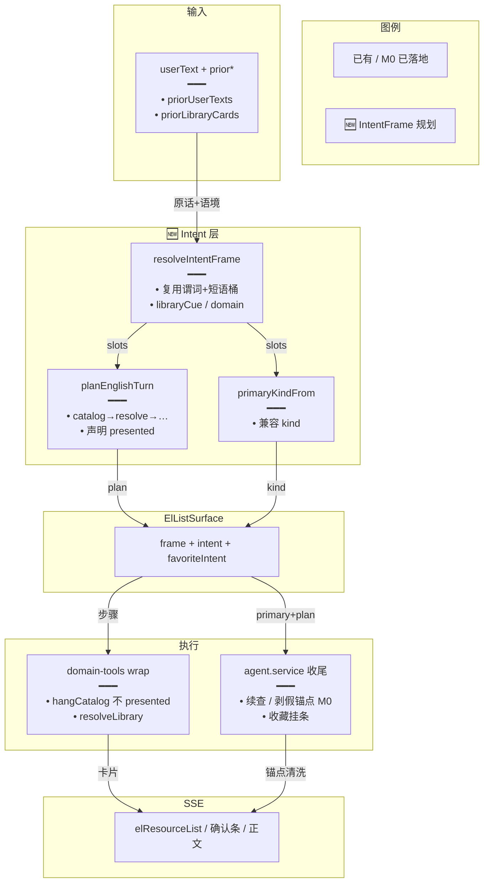
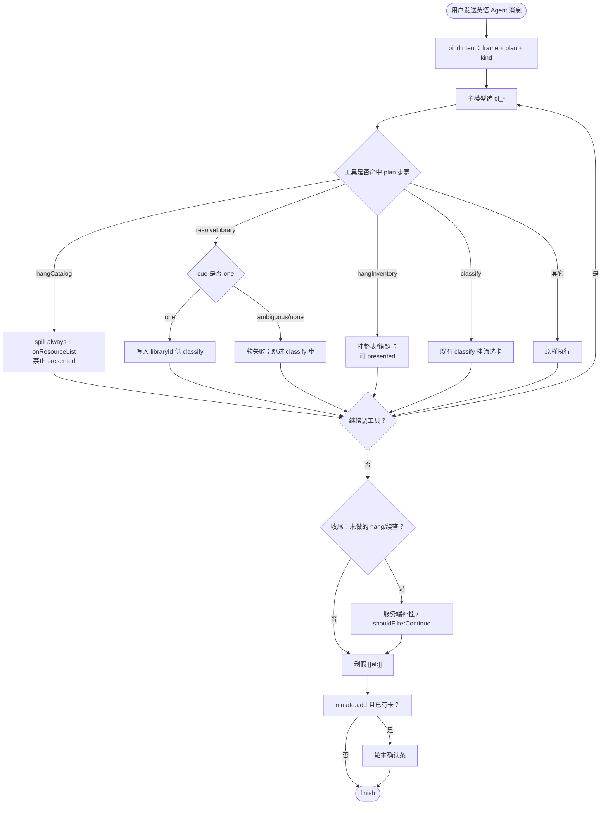
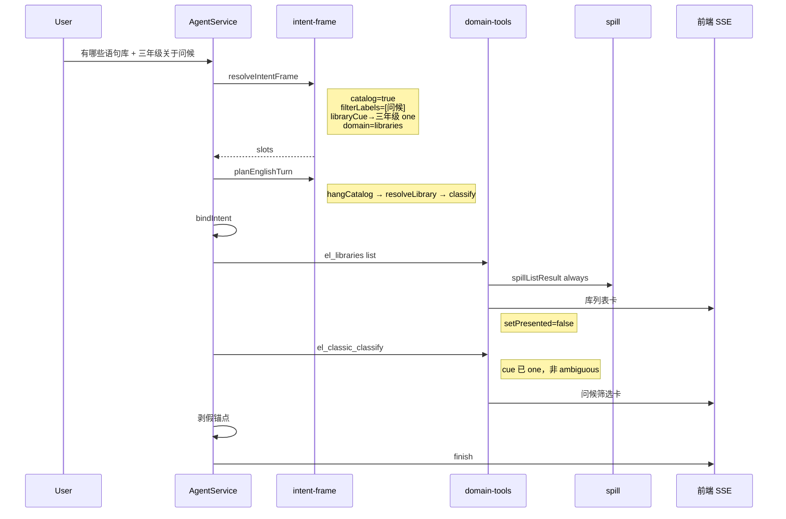

# 复合意图槽位化 — 实现思路

> **状态**：规划（M0 旁路补丁已落地；IntentFrame 未实现）  
> **日期**：2026-10-31  
> **需求摘要**：英语学习 Agent 要把「一句多事」与长对话指代做成可扩展的通用意图层，新增语境不再靠互斥正则补丁叠床架屋。  
> **一句话方案（预告）**：以归档文验证过的 M0 不变量为底座，落地确定性 **IntentFrame + 有序 plan**；`kind` 仅适配兼容；短语表按域分桶；`decide()` 只补原话子串线索；服务端执行挂卡步骤（不设 presented 挡 classify）；孤儿 `[[el:]]` 按 `turnElResources` 剥离。

## 延伸阅读

- **已落地归档（M0 补丁事实源）**：[../../english/Agent复合意图通用化.md](../../english/Agent复合意图通用化.md) — 下文通用化路线以**本文为规划主文**，归档文保留改动前后代码对照
- **前序总路由（单 kind，已落地）**：[语境意图总路由](./语境意图总路由.md) → [归档](../../english/语境意图总路由.md)
- 分域闸：[收藏意图总控](./收藏意图总控.md)、[生成不跑库筛选](./生成不跑库筛选.md)、[整库稳定出卡](./整库稳定出卡.md)、[意图决定出卡](./意图决定出卡.md)
- 槽位先例：[Agent词句认意图](./Agent词句认意图.md)、[../通用决策封装.md](../通用决策封装.md)

---

## 0. 读本文你将得到什么

- 要解决：单 `kind` 互斥表无法表达「盘点库 ∪ 分类 ∪ 收藏」；旁路谓词继续堆会不可测
- 选定方案：**IntentFrame 槽位 → 有序 plan（服务端执行 hang*）**；吸收归档文 M0 四条硬约束；放弃多标签 LLM 主闸与「万能有哪些」
- 改动层：后端 `tools/english/` + `agent.service`；前端只吃既有 SSE 卡
- 阶段：M0 已完成 → M1 类型适配 → M2 计划器 → M3 跨轮槽位
- 最大风险：一次换成多标签 LLM 意图主闸——明确放弃

---

## 0.1 与归档文比对结论（保留最佳）

对照 [`Agent复合意图通用化.md`](../../english/Agent复合意图通用化.md) 与本稿初版后，**定稿取舍**如下。

| 议题 | 归档文 | 本稿初版 | **定稿采用** | 理由 |
|------|--------|----------|--------------|------|
| 下一阶段总方向 | IntentFrame + 有序计划 | 同左，且含 A/B/C 三方比对 | **同向；以本稿为规划主文** | 方向一致；本稿有完整候选比对与 D1/D2 决策 |
| M0 热修策略 | 错题短语 / catalog 不标 presented / 忽略盘点 span / 剥假锚点 | 仅作「已落地」一笔带过 | **全部升格为硬约束**（§1.3 / §4.4） | 已线上验证，是 frame 不可破坏的不变量 |
| 槽位集合 | catalog / filter / libraryCue / domain / mutate | 另加 inventory、generate；mutate 偏写操作 | **合并**：归档五槽 + inventory + generate；mutate 含 query | 覆盖错题盘点与生成挡板，且能表达查询收藏 |
| 计划顺序 | ① catalog → ② resolve 库 → classify → ③ 提案 | hangCatalog → hangInventory → classify → propose | **归档顺序 + hangInventory**：先 catalog（不 presented）→ resolveLibrary → hangInventory/classify → mutate | resolve 显式化可避免再把「我有哪些」当库名 |
| 短语表 | 按域分桶，禁止万能「有哪些」 | PhraseBucket 候选 D2-B | **D2-B + 禁止万能有哪些** | 归档踩过的坑写入原则 |
| plan 谁执行 | 隐含服务端挂卡 | D1-B 服务端执行 vs D1-A 只靠模型 | **D1-B** | 与 M0 catalogAsk / inventoryFallback 一致 |
| 假卡防护 | 原则 4 + 已落地剥离 | 验收 A7 | **原则级保留 + 收尾白名单** | 两侧都要，归档写得更硬 |
| 多标签 LLM 主闸 | 未展开，强调确定性 | 方案 C 并否决 | **否决（保留比对表）** | 本稿论证更完整 |
| 代码对照 | 改动前/后 100% 注释 | 规划态示意代码 | **分工**：对照留归档；示意留本稿 §9 | 避免双份维护源码摘录 |

**一句话**：通用化仍走 IntentFrame；把归档文 M0 的「可叠加副作用 / 库名 span / 分域短语 / 剥假锚点」写成宪法，把本稿的候选比对、计划器执行点与跨轮 M3 写成落地法。

---

## 1. 需求与边界

### 1.1 用户故事

| 角色 | 场景 | 行为 | 期望结果 |
|------|------|------|----------|
| 学习者 | 刚打开 Agent | 「错题集有哪些资源？」 | 挂出错题清单卡（词/句），非空锚点 |
| 学习者 | 一句两事 | 「我有哪些语句库，其中三年级…关于问候」 | 库列表卡 + 问候筛选卡；`libraryCue=one`，非 ambiguous |
| 学习者 | 复合收藏 | 「需要收藏三年级关于家庭的词句」 | 先筛选卡再确认条（frame 显式 ensureFilterThenPropose） |
| 学习者 | 长对话续问 | 「那本库再筛家庭」 | 继承上一库 + 本句 filter，不串生成/收藏 |
| 维护者 | 新加「有哪些笔记」 | 只改短语表一行 + 一步 plan | 不动优先级大表与十处 wrap if |

### 1.2 范围

| 在范围内 | 不在范围内（非目标） |
|----------|----------------------|
| 英语 `assistMode` 意图抽取、计划执行、出卡副作用声明 | 通用 Chat / Skill Agent 意图框架 |
| 槽位：catalog / inventory / filter / libraryCue / domain / mutate / generate | 向量记忆、用户画像、跨会话长期意图 DB |
| 短语表数据化与可测矩阵；孤儿锚点防护（已有则保持） | 前端新 UI；重写全部 `el_*` 工具体；把 M0 补丁再打一遍 |

### 1.3 约束与依赖（含归档 M0 硬约束）

- 名单与确认数字仍以服务端卡片 / artifact 为准
- 禁止「每轮 LLM 多标签意图」作主闸；`decide()` 仅歧义槽且线索须为原话子串
- **禁止「万能有哪些」进 inventory**：错题/库清单用分域短语（归档已证泛化会误伤筛选）
- **catalog 挂卡不得 `presented=true`**：否则挡住后续 classify（M0 `catalogAsk`）
- **盘点前缀不是库名**：`isCatalogAskSpan` 忽略「我有哪些」等；唯一命中即 `one`
- **假锚点**：收尾只保留 `turnElResources` 内的 `[[el:]]`
- 兼容：旧 `surface.intent.kind` / `favoriteIntent` 渐进迁移
- Ponytail：先 frame + 适配，再删旁路；不新依赖

---

## 2. 背景

- **谁、场景、卡点**：学习者常把盘点、点名库、关于类、收藏写在一句；长对话还有「那本 / 上述」。现网用固定优先级选出**唯一** `EnglishIntent.kind`，第二件事靠 `wantsLibraryCatalog`、`needsFilterCards` 等旁路硬挂。
- **现状缺口**：`_ctx` 几乎未用；谓词各管一截；`presented` 被 inventory 置位后挡 classify。M0 已修两洞，但 `catalogAsk` 仍散落在 wrap。
- **不解决会怎样**：每多一种说法就改正则或 wrap `if`，假卡与 Markdown 复述反复复发。
- **硬约束**：见 §1.3；复用 `ElListSurface`、`spillListResult`、`onResourceList`、`decide`；不破坏生成/查询/取消互斥。

---

## 3. 现状与复用

| 能力 | 仓库中已有 | 本需求中的用法 |
|------|------------|----------------|
| 单主意图总路由 | `english-intent.ts` → `resolveEnglishIntent` | **扩展**：由 frame 推导 primary `kind` |
| 列表三态 | `spill.ts` → `listIntent` | **收编** → `slots.inventory`（`list==='inventory'`） |
| 关于类 / 生成挡板 | `isCategoryAsk` / `isPackGenerateAsk` / `isReadingGenerateAsk` | **复用**为抽取器 |
| 库清单副作用（M0） | `wantsLibraryCatalog` + wrap `catalogAsk` | **升级**为 plan `hangCatalog`（`setPresented:false`） |
| 库名点名（M0） | `resolveMentionedLibrary` / `isCatalogAskSpan` | **复用**填 `libraryCue`；plan 含 `resolveLibrary` |
| 卡标题分 kind（M0） | `artifactTitle(..., kind)` | **直接复用** |
| 筛选续查 | `shouldFilterContinue` / `inheritedLibrary` | **扩展**：M3 读 priorFrame |
| 收藏总闸 | `resolveFavoriteIntent` | **复用**填 `mutate`（含 query 标记） |
| 绑意图 | `bindIntent` | **扩展**写 `surface.frame` |
| 假锚点剥离（M0） | `agent.service` 收尾 | **直接复用**（原则级） |
| 短决策抽槽 | `decide()` | **复用**仅补 cue |

**调研结论**：单 kind 互斥仍够用；缺的是正交槽位与声明式副作用。M0 证明「副作用与主闸解耦」正确——应升为 frame，而不是继续加 `wantsX`。

---

## 4. 方案比对与最终方案

### 4.1 候选方案

#### 方案 A：继续单 kind + 旁路谓词堆叠（= 把 M0 模式常态化）

- **做法**：保持互斥表；新语境继续加 `wantsX` / wrap `if` / 提示词。
- **能工作的原因**：M0 已修好错题盘点与双卡；改动面小。
- **主要代价**：谓词组合爆炸；`presented` 靠约定；新说法碰多文件。

#### 方案 B：IntentFrame + 有序 plan（扩展总路由，吸收 M0 不变量）

- **做法**：`resolveIntentFrame` → 槽位；`planEnglishTurn` → 步骤（hangCatalog → resolveLibrary → hangInventory/classify → mutate）；`resolveEnglishIntent` 读 primary；wrap/收尾执行 plan；短语表分域。
- **能工作的原因**：槽位正交；出卡/`presented` 由步骤声明；旧 kind 适配；M0 行为可断言复现。
- **主要代价**：frame/plan 两概念；M2 挪 wrap；迁移期双读。

#### 方案 C：多标签 LLM 意图主闸

- **做法**：每轮模型输出 `intents[]` + slots，服务端按标签调工具。
- **能工作的原因**：说法覆盖面大。
- **主要代价**：飘、贵、难测；与「名单服务端为准」冲突。

### 4.2 比对

| 维度 | 方案 A | 方案 B | 方案 C |
|------|--------|--------|--------|
| 正确性 | 单路径稳；复合靠补丁 | 可断言双卡/`cue=one`；失败步短路 | 标签漂移易误挂确认 |
| 复用 | 最高（只加补丁） | 高（谓词作抽取器） | 低 |
| 改动面 | 每次 1～3 处 | M1～M3 分阶段 | 入口与提示词全换 |
| 复杂度 | 概念少、隐式耦合多 | 两类型；耦合显式 | 依赖模型行为 |
| 体验 | 已覆盖好；新复合仍偶发假卡 | 可产品化扩展；无额外意图 LLM | 偶发错路径更伤 |
| 风险 | 技术债线性涨 | 双读；plan 顺序写错 | 回滚难、费用 |
| 可维护性 | 一说法多闸 | 短语行 + 一步 | 回归弱 |

### 4.3 综合考量

权重：**正确性（复合不出假卡）**、**可维护性**、**与 M0/单 kind 契合**。A 是归档文已声明要毕业的模式；C 违反确定性主闸。**选 B**，并把归档 §3.2 决策表写成 B 的宪法。

**放弃**：A 的最小热修惯性；C 的少写正则。

### 4.4 最终方案

#### 背景

单 kind 解决了生成/查询/取消互斥；M0 用旁路修好双卡与错题盘点。缺口是缺少正交槽位与声明式执行顺序，`catalogAsk` 仍散落 wrap。硬约束即 §1.3。

#### 具体思路

1. **模块**：新增 `intent-frame.ts`；短语表分桶（可拆 `intent-phrases.ts`）；`english-intent` 薄适配；wrap/收尾读 `surface.frame.plan`。
2. **数据**：`userText` + prior* → `IntentFrame`（只挂本轮内存）。
3. **状态**：M3 起 priorFrame 摘要进 ctx；不落 DB。
4. **边界**：`libraryCue.ambiguous` → 跳过后续 classify；catalog 永不 presented；孤儿锚点收尾剥；mutate 失败软文案。

#### 实现方案

**一句话**：M0 不变量 + IntentFrame + 服务端有序 plan；`kind` 只适配；短语分域；`decide` 只补线索。

| 步骤 | 谁 | 做什么 | 输入 → 输出 |
|------|----|--------|-------------|
| 1 | `resolveIntentFrame` | 分域抽取填槽（含 libraryCue） | text, ctx → slots |
| 2 | `planEnglishTurn` | 有序步骤 + presented 标志 | slots → plan |
| 3 | `primaryKindFrom` | 兼容旧枚举 | slots → kind |
| 4 | `bindIntent` | 双写 frame/intent/favoriteIntent | surface |
| 5 | wrap / 收尾 | 执行 hang* / resolveLibrary / classify / 提案 / 剥锚点 | plan → SSE |

**计划默认顺序**（与归档对齐并补 inventory）：

1. `hangCatalog`（`setPresented: false`）
2. `resolveLibrary`（点名消歧；失败则短路 filter）
3. `hangInventory`（整表/错题；可 `setPresented: true`）
4. `classify`（filterLabels）
5. `ensureFilterThenPropose` / `proposeFavorite` / 查询只读

#### 选定原因

1. **正确性**：组合可断言；吃进 M0 四条坑。牺牲：短期双读重于 A。
2. **可维护性**：新说法进短语表。牺牲：首次搬 wrap。
3. **复用**：抽取器=现有谓词。牺牲：非零概念增量。
4. **风险**：无意图 LLM；可开关回滚。牺牲：得不到 C 的「少正则」。

#### 优势

- 相对 A：`presented`/双卡可单测；不再靠 wrap 注释约定。
- 相对 C：零额外意图调用；黄金句稳定；与 `decide` 子串校验一致。
- 相对「只写归档路线不写比对」：候选否决理由可审计。

#### 怎么实现

1. 锁定 §9 契约（slots/plan 含 `resolveLibrary`）。
2. M1：frame + primary 适配 + 黄金句（含 M0 句）。
3. M2：wrap 删 `catalogAsk` 特例；按 plan 挂卡。
4. M3：priorFrame 继承；收敛 `shouldFilterContinue`。
5. 短语表分桶 + 反例（禁止万能有哪些）。

### 4.5 其他关键决策

#### 决策 1：plan 在何处执行

| 维度 | D1-A 只靠模型+提示 | D1-B 服务端执行 hang* |
|------|-------------------|----------------------|
| 正确性 | 易跳过挂卡 | 对齐 M0 catalogAsk / fallback |
| 复用 | 少改 wrap | 对齐现网收尾 |
| 体验 | 假卡复发 | 双卡稳定 |
| 可维护性 | 提示词难测 | 步骤可测 |

**选 D1-B**。牺牲 D1-A 少改 wrap。

#### 决策 2：短语表形态

**选 D2-B** `PhraseBucket[]`（domain × flag × RegExp）+ **禁止万能有哪些**。牺牲 D2-A 少一行抽象。

#### 决策 3：`domain` 槽是否显式

| 维度 | 仅工具名反推 | 显式 domain 槽（短语表填） |
|------|--------------|---------------------------|
| 正确性 | 错题/库易混 | 归档路线，挂卡标题清晰 |
| 可维护性 | 隐式 | 新域加桶 |

**选显式 domain**（M1 可先从 mistakes/libraries 短语填；未知则 undefined 再反推）。牺牲「少一个字段」。

---

## 5. 架构图



**图内方法说明**：

| 方法 / 模块入口 | 功能 |
|-----------------|------|
| `resolveIntentFrame` | 🆕 填槽；调用 `wantsLibraryCatalog` / `listIntent` / `isCategoryAsk` / 收藏闸 / 库名解析 |
| `planEnglishTurn` | 🆕 生成有序步骤；catalog 强制 `setPresented:false` |
| `primaryKindFrom` | 🆕 旧枚举适配；catalog 不单开 kind |
| `resolveMentionedLibrary` / `isCatalogAskSpan` | M0：盘点前缀忽略；唯一命中 one |
| `bindIntent` | 双写 frame |
| wrap hang* | 按 plan 推卡 |
| 收尾剥 `[[el:]]` | M0：白名单 `turnElResources` |

**读图要点**：抽取→计划→surface→wrap/收尾；模型不做意图主闸；M0 剥离与 span 规则保留在执行层。

---

## 6. 主流程图



**图内方法说明**：

| 方法 | 功能 |
|------|------|
| `bindIntent` | 开轮解析 |
| `spillListResult` | 外溢；catalog 强制 always |
| `onResourceList` | SSE 出卡 |
| `resolveMentionedLibrary` | 点名消歧 |
| `shouldFilterContinue` | 停手后补分类（M3 读 frame） |
| 剥假锚点 | M0 白名单 |
| 轮末收藏挂条 | 读 mutate + 卡，不信散文 |

**读图要点**：catalog 与 inventory 分步；resolve 失败短路 filter；收尾必剥假锚点。

---

## 7. 核心时序图



**图内方法说明**：

| 方法 | 功能 |
|------|------|
| `resolveIntentFrame` | 抽 catalog/filter/cue |
| `planEnglishTurn` | 三步计划 |
| `bindIntent` | 写入 surface |
| `spillListResult` | 库列表外溢 |
| `onResourceList` | 出卡 |
| classify 路径 | 筛选卡 |
| 剥假锚点 | 防空锚点 |

**读图要点**：无意图 LLM；双卡对应两步 hang/classify；resolve 在 classify 前完成。

---

## 8. （可选）状态机

无独立 UI 模式；`presented` 仅为步骤副作用。

---

## 9. 具体实现（主链路代码）

### 9.1 模块一览

| 模块 | 职责 | 新增/改动 | 预估路径 |
|------|------|-----------|----------|
| intent-frame | 槽位、计划、primary | 新增 | `apps/backend/src/services/agent/tools/english/intent-frame.ts` |
| intent-phrases | 分域短语桶 | 新增或自 spill 迁出 | `.../intent-phrases.ts` |
| english-intent | 适配旧 API | 改动 | `.../english-intent.ts` |
| spill | 谓词保持；表迁出后 re-export | 改动 | `.../spill.ts` |
| domain-tools | 按 plan 挂卡；删 catalogAsk 特例 | 改动 | `.../domain-tools.ts` |
| agent.service | bindIntent / 剥锚点保持 | 改动 | `.../agent.service.ts` |
| 黄金句 | slots/plan 断言 | 新增 | `intent-frame.check.ts` |

### 9.2 数据流与契约

```typescript
// 对应 §4.4：合并归档五槽 + inventory/generate；mutate 含查询
export type IntentSlots = {
	// 要库名清单卡；可与 filter 同句
	catalog: boolean;
	// 整表/错题盘点；与 catalog 可并存
	inventory: boolean;
	// 关于类标签
	filterLabels: string[];
	// 点名库；resolveLibrary 步读写 status
	libraryCue?: {
		raw: string;
		libraryId?: string;
		status: 'one' | 'ambiguous' | 'none' | 'absent';
	};
	// 分域短语填入；影响工具与标题
	domain?: 'mistakes' | 'favorites' | 'libraries' | 'notes' | 'packs' | 'reading';
	// 写/查询收藏；query 用 action 旁标或 favoriteQuery
	mutate: {
		action: 'add' | 'remove' | 'query' | null;
		side: 'vocab' | 'classic' | 'both' | 'card';
	};
	// 生成；命中则清空 filterLabels（现网挡板）
	generate?: 'pack' | 'reading' | null;
};

export type PlanStep =
	| { type: 'hangCatalog'; setPresented: false }
	| { type: 'resolveLibrary' }
	| { type: 'hangInventory'; setPresented: boolean }
	| { type: 'classify'; labels: string[] }
	| { type: 'ensureFilterThenPropose' }
	| { type: 'proposeFavorite' }
	| { type: 'noop' };

export type IntentFrame = {
	slots: IntentSlots;
	plan: PlanStep[];
};
```

### 9.3 关键实现片段

```typescript
// 对应 §4.4 步骤 1～2：抽取 + 计划（吸收 M0：catalog 不 presented、先 resolve）
import {
	categoryLabels,
	isCategoryAsk,
	isPackGenerateAsk,
	isReadingGenerateAsk,
	listIntent,
	wantsLibraryCatalog,
} from './spill';
import { isFavoriteQuery, resolveFavoriteIntent, unfavoriteFromCards } from './favorite-ask';

export function resolveIntentFrame(
	userText: string,
	_ctx: { priorUserTexts: string[] } = { priorUserTexts: [] },
): IntentFrame {
	const text = userText.trim();
	const genPack = isPackGenerateAsk(text);
	const genRead = isReadingGenerateAsk(text);
	const cancel = unfavoriteFromCards(text);
	const favQuery = isFavoriteQuery(text);
	const fav = resolveFavoriteIntent(text);
	const list = listIntent(text);
	const catalog = wantsLibraryCatalog(text);
	const filterLabels =
		!genPack && !genRead && isCategoryAsk(text) ? categoryLabels(text) : [];
	const slots: IntentSlots = {
		catalog,
		inventory: list === 'inventory',
		filterLabels,
		domain: catalog ? 'libraries' : list === 'inventory' && /错题/.test(text) ? 'mistakes' : undefined,
		mutate: cancel
			? { action: 'remove', side: cancel }
			: favQuery
				? { action: 'query', side: 'card' }
				: { action: fav.action === 'add' ? 'add' : null, side: fav.side },
		generate: genPack ? 'pack' : genRead ? 'reading' : null,
	};
	return { slots, plan: planEnglishTurn(slots) };
}

export function planEnglishTurn(slots: IntentSlots): PlanStep[] {
	const steps: PlanStep[] = [];
	// 先库清单，且永不 presented——归档 M0 硬约束
	if (slots.catalog) steps.push({ type: 'hangCatalog', setPresented: false });
	// 点名消歧放在 classify 前，避免「我有哪些」污染 cue
	if (slots.filterLabels.length || slots.inventory) {
		steps.push({ type: 'resolveLibrary' });
	}
	if (slots.inventory) steps.push({ type: 'hangInventory', setPresented: true });
	if (slots.filterLabels.length) {
		steps.push({ type: 'classify', labels: slots.filterLabels });
	}
	if (slots.mutate.action === 'add' && slots.filterLabels.length) {
		steps.push({ type: 'ensureFilterThenPropose' });
	} else if (slots.mutate.action === 'add') {
		steps.push({ type: 'proposeFavorite' });
	}
	return steps.length ? steps : [{ type: 'noop' }];
}

export function primaryKindFrom(slots: IntentSlots): EnglishIntentKind {
	if (slots.mutate.action === 'remove') return 'favorite_remove';
	if (slots.mutate.action === 'query') return 'favorite_query';
	if (slots.generate === 'pack') return 'pack_generate';
	if (slots.generate === 'reading') return 'reading_generate';
	if (slots.mutate.action === 'add') return 'favorite_add';
	if (slots.filterLabels.length) return 'category_filter';
	if (slots.inventory) return 'inventory';
	// 仅 catalog：kind=chat，出卡靠 plan
	return 'chat';
}
```

```typescript
// 对应步骤 4～5：双写；wrap 用 plan 取代 catalogAsk
const bindIntent = (surface: ElListSurface) => {
	const frame = resolveIntentFrame(surface.userText, {
		priorUserTexts: surface.priorUserTexts,
	});
	surface.frame = frame;
	const intent = {
		kind: primaryKindFrom(frame.slots),
		needsFilterCards: frame.plan.some((s) => s.type === 'ensureFilterThenPropose'),
		side: frame.slots.mutate.side,
	};
	surface.intent = intent;
	surface.favoriteIntent = favoriteIntentFrom(intent);
};

const hangCatalog = deps.surface.frame?.plan.some((s) => s.type === 'hangCatalog');
// el_libraries list：always 外溢 + onResourceList；禁止 presented
```

### 9.4 复用与集成点

- `bindIntent`（`agent.service`）
- `buildEnglishLearningDomainTools` 顶部意图绑定
- `spillListResult` / `onResourceList` / `inventoryFallback`
- `resolveMentionedLibrary`（resolveLibrary 步）
- 收尾 `turnElResources` 剥锚点（M0，勿删）

---

## 10. 分阶段落地

| 阶段 | 目标 | 关键任务 | 依赖 | 完成标准 |
|------|------|----------|------|----------|
| **M0（已完成）** | 旁路补丁 | 错题短语、catalogAsk、span、剥锚点、artifactTitle | — | 归档验收句通过 |
| **M1** | 类型与适配 | intent-frame；resolveEnglishIntent 经 frame；黄金句含 M0 | M0 | 旧 kind 矩阵 100% 绿 |
| **M2** | 计划执行 | 删 wrap catalogAsk；按 plan 挂卡；短语分桶 | M1 | 双卡/错题仅靠 plan |
| **M3** | 跨轮槽位 | priorFrame；收敛 shouldFilterContinue | M2 | 「那本库再筛家庭」稳定 |

回滚：`EL_INTENT_FRAME=0` 时跳过 plan 执行，保留 M0 旁路与旧 kind。

---

## 11. 风险与验收

### 11.1 风险

| 风险 | 影响 | 缓解 |
|------|------|------|
| primary 与旧优先级微差 | 串台 | M1 黄金句锁 kind |
| plan 多挂卡 | 噪音 | shownLibraryIds；步骤审 |
| 短语过宽 | 误 catalog/inventory | 分域后缀；反例「找出…有哪些」 |
| 双读不一致 | 难查 | frame 为真相 |
| 误删 M0 剥锚点 | 假卡回潮 | 收尾单测 A7 |

### 11.2 验收

| 编号 | 步骤 | 期望 |
|------|------|------|
| A1 | 错题集有哪些资源 | hangInventory；错题卡；非万能有哪些误伤 |
| A2 | 我有哪些语句库 | hangCatalog；不 presented |
| A3 | 有哪些库 + 三年级关于问候 | 双卡；cue=one |
| A4 | 生成关于努力的语句 | generate；无筛选续查 |
| A5 | 当前收藏了哪些 | mutate.query；无确认条 |
| A6 | 需要收藏…关于家庭 | ensureFilterThenPropose |
| A7 | 手写假 [[el:uuid]] | 收尾剥离 |

---

## 12. 开放问题

| 问题 | 为何重要 | 建议 |
|------|----------|------|
| 仅 catalog 时 primary 用 chat 是否够 | 收尾分支是否读 plan | M1 收尾优先读 plan；kind 仅兼容 |
| 短语表何时拆文件 | 体量 | >30 行或跨域 3+ 再拆 |
| 黄金句载体 | 习惯 | 最小 `intent-frame.check.ts` |

---

（规划主文；M0 源码对照以 `english/Agent复合意图通用化.md` 为准；若与仓库最新源码不一致，以源码为准）
