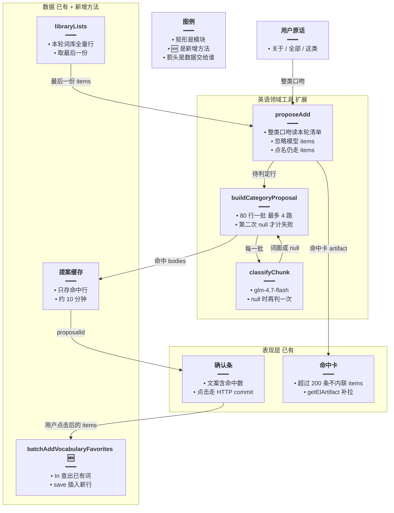
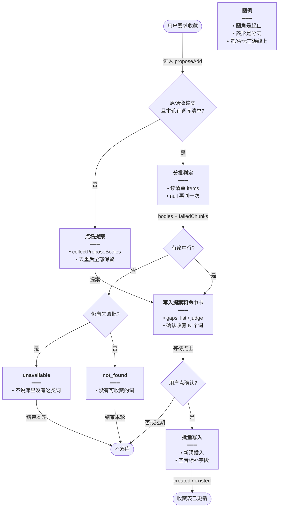
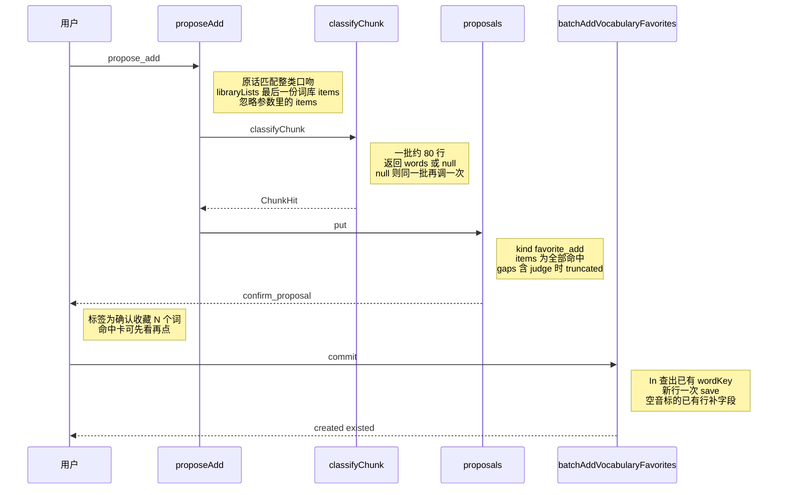

# 大批收藏稳落库 — 实现思路

> **状态**：规划（未实现）  
> **日期**：2026-10-28  
> **需求摘要**：用户要把一本词库里某一类词全部收藏，命中可以是几百到几千；这些词都要进同一条确认，不能因为 40、400 或 2000 这类条数被丢掉，也不能因为模型把词写进工具参数、某一批判定失败或确认时逐条插入而整批失败。  
> **一句话方案（预告）**：整类口吻改读本轮已经拉好的词库清单并忽略模型附带的 `items`；判定失败的一批再判一次；点确认后按错题批量的形状一次写入收藏。

## 延伸阅读

- 整类判定与确认条：[english/整类词一次收藏.md](./整类词一次收藏.md)。该文里的「点名上限 400」是当时方案，条数顶已从代码去掉，后续以本篇为准
- 清单按库内总数翻页：[english/清单按库取全.md](./清单按库取全.md)。本篇不改 `fetchAllPages`，分类器读到的行数等于该库已取出的 artifact
- 一批提案、HTTP 确认、同轮刹车：[english/收藏提案直确认.md](./收藏提案直确认.md)

---

## 0. 读本文你将得到什么

- 去掉条数顶之后，大库收藏会卡在三处：模型把词写进一次工具参数、Flash 某一批超时被整批排除、确认时每个词各查一次再插入。
- 选定方案：整类口吻用本轮词库 artifact 判定；失败批重试一次；收藏确认改成一次查出已有词再批量插入。
- 改动在英语领域工具、分类调用和收藏服务；确认条、前端拉卡片、图递归上限都不换。
- 分三阶段：M1 绑定本轮清单，M2 失败重试，M3 批量写入。
- 最大风险是几千词的判定仍要在一次工具调用里跑完，确认条出现前用户要等。

---

## 1. 需求与边界

### 1.1 用户故事

| 角色 | 场景 | 行为 | 期望结果 |
|------|------|------|----------|
| 登录用户 | 已让 Agent 列出某本词库，接着说「把关于动物的词全部收藏」 | 点一次确认 | 判定命中的词都在收藏里，不因条数被截掉 |
| 登录用户 | 只点名几个词，例如 cat 和 dog | 点确认 | 只写入这几个词，即使本轮刚列过整本词库 |
| 登录用户 | 大库里有一批判定超时 | 看确认条和回执 | 重试仍失败的那一批不进提案，回执写明有批未能判断；其余命中照常可确认 |

### 1.2 范围

| 在范围内 | 不在范围内（非目标） |
|----------|----------------------|
| 单词收藏的整类提案、失败重试、确认写入 | 恢复 40 / 400 / 2000 或任何「只留前 N 条」 |
| 点名 `items` 在不是整类口吻时原样进提案 | 整类取消收藏再做一套分类器。取消写入已经是 `removeVocabularyFavoritesBatch` 一条删除 |
| 单词错题若走同一条 `propose_add` + artifact，共用判定 | 语句收藏仍逐条 `addClassicQuoteFavorite`。语句库没有几千条一类词这条路径 |
| 命中卡继续走现有 artifact；超过 200 条由前端 `getElArtifact` 补拉 | 新进度条、任务队列、把判定挪到点确认之后 |
| | 提高图递归 56、领域工具上限 10、瘦索引 400、`decide()` 的 2 秒 / 400 token |

### 1.3 约束与依赖

- 必须复用：`proposeAdd`、`buildCategoryProposal`、`classifyChunk`、`ElListSurface.libraryLists`、`proposals.put`、`onPresented`、`forSse`、`addVocabularyFavorite` 的去重与补音标语义、`batchAddVocabularyMistakes` 的「先 `In` 再 `save`」形状。
- 同轮已有提案仍返回 `stop_tools`。确认仍是用户点击后的 HTTP `commit`，本轮对话不代点。
- 数据库是 MySQL。批量查询用 TypeORM `In`，不写 PostgreSQL 数组语法。
- 全量词库行留在本轮 artifact（进程内缓存，约 30 分钟）。提案只存命中行，不把整库再复制进模型上下文。
- 体验底线：失败批不能被当成「这批没有这类词」。用户点确认前仍能在命中卡里看到将要写入的词。

---

## 2. 背景

- **谁、在什么场景、卡在哪**：用户让英语 Agent 把一本词库里某一类词全部收藏。三年级上册一百来个词可以一次完成。四级、托福、日常英语这类库是几千条。用户要求超出任何固定条数的词也要加入。
- **现状缺口**：整类路径在模型传入 `artifactId` 时会分批判定，点名路径则把模型这次写出的 `items` 全部放进提案。模型一次能看见的瘦索引仍最多约 400 行或一页 80 行。它若改用 `items` 罗列整类，参数 JSON 写到一半，这次调用解析失败，一个词都进不了提案。判定一批 80 行、最多 4 路并行、单批 8 秒，超时返回 `null` 且不重试，该批词直接不进提案。确认时 `favorite_add` 对每个词调用 `addVocabularyFavorite`（先查再插），几百上千次往返；中途抛错只增加失败计数，已经插入的行留下。
- **不解决会怎样**：大库要么整次提案失败，要么漏掉超时的那几批，要么确认请求很慢。把条数顶加回去能缩短请求，但会再次丢掉用户要点的那些词。
- **硬约束**：不提高递归和工具次数；不把 `decide()` 的短超时套到 80 个词上；不在点确认前落库；不把整库 JSON 塞回模型。

---

## 3. 现状与复用

| 能力 | 仓库中已有 | 本需求中的用法 |
|------|------------|----------------|
| 整类判定 | `apps/backend/src/services/agent/tools/english/domain-tools.ts` 的 `proposeAdd`：有 `artifactId` 且 `kind==='vocab'` 时忽略 `items`，调用 `buildCategoryProposal` | 扩展：没有 `artifactId` 时，整类口吻改用本轮最后一份词库清单 |
| 分批与失败计数 | `category-propose.ts`：`CATEGORY_CHUNK=80`，并行 4，`classifyChunk` 超时或非 JSON 返回 `null`，不重试 | 扩展：仅 `null` 时再判一次；`{words:[]}` 仍表示这批没有命中 |
| 本轮清单 | `spill.ts` 的 `ElListSurface.libraryLists`；`domain-tools.ts` 在词库列表外溢时 `push(spilled.full)`，`full.items` 是已取行 | 直接复用，不再让模型把这些行抄进参数 |
| 提案与确认条 | `proposals.put`、`ui.confirm_proposal`、`gaps` 含 `list` / `judge` | 直接复用。重试后仍失败才记 `judge` |
| 命中卡 | `onPresented` + `spill.ts` 的 `forSse`（超过 `EL_SSE_INLINE_MAX_ITEMS=200` 去掉 `items`） | 直接复用。前端 `ResourceListBlock` 已按 `artifactId` 调用 `getElArtifact` |
| 逐条收藏 | `apply-proposal.ts` 循环 `addVocabularyFavorite`；该方法按 `wordKey` 去重，已有行只在音标为空时补字段 | 单词收藏改走新的批量方法，语义与这条单条方法一致 |
| 批量写入范例 | `english-learning.service.ts` 的 `batchAddVocabularyMistakes`：按词键去重、`In(keys)` 一次查出、`save(rows)` 一次插入 | 扩展出 `batchAddVocabularyFavorites`，不复用错题表 |
| 批量取消 | `removeVocabularyFavoritesBatch` 一条 `delete` | 不适用。本篇不改取消 |
| 瘦索引 | `EL_SLIM_MAX_ITEMS=400`，`EL_SLIM_PAGE=80` | 保持。模型仍然看不见未展示的词面；整类不靠它枚举 |
| 同轮刹车 | `openProposalId` 时 `stop_tools` | 直接复用。判定仍包在一次 `propose_add` 里，不拆成多次工具调用 |

**调研结论**：整类判定、清单外溢、提案确认和错题批量插入都已经在仓库里。缺的是「整类口吻在模型没传 `artifactId` 时仍用本轮清单」、失败批的一次重试，以及收藏确认的批量写入。不需要新表、新队列或新前端接口。

---

## 4. 方案比对与最终方案

### 4.1 候选方案

#### 方案 A：维持现状（复用）

- **做法**：模型传入 `artifactId` 时，`proposeAdd` 调用现有 `buildCategoryProposal` / `classifyChunk`，一次提案装下全部命中。模型只传 `items` 时，`collectProposeBodies` 去重后全部进入提案，不按条数切片。确认时 `apply-proposal.ts` 继续循环 `addVocabularyFavorite`。失败批保持 `null` 且不重试，回执用现有 `judge` 文案。
- **能工作的原因**：三年级这种小库、以及模型确实传了 `artifactId` 的整类请求，今天就能收齐命中。点名几个词也不会误伤整库。
- **主要代价**：模型若把几千个词写进 `items`，参数被生成长度截断后整次解析失败。大库判定时间不变，超时批直接缺失。确认仍是 N 次查询加 N 次插入。

#### 方案 B：点确认后再后台判定（新增）

- **做法**：`propose_add` 只记下 `artifactId` 和用户原话，立刻挂出确认条。用户点击后，HTTP `commit` 里再跑 `buildCategoryProposal`，命中直接 `save`。等待从对话工具调用挪到确认请求。
- **能工作的原因**：对话回合不再被 4 路 Flash 占住；同轮工具次数和递归上限都不用动。命中仍可以全部写入，没有条数顶。
- **主要代价**：用户点确认时还没看到命中词。分类器把擦边词放进来时，现有命中卡来不及拦住。确认接口要承担整库判定，超时后用户分不清是没点上还是还在跑。需要新的「判定中」状态，现有 `confirm_proposal` 只有一次点击。

#### 方案 C：本轮清单判定 + 失败重试一次 + 确认时批量插入（扩展）

- **做法**：`proposeAdd` 在已有 `artifactId` 分支之后增加一步。用户原话匹配整类口吻，且 `deps.surface.libraryLists` 里有 `source==='library'`、非语句、`items` 非空的清单时，用最后一份的 `items` 调用现有 `buildCategoryProposal`，忽略模型附带的 `items`。`classifyChunk` 返回 `null` 时用同一批再调一次，第二次仍是 `null` 才计入 `failedChunks`。`applyElProposal` 在 `favorite_add` 且 `contentKind==='vocab'` 时改为一次 `batchAddVocabularyFavorites`。该方法放在 `addVocabularyFavorite` 旁边：词键去重、`In` 查出已有行、新行 `save` 一次；已有行仅在音标为空时补音标、词性、切分、例句和中文，与单条方法相同。
- **能工作的原因**：整类词面来自已经按库取全的 artifact，不依赖模型把词抄进参数。重试只多一次往返，仍在同一次 `propose_add` 里，不增加图步。写入形状与 `batchAddVocabularyMistakes` 相同，MySQL 上已经在用。
- **主要代价**：几千词的判定仍发生在确认条出现之前，用户要等。放弃方案 B 那种「对话先结束、点击后再算」的短回合。

### 4.2 比对

| 维度 | 方案 A 维持现状 | 方案 B 确认后再判定 | 方案 C 绑定清单 + 重试 + 批量写入 |
|------|-----------------|---------------------|-----------------------------------|
| 正确性 | 模型改传 `items` 时，截断的 JSON 导致整批没有提案。超时批不重试 | 能收齐，但用户在看见命中前就确认，擦边词会直接落库 | 整类口吻不读模型的词表。超时批多一次机会。点确认前命中卡仍在。点名口吻不扫整库 |
| 复用 / 与现状契合 | 零改动 | 确认条要承担判定，和「先看卡片再写入」的现有交互不一致 | 复用 `libraryLists`、`buildCategoryProposal`、错题批量的 `In` + `save`、现有 `judge` 回执 |
| 改动面 | 无 | `proposeAdd`、`commit`、确认按钮状态、可能还有前端等待文案 | `proposeAdd`、`classifyChunk`、`apply-proposal.ts`、收藏服务新增一个方法 |
| 复杂度 | 无新状态 | 提案要区分「未判定 / 判定中 / 可写入」，多一种中间态 | 无新表。重试是同函数内的第二次调用。批量方法只服务确认路径 |
| 体验 | 小库正常。大库要么工具失败，要么确认慢 | 对话回合短。确认要等完整判定，且看不到将写入的词 | 大库仍要等判定结束才出现确认条。确认后的写入从 N 次往返变成常数次 |
| 风险 | 大库整类继续整批失败或漏批 | 误分类直接入库；确认 HTTP 被判定时间拖住 | 整类口吻误绑本轮最后一份词库清单。批量 `save` 若单包过大需按块提交，块是传输单位，每块都写，不丢词 |
| 可维护性 | 两条入口（`artifactId` 与 `items`）的行为差继续留在提示词里 | 判定逻辑拆进确认接口，和工具内分类两处都要懂 | 判定仍只在 `category-propose.ts`。收藏去重只在服务里一处，确认循环不再复制 |

### 4.3 综合考量

权重放在正确性和与现状的确认交互上。用户已经明确：超出固定条数的词也要加入，所以不把「恢复 400 或 2000」列成候选——它能缩短 JSON 和写入，但直接少词。方案 A 对小库够用，对「模型没传 `artifactId`」这条失败路径没有覆盖。方案 B 把等待挪到点击之后，对话回合更短，这是它相对 C 的优点；但现有命中卡就是为了在落库前拦住擦边词（例如 bear 的「忍受」），B 把这张卡拿掉了。本仓库的确认条是一次点击、无中间态，为了少等而加「判定中」不值得。

选定方案 C。放弃 A 的零改动，也放弃 B 的短对话回合。瘦索引仍是 400，整类不靠模型看见每一个词。

### 4.4 最终方案

#### 背景

去掉条数顶之后，词库行可以全部进 artifact，整类判定也能一次装下命中。缺口是入口和落库：整类只有在模型传入 `artifactId` 时才读 artifact；失败批不重试；单词收藏确认仍逐条 `addVocabularyFavorite`。硬约束是同轮不第二次提案、点确认前不落库、不把整库送回模型、不提高递归上限。

#### 具体思路

1. 判定留在 `proposeAdd`，不挪到 `commit`。入口增加「本轮清单」这一条，与已经存在的 `artifactId` 分支共用 `buildCategoryProposal`。
2. 数据从 `libraryLists` 最后一份词库清单的 `items` 到命中 `bodies`，再进提案和命中卡。模型传来的 `items` 在整类口吻下不参与。
3. 状态仍放在现有提案缓存（约 10 分钟）和 artifact 缓存（约 30 分钟）。不新建任务表。批量写入不在对话进程里记进度。
4. 边界：原话不像整类则走点名，本轮有没有清单都不扫库。`{words:[]}` 不重试。两次都失败才记 `judge`。无命中且有失败批仍返回 `unavailable`，避免模型说「库里没有这类词」。已有收藏只补空音标，不覆盖用户已有释义。

#### 实现方案

**一句话**：整类口吻改读本轮已经拉好的词库清单并忽略模型附带的 `items`；判定失败的一批再判一次；点确认后按错题批量的形状一次写入收藏。

| 步骤 | 谁 | 做什么 | 输入 → 输出 |
|------|----|--------|-------------|
| 1 | `domain-tools.ts` `proposeAdd` | 已有 `artifactId` 时保持现在的读法。否则原话像整类且本轮有词库清单，取最后一份的 `items` | 用户原话 + `libraryLists` → 待判定行 |
| 2 | `category-propose.ts` `classifyChunk` | 返回 `null` 时用同一批再调一次 | 一批行 + 原话 → `ChunkHit` |
| 3 | `buildCategoryProposal` | 仍 80 行一批、最多 4 路。第二次仍 `null` 才 `failedChunks++` | 全表行 → `bodies`、`failedChunks` |
| 4 | `proposals.put` 与 `onPresented` | 命中全部进提案和命中卡。`forSse` 超过 200 条去掉 `items`，前端按 `artifactId` 补拉 | `bodies` → `proposalId`、确认条 |
| 5 | `apply-proposal.ts` | 单词 `favorite_add` 改调批量方法。语句收藏保持逐条 | 提案 `items` → `created` / `existed` / `failed` |
| 6 | `english-learning.service.ts` `batchAddVocabularyFavorites` | 词键去重，`In` 查出已有行，新行一次 `save`；空音标的已有行补字段 | 命中行 → 与单条收藏相同的计数 |

整类口吻用这一条正则，写在 `domain-tools.ts` 旁，不进模型提示词：`/关于|全部|所有|这类|相关|找出|哪些|属于|挑出|筛/`。最后一份清单的过滤条件：`source==='library'`、`contentKind` 不是 `classic`、`items.length > 0`。

#### 选定原因

1. **正确性**：整类词面来自清单而不是模型参数，生成截断不再让整批提案消失。牺牲：原话里同时出现「全部」和个别例子时，以整库筛选为准，例子不会把范围收成那一个词。
2. **复用**：判定、提案、回执、命中卡、错题批量形状都沿用。牺牲：不换确认交互，大库的等待留在工具调用里。
3. **改动面**：三处后端，前端确认接口不动。牺牲：收藏服务多一个方法，不能只改工具文件。
4. **复杂度**：无中间态。牺牲：没有方案 B 的「先结束对话」。
5. **体验**：确认后的数据库往返变成按批而不是按词；命中卡还在。牺牲：判定结束前没有确认条。
6. **风险**：重试把偶发超时捞回，两次失败仍记 `judge`。牺牲：最坏情况下失败批的墙钟时间加倍，只发生在 `null` 上。
7. **可维护性**：去重和补音标收进一个批量方法，确认循环不再逐词复制。牺牲：单条 `addVocabularyFavorite` 仍留给页面上的单次收藏，两处要保持补音标规则一致。

#### 优势

- 相对方案 A：模型漏传 `artifactId` 时仍按本轮词库筛选，点名路径的「参数写一半则整批失败」不再发生在整类口吻上；超时批有一次补判；确认写入不再按词打往返。
- 相对方案 B：落库前用户仍看到命中卡和「确认收藏 N 个词」。误分类停在确认前。不给提案增加「判定中」状态。

#### 怎么实现

1. 在 `proposeAdd` 里，`artifactId` 分支之后、点名 `collectProposeBodies` 之前，解析本轮词库清单。命中则走与 `artifactId` 相同的 `buildCategoryProposal`、`gaps`、`proposals.put`、`onPresented`。
2. `classifyChunk` 在 `null` 时再执行一次相同的 `createLlm` 调用。空词数组直接返回。
3. `buildCategoryProposal` 的并行度保持 4，不把重试拆成图上的另一次工具。
4. 提案与命中卡逻辑不改字段。`full.truncated` 仍写 `list`，`failedChunks > 0` 仍写 `judge`。
5. `applyElProposal` 对单词收藏改为一次批量调用，用返回的 `created` / `existed` 填现有 `ApplyStats`。批量方法抛错时整批记 `failed`，不逐词吞掉。
6. `batchAddVocabularyFavorites` 按 `batchAddVocabularyMistakes` 的顺序：跳过空词、词键去重、`find({ wordKey: In(keys) })`、新行 `save`、已有空音标行再 `save` 补字段。单次 `save` 若超过驱动能接受的包大小，按 500 行一块依次 `save`，每块都写完，这是传输分块，不是用户可见的条数顶。

### 4.5 其他关键决策

无其他会改变架构、数据流或状态归属的决策。失败重试和批量写入都是方案 C 的步骤：重试不新开任务，批量写入不换收藏表，状态仍在现有提案与 artifact 缓存。

---

## 5. 架构图



**图内方法说明**：

| 方法 / 模块入口 | 功能 |
|-----------------|------|
| `proposeAdd` | 收藏或错题的提案入口。整类时选出本轮词库行并调用判定，把命中写入提案和命中卡，挂出确认条 |
| `buildCategoryProposal` | 把全表切成 80 行一批，最多 4 路调用分类，合并词面并套上音标等字段，返回命中行和失败批次数 |
| `classifyChunk` | 把一批「词面 \| 释义」和用户原话交给 Flash，解析 `{"words":[]}`。超时或无法解析时再调一次 |
| `getElArtifact` | 前端用命中卡上的 `artifactId` 拉取被 SSE 省掉的 `items` |
| `batchAddVocabularyFavorites` | 确认接口里一次性写入单词收藏：已有词不重复插入，空音标则补上 |

**读图要点**：

- 判定在领域工具里完成，确认条只负责用户点头后的写入。
- 新增的只有批量收藏方法；清单、提案缓存和命中卡沿用现有旁路。
- 模型参数里的词表不进入整类这条箭头。点名路径不经过 `classifyChunk`。

---

## 6. 主流程图



**图内方法说明**：

| 方法 | 功能 |
|------|------|
| `proposeAdd` | 流程图入口。先判断是否走整类，再决定读清单还是读 `items` |
| `collectProposeBodies` | 点名路径。把模型给出的词去重后全部放进提案，不按条数截断 |
| `buildCategoryProposal` | 整类路径上的分批判定。失败批重试一次后仍失败才计入 `failedChunks` |
| `batchAddVocabularyFavorites` | 用户确认后写入收藏表，返回新增数和已存在数 |

**读图要点**：

- 整类和点名在提案之前分叉，分叉之后共用同一条确认和写入。
- 没有命中且存在失败批时停在 `unavailable`，避免把超时说成「没有这类词」。
- 用户不点确认、或提案过期，收藏表不变。

---

## 7. 核心时序图



**图内方法说明**：

| 方法 | 功能 |
|------|------|
| `propose_add` | 模型发起的工具调用。图中由 `proposeAdd` 接收，整类时不采用模型列出的词 |
| `classifyChunk` | 对一批词面做 Flash 筛选。第一次失败再请求一次，两次都失败则该批没有词面 |
| `put` | 把命中行写入提案缓存并返回 `proposalId`，供确认条使用 |
| `confirm_proposal` | 返回给前端的确认控件，带提案 id 和命中数 |
| `commit` | 用户点击后的 HTTP。服务端按提案 id 取出 `items` 再调用批量收藏 |
| `batchAddVocabularyFavorites` | 把提案中的单词写入收藏表，已存在的词计入 existed |

**读图要点**：

- 用户看到确认条之前，分类已经在 `proposeAdd` 里结束。
- `commit` 不再逐词调用单条收藏。判定与写入分成工具回合和 HTTP 两段，中间隔着一次点击。
- 同轮第二次 `propose_add` 仍由现有 `stop_tools` 拦住，图中不展开。

---

## 9. 具体实现（主链路代码）

### 9.1 模块一览

| 模块 | 职责 | 新增/改动 | 预估路径 |
|------|------|-----------|----------|
| 整类入口 | 整类口吻绑定本轮清单 | 扩展 | `apps/backend/src/services/agent/tools/english/domain-tools.ts` |
| 分批判定 | `null` 再判一次 | 扩展 | `apps/backend/src/services/agent/tools/english/category-propose.ts` |
| 确认应用 | 单词收藏改批量 | 扩展 | `apps/backend/src/services/agent/tools/english/apply-proposal.ts` |
| 收藏服务 | 一次查出、一次插入 | 新增方法 | `apps/backend/src/services/english-learning/english-learning.service.ts` |
| 命中卡 / 确认条 | 超过 200 条补拉、点击 commit | 直接复用 | `apps/frontend/src/components/design/Assistant/ResourceListBlock.tsx` |

### 9.2 主链路实现

```typescript
// 对应 §4.4 步骤 1。整类口吻才绑定清单，点名「收藏 cat」不会把本轮整库扫进去
const CATEGORY_ASK = /关于|全部|所有|这类|相关|找出|哪些|属于|挑出|筛/;

// 对应 §4.4 步骤 1。从本轮外溢结果里取最后一份词库，后列出的库覆盖先列出的库
function latestLibraryRows(surface: ElListSurface, userText: string) {
  // 点名口吻不取清单，调用方改走 collectProposeBodies
  if (!CATEGORY_ASK.test(userText)) return null;
  // 从队尾找，用户最后一次列出的词库才是这句的范围
  for (let i = surface.libraryLists.length - 1; i >= 0; i -= 1) {
    // 当前这份外溢清单
    const row = surface.libraryLists[i];
    // 语句库和收藏清单不是单词整类的数据源
    if (row.source !== 'library' || row.contentKind === 'classic') continue;
    // 没有行的清单无法判定，继续看更早的一份
    if (!row.items?.length) continue;
    // 只留对象行，供 buildCategoryProposal 读 word 与释义
    return row.items.filter(
      // 类型收窄：判定函数只接受记录，不接受字符串或数组
      (item): item is Record<string, unknown> =>
        // 丢掉空值、字符串和数组，避免读 word 时抛错
        !!item && typeof item === 'object' && !Array.isArray(item),
    );
  }
  // 本轮没有可用词库清单
  return null;
}
```

```typescript
// 对应 §4.4 步骤 2。只在传输或解析失败时重试，空词数组表示这批确实没有命中
export async function classifyChunk(
  // 读模型配置，第二次调用与第一次共用同一套 Flash 预设
  config: ConfigService,
  // 这一批约 80 行，两次调用传入同一批，避免换批后对不上失败计数
  chunk: Array<Record<string, unknown>>,
  // 用户原话是筛选标准，不改写，防止模型摘要把类别说窄
  userText: string,
): Promise<ChunkHit> {
  // 第一次用现有 8 秒和 1500 token，不改 Flash 模型
  const first = await classifyChunkOnce(config, chunk, userText);
  // 有 JSON 结果就停，包括 words 为空
  if (first) return first;
  // 第二次仍返回 null 时，调用方把这一批计入 failedChunks
  return classifyChunkOnce(config, chunk, userText);
}
```

```typescript
// 对应 §4.4 步骤 6。确认路径一次写入，去重和补音标与 addVocabularyFavorite 一致
async function batchAddVocabularyFavorites(userId: number, items: FavoriteBody[]) {
  // 按词键收成一格，同一词只留第一行，避免一批里重复插入
  const byKey = new Map<string, FavoriteBody>();
  // 逐行归一化词键
  for (const item of items) {
    // 空词跳过，与单条收藏的校验一致
    const wordKey = normalizeVocabularyFavoriteWordKey(item.word);
    // 已收过的词键不再覆盖，保持「第一行说了算」
    if (!wordKey || byKey.has(wordKey)) continue;
    // 留下这一行，后面插入和补音标都读它
    byKey.set(wordKey, item);
  }
  // 查询和插入都用去重后的键
  const keys = [...byKey.keys()];
  // 一次查出已有收藏，替代确认循环里的逐词 findOne
  const existing = await vocabFavoriteRepo.find({
    // userId 限定本人；wordKey 用 In 一次带上全部词键
    where: { userId, wordKey: In(keys) },
  });
  // 用词键判断哪些还要插入
  const have = new Map(existing.map((row) => [row.wordKey, row]));
  // 没有的词键做成新行，字段截断规则与单条创建相同
  const fresh = keys
    // 已在收藏里的词键不插入，避免撞上唯一键
    .filter((key) => !have.has(key))
    // 新行字段与单条 create 相同，音标等截断留在 toFavoriteRow
    .map((key) => toFavoriteRow(userId, byKey.get(key)!));
  // 新词一次 save。包过大时按 500 行一块依次 save，每块都写，不丢词
  if (fresh.length) await vocabFavoriteRepo.save(fresh);
  // 已有行只补空音标及随同的空字段，不覆盖用户已经有的释义
  const patches = existing.filter(
    // 只补「库里有音标、收藏行还空着」的词，已有音标保持不动
    (row) => !row.ipa.trim() && incomingIpa(byKey.get(row.wordKey)),
  );
  // 没有要补的行就不发第二次 save
  if (patches.length) await vocabFavoriteRepo.save(patches);
  // created 给回执的新增数，existed 给「已在收藏中」
  return { created: fresh.length, existed: existing.length };
}
```

### 9.3 数据模型

| 字段/实体 | 来源 | 存储 | 说明 |
|-----------|------|------|------|
| `libraryLists[].items` | 本轮 `fetchAllPages` 后的外溢 | 请求内数组，并写入 artifact 缓存 | 整类判定的输入。不新增列 |
| 提案 `items` | `bodiesFromHits` | 提案缓存，约 10 分钟 | 只有命中行：`word`、`ipa`、`pos`、`segmentation`、`translationZh`、`example` |
| `gaps` | 清单 `truncated`、失败批次数 | 提案上的 `'list' \| 'judge'` | 重试成功的批不进入 `judge` |
| 收藏行 | 批量 `save` | `vocab_favorite` 现有表 | 无迁移。`wordKey` 仍是用户维度的去重键 |

---

## 10. 分阶段实现步骤

| 阶段 | 目标 | 交付物 | 依赖 |
|------|------|--------|------|
| M1 | 整类口吻不再依赖模型传入 `artifactId` | `latestLibraryRows` 接上现有判定与确认条 | 本轮已经列过词库 |
| M2 | 偶发超时的一批还能进提案 | `classifyChunk` 对 `null` 再判一次 | M1 |
| M3 | 确认写入不再按词打往返 | `batchAddVocabularyFavorites` 与 `apply-proposal` 单词分支 | 无，可与 M1 并行，合入时接在确认上 |

### M1

- [ ] `proposeAdd` 在 `artifactId` 分支之后调用 `latestLibraryRows`。
- [ ] 取到行则走现有 `buildCategoryProposal`、`gaps`、`proposals.put`、`onPresented`，不读参数 `items`。
- [ ] 取不到行时保持现在的点名路径，不截断条数。
- [ ] 自检：原话含「关于」、本轮清单有该词、参数另带 3 个无关 `items`，提案来自清单判定。

### M2

- [ ] 把现有 `classifyChunk` 正文收成 `classifyChunkOnce`。
- [ ] 仅 `null` 再调一次；`{words:[]}` 不重试。
- [ ] 自检：第一次 `null`、第二次返回词面，则 `failedChunks` 为 0 且该词在 `bodies`。

### M3

- [ ] 新增 `batchAddVocabularyFavorites`，补空音标的规则与 `addVocabularyFavorite` 相同。
- [ ] `applyElProposal` 的单词 `favorite_add` 改为这一次调用；语句收藏保持循环。
- [ ] 自检：3 个新词加 1 个已存在且无音标的词，结果为 created 3、existed 1，且该行音标被补上。

---

## 11. 风险、边界与待确认

| 项 | 等级 | 说明 | 缓解 |
|----|------|------|------|
| 判定墙钟 | 高 | 约 9000 词是 80 行一批、4 路并行，顺利时也要多轮 Flash；失败重试只加在 `null` 的批上 | 不加大并行。确认条仍等判定结束。不把分类拆到多次工具调用，避免碰到递归上限 |
| 口吻误判 | 中 | 「所有」等词会把本轮最后一份词库整表送去筛选 | 命中卡先展示。点名且原话不含这些词时不走这条分支 |
| 批量包大小 | 中 | 一次 `save` 几千行可能超过驱动单包 | 按 500 行一块依次 `save`，块数不代表用户少词 |
| 补音标两处实现 | 低 | 页面单次收藏仍走 `addVocabularyFavorite` | 批量方法复用同一套截断长度：音标 500、词性 32、切分 500 |
| 进程内清单 | 低 | artifact 约 30 分钟，且在当前进程 | 沿用现有注释：要跨进程再改同一缓存 key。本篇不换 Redis |

**待确认**：

- [ ] 大库判定会不会先被反向代理或 SSE 空闲超时断开（验证方式：对一本 4000 词以上的库走整类收藏，看 Nest 日志里 `propose_add` 返回前连接是否已断。若会断，再单独立项做进度，不在本篇加队列）。

---

## 12. 验收清单

| # | 用例 | 步骤 | 期望 |
|---|------|------|------|
| AC1 | 整类收齐 | 先列出一本词库，再说「把关于动物的词全部收藏」。模型参数里只带几个 `items`、不带 `artifactId` | 提案条数等于清单判定命中数，不是参数里那几个词 |
| AC2 | 点名不扫库 | 本轮刚列过词库，再说「收藏 cat 和 dog」 | 提案只有这两个词 |
| AC3 | 失败重试 | 某一批第一次超时，第二次返回一个清单内的词 | 该词在提案中，回执没有「未能判断」 |
| AC4 | 重试仍失败 | 某一批两次都超时，其他批有命中 | 提案不含该批；回执含「有批未能判断」；`gaps` 含 `judge` |
| AC5 | 全部失败 | 每一批两次都失败 | `unavailable`，文案要求不要说这个库里没有这类词 |
| AC6 | 批量确认 | 确认 3 个新词和 1 个已收藏但无音标的词 | 新词插入 3 行；已有行补上音标；不是 4 次 `findOne` |
| AC7 | 大命中卡 | 命中超过 200 | SSE 可不带 `items`；卡片通过 `artifactId` 仍能看全 |

---

## 13. 预估改动面（实现阶段参考）

| 类型 | 路径（预估） |
|------|----------------|
| 前端 | 无。确认条与 `getElArtifact` 已覆盖 |
| 后端 | `domain-tools.ts`、`category-propose.ts`、`apply-proposal.ts`、`english-learning.service.ts` |
| 文档（实现后） | 实现完成后再用实现归档写到 remote-docs wiki 的英语专题，不在本篇改业务代码 |
