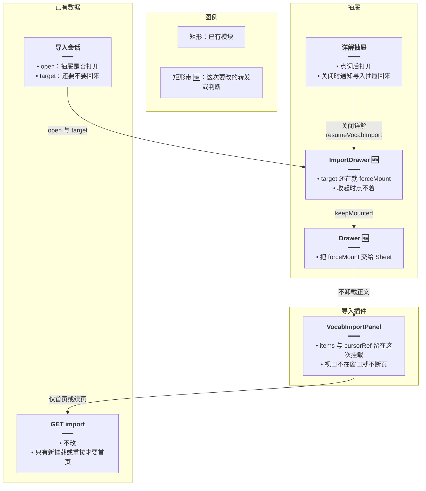
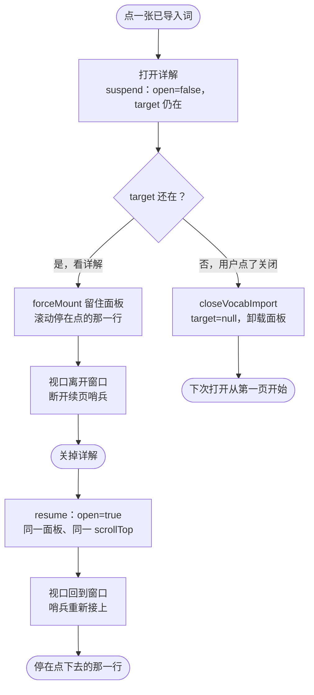
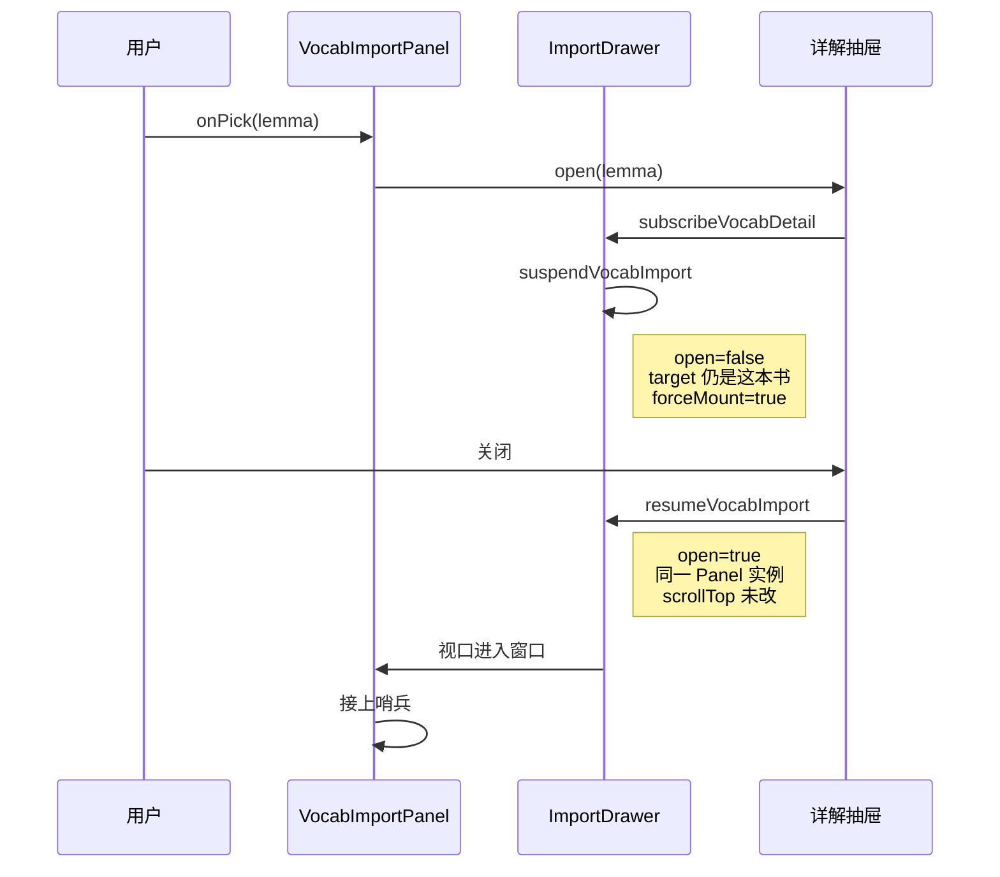
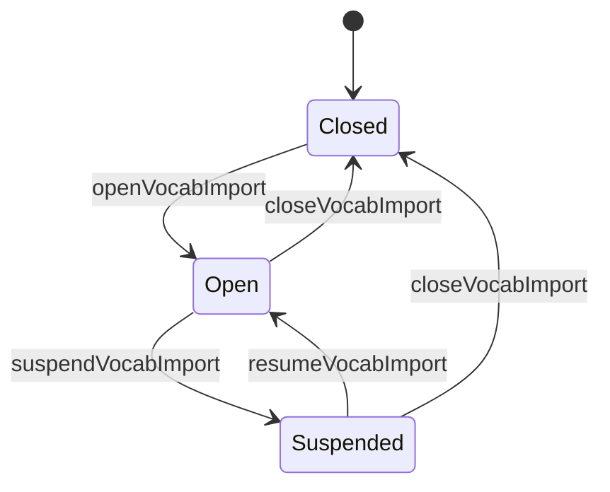

# 导入列表留在原位 — 实现思路

> **状态**：规划（未实现）
> **日期**：2026-11-12
> **需求摘要**：在导入单词详解抽屉里点一张已导入词卡片，看完详解再回来时，列表仍停在点下去的那一行，而不是回到第一页顶部。
> **一句话方案（预告）**：点词收起导入抽屉时用 `forceMount` 留住同一份面板；真正关掉才卸载。滚出屏幕时断开底部哨兵，回来再接上。

## 延伸阅读

- [已导入词游标分页](./已导入词游标分页.md)：列表按 `updatedAt|lemma` 每页 50 条，本篇不改接口
- [详解词列表](./详解词列表.md)：解析列表点词也是先收起自己的抽屉再开详解；那条列表的滚动不在本篇范围

---

## 0. 读本文你将得到什么

- 回来总在第一页，是因为收起抽屉时面板被卸掉，已加载的页和滚动位置一起没了
- 选定做法：收起但还要回来时不卸载面板，滚动条留在原来的 DOM 上
- 只改宿主抽屉和导入插件里的滚动哨兵，不改列表接口
- 两步：先保住挂载，再让藏起来的列表不要继续翻页
- 最大风险：关掉的抽屉若还占着点击区域，会挡住详解

---

## 1. 需求与边界

### 1.1 用户故事

| 角色 | 场景 | 行为 | 期望结果 |
|------|------|------|----------|
| 词库所有者 | 已导入 600 词，滚到后面某张卡片 | 点卡片看详解，再关掉详解 | 导入抽屉重新出现，那张卡片仍在视口里，不用再从第一页往下滚 |
| 词库所有者 | 看完详解回到导入抽屉 | 继续往下滚 | 从当时的游标接着要下一页，不重复已看见的词 |
| 词库所有者 | 点抽屉关闭，或导入/清空成功 | 再次打开或列表刷新 | 从第一页开始，不恢复上一次的滚动 |

### 1.2 范围

| 在范围内 | 不在范围内（非目标） |
|----------|----------------------|
| 点已导入卡片 → 详解 → 关闭详解后的列表位置 | 单词解析列表点词后的滚动（同一类卸载，另说） |
| 已加载页、游标、滚动条一起留下 | 改 `GET vocab-detail/import`、页大小、Redis |
| 导入成功、清空成功、换库、点关闭后仍从第一页开始 | 记住「上次看到第几页」跨刷新、跨重新登录 |

### 1.3 约束与依赖

- 复用现有 `suspendVocabImport` / `resumeVocabImport`：收起时 `open=false` 但留下 `target`，真正关闭才把 `target` 清掉
- 复用现有 `reloadFirstPage` 和按 `libraryId` 重拉的 effect：导入、清空、换库仍然丢掉旧列表
- 抽屉是 Radix Dialog（`Sheet`）。两个同时 `open` 的模态会抢焦点，不能为了留位置而让导入抽屉保持打开
- 列表状态今天只在插件组件的 `useState` / `useRef` 里，没有第二份缓存

---

## 2. 背景

- 所有者在导入抽屉里滚过第一页，点一张词卡片。详解打开时导入抽屉先收起，关掉详解后再打开。
- 再打开时标题上的总数还在，但词从第一页重新排，滚动条在顶部。点过的那一行要再滚一次才能看见。
- 词库有几百条时，这个来回是看详解的主路径，每次都回到顶部就没法接着看。
- 硬约束：不能为了留位置改分页接口；不能让两个模态抽屉叠在一起抢焦点；导入成功和清空成功仍然必须从第一页重拉。

---

## 3. 现状与复用

| 能力 | 仓库中已有 | 本需求中的用法 |
|------|------------|----------------|
| 收起但记住词库 | `apps/frontend/src/federation/modules/vocabDetailImport/session.ts` 的 `suspendVocabImport` | 直接复用。`open=false` 且 `target` 仍在，表示「等下还要打开」 |
| 真正关闭 | 同文件 `closeVocabImport` | 直接复用。`target=null`，下次打开必须从第一页来 |
| 打开详解时收起导入抽屉 | `apps/frontend/src/views/englishLearning/components/vocab/ImportDrawer.tsx` 订阅 `subscribeVocabDetail` | 收起/恢复的时机不变，只改收起时面板还在不在 |
| 抽屉壳 | `apps/frontend/src/components/design/Drawer/index.tsx` → `SheetContent` | 扩展一个 `forceMount`，传给 Radix Content |
| 列表状态与第一页重拉 | `micro-apps/dnhyxc-ai-plugins/src/views/vocab-detail-import/panel.tsx` | `items`、`cursorRef`、`listViewportRef` 都在这次挂载里。`libraryId` effect 每次挂载都清空并请求不带 cursor 的首页 |
| 底部续页 | 同文件 `IntersectionObserver`，`root` 是列表视口 | 视口离开屏幕时先断开，避免藏着的时候把下一页接上 |
| 解析列表的收起 | `apps/frontend/src/views/englishLearning/library/vocabulary/index.tsx` 把 `openPluginId` 置空 | 不适用。那次会卸掉解析列表，本篇不改它 |

**调研结论**：`resumeVocabImport` 留下的是同一个 `libraryId`，插件如果还活着，`target?.libraryId` 不变，首页 effect 不会重跑。现在会回到第一页，是因为 `Drawer` 的 `open` 变成 false 后，Radix 把 `SheetContent` 卸掉，`VocabImportPanel` 跟着卸掉。再打开是新实例，effect 重新执行，游标被设成首页，滚动条也是新的 0。接口和游标格式不用动。

---

## 4. 方案比对与最终方案

### 4.1 候选方案

#### 方案 A：收起时强制留住面板（扩展）

- **做法**：`session.open === false` 且 `session.target` 还在时，给 `SheetContent` 传 `forceMount`。Radix 不再卸载正文。`VocabImportPanel` 的 `items`、`cursorRef` 和视口的 `scrollTop` 都还在原来的 DOM 上。用户点关闭或 `closeVocabImport` 把 `target` 清掉后，不再 `forceMount`，面板卸载，下次从第一页来。
- **能工作的原因**：首页 effect 的依赖是 `libraryId`，不是抽屉开关。同一实例、同一个库，不会清空列表。滚动条也没有被新建。
- **主要代价**：看详解的那一小段时间，导入面板仍占着一份 DOM。`Drawer` 要多一个只给这条路径用的 prop。

#### 方案 B：卸载前把列表抄到模块变量（新增）

- **做法**：在插件文件顶上放一个变量，记下 `libraryId`、`items`、`nextCursor`、`total`、`scrollTop`。卸载时写入，挂载时若库没变就灌回 state，并在视口出现后写回 `scrollTop`。导入成功、清空、换库时把这份变量清掉。
- **能工作的原因**：即使 Radix 一定要卸载，新实例也能按抄下来的页恢复，不必重新请求已看过的页。
- **主要代价**：滚动恢复要等视口真正挂上，晚一帧就会先闪到顶部再跳回去。抄下来的页和「导入已经成功、必须从第一页来」这两件事要各写一处清理，漏一处就会把旧列表灌回来。

#### 方案 C：详解打开时导入抽屉保持 open（扩展）

- **做法**：点词时不调用 `suspendVocabImport`。导入 `Sheet` 继续 `open`，只把 `modal` 设成 false，并用更低的层级或 `invisible` 藏到详解下面。关掉详解后去掉隐藏，滚动还在。
- **能工作的原因**：面板从未卸载，state 和 `scrollTop` 自然还在。
- **主要代价**：两个 Dialog 同时开着。焦点陷阱、遮罩和 Esc 归谁处理都要再分一次。现在的「收起再打开」动画和 `markVocabDetailReplacedByList` 也要改掉。

### 4.2 比对

| 维度 | 方案 A | 方案 B | 方案 C |
|------|--------|--------|--------|
| 正确性（失败路径、边界、数据是否会错） | 滚动就是原来的 DOM，没有「先顶后跳」。真正关闭才卸载，下次是第一页 | 页数据能对上，但 `scrollTop` 写早了会被 0 盖掉；清理变量漏一次会在导入成功后仍停在旧位置 | 位置能对上。Esc、遮罩点击可能关错抽屉，或两个遮罩叠在一起 |
| 复用 / 与现状契合 | 收起/恢复仍走 `suspend` / `resume`。只给已有 `Drawer` 加 `forceMount` | 不碰抽屉开关，但列表要另养一份和组件 state 重复的缓存 | 要改掉刚接上的收起。和解析列表「先关上再开详解」不一致 |
| 改动面（要动哪些路径） | `Drawer` 转发 prop；`ImportDrawer` 按 `target` 决定是否留住；插件哨兵见 §4.5 | 只动插件 `panel.tsx` 的挂载和卸载 | `session`、`ImportDrawer`、`Drawer` 的 `modal`，以及详解抽屉的层级 |
| 复杂度（新概念、新状态、新依赖） | 一个布尔：这次关闭还要不要回来 | 一份模块级快照，加上滚动回写的时机 | 隐藏中的第二个模态，外加焦点规则 |
| 体验（延迟、步骤数、失败时用户看到什么） | 回来就是原来那一行，没有整表重拉，也没有顶部一闪 | 可能先看到第一页再跳到原位；已加载页不用再请求 | 回来也是原位。开着详解时背后还留着一层抽屉和遮罩 |
| 风险（迁移、互斥、并发、回滚） | 收起后的层若还能点到，会挡住详解。用离开屏幕的位移和 `pointer-events-none` 挡住 | 快照和「必须重拉第一页」的路径容易分叉 | 两个模态抢 Esc 和焦点，比单层抽屉难回归 |
| 可维护性（以后改一处还是改多处） | 留不留挂载只看 `target` 在不在，和列表字段无关 | 列表每加一个字段（错误、加载中）都要记得抄进快照 | 开关散在两个抽屉和 Dialog 的 modal 上 |

### 4.3 综合考量

这条需求的权重是：回来时那一行还在视口里，并且不要先闪到顶部。其次才是改动少、不要两个模态叠在一起。

方案 A 在这两项上同时成立：不新建列表缓存，滚动条也不换节点。方案 B 的优点是抽屉可以继续卸载、内存更干净，但滚动回写有一帧空窗，和「停在点下去的地方」对着干，所以不选。方案 C 的优点是连 `Drawer` 都不用加 prop，但两个模态的焦点和 Esc 要重做一套，比加一个 `forceMount` 更容易在关掉详解时关错层，所以不选。

### 4.4 最终方案

#### 背景

点词会 `suspendVocabImport`：导入会话 `open` 变成 false，`target` 仍是这本书。`ImportDrawer` 把这个 `open` 交给 `Drawer`。`SheetContent` 没有 `forceMount`，Radix 在关闭后卸载内容，插件面板的 `items`、游标和 `scrollTop` 一起消失。`resumeVocabImport` 只是把同一个 `libraryId` 再打开，新面板的 effect 无 cursor 拉第一页，视口从 0 开始。接口已经能按游标续页，缺的是这一次挂载不要断。

#### 具体思路

1. 抽屉壳只多转发 `forceMount`。留不留挂载由导入会话决定，不放到插件里。
2. 数据仍是面板里的 `items` 和 `cursorRef`。不抄到模块变量，也不写入服务端。
3. `target` 还在且 `open` 为 false：这是「看详解，等下回来」，强制留住。`target` 被 `closeVocabImport` 清掉：这是用户关掉或离开英语学习，允许卸载。
4. 收起后的层必须点不着，避免挡住详解。导入成功、清空、换库继续走现有的清空重拉，因为那是同一实例上的调用，不依赖卸载。

#### 实现方案

**一句话**：点词收起导入抽屉时用 `forceMount` 留住同一份面板；真正关掉才卸载。滚出屏幕时断开底部哨兵，回来再接上。

| 步骤 | 谁 | 做什么 | 输入 → 输出 |
|------|----|--------|-------------|
| 1 | `Drawer` | 把 `forceMount` 交给 `SheetContent` | `true` → 关闭后内容仍挂着；缺省 → 和现在一样卸载 |
| 2 | `ImportDrawer` | `!session.open && session.target` 时 `forceMount`，并加上 `pointer-events-none` | 收起 → 面板还在、点不着；真正关闭 → 卸载 |
| 3 | `panel.tsx` 哨兵 | 列表视口不在窗口里就断开续页观察，回到窗口再接上 | 见 §4.5 |
| 4 | 现有 `reloadFirstPage` / `libraryId` effect | 不改 | 导入、清空、换库仍清空并请求首页 |

#### 选定原因

1. **正确性**：位置留在原来的滚动节点上，没有先闪再跳。牺牲：看详解时多留着一份已渲染的列表。
2. **复用**：`suspend` / `resume` 和首页 effect 都不改语义。牺牲：`Drawer` 多一个只为这条路径存在的 prop。
3. **体验**：回来不用重拉已看过的页。牺牲：收起动画结束后节点还在屏外，而不是从树上拿掉。
4. **风险**：用 `pointer-events-none` 换掉「卸载了就一定点不着」。若这层仍挡点击，就只在收起态加这个类，而不是改详解抽屉。

#### 优势

- 相对方案 B：滚动位置不用在挂载后再写一次，不会先停在顶部再跳回点过的那一行。
- 相对方案 C：详解打开时导入抽屉的 `open` 仍是 false，Esc 和遮罩只属于详解，不会关错层。

#### 怎么实现

1. `Drawer` 增加可选 `forceMount`，原样传给 `SheetContent`。
2. `ImportDrawer` 用 `keepMounted = !session.open && session.target != null` 传给抽屉；`keepMounted` 时内容区 `pointer-events-none`。
3. 插件按 §4.5 把续页哨兵绑到「视口是否在窗口内」。
4. 不改 `loadPage`、不改 `GET` 的 cursor。

### 4.5 收起期间要不要继续翻页

收起后的列表还在 DOM 里。底部哨兵的 `root` 是列表自己的视口，不是窗口。视口被平移到屏幕外时，哨兵对这个视口仍可能算相交，从而把下一页接到内存里。

#### 方案 A：收起期间照常翻页（复用现状）

- **做法**：不改 `IntersectionObserver`。
- **能工作的原因**：追加发生在已有行的下面，`scrollTop` 通常不变，点过的那一行还在。
- **主要代价**：看详解时会多打一页。若浏览器按内容变化改滚动锚点，视口可能自己挪一截。

#### 方案 B：视口离开窗口就断开哨兵（扩展）

- **做法**：再用一个以窗口为 root 的 `IntersectionObserver` 看着列表视口。它离开窗口就断开续页观察；回到窗口再接上原来的哨兵。
- **能工作的原因**：屏外不算「用户滚到底」，不会在看详解时改列表高度。
- **主要代价**：哨兵 effect 里多一个观察者。

| 维度 | 方案 A | 方案 B |
|------|--------|--------|
| 正确性 | 行还在，但锚点一调，滚动可能离开点过的卡片 | 看详解时列表高度不变，滚动不会被新行顶开 |
| 复用 / 与现状契合 | 现有哨兵原样 | 在现有哨兵外包一层窗口观察 |
| 改动面 | 无 | 只动 `panel.tsx` 这一处 effect |
| 复杂度 | 无新状态 | 一个「现在在不在屏幕上」的观察者 |
| 体验 | 可能多加载一页，回来时位置有机会偏 | 回来仍是离开时那一屏 |
| 风险 | 锚点行为随浏览器变 | 窗口观察漏接时，回来后要再滚一点才加载下一页 |
| 可维护性 | 哨兵只有一个 | 两个观察者都在同一个 effect 里创建和断开 |

看详解时不要改列表高度，这项比「少写一个观察者」重。选方案 B。放弃方案 A 的「哨兵一行都不用动」：那一行省下来，换不回位置被顶开的情况。

**背景**：`forceMount` 留下的视口不在屏幕上，现有哨兵仍可能认为自己相交。

**具体思路**：续页只代表用户正在看这张列表并滚到底。窗口看不见视口，就不是这个时刻。

**实现方案**：哨兵 effect 里，窗口观察者负责接上或断开原来的列表观察者。不增加 React state。

**选定原因**：正确性上避免屏外追加改滚动。牺牲一个观察者的代码。体验上回来的一屏和离开时相同。牺牲「藏着的时候预先把下一页拉好」。

**优势**：相对方案 A，点过的卡片不会因为底下多了一页而被锚点挪走。

**怎么实现**：见 §9 第二段。列表观察者的 URL、`rootMargin: 120px` 和失败 `holdRef` 保持不变。

---

## 5. 架构图



**图内方法说明**：

| 方法 / 模块入口 | 功能 |
|-----------------|------|
| `resumeVocabImport()` | 详解关掉且这次是从导入抽屉点进去的：把导入会话 `open` 设回 true，`target` 不动。面板还在时不会触发首页重拉 |
| `forceMount` | Radix 的挂载开关。为 true 时 `open` 变成 false 也不卸载 `SheetContent`，列表 state 和 `scrollTop` 还在 |

**读图要点**：

- 留位置的决定在宿主抽屉，不在接口。插件只负责屏外不要继续翻页。
- `target` 被清掉后不再 `forceMount`，面板卸载，这和「点关闭后从第一页来」是同一条规则。
- 详解抽屉只负责关闭时叫导入抽屉回来，不保存导入列表。

---

## 6. 主流程图



**图内方法说明**：

| 方法 | 功能 |
|------|------|
| `suspendVocabImport()` | 详解打开且导入抽屉正开着：只把 `open` 设为 false，书的 id 留在 `target`，用来区分「等下回来」和「真正关掉」 |
| `closeVocabImport()` | 用户关掉导入抽屉或离开英语学习：`open` 和 `target` 都清掉，下次必须重新挂载并拉首页 |

**读图要点**：

- 分叉只看 `target` 还在不在，不看滚过了第几页。
- 回来的路径上没有「清空 items、请求不带 cursor」。那条只发生在新挂载、换库、导入成功和清空成功。
- 哨兵断开再接上不改变已加载的行，只决定要不要在屏外继续请求。

---

## 7. 核心时序图



**图内方法说明**：

| 方法 | 功能 |
|------|------|
| `onPick(lemma)` | 卡片点击。调用宿主的 `open`，打开这个词的详解。不改列表 state |
| `open(lemma)` | 宿主 `openVocabDetailWord`。详解插件可用则 `showVocabDetail`，并因此触发导入抽屉收起 |
| `subscribeVocabDetail()` | 导入抽屉听详解开关。详解打开且导入正开着就收起；详解关掉且这次是收起造成的，再把导入打开 |
| `suspendVocabImport()` | 见 §6。这里同时让 `keepMounted` 变成 true |
| `resumeVocabImport()` | 见 §5。`open` 回到 true，面板不是新挂上的，所以不会跑首页 effect |

**读图要点**：

- 从点卡片到回到原位，中间没有 `GET vocab-detail/import`。
- `forceMount` 发生在收起的同一次渲染里，卸载来不及发生。
- 哨兵是回来之后才接上的，详解还开着的时候列表高度不变。

---

## 8. 状态机



**图内方法说明**：

| 方法 | 功能 |
|------|------|
| `openVocabImport()` | 从词库卡片打开导入抽屉。新挂载，列表从第一页拉 |
| `suspendVocabImport()` | 进入 Suspended。面板留着，哨兵断开 |
| `resumeVocabImport()` | 回到 Open。不重拉，哨兵在视口进入窗口后接上 |
| `closeVocabImport()` | 进入 Closed。卸下面板。从 Suspended 直接关掉只发生在离开页面时的清理 |

**读图要点**：

- Suspended 和 Closed 的抽屉看起来都是关的，差别只在 `target` 还在不在。
- 只有进入 Open 的那一次是「新挂载」时才拉首页。从 Suspended 回到 Open 不是新挂载。

---

## 9. 具体实现（主链路代码）

### 9.1 模块一览

| 模块 | 职责 | 新增/改动 | 预估路径 |
|------|------|-----------|----------|
| `Drawer` | 转发 `forceMount` | 扩展 | `apps/frontend/src/components/design/Drawer/index.tsx` |
| `VocabImportDrawer` | 按 `target` 决定留不留面板 | 扩展 | `apps/frontend/src/views/englishLearning/components/vocab/ImportDrawer.tsx` |
| `VocabImportPanel` | 屏外断开续页哨兵 | 扩展 | `micro-apps/dnhyxc-ai-plugins/src/views/vocab-detail-import/panel.tsx` |
| 导入会话 | 区分收起和关闭 | 已有，不改 | `apps/frontend/src/federation/modules/vocabDetailImport/session.ts` |
| 列表接口 | 游标分页 | 已有，不改 | `apps/backend/src/services/english-learning/vocab-detail.service.ts` |

### 9.2 主链路实现

```tsx
// 对应 §4.4 步骤 2。target 还在说明这次关闭是去看详解，面板必须留住
const keepMounted = !session.open && session.target != null;

// 对应 §4.4 步骤 1。open 仍交给会话，收起时是 false，这样 Esc 和遮罩只属于详解
<Drawer
	// 会话里的打开态。false 时抽屉逻辑上已关，只是正文可以不卸载
	open={open}
	// 只在还要回来时强制留住。真正关闭时 keepMounted 为 false，Radix 照旧卸载
	forceMount={keepMounted}
	// 留在树上的那一层不能再接点击，否则会挡住已经打开的详解
	className={keepMounted ? 'pointer-events-none' : undefined}
/>
```

```tsx
// 对应 §4.4 步骤 1。缺省不传，其它抽屉的关闭卸载行为保持不变
forceMount?: boolean;

// 对应 §4.4 步骤 1。Radix 只在这个 prop 为 true 时，open=false 仍不卸载 Content
<SheetContent forceMount={forceMount ? true : undefined} />
```

```tsx
// 对应 §4.5。窗口看得见列表视口才允许续页，避免详解开着时把下一页接到屏外列表上
useEffect(() => {
	// 续页的滚动根。面板留住时这个节点还是点词前的那一个
	const root = listViewportRef.current;
	// 还没画出视口就先不观察，回来后 effect 会再跑
	if (!root) return;
	// 列表内部的哨兵观察者。断开它就不会再请求下一页
	let listIo: IntersectionObserver | null = null;
	// 窗口级观察。屏外视口不算用户正在翻这张列表
	const screenIo = new IntersectionObserver((entries) => {
		// 看不见就拆掉续页观察，列表高度保持离开时的样子
		if (!entries[0]?.isIntersecting) {
			// 停掉已经挂上的哨兵，避免屏外相交再打一页
			listIo?.disconnect();
			// 置空后，视口回到窗口才能重新挂，不会叠两个观察者
			listIo = null;
			return;
		}
		// 哨兵节点。列表还没画出底部时先不挂
		const sentinel = sentinelRef.current;
		// 已经在听、没有哨兵，或这一页已经到底，就不要再挂一个
		if (!sentinel || listIo || cursorRef.current === null) return;
		// root 仍是列表视口，提前量与现在的 120px 一致
		listIo = new IntersectionObserver(
			// 哨兵相对列表视口的回调。只有真的滚到底才要下一页
			(pageEntries) => {
				// 哨兵还没进视口就不要请求，避免一挂上就连打
				if (!pageEntries[0]?.isIntersecting) return;
				// 沿用原来的 loadPage：有 cursor 才追加，失败仍靠 holdRef 停住
				void loadPage();
			},
			{
				// 观察根是列表视口，不是窗口，这样只对列表内部的「到底」有反应
				root,
				// 提前 120px 开始要下一页，和改之前的手感一致
				rootMargin: '120px 0px',
				// 刚露出就算到底，不要求整块哨兵都进入视口
				threshold: 0,
			},
		);
		// 开始听哨兵。在此之前屏外期间不会发续页请求
		listIo.observe(sentinel);
	});
	// 看着列表视口进出窗口，而不是看着哨兵
	screenIo.observe(root);
	// 换库或卸载时两个观察者一起拆，避免对着旧视口续页
	return () => {
		// 窗口观察必须拆，否则关抽屉后仍会把哨兵挂回去
		screenIo.disconnect();
		// 续页观察一并拆，防止最后一次回调打在已经换库的列表上
		listIo?.disconnect();
	};
// 行数、失败、加载中变化时重挂。抽屉开关不在依赖里，回来不会因此重拉首页
}, [items.length, listError, listLoading, loadPage]);
```

### 9.3 数据模型

| 字段/实体 | 来源 | 存储 | 说明 |
|-----------|------|------|------|
| `session.open` | 导入会话 | 内存 | false 时抽屉逻辑上关闭 |
| `session.target` | 导入会话 | 内存 | 非空表示还要回来，决定 `forceMount` |
| `items` / `cursorRef` / `scrollTop` | 插件面板 | 这次挂载的 state 和 DOM | 不另存。卸载即丢，所以只有真正关闭才允许卸载 |
| 列表接口 | 已有 GET | 服务端 | 本篇不读写新的字段 |

---

## 10. 分阶段实现步骤

| 阶段 | 目标 | 交付物 | 依赖 |
|------|------|--------|------|
| M1 | 回来仍停在点过的那一行 | `Drawer.forceMount` + `ImportDrawer` 的 `keepMounted` | 现有 suspend / resume |
| M2 | 看详解时列表不要自己变长 | 哨兵改由窗口观察者接上 | M1 |

### M1

- [ ] `Drawer` 把可选 `forceMount` 传给 `SheetContent`，其它调用处不传。
- [ ] `ImportDrawer` 在 `!session.open && session.target` 时 `forceMount`，并 `pointer-events-none`。
- [ ] 点关闭、离开英语学习后再打开，列表从第一页开始。
- [ ] 导入成功、清空成功后仍从第一页开始。

### M2

- [ ] 列表视口不在窗口内时断开续页 `IntersectionObserver`。
- [ ] 详解关掉、导入抽屉回到屏幕后，滚到底仍能从当时的游标要下一页。
- [ ] 屏外期间不出现新的 `GET vocab-detail/import?cursor=`。

---

## 11. 风险、边界与待确认

| 项 | 等级 | 说明 | 缓解 |
|----|------|------|------|
| 收起的层挡住详解 | 中 | `forceMount` 的节点若还在点击路径上，详解点不到 | 收起态加 `pointer-events-none`；退出动画把抽屉移出屏幕 |
| 屏外哨兵仍相交 | 中 | 只做 M1 时，下一页可能在看详解时接上并顶动滚动 | M2 用窗口观察者断开哨兵 |
| 窗口观察漏接 | 低 | 回来后滚到底没有立刻加载 | 视口回到窗口会再次回调；用户再滚一点也会接上 |
| 解析列表也回到顶部 | 低 | 那条抽屉是把插件 id 置空，同样会卸载 | 本篇不做。若要同样留位，再用同一 `forceMount` 规则 |

**待确认**：

- [ ] 收起并 `forceMount` 后，详解抽屉上的按钮能否点到。（验证：点一张靠后的词，在详解里点关闭，确认关闭的是详解而不是被挡住。）

---

## 12. 验收清单

| # | 用例 | 步骤 | 期望 |
|---|------|------|------|
| AC1 | 停在点过的词 | 滚过第一页，点一张卡片，关掉详解 | 该卡片在视口中，列表不是从第一个词重新排 |
| AC2 | 接着翻页 | 接 AC1，继续滚到底 | 请求带关闭前的 cursor，不重复已显示的词 |
| AC3 | 看详解时不翻页 | 打开详解后停几秒，看网络 | 没有新的 import 列表请求 |
| AC4 | 真正关闭归零 | 点导入抽屉的关闭，再打开 | 第一页，滚动在顶部 |
| AC5 | 写入后归零 | 导入一份文件，或清空后再看列表 | 从第一页重拉，不停在写入前的位置 |
| AC6 | 换库 | 关掉当前库的导入抽屉，打开另一本库 | 只显示另一本库的第一页 |

---

## 13. 预估改动面（实现阶段参考）

| 类型 | 路径（预估） |
|------|----------------|
| 宿主抽屉 | `apps/frontend/src/components/design/Drawer/index.tsx`、`apps/frontend/src/views/englishLearning/components/vocab/ImportDrawer.tsx` |
| 插件 | `micro-apps/dnhyxc-ai-plugins/src/views/vocab-detail-import/panel.tsx` |
| 不改 | 导入会话、`GET vocab-detail/import`、详解抽屉正文 |

（本文档为规划态实现思路；落地后以源码为准）
