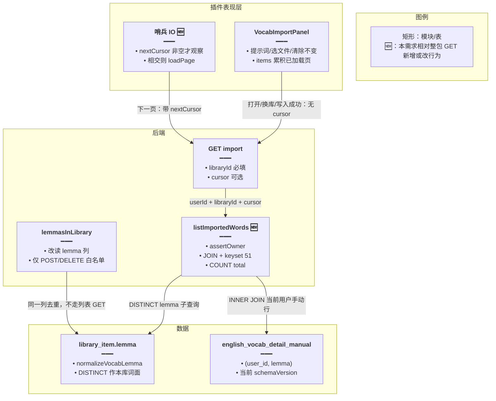
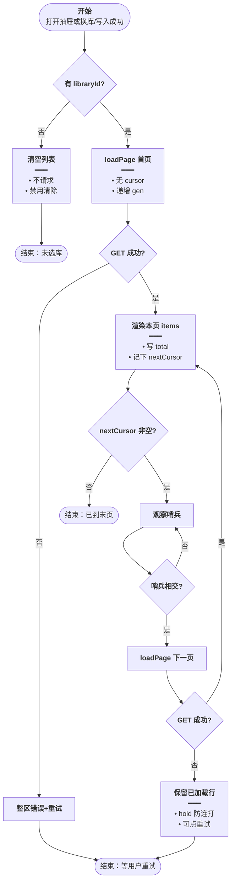
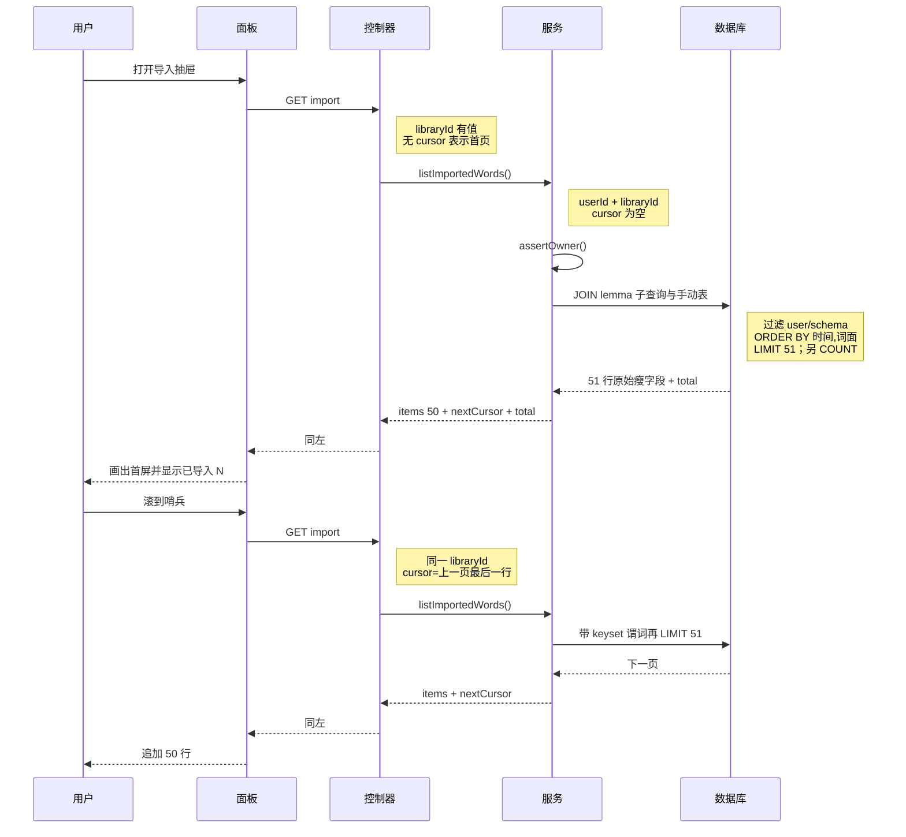
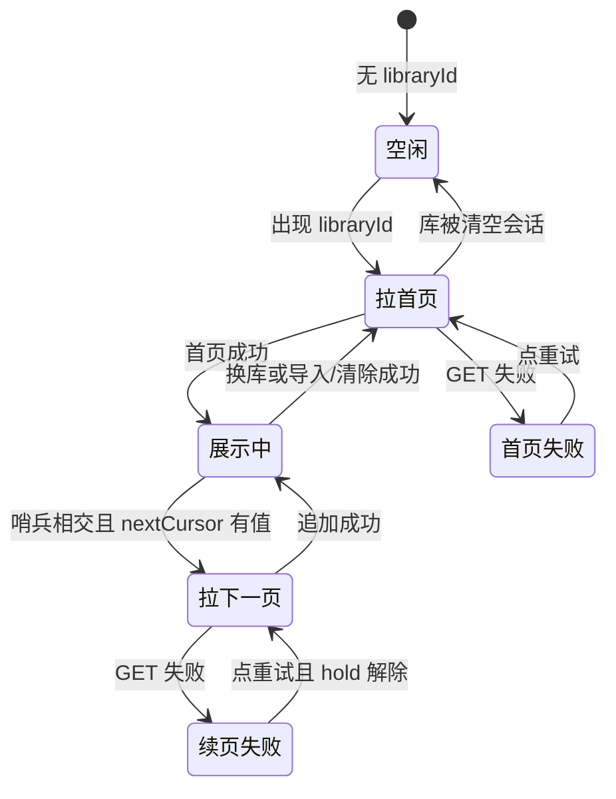

# 已导入词游标分页 — 实现思路

> **状态**：规划（未实现）  
> **日期**：2026-11-12  
> **需求摘要**：词库所有者打开导入抽屉时，已导入列表随库内词量增长（8000+，上限可到约 12000）仍能首屏秒开，且滚动加载不把整表读进 Node、不拖住其它接口。  
> **一句话方案（预告）**：`GET /english-learning/vocab-detail/import` 改成 `updatedAt|lemma` 游标分页，每页 50 条；用词条 `lemma` 列与手动表 JOIN（与 `lemmasInLibrary` 同源），只查当前页瘦行，不为这份列表加 Redis。

## 延伸阅读

- 导入抽屉为何独立 GET、以及当初整包返回的上限：[详解导入面板.md](./详解导入面板.md)
- 写入、清除、所有权：[手动导入单词详解.md](./手动导入单词详解.md)
- 解析列表的游标与 Redis 有序集合（本需求**不**复用那套键）：[解析列表绑定词库.md](./解析列表绑定词库.md)
- 插件列表滚动加载写法：[详解词列表.md](./详解词列表.md)

---

## 0. 读本文你将得到什么

- 要解决什么：已导入列表一次返回全部瘦行，库继续涨时单次 GET 变慢、JSON 变大、面板把整表放进 state。
- 选定方案：同路径 GET 加 `cursor`，服务端 JOIN 词条 `lemma` 后按时间倒序取 51 行切页；面板改成追加，不再本地切片假分页。
- 改哪些层：后端 `listImportedWords` 与控制器查询参数；插件 `vocab-detail-import/panel.tsx` 的加载状态。宿主抽屉、POST/DELETE、解析列表 Redis 不动。
- 分两阶段：先改接口契约与首页 50 条；再把面板改成游标追加，导入/清除后从第一页重拉。
- 最大风险：JOIN 的 `lemma` 列若未按 `normalizeVocabLemma` 回填，列表和清除白名单会对不上。

---

## 1. 需求与边界

### 1.1 用户故事

| 角色 | 场景 | 行为 | 期望结果 |
|------|------|------|----------|
| 词库所有者 | 一本已导入 8000+ 词的库打开导入抽屉 | 等列表出现 | 首屏约 50 条，总数仍显示真实 `total`，不必等整表序列化 |
| 词库所有者 | 首屏已经出来 | 向下滚 | 再请求下一页 50 条，已画出的行留着，不整表重绘 |
| 词库所有者 | 滚到最后 | 继续滚 | `nextCursor` 为空，哨兵停掉，不再发请求 |
| 词库所有者 | 导入一份文件或确认清除 | 等列表刷新 | 丢掉旧游标，从第一页重拉；清除后 `total` 为 0 |
| 词库所有者 | 某词既有手动详解又重新生成过 | 看已导入列表 | 该词仍在（只查手动表），与清除范围一致 |
| 非所有者 | 带 `cursor` 调同一 GET | 请求 | 仍 403 |
| 已登录用户 | 坏游标 | 请求 | 400，不把整表当首页返回 |

### 1.2 范围

| 在范围内 | 不在范围内（非目标） |
|----------|----------------------|
| `GET vocab-detail/import` 改为游标分页 | 改 POST 2000 条上限、改覆盖语义、改 `parseVocabDetail` |
| 面板按 `nextCursor` 追加 | 行上打开详解、搜索框、虚拟列表库 |
| 词条 `lemma` 与手动表 JOIN，固定每页 50 | 为已导入列表再做一套 Redis zset |
| `total` 仍给标题「已导入 N」和清除按钮禁用 | 改宿主 `ImportDrawer`、改解析列表接口 |

### 1.3 约束与依赖

- 必须登录；只允许词库所有者，与现有 POST/DELETE 同一把 `assertOwner`。
- 列表集合仍是 **当前用户手动表 ∩ 本库词面**，不是 `pickVocabOpen` 胜出源。
- 词面只认 `normalizeVocabLemma`。JOIN 必须用已经用该函数写入的 `english_vocabulary_library_item.lemma`，禁止在 SQL 里另写 `LOWER/TRIM`。
- 每页 50，客户端不能把 `limit` 放大（与 `GET vocab-detail/list` 相同）。
- 瘦行字段不变：`lemma`、`glossZh`、`updatedAt`。仍不返回 `detail` 全文，不打模型。
- 不读不写解析列表的 Redis 有序集合。
- 面板继续用现有 `ScrollArea` + `IntersectionObserver`，不新依赖。

---

## 2. 背景

- **谁、在什么场景、卡在哪**：所有者打开导入抽屉，要核对「清除会删掉哪些手动详解」。当前 `GET .../import?libraryId=` 一次返回全部瘦行；面板把数组放进 `useState`，只用 `shown` 控制 DOM。8000 条时响应已偏大，词库上限约 12000（`ENGLISH_VOCAB_GENERATION_MAX`），库还会涨。
- **现状缺口**：`listImportedWords` 先 `lemmasInLibrary` 取出全部词面，再按 1000 一批 `slotRows(manualRepo)`，内存里 `mergeLibraryDetailHits` 后整包返回。[详解导入面板](./详解导入面板.md) 已用 `ponytail:` 标明这条上限：过万变慢再改 keyset，不要加第二套 Redis。前端「滚动分页」只切本地数组，挡不住这次 GET。
- **不解决会怎样**：打开抽屉的等待随导入量线性变长；JSON 序列化占 Node 主线程；面板常驻整表。其它接口通常不会假死，但这条请求自己会越来越慢。
- **硬约束**：列表必须和 `deleteManualDetails` / 导入白名单同一批词面；不能为了翻页把重新生成盖掉的手动行藏起来；不能给这份只读列表双写 Redis。

---

## 3. 现状与复用

| 能力 | 仓库中已有 | 本需求中的用法 |
|------|------------|----------------|
| 已导入整包 GET | `VocabDetailService.listImportedWords`；`GET english-learning/vocab-detail/import?libraryId=` | **扩展**：加 `cursor`，返回 `nextCursor`，每页最多 50 |
| 导入面板 | `micro-apps/dnhyxc-ai-plugins/src/views/vocab-detail-import/panel.tsx` 的 `loadImported`、`PAGE`、`shown`、哨兵 | **扩展**：改成追加 + `cursorRef`，删掉对全量 `items` 的本地切片 |
| 解析列表滚动加载 | `micro-apps/dnhyxc-ai-plugins/src/views/vocab-detail-list/list.tsx`（`cursorRef` / `holdRef` / `genRef` / 哨兵） | **直接复用**交互，不复用其 URL 与 Redis |
| 解析列表游标 | `parseListCursor`、`CURSOR_SEP='\|'`、`updatedAt\|lemma`、每页 50 | **直接复用**编码与切页方向，独立函数以免和胜出列表耦在一起 |
| 词条 lemma 列 | [解析列表绑定词库](./解析列表绑定词库.md)：`english_vocabulary_library_item.lemma`，写入用 `normalizeVocabLemma` | **直接复用**作 JOIN 键。本需求不新加列 |
| 词面集合 | `VocabDetailService.lemmasInLibrary` | **扩展**：改为读同一 `lemma` 列去重，供 POST/DELETE 白名单；列表查询不再把该数组塞进 `IN` |
| 瘦行投影 | `slotRows` 的 `JSON_EXTRACT` / postgres `->>` 取 `senses[0].glossZh`，过滤 `schemaVersion` | **直接复用**表达式。分页查询自己拼 JOIN，不再对全库 `IN` |
| 所有权 | `assertOwner`（导入路径） | **直接复用** |
| 手动表 | `english_vocab_detail_manual`，唯一键 `(user_id, lemma)` | **直接复用**。不改表 |
| 解析列表 Redis | `writeListZset` / `pageListZset` | **不适用** |
| 导入写入 / 清除 | `POST` / `DELETE` 同路径 | **直接复用**。成功后面板从第一页重拉 |

**调研结论**：缺口只在「读」：写入、词面规则、抽屉壳都现成。解析列表已经证明 `(updatedAt, lemma)` 游标 + 每页 50 + 插件哨兵能工作，但它的 Redis 存的是胜出源，不能拿来当已导入列表。词条 `lemma` 列是 JOIN 的前提；`lemmasInLibrary` 源码不在本仓，落地前须确认它改读这一列（见 §11）。

---

## 4. 方案比对与最终方案

### 4.1 候选方案

#### 方案 A：维持整包 GET，只优化面板渲染（复用现状）

- **做法**：接口仍一次返回 `{ items, total }`。面板继续 `items.slice(0, shown)`，或换成虚拟列表。服务端仍 `lemmasInLibrary` + 分批 `slotRows` + `mergeLibraryDetailHits`。
- **能工作的原因**：8000 条瘦行大约 1～3MB，DOM 已经不是主因；虚拟列表只减少挂载节点。
- **主要代价**：每次打开仍把交集全部读进 Node 并 `JSON.stringify`；库涨到上限后这条请求只会更慢。没有解决当初 `ponytail:` 写下的上限。

#### 方案 B：同路径 keyset 分页 + 词条 lemma JOIN（扩展现有 GET）

- **做法**：`GET .../import?libraryId=&cursor=`。`listImportedWords` 在 `assertOwner` 之后，用「本库 `DISTINCT lemma`」子查询 INNER JOIN 手动表，过滤当前用户和当前 `schemaVersion`，按 `updated_at DESC, lemma DESC` 取 51 行，多出的一行生成 `nextCursor`。`total` 用同一 JOIN 做 `COUNT(DISTINCT lemma)`。面板抄 `vocab-detail-list`：首页无 cursor，哨兵带上 `nextCursor` 再请求，结果追加。
- **能工作的原因**：排序键与解析列表相同，稳定、无 offset 空洞。JOIN 把交集推到数据库，每页只投影 50 条瘦字段。不引入 Redis，导入/清除后从第一页重拉即可，没有补丁漏写。
- **主要代价**：旧面板「一次拿全再本地切」必须改。翻页多次往返。JOIN 依赖 `lemma` 列已回填。

#### 方案 C：为手动词单独做 Redis 有序集合（扩展列表缓存）

- **做法**：仿 `listForLibrary`，按 `(userId, libraryId)` 再写一套只含 `source=manual` 的 zset。首页未命中时整本构建；翻页 `ZRANGE` 50 条。导入、清除、`patchLemmaForUser` 同步维护。
- **能工作的原因**：翻页最快，且与解析列表运维方式眼熟。
- **主要代价**：详解列表已经有一套胜出缓存。再养一套手动专用键，导入/清除/换库/TTL 都要双写。漏补丁时「看见的」和「清除会删的」再次分叉——这正是导入面板放弃方案 C 的原因。

### 4.2 比对

| 维度 | 方案 A 整包 GET | 方案 B keyset + JOIN | 方案 C 手动专用 Redis |
|------|-----------------|----------------------|----------------------|
| 正确性（失败路径、边界、数据是否会错） | 集合仍对：手动表 ∩ 词面。坏处是超时/杀请求时用户什么都看不到 | 同一集合，按页切。坏游标 400。空 lemma 与白名单一致（都不计）。重复词条用 DISTINCT | 集合可以对，但补丁漏一次就会和手动表不一致 |
| 复用 / 与现状契合 | 零改接口。面板 `shown` 已在 | 复用现 GET 路径、游标编码、插件哨兵、`slotRows` 释义表达式、词条 `lemma` 列 | 复用 zset 翻页写法；键的产品含义与胜出列表不同 |
| 改动面（要动哪些路径） | 可不改，或只加虚拟列表 | `listImportedWords`、控制器 `cursor`、`panel.tsx` 加载；可选让 `lemmasInLibrary` 读 lemma 列 | 所有改手动行的路径 + 新键 + 面板 |
| 复杂度（新概念、新状态、新依赖） | 无新概念 | 面板多 `cursorRef`/`holdRef`。无新表、无新依赖 | 第二套 zset/hash/ready/epoch |
| 体验（延迟、步骤数、失败时用户看到什么） | 首屏等整包；之后滚动不请求。失败则整表没有 | 首屏只等 50 条。下一页失败时已加载行仍在，可重试 | 首屏在缓存命中时最快；冷启动仍要整本构建 |
| 风险（迁移、互斥、并发、回滚） | 无迁移。上限随库线性恶化 | 无新表。回滚=去掉 cursor 仍会破坏已改的面板，需前后端一起发。并发导入后重拉第一页即可 | 双写漏补丁；TTL 过期后第一次打开又整本打 |
| 可维护性（以后改一处还是改多处） | 词面规则仍一处，但读路径会一直扛全量 | 词面仍只来自 lemma 列；清除/导入不用记分页 | 改手动行的每一处都要记两套键 |

### 4.3 综合考量

本需求权重最高的是 **正确性（列表 = 清除范围）** 和 **打开抽屉的首包延迟**，其次是 **不要为只读抽屉再养缓存**。方案 A 正确，但完全没碰延迟，等于无视库会继续涨。方案 C 翻页最快，却把导入面板已经否决过的双写代价再付一次，冷启动仍可能整本构建。方案 B 用解析列表已经验证过的游标，把交集留在 SQL，首包和每页都是 50 行；放弃的是「打开一次之后滚动不再打网」和「缓存命中时零 SQL」。导入抽屉不是常驻列表，这点往返可以接受。

### 4.4 最终方案

#### 背景

导入抽屉需要一份与 `deleteManualDetails` 相同的手动词清单。现状整包返回在 8000+ 时已经偏慢，词库还会涨。硬约束是：不混入胜出源、不加第二套 Redis、词面与 `normalizeVocabLemma` 一致、每页固定 50。

#### 具体思路

1. **模块**：读路径仍在 `VocabDetailService.listImportedWords` 和导入插件面板。不新增模块、不改宿主会话。
2. **数据**：词条表 `DISTINCT lemma`（非空）INNER JOIN `english_vocab_detail_manual`（`userId` + 当前 `schemaVersion`）。投影 `lemma`、首条 `glossZh`、`updatedAt`。`total` 同一 JOIN 计数。游标为 `ISO时间|lemma`，方向与解析列表相同（时间倒序，并列时词面倒序）。
3. **状态**：面板用 `items` 累积已加载行、`total`、`cursorRef`、`genRef`、`holdRef`。不进 URL，不进英语学习 store。换库、导入成功、清除成功时清空并重拉首页。
4. **边界**：无 `libraryId` 不请求。非所有者 403。坏游标 400。首页失败整区重试；下一页失败保留已加载行。`total === 0` 禁用清除。同一词面在库内多行只占列表一行。

#### 实现方案

**一句话**：`GET /english-learning/vocab-detail/import` 改成 `updatedAt|lemma` 游标分页，每页 50 条；用词条 `lemma` 列与手动表 JOIN（与 `lemmasInLibrary` 同源），只查当前页瘦行，不为这份列表加 Redis。

| 步骤 | 谁 | 做什么 | 输入 → 输出 |
|------|----|--------|-------------|
| 1 | 控制器 `GET vocab-detail/import` | 校验登录；`libraryId` 必填；非空 `cursor` 原样交给服务 | query → 服务入参 |
| 2 | `listImportedWords` | `assertOwner`；JOIN 词面子查询；按游标取 51 行；数 `total` | `userId, libraryId, cursor?` → `{ items, nextCursor, total }` |
| 3 | 面板 `loadPage` | 无 cursor 当首页；有则追加；`gen` 过期丢弃 | 一页 → `items` / `total` / 本地 cursor |
| 4 | 哨兵 | `nextCursor != null` 且未 hold 时再 `loadPage` | 相交 → 下一页请求 |
| 5 | `onFile` / `clearManual` 成功 | 清空 items 与 cursor，再拉首页 | 写入结果 → 新的第一页 |

响应形状：

| 字段 | 含义 |
|------|------|
| `items` | 最多 50 条瘦行，已按时间倒序 |
| `nextCursor` | 下一页游标；没有更多时为 `null` |
| `total` | JOIN 后的去重条数，给标题和清除按钮 |

#### 选定原因

1. **正确性**：JOIN 的 lemma 与白名单同一列，重新生成盖不住手动行。牺牲：必须先保证 lemma 列回填（方案 A 用 JS `normalize` 不依赖该列）。
2. **复用**：同 GET、同样游标字母表、同样插件哨兵。牺牲：不能继续「一次拿全」。
3. **改动面**：只动读方法和一个面板。牺牲：前后端要一起发，旧插件会把第一页当成全集。
4. **复杂度**：无新表无新依赖。牺牲：面板状态比 `shown` 多几个 ref。
5. **体验**：首包固定约 50 行。牺牲：滚到底要再打网；不如方案 C 命中缓存时快。
6. **风险**：无双写。牺牲：并发导入时已打开的旧页可能短暂旧，成功回调会重拉首页。
7. **可维护性**：词面规则仍一列。牺牲：列表 SQL 和 `lemmasInLibrary` 都要读这一列，改归一函数时两处一起看（比 Redis 补丁仍少）。

#### 优势

- 相对方案 A：打开抽屉不再序列化整表；Node 内存和主线程占用随页大小封顶。
- 相对方案 C：导入/清除不必维护第二套 zset；冷启动也不先打一遍全量再切页。

#### 怎么实现

1. 控制器把可选 `cursor` 传进 `listImportedWords`。
2. 服务端 JOIN + keyset 取 51、数 total、编码 `nextCursor`。
3. 面板按解析列表的 ref 协议追加；写入成功从第一页重拉。
4. 主链路代码见 §9。

### 4.5 其他关键决策：词面过滤用 JOIN 还是 `IN (lemmasInLibrary())`

这一决策改变数据流：交集在 SQL 里完成，还是先把词面数组拉进 Node。

#### 4.5.1 候选

**候选 X：每页先 `lemmasInLibrary()`，再 `lemma IN (...)` 加 keyset `LIMIT 51`**

- **做法**：保留现有 JS 词面数组。分页 SQL 带上全部词面占位符，避免再分 1000 一批（分批无法正确 LIMIT）。
- **能工作的原因**：白名单函数原样复用，不依赖 lemma 列是否回填。
- **主要代价**：每页（含滚动）都把最多约 12000 个词面读进 Node 并塞进 `IN`。keyset 能裁响应，裁不掉词面扫描。

**候选 Y：词面子查询 JOIN 手动表；`lemmasInLibrary` 改为读同一列**

- **做法**：`SELECT DISTINCT lemma FROM english_vocabulary_library_item WHERE library_id=? AND lemma<>''` 作为子查询，与手动表 `m.lemma` INNER JOIN。POST/DELETE 的 `lemmasInLibrary` 改为 `find({ select: { lemma: true } })` 再 `Set`，不再对 `word` 现场 `normalize`。
- **能工作的原因**：写入词条时已经 `normalizeVocabLemma`。列表、白名单、清除读同一列，不会各算各的。
- **主要代价**：旧词条 lemma 为空则三边同时不计；回填未完成时会少行。

#### 4.5.2 比对

| 维度 | X：IN 数组 | Y：JOIN 同源列 |
|------|------------|----------------|
| 正确性 | 与当前白名单逐字相同 | 与列上的 lemma 相同；列错则三边一起错（比「列表对、清除错」好） |
| 复用 | 直接调用现函数 | 复用列和归一函数；改 `lemmasInLibrary` 实现，不改调用方 |
| 改动面 | 只改 list 查询 | list SQL + `lemmasInLibrary` 函数体 |
| 复杂度 | `IN` 上万占位符 | 一个 DISTINCT 子查询 |
| 体验 | 每页仍先扫整库词条 | 词面过滤留在数据库，滚动不再付整库数组 |
| 风险 | 占位符/包大小随库涨 | 依赖回填 |
| 可维护性 | 归一仍在 JS 一处 | 归一只在写入；读路径禁止第二套 SQL 归一 |

#### 4.5.3 综合考量

库会继续涨，所以「每页仍拉全量词面」只做了一半。权重在读路径成本。选 **Y**。放弃 X「完全不改 `lemmasInLibrary`」：那点省事换不来每页上万 `IN`。回填风险用 §11 待确认挡住：列未落地则本需求 M0 先完成回填，而不是退回 X。

#### 4.5.4 选定方案六块

**背景**：keyset 若仍先取全量词面，8000+ 时打开和每一次滚动都重复扫词条表。

**具体思路**：交集只通过 `item.lemma = manual.lemma`。`lemmasInLibrary` 读同一列，保证 POST/DELETE 不另写归一。

**实现方案**：列表 SQL 使用 DISTINCT lemma 子查询 JOIN；`lemmasInLibrary` 返回该列去重后的非空字符串。

**选定原因**：体验和可维护性（归一只在写入）压过「函数体一行不改」。牺牲：依赖列已存在且已回填。

**优势**：相对 X，滚动请求不再携带整库词面数组。

**怎么实现**：见 §9.2 的 JOIN 与 `lemmasInLibrary` 片段。

---

## 5. 架构图



**图内方法说明**：

| 方法 | 功能 |
|------|------|
| `loadPage()` | 面板按当前库和本地 cursor 请求一页；`gen` 过期则丢弃。首页替换空数组，后续页追加 |
| `listImportedWords(userId, libraryId, cursor?)` | 校验所有者后 JOIN 词面与手动表，返回最多 50 条瘦行、`nextCursor`、`total`。不打模型、不写 Redis |
| `assertOwner(userId, libraryId)` | 非本库所有者 403，与 POST/DELETE 同一把锁 |
| `lemmasInLibrary(libraryId)` | 读词条 `lemma` 列去重，给导入白名单和清除用。列表 GET 不再调用它做 `IN` |
| `parseImportCursor(cursor)` | 把 `ISO|lemma` 拆成时间和词面；非法则 400 |

**读图要点**：

- 表现层只累积页；交集在数据库完成。
- 新增行为集中在 `listImportedWords` 的 JOIN/keyset，不新增表。
- `lemmasInLibrary` 与列表 SQL 读同一列，但只有写入路径还走数组白名单。

---

## 6. 主流程图



**图内方法说明**：

| 方法 | 功能 |
|------|------|
| `loadPage()` | 拼 `libraryId` 与可选 `cursor` 发 GET；成功则更新 `items`/`total`/`cursorRef` |
| `listImportedWords(...)` | 服务端切一页；首页与下一页同一函数，差别只在 cursor |
| IntersectionObserver 回调 | 根为列表 `ScrollArea`；相交且未 loading/hold 时调用 `loadPage` |

**读图要点**：

- 入口只有「有库才请求」。
- 失败分两种：首页无数据可展示；下一页失败必须留下已画出的行。
- 终止：无库、到末页（`nextCursor=null`）、或停在错误上等重试。

---

## 7. 核心时序图



**图内方法说明**：

| 方法 | 功能 |
|------|------|
| `GET import` | 只读已导入页。登录用户；所有者才能过服务层 |
| `listImportedWords()` | 编排所有权、JOIN、keyset、计数；不写缓存 |
| `assertOwner()` | 确认当前用户拥有该 `libraryId` |
| 面板追加 | 第二次及以后把 `items` concat 到 state，不重置滚动位置 |

**读图要点**：

- 用户只触发打开和滚动；分页游标由服务端签发。
- 两次 GET 同一方法，没有 SSE/轮询。
- 数据库每次只为这一页工作，不再把 8000 行交回 Node。

---

## 8. 状态机



**图内方法说明**：

| 方法 | 功能 |
|------|------|
| `loadPage()` | 从「拉首页 / 拉下一页」发出 GET；`holdRef` 在续页失败时挡住哨兵 |
| `resetList()` | 导入/清除成功或换库时清空 items 与 cursor，并进入拉首页 |

---

## 9. 具体实现（主链路代码）

### 9.1 模块一览

| 模块 | 职责 | 新增/改动 | 预估路径 |
|------|------|-----------|----------|
| 控制器 | 解析 `libraryId`/`cursor`，调服务 | 改动 | `apps/backend/src/services/english-learning/english-learning.controller.ts` |
| `listImportedWords` | JOIN + keyset + total | 改动 | `apps/backend/src/services/english-learning/vocab-detail.service.ts` |
| `lemmasInLibrary` | 改读 lemma 列 | 改动 | 同上 |
| 游标解析 | `ISO\|lemma` | 新增（文件内私有函数即可） | 同上或紧邻 `parseListCursor` |
| 导入面板 | 追加分页 | 改动 | `micro-apps/dnhyxc-ai-plugins/src/views/vocab-detail-import/panel.tsx` |

### 9.2 主链路实现

```typescript
// 对应 §4.4 步骤 2。与解析列表同一套游标字母，避免 offset 在插入新导入行后重复或空洞
const IMPORT_PAGE = 50;
// 对应 §4.4 步骤 2。ISO 8601 不含该字符，lemma 里若有 | 全部留在后半段
const CURSOR_SEP = '|';

// 对应 §4.4 步骤 2。瘦行字段与现在面板 ImportedWord 一致，只是不再一次给齐
type ImportedWordPage = {
	// 本页最多 50 条，已按更新时间倒序
	items: {
		// 归一词面，也是手动表唯一键的一半
		lemma: string;
		// 首条中文释义，没有则为空串
		glossZh: string;
		// 该手动行 updated_at 的 ISO，给展示和下一页游标
		updatedAt: string;
	}[];
	// 没有更旧的行时为 null，面板据此拆掉哨兵
	nextCursor: string | null;
	// JOIN 去重后的条数，标题和清除按钮都读它，不读 items.length
	total: number;
};

// 对应 §4.4 步骤 2。坏游标必须 400，不能当成首页把后半本库漏掉
function parseImportCursor(cursor: string): { updatedAt: number; lemma: string } {
	// 只切第一个分隔符，词面可以含 |
	const sep = cursor.indexOf(CURSOR_SEP);
	// 缺分隔符或时间为空都无法比较
	if (sep <= 0) throw new BadRequestException('cursor');
	// 前半段必须是上一页最后一行的 ISO 时间
	const updatedAt = new Date(cursor.slice(0, sep)).getTime();
	// 后半段是上一页最后一行的词面
	const lemma = cursor.slice(sep + 1);
	// 非法时间或空词面会滤错整页
	if (Number.isNaN(updatedAt) || !lemma) throw new BadRequestException('cursor');
	// 拆开后切页只做数值比较，不再解析字符串
	return { updatedAt, lemma };
}
```

```typescript
// 对应 §4.4 步骤 2 与 §4.5。交集留在 SQL，避免每页把全库词面读进 Node
async function listImportedWords(
	// 当前登录用户。手动行按 user_id 隔离
	userId: number,
	// 抽屉里的库。服务端再验所有权
	libraryId: string,
	// 缺省为首页；非空必须能通过 parseImportCursor
	cursor?: string,
): Promise<ImportedWordPage> {
	// 与 POST/DELETE 同一把锁，非所有者不能枚举别人的手动详解
	await this.assertOwner(userId, libraryId);
	// 首页不带谓词；非法 cursor 在这里抛 400
	const parsed = cursor ? parseImportCursor(cursor) : null;
	// 释义表达式与 slotRows 相同，继续不把 detail JSON 读进进程
	const type = this.manualRepo.manager.connection.options.type;
	// 默认按 MySQL 迁移来取首条 glossZh，与 slotRows 相同
	let gloss = `JSON_UNQUOTE(JSON_EXTRACT(m.detail, '$.senses[0].glossZh'))`;
	// 本地若配成 postgres，运算符不同，不能复用 JSON_EXTRACT
	if (type === 'postgres') {
		// json 路径只取 senses[0]，仍然不把整份 detail 读进 Node
		gloss = `m.detail->'senses'->0->>'glossZh'`;
	}
	// 本库非空 lemma 去重，同一词面多条词库行只留一次，与旧 Set 行为一致
	const lemmaSub = this.itemRepo
		// 子查询别名 i，后面 JOIN 条件引用 i.lemma
		.createQueryBuilder('i')
		// DISTINCT 防止词库重复词面把 COUNT 放大
		.select('DISTINCT i.lemma', 'lemma')
		// 只扫这一本库，不把别的库的词面混进来
		.where('i.libraryId = :libraryId', { libraryId })
		// 空 lemma 与白名单一致：两边都不认
		.andWhere("i.lemma <> ''");
	// 手动表只投影三列。INNER JOIN 已经是「在库内且已导入」
	const qb = this.manualRepo
		// 主表别名 m，与 gloss 表达式一致
		.createQueryBuilder('m')
		// 子查询当词面白名单，避免把 8000 个占位符塞进 IN
		.innerJoin(`(${lemmaSub.getQuery()})`, 'i', 'i.lemma = m.lemma')
		// 把 libraryId 参数从子查询带进外层，否则 JOIN SQL 缺绑定
		.setParameters(lemmaSub.getParameters())
		// 词面给游标和面板当 key
		.select('m.lemma', 'lemma')
		// 排序和游标比较都用这一列
		.addSelect('m.updatedAt', 'updatedAt')
		// 首条释义。没有则为 SQL null，后面转成空串
		.addSelect(gloss, 'glossZh')
		// 只看当前用户，别人的手动行不可见
		.where('m.userId = :userId', { userId })
		// 旧 schema 打开详解也不命中，列表同样丢掉
		.andWhere('m.schemaVersion = :v', { v: VOCAB_DETAIL_CACHE_VERSION });
	// 必须在加上游标谓词之前计数，否则第二页的 total 会变成剩余条数
	const counted = await qb
		// clone 避免 COUNT 的 select 盖住后面的分页投影
		.clone()
		// JOIN 已经 DISTINCT 词面，这里数行即可
		.select('COUNT(*)', 'cnt')
		// 只要一个数字。失败让请求整体失败，不返回假 total
		.getRawOne();
	// 有游标时只取比上一页最后一行更旧的记录，比较方向与 ORDER BY 一致
	if (parsed) {
		// 时间更早，或同一毫秒词面更小，才属于后面的页
		qb.andWhere(
			'(m.updatedAt < :t OR (m.updatedAt = :t AND m.lemma < :lemma))',
			{ t: new Date(parsed.updatedAt), lemma: parsed.lemma },
		);
	}
	// 多取 1 条用来判断有没有下一页，避免最后一页再打一次空请求
	const rows = await qb
		// 新导入的词排在前面，和抽屉「刚覆盖了什么」的直觉一致
		.orderBy('m.updatedAt', 'DESC')
		// 同一毫秒用词面倒序，和游标谓词的 lemma < 对齐
		.addOrderBy('m.lemma', 'DESC')
		// 51 = 页大小 + 用于探测 hasMore 的一行
		.take(IMPORT_PAGE + 1)
		// 原始列名与 toHit 无关，下面直接按 lemma/updatedAt/glossZh 读
		.getRawMany();
	// 超过 50 说明后面还有
	const hasMore = rows.length > IMPORT_PAGE;
	// 有下一页时丢掉多看的那一条
	const page = hasMore ? rows.slice(0, IMPORT_PAGE) : rows;
	// 空页没有游标
	const last = page.at(-1);
	// 没有更多或本页为空时不签发 cursor，哨兵会停
	let nextCursor: string | null = null;
	// 有探测行才用本页最后一词拼下一页钥匙
	if (hasMore && last) {
		// ISO + 词面，下一页谓词才能接上
		nextCursor = `${new Date(last.updatedAt).toISOString()}${CURSOR_SEP}${last.lemma}`;
	}
	return {
		// 词面、释义、时间转成面板已经在用的字符串形状
		items: page.map((row) => ({
			// 表里的 lemma 已是归一形式，面板不再 normalize
			lemma: String(row.lemma),
			// null 画成空串，行上只显示词面
			glossZh: typeof row.glossZh === 'string' ? row.glossZh : '',
			// ISO 给前端 toLocaleString，避免把 Date 对象塞进 JSON 再丢时区信息
			updatedAt: new Date(row.updatedAt).toISOString(),
		})),
		// 面板用它决定要不要继续观察哨兵
		nextCursor,
		// 计数字段缺失时当成 0，清除按钮会禁用
		total: Number(counted?.cnt) || 0,
	};
}
```

```typescript
// 对应 §4.5。POST/DELETE 仍要一份 Set，但必须和 JOIN 读同一列，禁止再对 word 现场 normalize
async function lemmasInLibrary(libraryId: string): Promise<string[]> {
	// 只取 lemma。word 的展示大小写与钥匙无关
	const rows = await this.itemRepo.find({
		// 只限这本库，导入白名单不能跨库
		where: { libraryId },
		// 不读 word/detail，白名单只需要钥匙
		select: { lemma: true },
	});
	// 空字符串不能进白名单，否则会和 JOIN 的 lemma<>'' 分叉
	return [
		...new Set(
			rows
				// 列上已经是归一结果，这里不再 normalize
				.map((row) => row.lemma)
				// 未回填的空值丢掉，与 SQL lemma<>'' 一致
				.filter((lemma): lemma is string => Boolean(lemma)),
		),
	];
}
```

```typescript
// 对应 §4.4 步骤 3。抄解析列表的 gen/cursor/hold，避免整包 setItems
async function loadPage(libraryId: string) {
	// 并发换库时只让最新一代写入 state
	const gen = genRef.current;
	// 正在打网或上一页失败未点重试时，哨兵不能连发
	if (loadingRef.current || holdRef.current) return;
	// nextCursor 为 null 表示已经到末页
	if (cursorRef.current === null) return;
	// 先占住，避免 IntersectionObserver 连续触发打出两页同一 cursor
	loadingRef.current = true;
	// 首页用整区 loading；续页用底部「加载更多」时仍复用同一 flag
	setListLoading(true);
	try {
		// 发出前抄下游标。首页是 undefined，续页是服务端签发的字符串
		const cursor = cursorRef.current;
		// 库 id 始终编码进查询串，避免标题里的字符截断 URL
		let qs = `libraryId=${encodeURIComponent(libraryId)}`;
		// 只有续页才带 cursor；空串不能传，否则服务端会当成坏游标
		if (cursor) qs += `&cursor=${encodeURIComponent(cursor)}`;
		const page = unwrapImported(
			await httpRef.current!.get(`/english-learning/vocab-detail/import?${qs}`),
		);
		if (gen !== genRef.current) return;
		// 服务端签发的下一页钥匙；null 时哨兵不再观察
		cursorRef.current = page.nextCursor;
		// 每页都带回全集 total，导入过程中标题也能对齐
		setTotal(page.total);
		// 首页替换；续页追加，避免把已滚过的行丢掉
		setItems((prev) => (cursor ? [...prev, ...page.items] : page.items));
		// 成功后清掉上一页的错误条，避免成功列表上还挂着失败文案
		setListError(null);
	} catch (cause) {
		if (gen !== genRef.current) return;
		// 挡住哨兵，直到用户点重试，避免失败后空刷
		holdRef.current = true;
		setListError(errorText(cause, t('vocabImport.listFailed')));
	} finally {
		if (gen === genRef.current) {
			// 解开哨兵锁，允许下一次相交再请求
			loadingRef.current = false;
			// 关掉底部/整区 loading，避免成功后一直转圈
			setListLoading(false);
		}
	}
}
```

### 9.3 数据模型

| 字段/实体 | 来源 | 存储 | 说明 |
|-----------|------|------|------|
| `english_vocabulary_library_item.lemma` | `normalizeVocabLemma(word)` | DB | JOIN 与白名单的唯一词面 |
| `english_vocab_detail_manual` | 现有手动表 | DB | `(user_id, lemma)` 唯一；列表只读当前 schema |
| `cursor` | 上一页最后一行 `updatedAt\|lemma` | 查询串 | 服务端签发，客户端原样回传 |
| `ImportedWordPage` | 服务端拼装 | 响应 JSON | `items` ≤50，`nextCursor` 可空，`total` 为全集 |
| 面板 `items` | 各页追加 | 内存 | 换库/写入成功即丢弃 |

---

## 10. 分阶段实现步骤

| 阶段 | 目标 | 交付物 | 依赖 |
|------|------|--------|------|
| M0 | 词面列可 JOIN | 确认或补完 `lemma` 回填；`lemmasInLibrary` 改读该列 | 解析列表绑定词库的列 |
| M1 | 接口按页返回 | GET 带 `cursor`，首页 50 条 + `total` + `nextCursor` | M0 |
| M2 | 面板按页追加 | 哨兵、失败 hold、写入后重拉首页 | M1 |

### M0

- [ ] 确认 `english_vocabulary_library_item.lemma` 已存在且旧行已按 `normalizeVocabLemma` 回填。
- [ ] `lemmasInLibrary` 改为读该列去重；导入白名单和清除结果与改前抽查一致。

### M1

- [ ] `GET .../import?libraryId=` 无 cursor 时最多 50 条，`total` 为全集，有更多时 `nextCursor` 非空。
- [ ] 带合法 cursor 时不重复上一页最后一行。坏 cursor 返回 400。
- [ ] 非所有者 403。不打模型，不写解析列表 Redis。
- [ ] 同时有手动详解和重新生成的词仍出现。

### M2

- [ ] 打开抽屉只请求第一页；滚到底再请求；`shown` 本地切片删除。
- [ ] 下一页失败时已加载行仍在，点重试从同一 cursor 继续。
- [ ] 换库、导入成功、清除成功清空 cursor 并从首页重拉。
- [ ] `total===0` 空态并禁用清除。选择文件在列表失败时仍可点。

---

## 11. 风险、边界与待确认

| 项 | 等级 | 说明 | 缓解 |
|----|------|------|------|
| lemma 列未回填 | 高 | JOIN 少行，清除白名单也会少词 | M0 先对齐；未落地则不发 M1 |
| 旧插件把第一页当全集 | 中 | 前后端未一起发时，标题 `total` 对但只画 50 条且无法再加载 | 同一次发插件与 API；无 `nextCursor` 字段时不要默默当整包 |
| JOIN 重复词条 | 低 | 库内同一 lemma 多行会放大 COUNT | DISTINCT 子查询 |
| 无 `(updated_at, lemma)` 辅助索引 | 低 | 单用户单库 8000 行 filesort 通常可接受 | 若 EXPLAIN 变差再加 `(user_id, schema_version, updated_at, lemma)` |
| 写入成功前已加载的旧页 | 低 | 用户若在导入完成前继续滚，可能看到旧集合 | 成功回调清空重拉；不在导入过程中合并页 |

**待确认**：

- [ ] `lemmasInLibrary` 当前是对 `word` 做 `normalizeVocabLemma`，还是已经读 `lemma` 列。（验证：在 `dnhyxc-ai` 仓库 grep `lemmasInLibrary`。）
- [ ] `english_vocabulary_library_item.lemma` 迁移是否已在目标环境执行。（验证：看实体与 migrations。）

---

## 12. 验收清单

| # | 用例 | 步骤 | 期望 |
|---|------|------|------|
| AC1 | 大库首屏 | 打开一本已导入 8000+ 词的库的导入抽屉 | 首包 `items.length≤50`，标题 `total` 为全集，不必等整表 |
| AC2 | 滚动续页 | 滚到列表底部直至末页 | 每次追加约 50 条，无重复 lemma；最后一次 `nextCursor=null` 后不再请求 |
| AC3 | 与清除一致 | 列表中找一个后来又重新生成过的词，再清除 | 清除前该词在列表里；清除后该词的手动行删除，`total` 为 0 |
| AC4 | 写入后重拉 | 再导入一份含新词的文件 | 列表从第一页重来，新词按更新时间出现在前部 |
| AC5 | 坏游标 | 带非法 `cursor` 调 GET | 400，不是首页 50 条 |
| AC6 | 非所有者 | 另一个账号带该 `libraryId` 调 GET | 403 |
| AC7 | 续页失败 | 模拟第二页失败 | 第一页仍在；重试后从同一 cursor 继续 |

---

## 13. 预估改动面（实现阶段参考）

| 类型 | 路径（预估） |
|------|--------------|
| 后端 | `apps/backend/src/services/english-learning/vocab-detail.service.ts`、`english-learning.controller.ts` |
| 前端插件 | `micro-apps/dnhyxc-ai-plugins/src/views/vocab-detail-import/panel.tsx` |
| 文档（实现后） | `remote-docs/wiki/english/` 导入相关专题补「列表改为游标分页」；本文保持规划态 |

（本文档为规划态实现思路；落地后以源码与 remote-docs wiki 专题为准）
