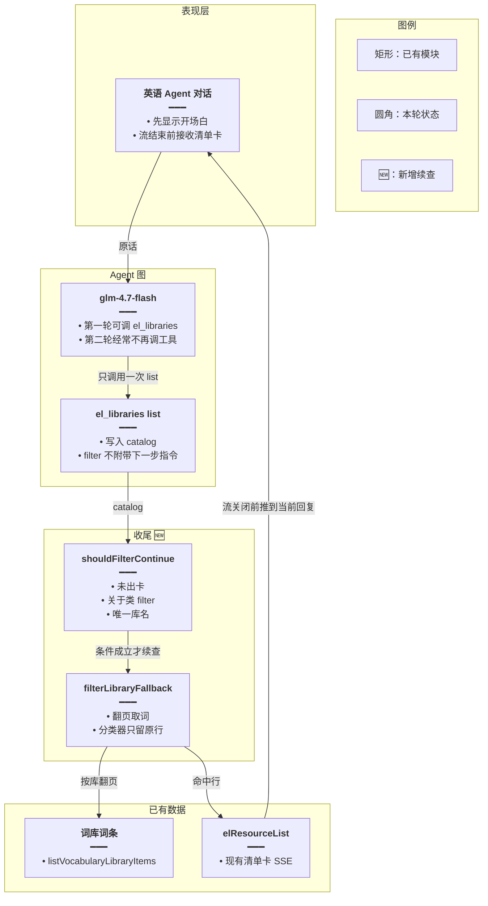
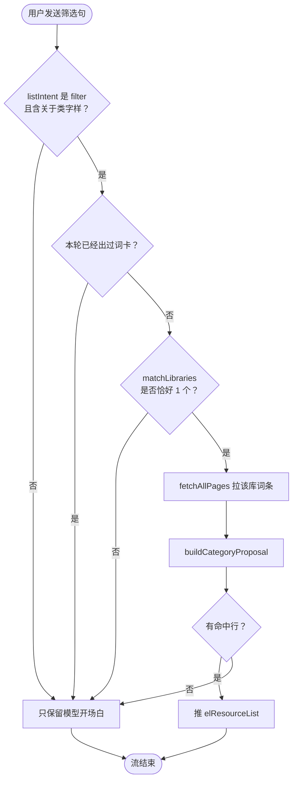
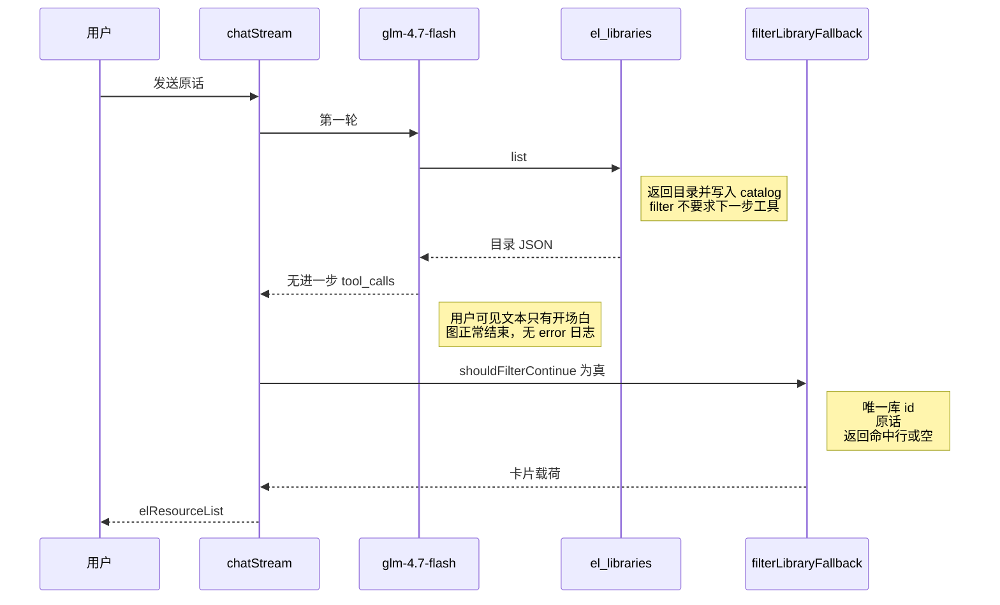
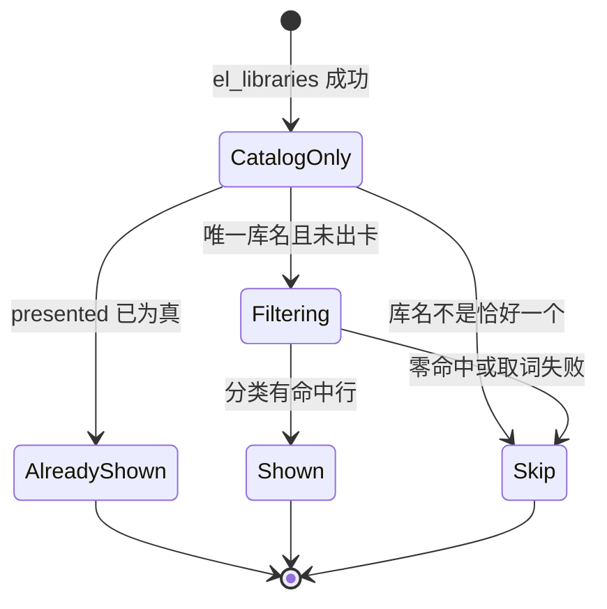

# 库内筛选不中断 — 实现思路

> **状态**：规划（未实现）
> **日期**：2026-10-28
> **需求摘要**：用户用 glm-4.7-flash 问「某词库里关于某一类的词」时，答到开场白并只查完库列表就停；deepseek-chat 与 glm-5.1 会继续查出词。要让这类问法在 flash 上也能挂出筛选卡。
> **一句话方案（预告）**：模型停在第一次 `el_libraries` 之后时，服务端用已有的库名匹配和整类筛选把命中词挂成卡片，不再指望 flash 自己发起第二次工具调用。

## 延伸阅读

- [英语Agent侧栏融合.md](../../english/英语Agent侧栏融合.md)
- [整库问法稳定出卡.md](../../english/整库问法稳定出卡.md)
- [整类词一次收藏.md](./整类词一次收藏.md)
- [英语工具防空转.md](./英语工具防空转.md)

---

## 0. 读本文你将得到什么

- 停住的原因：flash 只完成一轮工具，筛选问法又没有服务端续查。
- 选定方案：流结束后，若还没出卡且原话唯一对上一个库，服务端自己拉词并筛选后挂卡。
- 改动在后端 Agent 收尾，不改前端卡片组件，也不换用户选中的模型。
- 分两阶段：先补「关于某类」这一条，再看要不要放宽到其它筛选句。
- 最大风险：库名只对上一部分时误扫整库，所以对不上唯一库名就不续查。

---

## 1. 需求与边界

### 1.1 用户故事

| 角色 | 场景 | 行为 | 期望结果 |
|------|------|------|----------|
| 已登录用户 | 英语学习 Agent，模型是 glm-4.7-flash | 问「为我找出小学三年级英语单词库中关于动物的单词」 | 对话里出现该库里被判成动物的词卡，而不是只有一句开场白 |
| 同一用户 | 模型换成 deepseek-chat 或 glm-5.1 | 问同一句 | 仍然出卡，不因为续查再挂一张重复卡 |

### 1.2 范围

| 在范围内 | 不在范围内 |
|----------|------------|
| 原话里带「关于 / 相关 / 有关 / 属于」，且完整库名只对上一个词库 | 换掉 glm-4.7-flash、改思考开关、改 maxTokens |
| 流已经正常结束、只发生过 `el_libraries` list 的这一类中断 | 空转 24 次、`stop_tools`、图步耗尽（日志里没有这些） |
| 复用 `matchLibraries`、`fetchAllPages`、`buildCategoryProposal`、现有清单卡 SSE | 收藏确认条、错题、语句库、系统日推 |

### 1.3 约束与依赖

- 必须沿用 `apps/backend/src/services/agent/agent.service.ts` 里流结束后的补卡方式（整库兜底、笔记补卡已经在这里）。
- 分类仍走 `buildCategoryProposal`：命中词必须来自库内原行，分类器编出来的词不能进卡。
- 本轮已经挂过卡就不再补，避免强模型路径出现两张卡。
- 续查失败只记日志，不把整轮对话打成错误。

---

## 2. 背景

- **谁、在什么场景、卡在哪**：英语学习 Agent 使用智谱 `glm-4.7-flash`（`create-llm.ts` 里未指定模型时的默认名）。用户问小学三年级词库中关于动物的词。界面只剩「我来帮你查找小学三年级英语单词库中关于动物的单词。」随后流结束。
- **现状缺口**：终端在这次请求里只有一条 `[el_tool] tool=el_libraries op=list ok=true`，没有 `el_items_search`，也没有 `chatStream failed`。图是正常结束的，不是异常退出。同一句在 deepseek-chat、glm-5.1 上会继续调工具。三个模型都走 `GLM_THINKING_DISABLED_KWARGS`，思考开关不是差异点。
- **不解决会怎样**：默认模型和免费档停在库目录，用户看不到词。把提示词写得再长，也只约束还愿意发起第二次工具调用的模型。
- **硬约束**：不能把「列出有哪些库」也扫成词条卡。库名必须整段出现在原话里（`matchLibraries` 已有这条规则）。筛选问法现在被 `listIntent` 判成 `filter`（正则里有「找出」），因此 `el_libraries` 不会附上整库那句「请对该 id 调用 el_items_search」。

---

## 3. 现状与复用

| 能力 | 仓库中已有 | 本需求中的用法 |
|------|------------|----------------|
| 库目录 | `domain-tools.ts` 的 `el_libraries` list | 已经把 `{id,title}` 写入 `elSurface.catalog`。续查只读这份目录 |
| 问法分类 | `spill.ts` 的 `listIntent` | 「找出」命中 `FILTER_RE`，得到 `filter`，整库补卡 `inventoryFallback` 直接返回空 |
| 库名锁定 | `spill.ts` 的 `matchLibraries` | 原话包含且只包含一个库标题时才续查 |
| 翻页取词 | `fetch-all-pages.ts` 的 `fetchAllPages` + `listVocabularyLibraryItems` | 续查时把该库词条翻完 |
| 按原话挑词 | `category-propose.ts` 的 `buildCategoryProposal` | 现只在 `propose_add` 里使用。本需求在读路径复用，不挂确认条 |
| 流结束补卡 | `agent.service.ts` 的 `pushInventoryCard`、`missingNoteCard` | 同一位置增加筛选续查，SSE 仍走 `elResourceList` |
| 空转刹车 | `agent-middleware.ts` 的 `quietRoundMiddleware` / `brakeAfterModel` | 本次日志只有一轮工具，两道闸都没触发，不改它们 |

**调研结论**：链路缺的是「filter + 唯一库名 + 模型不再调工具」时的服务端续查。目录、取词、分类、出卡都已存在。`inventoryFallback` 故意不处理 filter，所以这次不会补卡。

---

## 4. 方案比对与最终方案

### 4.1 候选方案

#### 方案 A：只加强工具回执（复用现有回执）

- **做法**：`el_libraries` 在 `listIntent === 'filter'` 且 `matchLibraries` 唯一命中时，把整库那句「请对该 id 调用 el_items_search list」也写进 `message`。图和工具集不动。
- **能工作的原因**：glm-5.1 / deepseek 本来就会看回执继续调工具；flash 若肯再读一句回执，也可能继续。
- **主要代价**：这次故障就是 flash 在工具返回后不再发起调用。回执再明确，也到不了它的下一次生成。日志已经证明它停在第一轮。

#### 方案 B：流结束后服务端续查（扩展现有补卡）

- **做法**：`chatStream` 在 `subscriber.complete()` 之前，若本轮没有挂出词卡、问法是带「关于 / 相关 / 有关 / 属于」的 filter、且 `matchLibraries(userText, catalog)` 恰好一个库，就调用新的 `filterLibraryFallback`：`fetchAllPages` 拉该库词条，`buildCategoryProposal` 按原话挑词，命中行经现有 `elResourceList` 推给前端。已出卡则跳过。
- **能工作的原因**：flash 停住时 SSE 还没结束，补卡和整库兜底同一时机。强模型若已经 `el_present`，`presented` 为真，不再补第二张。
- **主要代价**：flash 路径多一次库内取词和分类，延迟在开场白之后、流关闭之前。对不上唯一库名时不补，用户仍只看到开场白。

#### 方案 C：把筛选做进 `el_libraries` 本轮（扩展工具内部）

- **做法**：list 返回前，只要 filter 且唯一库名，就在工具里取词、分类、`onPresented`，回执写「卡片已列出，不要再调工具」。
- **能工作的原因**：卡在第一次工具执行期间就推出去，即使模型随后空转结束，用户也看得到。
- **主要代价**：glm-5.1 若仍按提示再调 `el_items_search`，会把同一库再翻一遍。所有「列出库」请求的耗时都要先判断问法，工具职责从目录变成目录加筛选。

### 4.2 比对

| 维度 | 方案 A 加强回执 | 方案 B 流结束续查 | 方案 C 做进 el_libraries |
|------|-----------------|-------------------|--------------------------|
| 正确性 | 盖不住「模型不再调工具」。错库风险低 | 唯一库名才扫；已出卡不重复。对不上库名时仍无卡 | 卡最早出现。强模型可能再扫一遍同一库 |
| 复用 / 与现状契合 | 复用回执字符串 | 复用 `pushInventoryCard` 的收尾位置、`matchLibraries`、`buildCategoryProposal` | 复用分类函数，但把读筛选塞进目录工具 |
| 改动面 | 只改 `el_libraries` 的 message | `agent.service.ts` 收尾加一次调用，新函数放 `spill.ts` 旁或 `domain-tools.ts` | `el_libraries` 的 list 分支变长，并要接分类模型 |
| 复杂度 | 无新状态 | 一个收尾函数，无新表 | 工具内部增加分类耗时和出卡副作用 |
| 体验 | flash 多半仍只有开场白 | 开场白之后、流结束前出卡 | 出卡更早，但强模型可能多等一次重复翻库 |
| 风险 | 几乎不改变行为，故障还在 | 库名子串误匹配时会筛错库；用现有「标题整段包含」限制 | 目录查询变慢；重复出卡要再加 presented 判断 |
| 可维护性 | 一句回执 | 与整库兜底、笔记补卡并列，读路径仍在收尾 | 目录工具同时承担筛选，以后改出卡规则要改两处 |

### 4.3 综合考量

这次权重大的是正确性：日志已经说明 flash 不会进入第二轮工具，只改回执（方案 A）在这条故障上无效。方案 A 的优点是零延迟、零误扫，这个优点抵不过「用户仍然看不到词」。

方案 C 也能出卡，而且更早。它放弃的是工具边界：`el_libraries` 今天只列目录。强模型路径还会再列一次词条。体验上的「更早」抵不过重复翻库和职责混在一起。

选定方案 B。高权重的正确性靠「模型停了也能出卡」赢；复用靠收尾补卡已经存在。代价是 flash 用户要在开场白之后再等一次取词和分类，以及库名对不上时仍不续查。

### 4.4 最终方案

#### 背景

glm-4.7-flash 对「找出某库中关于某类的词」只调用了 `el_libraries` list，然后图正常结束。该句被 `listIntent` 判为 `filter`，整库兜底不会跑，整类筛选只挂在 `propose_add` 上，读问题没有任何续查。deepseek-chat 与 glm-5.1 会自己继续调 `el_items_search`。思考开关三者相同，不是原因。

#### 具体思路

1. 模型仍负责第一轮目录查询。续查不替换 Agent 图。
2. 目录结果已经在 `elSurface.catalog`。收尾读取它，不另存一份。
3. 状态仍放在这一轮的 `elSurface`（`presented`、`shownLibraryIds`、`catalog`）。不进数据库，不进前端新 store。
4. 边界：0 个或多个库名、本轮已出卡、分类 0 命中、分类有批失败，都不挂空卡；失败只打日志。没有「关于 / 相关 / 有关 / 属于」的 filter 句也不续查，避免「找出我有哪些词库」去扫词。

#### 实现方案

**一句话**：模型停在第一次 `el_libraries` 之后时，服务端用已有的库名匹配和整类筛选把命中词挂成卡片，不再指望 flash 自己发起第二次工具调用。

| 步骤 | 谁 | 做什么 | 输入 → 输出 |
|------|----|--------|-------------|
| 1 | `el_libraries` list | 与现在相同，写下 `catalog` | 用户句 → 库目录 |
| 2 | `chatStream` 收尾 | 若已出卡或问法不符，跳过 | `elSurface` → 不推卡 |
| 3 | `filterLibraryFallback` | 唯一库名才拉词并分类 | 原话 + catalog → 命中行或跳过 |
| 4 | 现有 `elResourceList` | 把命中行推到当前回复 | 卡片载荷 → 前端清单卡 |

#### 选定原因

1. **正确性**：补卡发生在模型已经停止之后，不依赖第二次工具调用。牺牲：对不上唯一库名时仍然只有开场白。
2. **复用**：收尾位置、库名匹配、分类器、SSE 卡片都是现成的。牺牲：多一个只在未出卡时运行的函数。
3. **体验**：强模型已经出卡就不再扫库。牺牲：flash 要在开场白之后等待分类。
4. **可维护性**：目录工具保持只列目录。牺牲：续查逻辑不在 `el_libraries` 里面，读代码时要看收尾。

#### 优势

- 相对方案 A：flash 不再调工具时仍然出卡。
- 相对方案 C：glm-5.1 / deepseek 已经出卡时不会把同一库再翻一遍，`el_libraries` 也不承担筛选。

#### 怎么实现

1. 在 `spill.ts` 增加 `shouldFilterContinue`：`listIntent` 为 filter，原话含「关于|相关|有关|属于」，`matchLibraries` 长度是 1，且 `presented === false`。
2. `agent.service.ts` 在 `pushInventoryCard` 同一收尾段调用 `filterLibraryFallback`。
3. 该函数用 `fetchAllPages` + `listVocabularyLibraryItems` 取词，再 `buildCategoryProposal`。
4. 有命中行才 `put` artifact 并 `subscriber.next({ type: 'elResourceList' })`，把 `presented` 设为 true。
5. 0 命中或有失败批：不挂卡，日志写明，不把开场白改成「库里没有」。

### 4.5 其他关键决策

筛选用子串还是现有分类器，会改变卡片里的数据。

#### 方案 A：词面或释义包含「动物」

- **做法**：取词后 `filter` 中文释义或英文里带用户主题词。
- **能工作的原因**：没有额外模型调用。
- **主要代价**：「动物」不会出现在 cat、dog 的词面上，卡是空的。

#### 方案 B：复用 `buildCategoryProposal`

- **做法**：80 行一批、最多 4 路，只保留原行里有的词。
- **能工作的原因**：收藏整类已经用它把「关于食物」收成确认条。
- **主要代价**：多一次 flash 分类耗时；有批失败时不能假装已经筛完。

| 维度 | 子串 | buildCategoryProposal |
|------|------|------------------------|
| 正确性 | 动物词几乎全漏 | 只收原行里的词；失败批不当成「没有」 |
| 复用 | 新写一套过滤 | 直接调用现函数 |
| 改动面 | 收尾里手写 filter | 收尾里一次调用 |
| 复杂度 | 低 | 已有分批与超时 |
| 体验 | 卡空，和现在一样失败 | 多等数秒，卡里是动物词 |
| 风险 | 误以为做完了 | 分类器漏词，可在回执写「有批未能判断」 |
| 可维护性 | 两套「关于某类」 | 收藏和阅读筛选共用分类器 |

综合：正确性权重大。子串快，但解决不了动物词。选定分类器。牺牲的是那几秒分类时间。

#### 背景

用户要的是类别，不是词面里含有「动物」两个字。

#### 具体思路

续查拿到词条数组后只调用 `buildCategoryProposal`。不把主题词交给模型现编。

#### 实现方案

**一句话**：类别判断复用整类收藏的分类器，空子串过滤不单独做。

| 步骤 | 谁 | 做什么 | 输入 → 输出 |
|------|----|--------|-------------|
| 1 | `filterLibraryFallback` | 把库内行交给分类器 | 行 + 原话 → `{bodies, failedChunks}` |
| 2 | 收尾 | `failedChunks > 0` 且无命中则不挂卡 | 计数 → 日志 |

#### 选定原因

**正确性**：类别词进得了卡。牺牲：分类耗时和偶发漏批。

#### 优势

相对子串：cat、dog 这类词面不含「动物」时仍能进卡。

#### 怎么实现

`filterLibraryFallback` 内部调用 `buildCategoryProposal`，命中行映射回原行字段后出卡。代码见 §9。

---

## 5. 架构图



**图内方法说明**：

| 方法 / 模块入口 | 功能 |
|-----------------|------|
| `el_libraries` list | 列出当前用户的词库目录，并把 `{id,title}` 放进 `elSurface.catalog` |
| `shouldFilterContinue` | 判断这轮要不要续查：未出卡、原话是「关于」类筛选、库名只命中一个 |
| `filterLibraryFallback` | 拉取该库词条，调用分类器，把命中行收成清单卡载荷 |
| `listVocabularyLibraryItems` | 按页返回指定词库的词条，续查用它翻到没有下一页 |
| `elResourceList` | 已有 SSE 事件，前端用它画清单卡 |

**读图要点**：

- 模型层保持原样，续查挂在图结束之后、SSE 关闭之前。
- 新增的是收尾两个函数，词库表和卡片通道都不新开。
- 目录工具仍然只写 catalog，不在工具内部做分类。

---

## 6. 主流程图



**图内方法说明**：

| 方法 | 功能 |
|------|------|
| `listIntent` | 把原话分成 inventory、filter、other；「找出」属于 filter |
| `matchLibraries` | 只保留标题整段出现在原话里的库 |
| `fetchAllPages` | 按页把该库词条拼完，不用条数硬顶 |
| `buildCategoryProposal` | 分批判断哪些原行符合原话，丢弃不在原行里的词 |

**读图要点**：

- 四道门都要过才拉词：问法、未出卡、唯一库名、分类有命中。
- 任一扇门不成立就结束，不把开场白改写成失败。
- 强模型已经出卡时走「已出卡」分支，不再取词。

---

## 7. 核心时序图



**图内方法说明**：

| 方法 | 功能 |
|------|------|
| `chatStream` | 跑 Agent 图，收尾时决定是否续查，最后才 `complete` |
| `el_libraries` list | 第一轮工具，只提供目录 |
| `filterLibraryFallback` | 模型不再调工具后的取词和分类 |
| `shouldFilterContinue` | 时序里续查箭头的前提，不成立则没有 `elResourceList` |

**读图要点**：

- 续查发生在模型返回「不再调工具」之后，所以不增加图的步数，也不会撞上 24 次空转闸。
- 卡片在流关闭前推送，前端不用再发一句用户消息。
- 若 `shouldFilterContinue` 为假，时序在模型返回后就结束。

---

## 8. 状态机



**图内方法说明**：

| 方法 | 功能 |
|------|------|
| `shouldFilterContinue` | `CatalogOnly` 到 `Filtering` 的守卫 |
| `filterLibraryFallback` | `Filtering` 上执行取词和分类，决定去 `Shown` 还是 `Skip` |

**读图要点**：

- `AlreadyShown` 和 `Skip` 都不发第二张卡。
- `Shown` 只表示这轮补上了一张筛选卡，不写收藏。

---

## 9. 具体实现（主链路代码）

### 9.1 模块一览

| 模块 | 职责 | 新增/改动 | 预估路径 |
|------|------|-----------|----------|
| `shouldFilterContinue` | 四道门 | 新增 | `apps/backend/src/services/agent/tools/english/spill.ts` |
| `filterLibraryFallback` | 取词、分类、组装卡片 | 新增 | 同文件，或 `domain-tools.ts` 旁的小函数 |
| `chatStream` 收尾 | 未出卡时调用续查并推 SSE | 扩展 | `apps/backend/src/services/agent/agent.service.ts` |

### 9.2 是否续查

```typescript
// 对应 §4.4 步骤 1。只有筛选句才续查，整库句仍走 inventoryFallback
export function shouldFilterContinue(
	// 用户原话，库名和「关于」都从这里认，不信模型复述
	userText: string,
	// el_libraries 写下的目录；空目录说明第一轮工具没跑成
	catalog: { id: string; title: string }[],
	// 本轮已经挂过卡就不再补，避免强模型路径两张卡
	presented: boolean,
// 返回唯一库；null 表示这轮不续查，调用方不用分支解释原因
): { id: string; title: string } | null {
	// 已出卡直接放弃，续查不能覆盖模型已经挂上的那张
	if (presented) return null;
	// 「找出」会被 listIntent 判成 filter，整库兜底不会处理这类句子
	if (listIntent(userText) !== 'filter') return null;
	// 没有关于类字样时多半是在问目录本身，不能去扫词条
	if (!/关于|相关|有关|属于/.test(userText)) return null;
	// 标题必须整段出现，对上零个或多个都不猜
	const hits = matchLibraries(userText, catalog);
	// 不是恰好一个库就停，避免把相邻库名扫错
	if (hits.length !== 1) return null;
	// 把这一库交给取词，后面不再让模型选 id
	return hits[0];
}
```

### 9.3 收尾调用

```typescript
// 对应 §4.4 步骤 2–4。放在 pushInventoryCard 之后、subscriber.complete 之前
const lib = shouldFilterContinue(
	// 与工具看到的是同一句，避免用模型开场白去对库名
	elSurface.userText,
	elSurface.catalog,
	// 已出卡则为真，续查函数会直接返回 null
	elSurface.presented,
);
// 没有唯一库就不取词，开场白保持原样
if (lib) {
	// 取词或分类抛错不能变成对话 error
	try {
		// 取词和分类都在流关闭前完成，前端不用再发一句
		const payload = await filterLibraryFallback(
			// 与左侧词库同一服务，不另开查询接口
			this.englishLearningService,
			// 分类器要建 decide 模型，配置从这里拿
			this.configService,
			// 只查当前登录用户的库
			userId,
			// 唯一命中的库 id 和标题
			lib,
			// 原话交给分类器，不把开场白当筛选条件
			elSurface.userText,
		);
		// 零命中返回空，不推一张空卡
		if (payload) {
			// 标记已出卡，后面的收藏兜底不会再挂一张
			elSurface.presented = true;
			// 同一库本轮不再挂第二张
			elSurface.shownLibraryIds.add(lib.id);
			// 写入本轮快照，刷新后卡片还在
			turnElResources.push(payload);
			// 用现有清单事件画卡，不新增前端类型
			subscriber.next({ type: 'elResourceList', data: forSse(payload) });
		}
	// 续查失败只记日志，用户仍能看到开场白
	} catch (e: unknown) {
		// 把异常收成一行，避免对象被打成 [object Object]
		this.logger.warn?.(
			`[AgentService] 库内筛选续查失败: ${e instanceof Error ? e.message : e}`,
		);
	}
}
```

`filterLibraryFallback` 内部使用 `fetchAllPages` 调用 `listVocabularyLibraryItems`，再把行交给 `buildCategoryProposal`。`bodies` 为空则返回 `null`。`failedChunks > 0` 时若仍有命中行，卡片 `truncated` 置真，并在标题或日志中保留「有批未能判断」，不把未判批次说成没有动物词。

---

## 10. 分阶段步骤

### M1 续查出卡

- [ ] 实现 `shouldFilterContinue` 与 `filterLibraryFallback`
- [ ] 接到 `chatStream` 收尾，SSE 走现有 `elResourceList`
- [ ] 用「小学三年级英语单词库」这句在 glm-4.7-flash 上验证：日志仍可以只有一次 `el_libraries`，但界面有动物词卡

### M2 不打扰强模型

- [ ] deepseek-chat、glm-5.1 同一句只出一张卡
- [ ] 「我有哪些单词库」不触发取词
- [ ] 原话对上两个库名时不续查

---

## 11. 风险与回滚

| 风险 | 缓解 | 回滚 |
|------|------|------|
| 库名是另一个库标题的子串，扫错库 | 沿用整段包含，多个命中则跳过 | 去掉收尾调用即可，模型路径不变 |
| 分类漏词或超时 | 失败批不说成「没有」；整轮不报错 | 同上 |
| 大库分类要数秒 | 只在未出卡且唯一库名时跑 | 同上 |

---

## 12. 验收清单

- [ ] glm-4.7-flash 问「找出小学三年级英语单词库中关于动物的单词」：流正常结束，回复里有该库动物词卡，而不只是开场白。
- [ ] 同一句在 deepseek-chat 或 glm-5.1 上只有一张卡。
- [ ] 「我有哪些单词库」只列目录，不拉词条。
- [ ] 原话里的库名对不上或对上多个时，不挂筛选卡，也不报 500。
- [ ] 分类器写出的、库里不存在的词不会出现在卡上。
- [ ] 终端没有 `Recursion limit` / `stop_tools` 时，这次续查也不增加工具来回次数。

---

## 13. 待确认

- 第二轮模型返回的 `finish_reason` 是否为 `stop` 且正文为空。现有日志只证明没有第二次 `el_tool`、也没有 `chatStream failed`。验证：在 `on_chat_model_end` 临时打一轮 `finish_reason` 与 `tool_calls` 长度。不影响方案 B，因为续查不看这个字段。

（若与仓库最新源码不一致，以源码为准）
