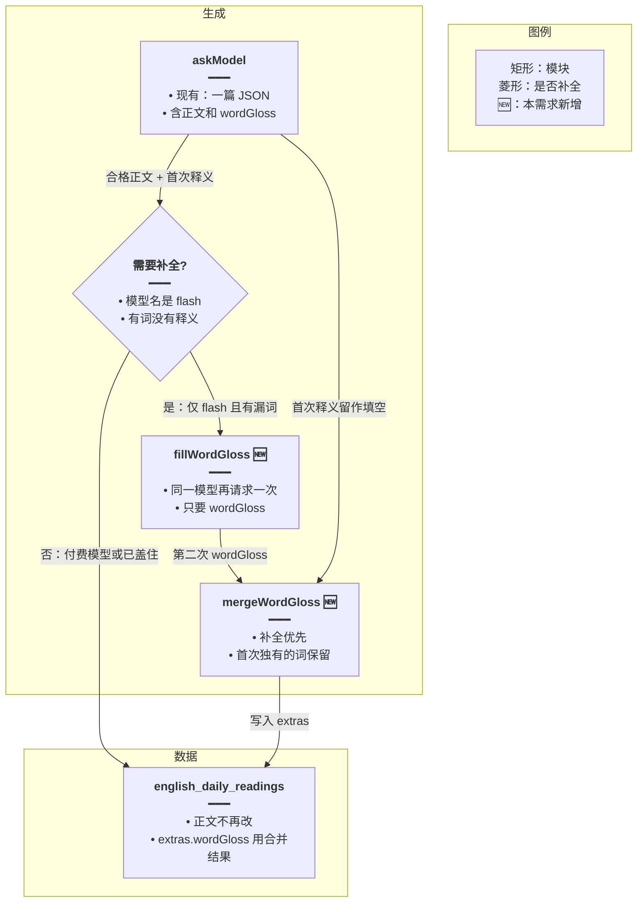
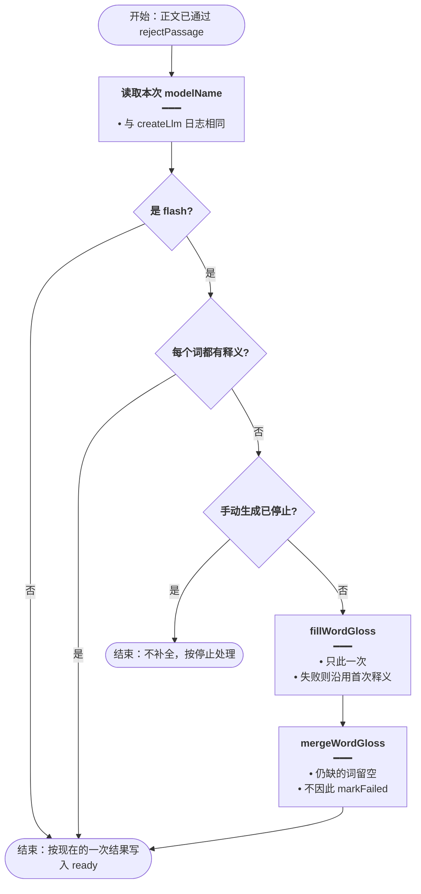
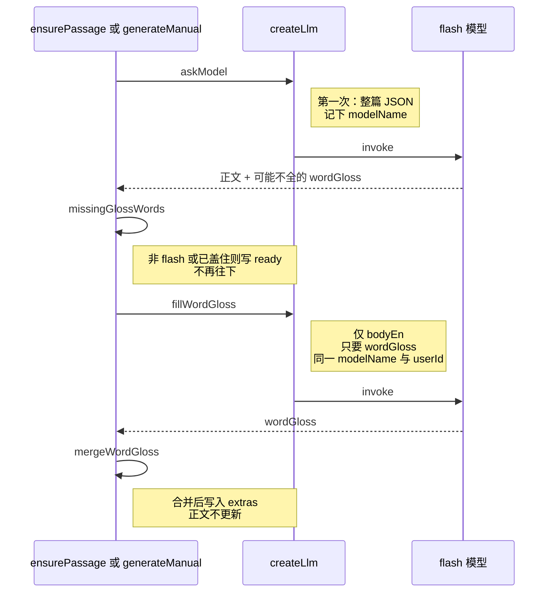
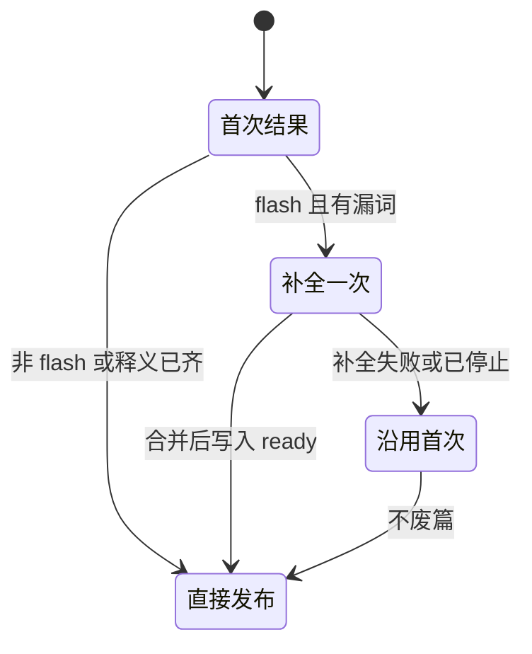

# 弱模型补单词释义 — 实现思路

> **状态**：规划（未实现；逐词释义已在同一次生成的 JSON 里，付费模型一次就能写全）  
> **日期**：2026-10-16  
> **需求摘要**：只有 glm-4-flash、glm-4.7-flash 写出的逐词中文释义不全时，用同一模型再请求一次，只补释义，不重写短文。付费模型保持现在的一次调用。

## 延伸阅读

- [每日阅读](./每日阅读.md)（短文与 `wordGloss` 同一次模型调用写出）
- [每日阅读手动生成](./每日阅读手动生成.md)（手动生成走同一条 `askModel`，本方案两边都生效）
- [阅读截断补释义](./阅读截断补释义.md)（后写：输出被 8192 截断时，所有模型都把短文和释义拆开，并按句补缺口。本文「付费模型仍一次调用」不再用于截断场景）

---

## 0. 读本文你将得到什么

- 要解决的问题：flash 常漏词；付费模型按同一提示能写全。漏词后若整篇重写，正文会被换掉，费用接近再生成一篇，而且仍可能漏。
- 总体方案：正文合格后，仅当本次模型名在 flash 名单里、且有词没有中文释义时，再请求一次，输入已定稿的英文正文，只要 `wordGloss`。
- 只改后端生成。详情页、列表、设置都不动。
- 分两阶段：M1 判定不全并补一次；M2 两次结果按词合并，补完仍缺也不废篇。
- 最大风险：补全那一次仍漏实词。只允许这一次，不循环。缺的词保持可点范围之外，短文照常发布。

---

## 1. 需求与边界

### 1.1 用户故事

| 角色 | 场景 | 行为 | 期望结果 |
|------|------|------|----------|
| 读者 | 定时任务用环境变量里的 flash 写完一篇 | 打开详情点词 | 漏掉的词经过一次补全后尽量能点出中文 |
| 已登录用户 | 系统设置里选的是付费模型，手动生成 | 生成结束 | 仍然只打一次模型，延迟与现在相同 |
| 已登录用户 | 系统设置里选的就是 flash，手动生成 | 首次释义不全 | 同一次请求里多等一次补全，正文不变 |
| 读者 | 补全后仍有个别实词没有释义 | 打开已发布的篇 | 篇目是 `ready`，缺的词不显示释义，不因此失败 |

### 1.2 范围

| 在范围内 | 不在范围内（非目标） |
|----------|----------------------|
| 模型名是 `glm-4-flash` 或 `glm-4.7-flash` 时检查释义是否盖住正文每个词 | 付费模型、其它模型名再打一次 |
| 不全时用同一把 Key、同一个模型再请求一次，只要 `wordGloss` | 整篇重写（标题、正文、词汇、语法、理解题一起重来） |
| 定时生成与手动生成共用这一段 | 回填已经 `ready` 的旧篇 |
| 最多补一次；两次都有的词优先用补全结果，只在一边有的留下 | 循环打到每个词都有 |
| 用户点了停止生成时，不开始补全 | 改详情页的按顺序对齐 |

### 1.3 约束与依赖

- 复用 `askModel` 所在的 `createLlm`。补全这次传入同一次的 `userId` 与 `abortSignal`。
- 模型名读这次 `createLlm` 解析出的名字，与现有 `createLlm` 日志里的 `modelName` 相同。不扫用户表。
- 释义不合格不能废篇。现有 `pickExtras` 已经是「学习块不行就省略」。
- 手动生成的停止必须能拦住补全。定时任务没有停止按钮。
- 夜间工人并发仍是 1。补全只拉长这一篇的工人时间，不并行打模型。

---

## 2. 方案总览（一句话 + 要点）

**一句话方案**：flash 且逐词释义没盖住正文时，用同一模型把已定稿英文再解释一遍，只收回 `wordGloss`。

| # | 设计要点 | 理由 |
|---|----------|------|
| 1 | 整篇重打可行，但不采用 | 正文通常已经合格。重写会换篇，上下文里还有检索材料，费用接近再写一篇，flash 仍可能漏词 |
| 2 | 只补释义 | 行业里弱模型做结构化标注的常见做法是第二段只做抽取。输入只有正文，输出只有词表，token 少 |
| 3 | 用模型名做门闩 | 付费模型没有漏词问题，多一次调用只增加费用和等待 |
| 4 | 最多一次 | 第二次仍不全就发布。循环会把夜间任务拖长，也不保证收敛 |
| 5 | 不改详情页对齐 | 付费模型的输出顺序已经能对上。补全目标是让 flash 交齐词，而不是改展示 |

市面上另外几条路不采用：JSON Schema 不能强制「每个英文词恰好一条中文」；本地词典补不出句中实词的意思；把温度调低仍是同一次生成，flash 该漏还是漏。

---

## 3. 现状与复用

| 能力 | 仓库中已有 | 本需求中的用法 |
|------|------------|----------------|
| 一次 JSON 含逐词释义 | `english-daily-reading.service.ts` 的 `askModel` 系统提示要求 `wordGloss` | 第一次照旧。补全另起一条更短的提示 |
| 过滤不合格释义 | `daily-reading.rules.ts` 的 `pickWordGloss` | 两次原始结果都先过它，再按词合并 |
| 废稿只重写整篇一次 | `ensurePassage` / `generateManual` 在 `rejectPassage` 有原因时再调一次 `askModel` | 不复用这条。释义不全不是废稿 |
| 模型名 | `create-llm.ts` 的 `createLlm` 把 `credentials.modelName` 交给 `ChatOpenAI` | 补全前读这个名字。默认环境变量模型是 `glm-4.7-flash` |
| 手动停止 | `generateManual` 的 `AbortSignal` 与 `shouldStop` | 补全前再查一次，已停止则不打 |
| 详情逐词对齐 | `Detail.tsx` 的 `GlossSentence` 按词序对 `words` | 不改 |

**调研结论**：付费模型与 flash 走的是同一段提示和同一套过滤。差别在模型有没有把每个词写进 JSON。缺的是「flash 漏了再补一次」这一小段，放在正文已判定合格、写入 `ready` 之前。不要另建队列。

---

## 4. 架构图



**图内方法说明**：

| 方法 / 模块入口 | 功能 |
|-----------------|------|
| `askModel` | 现有的一次生成。补全不调用它的「写一篇新短文」提示 |
| `fillWordGloss` | 正文已定稿后，仅 flash 且有漏词时调用。输入是这篇 `bodyEn`，输出只解析 `wordGloss` |
| `mergeWordGloss` | 同一句里，补全写了的词覆盖首次；只有首次写了的词保留。避免补全漏写把已经有的释义擦掉 |

**读图要点**：

- 付费模型从判断直接落库，没有第二条到模型的线。
- 补全不写新正文，短文行的标题和段落保持第一次的结果。
- 新增逻辑在生成服务内部，不增加队列任务。

---

## 5. 主流程图



**图内方法说明**：

| 方法 | 功能 |
|------|------|
| `missingGlossWords` | 把 `bodyEn` 拆成词，对照 `pickWordGloss` 之后的结果。有一个词没有中文释义就返回真 |
| `fillWordGloss` | 再请求一次。调用失败、返回不是 JSON、或用户已停止时，不抛到篇目失败，沿用第一次的释义 |
| `mergeWordGloss` | 合并两次释义后再交给现有的保存 |

**读图要点**：

- 门闩先看模型名，再看覆盖。付费模型不做拆词检查，避免白耗。
- 失败分支仍发布短文。释义是附加块。
- 停止分支只存在于手动生成。定时任务没有这条。

---

## 6. 核心时序图



**图内方法说明**：

| 方法 | 功能 |
|------|------|
| `askModel` | 第一次生成整篇。定时与手动都从这里进来 |
| `missingGlossWords` | 决定要不要第二次。返回假就结束时序 |
| `fillWordGloss` | 第二次请求。提示里写明按正文逐词给 `{en, words:[{w, zh}]}`，不要新正文 |
| `mergeWordGloss` | 把第二次能用的词补进第一次，然后 `repo.update` 为 `ready` |

**读图要点**：

- 第二次仍打到同一个 flash，费用记在同一次解析出的那把 Key 上。
- 参与者没有前端。详情页只读已经合并好的 `extras.wordGloss`。
- 非 flash 的时序在 `missingGlossWords` 之前就结束，图里后半段不会发生。

---

## 7. 状态机

短文行的 `pending / ready / failed` 不变。补全是 `pending` 期间多一次模型等待，不新增状态。



**图内方法说明**：

| 方法 | 功能 |
|------|------|
| `missingGlossWords` | 「补全一次」的守卫。非 flash 不会进入该状态 |
| `fillWordGloss` | 进入补全。抛错时改走「沿用首次」 |
| `mergeWordGloss` | 从补全进入发布。不调用 `markFailed` |

**读图要点**：

- 没有「补全两次」的迁移。
- 停止发生在补全开始前时走「沿用首次」然后按现有停止逻辑结束，不把篇目标成 `ready`。

---

## 8. 模块职责与接口草图

### 8.1 模块一览

| 模块 | 职责 | 新增/改动 | 预估路径 |
|------|------|-----------|----------|
| 生成服务 | 合格正文之后决定是否补全 | 扩展 | `apps/backend/src/services/english-learning/english-daily-reading.service.ts` |
| 释义规则 | 判断漏词、合并两次释义 | 扩展 | `apps/backend/src/services/english-learning/daily-reading.rules.ts` |
| 模型创建 | 提供本次 `modelName` | 复用 | `apps/backend/src/utils/create-llm.ts` |
| 详情页 | 照旧读 `extras.wordGloss` | 不改 | `apps/frontend/src/views/englishLearning/dailyReading/Detail.tsx` |
| 工人 | 仍调用一次 `ensurePassage` | 不改 | `english-daily-reading.processor.ts` |

### 8.2 关键接口（伪代码）

```typescript
// 只对这些模型补释义；付费模型不在名单里，避免多一次费用
const FLASH_GLOSS_MODELS = ['glm-4-flash', 'glm-4.7-flash'];

// 对照正文找漏词；有漏才值得再打一次
function missingGlossWords(
	// 已定稿英文；以它拆出的词为准，避免模型改写句子
	bodyEn: string,
	// 首次 pickWordGloss 之后的结果；没有词表视为全漏
	gloss: { en: string; words: { w: string; zh: string }[] }[] | undefined,
	// 有漏词才返回真，调用方据此决定是否补全
): boolean;

// 同一模型只补释义；失败返回 null，调用方沿用首次结果
function fillWordGloss(
	// 与第一次共用用户和停止信号，避免补全记到另一把 Key
	input: {
		// 只传正文，不传检索材料，避免第二次抄材料或改写短文
		bodyEn: string;
		// 与第一次相同，费用仍记在同一次解析出的 Key 上
		userId?: number;
		// 手动停止时中断补全，定时任务不传
		signal?: AbortSignal;
	},
	// 解析后的词表；null 表示这次没补上，调用方保留首次释义
): Promise<{ en: string; words: { w: string; zh: string }[] }[] | null>;
```

### 8.3 数据模型

| 字段/实体 | 来源 | 存储 | 说明 |
|-----------|------|------|------|
| `modelName` | 本次 `createLlm` | 不落库 | 只用于当次判断 |
| `extras.wordGloss` | 首次，必要时与补全合并 | 现有 JSON 列 | 不新增列，不改迁移 |
| 正文各列 | 第一次合格稿 | 现有列 | 补全不更新这些列 |

---

## 9. 分阶段实现步骤

| 阶段 | 目标 | 交付物 | 依赖 |
|------|------|--------|------|
| M1 | flash 漏词时补一次 | `missingGlossWords`、`fillWordGloss`，接在两处保存之前 | 无 |
| M2 | 补全失败也不丢首次释义 | `mergeWordGloss`，停止信号，日志只打模型名和漏词数 | M1 |

- [ ] M1：名单包含 `glm-4-flash` 与当前默认的 `glm-4.7-flash`
- [ ] M1：`ensurePassage` 与 `generateManual` 在正文合格、`repo.update` 之前走同一段补全
- [ ] M1：补全提示只含定稿 `bodyEn`，不带检索材料，不要求新正文
- [ ] M2：合并时补全优先，首次独有的词保留
- [ ] M2：补全抛错或返回空时仍 `ready`；手动停止则不发起补全
- [ ] M2：日志写模型名与漏词数，不写密钥，不写整篇正文

---

## 10. 关键决策与备选方案

| 决策 | 选用 | 备选 | 为何不选备选 |
|------|------|------|--------------|
| 第二次打什么 | 只补 `wordGloss` | 整篇再打一遍 | 整篇可行，但换正文、费用接近再生成一篇，flash 仍可能漏 |
| 谁触发 | 仅 `glm-4-flash`、`glm-4.7-flash` | 所有模型都检查并可能再打 | 付费模型一次就全，再打只加费用和等待 |
| 打几次 | 最多一次 | 循环到全覆盖 | 夜间并发是 1，循环会让这一发布日过不完，且不保证收敛 |
| 仍不全 | 发布短文，缺词留空 | 把篇目标成失败再重试 | 释义从来不是废稿条件，失败会让当天没有短文 |
| 旧篇 | 不回填 | 启动时把历史 flash 篇再补一遍 | 会在用户无操作时打模型、产生费用 |
| 展示 | 不改按词序对齐 | 前端自行补词 | 付费模型已经对齐；问题在 flash 没写出词，不在页面 |

---

## 11. 风险、边界与待确认

| 项 | 等级 | 说明 | 缓解 |
|----|------|------|------|
| 补全仍漏实词 | 中 | flash 第二次也可能少写 | 只打一次；合并后缺词留空；篇目仍发布 |
| 手动生成变长 | 中 | 仅 flash 且不全时，现有 180 秒时限里多一次等待 | 补全输入短；超时按失败处理并沿用首次释义 |
| 夜间任务变长 | 低 | 只有 flash 漏词的那一篇多一次调用 | 工人仍是一篇接一篇，不并行 |
| 模型名写了后缀 | 低 | 网关可能返回带厂商前缀的名字 | 待确认匹配方式 |

**待确认**：

- [ ] 模型名是否只做全等。验证方式：看一次 `createLlm` 日志里的 `modelName` 是 `glm-4-flash` 还是 `Pro/zai-org/GLM-4-Flash` 这类带前缀的字符串。若带前缀，改为「去掉前缀后与名单全等」，不要用「名字里只要有 flash」这种过宽规则，以免误伤别的模型。

---

## 12. 验收清单

| # | 用例 | 步骤 | 期望 |
|---|------|------|------|
| AC1 | 付费模型不补 | 系统设置选付费模型，手动生成一篇 | 日志里只有一次 `createLlm`；逐词释义与现在一样全 |
| AC2 | flash 已全不补 | 用 flash 生成，若首次已盖住每个词 | 没有第二次请求 |
| AC3 | flash 漏词会补 | 用 flash 生成且首次有词没有释义 | 同模型再请求一次；落库正文与第一次相同；能补上的词出现在 `wordGloss` |
| AC4 | 补全失败仍发布 | 第二次超时或返回无法解析 | `status = ready`，保留第一次的释义 |
| AC5 | 停止不补 | 手动生成首次返回后、补全开始前点停止 | 不再调用模型 |
| AC6 | 定时任务 | 不传 `userId`、环境变量为 `glm-4.7-flash`，且释义不全 | 补全使用这把环境变量 Key，全站仍是一篇 |
| AC7 | 旧篇 | 打开补全功能上线前的短文 | 不自动再打模型 |

---

## 13. 预估改动面（实现阶段参考）

| 类型 | 路径（预估） |
|------|--------------|
| 后端 | `english-daily-reading.service.ts`、`daily-reading.rules.ts` |
| 前端 | 无 |
| 文档（实现后） | 落地后再写 `wiki/english/` 归档；本文保持规划说明 |

---

（本文档为规划态实现思路；落地后以源码为准）
