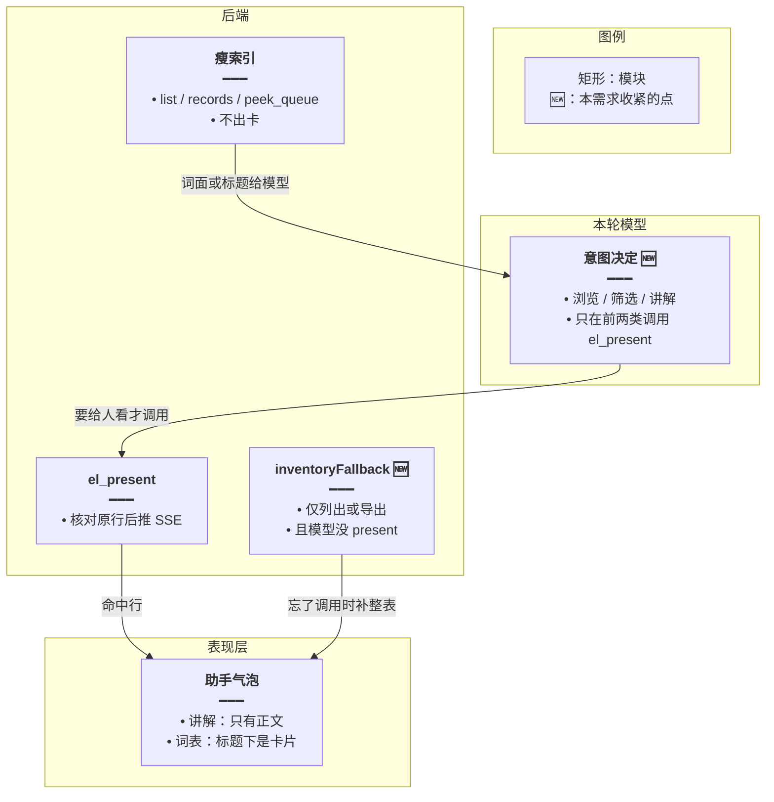
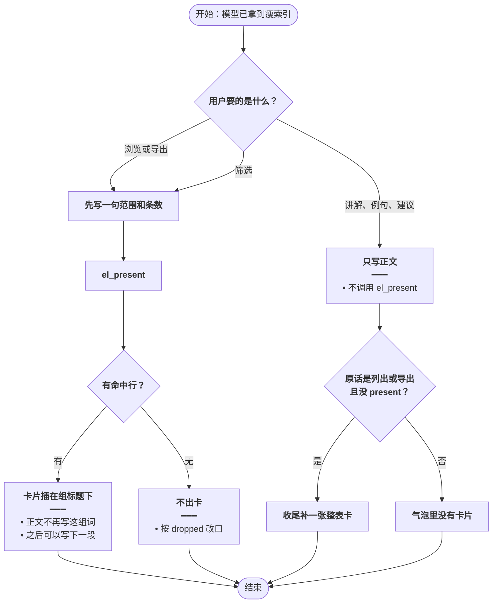
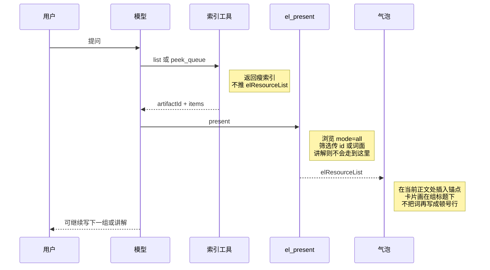
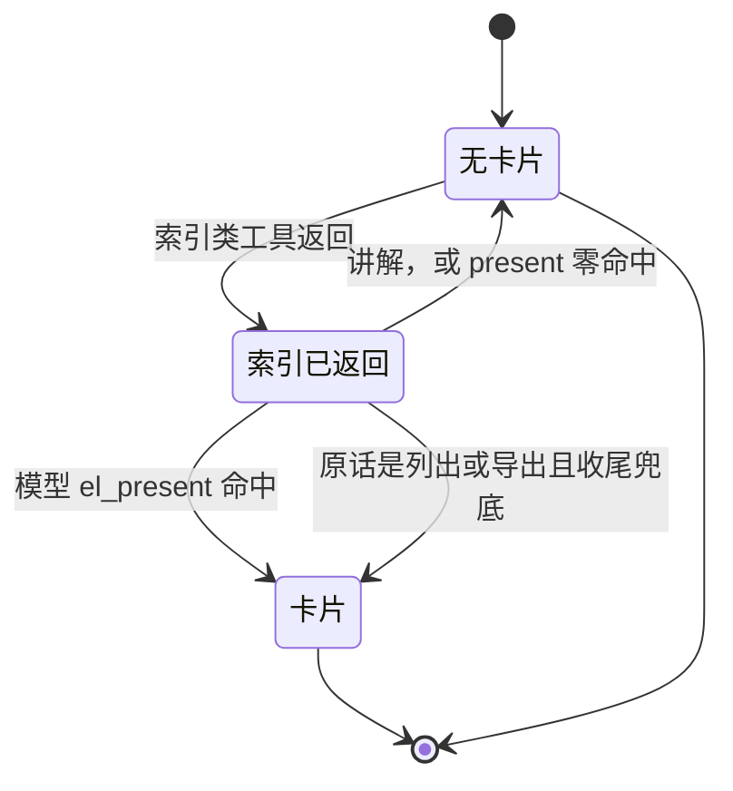

# 意图决定出卡 — 实现思路

> **状态**：规划 | **日期**：2026-10-26 | **需求摘要**：清单卡片只在「用户要看这份列表」时出现；讲解、例句、学习建议不出卡，由本轮模型调用 `el_present` 做决定。

## 延伸阅读

- [问答清单按需出卡.md](./问答清单按需出卡.md) — 筛选子集与 `el_present` 核对原行；本篇收紧「谁有权把卡片推到气泡」
- [清单索引可筛选.md](./清单索引可筛选.md) — 大 list 把瘦索引留给模型；索引仍然给，本篇不再因此收尾出整表
- 业界：MCP Apps 规定检索结果默认给模型，只有这份结果本身就是要给人看的交付物时才渲染界面（[MCP Apps 2026](https://mcp.directory/blog/mcp-apps-spec-2026-when-should-your-server-render-ui)）；工具轨迹与答案分开展示（[aparté tool-call UI](https://apartejs.dev/guides/tool-call-ui/)）；给模型的字段要少而可判断，不要把整表当成用户界面（[Semantic Tool Output](https://www.agentpatterns.ai/tool-engineering/semantic-tool-output/)）

---

## 0. 读本文你将得到什么

- 问题：只要问题不是筛选，`finalizeTurn` 就会在全文写完后补一张整表卡，讲解收尾句下面会突然撑出 30 行。
- 一句话方案：出卡只来自模型的 `el_present`；服务端只在用户明确说列出或导出、且模型没调用时补一张。
- 改动层：收尾兜底、提示词、`search` 不再自动出卡；`el_present` 在正文当前位置插入锚点，前端把卡片画在锚点上，代替顿号词表。
- 阶段：M1 关掉「非筛选就出卡」→ M2 检索命中也改由模型出示 → M3 成组词表改成锚点卡片。
- 不做第二次意图模型。本轮对话模型已经看见原话和索引，再加分类器只会更晚弹出卡片。

---

## 1. 需求与边界

### 1.1 用户故事

| 角色 | 场景 | 行为 | 期望结果 |
|------|------|------|----------|
| 学习者 | 「基础组怎么记，要不要讲例句」 | 模型读了复习队列再讲解 | 只有讲解，没有 30 条卡片 |
| 学习者 | 「基础组有哪些词」并得到 Miss、panda、zoo… 这样一行 | 模型只写组标题，再 `el_present` 这些词 | 标题下面是卡片，正文里不再出现这 30 个词 |
| 学习者 | 「哪些是校园主题」 | 模型点名命中篇 | 卡片只有命中行 |
| 学习者 | 明确要看整表，但模型忘了 `el_present` | 收尾兜底 | 仍有一张整表卡，避免「列出全部」只剩一句空话 |

### 1.2 范围

| 在范围内 | 不在范围内 |
|----------|------------|
| `inventoryFallback` 从「非筛选就出卡」改成「仅列出/导出且未 present」 | 再请求一个意图分类模型 |
| 成组词表改为锚点卡片：`[[el:artifactId]]` 插在组标题后面 | 让模型直接输出卡片 JSON 或 HTML |
| `el_items_search search`、`el_favorites search` 过阈后也不再自动 `onResourceList` | 改过滤、双语、导出按钮 |

### 1.3 约束与依赖

- 卡片今天画在整段 Markdown 后面，所以顿号词表和卡片会叠在一起，卡片还总在最后一句之后。成组列出时改为在 `el_present` 的那一刻插入锚点，卡片画在组标题下面，后面的段落可以继续写。
- `pushInventoryCard` 在 `finalizeTurn` 里调用，发生在流式正文结束之后。这条路径只保留给出错兜底，不能再覆盖讲解题。
- `el_present` 已能按 id / 词面核对 artifact，零命中不出卡。本篇不改核对规则。
- 本轮领域工具仍最多 10 次。`el_present` 占 1 次。

---

## 2. 方案总览（一句话 + 要点）

**一句话方案**：模型看完用户原话和瘦索引后，自己决定叫不叫 `el_present`；服务端不再把「不是筛选」当成「要看整表」。

| # | 设计要点 | 理由 |
|---|----------|------|
| 1 | 决定权在本轮模型 | 它同时看见问法和索引。另起分类器要等回答结束，卡片会更晚出现 |
| 2 | 三种意图 | 浏览才出整表；筛选出子集；讲解只写正文 |
| 3 | 成组词表换成卡片 | 组标题后 `el_present`，锚点插在此处。句子里顺带的两三个词仍写在句子里 |
| 4 | 兜底只认强句式 | `全部`、`列出全部`、`导出`、`整个库`。漏掉「怎么记」这种讲解 |
| 5 | 检索命中同样不出自动卡 | `search` 常常只是找数据的一步，不是用户要看的清单 |

---

## 3. 现状与复用

| 能力 | 仓库中已有 | 本需求中的用法 |
|------|------------|----------------|
| 模型点名出卡 | `el-spill.ts` `presentRows`；`english-learning-domain-tools.ts` `el_present` | 继续作为唯一的正常出卡入口 |
| 收尾补卡 | `inventoryFallback`：`presented` 为假且问法不是 `filter` 就补最近一份索引；`agent.service.ts` `pushInventoryCard` 在 `finalizeTurn` 里推 SSE | 条件改为仅 `listIntent === 'inventory'` |
| 问法正则 | `FILTER_RE` 含筛选/主题；`INVENTORY_RE` 含全部/导出/整个库/列出全部 | 兜底只用 `INVENTORY_RE`。`other`（怎么记、讲例句、建议）不出卡 |
| 索引类 list | `isIndexOp` 已不自动 `onResourceList` | 保持。模型没有索引就无法做决定 |
| 检索自动出卡 | `el_items_search search`、`el_favorites search` 不在 `isIndexOp` 里，外溢仍 `onResourceList` | 改为与 list 一样只进上下文，要看再 `el_present` |
| 气泡位置 | `ChatAssistantMessage/index.tsx` 在正文节点之后渲染 `elResources` | 有锚点的卡画在锚点处；没有锚点的兜底卡仍在文末 |

**调研结论**：截图里的复习卡不是模型点名的，是收尾把「非筛选」一律补成整表，而且补在正文结束之后。成熟做法是让当前这个代理自己选择要不要把工具结果渲染给用户。成组词表（「Miss、panda、zoo…」）属于要给人看的交付物，应换成核对过的卡片，而不是再在正文里点一遍名。

### 3.1 评估：顿号词表直接变成卡片

可行。基础组那 30 个词不再写进正文，改由 `el_present` 在组标题下插入卡片。卡片行来自 artifact 原行，所以有释义，也不会混进模型编造的词。

| 做法 | 结论 | 原因 |
|------|------|------|
| 组标题后调用 `el_present`，锚点插在当前位置 | 采用 | 复用现有卡片；多组词可以一组一张，后文还能继续 |
| 模型在流里输出卡片 JSON / HTML | 不采用 | 流式容易截断；释义不跟词库原行 |
| 收尾用正则把顿号行猜成卡片 | 不采用 | 「sea、cave」和句子里的英文分不开；对不上库的词会进卡片 |
| 句子里举例的两三个词也强制成卡 | 不采用 | 「例如 panda」应留在句子里。只有成组列出才出卡 |

模型仍可能把顿号词表和 `el_present` 都做了。收尾时若本轮已有卡片，删掉「至少 8 个英文词、用顿号或逗号分隔」的那一行。现有 `stripDumpedList` 只剥 Markdown 列表，剥不到这种一行词表。

---

## 4. 架构图



**图内方法说明**：

| 方法 | 功能 |
|------|------|
| `el_present` | 模型决定出卡时调用；服务端只核对原行并推卡片 |
| `inventoryFallback` | 收尾时若用户原话命中列出/导出、且本轮没有成功 present、且只有一份索引，补一张整表卡 |
| `isIndexOp` | 判断这次工具是索引。索引本身不推卡片 |

**读图要点**：

- 讲解路径在模型处结束，不到 `el_present`，也不到兜底。
- 兜底不读模型写出来的正文，只读用户原话，避免模型把讲解说成「列出全部」。
- 成组词表的卡片嵌在组标题下面，不是全文结束后再贴一块。

---

## 5. 主流程图



**图内方法说明**：

| 方法 | 功能 |
|------|------|
| `el_present` | 浏览用 `mode=all`，筛选用 `mode=subset` 并只传 id 或词面 |
| `inventoryFallback` | 只在「列出/导出」分支补卡；讲解分支返回 null |
| `listIntent` | 把用户原话分成 `inventory` / `filter` / `other`，供兜底使用，不代替模型做讲解判断 |

**读图要点**：

- 「怎么记、要不要讲例句」走讲解，结束在「没有卡片」。
- 「列出全部」若模型按提示调用了 `el_present`，兜底不再补第二张。
- 成组列出时，模型先写组标题再 present。锚点落在标题后面，这 30 个词不再以顿号出现在正文里。

---

## 6. 核心时序图



**图内方法说明**：

| 方法 | 功能 |
|------|------|
| `list` / `peek_queue` | 把索引交给模型做决定，不产生用户卡片 |
| `el_present` | 模型选定要展示的行后推 SSE。讲解题不调用 |
| `onElResourceList` | 前端按锚点把卡片嵌进正文；没有锚点的兜底卡仍放在文末 |

**读图要点**：

- 讲解题的时序在工具回执后直接写正文，没有 `el_present`，也没有收尾补卡。
- 可见顺序是组标题、卡片、下一段。卡片代替的是顿号词表，不是整段回答。
- 兜底不在这条成功时序里。它只在 present 没发生、且原话是列出或导出时，由 `finalizeTurn` 补上。

---

## 7. 状态机



**图内方法说明**：

| 方法 | 功能 |
|------|------|
| `el_present` | 从索引进入卡片的正常路径 |
| `inventoryFallback` | 仅列出/导出进入卡片的兜底路径 |

**读图要点**：讲解停在无卡片。筛选零命中也停在无卡片。

---

## 8. 模块职责与接口草图

### 8.1 模块一览

| 模块 | 职责 | 新增/改动 | 预估路径 |
|------|------|-----------|----------|
| 提示词 | 三种意图；成组列出只写标题并 present，禁止顿号词表 | 扩展 | `apps/backend/src/services/agent/agent.prompt.ts` |
| `inventoryFallback` | 仅 `inventory` 且未 present 且一份索引 | 扩展 | `apps/backend/src/services/agent/el-spill.ts` |
| `search` 外溢 | 不再 `onResourceList` | 扩展 | `english-learning-domain-tools.ts` 的 `wrap` |
| 锚点渲染 | `[[el:artifactId]]` 处画 `ResourceListBlock` | 扩展 | `ChatAssistantMessage/index.tsx` |

### 8.2 关键接口（伪代码）

```typescript
// 收尾补卡只认「列出 / 导出」。讲解和其他问法返回 null，避免正文结束后再贴整表
function inventoryFallback(userText: string, lists: Payload[], presented: boolean): Payload | null;

// search 与索引类 list 一样只把行交给模型。用户要看时由模型再调用 el_present
function shouldAutoCard(tool: string, op: string): boolean;

// present 成功时插在当前正文末尾，前端据此把卡片画在组标题下面
const cardAnchor = `[[el:${artifactId}]]`;
```

### 8.3 意图口径

| 意图 | 用户原话示例 | 模型动作 | 服务端兜底 |
|------|----------------|----------|------------|
| 浏览 | 列出来、列出全部、导出、整个库、所有词 | 写标题，`el_present` `mode=all`，不写词表 | 没调用则补一张 |
| 筛选或分组 | 找出、哪些是、主题、基础组有哪些 | 写组标题，`mode=subset` 只传命中 id 或词面，不写顿号词表 | 不补整表 |
| 讲解 | 怎么记、讲例句、给建议 | 只写正文；句子里的少量例子直接写词 | 不补卡 |

`search` 的命中行仍完整出现在工具回执里。模型若判断用户要看这些命中，再 `el_present` 那些词面或 id。

---

## 9. 分阶段实现步骤

| 阶段 | 目标 | 交付物 | 依赖 |
|------|------|--------|------|
| M1 | 讲解题不再在句号后冒出整表 | 兜底条件 + 提示词 | 无 |
| M2 | 检索命中也不自动铺卡 | `search` 改走上下文 | M1 |
| M3 | 顿号词表变成标题下的卡片 | 锚点 + 删重复词表行 | M1 |

- [ ] M1：`inventoryFallback` 在 `listIntent !== 'inventory'` 时返回 null
- [ ] M1：提示词增加三种意图。讲解禁止 `el_present`。成组列出只写组标题，禁止输出顿号或逗号词表
- [ ] M1：自检覆盖「怎么记」不出卡、「列出全部」仍兜底一张
- [ ] M2：`el_items_search search` 与 `el_favorites search` 外溢后不调用 `onResourceList`
- [ ] M2：这两处 search 的回执写明「未出卡片，要看再 el_present」
- [ ] M3：`el_present` 成功时向正文追加 `[[el:artifactId]]`，并用 content SSE 推给前端
- [ ] M3：气泡按该标记渲染 `ResourceListBlock`，同一张卡不要在文末再画一次
- [ ] M3：已有卡片时，`stripDumpedList` 去掉至少 8 个英文词的顿号/逗号行

---

## 10. 关键决策与备选方案

| 决策 | 选用 | 备选 | 为何不选备选 |
|------|------|------|--------------|
| 谁识别意图 | 本轮模型，用叫不叫 `el_present` 表达 | 回答结束后再调一个分类模型 | 多一次等待，卡片更晚弹出，还可能和刚写完的讲解矛盾 |
| 讲解题的卡片 | 不出现 | 收成一行，点开再展开 | 用户没要看列表。收起的工具条仍是句号后面多出来的一块 |
| 忘了 present | 只对列出/导出兜底 | 所有非筛选都兜底 | 后者就是现在的突兀卡片 |
| 检索命中 | 也由模型出示 | 命中即出卡 | 检索经常是讲解前的一步，不是交付物 |
| 词表放哪 | 锚点插在组标题下，卡片代替顿号行 | 模型直接输出卡片 JSON，或正则把顿号行猜成卡片 | JSON 会截断且释义不跟原行；正则会把句子里的英文误收进去 |

---

## 11. 风险、边界与待确认

| 项 | 等级 | 说明 | 缓解 |
|----|------|------|------|
| 模型在讲解里仍 present 整表 | 中 | 提示词没遵守时仍会出卡 | 不在服务端再拦，避免和「由模型决定」对着干。锚点落在它调用的位置 |
| 模型该出卡却没出 | 中 | 「有哪些阅读」不在 `INVENTORY_RE` 里，不会兜底 | 提示词把「有哪些、给我看看」算浏览，必须 present。兜底不扩大到这句，以免把「有哪些记法」判成要整表 |
| 兜底仍在正文结束后 | 低 | 只在列出/导出且模型失约时发生 | 正常路径已经在导语后出卡。兜底是少数 |
| 两份索引 | 低 | 兜底要求恰好一份 | 多份时只允许模型按 artifactId present，不自动挑一张 |
| 历史消息 | 低 | 旧气泡上的整表卡 | 不回写 |

**待确认**：无。`INVENTORY_RE` 已包含全部、所有词、整个库、导出、列出全部，兜底范围以这段正则为准。

---

## 12. 验收清单

| # | 用例 | 步骤 | 期望 |
|---|------|------|------|
| AC1 | 讲解复习队列 | 问基础组怎么记、要不要讲例句，模型读了队列 | 正文在，没有 30 条卡片 |
| AC2 | 基础组词表 | 回答里本来会写「Miss、panda、zoo…」共 30 词 | 组标题下是一张 30 行卡片；正文没有这行顿号词表 |
| AC3 | 筛选 | 「哪些阅读是校园主题」 | 只有命中卡片，没有 93 篇整表 |
| AC4 | 忘了 present | 原话含「导出」或「列出全部」，模型只写了导语 | 收尾仍有一张整表卡 |
| AC5 | 检索只是步骤 | search 到若干词后做讲解 | search 本身不铺卡 |
| AC6 | 零命中 | present 的 id 都不在索引里 | 无卡片，回执有 dropped |

---

## 13. 预估改动面（实现阶段参考）

| 类型 | 路径（预估） |
|------|----------------|
| 后端 | `apps/backend/src/services/agent/el-spill.ts`、`english-learning-domain-tools.ts`、`agent.prompt.ts` |
| 自检 | `el-spill.check.ts`：`other` 不兜底；`inventory` 兜底一张；`filter` 不兜底 |
| 前端 | `apps/frontend/src/components/design/ChatAssistantMessage/index.tsx`：按 `[[el:…]]` 嵌入卡片 |

（本文档为规划态实现思路；落地后以源码为准）
