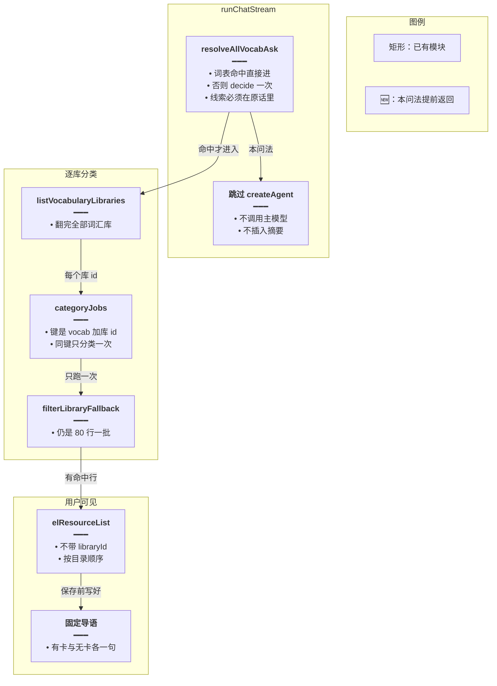
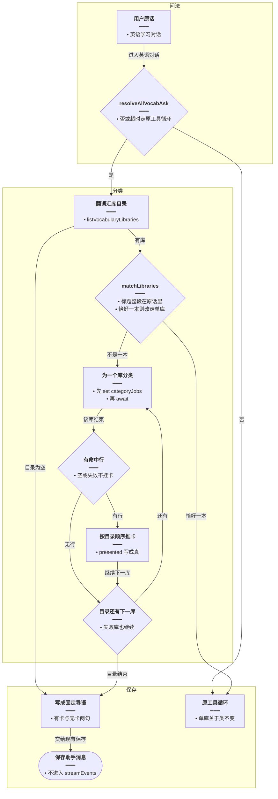
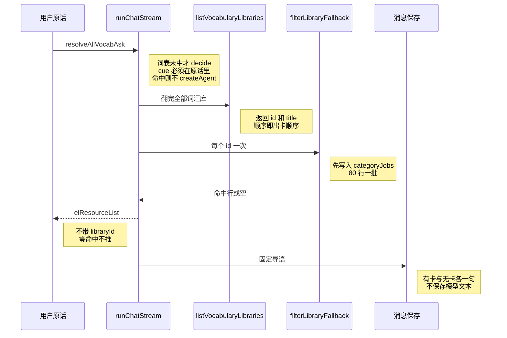
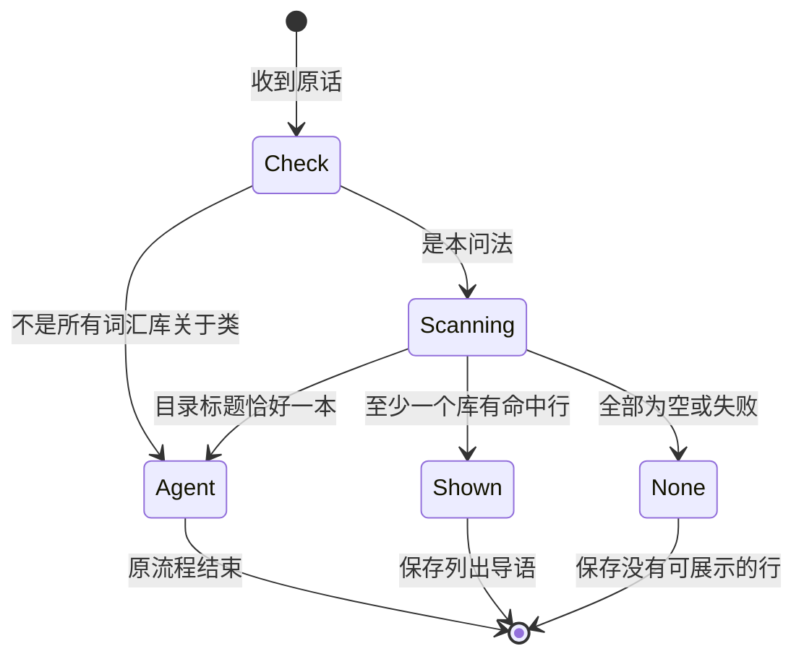

# 所有词库一次分类 — 实现思路

> **状态**：规划（未实现）
> **日期**：2026-10-28
> **需求摘要**：用户用各种日常说法要求把某一类单词从全部词汇库里分类列出来时，服务端都按目录逐库分类一次，并只留一句中文导语。点名一本库或判断失败时仍走原来的工具循环。
> **一句话方案（预告）**：换种说法先由一次短决策认定是不是从全部词汇库列出某一类；认定后进模型前逐库分类，卡片按目录顺序挂上，正文固定一句。

## 延伸阅读

- [同库分类只扫一次.md](./同库分类只扫一次.md)
- [关于类一次出卡.md](./关于类一次出卡.md)
- [库内筛选不中断.md](./库内筛选不中断.md)

---

## 0. 读本文你将得到什么

- 同句两次结果不同，是因为分类只在模型带上库 id 时才发生；这次模型改用英文关键词做字面搜索，正文又被摘要和思考过程带偏。
- 选定方案：换种说法先由一次短决策认定是不是从全部词汇库列出某一类；认定后进模型前逐库分类，卡片按目录顺序挂上，正文固定一句。
- 改动在英语对话入口和收尾正文。单库问法、语句库、80 行一批和分类模型都不动。
- 分三阶段：先认定问法，再逐库出卡，最后把正文收成固定导语。
- 最大风险：短决策超时或线索对不上原话时，这句退回原来的工具循环，换说法仍可能不稳定。扫全部库时，等待是最慢那一库，token（模型调用量）按各库词数相加。

---

## 1. 需求与边界

### 1.1 用户故事

| 角色 | 场景 | 行为 | 期望结果 |
|------|------|------|----------|
| 已登录用户 | 用「所有词汇库里与动物相关」「每个单词库里跟动物有关的都列出来」「词库里动物类的词都给我」这类说法提问 | 服务端认定是从全部词汇库列出某一类后，逐库分类 | 每个有命中的库一张卡，顺序与目录一致，正文是同一句中文 |
| 同一用户 | 问某一本点名的单词库或语句库，或短决策失败 | 仍走现有的带库 id 分类 | 不会改成扫完全部词汇库 |

### 1.2 范围

| 在范围内 | 不在范围内 |
|----------|------------|
| 意思是从全部词汇库列出某一类的日常说法，不要求原话带齐「相关」「词汇库」「所有」 | 只点名一本库、语句库、整库「列出全部单词」、问怎么用库 |
| 每个词汇库本轮只分类一次，零命中不挂空卡 | 更换 `glm-4.7-flash`、改 80 行一批、改摘要中间件的全局触发 |
| 保存的助手正文固定为一句中文导语 | 让模型继续用表格讲解搜到的词 |

### 1.3 约束与依赖

- 分类仍走 `filterLibraryFallback`，命中行必须来自原行。筛选卡仍不带 `libraryId`。
- 同库合并仍用本轮 `categoryJobs`。先写入再等待，失败的 Promise（同一次尚未结束的分类）留到这句结束。
- 单库关于类、`filter_shown` 闸、收尾对唯一库名的续查保持现有行为。
- 卡片可以在分类完成时逐张推到 SSE（服务器推送事件），不必等最慢的库才让用户看到第一张。
- 问法认定复用 `decide()`：只看这一句原话，温度 0，2 秒超时，失败返回 null，不重试。

---

## 2. 背景

- **谁、在什么场景、卡在哪**：同一句「将词汇库中所有与动物相关的单词进行分类，并全部列出来」，上一次走的是整库分类。这一次 GLM-5.1 先 `el_libraries` list（12 毫秒），再连续 `el_items_search` search。第一次 search 463 毫秒，约 70 秒后又有一大批 search，耗时从 0.6 秒到 7 秒。随后是 `bad_args`、`el_limit`，以及 `Cannot read properties of undefined (reading 'trim')`。整段日志里只有对话模型的两次 `createLlm`（一次流式、一次摘要），没有分类器那次 `glm-4.7-flash`。
- **现状缺口**：关于类分支只在调用带有 `libraryId` 时才分类。这批 search 没有走进该分支，所以落进字面 `LIKE`。服务里的搜索上限是 20 条，于是「pet」会带出 petal、petrol。`el_libraries` 的下一步提示只在整库问法且库名唯一时出现，关于类「所有词汇库」不会要求模型对每个 id 分类。正文则把摘要当作用户原话，并带出 `</think>` 后的英文表格。
- **不解决会怎样**：同一句有时出分类卡，有时出一截关键词表，有时复述上一轮摘要。用户无法预期结果。
- **硬约束**：点名一本库的关于类不能被拉去扫全部词汇库。语句库不在这句的范围内。

---

## 3. 现状与复用

| 能力 | 仓库中已有 | 本需求中的用法 |
|------|------------|----------------|
| 关于类判断 | `spill.ts` 的 `isCategoryAsk`。原话含「相关」且不是整库问法时为真 | 只作原句的快路径。没有这些词的换说法不靠它放行 |
| 短决策 | `apps/backend/src/utils/glm-decide.ts` 的 `decide()`。`pack-ask.ts`、`reading-ask.ts` 已用：任务说明加原话，`parse` 看形状，`accept` 要求主题是原话子串，失败返回 null | 换说法问一次。返回的线索必须是原话里的连续子串，才允许扫全部词汇库 |
| 整库分类 | `filterLibraryFallback`、`categoryJobs` | 每个目录 id 调用一次。同 id 后来者只等待 |
| 目录 | `listVocabularyLibraries`，`el_libraries` list 写入 `surface.catalog` | 进模型前自己拉词汇库目录，不靠模型先 list |
| 字面搜索 | `searchVocabularyLibraryItems`，`limit` 被收成最多 20 条 | 本问法不再调用 |
| 同参保险丝 | `domain-tools.ts` 里 `raw.trim()` 后与 `lastSig` 比较，相同则 `el_limit` | 不靠它停这批搜索。参数不同的关键词都会执行。`raw` 为空时 `trim` 抛错，变成 `unavailable` |
| 结束图 | `brakeAfterModel` 只认上一批工具回执里的 `filter_shown` | 本问法不进入工具循环，闸保持不动 |
| 空转计数 | `quietRoundMiddleware` 按带工具调用的 AI 消息计数，满 24 轮后的下一次才收束 | 一次 AI 消息里的几十个并行 search 只算一轮，挡不住这批搜索 |
| 长上下文 | `summarizationMiddleware`，`trigger: { tokens: 6000, messages: 12 }` 是同时满足才触发。摘要插入的是 `HumanMessage`，前缀为 `Here is a summary of the conversation to date:` | 本问法不调用主模型，这句不会再把摘要当作用户问题 |
| 收尾正文 | `stripDumpedList` 要表格加列表行数达到 `max(80, 卡片条数的 80%)` 才删表 | 这次大约十几行的表删不掉。本问法改为固定导语 |

**调研结论**：分类器和同库合并已经能用。`decide()` 已经能做「只看原话、形状不对就放弃、线索必须是原话子串」的短判断。缺的是把「从全部词汇库列出某一类」从对话模型的工具选择里拿出来。三组固定词只能盖住原句：「把所有词汇库里的动物单词进行分类」没有「相关」，会被整库问法排除；「每个单词库」没有「所有 / 全部 / 各个」；「词库」对不上「词汇库 / 单词库」。这次日志没有分类器的 `createLlm`，可以确定没有走进 `filterLibraryFallback`。

---

## 4. 方案比对与最终方案

### 4.1 候选方案

#### 方案 A：继续等模型带上库 id（复用现状）

- **做法**：关于类仍只在 `el_items_search` 带 `libraryId` 时分类。模型若只传 `q`，继续 `searchVocabularyLibraryItems`。正文仍由模型写，收尾只删很长的表。
- **能工作的原因**：模型若对每个库 id 调用 list 或 search，现有分支会分类并出卡。单库问法已经是这条路。
- **主要代价**：模型可以选择关键词。长对话里摘要是一条 `HumanMessage`，模型会把它当成用户问题，两次提问的工具和正文都可以不同。

#### 方案 B：进模型前按词汇库目录分类（扩展 `runChatStream`）

- **做法**：原话同时满足关于类、点到词汇库或单词库、以及「所有 / 全部 / 各个」时，`runChatStream` 自己调用 `listVocabularyLibraries`，对每个 id 走 `filterLibraryFallback`，用 `categoryJobs` 合并。有命中的库按目录顺序推一张卡。不调用 `createAgent`。助手正文写成固定的一句中文。
- **能工作的原因**：工具选择和摘要都不再参与这句。同一目录、同一分类器、同一导语，重复提问的形状一致。
- **主要代价**：这句没有模型写的开场白。词汇库多时要等分类做完，token 是各库词数相加。

#### 方案 C：仍让模型跑，但在 list 之后扫完全部库并禁止字面搜索

- **做法**：`el_libraries` list 成功后，若是本问法，就对目录里每个词汇库分类并回 `filter_shown`。同时 `el_items_search` 的 search 在本问法下直接回 `filter_shown`，不执行 `LIKE`。模型继续生成最后一段话。
- **能工作的原因**：模型只要先 list，卡片就会齐。字面搜索不再把 petal、petrol 塞进上下文。
- **主要代价**：模型可以不调用工具，只根据摘要写英文表格。`stripDumpedList` 的行数门槛删不掉十几行的表。用户仍会先看到思考过程。

### 4.2 比对

| 维度 | 方案 A 等模型带库 id | 方案 B 进模型前分类 | 方案 C 模型跑完再补扫 |
|------|----------------------|---------------------|----------------------|
| 正确性 | 关键词搜索漏掉大部分动物词，并混入词面子串 | 每个词汇库按原话分类一次 | 模型调用了 list 时卡片是对的；不调用则仍是摘要 |
| 复用 | 现成分支 | 复用 `filterLibraryFallback` 和 `categoryJobs` | 复用分类函数，仍依赖工具循环 |
| 改动面 | 无 | 对话入口加一条提前返回 | 改 list 与 search 两个入口 |
| 复杂度 | 无新分支 | 一个问法判断加一次目录循环 | 工具循环、闸和正文三处都要顾到 |
| 体验 | 同一句时而数分钟搜索，时而分类卡 | 等待等于最慢的一库，卡片逐张出现 | 仍可能先打出几十次 search，再看到英文正文 |
| 风险 | 低，但结果不稳定 | 问法判断过宽会误扫全部库 | 摘要仍能决定正文 |
| 可维护性 | 稳定输出依赖模型 | 问法、出卡、导语在同一段入口 | 禁止搜索和模型正文会互相打架 |

### 4.3 综合考量

这次权重大的是同一句的结果形状。方案 A 在模型配合时能出卡，这次日志已经证明它不配合：没有分类器调用，正文在复述摘要。

方案 C 能停掉字面搜索，这是它比 A 强的地方。它放弃不了的是模型最后那段话。摘要以 `HumanMessage` 插入，GLM-5.1 会把「Here is a summary of the conversation to date」当成用户没提新问题。只改工具，保存下来的正文仍会变。

选定方案 B。这句在 `createAgent` 之前结束，目录、分类和导语都不经过模型。放弃的是方案 C 里「模型还能补一句讲解」的能力，以及方案 A 的零改动。

### 4.4 最终方案

#### 背景

「所有词汇库」对不上唯一库名，收尾的 `shouldFilterContinue` 不会补扫。分类又只认带 `libraryId` 的取词。模型改传 `q` 时，服务端按最多 20 条做字面搜索。长对话达到 6000 token 且 12 条消息后，摘要会插成另一条用户消息。

#### 具体思路

1. 问法按 §4.6 认定。原句走词表快路径；其它日常说法走一次 `decide()`。点名一本库、语句库、决策失败，继续走现有工具循环。
2. 认定命中后，在 `runChatStream` 里拉词汇库目录。目录标题整段出现在原话里且只有一本时，改为单库路径，不扫其它库。其余每个 id 先放入 `categoryJobs` 再分类。卡片按目录顺序推，不带 `libraryId`。
3. 不创建 Agent，主模型和摘要模型都不调用。正文写成固定导语，再走现有的消息保存。
4. 某一库失败或零命中：不挂卡，Promise 留在 Map 里。其它库照常出卡。全部没有命中时，导语说明这次没有可展示的行，不说库是空的。

#### 实现方案

**一句话**：换种说法先由一次短决策认定是不是从全部词汇库列出某一类；认定后进模型前逐库分类，卡片按目录顺序挂上，正文固定一句。

| 步骤 | 谁 | 做什么 | 输入 → 输出 |
|------|----|--------|-------------|
| 1 | `resolveAllVocabAsk` | 快路径或一次 `decide()` | 原话 → 是或否 |
| 2 | `runChatStream` | 命中则拉词汇库目录，不创建 Agent | 原话 → 目录 id |
| 3 | `filterLibraryFallback` | 每个 id 分类一次 | 库 id 加原话 → 命中行或空 |
| 4 | 消息保存 | 有卡写固定导语 | 卡片 → 一条助手消息 |

#### 选定原因

1. **正确性**：每个词汇库都按原话分类，不再用词面子串。牺牲：点名一本库的句子不走这里。
2. **复用**：分类、同库合并、筛选卡形状都不换。牺牲：入口多一个提前返回。
3. **改动面**：只加问法判断和一段循环。牺牲：这句看不到模型自己的开场白。
4. **复杂度**：没有新的工具协议。牺牲：目录很多时这段循环要等分类。
5. **体验**：同一句不再出现英文表格和几十次 search。牺牲：第一张卡要等该库分类完。
6. **风险**：全库扫描只在线索是原话子串时打开；超时不扫。牺牲：决策失败的那一句退回原来的工具循环。
7. **可维护性**：出卡和导语在保存前就定下来。牺牲：讲解类句子若被误判，会只有卡片没有讲解。

#### 优势

- 相对方案 A：同句再问不会改走 mammal、falcon、pet 这种字面搜索。
- 相对方案 C：摘要和 `</think>` 不会成为保存下来的正文。

#### 怎么实现

1. 在 `spill.ts` 增加 `isAllVocabCategory` 和 `resolveAllVocabAsk`。后者先走词表，走不通再 `decide()`。
2. `runChatStream` 在 `createAgent` 之前调用 `resolveAllVocabAsk`。命中则 `listVocabularyLibraries` 翻全目录；若恰好一本库的标题整段在原话里，改走原路径。
3. 按目录顺序为每个 id 创建 `filterLibraryFallback` 并 `categoryJobs.set`。全部创建完再按同一顺序 `await`，有命中就 `put` artifact 并推 `elResourceList`。
4. `accumulated` 设为固定导语，跳过 `streamEvents`，进入现有的 `finalizeTurn` 保存。`presented` 在第一张卡挂上时写成真。

### 4.5 正文由谁写

这会改变用户最后看到的字，和卡片是否稳定是两件事。

#### 方案 A：仍用模型最后一段

- **做法**：卡片由服务端挂上，正文沿用模型输出，只跑现有的 `stripDumpedList`。
- **能工作的原因**：模型有时会写一句得体的导语。
- **主要代价**：这次的正文是摘要复述加英文表。行数不到删除门槛，会原样保存。

#### 方案 B：有卡片或已经扫过时写成固定导语

- **做法**：本问法不采用模型输出。有卡时保存「已从各词汇库分出与原话相关的单词，完整清单在卡片中。」没有卡时保存「这次没有可展示的行。」
- **能工作的原因**：重复提问时，卡片标题和这一句都来自服务端。
- **主要代价**：不能在同一句里让模型再解释某个词。

| 维度 | 模型写正文 | 固定导语 |
|------|------------|----------|
| 正确性 | 会把摘要和关键词表当成答案 | 答案就是卡片加这一句 |
| 复用 | 现成的 `stripDumpedList` | 现成的消息保存，只换字符串 |
| 改动面 | 无 | 本问法多一次赋值 |
| 复杂度 | 此项相同 | 此项相同 |
| 体验 | 同一句的文字会变 | 同一句的文字不变 |
| 风险 | 思考过程直接进聊天记录 | 误判问法时没有讲解 |
| 可维护性 | 要继续调删除门槛 | 导语只有两句 |

综合：用户要的是每次列出同一类结果，不是每次一段不同的讲解。选定固定导语。放弃模型偶尔能写出的开场白。`stripDumpedList` 仍留给其它问法。

#### 背景

这次可保存的正文来自模型，里面有 `</think>` 和一张词表。收尾的删表条件要求列表行数达到 80 或卡片条数的八成，这张表过不了这个门槛。

#### 具体思路

本问法的 `accumulated` 不从模型 token 累加。在推完卡片后直接写成两句中的一句，再交给现有保存。

#### 实现方案

**一句话**：本问法的助手正文只用固定导语，不保存模型输出。

| 步骤 | 谁 | 做什么 | 输入 → 输出 |
|------|----|--------|-------------|
| 1 | `runChatStream` | 有卡写列出导语，无卡写没有可展示的行 | 卡片张数 → 一句中文 |

#### 选定原因

**体验**：同一句保存下来的文字不变。牺牲：这句里没有模型讲解。

#### 优势

相对继续用模型正文：摘要和英文表不会进 `english_agent_message`。

#### 怎么实现

见 §9.3。有 `turnElResources.length > 0` 用列出导语，否则用没有可展示的行。

### 4.6 换种说法怎么认定

出卡路径已经不依赖对话模型。还没定的是谁来识别「意思是从全部词汇库列出某一类」。

#### 方案 A：只认三组固定词（上一版入口）

- **做法**：`isAllVocabCategory` 要求同时有「关于 / 相关 / 有关 / 属于」、有「词汇库 / 单词库」、有「所有 / 全部 / 各个」。命中才提前返回。
- **能工作的原因**：原句「将词汇库中所有与动物相关的单词进行分类，并全部列出来」三组都有，不会误扫单库。
- **主要代价**：「把所有词汇库里的动物单词进行分类」没有「相关」，会被整库问法排除；「每个单词库」「词库」「动物类的词都列出来」进不了这条路。

#### 方案 B：把同义词补进正则

- **做法**：在三组词上再加「每个」「都」「词库」「分类」「列出来」「找出来」。仍不调用 `decide()`。
- **能工作的原因**：上一节举出的一部分换说法能靠新增词命中，出卡路径与原句相同。
- **主要代价**：词表要继续加。「词汇库里动物类的词都给我」这种不带那些标记的说法仍然进不去。每加一个词，误扫讲解句的面也变大。

#### 方案 C：词表定了就直接进，定不了再问一次 `decide()`

- **做法**：`isAllVocabCategory` 为真则不再问模型。否则调用现有 `decide()`，任务只要求返回 `{"scope":"all_vocab|one_vocab|classic|none","cue":""}`。`accept` 只放行 `scope === "all_vocab"`，且 `cue` 去掉空白后至少两个字、并且是原话的连续子串。超时、非 JSON、线索不在原话里，都返回否，走原工具循环。拉完目录后，若 `matchLibraries` 恰好一本，也改走原路径。
- **能工作的原因**：换说法不需要先写进词表。线索必须来自原话，模型和摘要不能编一个范围把全部库打开。原句不付这次调用。
- **主要代价**：词表没盖住的句子多一次 flash，最多等 2 秒。这 2 秒失败时，该句退回不稳定的工具循环。

| 维度 | 方案 A 三组固定词 | 方案 B 加同义词 | 方案 C 词表加一次 decide |
|------|------------------|-----------------|-------------------------|
| 正确性 | 只盖住带齐三组词的原句 | 盖住列出的一部分换说法 | 日常换说法由原话里的线索放行，点名一本库仍排除 |
| 复用 | 现成的 `isCategoryAsk` | 仍是正则 | 复用 `decide()` 和子串验收，与 `pack-ask.ts` 相同 |
| 改动面 | 一个函数 | 同一个函数加长正则 | 多一个 `resolveAllVocabAsk` |
| 复杂度 | 三项同时成立 | 词越加越要防误伤 | 一次 JSON，失败即否 |
| 体验 | 原句不增加等待 | 此项相同 | 换说法多最多 2 秒；原句不加 |
| 风险 | 低，但换说法没覆盖 | 新词会把讲解句扫进去 | 超时退回旧路径；线索不在原话里不会扫 |
| 可维护性 | 新说法要改代码 | 词表继续长 | 新说法不用改词表，任务说明要保持短 |

综合：权重大的是大众问法都能进同一条出卡路径，同时不能因为模型一句话就把全部库扫掉。方案 A 对原句稳定，这个优点留在快路径里，但不能当唯一入口。方案 B 把覆盖面做成另一张词表，放弃不了「还要再加词」这件事。选定方案 C。放弃的是方案 A 的「完全不调用决策模型」，以及方案 B 的「失败时也没有 2 秒等待」。

#### 背景

`isCategoryAsk` 先看「关于 / 相关 / 有关 / 属于」。没有这些词时，「全部」「所有词」会先变成整库问法。所以意思相同的句子会在入口被拆成两类。`decide()` 已规定只看这一句、2 秒、失败即 null，并且调用方可以用 `accept` 丢掉不在原话里的内容。

#### 具体思路

1. 原句仍用词表，避免每次都打一次 flash。
2. 词表未命中才 `decide()`。输入只有用户这一句，不带摘要和历史。
3. 模型可以换着理解「每个库」「都列出来」「动物类」，但必须交回原话里实际出现的一段 `cue`。对不上就当没认定。
4. 认定之后才拉目录。标题整段落在原话里且只有一本时，把全库扫描取消，交给现有单库路径。

#### 实现方案

**一句话**：词表能确定就直接进；不能确定时用一次 `decide()`，线索必须是原话子串，失败不扫全部库。

| 步骤 | 谁 | 做什么 | 输入 → 输出 |
|------|----|--------|-------------|
| 1 | `isAllVocabCategory` | 原句快路径 | 原话 → 是或否 |
| 2 | `decide` | 快路径为否时问一次 | 原话 → JSON 或 null |
| 3 | `acceptAllVocabCue` | 只收全部词汇库，且线索在原话里 | JSON → `{ scope: "all_vocab" }` 或 null |
| 4 | `matchLibraries` | 恰好一本则取消全库扫描 | 目录标题 → 改走单库 |

#### 选定原因

1. **正确性**：换说法不再被三组词拆开。牺牲：决策失败的句子仍走旧路径。
2. **复用**：验收方式和 `acceptSlots` 一样，线索必须是原话子串。牺牲：多一次最多 400 token 的 flash。
3. **体验**：原句不加等待。牺牲：新说法最多等 2 秒才开始分类。
4. **风险**：编造的范围开不了全库扫描。牺牲：模型没把线索抄进原话时，这句不会提前返回。

#### 优势

- 相对方案 A：「每个单词库」「动物类的词都列出来」不必先改正则。
- 相对方案 B：覆盖面不靠继续加词，误扫仍有子串和单库标题两道闸。

#### 怎么实现

`resolveAllVocabAsk` 先调用 `isAllVocabCategory`，否则 `decide()`。任务文案固定为：只返回 JSON `{"scope":"all_vocab|one_vocab|classic|none","cue":""}`；只有用户要求把某一类单词从词汇库全体里找出来、分类或列出来时，`scope` 才是 `all_vocab`；点名一本库是 `one_vocab`，只要语句是 `classic`，其它是 `none`；`cue` 必须是原话中连续出现的一段，不要编。代码见 §9.2。目录拉完后的单库退回写在 §9.3 开头。

---

## 5. 架构图



**图内方法说明**：

| 方法 | 功能 |
|------|------|
| `resolveAllVocabAsk` | 判断这句是不是从全部词汇库列出某一类。词表未中则调用 `decide` |
| `decide` | 只看这一句原话，返回范围和线索。超时或形状不对返回 null |
| `isAllVocabCategory` | 原句快路径。三组词都在时不再调用 `decide` |
| `listVocabularyLibraries` | 翻出当前用户能读的全部词汇库 id 和标题 |
| `categoryJobs` | 记住本轮每个库的分类 Promise，同键不第二次分类 |
| `filterLibraryFallback` | 按原话把一个库分成命中行，分批和模型都不改 |
| `elResourceList` | 把一个库的命中行推成一张筛选卡 |
| `createAgent` | 本问法不调用。其它问法仍用它跑工具循环 |

**读图要点**：

- 提前返回在创建 Agent 之前，摘要中间件不会在这句运行。
- 一个目录 id 一条分类，卡的顺序跟目录一致。
- 单库关于类在 `decide` 返回 `one_vocab` 或标题恰好一本时不进全库扫描。

---

## 6. 主流程图



**图内方法说明**：

| 方法 | 功能 |
|------|------|
| `resolveAllVocabAsk` | 词表或一次 `decide` 决定是否提前返回 |
| `decide` | 换说法时返回 `scope` 和 `cue`，失败则否 |
| `matchLibraries` | 目录标题整段在原话里且只有一本时，取消全库扫描 |
| `listVocabularyLibraries` | 提供要分类的库 id 列表 |
| `categoryJobs` | 流程图里「先 set」的那一步，保证同库不重复分类 |
| `filterLibraryFallback` | 「为一个库分类」 |
| `streamEvents` | 本问法的结束节点不调用它 |

**读图要点**：

- 不命中的原话仍进原来的 Agent。
- 一个库失败只跳过该库的卡，后面的库继续。
- 导语在全部库结算之后才写，避免写到一半改口。

---

## 7. 核心时序图



**图内方法说明**：

| 方法 | 功能 |
|------|------|
| `resolveAllVocabAsk` | 决定这句是提前返回还是进入 Agent |
| `decide` | 只在词表未命中时调用，输入是这一句原话 |
| `listVocabularyLibraries` | 取出要扫的词汇库 |
| `filterLibraryFallback` | 对一个库做关于类分类 |
| `elResourceList` | 把命中行推给当前这条回复 |
| `createAgent` | 时序里不出现。本问法不创建它 |

**读图要点**：

- 主模型和摘要模型都不在这条时序上。
- 每个库一次 `filterLibraryFallback`，不是每个英文关键词一次。
- 导语在卡片推送之后写入保存，用户刷新看到的是同一句。

---

## 8. 状态机



**图内方法说明**：

| 方法 | 功能 |
|------|------|
| `resolveAllVocabAsk` | `Check` 的两条出口。内部先词表，再 `decide` |
| `decide` | 换说法的那一次短判断 |
| `matchLibraries` | 恰好一本库时从 `Scanning` 改回 `Agent` |
| `filterLibraryFallback` | `Scanning` 上每个库的分类 |
| `elResourceList` | 进入 `Shown` 时推卡 |

**读图要点**：

- `None` 也结束这句，不会再交给模型补搜。
- `Agent` 是现有单库和其它问法，不在本方案里改状态。

---

## 9. 具体实现（主链路代码）

### 9.1 模块一览

| 模块 | 职责 | 新增/改动 | 预估路径 |
|------|------|-----------|----------|
| `resolveAllVocabAsk` | 词表快路径，否则一次 `decide()` | 新增 | `apps/backend/src/services/agent/tools/english/spill.ts` |
| `decide` | 短决策，失败返回 null | 已有 | `apps/backend/src/utils/glm-decide.ts` |
| 提前返回 | 拉目录、逐库分类、写导语 | 扩展 | `apps/backend/src/services/agent/agent.service.ts` |
| `filterLibraryFallback` | 单库分类 | 已有 | `apps/backend/src/services/agent/tools/english/domain-tools.ts` |
| `categoryJobs` | 同库只扫一次 | 已有 | `apps/backend/src/services/agent/tools/english/spill.ts` |

### 9.2 问法与提前返回

`isAllVocabCategory` 仍是原句快路径：关于类、点到「词汇库 / 单词库」、并且有「所有 / 全部 / 各个」时直接返回真。换说法走下面这次决策。

```typescript
// 对应 §4.6 步骤 3。线索必须是原话里的连续子串，编出来的范围不能打开全库扫描
export function acceptAllVocabCue(
	// 用来核对线索是不是原话里的字
	userText: string,
	// 模型返回的 JSON，形状不对就拒绝
	raw: unknown,
): { scope: 'all_vocab' } | null {
	// 不是对象就拒绝，避免把字符串当成要扫库
	if (!raw || typeof raw !== 'object' || Array.isArray(raw)) return null;
	// 只读 scope 和 cue，其它字段不参与放行
	const body = raw as { scope?: unknown; cue?: unknown };
	// 单库、语句库和其它问法都留给原来的工具循环
	if (body.scope !== 'all_vocab') return null;
	// 没有线索就无法核对模型是不是在看这句原话
	if (typeof body.cue !== 'string') return null;
	// 去掉首尾空白再比对，避免空格让原话里的词对不上
	const cue = body.cue.trim();
	// 至少两个字，并且必须在原话里出现
	if (cue.length < 2 || !userText.includes(cue)) return null;
	// 验收通过，调用方才可以按全部词汇库分类
	return { scope: 'all_vocab' };
}

// 对应 §4.6 步骤 1–2。词表能确定就不再问模型，问了也只看这一句原话
export async function resolveAllVocabAsk(
	// decide 要用的配置，模型固定是 glm-4.7-flash
	config: ConfigService,
	// 只有这一句，不带上一轮摘要
	userText: string,
): Promise<boolean> {
	// 原句零次额外调用，结果不随对话摘要变化
	if (isAllVocabCategory(userText)) return true;
	// 超时、非 JSON、验收失败都是 null，不当成要扫全部库
	const slot = await decide(config, {
		// 任务只描述范围，不把换说法的词表写进提示
		task: ALL_VOCAB_TASK,
		// 不附历史和摘要，避免把上一轮动物词当成这句要求
		input: userText,
		// 形状交给 accept，这里只把对象传进去
		parse: (raw) =>
			// 数组和空值都不是槽位，避免 accept 读到错误类型
			raw && typeof raw === 'object' && !Array.isArray(raw) ? raw : null,
		// 线索不在原话里就丢掉
		accept: (_value, input) => acceptAllVocabCue(input, _value),
	});
	// 只有验收通过的全部词汇库才提前返回
	return slot?.scope === 'all_vocab';
}
```

`ALL_VOCAB_TASK` 要求只返回 `{"scope":"all_vocab|one_vocab|classic|none","cue":""}`。只有用户要把某一类单词从词汇库全体里找出来、分类或列出来时，`scope` 才是 `all_vocab`。`cue` 必须是原话中连续出现的一段。`runChatStream` 在 `createAgent` 之前调用 `resolveAllVocabAsk`。返回真才执行 §9.3，然后进入现有的 `finalizeTurn`，不调用 `streamEvents`。返回假就走原来的 Agent。

### 9.3 按目录出卡并写导语

```typescript
// 对应 §4.6 步骤 4。页大小与 el_libraries 相同，翻到没有下一页，避免只分类第一页库
const libs = await fetchAllPages(100, async (limit, offset) => {
	// 目录接口仍是现有的词汇库列表，不新开查询
	const page = await this.englishLearningService.listVocabularyLibraries(
		// 只读当前用户能看的库
		userId,
		{
			// 本页条数由 fetchAllPages 传入
			limit,
			// 偏移跟着上一页的实际条数走
			offset,
		},
	);
	// 交给 fetchAllPages 拼页，这里只留 id 和标题
	return {
		// 分类只需要 id 和标题，词数不参与判断
		items: page.items.map((lib) => ({ id: lib.id, title: lib.title })),
	};
});
// 标题整段出现且只有一本时，这句是单库，不扫其它库
const named = matchLibraries(elSurface.userText, libs.items);
// 恰好一本就不要往下分类，runChatStream 继续创建 Agent
if (named.length === 1) {
	// 不写固定导语，单库仍由现有的工具分类和收尾续查负责
	return 'single';
}
// 对应 §4.4 步骤 3。先全部放入 Map，分类并行开始，出卡仍按目录顺序
const jobs = libs.items.map((lib) => {
	// 键与带库 id 的关于类分支一致，同库不会分类两次
	const jobKey = `vocab:${lib.id}`;
	// 已有任务就等待，这条提前返回正常情况下是第一次
	let job = elSurface.categoryJobs.get(jobKey);
	// 没有任务才创建，避免目录里重复 id 再扫一遍
	if (!job) {
		// 分类函数不改，原话整句传入，不用模型拆出的英文关键词
		job = filterLibraryFallback(
			// 翻页仍走英语学习服务
			this.englishLearningService,
			// 分类模型配置沿用现有预设
			this.configService,
			// 只读当前用户能看的库
			userId,
			{
				// 取词认这个库 id
				id: lib.id,
				// 目录标题原样用作卡片标题
				title: lib.title,
			},
			// 分类对照用户原话
			elSurface.userText,
			// 失败日志走本轮已注入的 logger
			this.logger,
			// 本问法只扫词汇库
			'vocab',
		);
		// 先写入再等待。失败的 Promise 留到这句结束
		elSurface.categoryJobs.set(jobKey, job);
	}
	// 带回 Promise，外面按目录顺序等待
	return job;
});
// 按目录顺序结算，先完成的库不会插到前面的库之前
for (const job of jobs) {
	// 单库拒绝当成没挂卡，Map 里的原 Promise 仍留着
	const draft = await job.catch(() => null);
	// 空结果不挂卡，继续下一个库
	if (!draft) continue;
	// 全量进 artifact，推送仍走现有的 forSse
	const artifactId = await this.elArtifactStore.put(userId, draft);
	// 卡片载荷带上 artifactId，前端才能拉全量
	const payload = { ...draft, artifactId };
	// 第一张卡之后，收尾不再把这句当成还没出卡
	elSurface.presented = true;
	// 记下这张卡，同一 artifact 不再挂第二次
	elSurface.shownLibraryIds.add(artifactId);
	// 收尾保存要带上这些卡
	turnElResources.push(payload);
	// 分类完一张就推一张，不必等最慢的库
	subscriber.next({ type: 'elResourceList', data: forSse(payload) });
}
// 对应 §4.5。有卡与无卡各一句，不保存模型输出
if (turnElResources.length) {
	// 列出导语写进助手消息，刷新后仍是这一句
	accumulated = '已从各词汇库分出与原话相关的单词，完整清单在卡片中。';
} else {
	// 没有卡时不说库是空的，分类失败和零命中用同一句
	accumulated = '这次没有可展示的行。';
}
```

---

## 10. 分阶段步骤

### M1 认定问法

- [ ] 原句「将词汇库中所有与动物相关的单词进行分类，并全部列出来」不调用 `decide`
- [ ] 「每个单词库里跟动物有关的词都分类列出来」「词汇库里动物类的词都给我列出来」在线索属于原话时进入全库分类
- [ ] `decide` 超时、线索不在原话里、或目录标题恰好一本时，不扫其它库

### M2 进模型前出卡

- [ ] `isAllVocabCategory`：原句为真；只点名一本库、语句库为假
- [ ] 命中后不出现主模型的 `createLlm`，也不出现字面 `el_items_search`
- [ ] 每个词汇库至多一批分类器 `createLlm`，有命中的库各一张卡，顺序与目录一致

### M3 固定导语

- [ ] 有卡时，刷新后的助手正文是列出导语
- [ ] 全部无命中时，正文是「这次没有可展示的行。」，没有空卡
- [ ] 同一长对话里再问一次，不再出现 `</think>` 或英文词表

---

## 11. 风险与回滚

| 风险 | 缓解 | 回滚 |
|------|------|------|
| 换说法被误判成全库扫描 | 线索必须是原话子串；恰好一本库标题则改走单库 | 去掉 `decide`，只留三组词快路径 |
| 决策超时退回旧路径 | 2 秒失败即否，不重试，不扫全部库 | 同上 |
| 库很多时等待长 | 每个库完成就推卡；同库不重复 | 同上 |
| 目录第一页不全 | 用 `fetchAllPages` 翻完 | 同上 |
| 某一库分类抛错 | 该库不挂卡，其它库继续 | 同上 |

---

## 12. 验收清单

- [ ] 再问本句：没有 `el_items_search`，没有对话模型的 `createLlm`，每个词汇库只有一批分类器调用。
- [ ] 有命中的库各一张筛选卡，卡上没有整库 `libraryId`，刷新后正文是同一句中文。
- [ ] 「每个单词库里跟动物有关的词都分类列出来」「词汇库里动物类的词都给我列出来」与原句一样逐库出卡，正文是同一句中文。
- [ ] 「为我找出某一本单词库中关于动物的单词」仍走原来的工具分类，不会扫其它库。
- [ ] `decide` 超时或返回的线索不在原话里时，不扫全部词汇库。
- [ ] 「列出某语句库中关于打招呼的语句」仍是一张语句卡。
- [ ] 全部库都没有命中时不挂卡，正文不说库是空的。
- [ ] 长对话里再问本句，不再保存摘要复述或 `</think>`。

---

## 13. 待确认

- 这批 `el_items_search` 的 `q` 和是否带 `libraryId`。验证：在现有 `[el_tool]` 日志加上这两个字段后再问一次。正文里的 mammal、falcon、pet 以及「没有分类器 `createLlm`」已经说明走的是字面搜索；本方案不依赖某一个 `q` 的拼写。

（若与仓库最新源码不一致，以源码为准）
