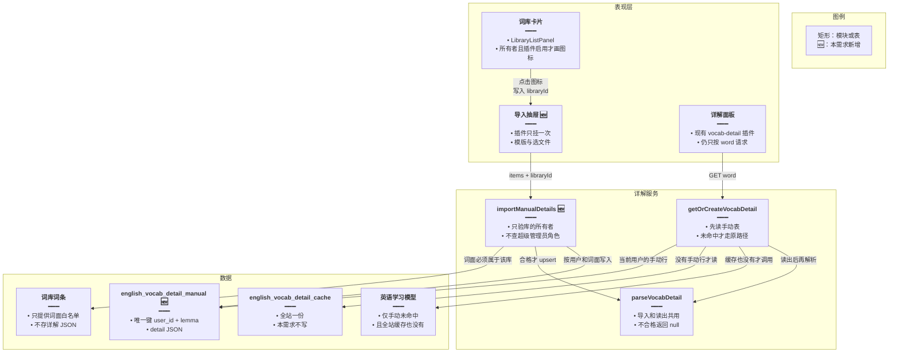
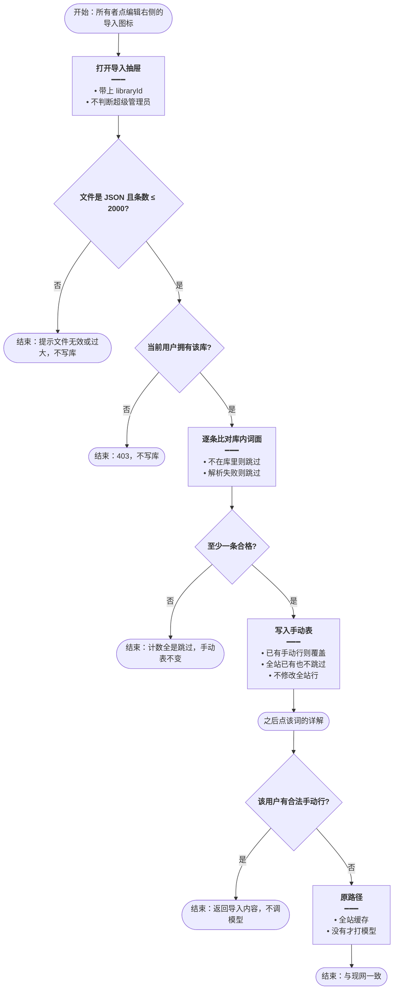
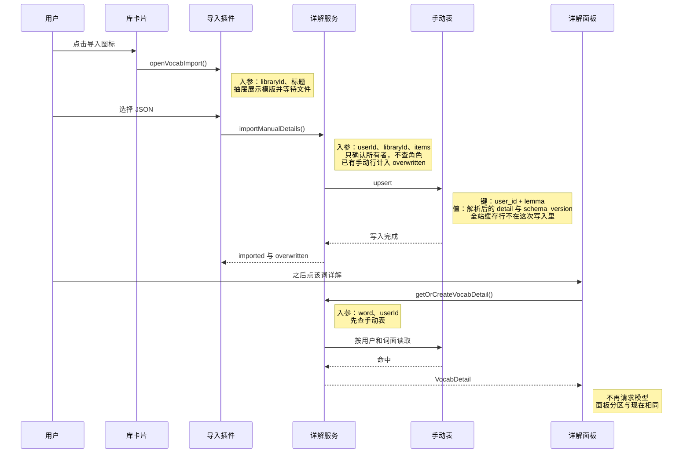

# 手动导入单词详解 — 实现思路

> **状态**：已落地（2026-11-13）。实现细节与逐行代码见 [手动导入单词详解.md](../../english/手动导入单词详解.md)。
> **日期**：2026-11-11
> **需求摘要**：词库所有者把词库导出的 JSON 整份交给外部 agent，让它按批生成可导入的详解；再从词库卡片编辑按钮右侧的插件导入。该用户已有的手动详解被这份文件覆盖，全站模型详解不改、也不因此跳过导入。之后该用户点详解直接返回导入内容，不再调用大模型。入口不按超级管理员隐藏。
> **一句话方案（预告）**：新增「手动导入详解」插件，图标插在单词库卡片编辑按钮右侧，词库所有者启用后即可看见并导入；JSON 按用户 + 规范化词面单独落表；`getOrCreateVocabDetail` 先读这张表，命中则返回，不读全站缓存、不调模型。

## 延伸阅读

- 现成详解抽屉与全站缓存：[单词详解插件.md](./单词详解插件.md)
- 详解列表只列全站缓存、点词复用同一抽屉：[详解词列表.md](./详解词列表.md)
- 同类「外部 JSON 覆盖缓存、允许只导入一部分」：[语句库标注手动导入.md](./语句库标注手动导入.md)
- 抽屉里展示提示词和已导入词、重排操作按钮：[详解导入面板.md](./详解导入面板.md)

---

## 0. 读本文你将得到什么

- 要补的缺口：详解现在只有「全站缓存或当场打模型」两条路，外部写好的详解进不去。
- 选定方案：独立插件负责选文件；详解按账号和词面另存一张表；打开详解时这张表优先于全站缓存和模型。
- 改动落在词库卡片操作区、插件包、详解服务和一张新表。单词卡、抽屉和 `parseVocabDetail` 不另起一套。
- 外部 agent 的输入就是现成的词库导出 JSON（`title` + `items` 里的词、音标、词性、释义、例句）。输出才是带 `detail` 的导入文件。
- 入口跟词库所有者走：启用插件后，编辑按钮右侧就能看见。不按超级管理员隐藏，接口也不查角色。
- 已有详解：全站模型结果不跳过、不覆盖；该用户自己的手动详解由新文件覆盖。
- 分三阶段：先能导入并在点详解时命中；再给抽屉里的整库提示词和失败明细；最后才做「按库清除、改回模型」。
- 最大风险是把词库导出文件本身当成详解导入，或外部 agent 一次写不完导致半截 JSON。前者按条跳过，后者整份拒绝。

---

## 1. 需求与边界

### 1.1 用户故事

| 角色 | 场景 | 行为 | 期望结果 |
|------|------|------|----------|
| 词库所有者 | 已启用导入插件，单词库列表卡片上 | 看编辑按钮右侧 | 多一枚导入图标；未启用时操作区和现在一样。不看是不是超级管理员 |
| 词库所有者 | 已导出词库 JSON（如 `考研英语核心词汇.json`） | 把整份文件和 §9.4 提示词发给外部 agent | agent 按词批量写出带 `detail` 的导入 JSON，词面与文件里的 `word` 一致 |
| 词库所有者 | 点导入图标 | 打开抽屉 | 能复制「整库生成」提示词；选中的是 agent 产出的详解文件，不是词库导出文件 |
| 词库所有者 | 抽屉里选一份详解 JSON | 文件里只有该库的一部分词 | 这些词写入该用户的手动详解；不在这本库里的词跳过并计数；文件没提到的词不动 |
| 词库所有者 | 这个词全站已经有模型详解 | 再导入一份手动详解 | 仍写入该用户的手动行；全站那一行不改；该用户再点详解看到的是导入内容 |
| 词库所有者 | 这个词自己已经导过 | 再导入一份 | 覆盖该用户的手动详解，不跳过 |
| 已登录用户 | 词库单词卡、收藏、错题或详解列表里点「单词详解」 | 这个词有他导入过的详解 | 面板直接展示导入内容，这次请求不调用大模型 |
| 已登录用户 | 同上 | 这个词他没导入过 | 与现在一致：全站缓存命中就返回，否则才打模型 |
| 其他用户 | 点同一个词的详解 | 自己没有手动导入 | 看不到别人的导入，仍走全站缓存或模型 |
| 非所有者 | 看别人的公开词库卡片 | 浏览操作区 | 没有编辑按钮，也没有导入图标；直接调导入接口得到 403 |

### 1.2 范围

| 在范围内 | 不在范围内（非目标） |
|----------|----------------------|
| 单词库列表卡片，编辑按钮右侧的插件图标。所有者启用后即可看见 | 按超级管理员隐藏图标，或在插件中心滤掉这条插件 |
| 导入与按库清除只校验词库所有权 | 接口再拒绝非超级管理员 |
| 入口只在单词库列表卡片 | 语句库卡片、单词包、日推、收藏夹、错题本上的导入入口 |
| 一份详解 JSON 导入该库中已有的若干词 | 用导入去新建词库词条，或改卡片上的音标、短释义、例句 |
| 外部 agent 的输入是词库导出 JSON 整份 | 本系统替用户去调用外部 agent |
| 全站已有模型详解时仍然导入，只影响当前用户 | 因为全站已有详解就跳过；或用导入覆盖全站行 |
| 该用户已有手动详解时，新文件覆盖 | 默认跳过已有手动行（更正一份生成结果会被迫先删除） |
| 文件可以只含该库的一部分词 | 要求文件词数等于库内词数，否则整批失败 |
| 不合格式的单条跳过，并在结果里点名 | 静默丢掉错误却报「全部成功」 |
| 本文给出与 `parseVocabDetail` 一致的字段模版 | 在产品里再做可视化逐字段编辑器 |
| 同一用户的手动行以后一次文件为准；全站模型行不覆盖、也不因此跳过 | M1 就做「按库一键清除、恢复模型生成」（放到 M3） |

### 1.3 约束与依赖

- 必须登录。词库写权限沿用 `assertVocabularyLibraryOwned`：只有所有者能导入。不调用 `userHasSuperAdminRole`。公开库的读者不能往别人的库上挂导入。
- 插件开关沿用插件中心，列表不过滤角色。关掉后图标消失，已经导入的行仍在，详解读取不受开关影响。
- 词面归一与现网一致：`normalizeVocabLemma`（去首尾空白、合并空格、转小写）。超过 120 字的词拒绝，不截断成另一个词。
- 详解正文的合法形状只有 `parseVocabDetail` 这一处。导入和读取都走它，避免「文件能进、面板解析不了」。
- 卡片上的音标、词性、一行中文、原例句仍来自词库行。它们不在详解 JSON 里，模版也不要求外部 agent 填写。
- 详解列表仍只扫全站缓存表。只导入、从未生成过的词不会出现在详解列表里；在词库单词卡上点详解仍然能读到导入内容。
- 不改模型提示词，不改 `VOCAB_DETAIL_CACHE_VERSION` 的含义。手动行自带同一版本号，版本一变就不当作命中。

---

## 2. 背景

- **谁、在什么场景、卡在哪**：词库所有者已经能在外部 agent 里写好词根、记忆、释义和例句，但单词卡上的「单词详解」只会查全站缓存，没有就再打一次英语学习模型。外部写好的内容没有入口。
- **现状缺口**：词库卡片的操作区是练习、导出、编辑、删除，编辑右侧没有插件位。详解服务 `getOrCreateVocabDetail` 只认识全站表 `english_vocab_detail_cache`。词库导出 JSON 只有词、音标、词性、音节、一行中文和一条例句，没有词根和详解；外部 agent 若直接改这份文件，导入端认不出。语句库标注已经能把手动 JSON upsert 进缓存，那张表的列是句内词性标注，不能拿来存详解。全站缓存里一旦有了某个词，若导入因此跳过，用户就无法用外面写好的讲法换掉模型结果。
- **不解决会怎样**：同一批词每次点详解都可能再打模型；用户在外面改好的讲法进不了面板，也压不住模型的不稳定拆词。
- **硬约束**：不能把一个人的导入变成所有人的详解；不能为了导入去改词库词条上的音标和短释义；虚拟列表里不能每张库卡片各加载一份远程模块；点详解的现有抽屉和面板要保持不动。入口是否出现只看插件开关和是不是这本库的所有者。

---

## 3. 现状与复用

| 能力 | 仓库中已有 | 本需求中的用法 |
|------|------------|----------------|
| 词库卡片操作区 | `apps/frontend/src/views/englishLearning/library/components/LibraryListPanel.tsx`，编辑是 `SquarePen`，在删除左边 | 扩展：仅 `kind === 'vocab'` 且 `showEdit` 时，在编辑按钮右侧插入插件图标 |
| 操作区占位宽度 | 同文件 `actionCount` 与 `ROW_HOVER_PR` | 扩展：启用插件时 `actionCount + 1`，避免标题挡住新图标 |
| 单词卡详解图标 | `apps/frontend/src/views/englishLearning/components/vocab/PluginActions.tsx`，表面 `english.vocab.card`、槽 `card-action` | 直接复用这条「宿主画图标、插件画正文」的做法，不在每张库卡片上挂 `PluginHostPage` |
| 词库页已有的抽屉插件 | `library/vocabulary/index.tsx` 的 `PluginHostSurface surface="english.vocab.library"`，槽是 `drawer`（详解列表） | 扩展同一表面的另一个槽 `library-card-action`。列表抽屉插件不会因此出现在卡片上 |
| 详解读取 | `VocabDetailService.getOrCreateVocabDetail` | 扩展：函数开头增加手动表查询；未命中才执行现在的 `leadOrFollow` |
| 详解合法性 | `apps/backend/src/services/english-learning/vocab-detail.parse.ts` 的 `parseVocabDetail` | 直接复用。导入前和读出时都用它 |
| 词面钥匙 | `normalizeVocabLemma` | 直接复用。文件里的 `word`、词库行、手动表、全站缓存用同一把钥匙 |
| 词库所有权 | `EnglishLearningService.assertVocabularyLibraryOwned` | 直接复用。导入接口只接受所有者，不另查超级管理员角色 |
| 词库词条 | `english_vocabulary_library_item.word` | 直接复用为允许导入的词集合。不在这张表上加详解列 |
| 词库导出 JSON | `apps/frontend/src/views/englishLearning/utils/exportVocabulary.ts` 的 `exportVocabularyJson` | 直接复用为外部 agent 的输入。形状是 `{ title, items: [{ word, ipa, pos, segmentation, translationZh, example }] }`。仓库里的 `考研英语核心词汇.json` 就是这一形状的样本 |
| 全站详解缓存 | `english_vocab_detail_cache` | 不写入。只在该用户没有手动行时继续被读取 |
| 插件 HTTP | 宿主 `api.http`，权限 `http:plugin-api` | 直接复用 |
| 语句标注手动导入 | 语句库标注的「部分文件、同 key 覆盖、坏行跳过」 | 复用这个语义，不复用那张表和那个解析器 |
| 详解面板 | `micro-apps/dnhyxc-ai-plugins/src/views/vocab-detail/panel.tsx` | 不改。它仍然只 `GET /english-learning/vocab-detail?word=` |

**调研结论**：图标必须由宿主画在 `LibraryListPanel` 上。正文适合做成新插件的抽屉，而不是塞进每张卡片。详解能不能跳过模型，取决于 `getOrCreateVocabDetail` 的读取顺序，不取决于面板。全站缓存表不能当成个人导入的目的地，否则一份 JSON 会变成所有用户的命中。

---

## 4. 方案比对与最终方案

### 4.1 候选方案

#### 方案 A：新插件 + 按用户和词面另存，读取优先于全站缓存（新增表，扩展现有读取）

- **做法**：registry 增加插件 `vocabDetailImport`，`host.surface = "english.vocab.library"`，`host.slot = "library-card-action"`。`LibraryListPanel` 在编辑按钮后渲染一枚本地图标，点击把 `{ libraryId, title }` 写进模块会话并打开抽屉。抽屉里的插件提供模版复制和选文件，`POST /english-learning/vocab-detail/import`。服务确认库属于当前用户，只接受库内已有词，`parseVocabDetail` 通过后 upsert 到新表 `english_vocab_detail_manual`，唯一键是 `(user_id, lemma)`。`getOrCreateVocabDetail` 先查这张表，解析成功就返回；否则保持现在的全站缓存和模型路径。
- **能工作的原因**：点详解的所有入口最终都进这一个函数，所以词库单词卡、收藏、错题和详解列表不用各自判断。别人的账号查不到这张表里的行。
- **主要代价**：多一张表，多一次按用户的查询。同一用户在两个库里给同一个词导入不同内容时，后一次覆盖前一次。

#### 方案 B：不新建表，导入直接 upsert 全站缓存（复用现有命中）

- **做法**：插件和选文件与方案 A 相同。服务把解析后的 JSON 用现有 `cache_key` upsert 进 `english_vocab_detail_cache`。`getOrCreateVocabDetail` 不改，缓存命中自然不会打模型。
- **能工作的原因**：今天的读取路径已经是「有缓存就不打模型」。导入只是换了一个写入方。
- **主要代价**：这张表按词全局共享，没有 `user_id`。用户 A 的导入会变成用户 B 的详解；详解列表也会列出这份个人内容。要恢复模型生成，只能删掉这行，连别人的命中一起删。

#### 方案 C：详解 JSON 写在词库词条上，打开时带上词条 id（扩展词库行和卡片快照）

- **做法**：`english_vocabulary_library_item` 增加可空列 `manual_detail`。导入按库内词条逐行更新。单词卡快照增加 `libraryItemId`，`GET /english-learning/vocab-detail` 增加这个查询参数。有词条 id 且列里有合法 JSON 就返回，否则走全站缓存和模型。
- **能工作的原因**：详解严格跟在「这一库的这一行」上，两个库可以给同一个词面存两份不同详解。
- **主要代价**：收藏、错题、日推和详解列表打开时没有词条 id，这些入口仍然打模型，完不成「点详解就不用模型」。词库行会带上一大段与背单词无关的 JSON。

### 4.2 比对

| 维度 | 方案 A | 方案 B | 方案 C |
|------|--------|--------|--------|
| 正确性（失败路径、边界、数据是否会错） | 坏 JSON 在导入时跳过，读出时再解析一次，坏行不当命中。其他用户不受影响 | 坏 JSON 若写进全站表，所有用户的下一次打开都会中招。个人内容变成公共命中 | 带词条 id 的打开是对的。没有词条 id 的打开仍打模型，和「已导入就不要模型」矛盾 |
| 复用 / 与现状契合 | 复用 `parseVocabDetail`、`normalizeVocabLemma`、所有权校验、宿主画图标。新表的形状对照全站缓存，但不写那张表 | 最大化复用读取路径，零改 `getOrCreateVocabDetail` | 复用词库行更新。卡片快照、详情列表、收藏入口都要改，和「面板不改」相反 |
| 改动面（要动哪些路径） | 库卡片操作区、新插件、一个导入接口、`getOrCreateVocabDetail` 开头、一张表 | 库卡片、新插件、导入接口、全站表的写入。读取函数不动 | 词库实体与迁移、卡片快照、详情查询参数、五个打开详解的入口 |
| 复杂度（新概念、新状态、新依赖） | 一张用户级表，外加「当前要导入哪一个库」的模块会话 | 没有新表。要在全站行上区分「模型写的」和「某人导入的」，现有列做不到 | 词条列 + 快照字段 + 查询参数。同一词面多行时要决定写哪一行 |
| 体验（延迟、步骤数、失败时用户看到什么） | 点详解仍是一次 GET。导入结束用计数说明成功、不在库里、格式不对。未启用插件时界面不变 | 点详解一样快。用户看不出自己的内容已经覆盖了别人，出错面更大 | 从本库单词卡打开是对的。从详解列表打开仍要等模型，体验分裂 |
| 风险（迁移、互斥、并发、回滚） | 新表可整表丢掉以回滚。模型正在生成时导入也不写全站行，下一次读取仍以手动为准 | 回滚要删全站行，可能删掉别人已经在用的模型结果。并发导入互相覆盖全局行 | 迁移给大表加 JSON 列。删库会级联丢掉详解，收藏入口却还在 |
| 可维护性（以后改一处还是改多处） | 合法形状只维护 `parseVocabDetail`。跳过模型只维护读取函数开头 | 写入方变成两个，以后改缓存版本要同时记住模型 upsert 和导入 upsert | 每个新的详解入口都要记得把词条 id 传进去 |

### 4.3 综合考量

权重在两件事上：导入不能污染别人的详解，以及现有任何一个详解入口都要能跳过模型。这两条来自 §1 的非目标和 §3 里「所有入口都进 `getOrCreateVocabDetail`」。

方案 A 同时满足这两条。方案 B 少一张表、读取函数一行都不用改，这是它真实的优点；放弃它，是因为全站表没有用户维度，一份导入会变成所有人的命中，也让详解列表混进个人内容。方案 C 能让两个库对同一个词各存一份，这是它真实的优点；放弃它，是因为详解列表和收藏打开时没有词条 id，那些点击仍然打模型，主路径是断的。

因此同一用户在两个库里对同一个词各导一次时，后一次覆盖前一次。这个限制换来的是所有入口行为一致。

### 4.4 最终方案

#### 背景

详解的合法 JSON、词面钥匙和「点图标打开抽屉」都已经有了。缺的是一条只属于当前用户的写入，以及读取时把它排在全站缓存和模型前面。词库卡片的编辑按钮右侧还没有插件槽。导入必须先证明这个词属于这一本库，但不能把 JSON 写进词条，也不能写进全站缓存。

#### 具体思路

1. 宿主画图标，插件画导入抽屉。单词详解插件继续只负责展示。两个插件分开开关。
2. 文件从抽屉进 `POST /english-learning/vocab-detail/import`。服务用库内词条做白名单，用 `parseVocabDetail` 做合法性，结果写入 `english_vocab_detail_manual`。
3. 「现在正在给哪一个库导入」放在联邦模块会话里，只活在词库页。不进 URL，也不进英语学习的业务 store。详解正文的优先顺序放在服务端，不放在面板的 `useState` 里，这样收藏和详解列表不用改。
4. 整份文件不是 JSON 就拒绝。单条不在库里或解析失败就跳过，其余继续。同一词重复出现时以后一条为准。手动行解析失败时不当作命中，落到原来的缓存和模型，避免面板打不开。

#### 实现方案

**一句话**：新增「手动导入详解」插件，图标插在单词库卡片编辑按钮右侧；JSON 按用户 + 规范化词面单独落表；`getOrCreateVocabDetail` 先读这张表，命中则返回，不读全站缓存、不调模型。

| 步骤 | 谁 | 做什么 | 输入 → 输出 |
|------|----|--------|-------------|
| 1 | `LibraryListPanel` | 所有者且插件启用时，在编辑按钮右侧放图标；点击写入导入会话并打开抽屉 | 库 id、库标题 → 会话 |
| 2 | 导入插件抽屉 | 复制整库提示词，选择 agent 产出的 JSON 并提交 | 文件 → `{ libraryId, items }` |
| 3 | `POST .../vocab-detail/import` | 校验所有权，不查角色。按词面匹配库内词，解析后写入。全站已有详解不跳过；该用户已有手动行则覆盖 | items → `{ imported, overwritten, skippedNotInLibrary, skippedInvalid }` |
| 4 | `getOrCreateVocabDetail` | 先读手动表；没有或解析失败才走现有 `leadOrFollow` | `word + userId` → `VocabDetail` |
| 5 | 现有详解面板 | 不改，仍 GET 原来的接口 | `word` → 面板分区 |

#### 选定原因

1. **正确性**：手动行只按 `user_id` 命中，坏 JSON 不进入全站表。牺牲：同一用户对同一词只能留一份，不能按库分叉。
2. **复用**：合法形状、词面、所有权和抽屉加载都用现成的。牺牲：多一次用户级查询，不能零改读取函数。
3. **体验**：所有详解入口同一次 GET 就结束，导入结果用三条计数说清楚。牺牲：只导入、从未进过全站缓存的词不会出现在详解列表。
4. **风险**：回滚是停用插件并留下或清空新表，不动全站缓存。牺牲：清除「改回模型」要另做删除，不放在 M1。
5. **可维护性**：跳过模型只有读取函数开头一处。牺牲：导入插件和详解插件是两个 registry 条目，要分别开关。

#### 优势

- 相对方案 B：个人 JSON 不会变成别人的详解，也不会出现在所有人的详解列表里；恢复模型生成时不必删除全站行。
- 相对方案 C：收藏、错题、日推和详解列表都不用改快照，点详解一样能命中导入内容。

#### 怎么实现

1. registry 注册 `vocabDetailImport`，表面 `english.vocab.library`，槽 `library-card-action`。`LibraryListPanel` 在所有者且插件启用时，把图标插在编辑和删除之间，并给 `actionCount` 加 1。不调用 `useIsSuperAdmin`。
2. 点击调用 `openVocabImport({ libraryId, title })`。词库页抽屉里只挂一次 `PluginHostPage`。插件用 `getTarget()` 读当前库。
3. 导入接口加载该库全部词面做成集合，逐条 `normalizeVocabLemma` 后决定写入、跳过或不合法。不查询全站缓存来决定跳过。该用户已有手动行则计入 `overwritten` 并覆盖；没有则计入 `imported`。`detail` 存解析后的对象，`schema_version` 用现有 `VOCAB_DETAIL_CACHE_VERSION`。
4. `getOrCreateVocabDetail` 在拿进程内 Promise 和 Redis 锁之前查手动表。命中且 `parseVocabDetail` 成功则直接返回。
5. 面板、全站缓存和模型路径保持不动。主要代码见 §9.2。

### 4.5 其他关键决策

#### 决策：一份文件是否必须覆盖整库

##### 候选

###### 方案 P：允许部分词（与语句标注导入相同）

- **做法**：文件里有的、且属于该库的词才 upsert。没出现在文件里的词不删除手动行，也不触发模型。不在库里的词计入 `skippedNotInLibrary`。
- **能工作的原因**：外部 agent 通常按批生成。库有几千词时可以分多个文件。
- **主要代价**：用户看不出「这一库还有哪些词没导过」，M1 不提供对照清单。

###### 方案 Q：文件必须包含该库每一个词，否则整批拒绝

- **做法**：先比词集合，少一个就 400，不写任何行。
- **能工作的原因**：一次成功就表示这一库全部有了手动详解。
- **主要代价**：大库和分批生成都做不到。一个词格式错误会让已经写好的其他词也进不来。

##### 比对

| 维度 | 方案 P | 方案 Q |
|------|--------|--------|
| 正确性 | 坏词跳过，好词落库。重复导入同一词以后一条为准 | 要么全对要么全不写。一个坏词会挡住整库 |
| 复用 | 与语句标注「部分文件、同 key 覆盖、文件外保留」一致 | 与现有导入语义相反，要新做集合相等判断 |
| 改动面 | 导入循环里的三类计数 | 还要先拉全库词面做差集，并定义整批回滚 |
| 复杂度 | 无新状态 | 多一个「必须全集」的事务边界 |
| 体验 | 分批文件能成功，结果里能看到跳过了谁 | 大库几乎无法一次成功 |
| 风险 | 用户可能以为没出现的词也被覆盖了 | 大请求失败率高，重试成本大 |
| 可维护性 | 计数规则只有一处 | 全集规则要和库的增删保持同步 |

##### 综合考量

权重大的是「外部按批生成」和「一条坏数据不要毁掉整份文件」。方案 Q 的优点是成功即表示整库覆盖，这个优点抵不过大库和分批根本导不进去。选定方案 P。文件没提到的词保持原状，这个差异要写在抽屉说明里，避免用户以为导入会清空未提及的词。

##### 最终方案

**背景**：库可以很大，外部 agent 一次往往只生成一部分。解析器对单条是失败即 null，不应该升级成整批失败。

**具体思路**：白名单是这一库的词面集合。文件是这个集合的子集。子集之外的手动行不删。

**实现方案**：导入循环对合格词给出 `imported` 或 `overwritten`，其余给出 `skippedNotInLibrary` 或 `skippedInvalid`。单次最多 2000 条，超出直接 400，请用户拆文件。

**选定原因**：正确性上坏条不连坐，体验上分批文件能用。牺牲：M1 没有「这一库还缺哪些词」的清单。

**优势**：相对方案 Q，几千词的库可以拆开导，一个词写错不会让其他词重传。

**怎么实现**：见 §9.2 的 `importManualDetails`。抽屉文案写明「文件里没有的词保持原样」。

#### 决策：库里已经有详解时，导入是覆盖还是跳过

这里的「已经有」要拆开。全站表 `english_vocab_detail_cache` 是模型写的、所有用户共用。手动表是该用户自己的上一份导入。两处已有，处理不一样。

##### 候选

###### 方案 S：两处已有都跳过

- **做法**：导入前先查全站缓存和该用户的手动行。任一存在就计入 `skippedExists`，不写。
- **能工作的原因**：已经点开过的词不会被一份新文件改掉，误选旧文件时比较安全。
- **主要代价**：用户导出整库交给外部 agent，就是为了换掉模型讲法。凡是别人或自己点开过的词都会被跳过，整库导入接近空操作。已有手动行要改一个错字，也必须先走 M3 删除。

###### 方案 O：一律覆盖全站行和手动行

- **做法**：解析通过就 upsert 全站 `cache_key`，同时写手动表。
- **能工作的原因**：任何人再点这个词都看到导入内容，不会再打模型。
- **主要代价**：这就是 §4 已放弃的方案 B。一个人的文件变成所有人的详解，详解列表也会换成这份内容。

###### 方案 K：全站行不碰；该用户的手动行覆盖（扩展现有读取顺序）

- **做法**：导入不读全站表。该用户没有手动行就插入，已有就覆盖，并在计数里分开。读取仍然是手动表优先，所以该用户下次不再命中全站模型结果，但那一行还在，其他用户和 M3 清除之后的回退都用得上。
- **能工作的原因**：导入的目的就是让这位用户用外部讲法，而不是保护模型已经生成的文本。同一份文件再导一次，内容相同，覆盖是幂等的。
- **主要代价**：不小心导入一份更差的文件，会盖住上一份手动详解。恢复要靠 M3 删掉手动行，之后才回到全站缓存。

##### 比对

| 维度 | 方案 S | 方案 O | 方案 K |
|------|--------|--------|--------|
| 正确性 | 模型结果和旧手动行都不会被坏文件改掉。但「已导入」和「用户实际看到的」会不一致：全站有行时导入成功计数是 0，面板仍是模型文本 | 文件内容会变成所有人的正文。坏文件污染全站 | 该用户看到的就是这份文件。全站行保持模型结果，其他用户不变 |
| 复用 | 要在导入路径上再查两张表，和「读取时才决定优先顺序」重复 | 复用全站 upsert，手动表变得多余 | 复用 §4.4 的手动表优先。导入只写这一张表 |
| 改动面 | 导入循环加两次存在性查询和一类跳过计数 | 写全站表，和 §4 选定的「不写全站」相反 | 导入循环区分插入和覆盖两个计数 |
| 复杂度 | 多一个「存在就跳过」的规则，用户要理解为什么词在文件里却没生效 | 全站来源变成模型和导入两套，还要决定谁最后写入 | 规则是一句：手动行以最新一份文件为准，全站行不参与导入 |
| 体验 | 整库生成后再导入，大量词显示跳过，用户会以为失败 | 导入立刻对所有人生效，无法只给自己换讲法 | 计数写明新增多少、覆盖多少。再点详解就是新内容 |
| 风险 | 低风险，也低效用。外部重跑一批来修正错误时全部被跳过 | 误导入无法只撤回自己，还会带走别人的模型命中 | 误覆盖只影响自己的手动行。M3 删除后回到全站缓存 |
| 可维护性 | 跳过条件以后会和读取优先顺序打架 | 两个写入方都要记得缓存版本 | 写入方只有导入，读取优先顺序不用再加分支 |

##### 综合考量

权重在「整库文件是用户有意换上的正文」和「不能改别人的详解」。方案 S 保护旧数据，这是它真实的优点；放弃它，是因为全站只要有过一次模型生成，这次导入就看不到效果，和把整份词库交给外部 agent 的用法相反。方案 O 让所有入口都不用模型，这是它真实的优点；放弃它，是因为全站行没有用户维度。选定方案 K：全站已有详解不构成跳过，也不被覆盖；该用户已有手动详解则覆盖。

##### 最终方案

**背景**：点过详解的词已经在全站表里。用户仍把整库 JSON 交给外部 agent，期望导入后自己看到的是那份生成结果。同时上一份手动导入可能是试错，下一份文件就是修正。

**具体思路**：导入路径不查询 `english_vocab_detail_cache`。只看 `(user_id, lemma)` 的手动行是否已存在，用来区分计数，不用来拒绝写入。文件内同一词面出现多次时，只保留最后一条合格记录，避免先插入再覆盖被算成两次。

**实现方案**：返回 `imported`（新手动行）、`overwritten`（盖住该用户旧手动行）、`skippedNotInLibrary`、`skippedInvalid`。抽屉写明「已有手动详解会被这份文件替换；全站已有的模型详解不会被改掉，但你自己再打开时优先用这份」。

**选定原因**：正确性上其他用户的模型结果还在；体验上整库重导能够生效。牺牲：误选旧文件会盖住自己上一份手动详解，不能靠「已存在就跳过」来防手滑。

**优势**：相对方案 S，已经生成过模型详解的词仍然能换上外部讲法。相对方案 O，不会把这份 JSON 写成所有人的缓存。

**怎么实现**：见 §9.2 的 `manualWriteAction`。同一请求里先按词面折叠成最后一条，再查该用户是否已有手动行。

##### 导入时还要守住的边界

这些边界都落在方案 K 和方案 P 上，不另开存储。

| 边界 | 处理 |
|------|------|
| 用户把词库导出 JSON 直接拿来导入（只有 `word` / `ipa` / `pos` / `segmentation` / `translationZh` / `example`，没有 `detail`） | 每条 `skippedInvalid`。不把音标或例句当成详解正文 |
| 文件里的 `title` 和当前库标题不一致 | 忽略 `title`。白名单只看这次点击的 `libraryId` |
| 词库里的 `pos` 是 `v.` 或 `adj./n./v.`，`ipa` 带斜杠，`segmentation` 为空 | 这些只作为外部 agent 的上下文。`detail` 里不写音标和音节。`senses[].pos` 仍是不超过 32 字的短标签 |
| 超长字段 | `parseVocabDetail` 按现有上限截断。截完仍为空才算 `skippedInvalid` |
| 同一文件里同一词面出现两次 | 只保留最后一条合格记录，计数一次 |
| 词不在当前库 | `skippedNotInLibrary`。不会因为文件里有这个词就新建词条 |
| 超过 2000 条，或整份不是 JSON | 整批 400 或 400，一行都不写 |
| 外部 agent 上下文不够，只完成一部分，但输出的 JSON 是完整的 | 按方案 P 部分导入 |
| 外部 agent 把 JSON 截断在半个对象 | 整份拒绝 |
| 全站正在为这个词调模型 | 不取消那次调用。它写完也只进全站表。该用户下一次读取仍先看手动表 |
| 别的用户已有手动行或全站行 | 不读、不写 |
| 调用者不是这本库的所有者 | 403。不按超级管理员再拦一层 |

#### 决策：谁能看见并操作导入

##### 候选

###### 方案 U：启用了插件的词库所有者都能导入（本文原先的入口）

- **做法**：`showEdit` 为真且插件启用就在编辑右侧画图标。接口只调 `assertVocabularyLibraryOwned`。
- **能工作的原因**：所有者和编辑按钮同一条件，公开库读者本来就看不见编辑，也就看不见导入。
- **主要代价**：不按角色区分。任一所有者启用插件后都能看见并写入自己的手动详解。

###### 方案 F：只在前端用 `useIsSuperAdmin` 藏图标

- **做法**：`LibraryListPanel` 在 `showEdit && isSuperAdmin` 时才画图标，`actionCount` 也只在这时加 1。接口仍只校验库的所有者。
- **能工作的原因**：页面上看不到按钮，普通用户的操作区宽度不变。
- **主要代价**：导入地址仍然接受普通所有者的请求。藏按钮挡不住直接调用。

###### 方案 N：前端藏入口，接口再验超级管理员，并且仍要是库的所有者（扩展现有角色判定）

- **做法**：卡片图标和插件中心列表都用 `useIsSuperAdmin` 滤掉 `vocabDetailImport`。`importManualDetails` 和 M3 的删除先调 `userHasSuperAdminRole`，失败抛 `ForbiddenException`，通过后再 `assertVocabularyLibraryOwned`。读取顺序不变：手动行仍只属于导入的那个账号。普通用户点详解继续走全站缓存或模型。
- **能工作的原因**：角色判定前后端已经存在，日推设置和上传 registry 都是「页面按角色分支，接口再查一次角色」。
- **主要代价**：超级管理员导入的内容不会变成普通用户的详解。普通用户打开同一个词仍然可能打模型。

##### 比对

| 维度 | 方案 U | 方案 F | 方案 N |
|------|--------|--------|--------|
| 正确性 | 所有者能看见并写入自己的手动行。非所有者 403。不看角色 | 界面按角色隐藏，但同一接口对普通所有者返回 200 | 非超级管理员看不见，直接调接口也是 403 |
| 复用 | 只复用词库所有权 | 复用 `useIsSuperAdmin`，接口没复用 `userHasSuperAdminRole` | 两个现成判定都用。不新做插件权限字段 |
| 改动面 | 卡片和接口都不看角色 | 只改 `LibraryListPanel` 的显示条件 | 卡片、插件列表、导入接口、M3 删除各加一次角色判断 |
| 复杂度 | 无角色概念 | 多一个只存在于界面的条件，和接口不一致 | 条件是一句：超级管理员，且是这本库的所有者 |
| 体验 | 普通所有者也看见图标 | 普通用户看不到图标。若用脚本调用，会导入成功，和界面说明相反 | 非管理员的卡片和插件中心都没有这条。管理员自己的库上才有图标 |
| 风险 | 任何所有者都能写入 | 前端本地角色可以被绕过 | 角色存在数据库里，接口以服务端查询为准。本地改 `localStorage` 只能骗过图标 |
| 可维护性 | 以后要收紧权限得再改入口和接口 | 两处规则会分叉 | 写入和删除共用同一次角色判断；读取函数不加角色分支 |

##### 综合考量

「只有超级管理员才能看见」这条已取消。权重回到「谁拥有这本库，谁就能导入自己的详解」。方案 N 把入口和接口都收在角色上，这是它真实的优点；放弃它，是因为普通所有者也要看见这个图标，并完成导入。方案 F 少改接口，这是它真实的优点；放弃它，是因为图标仍按角色隐藏，和取消后的要求相反。选定方案 U。公开库读者仍然看不见，因为编辑按钮本身只给所有者。

##### 最终方案

**背景**：导入写的是当前账号自己的手动详解。限制应落在「是不是这本库的所有者」，而不是超级管理员角色。`useIsSuperAdmin` 和 `userHasSuperAdminRole` 继续给定时日推、插件 registry 使用，本功能不调用它们。

**具体思路**：看见和写入用同一条所有权。`showEdit` 已经表示当前用户拥有这本库。插件启用后才在编辑右侧加图标。接口只调 `assertVocabularyLibraryOwned`，角色通过与否都不改变结果。

**实现方案**：`LibraryListPanel` 在 `showEdit && 插件启用` 时把图标插在编辑和删除之间，并给 `actionCount` 加 1。插件中心按现有列表展示，不按角色过滤 `vocabDetailImport`。导入和 M3 删除都只校验库的所有者。

**选定原因**：正确性上所有者看见图标就能导入，非所有者 403。复用上不把日推那套角色判断搬进来。牺牲：不能再用角色把这个入口藏起来。

**优势**：相对方案 N，普通词库所有者不用变成超级管理员也能导入。相对方案 F，页面上的图标和接口接受的人是同一批所有者。

**怎么实现**：卡片条件见 §9.1。接口开头见 §9.2 的 `importManualDetails`，其中没有角色判断。

---

## 5. 架构图



**图内方法说明**：

| 方法 | 功能 |
|------|------|
| `importManualDetails(userId, libraryId, items)` | 确认库属于该用户，只接受库内词，解析通过后按 `(user_id, lemma)` upsert。不查角色。谁调用：导入插件提交文件时 |
| `getOrCreateVocabDetail(word, userId)` | 生成或返回一份详解。本需求在原逻辑前先查手动表，命中则不再读全站缓存、不调模型 |
| `parseVocabDetail(raw, lemma)` | 把任意 JSON 收成法定 `VocabDetail`；缺必填栏目返回 null。导入写入前和手动行读出时各用一次 |
| `normalizeVocabLemma(word)` | 得到词面钥匙。文件、词库行和两张详解表用同一结果比对 |

**读图要点**：

- 导入抽屉和详解面板是两个插件，中间不直接调用。它们只通过手动表衔接。
- 全站缓存和模型仍在读取函数的后半段，导入路径不碰它们。
- 词库词条只回答「这个词在不在这本库」，不保存详解正文。

---

## 6. 主流程图



**图内方法说明**：

| 方法 | 功能 |
|------|------|
| `openVocabImport(libraryId, title)` | 宿主在点击图标时写下当前库。抽屉插件用 `getTarget()` 读取，避免把库 id 只放在按钮闭包里 |
| `importManualDetails(...)` | 执行上图「逐条比对」和「写入手动表」。返回新增、覆盖、不在库中、格式不对四类计数 |
| `getOrCreateVocabDetail(...)` | 执行「有合法手动行就返回」。没有则进入原来的 `leadOrFollow` |
| `parseVocabDetail(...)` | 决定这一条能不能写。能写时再看手动行是否已存在，分成 `imported` 或 `overwritten`；不能写则是 `skippedInvalid` |

**读图要点**：

- 未启用插件时图标不出现，操作区宽度与现在一致。所有者不因角色被藏起来。
- 文件级错误（不是 JSON、超过 2000 条、不是所有者）整批不写。
- 词级错误只跳过该词。一条合格就写一条。
- 点详解时的分支在服务端，面板没有「这是导入的」特殊状态。

---

## 7. 核心时序图



**图内方法说明**：

| 方法 | 功能 |
|------|------|
| `openVocabImport()` | 把当前库放进模块会话并打开只挂一次的导入抽屉 |
| `importManualDetails()` | 校验、白名单、解析后写入手动表。全站已有详解不跳过；该用户已有手动行计入覆盖。不调用模型，不写全站缓存 |
| `upsert` | 同一用户同一词面已有行则覆盖 `detail` 和 `updated_at`，没有则插入 |
| `getOrCreateVocabDetail()` | 详解面板唯一的读取入口。手动命中时在加锁和调模型之前返回 |

**读图要点**：

- 导入和后来的点详解是两次独立请求。抽屉关掉不影响已经写入的行。
- 第二次请求的面板仍是现有详解插件，它不知道数据来自手动表。
- 未命中手动表时，这条时序在 `getOrCreateVocabDetail` 之后接上现有的缓存和模型，图中不再展开。

---

## 8. 状态机

导入抽屉本身没有播放或编辑那种模式切换。读取侧只有「手动命中 / 落到原路径」一个分支，已画在 §6，不再单画状态图。

---

## 9. 具体实现（主链路代码）

### 9.1 模块一览

| 模块 | 职责 | 新增/改动 | 预估路径 |
|------|------|-----------|----------|
| 库卡片图标 | 所有者且插件启用时，放在编辑右侧，并维护 `actionCount` | 扩展 | `apps/frontend/src/views/englishLearning/library/components/LibraryListPanel.tsx` |
| 导入会话 | 当前库 id 与标题 | 新增 | `apps/frontend/src/federation/modules/vocabDetailImport/session.ts` |
| 模块桥 | `getTarget` / `subscribe` | 扩展 | `apps/frontend/src/federation/runtime/index.ts` 的 `buildModules` |
| 导入插件 | 模版、选文件、结果计数 | 新增 | `micro-apps/dnhyxc-ai-plugins/src/views/vocab-detail-import/` |
| 导入接口 | 所有权、白名单、upsert | 新增 | `english-learning.controller.ts` 增加 `POST vocab-detail/import` |
| 读取顺序 | 手动表优先 | 扩展 | `vocab-detail.service.ts` 的 `getOrCreateVocabDetail` |
| 手动表 | 用户 + 词面的 JSON | 新增 | `entity/english-vocab-detail-manual.entity.ts` 与一条 migration |
| 解析器 | 法定字段 | 不改 | `vocab-detail.parse.ts` |

### 9.2 主链路实现

```typescript
// 对应 §4.4 步骤 4。在进程内 Promise 和 Redis 锁之前返回，避免导入后仍排队打模型
async function getOrCreateVocabDetail(word: string, userId: number): Promise<VocabDetail> {
	// 与词库词条、全站缓存使用同一词面，避免大小写各存一行
	const lemma = normalizeVocabLemma(word);
	// 空词面不再查表，也不把空钥匙送进模型
	if (!lemma) throw new BadRequestException('单词为空');
	// 只认当前栏目版本；提示词或字段一变，旧手动行就让路给原来的缓存和模型
	const manual = await this.manualRepo.findOne({
		where: {
			// 手动详解只对导入的那个账号可见
			userId,
			// 规范化后的词面，和导入时写入的键相同
			lemma,
			// 与 parseVocabDetail 的栏目版本对齐，过期行不当命中
			schemaVersion: VOCAB_DETAIL_CACHE_VERSION,
		},
	});
	// 读出后再解析，防止库里的 JSON 被改坏后仍返回给面板
	const parsed = manual ? parseVocabDetail(manual.detail, lemma) : null;
	// 命中则到此为止，不读全站缓存，不加生成锁
	if (parsed) return parsed;
	// 没有可用的手动详解时，保持今天的全站缓存和模型路径
	return this.leadOrFollow(lemma, userId, cacheKeyOf(lemma));
}
```

```typescript
// 对应 §4.4 步骤 3 与方案 K。不查询全站缓存，单条失败不连坐
async function importManualDetails(
	// 当前登录用户，手动行只属于这个账号
	userId: number,
	// 这次点击的词库，只用来做词面白名单，不写入手动表
	libraryId: string,
	// 外部 agent 产出的条目；词库导出文件没有 detail，会在循环里被跳过
	items: { word: string; detail: unknown }[],
): Promise<{
	// 这次新插入的手动行数，和全站是否已有模型详解无关
	imported: number;
	// 盖住该用户旧手动行的条数，同一份文件再导一次也走这里
	overwritten: number;
	// 词面为空或不属于这次点击的那本库
	skippedNotInLibrary: number;
	// 没有 detail，或 parseVocabDetail 不接受
	skippedInvalid: number;
}> {
	// 超过 2000 条直接拒绝，大库拆成多个文件，避免一次事务拖住词库
	if (items.length > 2000) throw new BadRequestException('一次最多导入 2000 条');
	// 只认库的所有者，不查超级管理员角色
	await this.englishLearningService.assertVocabularyLibraryOwned(userId, libraryId);
	// 白名单只用规范化词面，展示用的大小写以文件里的 word 为准去归一
	const allowed = new Set(await this.lemmasInLibrary(libraryId));
	// 同一词面只留最后一条合格记录，避免先插入再覆盖被算成两次
	const latest = new Map<string, VocabDetail>();
	// 词面为空或不在这本库，按文件原始条数累加
	let skippedNotInLibrary = 0;
	// 没有 detail 或解析失败，同样按原始条数累加
	let skippedInvalid = 0;
	// 先折叠再写库，重复词面不会打两次 upsert
	for (const item of items) {
		// 与读取、全站缓存同一把钥匙
		const lemma = normalizeVocabLemma(item.word);
		// 空词面或这本库里没有的词不写入，避免导入变成「往账号塞任意词」
		if (!lemma || !allowed.has(lemma)) {
			skippedNotInLibrary += 1;
			continue;
		}
		// 词库导出 JSON 没有 detail，这里会得到 null，整条计入格式不对
		const detail = parseVocabDetail(item.detail, lemma);
		if (!detail) {
			skippedInvalid += 1;
			continue;
		}
		// 后一条合格记录替换前一条，文件外的词不会进这张表
		latest.set(lemma, detail);
	}
	// 一条合格都没有时不查手动表，避免 In 空数组打出无效 SQL
	if (latest.size === 0) {
		// 四个计数都返回，抽屉仍能显示跳过了多少
		return { imported: 0, overwritten: 0, skippedNotInLibrary, skippedInvalid };
	}
	// 只为了区分新增和覆盖，不因为已存在而拒绝写入
	const had = new Set(
		(
			await this.manualRepo.find({
				// 只看当前用户，别人的手动行不参与计数
				where: { userId, lemma: In([...latest.keys()]) },
				// 不把已有 JSON 读出来，这次判断只需要词面
				select: { lemma: true },
			})
		// 收成词面集合，后面只用来选择计数桶
		).map((row) => row.lemma),
	);
	// 这次新出现的手动行
	let imported = 0;
	// 这次盖住的旧手动行
	let overwritten = 0;
	// 每个词面只写一次；全站表不在这个循环里
	for (const [lemma, detail] of latest) {
		// 唯一键是用户加词面；已有行更新 detail
		await this.manualRepo.upsert(
			{
				// 行的归属，读取时必须同一 userId 才命中
				userId,
				// 词面钥匙
				lemma,
				// 写入时的栏目版本，以后版本升级会让这行自然失效
				schemaVersion: VOCAB_DETAIL_CACHE_VERSION,
				// 解析后的对象，不保留词库导出里的音标和短释义
				detail,
			},
			// 冲突键与表的唯一约束一致，命中则更新而不是再插一行
			['userId', 'lemma'],
		);
		// 已有手动行算覆盖，没有才算新增
		if (had.has(lemma)) overwritten += 1;
		// 没有旧行时计入新增，全站缓存里有没有这个词都不影响这里
		else imported += 1;
	}
	return { imported, overwritten, skippedNotInLibrary, skippedInvalid };
}
```

### 9.3 数据模型

| 字段 | 来源 | 存储 | 说明 |
|------|------|------|------|
| `user_id` | 登录账号 | `english_vocab_detail_manual` | 与 `lemma` 组成唯一键 |
| `lemma` | `normalizeVocabLemma(word)` | 同表，`varchar(120)` | 不保留文件里的原始大小写 |
| `schema_version` | `VOCAB_DETAIL_CACHE_VERSION`（现为 `v1`） | 同表 | 与全站缓存同一个版本常量 |
| `detail` | `parseVocabDetail` 的返回值 | JSON 列 | 不含音标和词库短释义 |
| `libraryId` | 不入库 | — | 只在导入请求里用来做白名单。清除某一库时按该库现有词面删除，不靠列 |
| 全站 `cache_key` | 不使用 | `english_vocab_detail_cache` | 本需求不写这张表 |

### 9.4 外部 agent 用的字段模版

生成结果保存为 JSON 后，从词库卡片的导入插件选中该文件。不要选词库导出文件本身。

约束与 `parseVocabDetail` 一致。多出来的字段会被忽略。缺了必填字段的那一条会被跳过，不会写入。

| 字段 | 必填 | 限制 |
|------|------|------|
| `word` | 是 | 必须是这本词库里已有的词。服务端会去空白、合并空格、转小写。超过 120 字的词整条跳过 |
| `detail.morphology.parts` | 是 | 1 到 8 段。每段要有 `form`（不超过 80 字）、`kind`、`meaningZh`（不超过 500 字）。`kind` 只能是 `prefix`、`root`、`suffix`、`base`。拆不开时只给一段 `kind` 为 `base` 的整词 |
| `detail.morphology.storyZh` | 可空字符串 | 不超过 500 字。没有就写 `""` |
| `detail.memory.hookZh` | 是 | 一句中文记忆，不超过 500 字，不能是空字符串 |
| `detail.senses` | 是 | 1 到 6 条。每条 `pos`（不超过 32 字）和 `glossZh`（不超过 500 字）必填。`nuanceZh` 没有差别就写 `""` |
| `detail.examples` | 是 | 1 到 4 条。每条 `en` 和 `zh` 都要有，各不超过 500 字 |
| `detail.family` | 可空数组 | 最多 6 条。每条 `word`（不超过 80）、`pos`（不超过 32）、`glossZh` 都要有，否则整段派生词被丢掉 |
| `detail.collocations` | 可空数组 | 最多 6 条。每条 `phrase`（不超过 120）和 `glossZh` 都要有 |
| `detail.synonyms` | 可空数组 | 最多 6 条。字段与 `family` 相同 |
| `detail.tags` | 可空数组 | 最多 4 个，每个不超过 32 字 |
| `detail.lemma` | 不要写 | 服务端用 `word` 归一后写入。文件里的 `lemma` 会被忽略 |
| 音标、词库短释义、原例句 | 不要写 | 它们属于词库词条，不属于这份详解 |

空模版：

```json
{
  "items": [
    {
      "word": "",
      "detail": {
        "morphology": {
          "parts": [
            { "form": "", "kind": "base", "meaningZh": "" }
          ],
          "storyZh": ""
        },
        "memory": { "hookZh": "" },
        "senses": [
          { "pos": "", "glossZh": "", "nuanceZh": "" }
        ],
        "examples": [
          { "en": "", "zh": "" }
        ],
        "family": [],
        "collocations": [],
        "synonyms": [],
        "tags": []
      }
    }
  ]
}
```

可直接导入的示例（`word` 必须已经在目标词库里，否则这一条会计入「不在库中」）：

```json
{
  "items": [
    {
      "word": "political",
      "detail": {
        "morphology": {
          "parts": [
            { "form": "polit", "kind": "root", "meaningZh": "城市、公民" },
            { "form": "ical", "kind": "suffix", "meaningZh": "与…有关的" }
          ],
          "storyZh": "由「公民、城邦」加上形容词后缀，表示和政权、公共事务有关。"
        },
        "memory": { "hookZh": "polit 想成 city，ical 想成「关于」，合在一起就是「关于城邦的」。" },
        "senses": [
          { "pos": "adj", "glossZh": "政治的；政权的", "nuanceZh": "修饰制度、人物、新闻，不修饰个人心情。" },
          { "pos": "adj", "glossZh": "对政治感兴趣的", "nuanceZh": "说人时语气可以偏贬，指精于站队。" }
        ],
        "examples": [
          { "en": "She avoids political debates at dinner.", "zh": "她在晚饭时避开政治争论。" },
          { "en": "The change was more political than legal.", "zh": "这一变化更多是政治上的，而不是法律上的。" }
        ],
        "family": [
          { "word": "politics", "pos": "n", "glossZh": "政治；权术" },
          { "word": "politician", "pos": "n", "glossZh": "政治家；政客" }
        ],
        "collocations": [
          { "phrase": "political party", "glossZh": "政党" },
          { "phrase": "political power", "glossZh": "政权" }
        ],
        "synonyms": [
          { "word": "governmental", "pos": "adj", "glossZh": "政府的；偏重机构而不是立场" }
        ],
        "tags": ["考研", "核心"]
      }
    }
  ]
}
```

词库导出文件本身不能导入。它由 `exportVocabularyJson` 生成，形状如下。`考研英语核心词汇.json` 就是这一形状：`title` 是库名，`items` 里只有词、音标、词性、音节、一行中文和一条例句。音标常带斜杠，词性可以是 `v.` 或 `adj./n./v.`，音节经常是空字符串。这些字段只给外部 agent 当上下文。

```json
{
  "title": "考研英语核心词汇",
  "items": [
    {
      "word": "abandon",
      "ipa": "/əˈbændən/",
      "pos": "v.",
      "segmentation": "",
      "translationZh": "放弃；抛弃",
      "example": "They had to abandon the car."
    }
  ]
}
```

把整份导出文件和下面的提示词一起发给外部 agent。它一次写不完时，输出仍必须是完整 JSON，只包含已经写完的词；半个对象整份都不能导入。本系统不调用这个 agent。

```text
下面附上一份词库导出 JSON。请为 items 里的每一个 word 写详解。
只输出一个 JSON 对象，不要 Markdown，不要重复输入里的 title、ipa、pos、segmentation、translationZh、example。
顶层是 { "items": [ ... ] }。每个 item 只有 word 和 detail。
word 必须原样复制输入里的 word，不要翻译，不要改大小写，不要改空格。
detail 不要写 lemma，不要写音标，不要写音节。
输入里的 pos 若含多个词性（如 adj./n./v.），拆成多条 senses，每条 pos 不超过 32 个字符。
输入里的 translationZh 和 example 只作参考，detail.examples 另写 1 到 4 条，不要把词库原句原样再贴一次就结束。
detail.morphology.parts：1 到 8 段，每段 form、kind、meaningZh。
kind 只能是 prefix、root、suffix、base。拆不开时只给一段 kind 为 base 的整词，不要编造前后缀。
detail.morphology.storyZh：一两句中文，可以是空字符串。
detail.memory.hookZh：一句中文记忆，必须有。
detail.senses：1 到 6 条，每条 pos、glossZh、nuanceZh。没有差别 nuanceZh 用空字符串。
detail.examples：1 到 4 条，每条 en 和 zh 都要有。
detail.family、collocations、synonyms：可空数组，最多 6 条。
family 和 synonyms 每条是 word、pos、glossZh。
collocations 每条是 phrase、glossZh。
detail.tags：可空数组，最多 4 个短标签。
如果一次写不完，只输出已经写完的词，JSON 必须能被完整解析，不要截断在半个对象。
一次输出不要超过 2000 条；超出时分成多个同样形状的文件。
```

---

## 10. 分阶段实现步骤

| 阶段 | 目标 | 交付物 | 依赖 |
|------|------|--------|------|
| M1 | 导入能落库，点详解能命中 | 表、接口、读取顺序、卡片图标、最简抽屉 | 无 |
| M2 | 外部 agent 用得上模版，失败能看懂 | 抽屉内复制模版、跳过词的前 20 个样例 | M1 |
| M3 | 可以放弃手动内容 | 按当前库词面删除手动行，之后点详解回到缓存或模型 | M1 |

### M1

- [ ] 新增 `english_vocab_detail_manual`，唯一键 `(user_id, lemma)`，列含 `schema_version` 与 `detail`。
- [ ] `POST /english-learning/vocab-detail/import` 实现 §9.2：不查全站缓存，返回 `imported`、`overwritten`、`skippedNotInLibrary`、`skippedInvalid`。
- [ ] `getOrCreateVocabDetail` 在 `leadOrFollow` 之前按 §9.2 读取手动表。
- [ ] registry 增加 `vocabDetailImport`。所有者且插件启用时，`LibraryListPanel` 在编辑按钮右侧显示图标，并计入 `actionCount`。
- [ ] 抽屉能选文件并展示新增、覆盖、不在库中、格式不对。未启用插件时操作区与现在一致。

### M2

- [ ] 抽屉提供「复制整库提示词」，内容与 §9.4 的提示词一致，并说明输入是词库导出 JSON。
- [ ] 响应增加 `skippedNotInLibrarySample` 与 `skippedInvalidSample`，各最多 20 个词，抽屉列出来。
- [ ] 文案写明：文件里没有的词不会被删除，也不会因此去打模型。

### M3

- [ ] `DELETE /english-learning/vocab-detail/import?libraryId=` 只删除「当前用户」且词面属于该库的手动行。不查角色。
- [ ] 删除后点这些词的详解，行为回到全站缓存或模型。
- [ ] 不删除全站缓存，不影响其他用户。

---

## 11. 风险、边界与待确认

| 项 | 等级 | 说明 | 缓解 |
|----|------|------|------|
| 把词库导出 JSON 当成详解导入 | 高 | 文件没有 `detail`，每条都会 `skippedInvalid`，用户会以为整库失败 | 抽屉写明要选 agent 产出的文件；提示词要求丢掉音标和短释义 |
| 外部 JSON 与解析器不一致 | 高 | 缺 `hookZh`、`kind` 写错、例句为空都会使该条 `skippedInvalid` | §9.4 模版与解析器同一套限制；M2 回传样例词 |
| 误覆盖自己的上一份手动详解 | 中 | 方案 K 不跳过已有手动行。选错文件会盖住上一份 | 计数分开显示覆盖条数；M3 删除后才回到全站模型结果 |
| 半截 JSON | 中 | 外部 agent 写到上下文上限时可能截断对象 | 提示词要求只输出完整 JSON；解析失败整份 400，不写部分行 |
| 同一词只保留一份 | 中 | 两个库先后导入同一词面时，后一次覆盖该用户的前一次 | 抽屉说明写清楚；不把 `library_id` 放进唯一键 |
| 详解列表看不到「只导入」的词 | 中 | 列表查询的是全站缓存，不是手动表 | M1 接受。词库单词卡仍能打开。若要进列表，另开需求 |
| 手动行版本过期 | 低 | `schema_version` 变化后读取落回模型，用户会觉得导入丢了 | 版本变更时在发布说明里要求按新模版重导 |
| 大库一次提交 | 中 | 单词库可以远大于 2000 | 单次 2000，允许分批；超出则 400 |
| 非所有者想给自己导入 | 低 | 公开库上没有编辑按钮，也就没有导入图标 | 接口 `assertVocabularyLibraryOwned`，不另查角色 |

**待确认**：

- [x] 谁可以看见并导入：词库所有者启用插件即可，不限超级管理员。公开库读者没有编辑按钮，也没有导入图标。手动详解仍只对导入的那个账号生效。
- [ ] 只导入、从未生成的词要不要出现在详解列表（验证方式：打开详解列表，确认产品是否接受「列表没有、单词卡有」；若否，列表查询改为全站缓存并上当前用户的手动词面）。

---

## 12. 验收清单

| # | 用例 | 步骤 | 期望 |
|---|------|------|------|
| AC1 | 图标位置 | 词库所有者启用插件，打开自己的单词库列表。该账号不是超级管理员 | 编辑按钮右侧、删除按钮左侧出现导入图标；语句库卡片没有 |
| AC2 | 未启用 | 关掉插件 | 操作区与现在一致，标题右侧留白不变 |
| AC3 | 部分导入 | 库内有 A、B，文件只有合法的 A 和不在库里的 C | A 写入；C 计入不在库中；B 的旧手动行不变；返回计数与之相符 |
| AC4 | 坏条不连坐 | 文件含一条缺 `memory.hookZh`、一条合法 | 合法的写入；坏的计入格式不对；接口仍 200 |
| AC5 | 点详解不打模型 | AC3 之后在词库单词卡、以及收藏里点 A 的详解 | 面板内容为导入 JSON；服务日志没有这次的模型调用 |
| AC6 | 不污染别人 | 另一个账号点 A 的详解 | 不返回第一个账号的导入；仍走全站缓存或模型 |
| AC7 | 非所有者 | 打开别人的公开词库，并用该 `libraryId` 调导入接口 | 没有编辑按钮，也没有导入图标；接口 403。与调用者是不是超级管理员无关 |
| AC8 | 覆盖 | 对 A 再导一份不同的 `hookZh` | 再点详解看到新的记忆句 |
| AC9 | 未导入的词 | 点 B 的详解 | 与现网一致，可以命中全站缓存或触发模型 |
| AC10 | 模版 | 按 §9.4 示例，把 `word` 换成库内真实词后导入 | 该条计入 imported，面板能分出词根、记忆、释义和例句 |
| AC11 | 词库文件不能当详解 | 把 `考研英语核心词汇.json` 这种导出文件直接导入 | 每条 `skippedInvalid`，手动表和全站缓存都不变 |
| AC12 | 全站已有仍导入 | A 已在 `english_vocab_detail_cache`，再导入一份合法详解 | 计入 imported；全站那一行的 JSON 不变；该用户再点详解看到导入内容；另一个账号仍看到全站内容 |
| AC13 | 再导入是覆盖 | AC12 之后把 A 的 `hookZh` 改掉再导一次 | 计入 overwritten，不计入 imported；再点详解看到新的记忆句 |
| AC14 | 同文件重复词 | 一个文件里同一词面两条都合法，后一条 `hookZh` 不同 | 只写一次，计数加 1，面板是后一条 |

---

## 13. 预估改动面（实现阶段参考）

| 类型 | 路径（预估） |
|------|----------------|
| 前端 | `LibraryListPanel.tsx`；`federation/modules/vocabDetailImport/session.ts`；`federation/runtime/index.ts` |
| 插件 | `micro-apps/dnhyxc-ai-plugins` 新视图、`exposes`、registry 一条 |
| 后端 | `vocab-detail.service.ts`、`english-learning.controller.ts`、新 entity、新 migration |
| 不改 | `vocab-detail.parse.ts`、详解面板、`english_vocab_detail_cache` 的写入 |
| 文档（实现后） | `micro-apps/remote-docs/wiki/english/` 下的实现归档，不在本篇改写成已落地 |

---

（本文档为规划态实现思路；落地后以源码与 remote-docs wiki 专题为准）
