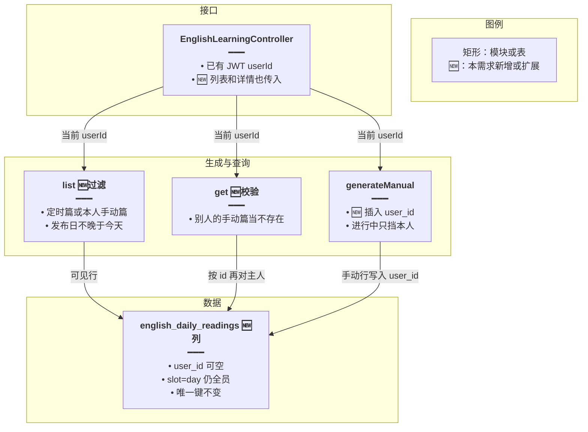
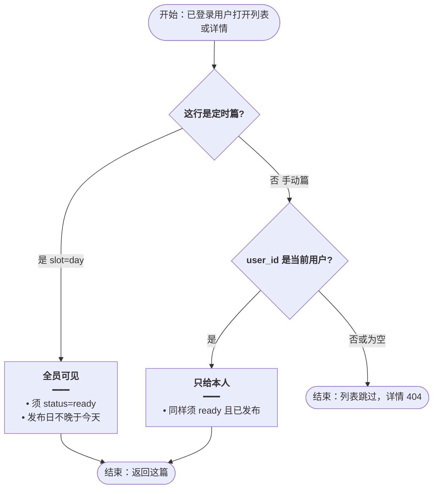
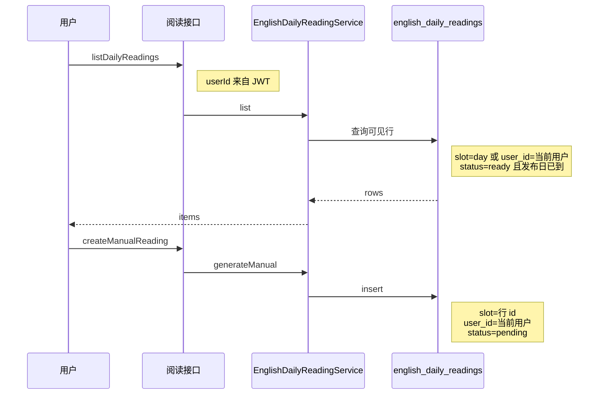
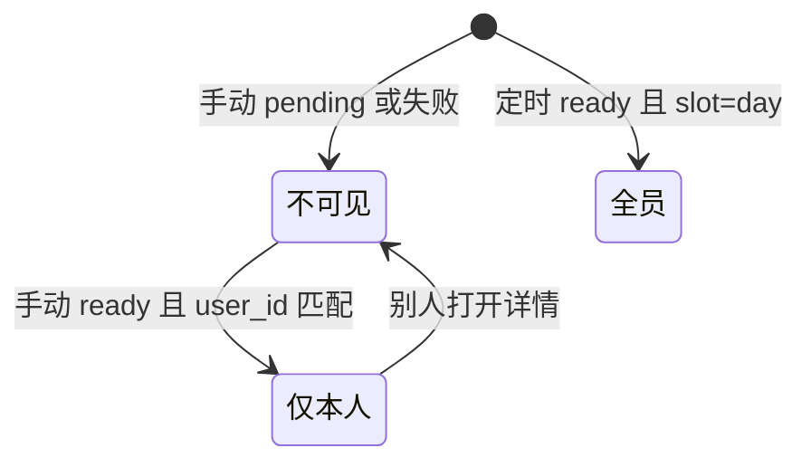

# 手动阅读按用户隔离 — 实现思路

> **状态**：规划（未实现；定时篇 `slot = day` 全站一行、手动篇 `slot` 为行 id 已有）  
> **日期**：2026-10-16  
> **需求摘要**：手动生成的短文只给生成它的用户看；系统每晚生成的定时篇仍所有登录用户可见。

## 延伸阅读

- [每日阅读](./每日阅读.md)（定时篇前一天生成、当天展示）
- [每日阅读手动生成](./每日阅读手动生成.md)（手动篇不覆盖定时篇；本文只加归属）

---

## 0. 读本文你将得到什么

- 要解决的问题：列表现在把所有 `ready` 行都返回，手动篇没有主人，别人也能打开。
- 总体方案：手动行写入 `user_id`；列表和详情只把「定时篇」或「本人的手动篇」给当前用户。
- 只改后端。前端列表仍调原来的接口。
- 分两阶段：M1 列与查询；M2 进行中的手动生成、停止、防重复也按人分开。
- 最大边界：改功能之前的手动篇没有 `user_id`，不猜测主人，上线后不再出现在任何人的列表里。

---

## 1. 需求与边界

### 1.1 用户故事

| 角色 | 场景 | 行为 | 期望结果 |
|------|------|------|----------|
| 已登录用户 | 自己手动生成了一篇 | 打开列表和详情 | 看得到，并标为手动 |
| 已登录用户 | 别人手动生成了一篇 | 打开列表，或猜 id 打开详情 | 列表没有这篇；详情当不存在 |
| 已登录用户 | 夜里的定时篇已 `ready` | 打开列表 | 所有登录用户都能看到同一篇 |
| 已登录用户 | 自己还有一篇正在写 | 再点手动生成 | 仍提示正在生成；别人可以同时写自己的 |

### 1.2 范围

| 在范围内 | 不在范围内（非目标） |
|----------|----------------------|
| `english_daily_readings.user_id` 可空 | 定时篇按用户各写一篇 |
| 列表、详情、手动进行中、停止按当前用户过滤 | 把旧手动篇指派给某个用户 |
| 防抄袭对照只使用定时篇和本人的手动篇 | 改列表页样式 |
| 新迁移，不改已应用的迁移 | 改 `(publish_date, slot)` 唯一键 |

### 1.3 约束与依赖

- 登录仍走现有 `JwtGuard`。`userId` 从 `req.user.userId` 来，不让前端另传主人。
- 定时篇 `slot = day` 且 `user_id` 为空。手动篇 `slot` 仍是该行 id，并写入当前 `userId`。
- 一人同时只许一篇未过期的手动稿。不同人互不挡。

---

## 2. 方案总览（一句话 + 要点）

**一句话方案**：手动行记下 `user_id`；查询时定时篇人人可见，手动篇只匹配当前用户。

| # | 设计要点 | 理由 |
|---|----------|------|
| 1 | 不改唯一键 | 手动 `slot` 已是行 id，天然不撞；定时篇仍一天一行 |
| 2 | `user_id` 可空 | 定时篇没有主人。空值加 `slot = day` 表示全员 |
| 3 | 无主旧手动篇不展示 | 没有主人就不能算「某个用户的」。不把它们继续公开，也不猜是谁的 |
| 4 | 进行中的停止按人 | 现在进程里只有一个 `manualRun`，第二个人会把第一个人的中断信号盖掉 |
| 5 | 对照正文不读别人的手动篇 | 防重复会把正文送进模型提示，不能带上别人的私有短文 |

---

## 3. 现状与复用

| 能力 | 仓库中已有 | 本需求中的用法 |
|------|------------|----------------|
| 定时 / 手动区分 | `english-daily-reading.entity.ts` 的 `slot`；`day` 为定时 | 定时篇不写 `user_id`；手动篇写入 |
| 列表与详情 | `english-daily-reading.service.ts` 的 `list`、`get`；只判断 `ready` 和发布日 | 扩展：加上归属条件 |
| 当前用户 | `english-learning.controller.ts` 已从 JWT 取 `userId` 传给 `generateManual` | 列表、详情、进行中、停止也传入 |
| 一人一篇进行中 | `hasFreshManual` 查所有 `slot != day` 的新鲜 `pending` | 扩展：只查该 `user_id` |
| 进程内中断 | `manualRun` 单对象 | 改为按 `userId` 的 Map |
| 唯一索引 | `uq_english_daily_readings_publish_slot` | 不改 |

**调研结论**：隔离是读和写时带上用户，不是再拆一张表。前端列表组件不用改，因为它只渲染接口返回的 `items`。

---

## 4. 架构图



**图内方法说明**：

| 方法 / 模块入口 | 功能 |
|-----------------|------|
| `list` | 返回定时篇和当前用户的手动篇。今天的生成状态仍只看 `slot = day` |
| `get` | 按 id 取 `ready` 且已到发布日的行。手动篇的 `user_id` 必须是当前用户，否则按不存在 |
| `generateManual` | 插入手动行时写入当前 `userId`。不改定时行 |

**读图要点**：

- 定时篇不经过「主人」分支，`user_id` 保持空。
- 前端没有新接口。过滤发生在已有的列表和详情上。
- 唯一键仍是发布日加 `slot`，不按用户再拆定时篇。

---

## 5. 主流程图



**图内方法说明**：

| 方法 | 功能 |
|------|------|
| `list` | 用同一次查询表达上面的两个「是」分支，并统计过滤后的总数 |
| `get` | 先按 id 取行，再走同一套归属判断。不存在和别人的手动篇都是「文章不存在」 |

**读图要点**：

- 空的 `user_id` 只有配上 `slot = day` 才可见。旧的无主手动篇走「否」。
- 发布日和 `ready` 仍是原条件，归属是额外条件。
- 详情不因为「列表里没有」而改成另一种错误文案。

---

## 6. 核心时序图



**图内方法说明**：

| 方法 | 功能 |
|------|------|
| `listDailyReadings` | 控制器入口。未登录仍 401，不把 userId 交给前端伪造 |
| `list` | 只查询当前用户能看的行 |
| `generateManual` | 手动稿从插入起就带主人，避免 pending 期间被别人的列表或停止误伤 |
| `insert` | 写入手动行。定时篇的 `claim` 不写 `user_id` |

**读图要点**：

- 列表和生成是两条请求。生成不会把这篇提前标成别人也能看的 `ready`。
- 停止和「正在生成」轮询使用同一个 `userId`，图中不另画，规则见状态机。

---

## 7. 状态机

文章行的 `pending / ready / failed` 不变。新增的是「谁能看见」。



**图内方法说明**：

| 方法 | 功能 |
|------|------|
| `generateManual` | 把手动行留在不可见，直到写成 `ready` |
| `get` | 别人请求时停在不可见，抛「文章不存在」 |
| `claim` | 定时行不进入「仅本人」 |

**读图要点**：

- 失败和未写完的手动稿谁的列表都不出现，和现在一样。
- 可见性不新增数据库状态值。

---

## 8. 模块职责与接口草图

### 8.1 模块一览

| 模块 | 职责 | 新增/改动 | 预估路径 |
|------|------|-----------|----------|
| 阅读实体 | 可空 `userId` | 扩展 | `apps/backend/src/services/english-learning/entity/english-daily-reading.entity.ts` |
| 迁移 | 加列和非唯一索引 | 新增 | `apps/backend/src/migrations/` 新文件 |
| 阅读服务 | 列表、详情、手动插入、进行中、停止、对照正文 | 扩展 | `apps/backend/src/services/english-learning/english-daily-reading.service.ts` |
| 控制器 | 把 JWT 的 `userId` 传进上述方法 | 扩展 | `apps/backend/src/services/english-learning/english-learning.controller.ts` |
| 列表页 | 仍渲染返回的 items | 不改 | `apps/frontend/src/views/englishLearning/dailyReading/List.tsx` |

### 8.2 关键接口（伪代码）

```typescript
// 列表只含定时篇和本人手动篇；今天是否还在生成仍看全站 day 行
function list(userId: number, limit: number, offset: number): Promise<DailyReadingList>;

// 别人的手动篇与不存在相同，避免用 403 暴露「这篇是别人的」
function get(id: string, userId: number): Promise<DailyReadingView>;

// 进行中只查这个用户的新鲜手动稿，不挡其他人
function manualPending(userId: number): Promise<boolean>;
```

### 8.3 数据模型

| 字段/实体 | 来源 | 存储 | 说明 |
|-----------|------|------|------|
| `user_id` | 手动生成时的 JWT | `english_daily_readings.user_id`，可空 | 定时篇为空 |
| `slot` | 已有 | 不改 | `day` 为定时；手动为行 id |
| 可见行 | 查询条件 | 不另存 | `slot=day` 或 `user_id=当前用户`，且 `ready`、发布日已到 |

---

## 9. 分阶段实现步骤

| 阶段 | 目标 | 交付物 | 依赖 |
|------|------|--------|------|
| M1 | 读写隔离 | 列、迁移、`list`、`get`、插入 `user_id` | 无 |
| M2 | 进行中也按人 | `manualPending`、`stopManual`、`manualRuns`、`recentNorms` | M1 |

- [ ] M1：新迁移添加可空 `user_id` 和普通索引；不改已有唯一索引
- [ ] M1：`generateManual` 插入时写入 `userId`；`claim` 不写
- [ ] M1：`list` / `get` 接收 `userId` 并按归属过滤；控制器传入 JWT
- [ ] M2：`hasFreshManual`、`failFreshPending` 只处理该用户的手动 `pending`
- [ ] M2：`manualRun` 改为 `Map<userId, …>`，停止只中断本人的那次
- [ ] M2：定时对照只取 `slot=day`；手动对照再加本人的已发布手动篇

---

## 10. 关键决策与备选方案

| 决策 | 选用 | 备选 | 为何不选备选 |
|------|------|------|--------------|
| 存在哪 | 原表加可空 `user_id` | 手动篇另建表 | 列表、详情、状态机已经认这张表 |
| 旧手动篇 | 无 `user_id` 的不再展示 | 继续对所有人可见 | 继续公开就没有隔离；猜一个主人会把别人的稿记到错误账号 |
| 唯一键 | 保持 `(publish_date, slot)` | 改成含 `user_id` | 定时篇必须仍是全站一天一行 |
| 详情错误 | 一律「文章不存在」 | 403 无权 | 403 会告诉对方这篇存在 |
| 进行中 | 按用户各挡各的 | 全站同时只许一篇手动稿 | 全站互斥会让一个人的生成挡住所有人 |

---

## 11. 风险、边界与待确认

| 项 | 等级 | 说明 | 缓解 |
|----|------|------|------|
| 旧手动篇从列表消失 | 中 | 上线前的手动行 `user_id` 为空 | 文档写明不回填。定时篇不受影响 |
| 进程内 Map 只在本机 | 低 | 多实例时各进程各记中断 | 与现在的单对象相同，数据库里的 `pending` 仍按 `user_id` 挡重复 |
| 直接猜 id | 低 | 手动 id 是 uuid | `get` 仍核对主人 |

**待确认**：无。旧无主手动篇不展示是本方案的明确选择。

---

## 12. 验收清单

| # | 用例 | 步骤 | 期望 |
|---|------|------|------|
| AC1 | 本人的手动篇 | 用户 A 手动生成成功后打开列表和详情 | 看得到，来源为手动 |
| AC2 | 别人的手动篇 | 用户 B 打开列表，并用 A 的 id 请求详情 | 列表没有；详情为文章不存在 |
| AC3 | 定时篇 | 存在 `slot=day` 且 `ready` 的今天或更早篇 | A 和 B 的列表都有这篇 |
| AC4 | 互不挡 | A 的手动稿仍是新鲜 `pending` 时 B 手动生成 | B 可以开始；A 再点仍是正在生成 |
| AC5 | 停止 | A 点停止 | 只中断 A 的模型调用，并把 A 的 `pending` 标失败；不动 B |
| AC6 | 旧数据 | 打开一条 `user_id` 为空且 `slot` 不是 `day` 的旧行 | 列表和详情都没有 |
| AC7 | 对照 | 定时生成的提示材料 | 不包含其他用户手动篇的正文 |

---

## 13. 预估改动面（实现阶段参考）

| 类型 | 路径（预估） |
|------|--------------|
| 后端 | 实体、新迁移、`english-daily-reading.service.ts`、`english-learning.controller.ts` |
| 前端 | 无 |
| 文档（实现后） | 落地后再写 `wiki/english/` 归档；本文保持规划说明 |

---

（本文档为规划态实现思路；落地后以源码为准）
