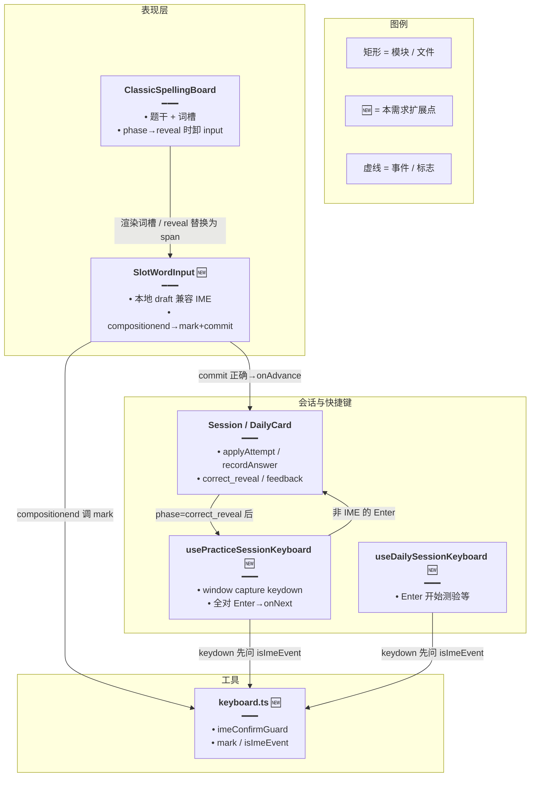
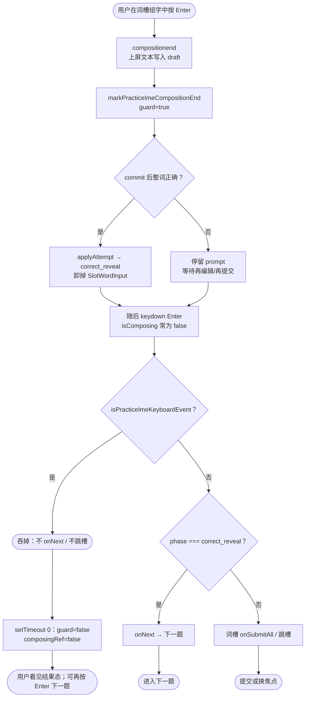
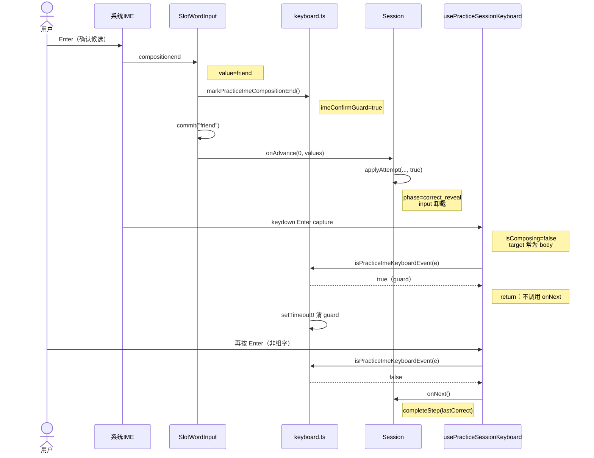
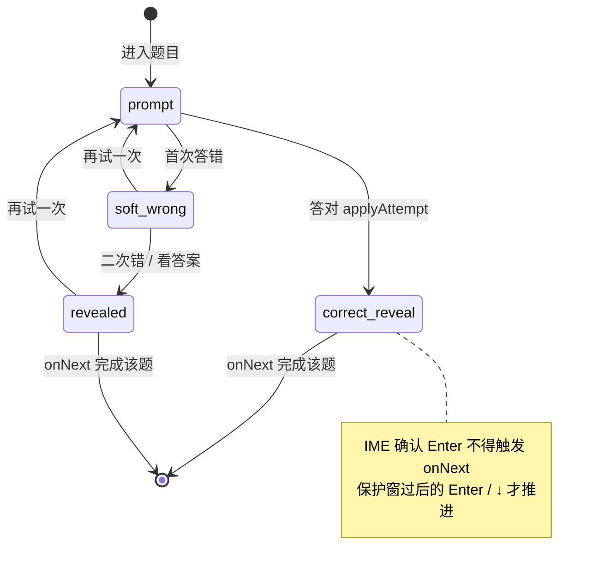

# 拼写 IME 回车防跳题 — 实现思路

> **状态**：核心已落地  
> **日期**：2026-10-11  
> **需求摘要**：中文输入法组字态下输入完按回车上屏时，应先停在全对结果态（词性/音标/释义），不得被同一记 Enter 误触「下一题」而跳过结果态。

## 延伸阅读

- 词槽 UI：`apps/frontend/src/views/englishLearning/practice/components/slots/SentenceWordSlots.tsx`
- 练习快捷键：`apps/frontend/src/views/englishLearning/practice/hooks/usePracticeSessionKeyboard.ts`
- 快捷键工具：`apps/frontend/src/views/englishLearning/practice/utils/keyboard.ts`
- 会话态：`apps/frontend/src/views/englishLearning/practice/Session.tsx`（`correct_reveal` / `onNext`）
- 同类 IME 延拍清标志：`apps/frontend/src/hooks/useEntry.ts`、`apps/frontend/src/views/chat/session-list/index.tsx`
- 相关词槽能力：[短语词槽标注.md](./短语词槽标注.md)

---

## 0. 读本文你将得到什么

- **问题**：IME 用 Enter 上屏后，紧随的「假提交 Enter」会在 `correct_reveal` 被全局 capture 快捷键当成下一题。
- **方案**：compositionend 打一拍 `imeConfirmGuard` + 延清组字标志；全局 keydown 统一忽略组字中 / keyCode 229 / 确认保护窗内的按键。
- **改动层**：仅前端练习/每日键盘与词槽；无后端、无 i18n。
- **阶段**：M1 共享 guard → M2 词槽 compositionend → M3 练习/每日键盘接入（均可一次做完）。
- **最大风险**：各端 IME 事件顺序不一；保护窗过短会漏拦、过长会吞用户真·下一题 Enter。

---

## 1. 需求与边界

### 1.1 用户故事

| 角色 | 场景 | 行为 | 期望结果 |
|------|------|------|----------|
| 学习者 | 看中写/听写拼写，开中文输入法 | 拼完英文后按回车上屏（候选条仍可能可见） | 进入全对结果态（中文题干 + 词性 + 英文 + 音标），不跳下一题 |
| 学习者 | 已在全对结果态 | 再按一次回车（非组字） | 正常进入下一题 / 结算 |
| 学习者 | 组字中误按方向键等 | 仍在输入 | 快捷键不抢答、不跳题 |

### 1.2 范围

| 在范围内 | 不在范围内（非目标） |
|----------|----------------------|
| 练习 Session 词槽 + `usePracticeSessionKeyboard`（capture） | 改判分 / 改 `correct_reveal` UI 布局 |
| 每日记词拼写词槽 + `useDailySessionKeyboard` | 聊天框、知识库等其它输入（已有各自 IME 处理） |
| 共享 `markPracticeImeCompositionEnd` / `isPracticeImeKeyboardEvent` | 自研 IME、拦截系统候选窗 |
| 词槽 `composingRef` 延一拍清零 | 非 Enter 的其它 IME 确认键（数字选词等）专项逻辑 |

### 1.3 约束与依赖

- 答对后词槽切 `reveal`，`SlotWordInput` 卸掉，焦点落到 `body`，原有 `inField` 守卫失效。
- 练习键盘挂在 `window` **capture** 阶段，输入框 `onKeyDown` 无法靠 bubble `stopPropagation` 拦住。
- 须复用仓库已有「compositionend + `setTimeout(0)` 再清 isComposing」模式（chat / useEntry）。
- Ponytail：不引入新依赖、不新建抽象层文件；guard 放进已有 `keyboard.ts`。

---

## 2. 方案总览（一句话 + 要点）

**一句话方案**：在 compositionend 打跨模块一拍确认保护，并让练习/每日全局 keydown 与词槽本地 keydown 共同忽略「组字中 + IME 确认 Enter」。

| # | 设计要点 | 理由 |
|---|----------|------|
| 1 | 模块级 `imeConfirmGuard` + `setTimeout(0)` 清零 | 与 chat 一致；跨 capture 监听与词槽卸载仍可见 |
| 2 | `isPracticeImeKeyboardEvent`：`isComposing \|\| keyCode===229 \|\| guard` | 覆盖组字中与上屏后假 Enter |
| 3 | 词槽 compositionend：先 `mark` + `commit`，再延清 `composingRef` | 本地 Enter/空格跳槽也不误触 |
| 4 | 不改「答对自动进 `correct_reveal`」 | 拉丁键盘直接输完仍可自动揭示；只吞 IME 确认那一记 |

---

## 3. 现状与复用

| 能力 | 仓库中已有 | 本需求中的用法 |
|------|------------|----------------|
| 词槽本地 draft + composition | `SentenceWordSlots.tsx` `SlotWordInput` | **扩展**：延清 `composingRef` + 调用 mark |
| 练习全局快捷键（含全对 Enter→下一题） | `usePracticeSessionKeyboard.ts` | **扩展**：入口处 IME 过滤 |
| 每日会话快捷键 | `useDailySessionKeyboard.ts` | **扩展**：同上，防 study/quiz 误触 |
| 快捷键工具函数 | `practice/utils/keyboard.ts` | **扩展**：新增 mark / isIme |
| 答对进 `correct_reveal`、Enter 下一题 | `Session.tsx` `applyAttempt` / `onNext` | **直接复用**：不改状态机 |
| compositionend 延拍清标志 | `hooks/useEntry.ts`、chat session-list | **直接复用**：模式对齐，不抽公共包 |
| 表单 submit 判分 | Session / DailyCardSession 的 `onSubmit` | **不适用**：根因在全局 Enter→`onNext`，非表单二次提交 |

**调研结论**：词槽已有 `isComposing` 早退，但拦不住 **window capture** 且拦不住 **compositionend 之后** 的假 Enter；全对揭示会卸掉 input，使 `inField` 失效。缺的是「跨监听、跨卸载」的一拍确认保护，放进已有 `keyboard.ts` 即可，不必新文件。

---

## 4. 架构图



**图内方法说明**：

| 方法 | 功能 |
|------|------|
| `markPracticeImeCompositionEnd()` | compositionend 时置 `imeConfirmGuard=true`，`setTimeout(0)` 清零；供全局快捷键吞掉上屏确认 Enter |
| `isPracticeImeKeyboardEvent(e)` | 判断是否组字中 / keyCode 229 / 仍在确认保护窗；为 true 则快捷键直接 return |
| `SlotWordInput` 的 `commit(raw)` | 去空格后写父级 values；整词正确时调 `onAdvance` |
| `onAdvance` / `onSlotAdvance` | 末槽答对则 `applyAttempt(..., true)` 或每日 `recordAnswer(true)` |
| `applyAttempt(userInput, correct)` | 正确则 `setPhase('correct_reveal')`；错误走 soft_wrong / revealed |
| `onNext()` | 全对态下 `completeStep(lastCorrect)` 进下一题 |
| `usePracticeSessionKeyboard` 内 `onKeyDown` | capture 监听；全对态 ArrowDown/Enter→`onNext`（须先过 IME 过滤） |

**读图要点**：

- 根因跨两层：词槽上屏自动判对卸 input，全局 capture 仍收到假 Enter。
- 新增逻辑集中在 `keyboard.ts` 标志 + 两处 Hook 入口过滤 + 词槽 compositionend。
- Session 状态机不改，只挡「上屏那一记」快捷键。

---

## 5. 主流程图



**图内方法说明**：

| 方法 | 功能 |
|------|------|
| `markPracticeImeCompositionEnd()` | 打开一拍确认保护，避免紧随 Enter 被当成业务快捷键 |
| `commit(raw)` | 规范化输入并可能触发末槽自动判对 |
| `applyAttempt(...)` | 写入 lastCorrect 并切 `correct_reveal` |
| `isPracticeImeKeyboardEvent(e)` | 决定吞键还是放行 |
| `onNext()` | 仅非 IME 的 Enter/↓ 在全对态推进 |
| `onSubmitAll` / `onSubmit` | 仍在 prompt 时手动判分；全对后 phase 已变则早退 |

**读图要点**：

- 成功路径：上屏 → 判对 → 揭示 → **假 Enter 被吞** → 用户看到结果态。
- 失败/未完成路径：上屏未整词正确时同样吞假 Enter，需再按一次才提交（与 chat 发送一致）。
- 真·下一题：保护窗过后的第二次 Enter。

---

## 6. 核心时序图



**图内方法说明**：

| 方法 | 功能 |
|------|------|
| `markPracticeImeCompositionEnd()` | 在 compositionend 同步置位，保证后续同轮 keydown 可见 |
| `commit("friend")` | 把上屏文本写入槽值并触发正确则 advance |
| `onAdvance` / `applyAttempt` | 切全对揭示态并卸载输入 |
| `isPracticeImeKeyboardEvent(e)` | capture 监听的第一道闸 |
| `onNext()` | 放行后的下一题入口 |

**读图要点**：

- 关键竞态在 **compositionend 与紧随 keydown** 之间，React 已 flush 揭示态。
- capture 监听必须读共享 guard，不能只依赖 input 上的 `composingRef`。
- 无后端、无异步请求；保护窗长度为一拍 macrotask。

---

## 7. 状态机（练习单题 phase）



**图内方法说明**：

| 方法 | 功能 |
|------|------|
| `applyAttempt(..., true)` | `prompt` → `correct_reveal` |
| `onNext()` | 离开 `correct_reveal` / 错题态，写入本步结果 |
| `onRetryCurrent()` | 错题或全对态回到 `prompt` 清空槽 |

---

## 8. 模块职责与接口草图

### 8.1 模块一览

| 模块 | 职责 | 新增/改动 | 预估路径 |
|------|------|-----------|----------|
| keyboard 工具 | IME 确认保护窗 | 扩展 | `apps/frontend/src/views/englishLearning/practice/utils/keyboard.ts` |
| SlotWordInput | compositionend mark + 延清 composing | 扩展 | `.../components/slots/SentenceWordSlots.tsx` |
| 练习键盘 Hook | keydown 入口过滤 IME | 扩展 | `.../practice/hooks/usePracticeSessionKeyboard.ts` |
| 每日键盘 Hook | 同上 | 扩展 | `.../daily/hooks/useDailySessionKeyboard.ts` |

### 8.2 关键接口（草图）

```typescript
// 模块级：跨 capture 监听与词槽卸载仍能读到的一拍标志
let imeConfirmGuard = false;

// compositionend 调用：打开保护，下一 macrotask 自动关闭
export function markPracticeImeCompositionEnd(): void {
	// 置位后立刻可被随后的 keydown 读到
	imeConfirmGuard = true;
	// 与 chat/useEntry 一致：等假 Enter 过完再清
	setTimeout(() => {
		imeConfirmGuard = false;
	}, 0);
}

// 全局 / 本地 keydown 共用：组字中或确认保护窗内一律视为 IME 键
export function isPracticeImeKeyboardEvent(e: KeyboardEvent): boolean {
	// 229：部分浏览器组字时的 keyCode；guard：上屏后假 Enter
	return e.isComposing || e.keyCode === 229 || imeConfirmGuard;
}
```

### 8.3 数据模型

| 字段/实体 | 来源 | 存储 | 说明 |
|-----------|------|------|------|
| `imeConfirmGuard` | compositionend | 模块内存 | 一拍布尔，非持久化 |
| `composingRef` | compositionstart/end | 词槽组件 ref | 本地 draft 与 keydown 早退 |
| `phase` | Session | React state | `correct_reveal` 时 Enter 语义变为下一题 |

---

## 9. 分阶段实现步骤

| 阶段 | 目标 | 交付物 | 依赖 |
|------|------|--------|------|
| M1 | 共享 IME 判定 | `mark` / `isIme` API | 无 |
| M2 | 词槽上屏打点 | compositionend 调 mark + 延清 ref | M1 |
| M3 | 快捷键接入 | 练习 + 每日 Hook 入口过滤 | M1 |

### M1

- [x] 在 `keyboard.ts` 增加模块级 guard 与两个导出函数
- [x] 注释写清与 chat `setTimeout(0)` 模式的对齐关系

### M2

- [x] `onCompositionEnd`：`markPracticeImeCompositionEnd` → `commit` → `setTimeout` 清 `composingRef`
- [x] 本地 `onKeyDown` 增加 `keyCode === 229` 早退

### M3

- [x] `usePracticeSessionKeyboard`：`repeat \|\| isPracticeImeKeyboardEvent` 则 return
- [x] `useDailySessionKeyboard`：同上
- [x] 手测：中文输入法上屏停结果态；再按 Enter 才下一题

---

## 10. 关键决策与备选方案

| 决策 | 选用 | 备选 | 为何不选备选 |
|------|------|------|--------------|
| 假 Enter 识别 | 模块 guard + 延拍 | 仅 `e.isComposing` | 上屏后 keydown 常为 false，拦不住 |
| 保护作用域 | `keyboard.ts` 模块变量 | Context / 新 Hook | 过重；两 Hook + 一词槽足够 |
| 答对时机 | 保持 compositionend 自动 advance | 禁止自动揭示、强制再按 Enter 提交 | 拉丁键盘体验变差 |
| 监听阶段 | 继续 window capture + 入口过滤 | 去掉 capture / 改为 bubble | 会破坏 Shift+空格等与词槽抢键的既有修复 |

---

## 11. 风险、边界与待确认

| 项 | 等级 | 说明 | 缓解 |
|----|------|------|------|
| IME 事件序差异 | 中 | 部分环境 Enter 在 compositionend 前且 `isComposing=true` | 同时认 `isComposing` / 229 / guard |
| 保护窗过长 | 低 | 用户极快连按两次 Enter 可能吞第二次 | `setTimeout(0)` 仅一拍；验收连按 |
| 每日路径 | 低 | 每日 feedback 主要靠按钮/↓，Enter 跳题主发在练习 | 仍统一过滤，成本低 |
| 多词槽中间词 | 低 | 上屏正确会 `onAdvance` 跳下一槽；假 Enter 被吞 | 与「空格跳槽」分离，可接受 |

**待确认**：

- [ ] Windows 微软拼音 / macOS 系统拼音是否均只需一拍（验证：上屏后是否偶发仍跳题；若有则改为 `rAF` 双拍或短 `16ms`）
- [ ] 用数字键选候选（非 Enter）后立刻按 Enter 提交：应正常提交/揭示（验证：选词后 guard 已清）

---

## 12. 验收清单

| # | 用例 | 步骤 | 期望 |
|---|------|------|------|
| AC1 | 中文输入法上屏 | 拼写题开拼音，输入正确答案，候选条出现时按 Enter | 停在全对结果态，不跳下一题 |
| AC2 | 结果态再确认 | AC1 后焦点不在输入框，再按 Enter 或 ↓ | 进入下一题 |
| AC3 | 英文输入法 | 关 IME，直接键入正确单词（若未自动揭示则按 Enter 提交） | 正常揭示；无多余吞键 |
| AC4 | 组字中快捷键 | 组字过程中按 ↓ / Enter | 不触发下一题；上屏逻辑由系统 IME 处理 |
| AC5 | 每日拼写 | 今日记词听写/看中写同样用拼音上屏 | 不误跳；行为与练习一致 |

---

## 13. 预估改动面（实现阶段参考）

| 类型 | 路径（预估） |
|------|--------------|
| 前端 | `apps/frontend/src/views/englishLearning/practice/utils/keyboard.ts` |
| 前端 | `apps/frontend/src/views/englishLearning/practice/components/slots/SentenceWordSlots.tsx` |
| 前端 | `apps/frontend/src/views/englishLearning/practice/hooks/usePracticeSessionKeyboard.ts` |
| 前端 | `apps/frontend/src/views/englishLearning/daily/hooks/useDailySessionKeyboard.ts` |
| 文档（本篇） | `../micro-apps/remote-docs/wiki/ideas/english/拼写IME回车防跳题.md` |

（本文档为规划/落地对照实现思路；行为以源码为准。若需改前改后逐行归档，再用 `implementation-doc-from-diff` 写入 `wiki/english/`。）
