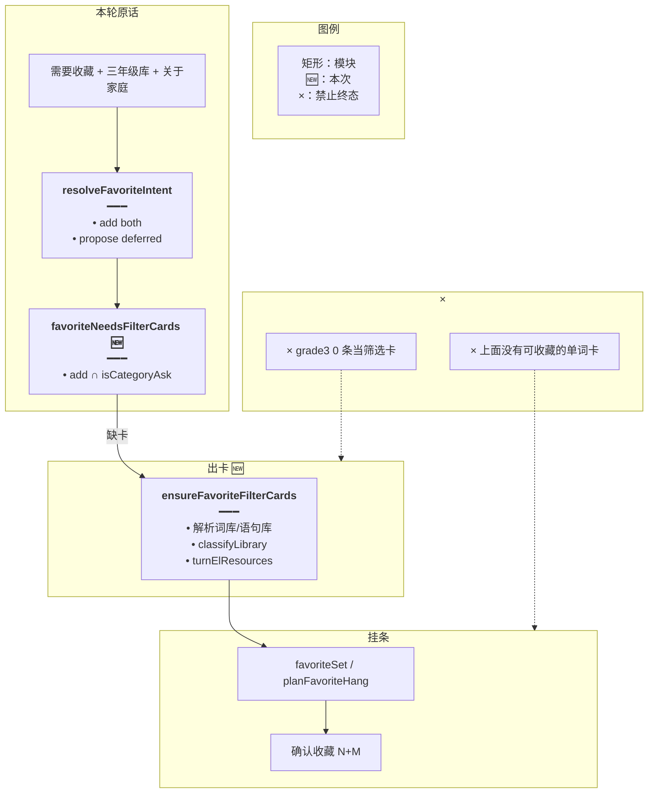
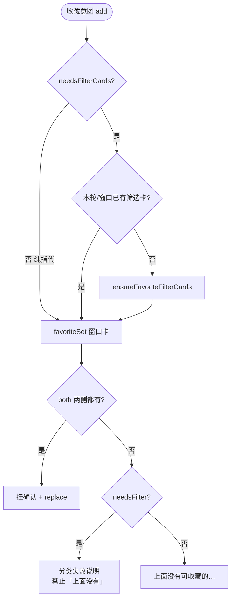
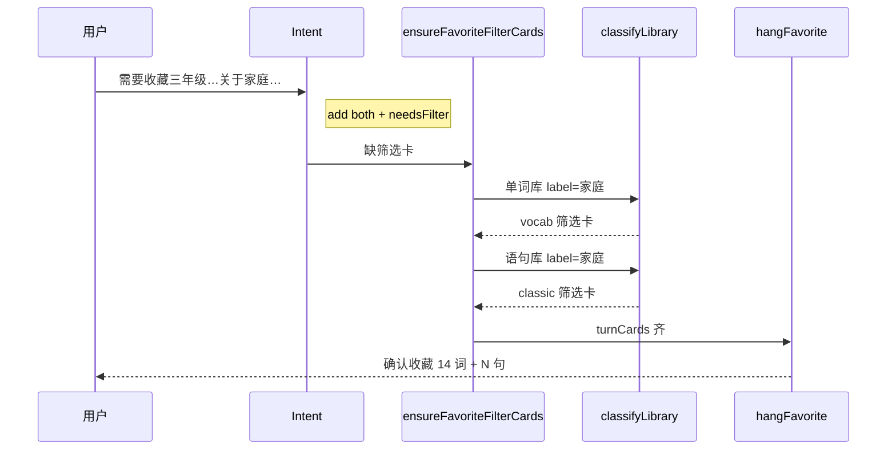
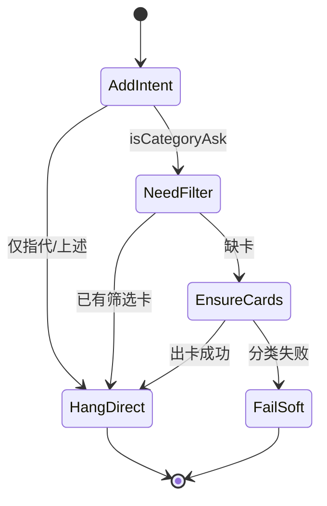

# 收藏先出筛选卡 — 实现思路

> **状态**：规划（M1–M3 工作区已落地）  
> **日期**：2026-10-30  
> **需求摘要**：用户在长对话中说「我需要收藏三年级单词库和语句库中的所有关于家庭的单词和语句」时，应先（本轮）产出家庭筛选卡再挂收藏确认；不得用「上面没有可收藏的单词卡。」收尾，也不得挂出「grade3 / 0 条」空检索卡冒充结果。  
> **一句话方案（预告）**：把「收藏 + 关于类」从「纯指代收藏」拆开——缺筛选卡时不写「没有单词卡」；本轮按原话解析库并跑分类出卡后再 `favoriteSet` 挂条；空 `list` 卡不得挡住续查。

## 延伸阅读

- [收藏意图总控](./收藏意图总控.md)：`需要收藏` 进 add；本文修「进 add 后还没卡就宣布没有」
- [查询收藏不挂确认](./查询收藏不挂确认.md)：查询 vs 添加；本文是添加 + 分类复合句
- [再收藏不断窗](./再收藏不断窗.md)：窗口断了摸不到旧卡；复合句应**本轮自给自足**出卡，不依赖「上面」
- [收藏只收库卡](./收藏只收库卡.md)：只收 library 筛选卡
- [关于类一次出卡](./关于类一次出卡.md)：关于类应分类出卡，不是关键词 list
- [库内筛选不中断](./库内筛选不中断.md)：收尾续查；空 list 卡可能误标 `presented`
- [生成不跑库筛选](./生成不跑库筛选.md)：生成句里的「关于」不是筛库；若走收尾续查会盖住生成确认正文

---

## 0. 读本文你将得到什么

- 为何长对话里这句会变成「上面没有可收藏的单词卡」+ 两张 grade3「0 条」
- 根因：**软添加进闸过早挂条** + **窗口里没有家庭筛选卡** + **模型用 list 空卡**，不是「模型突然变笨」这么笼统
- 选定方案：复合句先出筛选卡再挂收藏；缺卡时禁止「没有卡」replace；服务端可本轮补分类
- 改动在意图辅助函数、`agent.service` 挂条顺序、空卡 presented；不换记忆表
- 最大风险：本轮双库分类耗时；可用已有 `classifyLibrary` + 缓存

---

## 1. 需求与边界

### 1.1 用户故事

| 角色 | 场景 | 行为 | 期望结果 |
|------|------|------|----------|
| 登录用户 | 长会话，窗口里未必还有旧家庭卡 | 「我需要收藏三年级单词库和语句库中的所有关于家庭的单词和语句」 | 本轮出家庭词/句筛选卡，再挂确认（如 14+2）；无「没有单词卡」 |
| 登录用户 | 上面已有筛选卡 | 「将上述单词和语句都收藏」 | 仍只按卡挂条（现网） |
| 登录用户 | 仅指代 | 「我需要收藏之前的单词和语句」 | 仍靠窗口卡；缺卡才说没有 |

### 1.2 范围

| 在范围内 | 不在范围内 |
|----------|------------|
| 收藏 + 关于类复合句 | 换 LLM、加向量记忆 |
| 缺卡时挂条/文案策略 | 改分类器模型本身 |
| 本轮补分类出卡 | 「清空收藏」等其它意图 |

### 1.3 约束与依赖

- 复用 `resolveFavoriteIntent`、`isCategoryAsk`、`categoryLabels`、`classifyLibrary`、`favoriteSet`、`planFavoriteHang`
- 名单仍是筛选卡 `items`，不信模型散文
- Ponytail：先断错误文案，再补出卡，不新开会话状态机除非必要

---

## 2. 背景

### 2.1 实录与日志

| 现象 | 说明 |
|------|------|
| 用户句 | 我需要收藏三年级单词库和语句库中的所有关于家庭的单词和语句 |
| 正文 | 上面没有可收藏的单词卡。 |
| UI | 两张「grade3 / 0 条 / 没有匹配的条目」 |
| 日志 | `el_items_search op=list` ×2（无 classify 成功日志） |

### 2.2 根因链（错乱拆解）

1. **意图**：`需要收藏` → `isFavoriteSoftAdd` → `action=add, side=both`。句中同时有「关于家庭」→ `isCategoryAsk=true`。这是**复合意图**（先筛后藏），却被当成**纯添加挂条**。
2. **挂条**：轮末 `favoriteSet` 在回扫窗口 + 本轮卡里找 library 卡。长对话里家庭筛选卡常已出窗；本轮模型没挂出有效筛选卡 → `plan.hang=false` → `favoriteReplyText='上面没有可收藏的单词卡。'` → `contentReplace`。
3. **工具跑偏**：模型调 `el_items_search list`（日志），用近似名「grade3」挂空卡；**没有**走出 `el_vocab_classify` / `el_classic_classify` 成功路径。关于类应分类，不是整库 list。
4. **续查可能被挡**：空 list 卡可能让 `presented=true`，收尾 `shouldFilterContinue` 不再补分类（与「库内筛选不中断」同类坑）。即使续查，现逻辑 `inheritedKind` **一次只续一种**（vocab 或 classic），而本句点了**单词库+语句库**两侧。
5. **与「记忆不够」的关系**：历史里或许早有 14+3，但产品句是**自包含**的（三年级 + 关于家庭 + 收藏）。正确行为是本轮自给自足出卡，而不是抱怨「上面没有」。怪记忆窗口是次要的；**复合句被过早按「上面」挂条**才是主因。

### 2.3 不解决会怎样

凡长会话中「需要收藏某库关于某类的词句」都会稳定复现：空 list 卡 + 「没有单词卡」文案，用户以为 Agent 坏了。

### 2.4 硬约束

- 有「关于/有关…」且点名库时：必须先有筛选卡，再挂收藏确认。  
- 缺卡时禁止用「上面没有可收藏的单词卡」作为终态文案（应出卡或说明分类失败）。  
- 不靠 prompt 单独保证模型一定调 classify。

---

## 3. 现状与复用

| 能力 | 仓库中已有 | 本需求用法 |
|------|------------|------------|
| 软添加 | `isFavoriteSoftAdd` / `resolveFavoriteIntent` | 保留进 add（propose 仍 deferred） |
| 关于类判定 | `isCategoryAsk` / `categoryLabels` | 识别复合句 |
| 挂条 | `favoriteSet` + `planFavoriteHang` | 有卡才 hang；缺卡策略改 |
| 分类 | `classifyLibrary` / 收尾续查 | **扩展**：复合句缺卡时本轮双侧补出 |
| list 出卡 | `el_items_search` | 空卡不得阻断续查 / 不得当筛选卡 |

**调研结论**：意图与分类能力都在；缺的是「复合句缺卡时不要假失败文案 + 本轮补齐筛选卡再挂条」。

---

## 4. 方案比对与最终方案

### 4.1 候选方案

#### 方案 A：复合句 intent 改为 null，全交给模型先分类再收藏

- **做法**：`需要收藏`+`关于` → `action=null`，不挂条、不 deferred。
- **能工作原因**：模型可能先 classify。
- **代价**：propose 可能乱挂；长对话更不稳；与「名单服务端」原则冲突。

#### 方案 B：保留 add deferred；缺卡时不写「没有卡」；本轮服务端补分类后再 hang（推荐）

- **做法**：  
  1. `favoriteNeedsFilterCards(text)` = add 意图且 `isCategoryAsk(text)`（复合句）。  
  2. 轮末：先若 needsFilter 且两侧卡不齐 → 按原话解析三年级词库/语句库，`classifyLibrary` 出筛选卡推入 `turnElResources`。  
  3. 再 `favoriteSet`；能 hang 则挂条 + replace。  
  4. 仍不齐 → replace 为分类失败说明（可选），**禁止**「上面没有可收藏的单词卡」套话。  
  5. 空 list（0 条）不设/回滚 `presented` 挡续查（小补丁）。
- **能工作原因**：自包含句本轮出卡；add 仍 deferred 防模型乱确认。
- **代价**：本轮可能多 1～2 次分类（有 categoryJobs 缓存）。

#### 方案 C：只加宽回扫窗口，尽量摸到旧家庭卡

- **做法**：bridge 更多用户句。
- **能工作原因**：若历史真有卡可碰巧对。
- **代价**：新开会话/卡已过期仍失败；不解决 grade3 空 list；复合句仍依赖「上面」。

### 4.2 比对

| 维度 | 方案 A | 方案 B | 方案 C |
|------|--------|--------|--------|
| 正确性 | 偶发 | 本轮自给自足，确定 | 依赖历史 |
| 复用 | 低 | classify + favoriteSet | 只改回扫 |
| 改动面 | intent 一处 | service 挂条前补分类 | quote 一处 |
| 复杂度 | 低 | 中（双侧库解析） | 低 |
| 体验 | 仍可能乱 | 一次说完可出确认 | 长会话仍飘 |
| 风险 | 模型挂错确认 | 分类耗时 / 库名歧义 | 误并旧卡 |
| 可维护性 | 差 | 与「卡是名单」一致 | 治标 |

### 4.3 综合考量

权重：**正确性**（复合句必须先有筛选卡）与 **不依赖长窗口**。选定 **B**。放弃 A（放回模型手里）。放弃 C 作为主方案（可作辅：回扫仍保留）。

### 4.4 最终方案

#### 背景

软添加让「需要收藏…关于家庭…」进 add；轮末按「上面」找卡失败就 replace「没有单词卡」；模型 list 出 grade3 空卡。长对话放大窗口空洞，但即便有记忆，本句也应本轮出卡。

#### 具体思路

1. 识别 `favoriteNeedsFilterCards`。  
2. 挂条前：缺筛选卡 → 服务端按原话解析库 + label（家庭）分类，推卡。  
3. 再 hang；成功则与现网一致。  
4. 失败文案与空 list presented 修补。

#### 实现方案

**一句话**：收藏 + 关于类复合句先出筛选卡再挂确认；缺卡时禁止「上面没有可收藏的单词卡」终态。

| 步骤 | 谁 | 做什么 |
|------|----|--------|
| 1 | `favoriteNeedsFilterCards` | add ∩ isCategoryAsk |
| 2 | `ensureFavoriteFilterCards` | 解析库、classify、写入 turnElResources |
| 3 | 现有 hang | favoriteSet → plan → propose |
| 4 | 文案闸 | !hang 且 needsFilter → 不用「上面没有…」 |

#### 选定原因

1. **正确性**：自包含句不依赖断窗历史。牺牲：多分类耗时。  
2. **复用**：classifyLibrary / favoriteSet。牺牲：比只改文案重。  
3. **体验**：一次提问可到确认条。牺牲：库名歧义时仍要用户点名（沿用现解析）。

#### 优势

- 相对 A：确认仍服务端。  
- 相对 C：新会话同样正确。

#### 怎么实现

见 §9。

### 4.5 其他关键决策

#### 4.5.1 缺卡时是否仍展示「没有单词卡」

##### 候选

**A**：保持现状文案。  
**B**：复合句禁用该文案（本文）。

##### 比对

| 维度 | A | B |
|------|---|---|
| 正确性 | 误导 | 不误导 |
| 体验 | 差 | 好 |
| 其它维度 | 此项相同 | 此项相同 |

选定 B。

#### 4.5.2 双侧库如何补

##### 候选

**A**：只续 inheritedKind 单侧（现状续查）。  
**B**：原话同时点单词库与语句库则两侧都 classify（本文）。

##### 比对

| 维度 | A | B |
|------|---|---|
| 正确性 | both 常缺一侧 | 对齐 both |
| 改动面 | 无 | 双侧解析 |
| 风险 | 再报没有单词卡 | 耗时 ×2 |

选定 B。

---

## 5. 架构图



**图内方法说明**：

| 方法 | 功能 |
|------|------|
| `resolveFavoriteIntent` | 判定 add；复合句仍 add 以便 deferred |
| `favoriteNeedsFilterCards` | 是否必须先有关于类筛选卡 |
| `ensureFavoriteFilterCards` | 本轮双侧分类出卡 |
| `classifyLibrary` | 已有。按 label 筛库内行 |
| `favoriteSet` / `planFavoriteHang` | 已有。有卡则挂确认 |

**读图要点**：先 Ensure 再 Hang；禁止空话术终态。

---

## 6. 主流程图



**图内方法说明**：

| 方法 | 功能 |
|------|------|
| `favoriteNeedsFilterCards` | 分流复合句 |
| `ensureFavoriteFilterCards` | 补卡 |
| `planFavoriteHang` | hang / 文案 |

**读图要点**：复合句失败路径不再走「上面没有」。

---

## 7. 核心时序图



**图内方法说明**：

| 方法 | 功能 |
|------|------|
| `resolveFavoriteIntent` | 进 add |
| `ensureFavoriteFilterCards` | 调度双侧分类 |
| `classifyLibrary` | 产出 items |
| 挂条 | propose + contentReplace |

**读图要点**：不依赖历史窗口里是否还有旧卡。

---

## 8. （可选）状态机



**图内方法说明**：同 §5。

**读图要点**：NeedFilter 是复合句专用态。

---

## 9. 具体实现（主链路代码）

### 9.1 模块一览

| 模块 | 职责 | 类型 | 路径 |
|------|------|------|------|
| `favoriteNeedsFilterCards` | 复合句判定 | 新增 | `favorite-ask.ts` |
| `ensureFavoriteFilterCards` | 补筛选卡 | 新增 | `agent.service.ts`（或 english 工具旁） |
| 挂条文案闸 | 禁用「上面没有」 | 扩展 | `agent.service.ts` |
| 空 list presented | 不挡续查 | 扩展 | spill / present 路径 |
| 单测 | 复合句 needsFilter；缺卡不写旧文案 | 扩展 | scope.spec |

### 9.2 复合句判定

```typescript
// 对应 §4.4 步骤 1。收藏且关于类 → 必须先有筛选卡，不能直接抱怨「上面没有」
export function favoriteNeedsFilterCards(userText: string): boolean {
	const intent = resolveFavoriteIntent(userText);
	// 非添加不走收藏挂条
	if (intent.action !== 'add') return false;
	// 关于/有关/相关/属于：本轮要筛选卡
	return isCategoryAsk(userText);
}
```

### 9.3 挂条前补卡 + 文案闸（要点）

```typescript
// 对应 §4.4 步骤 2～4。复合句缺卡则先分类，再 hang
if (elSurface.favoriteIntent?.action === 'add' && businessSessionId) {
	let turnCards = collectTurnLibraryCards(...);
	let set = favoriteSet(history, dto.content, prior, turnCards);
	let plan = set
		? planFavoriteHang({ set, turnVocab: [], turnClassic: [] })
		: null;
	const needsFilter = favoriteNeedsFilterCards(dto.content);
	// 缺侧且是复合句 → 本轮补分类，不立刻「上面没有」
	if (needsFilter && (!plan || !plan.hang)) {
		await this.ensureFavoriteFilterCards({
			userId,
			userText: dto.content,
			surface: elSurface,
			turnElResources,
			emit: (card) => subscriber.next({ type: 'elResourceList', data: forSse(card) }),
		});
		turnCards = collectTurnLibraryCards(...);
		set = favoriteSet(history, dto.content, prior, turnCards);
		plan = set
			? planFavoriteHang({ set, turnVocab: [], turnClassic: [] })
			: null;
	}
	if (plan?.hang) {
		// 现有 propose + favoriteReplyText
	} else if (plan && !needsFilter) {
		favoriteReplyText = plan.reply;
	} else if (needsFilter) {
		// 分类仍失败时的软失败，禁止「上面没有可收藏的单词卡」
		favoriteReplyText = '没有从指定词库/语句库筛出可收藏的家庭类条目。';
	}
}
```

### 9.4 空 list 卡

```typescript
// list 出 0 条时不要当成已 presented，以免挡住关于类续查/补分类
if ((payload.items?.length ?? 0) === 0 && payload.source === 'library') {
	// 不 set presented=true，或显式 presented=false
}
```

---

## 10. 分阶段实现步骤

| 阶段 | 目标 | 交付 |
|------|------|------|
| M1 | 复合句不再出现「上面没有可收藏的单词卡」 | needsFilter + 文案闸 + 单测 |
| M2 | 本轮双侧补分类后再 hang | ensureFavoriteFilterCards |
| M3 | 空 list 不挡续查 | presented 修补 |

M1

- [x] `favoriteNeedsFilterCards(实录句) === true`
- [x] `favoriteNeedsFilterCards('将上述…都收藏') === false`
- [x] 缺卡 + needsFilter 时 replace 文案 ≠「上面没有可收藏的单词卡。」

M2

- [x] 无历史卡时实录句走 `ensureFavoriteFilterCards` 再 hang（工作区已接 classifyLibrary）

M3

- [x] 空 list / 空筛选结果不设 `presented`

---

## 11. 风险、边界与待确认

| 项 | 等级 | 说明 | 缓解 |
|----|------|------|------|
| 库名「三年级」歧义 | 中 | 多库匹配 | 复用现有 matchLibraries / ambiguous |
| 双侧分类耗时 | 中 | 两库 | categoryJobs 缓存；并行 |
| 与纯「需要收藏之前的」 | 低 | 无关于 → needsFilter false | 单测钉住 |

**待确认**：

- [ ] 软失败文案最终用词（验证：产品是否接受「没有筛出…」）

---

## 12. 验收清单

| # | 用例 | 期望 |
|---|------|------|
| AC1 | 长会话实录句 | 不出「上面没有可收藏的单词卡」；尽量挂出家庭确认或明确分类失败 |
| AC2 | 同上 | 不以 grade3 0 条空卡为成功态 |
| AC3 | 「将上述都收藏」有卡 | 行为与现网一致 |
| AC4 | 「需要收藏之前的…」无关于 | 仍可走窗口；缺卡才「上面没有」 |

---

## 13. 预估改动面

| 类型 | 路径 |
|------|------|
| 后端 | `favorite-ask.ts`、`agent.service.ts` |
| 可能 | `domain-tools` / spill 空卡 presented |
| 测试 | `favorite-ask.scope.spec.ts` |
| 文档 | README；互链意图总控 / 再收藏不断窗 |

---

（规划态；落地后以源码为准）
