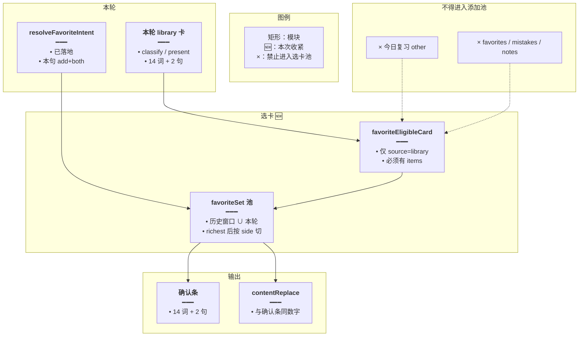
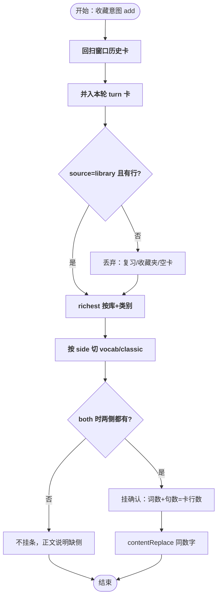
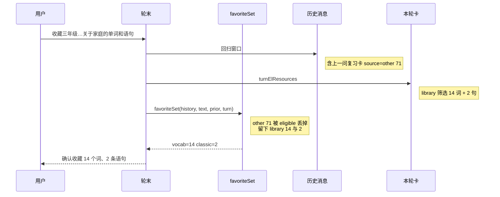

# 收藏只收库卡 — 实现思路

> **状态**：规划（M1 工作区已落地）  
> **日期**：2026-10-29  
> **需求摘要**：用户说「我需要收藏三年级单词库和语句库中的所有关于家庭的单词和语句」时，确认条必须是本轮（或窗口内）**词库/语句库筛选卡**上的行数（例如 14 个词、2 条语句），不能把上一问「今日待复习」的 71 个词算进去。  
> **一句话方案（预告）**：收藏选卡只收 `source === 'library'` 的卡；本轮挂出的库卡与历史库卡进同一池再 `richest`；复习 / 收藏夹 / 错题 / 笔记等来源一律不进添加确认。

## 延伸阅读

- [收藏意图总控](./收藏意图总控.md)：意图总闸已落地。「需要收藏…关于家庭…」能进 both；本文管进闸之后**选哪张卡**
- [收藏确认跟卡片](./收藏确认跟卡片.md)：`favoriteSet` + `contentReplace` 已落地；本文修正它把 `source: other` 复习卡当单词卡的漏洞
- [词句分表收藏](./词句分表收藏.md)：点确认后分表写入，不改
- [取消沿用上次收藏](./取消沿用上次收藏.md)：取消范围另论；取消仍可不收复习卡除非产品明确要

---

## 0. 读本文你将得到什么

- 为什么界面上是家庭单词 14 条，确认条却写「确认收藏 71 个词、2 条语句」
- 选定方案：添加收藏的选卡池只留词库/语句库卡，本轮与历史合并后再取最满；复习卡彻底排除
- **对本次「71 顶替 14」：方案 B 是最优解**；对「整段对话永不胡编、每次一字不差」：B 只锁选卡/确认层，不是全集（见 §4.3.1）
- 改动集中在 `favoriteSet` / `planFavoriteHang`（及 keepCard）；意图总闸、分表写入、确认条 UI 不改
- 一个阶段即可交出主链路；可选第二阶段收紧「关于类」只收带 `categoryLabels` 的筛选卡
- 最大风险：用户想「把今日复习也收藏」时会被拒，需另说或另开入口

---

## 1. 需求与边界

### 1.1 用户故事

| 角色 | 场景 | 行为 | 期望结果 |
|------|------|------|----------|
| 登录用户 | 上一问看过今日复习 71 词；本问要收藏三年级「家庭」词+句 | 说「我需要收藏三年级…关于家庭的单词和语句」 | 确认条 = 家庭单词卡行数 + 家庭语句卡行数（如 14+2），不是 71+2 |
| 登录用户 | 本轮刚分类出库卡 | 同上 | 以本轮库卡为准，不被更早的复习卡挡住 |
| 登录用户 | 只说收藏、窗口里只有库卡 | 「将上述单词和语句都收藏」 | 行为与现网一致，仍用库卡 |
| 登录用户 | 明确要收藏复习队列 | 「把今日待复习收藏」 | 本文默认**不**用复习卡挂添加确认（非目标）；若要做另立需求 |

### 1.2 范围

| 在范围内 | 不在范围内（非目标） |
|----------|----------------------|
| 添加收藏选卡：来源过滤 + 本轮/历史合并 | 新建表、改确认条组件 |
| `planFavoriteHang` 不再「历史有词就丢本轮」 | 取消确认是否纳入复习卡（保持现逻辑或另文） |
| 回归意图 both / contentReplace | 修「于家庭」类别截断（另记风险，可顺手） |

### 1.3 约束与依赖

- 复用 `resolveFavoriteIntent`、`favoriteSet`、`richest`、`proposePairedFavorites`、`contentReplace`
- 名单仍是卡片 `items`，不是模型气泡
- 一轮一条确认；Ponytail：最少改选卡过滤与合并顺序

### 1.4 产品不变量（稳定优先）

收藏确认这条链要稳定，产品语义固定为：

> **可收藏集合 = 服务端 `source === 'library'` 卡上的 `items`；确认条数字 = 这些行数；正文以 `contentReplace`（来自同一份 plan）为准。模型散文永不作为名单来源。**

不靠加强 prompt / 降温度求模型「别选复习卡」——那仍会偶发，不是稳定。

---

## 2. 背景

- **谁、在什么场景、卡在哪**：用户先问今日复习，助手挂出「今日待复习单词（71个）」卡（`source: other`，`contentKind: vocab`，71 行）。再说「我需要收藏三年级单词库和语句库中的所有关于家庭的单词和语句」。本轮分类挂出语句库筛选卡 2 条、单词库筛选卡 14 条。气泡/列表能看见 14，底栏却是「确认收藏 71 个词、2 条语句」。
- **现状缺口**（有日志与库证）：
  1. `resolveFavoriteIntent` 正确 → `add` + `both`；`propose_add` deferred（11:45:06 latency 0）。
  2. 本轮 `el_classic_classify` / `el_vocab_classify` 成功，落库助手消息上最终是 `library`×2（classic 2 + vocab 14）。
  3. 但轮末挂条读的是**当时历史**：上一助手仍是复习卡 71（`source: other`）。`favoriteSet` 只排除 `favorites`，复习卡进池。
  4. `planFavoriteHang`：`set.vocab.length > 0` 时**整侧丢弃** `turnVocab`（本轮 14）。经典侧历史没有 → 用上本轮 2。于是确认条 = 71 + 2。
  5. `contentReplace` 用同一份 plan，正文也写成「今日待复习…71 个词」。
- **不解决会怎样**：任意「先看复习/错题/笔记 → 再收藏库内某一类」都会把无关清单算进确认条；意图总闸越正确，错选卡越明显。
- **硬约束**：用户点名的是**词库/语句库**；复习队列不是库卡。添加确认不得用 `other` / `favorites` / `mistakes` / `notes` 等来源冒充库内行。

### 2.1 出错链路（对照日志）

```text
15:42  用户：今日复习？ → el_review peek → 卡 source=other, 71 词
15:44  用户：收藏三年级…关于家庭的单词和语句
       → intent=add both
       → classify 出 library 筛选卡 2 句 + 14 词（在 turnElResources）
       → favoriteSet(历史) 吃到 71 的 other 卡
       → planFavoriteHang 保留历史 vocab，丢掉本轮 14
       → 确认条「71 个词、2 条语句」
```

---

## 3. 现状与复用

| 能力 | 仓库中已有 | 本需求中的用法 |
|------|------------|----------------|
| 意图 | `resolveFavoriteIntent` | 直接复用；本句已是 add+both |
| 选卡 | `favoriteSet` + `richest` | **扩展过滤**：只留 library；池内并入本轮卡 |
| 历史优先副作用 | `planFavoriteHang`「历史有则不用本轮」 | **改掉**：合并进 `favoriteSet` 后两侧都已定，turn 仅作空池兜底 |
| 复习卡来源 | `spill.sourceOf('el_review')` → `other` | 用 `source !== 'library'` 排除 |
| 库筛选卡 | `filtered` + `categoryLabels` + `libraryId` | 优先保留；无标签的整库卡仅在非关于类时可用 |
| 挂条 / 替换 | `proposePairedFavorites` / `favoriteReplyText` | 不改契约 |

**调研结论**：意图与挂条框架可用。漏洞在「谁算单词卡」——把 `other` 复习卡当成 vocab，又用「历史非空」挡住本轮真正的 `library` 卡。候选必须改 `favoriteSet`/`planFavoriteHang`，而不是再扩 SAVE_RE。

---

## 4. 方案比对与最终方案

### 4.1 候选方案

#### 方案 A：只在 `planFavoriteHang` 里「本轮有 library 卡就覆盖历史」（扩展一点）

- **做法**：若 `turnVocab` 里存在 `source==='library'`，则 vocab 用 turn；否则用 set。classic 同理。
- **能工作的原因**：本次 turn 有 14，会盖掉 71。
- **主要代价**：`favoriteSet` 仍把复习卡算进集合；其它只读 set 的路径（若有）仍脏。历史里若同时有旧家庭卡与复习卡，回复文案仍可能先混一下。

#### 方案 B：选卡池只收 `library`，本轮与历史先合并再 `richest`（扩展）

- **做法**：`favoriteEligibleCard`：`source==='library' && items.length>0`（继续排除 favorites）。`favoriteSet` 输入 = 窗口历史卡 ∪ 调用方传入的本轮卡，再 richest，再按 side 切开。`planFavoriteHang` 不再用「历史非空则忽略本轮」抢优先级；turn 参数可删或仅当池为空时的兼容。
- **能工作的原因**：71 的 `other` 进不了池；14 与历史其它 library 卡比行数，家庭筛选卡留下；2 条语句同理。
- **主要代价**：想收藏复习队列要另开口（本文非目标）。

#### 方案 C：按用户原话「家庭」过滤 `categoryLabels`（新增规则）

- **做法**：关于类时只收 `categoryLabels` 与原话类别子串匹配的卡。
- **能工作的原因**：复习卡无 labels，家庭卡有 labels，71 被滤掉。
- **主要代价**：本次 labels 落成了「于家庭」（截断），匹配「家庭」仍可能成功，但依赖抽标签质量；无标签的合法库卡会被误杀；且不解决「非关于类却先看了复习」的一般情况。

### 4.2 比对

| 维度 | 方案 A | 方案 B | 方案 C |
|------|--------|--------|--------|
| 正确性 | 本轮有库卡时对；本轮库卡晚于挂条写入失败时仍可能用到 71 | 复习卡永不当添加名单；本轮与历史库卡统一 richest | 依赖类别字符串；截断/同义会漏 |
| 复用 | 只改 planFavoriteHang | 改 favoriteSet 过滤 + 合并；挂条仍复用 | 要新写类别对齐 |
| 改动面 | 一处 | favorite-ask + agent 传入本轮卡 | favorite-ask + 抽槽 |
| 复杂度 | 低 | 低：一条 eligible 规则 | 中：标签对齐、截断 |
| 体验 | 修本次截图 | 修本次，并堵住其它 non-library 污染 | 只对关于类稳 |
| 风险 | 历史仍脏 | 「收藏今日复习」要另做 | 「于家庭」类截断已存在 |
| 可维护性 | 两套优先级（历史 vs 本轮） | 一条来源规则 | 规则与分类器耦合 |

### 4.3 综合考量

权重是**正确性**（确认条=用户要的库内行）和**可维护性**（一条来源规则）。方案 A 能修截图，但「历史非空」与「来源不过滤」两处隐患还在，放弃其改动面最小的优点。方案 C 能顺带挡复习卡，却绑在类别字上，挡不住无「关于」的污染，放弃。选定方案 B：来源只认 library，本轮与历史同一池。

### 4.3.1 方案边界：B 对本次最优，但不是 agent 全集稳定

**结论**：对本次「确认条 71 顶替库卡 14」——方案 B 在候选里最优；对「agent 整段输出永不胡编、每次完全一致」——B **必要且必须当地基，但不够当全集**。

本次不一致的根因**不是**模型「乱写了 71」，而是服务端选卡规则错了：

1. 复习卡 `source=other`（71）进了添加池；
2. `planFavoriteHang` 见历史有词就丢掉本轮库卡 14。

确认条与 `contentReplace` 都读这份 plan，所以界面卡是 14、底栏却是 71。要稳，就把「选谁」从模型手里拿开，用确定性规则锁死——这正是 B。

#### 稳定分层（谁说了算）

| 层 | 谁说了算 | 不稳时用户感知 | 本文是否覆盖 |
|----|----------|----------------|--------------|
| 意图进闸 | `resolveFavoriteIntent`（已落地） | 有时有确认条、有时没有 | 不改；依赖总控 |
| **选卡名单** | **服务端 `elResources` 且仅 library** | **确认条数字乱飘（本次 71 vs 14）** | **M1 主修** |
| 确认文案 | `plan.reply` → `contentReplace` | 气泡数字与底栏不一致 | 挂条沿用同一 plan |
| 列表内容 | classify / present 的 `items` | 卡上词句对不对、标签如「于家庭」 | 不改分类器；M2 可选收紧 filtered |
| 模型气泡 | LLM 自由文本 | 流式阶段先编几句/错数，轮末应被 replace 盖掉 | 非本文主改；见下方残留 |

#### 只落地 B 之后仍可能「看起来飘」的来源

| 残留 | 说明 | 后续 |
|------|------|------|
| 流式闪烁 | replace 前短暂看到模型散文里的错数/编造句 | 收藏意图命中后更早 suppress 自由复述（另文/另阶段） |
| 分类标签截断 | 如 `于家庭`；卡内容批次抖动 | 另修抽槽；不否定 B |
| 工具乱序 / 多轮混卡 | 先 review 再收藏时历史窗口仍有其它 library 卡 | B 已挡 other；多张 library 靠 richest；关于类可 M2 |

落地 B 后验收应固定为：**确认条与库卡行数对齐**（如 14+2），而不是「整段 token 与上次逐字相同」。

#### 明确不要换成什么（会更不稳）

| 做法 | 为什么放弃 |
|------|------------|
| 加强 prompt / 降温度，求模型别选复习卡、别编数字 | 仍偶发；名单不应由散文决定 |
| 用「家庭 / 于家庭」类别关键字当主过滤（方案 C） | 标签一截就漂；挡不住无「关于」的污染 |
| 只在 `planFavoriteHang` 做「本轮盖历史」（方案 A） | 修截图；`favoriteSet` 池仍脏，其它读 set 的路径还会吃 71 |

与仓库既有原则一致：**不要信模型散文当集合；服务端卡片才是集合。** B 是把这条贯彻到选卡，而不是再加一层 prompt。

### 4.4 最终方案

#### 背景

添加收藏已由意图总闸进 both，并由 `favoriteSet` 选卡。选卡目前只排除 `favorites`，把 `el_review` 外溢的 `other` 71 词卡当成单词卡；`planFavoriteHang` 又规定历史 vocab 非空就不用本轮 14 词库卡。用户原话点的是三年级库内「家庭」，确认条必须跟 library 筛选卡走。

#### 具体思路

1. **模块**：在 `favorite-ask.ts` 收紧 eligible；`favoriteSet` 增加可选 `turnCards` 并入池；`agent.service` 把 `turnElResources`（及本轮 libraryLists）传入；`planFavoriteHang` 改为信任 set 已合并的结果。
2. **数据**：仍只读 `el_resources` / 本轮 SSE 卡；不写新表。
3. **状态**：不新增 MobX 状态；确认条仍一条。
4. **边界**：`source !== 'library'` 不进添加池。关于类若同时存在整库未筛选卡与筛选卡，richest 按 `libraryId+label` 留下筛选卡行数；无 label 的整库卡进 `rest`，可用「关于类时要求 filtered」作 M2 收紧。

#### 实现方案

**一句话**：收藏选卡只收 `source === 'library'` 的卡；本轮挂出的库卡与历史库卡进同一池再 `richest`；复习 / 收藏夹 / 错题 / 笔记等来源一律不进添加确认。

| 步骤 | 谁 | 做什么 | 输入 → 输出 |
|------|----|--------|-------------|
| 1 | `favoriteEligibleCard` | library + 有 items | 卡 → 布尔 |
| 2 | `favoriteSet(..., turnCards?)` | 历史窗口 ∪ 本轮，过滤，richest，按 side 切 | → FavoriteSet |
| 3 | `planFavoriteHang` | 直接用 set 两侧；仅当某侧空且调用方仍传 turn 时兼容补一次（或删除 turn 参数） | → label/reply |
| 4 | `agent.service` 轮末 | 传入本轮 library 卡 | turnElResources 过滤后入 favoriteSet |
| 5 | 挂条 / 替换 | 现有 propose + contentReplace | 14+2 而非 71+2 |

#### 选定原因

1. **正确性**：从源头禁止复习卡进添加名单，并避免「历史挡住本轮库卡」。牺牲：默认不能一句话收藏复习队列。
2. **可维护性**：一条 `source === 'library'` 规则，比历史/本轮双优先级好懂。牺牲：比只改 plan 多改 favoriteSet 签名。
3. **复用**：意图、paired、替换正文不动。牺牲：不用类别匹配的「巧劲」。
4. **体验**：确认条与用户看见的库卡一致。牺牲：先流式看到模型字，轮末仍 replace。

#### 优势

- 相对方案 A：其它路径若再读 favoriteSet，也不会再吃到 71。
- 相对方案 C：不依赖「家庭 / 于家庭」字符串是否对齐。

#### 怎么实现

1. 增加 `favoriteEligibleCard(card)`：`source==='library' && (items?.length??0)>0`。
2. `favoriteSet` 增加参数 `turnCards: ScopeCard[] = []`；`cards = richest([...历史合格, ...本轮合格])`。
3. `planFavoriteHang`：vocab/classic 以 set 为准；若仍保留 turn 参数，仅 `set.vocab.length===0` 时用 turn 且 turn 也必须 eligible。
4. 轮末调用传入 `thisTurn` 的 library 卡。
5. 单测：历史 other 71 + 本轮 library 14 → set.vocab 只有 14；确认文案 14 词。

### 4.5 其他关键决策

#### 4.5.1 本轮卡与历史卡谁优先

##### 候选

**方案 A**：历史非空则忽略本轮（现状）。

**方案 B**：合并进同一池再 richest（按 libraryId+label 留行数多的）。

##### 比对

| 维度 | 方案 A | 方案 B |
|------|--------|--------|
| 正确性 | 本轮分类结果常被旧复习/旧短卡挡住 | 同库同类留最满；本轮 14 与历史 71 不同源时 71 已被来源规则打掉 |
| 复用 | 现逻辑 | 现 richest |
| 改动面 | 无 | favoriteSet 合并 |
| 复杂度 | 表面简单、语义分叉 | 一池 |
| 体验 | 本次失败 | 与「最满卡」产品语义一致 |
| 风险 | 高（已现网） | 两张不同库的 library 卡会并列，both 时词数相加——符合「上述多张」 |
| 可维护性 | 差 | 好 |

##### 综合考量

选定方案 B。放弃方案 A「少改一行」。

##### 最终方案

- **背景**：本轮 classify 的卡在 hang 时多半只在 turnElResources，不在已落库的历史里。
- **具体思路**：调用方把本轮库卡并入 favoriteSet 池。
- **实现方案**：见 §9。
- **选定原因**：正确性。
- **优势**：相对「本轮覆盖历史」，同库多卡仍走 richest，不硬覆盖。
- **怎么实现**：§9.2。

#### 4.5.2 关于类是否强制 `filtered`

##### 候选

**方案 A**：M1 只做 source=library（本文主方案）。

**方案 B**：intent 原话含 关于/有关/相关 时，额外要求 `filtered && categoryLabels.length`。

##### 比对

| 维度 | 方案 A | 方案 B |
|------|--------|--------|
| 正确性 | 已挡复习；若窗口里有整库未筛选卡可能偏大 | 更贴「关于家庭」 |
| 复用 | 此项相同 | 复用 isCategoryAsk |
| 风险 | 整库误收 | labels 截成「于家庭」时仍可 includes 家庭 |
| 复杂度 | 低 | 略高 |

##### 综合考量

M1 用方案 A 先修 71；M2 可选方案 B。本文主方案为 A，B 进阶段表。

---

## 5. 架构图



**图内方法说明**：

| 方法 | 功能 |
|------|------|
| `resolveFavoriteIntent` | 已有。判定是否添加及 side |
| `favoriteEligibleCard(card)` | 新增。只有词库/语句库来源且带行的卡可进添加池 |
| `favoriteSet(..., turnCards)` | 扩展。合并历史与本轮合格卡，richest 后按 side 返回 |
| `planFavoriteHang` | 调整。以 set 为准生成 label/reply，不再用历史非空挡住本轮库卡 |
| `proposePairedFavorites` | 已有。按 set 行数挂 paired 确认 |
| `contentReplace` | 已有。正文与确认条对齐 |

**读图要点**：

- 意图负责「要不要挂」；来源过滤负责「挂哪些行」。
- 复习卡在过滤口被挡住，不会进入 richest。

---

## 6. 主流程图



**图内方法说明**：

| 方法 | 功能 |
|------|------|
| `quoteThreadAssistantIndexes` | 已有。提供历史助手下标 |
| `favoriteEligibleCard` | 过滤来源 |
| `richest` | 已有。同库同类留行数最多 |
| `planFavoriteHang` | 生成确认文案与是否挂条 |

**读图要点**：

- 过滤在 richest 之前，71 不会参与「谁更满」的比较。
- both 缺侧仍不挂单边条，避免再退成「只有语句」。

---

## 7. 核心时序图



**图内方法说明**：

| 方法 | 功能 |
|------|------|
| `favoriteSet` | 合并并过滤后返回两侧卡 |
| `favoriteEligibleCard` | 拒绝 other 复习卡 |
| `planFavoriteHang` / `proposePairedFavorites` | 用 14 与 2 挂条 |

**读图要点**：

- 挂条发生在本轮卡已进入 turnElResources 之后（与现网顺序一致）。
- 历史复习卡即使仍在窗口内也不影响结果。

---

## 8. （可选）状态机

本文无新的长期状态；选卡为无状态纯函数。跳过独立状态图。

---

## 9. 具体实现（主链路代码）

### 9.1 模块一览

| 模块 | 职责 | 新增/改动 | 预估路径 |
|------|------|-----------|----------|
| `favoriteEligibleCard` | 来源闸 | 新增 | `favorite-ask.ts` |
| `favoriteSet` | 合并本轮+历史 | 改动 | 同上 |
| `planFavoriteHang` | 去掉错误的历史优先 | 改动 | 同上 |
| 轮末调用 | 传入本轮库卡 | 改动 | `agent.service.ts` |
| 单测 | 71 other 不进、14 library 进 | 扩展 | `favorite-ask.scope.spec.ts` |

### 9.2 选卡

```typescript
// 对应 §4.4 步骤 1。添加收藏只认词库/语句库卡，复习 other 与收藏夹不能进名单
export function favoriteEligibleCard(
	// 任意旁路卡；没有 source/items 的直接不合格
	card: { source?: string; items?: unknown[] } | null | undefined,
): boolean {
	// 没有卡或没有行，不能凑确认条
	if (!card?.items?.length) return false;
	// 只有 library 是用户点名的单词库/语句库；other=复习，favorites=收藏夹列表
	return card.source === 'library';
}

// 对应 §4.4 步骤 2。历史窗口与本轮卡同一池，避免「历史有 71 就丢掉本轮 14」
export function favoriteSet(
	// 升序历史消息，只读 elResources
	messages: FavoriteScopeMessage[],
	// 当前原话，决定 side
	userText: string,
	// 已有回扫
	priorIndexes: (
		slice: FavoriteScopeMessage[],
		bridgeFavorites: boolean,
	) => number[],
	// 本轮已挂出的卡（classify/present），hang 时多半还不在历史里
	turnCards: ScopeCard[] = [],
): FavoriteSet | null {
	// 意图未命中添加则不选卡
	const ask = favoriteAsk(userText);
	// 查询句或取消句不应走到添加选卡
	if (!ask) return null;
	// both / 单侧，与现逻辑一致；card 当 classic
	const side = favoriteAsksBoth(userText)
		? 'both'
		: ask.kind === 'vocab'
			? 'vocab'
			: 'classic';
	// 窗口跨过收藏句与取消句
	const indexes = priorIndexes(messages, true);
	// 历史合格库卡
	const fromHistory = indexes.flatMap((index) =>
		(messages[index]?.elResources ?? []).filter((card) =>
			favoriteEligibleCard(card),
		),
	);
	// 本轮合格库卡（14 词、2 句在这里）
	const fromTurn = turnCards.filter((card) => favoriteEligibleCard(card));
	// 同库同类留最满；复习卡已不在池内
	const full = richest([...fromHistory, ...fromTurn]);
	// 只收藏语句时单词侧必须空，避免复习污染换成库卡后又带上旧词
	const vocab =
		side === 'classic' ? [] : full.filter((card) => card.contentKind === 'vocab');
	// 只收藏单词时语句侧必须空
	const classic =
		side === 'vocab' ? [] : full.filter((card) => card.contentKind === 'classic');
	return { side, vocab, classic };
}
```

### 9.3 挂条调用

```typescript
// 对应 §4.4 步骤 3～4。turn 并入 favoriteSet，plan 不再用历史挡住本轮
const turnCards = [
	// SSE 本轮已推给前端的卡，含刚 classify 的 14 与 2
	...turnElResources,
	// 工具 remember 的本轮库卡，防止未进 turnElResources 的边角
	...elSurface.libraryLists.filter((card) => !card.fromPrior),
	...elSurface.vocabLists.filter((card) => !card.fromPrior),
].filter((card) => card.source === 'library');

// 第四参把本轮库卡并进池，与历史一起 richest
const set = favoriteSet(history, dto.content, priorIndexes, turnCards);
// 意图或池为空则不挂
if (!set) return;
// 不再传 turnVocab 抢优先级；数字只来自 set
const plan = planFavoriteHang({ set, turnVocab: [], turnClassic: [] });
```

### 9.4 数据模型

| 字段 | 来源 | 说明 |
|------|------|------|
| `source` | 卡 | 添加池仅 `library` |
| `filtered` / `categoryLabels` | 分类卡 | M1 不强制；M2 可对关于类加严 |
| 确认条数字 | `items.length` | 与正文同一 set |

---

## 10. 分阶段实现步骤

| 阶段 | 目标 | 交付物 | 依赖 |
|------|------|--------|------|
| M1 | 71 复习卡不再进确认；14+语句卡进条 | eligible + set 合并 + 单测 | 意图总闸已落地 |
| M2 | 关于类只收 filtered 卡 | 可选过滤 | M1 |

M1

- [x] `favoriteEligibleCard({ source:'other', items:[...] }) === false`
- [x] 历史 71 other + 本轮 14 library → `favoriteSet.vocab` 仅 14
- [x] 确认条文案为词库行数而非 71
- [x] 「将上述单词和语句都收藏」在仅有 library 卡时行为不变

M2

- [ ] 原话含关于/有关时，未 filtered 的整库卡不进池
- [ ] 不回归 M1

---

## 11. 风险、边界与待确认

| 项 | 等级 | 说明 | 缓解 |
|----|------|------|------|
| 无法一句话收藏复习队列 | 中 | source=other 被排除 | 产品若需要，另开「收藏今日复习」且显式允许 other |
| 类别标签「于家庭」 | 低 | 抽槽截断，不影响来源过滤 | 另修 categoryLabels；M2 用 includes('家庭') |
| 多张 library 卡相加 | 低 | 问候+家庭两张都会进 | 与「上述」语义一致；要单类再靠 richest 键 |
| 误以为 B=全集不胡编 | 中 | 只锁选卡/确认；流式散文、分类质量仍可能飘 | 见 §4.3.1；验收盯确认条=卡行数 |
| 流式先闪错文案 | 低 | replace 前短暂看到模型字 | 另阶段：收藏意图命中后 suppress 自由复述 |

**待确认**：

- [ ] 「把今日复习的单词收藏」是否要支持（验证方式：若要，M3 对含「复习」的添加句放开 source other）

---

## 12. 验收清单

| # | 用例 | 步骤 | 期望 |
|---|------|------|------|
| AC1 | 本次截图 | 先复习 71，再收藏三年级关于家庭的词+句 | 确认条词数=家庭单词卡（14），句数=家庭语句卡；不是 71 |
| AC2 | 正文 | 同上 | contentReplace 不为「今日待复习…71」；最终正文数字与确认条一致 |
| AC3 | 无复习干扰 | 仅库卡后「都收藏」 | 与现网库卡条数一致 |
| AC4 | 工具 | AC1 当轮 | propose_add 仍 deferred；最终一条 paired 确认 |
| AC5 | 来源 | 单测 | other/favorites 卡不进 favoriteSet |
| AC6 | 稳定语义 | AC1 重复 2～3 次 | 确认条始终跟当轮 library 卡行数，不跟模型散文；不要求整段 token 逐字相同 |

---

## 13. 预估改动面（实现阶段参考）

| 类型 | 路径（预估） |
|------|--------------|
| 后端 | `apps/backend/src/services/agent/tools/english/favorite-ask.ts` |
| 后端 | `apps/backend/src/services/agent/agent.service.ts` |
| 测试 | `favorite-ask.scope.spec.ts` |
| 前端 | 不改 |
| 文档 | 与 [收藏意图总控](./收藏意图总控.md)、[收藏确认跟卡片](./收藏确认跟卡片.md) 互链 |

---

（本文档为规划态实现思路；落地后以源码与 remote-docs wiki 专题为准）
