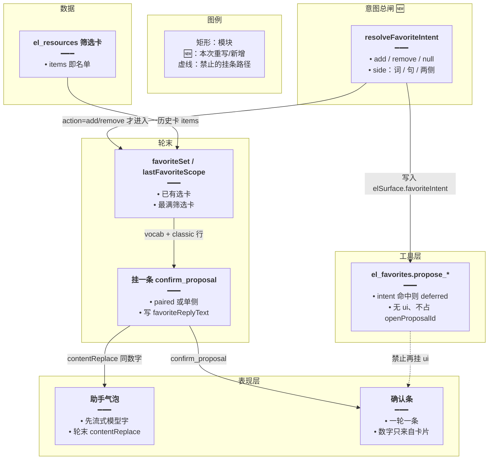
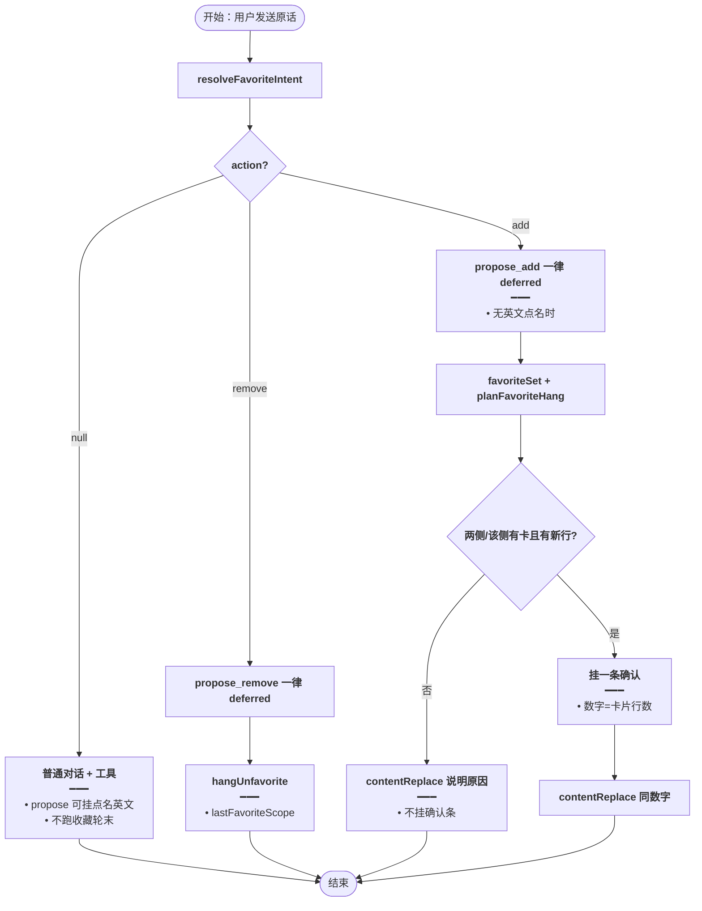
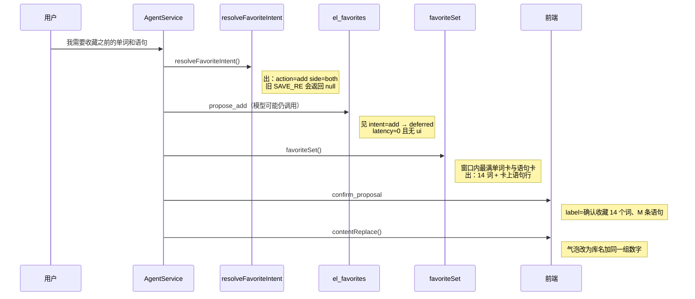
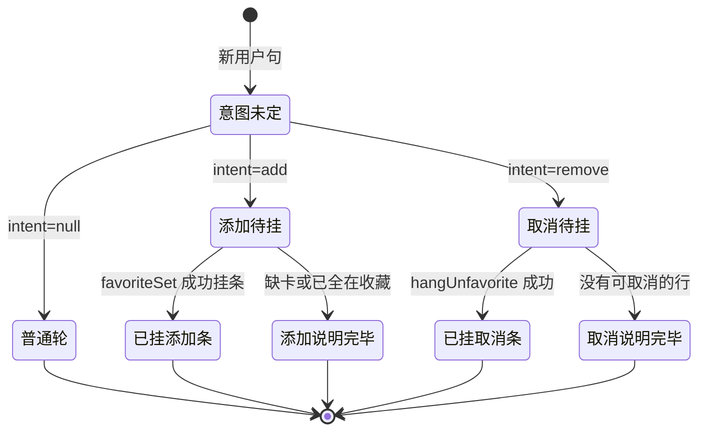

# 收藏意图总控 — 实现思路

> **状态**：规划（工作区已按本文落地）  
> **日期**：2026-10-29  
> **需求摘要**：用户说「我需要收藏之前的单词和语句」时，确认条必须是会话里已挂出的单词卡 + 语句卡的条数（例如 14 个词、3 条语句），不能再变成只有「确认收藏 2 条语句」；同类说法不必再靠不断加正则短语才能进服务端链路。  
> **一句话方案（预告）**：本轮一开始用统一的 `resolveFavoriteIntent` 判定添加 / 取消 / 无关；一旦是添加或取消，中途全部 `propose_*` 只延期不挂条，轮末只由 `favoriteSet` / `lastFavoriteScope` 按卡片挂一条确认，并用 `contentReplace` 盖掉模型列举。

## 延伸阅读

- [收藏确认跟卡片](./收藏确认跟卡片.md)：选卡、最满卡、正文替换已落地。本文解决「意图根本没进那条链路」的总闸问题，选卡规则仍用它
- [词句分表收藏](./词句分表收藏.md)：点确认后单词、语句分表写入。本文不改 `paired` 落库
- [取消沿用上次收藏](./取消沿用上次收藏.md)：取消范围仍是上一次收藏圈定的行
- [收藏提案直确认](./收藏提案直确认.md)：一个会话一条确认条
- [语句收藏确认](./语句收藏确认.md)：改业务表前必须先确认
- [收藏只收库卡](./收藏只收库卡.md)：意图进闸后若窗口里有「今日复习」other 卡，确认条会变成 71 词。选卡来源收口由那篇做
- [查询收藏不挂确认](./查询收藏不挂确认.md)：总控放宽 object 后，「当前收藏了哪些」会被误判 add 并挂确认。查询优先与软添加收口由那篇做
- [收藏先出筛选卡](./收藏先出筛选卡.md)：`需要收藏`+`关于类`复合句进 add 后窗口无卡会误报「上面没有单词卡」。先出筛选卡再挂条由那篇做

---

## 0. 读本文你将得到什么

- 为什么「我需要收藏之前的单词和语句」正文写了 14 个词和 2 条语句，确认条却是「确认收藏 2 条语句」
- 选定方案：意图总闸在轮初判定一次；命中后工具禁止挂条，轮末只按卡片挂一条
- 改动集中在 `favorite-ask.ts` 的意图函数和 `domain-tools` / `agent.service` 的闸门；确认条 UI、分类器、分表写入不改
- 两个阶段：先拓宽并统一意图，再保证「命中则模型永远挂不上确认」
- 最大风险是「查看我的收藏」一类查询句被误当成添加

---

## 1. 需求与边界

### 1.1 用户故事

| 角色 | 场景 | 行为 | 期望结果 |
|------|------|------|----------|
| 登录用户 | 会话里已有家庭单词卡、语句卡，且刚取消过 | 说「我需要收藏之前的单词和语句」 | 确认条「确认收藏 N 个词、M 条语句」，N/M 来自卡片，不是模型少写的 2 |
| 登录用户 | 同上 | 说「将上述单词和语句都收藏」「帮我收藏之前的…」 | 同一条服务端链路，结果一致 |
| 登录用户 | 只想收藏语句 | 说「将语句收藏吧」 | 只有语句侧，不带单词 |
| 登录用户 | 在查收藏夹 | 说「看看我的收藏列表」 | 不出收藏确认条，走 list |
| 登录用户 | 取消 | 说「将单词和语句都取消吧」 | 确认条两侧都有，范围仍是上一次收藏 |

### 1.2 范围

| 在范围内 | 不在范围内（非目标） |
|----------|----------------------|
| 添加 / 取消意图的统一判定与闸门 | 新建表、改确认条组件、改分类器 |
| 命中意图后禁止模型 `propose_*` 挂 ui | 点名英文的取消（仍可走工具按词面） |
| 轮末挂条与 `contentReplace` 与意图对齐 | 用模型气泡里的词表当写入名单 |
| 回归：已落地的 `favoriteSet` / 取消范围 | 阅读生成确认条 |

### 1.3 约束与依赖

- 必须复用已落地的 `favoriteSet`、`planFavoriteHang`、`lastFavoriteScope`、`proposePairedFavorites`、`contentReplace`
- 一轮一个 `proposalId`；前端仍只留最后一条 `pendingProposal`
- 「将这些进行收藏」未同时点名单词和语句时，仍只收语句
- 名单只来自筛选卡 `el_resources.items`，不来自模型正文
- Ponytail：不新加 LLM 专门判意图，除非正则总闸证明不够

---

## 2. 背景

- **谁、在什么场景、卡在哪**：登录用户在英语 Agent 里已经出过「家庭」单词卡和语句卡，中间取消过，再说「我需要收藏之前的单词和语句」。气泡列出 14 个词和 2 条语句，底栏却是「确认收藏 2 条语句」。
- **现状缺口**：服务端其实已经有完整的「按卡片挂确认」链路（`favoriteSet` → 轮末挂条 → `contentReplace`）。但这条链路的总闸是 `favoriteAsk` 的 `SAVE_RE`。`我需要收藏之前的单词和语句` **对不上** `SAVE_RE`（对得上的是「都收藏」「帮我收藏」「将…收藏」等），于是：
  1. `favoriteAsk` → `null`
  2. `favoriteAsksBoth` → `false`，工具里不会 deferred
  3. 轮末 `if (favoriteAsk(...))` 整段不跑
  4. 模型自己调 `el_favorites.propose_add`，最后一次（往往只有语句）占了唯一确认位
- **实测**（2026-10-29）：`favoriteAsk('我需要收藏之前的单词和语句') === null`；同义的 `帮我收藏之前的单词和语句` / `把之前的单词和语句收藏` 反而能命中。收藏表在取消后单词、语句均为 0，不是「单词已在收藏所以只剩语句」。
- **不解决会怎样**：每出现一种「需要收藏 / 想收藏 / 给我收藏」说法，就再修一次正则，确认条继续和气泡分叉；[收藏确认跟卡片](./收藏确认跟卡片.md) 的选卡逻辑根本进不去。
- **硬约束**：意图必须在进模型工具之前就能判定；名单仍是卡片；不能为了省事让模型列举成为真相。

### 2.1 当前 Agent 收藏链路（出问题的那条）

```text
用户原话
  → favoriteAsk / favoriteAsksBoth / unfavoriteFromCards   ← 总闸（窄）
  → 模型调 el_favorites.propose_add / propose_remove
       ├─ 若总闸命中：deferred，无 ui
       └─ 若总闸未命中：真正 put 提案 + confirm_proposal   ← 本次走这里
  → 轮末 agent.service
       ├─ favoriteAsk 命中：favoriteSet + 挂条 + contentReplace
       └─ favoriteAsk 未命中：什么都不做                   ← 本次走这里
  → 前端 pendingProposal = 最后一条带 ui 的工具结果
```

本次：总闸未命中 → 模型挂了「2 条语句」→ 轮末不跑 → 底栏只有语句。

---

## 3. 现状与复用

| 能力 | 仓库中已有 | 本需求中的用法 |
|------|------------|----------------|
| 添加意图 | `favorite-ask.ts` 的 `favoriteAsk` + `SAVE_RE` | **重写判定面**：收成 `resolveFavoriteIntent`，添加不再只靠动词短语表 |
| 两类一起 | `favoriteAsksBoth` | 改为读 intent.side === 'both' |
| 取消意图 | `unfavoriteFromCards` | 并进同一 intent；取消优先于添加 |
| 延期挂条 | `domain-tools.ts` propose_add / propose_remove | 凡 intent 为 add/remove 且未点名英文，一律 deferred |
| 轮末挂添加 | `agent.service.ts` 的 `favoriteSet` + `planFavoriteHang` | 条件改为 `intent.action === 'add'`，不再只认旧 `favoriteAsk` |
| 轮末挂取消 | `hangUnfavorite` + `lastFavoriteScope` | 条件改为 `intent.action === 'remove'` |
| 正文替换 | `favoriteReplyText` + `contentReplace` | 意图命中的添加轮继续用 |
| 分表写入 | `proposePairedFavorites` / apply-proposal | 直接复用 |
| 一条确认 | 前端 `pendingProposal` | 不改 |

**调研结论**：选卡和挂条已经齐，缺的是「什么样的原话算收藏」这一道总闸够不够宽、以及闸没命中时模型还能不能挂 ui。候选必须接上 `favorite-ask.ts` 与 `agent.service` 轮末，而不是再写一套选卡。

---

## 4. 方案比对与最终方案

### 4.1 候选方案

#### 方案 A：继续往 `SAVE_RE` 里加「需要收藏|想收藏|要收藏」（复用现状）

- **做法**：在现有 `SAVE_RE` 增加若干短语；`favoriteAsksBoth` 与轮末条件不动。
- **能工作的原因**：这次「我需要收藏…」会对上，deferred + `favoriteSet` 会跑，确认条回到 14+语句卡。
- **主要代价**：下次「麻烦收藏一下」「收藏一下之前的」又漏；总闸仍然是动词短语白名单，架构还是「认不出就交给模型」。

#### 方案 B：统一 `resolveFavoriteIntent`，命中则模型禁止挂条（扩展）

- **做法**：一个函数返回 `{ action: 'add' \| 'remove' \| null, side: 'vocab' \| 'classic' \| 'both' \| 'card' }`。取消优先。添加：含「收藏」、不是查询收藏夹、且（点了单词/语句/这些/之前/上述 **或** 命中原有动词短语）。轮初写入 `elSurface.favoriteIntent`。`propose_add` / `propose_remove` 见 intent 为 add/remove 且原话无英文则 deferred。轮末只认 intent，调用已有 `favoriteSet` / `hangUnfavorite`。
- **能工作的原因**：总闸按「要不要改收藏表」判定，不按「有没有说进行/都/帮我」。模型无法在未识别说法下偷挂单边确认。
- **主要代价**：查询句要单独排除；「收藏」二字的误伤面比白名单大，要用查询排除式收住。

#### 方案 C：用小模型 `decide()` 判意图（新增）

- **做法**：每轮英语收藏相关原话打一次 flash/decide，输出 add/remove/none 与 side。
- **能工作的原因**：说法覆盖面大。
- **主要代价**：多一次模型调用、延迟与失败路径；和现有「原话正则可测」的收藏约束不一致；Ponytail 不优先。

### 4.2 比对

| 维度 | 方案 A | 方案 B | 方案 C |
|------|--------|--------|--------|
| 正确性 | 只修好已知短语；未列出的说法仍落入模型挂条 | 意图命中则确认条与卡片同源；未命中查询句仍走 list | 说法覆盖好，但 decide 失败时仍要退回正则 |
| 复用 | 只改一行正则 | 复用 favoriteSet / hangUnfavorite / deferred；只换总闸 | 新调用链，选卡仍要接现有模块 |
| 改动面 | `SAVE_RE` 一处 | `favorite-ask.ts` + domain-tools 闸门 + agent.service 条件 | glm-decide + 提示词 + 回退 |
| 复杂度 | 低 | 一个 intent 对象，无新表 | 高：异步意图、缓存、失败 |
| 体验 | 改过的短语好了，没改过的依旧错条 | 「需要/想/要/帮我/将…」同一体验；气泡被换成卡片数字 | 多 200～500ms |
| 风险 | 正则继续膨胀 | 「我的收藏」误伤；用查询排除缓解 | 模型误判取消/添加 |
| 可维护性 | 每漏一次加一词 | 意图规则集中在一处；选卡不再分叉 | 两套真相（模型意图 + 卡片） |

### 4.3 综合考量

本需求的权重是：**正确性（确认条=卡片）** 和 **可维护性（不要再按截图加词）**。方案 A 改动最小，但架构上仍允许「总闸未命中 → 模型挂条」，这正是本次和过去多次「只有语句 / 只有 1 条」的共同根因，放弃它「一行正则就够」的优点。方案 C 覆盖说法的能力好，但为收藏意图单独引模型，抵不过延迟和失败回退，放弃。选定方案 B：总闸加宽并统一，命中后模型彻底不能挂收藏确认。

### 4.4 最终方案

#### 背景

英语 Agent 的收藏确认已经拆成「意图 → 延期工具 → 轮末按卡挂条 → 正文替换」四段。后三段在 [收藏确认跟卡片](./收藏确认跟卡片.md) 里可用；第一段 `SAVE_RE` 过窄，导致「我需要收藏之前的单词和语句」整段服务端链路跳过，模型最后一次 `propose_add`（2 条语句）成为唯一确认条。硬约束是：意图必须服务端可测、名单必须是卡片、一轮一条确认。

#### 具体思路

1. **模块**：在 `favorite-ask.ts` 用 `resolveFavoriteIntent` 取代散落的「是否收藏」判断；`domain-tools` 与 `agent.service` 只读 intent；选卡函数不改语义。
2. **数据**：意图只活在本轮 `elSurface`；确认条数据仍来自历史 `el_resources`；不进新表。
3. **状态**：`elSurface.favoriteIntent` 在组工具前写入；`openProposalId` 仍表示本轮已挂条。
4. **边界**：取消优先于添加；带英文词面的取消仍走工具；查询收藏夹（列表/打开/我的收藏且无「要/需要/帮我…收藏」动作）intent 为 null；「将这些进行收藏」side=card→按经典句处理（与现 `inheritedSide` 一致）。

#### 实现方案

**一句话**：本轮一开始用统一的 `resolveFavoriteIntent` 判定添加 / 取消 / 无关；一旦是添加或取消，中途全部 `propose_*` 只延期不挂条，轮末只由 `favoriteSet` / `lastFavoriteScope` 按卡片挂一条确认，并用 `contentReplace` 盖掉模型列举。

| 步骤 | 谁 | 做什么 | 输入 → 输出 |
|------|----|--------|-------------|
| 1 | `resolveFavoriteIntent` | 取消 / 添加 / 无关；算出 side | 原话 → intent |
| 2 | 组工具时 | `elSurface.favoriteIntent = intent` | intent 进本轮表面状态 |
| 3 | `propose_add` / `propose_remove` | intent 为 add/remove 且无英文点名 → deferred | 无 ui |
| 4 | 轮末添加 | `intent.action==='add'` → `favoriteSet` + `planFavoriteHang` | 一条确认或说明已在收藏 |
| 5 | 轮末取消 | `intent.action==='remove'` → `hangUnfavorite` | 一条取消确认 |
| 6 | `finalizeTurn` | 有 `favoriteReplyText` 则 `contentReplace` | 气泡与确认条同数字 |

#### 选定原因

1. **正确性**：总闸命中后确认条只能来自卡片，模型不能再挂「2 条语句」顶替 14+M。牺牲：查询句要写清楚排除，否则可能误挂。
2. **可维护性**：意图集中一处，不再每个截图加一个动词。牺牲：比改一行 `SAVE_RE` 多动两个调用点。
3. **复用**：选卡、分表、替换正文全部沿用。牺牲：不引入 decide 的「说法全覆盖」能力。
4. **体验**：同义说法同一条确认；气泡轮末对齐。牺牲：用户仍会先看到模型列举再被替换。

#### 优势

- 相对方案 A：新说法只要「收藏 + 对象/之前/上述」，不必等下次加词；未识别时也不会静默交给模型挂单边条。
- 相对方案 C：无额外模型调用；意图可用单测钉死，和现有 `favorite-ask.scope.spec.ts` 一套。

#### 怎么实现

1. 实现 `resolveFavoriteIntent`（见 §9）：取消优先；添加用「收藏 + 非查询 +（对象线索|旧动词）」；side 规则与现 `favoriteAsk`/`favoriteAsksBoth`/`inheritedSide` 对齐。
2. `favoriteAsk` / `favoriteAsksBoth` / `unfavoriteFromCards` 改为薄封装读 intent，避免调用方大面积改名；或逐步替换调用点。
3. `propose_add`：`if (intent?.action === 'add' && !英文点名) return deferred`（覆盖 both 与单类）。
4. `propose_remove`：`if (intent?.action === 'remove' && !英文) return deferred`。
5. 轮末条件从 `favoriteAsk(dto.content)` 改为 `intent?.action === 'add'`；取消同理。
6. 单测：本次原话 → add+both；「看看我的收藏」→ null；「将语句收藏吧」→ add+classic；「将单词和语句都取消吧」→ remove+both。

### 4.5 其他关键决策

#### 4.5.1 添加意图的判定面：动词白名单 vs 收藏+对象

##### 候选

**方案 A**：只扩 `SAVE_RE` 动词（需要收藏|想收藏|…）。

**方案 B**：含「收藏」且非查询，并带有 单词/语句/这些/它们/之前/上述/都/一起，**或** 命中旧动词短语。

##### 比对

| 维度 | 方案 A | 方案 B |
|------|--------|--------|
| 正确性 | 「我需要收藏之前的单词和语句」可修；「收藏一下那些」仍可能漏 | 本次与「之前/上述/单词/语句」类都能进闸 |
| 复用 | 现成 SAVE_RE | 在 SAVE_RE 旁加对象线索 |
| 改动面 | 一处 | 一处函数内 |
| 复杂度 | 低 | 低；多一个 QUERY_RE |
| 体验 | 依赖用户说「对的动词」 | 依赖用户说清收藏对象或沿用旧说法 |
| 风险 | 漏识别 | 「语句收藏库」类查询要排除 |
| 可维护性 | 白名单膨胀 | 对象线索稳定 |

##### 综合考量

对象线索（单词/语句/之前/上述）比动词更贴近用户目标。放弃方案 A「更少概念」的优点。选定方案 B。

##### 最终方案

- **背景**：本次失败句有「收藏」+「之前」+「单词和语句」，却没有 `SAVE_RE` 里的动词模板。
- **具体思路**：查询排除后，对象线索或旧动词任一成立即 add。
- **实现方案**：见 §9.2 `resolveFavoriteIntent`。
- **选定原因**：正确性对准「收藏什么」；牺牲纯动词白名单的简单。
- **优势**：相对只加「需要收藏」，「把之前的…」「收藏上述单词和语句」一类也稳。
- **怎么实现**：§9.2；单测钉死本次原话与「我的收藏列表」。

#### 4.5.2 未点名英文时，模型可否再挂收藏确认

##### 候选

**方案 A**：仅 bothAsk 与「已认收藏且无英文」延期（现状）。

**方案 B**：只要 `intent.action` 为 add/remove，未点名英文就延期。

##### 比对

| 维度 | 方案 A | 方案 B |
|------|--------|--------|
| 正确性 | 意图漏判时模型仍可挂单边条 | 意图命中则不可能再出现「只有 2 条语句」占位 |
| 复用 | 现有两处 if | 收成一处读 intent |
| 改动面 | 不改 | domain-tools 两处 |
| 复杂度 | 此项相同 | 此项相同 |
| 体验 | 漏判时气泡和底栏继续分叉 | 漏判时若 intent 也为 null，行为与今相同；命中则一致 |
| 风险 | 现状即风险 | 点名英文的添加仍允许工具（用户原话里有英文词） |
| 可维护性 | 两套条件 | 一套 |

##### 综合考量

本次条只挂语句，就是方案 A 在意图漏判时的结果。选定方案 B。放弃方案 A「少动工具层」的优点。

##### 最终方案

- **背景**：开着「模型可挂确认」的口子，总闸一旦漏判，后三段选卡全无意义。
- **具体思路**：意图与挂条解耦——意图说改收藏，挂条权只在轮末。
- **实现方案**：propose_* 读 `deps.surface.favoriteIntent`。
- **选定原因**：正确性；牺牲模型点名少量英文词时仍可用工具（保留英文点名例外）。
- **优势**：相对方案 A，不会再用最后一次 propose 覆盖服务端本该挂的两侧。
- **怎么实现**：§9.3。

---

## 5. 架构图



**图内方法说明**：

| 方法 | 功能 |
|------|------|
| `resolveFavoriteIntent(text)` | 本轮唯一意图入口。返回 action 与 side；取消优先；查询收藏夹返回 null |
| `favoriteAsk` / `unfavoriteFromCards` | 薄封装或逐步替换为读 intent，供旧调用方兼容 |
| `propose_add` / `propose_remove` | 见 intent 为改收藏且无英文点名则 deferred，避免占确认位 |
| `favoriteSet` | 已有。按窗口取最满筛选卡，供添加挂条 |
| `lastFavoriteScope` | 已有。取消范围以上一次收藏原话为准 |
| `planFavoriteHang` | 已有。生成与卡片同数字的 label / reply |
| `contentReplace` | 已有 SSE。用 reply 覆盖模型列举 |

**读图要点**：

- 意图在工具与轮末之前就定死；选卡模块不负责「算不算收藏句」。
- 虚线表示模型挂条路径在 intent 命中时关闭。
- 卡片仍是唯一名单源。

---

## 6. 主流程图



**图内方法说明**：

| 方法 | 功能 |
|------|------|
| `resolveFavoriteIntent` | 分流 add / remove / 普通轮 |
| `favoriteSet` / `planFavoriteHang` | 添加轮选卡与是否挂条 |
| `hangUnfavorite` | 取消轮按上一次收藏挂条 |
| `contentReplace` | 添加成功或失败说明都写进气泡 |

**读图要点**：

- 入口只有意图三路，不再存在「未识别却让模型挂收藏确认」的第四路。
- 添加失败（缺卡 / 已全在）也不挂空确认条。

---

## 7. 核心时序图



**图内方法说明**：

| 方法 | 功能 |
|------|------|
| `resolveFavoriteIntent()` | 轮初判定；本次原话必须为 add+both |
| `propose_add` | 命中后只回 deferred，不写 pendingProposal |
| `favoriteSet()` | 用历史筛选卡组两侧行 |
| `confirm_proposal` | 唯一确认条事件 |
| `contentReplace()` | 气泡与底栏数字对齐 |

**读图要点**：

- 模型仍可能调用工具，但挂条权在服务端轮末。
- 前端不会先收到一条「2 条语句」再被覆盖成两侧——因为 deferred 根本不带 ui。

---

## 8. 状态机



**图内方法说明**：

| 方法 | 功能 |
|------|------|
| `resolveFavoriteIntent` | 离开「意图未定」的唯一出口 |
| `favoriteSet` / `hangUnfavorite` | 决定挂条或说明完毕 |

---

## 9. 具体实现（主链路代码）

### 9.1 模块一览

| 模块 | 职责 | 新增/改动 | 预估路径 |
|------|------|-----------|----------|
| `resolveFavoriteIntent` | 统一意图 | 新增 | `apps/backend/src/services/agent/tools/english/favorite-ask.ts` |
| `favoriteAsk` 等 | 兼容封装 | 改动 | 同上 |
| propose 闸门 | deferred | 改动 | `domain-tools.ts` |
| 轮末条件 | 读 intent | 改动 | `agent.service.ts` |
| 单测 | 钉死本次原话 | 扩展 | `favorite-ask.scope.spec.ts` |

### 9.2 意图总闸

```typescript
// 对应 §4.4 步骤 1。本轮只在这里决定算不算改收藏，避免 SAVE_RE 漏句后整条服务端链路消失
export type FavoriteIntent = {
	// add 走 favoriteSet；remove 走 hangUnfavorite；null 表示普通轮
	action: 'add' | 'remove' | null;
	// both 要两侧卡；card 与「这些」按语句侧处理，和现 inheritedSide 一致
	side: 'vocab' | 'classic' | 'both' | 'card';
};

// 查询收藏夹：有「收藏」但不能当成「要写入」
const FAVORITE_QUERY_RE =
	// 列表/夹/看看/打开/我的收藏，以及「xx收藏里」这种库内查询
	/收藏(列表|夹)|看看收藏|打开收藏|我的收藏|语句收藏里|单词收藏里/;

// 对象线索：用户在说收藏「什么」，比「进行/都」更贴近这次原话
const FAVORITE_OBJECT_RE =
	// 词句类别、代词对象、时间指代（之前/上述/刚才）任一即可进添加闸
	/单词|词汇|词书|语句|句子|经典句|这些|它们|他们|之前|上述|刚才|刚刚/;

export function resolveFavoriteIntent(userText: string): FavoriteIntent {
	// 空句直接无关，避免给 trim 后的空白挂确认
	const text = userText.trim();
	// 空白原话没有可挂的收藏对象
	if (!text) return { action: null, side: 'card' };

	// 取消优先。点名英文时 unfavoriteFromCards 已返回 null，留给工具按词面删
	const cancel = unfavoriteFromCards(text);
	// 命中取消则 action=remove，side 可能是 both/vocab/classic
	if (cancel) return { action: 'remove', side: cancel };

	// 没有「收藏」二字就不是收藏添加（生成/分类等走别的工具）
	if (!/收藏/.test(text)) return { action: null, side: 'card' };
	// 纯查看收藏夹不挂添加确认
	if (FAVORITE_QUERY_RE.test(text)) return { action: null, side: 'card' };

	// 旧动词短语仍认，兼容「都收藏」「进行收藏」
	const verb = SAVE_RE.test(text);
	// 「我需要收藏之前的单词和语句」靠对象线索进闸，不再要求「需要收藏」整词在白名单
	const object = FAVORITE_OBJECT_RE.test(text);
	// 动词和对象都没有则不是明确的添加收藏
	if (!verb && !object) return { action: null, side: 'card' };

	// 是否点名语句侧，与现 CLASSIC_RE 相同
	const classic = CLASSIC_RE.test(text);
	// 是否点名单词侧
	const vocab = VOCAB_RE.test(text);
	// 两侧都点名 → both，对应本次原话
	if (classic && vocab) return { action: 'add', side: 'both' };
	// 只点单词
	if (vocab) return { action: 'add', side: 'vocab' };
	// 只点语句
	if (classic) return { action: 'add', side: 'classic' };
	// 「将这些进行收藏」一类：有动词无两侧词 → card，后续按语句收
	return { action: 'add', side: 'card' };
}
```

### 9.3 工具延期与轮末

```typescript
// 对应 §4.4 步骤 3。意图已是 add 时，模型再 propose_add 也不许带 ui
if (
	// 只拦收藏工具，错题 propose 不走这套
	which === 'favorites' &&
	// 轮初写入的 intent，避免再读一遍可能漂移的原话正则
	deps.surface.favoriteIntent?.action === 'add' &&
	// 原话点名英文时仍允许工具按词面提案
	!/[A-Za-z]{2,}/.test(userText)
) {
	// deferred 不设 openProposalId，轮末才能挂两侧卡片
	return elOk(
		// 标记延期，模型不应再告诉用户已发起
		{ deferred: true },
		{
			// 明确禁止列举原话没有的句子，堵住编造句占位
			message:
				'确认条按上面的卡片在本轮结束时挂上。不要再 propose_add，不要列举原话里没有的句子，也不要说已经发起收藏。',
		},
	);
}

// 对应 §4.4 步骤 4。轮末只认 intent，不再依赖旧 favoriteAsk 是否碰巧命中 SAVE_RE
const intent = resolveFavoriteIntent(dto.content);
if (
	// 仅英语学习助手跑收藏轮末
	dto.assistMode === 'english_learning' &&
	// 本次原话是添加收藏
	intent.action === 'add' &&
	// 本轮还没有别的确认条
	!elSurface.openProposalId &&
	// 有业务会话才能回扫历史卡
	businessSessionId
) {
	// favoriteSet 内部用 side：both / vocab / classic（card 当 classic）
	const set = favoriteSet(history, dto.content, priorIndexes);
	// planFavoriteHang / proposePairedFavorites 保持已有实现，此处不重复
}
```

### 9.4 数据模型

| 字段/实体 | 来源 | 存储 | 说明 |
|-----------|------|------|------|
| `FavoriteIntent` | 用户原话 | 本轮 `elSurface` | 不入库 |
| 确认条 items | 筛选卡 | 提案存储器 | 与现网一致 |
| 助手正文 | `favoriteReplyText` | 消息表 content | 覆盖模型列举 |

---

## 10. 分阶段实现步骤

| 阶段 | 目标 | 交付物 | 依赖 |
|------|------|--------|------|
| M1 | 「我需要收藏之前的单词和语句」进闸并为 both | `resolveFavoriteIntent` + 单测 | 现有卡片仍在历史里 |
| M2 | 命中后 propose 无 ui；轮末挂 14+M；正文替换 | domain-tools + agent.service 条件切换 | M1 |

M1

- [ ] `resolveFavoriteIntent('我需要收藏之前的单词和语句')` → `{ action:'add', side:'both' }`
- [ ] `resolveFavoriteIntent('看看我的收藏列表')` → `action:null`
- [ ] `resolveFavoriteIntent('将语句收藏吧')` → add+classic
- [ ] `resolveFavoriteIntent('将单词和语句都取消吧')` → remove+both
- [ ] 旧句「将上述单词和语句都收藏」行为不变

M2

- [ ] 上述添加句工具日志为 deferred（latency≈0 且无 confirm_proposal）
- [ ] 轮末确认条同时含词数与语句数，且等于卡片行数
- [ ] `contentReplace` 后气泡数字与确认条一致
- [ ] 点名英文的取消仍可不 deferred

---

## 11. 风险、边界与待确认

| 项 | 等级 | 说明 | 缓解 |
|----|------|------|------|
| 查询句误伤 | 中 | 「收藏」+ 对象词的讲解句 | `FAVORITE_QUERY_RE`；单测「语句收藏里有哪些」 |
| 无对象无动词 | 低 | 「收藏」单字 | 保持 null，不挂条 |
| 卡片语句数与模型写的 2 不一致 | 低 | 模型少写是常态 | 以卡片为准并替换正文 |
| 与「收藏确认跟卡片」重复 | 低 | 选卡已落地 | 本文只换总闸，文首互链 |

**待确认**：

- [ ] 「收藏一下」无对象时是否也要进闸（验证方式：若产品要，则 object 线索增加 `一下`；默认不进，避免空挂）

---

## 12. 验收清单

| # | 用例 | 步骤 | 期望 |
|---|------|------|------|
| AC1 | 本次截图原话 | 会话有 14 词卡 + 语句卡，说「我需要收藏之前的单词和语句」 | 确认条含词与句两侧；数字=卡片；不是「确认收藏 2 条语句」 |
| AC2 | 同义 | 「帮我收藏之前的…」「把之前的单词和语句收藏」 | 与 AC1 同一链路 |
| AC3 | 查询 | 「看看我的收藏列表」 | 无收藏确认条 |
| AC4 | 只语句 | 「将语句收藏吧」 | 只有语句侧 |
| AC5 | 取消 | 「将单词和语句都取消吧」 | 取消确认含两侧（在有可取消行时） |
| AC6 | 工具 | AC1 当轮 el_tool | propose_add 为 deferred，最终只有一条服务端 confirm_proposal |

---

## 13. 预估改动面（实现阶段参考）

| 类型 | 路径（预估） |
|------|--------------|
| 后端 | `apps/backend/src/services/agent/tools/english/favorite-ask.ts` |
| 后端 | `apps/backend/src/services/agent/tools/english/domain-tools.ts` |
| 后端 | `apps/backend/src/services/agent/agent.service.ts` |
| 后端测试 | `favorite-ask.scope.spec.ts` |
| 前端 | 不改 |
| 文档 | 落地后与 [收藏确认跟卡片](./收藏确认跟卡片.md) 互链更新状态 |

---

（本文档为规划态实现思路；落地后以源码与 remote-docs wiki 专题为准）
