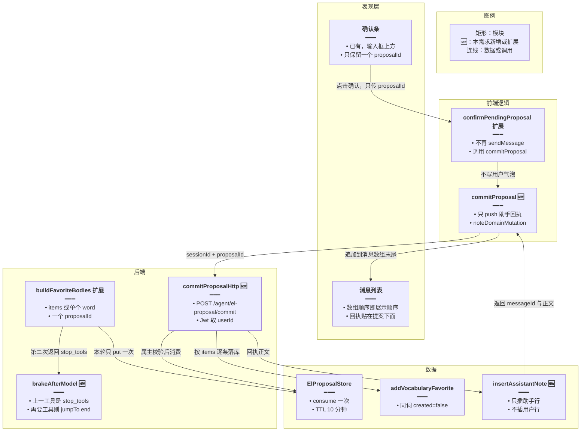
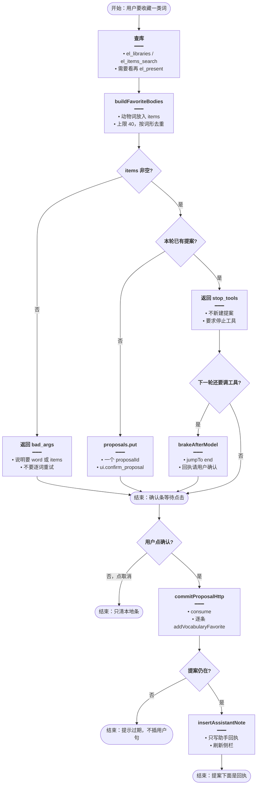
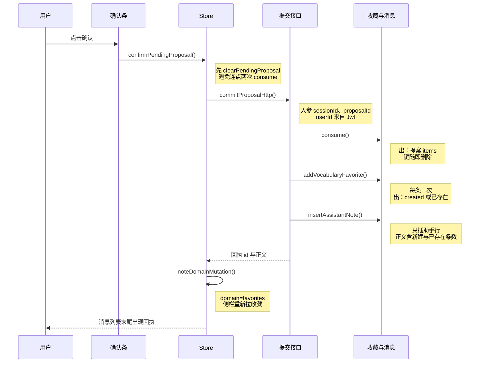
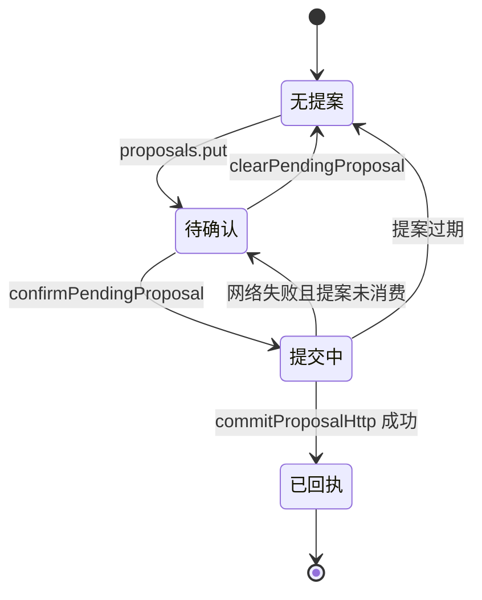

# 收藏提案直确认 — 实现思路

> **状态**：规划（未实现）  
> **日期**：2026-10-28  
> **需求摘要**：用户让英语 Agent 把词库里某一类词（如小学三年级动物词）一次收藏时，提案应一次交齐并停在确认条上；点确认直接落库，聊天里不出现事后补上的「请对提案调用 commit」用户句，也不再因逐词工具循环抛出 `GRAPH_RECURSION_LIMIT`。

## 延伸阅读

- 提案制来源：[english/英语Agent关联侧栏.md](./英语Agent关联侧栏.md)（写操作 `propose_*` → 用户点确认或下轮 `commit`；当时约定不把确认做成模型可伪造的同轮 `confirm=true`）
- 本篇只补「一批词一次提案」和「点确认不另开模型轮」。查找、出卡、旁路清单仍沿用现有 `el_items_search` / `el_present` / spill

---

## 0. 读本文你将得到什么

- 要解决的是同一轮里的两件事：逐词 `propose_add` 把 LangGraph 图步数耗尽，以及点确认后把内部指令写成一条用户消息。
- 一句话方案：多个词一次 `propose_add.items` 只产生一个提案；确认按钮直接 HTTP 消费该提案并只追加助手回执。
- 改动落在领域工具入参、系统提示、`AgentController` 一个提交接口、英语消息表插一条助手回执、确认按钮不再调用 `sendMessage`。
- 分三阶段：M1 批量提案，M2 直确认，M3 同轮刹车。
- 最大风险是模型仍逐词调用；刹车保证不炸图，不保证逐词路径能收齐全部词。

---

## 1. 需求与边界

### 1.1 用户故事

| 角色 | 场景 | 行为 | 期望结果 |
|------|------|------|----------|
| 已登录用户 | 英语学习右侧 Agent | 说「把小学三年级词库里的动物词收藏」 | 助手查库后给出**一个**确认条，覆盖这批词 |
| 已登录用户 | 确认条已出现 | 点「确认」 | 这批词写入收藏；侧栏刷新；聊天顺序是「原用户句 → 提案 → 助手回执」 |
| 已登录用户 | 不想收藏 | 点「取消」或改口 | 提案作废或留到 TTL；不写收藏，不插入用户句 |
| 已登录用户 | 口头说「确认」 | 下一条用户消息 | 仍允许模型调用 `el_favorites` 的 `commit`（新的一轮，不是按钮） |

### 1.2 范围

| 在范围内 | 不在范围内（非目标） |
|----------|----------------------|
| `el_favorites` / `el_mistakes` 的 `propose_add` 支持 `items` | 不改词库检索、不在服务端做「动物」语义分类 |
| 确认按钮对收藏、取消收藏、错题提案都直写 | 不把批量收藏改成同轮白名单 `add`（那会取消确认） |
| 同轮禁止模型自己 `commit` 刚创建的提案 | 不提高 `recursionLimit`（现为英语 56） |
| 助手回执入库，刷新后仍在提案下面 | 不改通用 Agent / 知识库助手的发送路径 |

### 1.3 约束与依赖

- 须登录。确认条只在英语 Agent 面板，Web 与 Tauri 同一套前端。
- 复用 `ElProposalStore`（Redis 键 `el_proposal:{id}`，TTL 10 分钟）、`addVocabularyFavorite`（同词已存在则 `created:false`）、`noteDomainMutation`。
- 图步预算保持 `agentStreamRecursionLimit('english_learning') === 56`。英语图每一轮工具约 5 个节点：摘要 `before_model`、模型、两个 `toolCallLimit` 的 `after_model`、`tools`。
- 领域工具合计上限仍是 `ENGLISH_EL_TOOL_RUN_LIMIT = 10`。本方案靠减少往返，不靠放宽上限。

---

## 2. 方案总览（一句话 + 要点）

**一句话方案**：一批词一次写入同一个提案；点确认由服务端消费提案并落库，只在会话末尾追加助手回执。

| # | 设计要点 | 理由 |
|---|----------|------|
| 1 | `propose_add` 接受 `items`，一个 `proposalId` | 三年级动物词只有一次工具往返，查库加提案约 6 轮，远低于 56 步 |
| 2 | 确认按钮调用 `POST /agent/el-proposal/commit`，不调用 `sendMessage` | 现网按钮把指令原文推进用户气泡，所以这句话出现在点击之后 |
| 3 | 回执只插助手行 | 顺序停在提案下面；没有用户/助手成对插入，也避开同秒 `created_at` 把两行排反 |
| 4 | 本轮创建的提案，工具里的 `commit` 直接拒绝 | 2026-10-27 23:52 的日志里模型提案后立刻 `commit`，一轮里次数翻倍 |
| 5 | 同轮第二次 `propose_add` 返回 `stop_tools`；下一轮若再要工具则 `jumpTo: end` | 模型不听 `items` 时，在图步用完之前停住，把 `GRAPH_RECURSION_LIMIT` 换成可读回执 |

### 2.1 根因（2026-10-27 23:55 这次提问）

用户原话是收藏小学三年级词库中的动物词。后端同一秒先打出 `el_limit`，再打出 `GraphRecursionError`。

| 现象 | 原因 | 代码位置 |
|------|------|----------|
| 工具一秒一次，共 11 次领域调用 | `buildFavoriteBody` 只认单个 `word`。第一次 `propose_add` 缺 `word`，返回 `bad_args`；之后一调用一次 | `domain-tools.ts` 的 `buildFavoriteBody`、`propose_add` |
| 第 11 次 `op=` 为空且 `code=el_limit` | 上限判断在解析 `op` 之前；前 10 次已含查库、出卡、失败提案和 4 次成功提案 | `wrap` 内 `ENGLISH_EL_TOOL_RUN_LIMIT` |
| 紧接着 `GRAPH_RECURSION_LIMIT` | 11 轮 × 约 5 节点 ≈ 55，顶到英语图步上限 56。`el_limit` 要求「根据已有结果作答」，模型节点已经排不进去 | `agentStreamRecursionLimit`；`buildAgentLangchainMiddleware` |
| 确认条只有最后一条提案 | 每次 `onTool` 用新的 `confirm_proposal` 覆盖 `pendingProposal` | `englishAgent.ts` 的 `parseElConfirmProposal` |
| 点确认后出现「请对提案 9d6f06d3-… 调用 el_favorites 的 commit 操作完成确认。」 | `confirmPendingProposal` 把这句话当作 `sendMessage` 的用户正文。`activeContext.confirmProposalId` 只拼进模型看到的 Human 消息，不落库、也不执行 commit | `views/englishLearning/agent/index.tsx` |

23:56:27 的 `el_favorites commit` 是这次点击新开的一轮，不是提案当时的提交。

---

## 3. 现状与复用

| 能力 | 仓库中已有 | 本需求中的用法 |
|------|------------|----------------|
| 提案缓存 | `apps/backend/src/services/agent/tools/english/proposal.store.ts` 的 `put` / `consume` | 直接复用；载荷增加 `items` |
| 收藏写入 | `EnglishLearningService.addVocabularyFavorite` | 直接复用；提交接口按条调用，已存在词不报错 |
| 错题批量写入 | `batchAddVocabularyMistakes` / `batchAddClassicQuoteMistakes` | 直接复用；错题提案走同一提交接口 |
| 确认条 | `AgentPanel` 底部「确认 / 取消」 | 扩展：确认改为 HTTP，取消仍只清本地条 |
| 侧栏刷新 | `englishAgentStore.noteDomainMutation` | 直接复用；提交成功后发 `favorites` 或 `mistakes` |
| 领域工具限额 | `domain-tools.ts` 的 `wrap`，上限 10 | 直接复用；不调大 |
| 图步上限 | `agent-middleware.ts` 的 `agentStreamRecursionLimit` | 不适用；保持 56 |
| 英语消息插入 | `EnglishTableMemory.insertUserAndAssistantPlaceholder` 成对插入 | 新建只插助手行的方法；按钮路径不走成对插入 |
| 提交 HTTP | 无。`AgentController` 只有会话、SSE、`el-artifact` | 新建 `POST /agent/el-proposal/commit` |

**调研结论**：提案、落库、确认条、侧栏刷新都已存在。缺的是「多词一个提案」和「按钮不经过模型」。现网把 [英语Agent关联侧栏](./英语Agent关联侧栏.md) 里的「点确认再 commit」做成了再发一条用户消息，所以指令出现在点击之后。

---

## 4. 架构图



**图内方法说明**：

| 方法 | 功能 |
|------|------|
| `confirmPendingProposal()` | 读当前 `pendingProposal` 后立刻清条，再调用 `commitProposal`。不再把「请对提案调用 commit」交给 `sendMessage`，因此点击不会新增用户消息 |
| `commitProposal(proposalId)` | 前端 Store 方法：请求提交接口，成功后只 `push` 一条助手消息，并 `noteDomainMutation` 让收藏或错题侧栏刷新 |
| `commitProposalHttp()` | `POST /agent/el-proposal/commit`：用登录用户消费提案、落库、插入助手回执，返回新建条数与回执 id |
| `buildFavoriteBodies()` | 把 `items` 或单个 `word` 收成校验后的数组；多词一次 `proposals.put`，供收藏和错题的 `propose_add` 共用 |
| `brakeAfterModel()` | 挂在现有 Agent 中间件链的 `afterModel`：若上一条工具结果是 `stop_tools` 且本步又要调工具，改成纯文本并 `jumpTo: 'end'`，不再进入 `tools` |
| `consume()` | `ElProposalStore` 已有方法：校验 `userId` 后删除 Redis 键并返回载荷；第二次提交得到过期 |
| `addVocabularyFavorite()` | 已有收藏写入：空词拒绝，同用户同词形返回已存在，不抛重复错误 |
| `insertAssistantNote()` | 在英语会话消息表只插入助手行，使刷新后回执仍在提案下面 |
| `noteDomainMutation(domain)` | 已有：递增计数并派发 `english-domain-mutation`，侧栏列表重新拉取 |

**读图要点**：

- 按钮路径停在 HTTP，不进入 `createAgent`，所以确认本身不消耗图步。
- 提案路径仍走现有 `el_favorites` 工具；`items` 让查库和提案停留在个位数轮次。
- `brakeAfterModel` 只在模型无视 `stop_tools` 时截断，不替代批量提案。

---

## 5. 主流程图



**图内方法说明**：

| 方法 | 功能 |
|------|------|
| `buildFavoriteBodies()` | 解析本轮要收藏的词；没有 `word` 也没有合法 `items` 时返回 `bad_args`，避免模型用错误形状再打一轮 |
| `proposals.put()` | 本轮第一次成功提案写入 Redis，返回唯一 `proposalId` 和「确认收藏 N 个词」 |
| `brakeAfterModel()` | 模型在 `stop_tools` 之后仍发出 `tool_calls` 时结束本轮，把固定中文回执交给用户，不再执行工具 |
| `commitProposalHttp()` | 点击确认后的唯一写路径：消费提案并落库；失败不调用聊天 SSE |
| `insertAssistantNote()` | 把「已收藏 x，已存在 y」写入当前英语会话的助手消息 |

**读图要点**：

- 成功主路径在 `proposals.put` 之后停住等点击，模型不应再 `commit`。
- 失败分三支：参数不对、提案过期、用户取消。三条都不插入用户消息。
- 口头「确认」不走这张图的点击支，仍走下一轮聊天里的工具 `commit`（见 §10）。

---

## 6. 核心时序图



**图内方法说明**：

| 方法 | 功能 |
|------|------|
| `confirmPendingProposal()` | 确认条点击入口：清掉本地提案条，把 `proposalId` 交给 Store，不组用户句子 |
| `commitProposalHttp()` | 服务端按属主消费提案并落库，组装回执后返回给前端 |
| `consume()` | 取出并删除提案；属主不符或 TTL 过了则接口返回过期，前端 Toast，不追加消息 |
| `addVocabularyFavorite()` | 按 `items` 顺序写入收藏；重复词计入「已存在」，不中断其余词 |
| `insertAssistantNote()` | 持久化助手回执，保证刷新后仍排在提案消息之后 |
| `noteDomainMutation()` | 通知英语学习侧栏收藏已变，不依赖再开一轮 Agent |

**读图要点**：

- 用户只产生一次点击，时序里没有第二条用户消息。
- 落库在插回执之前；落库失败则不插回执，提案若已 `consume` 须在接口内写完或明确返回部分成功（见 §11）。
- 侧栏刷新与消息回执都来自同一次 HTTP 响应，不走 SSE。

---

## 7. 状态机



**图内方法说明**：

| 方法 | 功能 |
|------|------|
| `proposals.put()` | 进入待确认：前端 `pendingProposal` 设为该 id，确认条出现 |
| `clearPendingProposal()` | 取消：只清前端条，Redis 提案留到 TTL，避免误点后无法用口头确认补救 |
| `confirmPendingProposal()` | 进入提交中：按钮禁用，直到 HTTP 返回 |
| `commitProposalHttp()` | 成功则到已回执；过期则回无提案并 Toast |

**读图要点**：

- 待确认只有一条。新的 `propose_add` 不覆盖成另一个 id，而是 `stop_tools`。
- 网络失败且服务端还没 `consume` 时恢复确认条；已消费则不能恢复，只提示结果。

---

## 8. 模块职责与接口草图

### 8.1 模块一览

| 模块 | 职责 | 新增/改动 | 预估路径 |
|------|------|-----------|----------|
| 提案载荷 | `items` 与单条 `body` 二选一 | 扩展 | `apps/backend/src/services/agent/tools/english/proposal.store.ts` |
| 收藏/错题提案 | 一次 `put`；同轮第二次 `stop_tools`；同轮 `commit` 拒绝 | 扩展 | `apps/backend/src/services/agent/tools/english/domain-tools.ts` |
| 系统提示 | 多词必须 `items`，本轮不要 `commit` | 扩展 | `apps/backend/src/services/agent/agent.prompt.ts` |
| 刹车 | `stop_tools` 之后禁止再进工具节点 | 扩展 | `apps/backend/src/services/agent/agent-middleware.ts` |
| 提交接口 | 消费提案、落库、插回执 | 新增 | `apps/backend/src/services/agent/agent.controller.ts`、`agent.service.ts` |
| 助手回执 | 只插助手行 | 新增 | `apps/backend/src/services/english-learning/english-table-memory.ts` |
| 确认按钮 | 改走 Store 的 `commitProposal` | 扩展 | `apps/frontend/src/views/englishLearning/agent/index.tsx` |
| Store | HTTP、本地回执、领域刷新 | 扩展 | `apps/frontend/src/store/englishAgent.ts`、`apps/frontend/src/service/api.ts` |
| 文案 | 回执与过期提示 | 扩展 | `apps/frontend/src/i18n/locales/zh-CN/englishLearning.ts` 与 `en-US` 同文件 |

### 8.2 关键接口（伪代码或 TypeScript 草图）

```typescript
// 多词一次提案；保留 word 是为了单次收藏不用改调用形状
type FavoriteProposeArgs = {
	// 一批词；动物词这类集合必须走这里，避免一调用一次
	items?: Array<{ word: string; translationZh?: string }>;
	// 只有一个词时用；与 items 同时出现则忽略
	word?: string;
};

// 确认按钮的提交入参；不含会显示在气泡里的句子
type CommitProposalInput = {
	// 英语会话 id，用来把回执插进当前线程
	sessionId: string;
	// 确认条上的那一个提案
	proposalId: string;
};
```

```typescript
// 同轮第二次提案不再 put；让模型停，而不是再收藏下一个词
function onProposeAgain(existingId: string): ElEnvelope {
	// stop_tools 是刹车的约定码，中间件见到它就不再执行工具
	return elFail('stop_tools', '本轮已有待确认提案，停止工具调用');
}
```

### 8.3 数据模型

| 字段/实体 | 来源 | 存储 | 说明 |
|-----------|------|------|------|
| `ElProposalPayload.items` | `buildFavoriteBodies` | Redis，TTL 10 分钟 | 有 `items` 时 `commit` 按数组落库；无则沿用单条 `body` |
| `proposalId` | `proposals.put` | 确认条内存 + Redis | 一轮一个；按钮和口头确认都消费这一个 |
| 助手回执 | `commitProposalHttp` | `english_agent_messages`，`role=assistant` | 无配对用户行；`turnId` 可空 |
| `pendingProposal` | 工具 SSE `ui.confirm_proposal` | 前端 Store | 仍是单个对象；`label` 带条数 |

`items` 上限 40。超出则提案只收前 40，回执说明已截断，不要求模型再调一次补齐。小学动物词足够，也避免一次提交把收藏接口拖长。

---

## 9. 分阶段实现步骤

| 阶段 | 目标 | 交付物 | 依赖 |
|------|------|--------|------|
| M1 | 一批词一个提案 | `items`、提示语、确认条文案含条数 | 无 |
| M2 | 点确认不产生用户句 | 提交接口、助手回执、按钮改道 | M1 |
| M3 | 模型乱循环时不炸图 | 同轮 `stop_tools`、`brakeAfterModel`、同轮 `commit` 拒绝 | M1 |

### M1

- [ ] `buildFavoriteBodies` 接受 `items`，按词形去重，超过 40 截断并在信封 `message` 说明
- [ ] 收藏与错题的 `propose_add` 把数组放进一次 `proposals.put`
- [ ] 系统提示与工具描述写明：多词只用一次 `items`，禁止逐词 `propose_add`
- [ ] 确认条 `label` 使用「确认收藏 N 个词」

### M2

- [ ] `POST /agent/el-proposal/commit`：Jwt、`consume`、按 `kind` 调用已有收藏/错题/取消收藏方法
- [ ] `insertAssistantNote` 只插助手行；前端 `commitProposal` 用返回的 id 追加消息
- [ ] `confirmPendingProposal` 删除对 `sendMessage` 的调用，以及 `confirmProposalId` 那种只给模型看的上下文
- [ ] 成功后 `noteDomainMutation`；过期与网络失败用现有 Toast，不追加用户消息
- [ ] 中英文回执文案

### M3

- [ ] 闭包记录本轮 `proposalId`；第二次 `propose_add` 返回 `stop_tools` 且不 `put`
- [ ] 本轮 `commit` 若 `proposalId` 就是这次 `put` 的，返回「请等用户点确认」
- [ ] `brakeAfterModel`：上一条工具码为 `stop_tools` 且模型又发出工具调用时 `jumpTo: 'end'`
- [ ] 不修改 `agentStreamRecursionLimit` 与 `ENGLISH_EL_TOOL_RUN_LIMIT`

---

## 10. 关键决策与备选方案

| 决策 | 选用 | 备选 | 为何不选备选 |
|------|------|------|--------------|
| 多词怎么交 | 一次 `items` | 继续逐词，把图步调到 120 | 11 轮已经顶到 56；词再多仍会在收口前炸。调上限不减少无效模型往返 |
| 点确认怎么写 | HTTP 消费提案，只插助手回执 | 继续 `sendMessage`，但把那句标成隐藏 | 隐藏仍开一轮模型，可能再次撞上限；用户刷新后若过滤失效，句子还会出现在点击之后 |
| 按钮要不要新接口 | 要，挂在现有 `AgentController` | 前端拿不到词表，无法直接调收藏 REST | 词表只在 Redis 提案里。这不是平行的收藏 API，只是把已有 `consume` 暴露给按钮 |
| 模型不听话 | 第二次提案 `stop_tools`，再下一轮刹车结束 | 服务端替模型从 107 个词里挑动物 | 分类不是本需求；刹车只保证不抛 `GRAPH_RECURSION_LIMIT` |
| 口头确认 | 下一轮用户消息仍可 `commit` | 关掉工具 `commit`，只留按钮 | 用户打字「确认」是原提案制的另一条合法路径 |

---

## 11. 风险、边界与待确认

| 项 | 等级 | 说明 | 缓解 |
|----|------|------|------|
| 逐词调用收不齐 | 中 | 刹车会在第二、第三次提案后停，确认条里可能只有第一次那几个词 | 提示与工具描述强制 `items`；回执写明「提案里是这些词」。不靠加图步把逐词跑完 |
| `consume` 之后落库中断 | 中 | 提案不能重放，可能只写入一部分 | 接口按条循环，返回 `created` / `existed` / `failed`；回执写明条数。单条失败不回滚已写入（与现网逐条收藏一致） |
| 错题与取消收藏共用按钮 | 低 | 只改收藏会让错题确认仍插入用户句 | M2 的接口按 `payload.kind` 分发，三条写路径一起切 |
| 助手连着助手 | 低 | 提案消息和回执都是助手角色 | 这是要点击之后的正确顺序；列表按数组与 `created_at` 升序，中间没有用户行 |
| 同轮白名单 `add` | 低 | 模型可能改走 `add` 绕过确认 | 提示保持「写入须提案」；本篇不扩大 `add` |

**待确认**：

- [ ] 回执是否要带词面列表，还是只写条数（验证方式：用 12 个动物词点确认，看气泡会不会挤占提案卡片；默认只写条数，词面留在确认前的提案说明里）

---

## 12. 验收清单

| # | 用例 | 步骤 | 期望 |
|---|------|------|------|
| AC1 | 一类词一次提案 | 对小学三年级词库说「收藏里面的动物词」 | 领域工具远少于 10 次；无 `GRAPH_RECURSION_LIMIT`；确认条只有一个 id，文案含条数 |
| AC2 | 点击顺序 | 点确认 | 提案与回执之间没有「请对提案 … 调用 el_favorites 的 commit」；该句也不在点击前出现 |
| AC3 | 落库 | 点确认后打开单词收藏 | 提案里的新词在；重复词不报错；侧栏不用手动刷新 |
| AC4 | 刷新 | 提交成功后重进会话 | 回执仍在提案下面，角色是助手 |
| AC5 | 取消 | 点取消 | 无新消息，收藏不变 |
| AC6 | 过期 | 等提案超过 TTL 再点 | Toast 过期；无用户消息；无部分脏写 |
| AC7 | 口头确认 | 不点按钮，下一条用户消息说「确认」 | 新一轮里工具 `commit` 成功；这一轮可以有用户自己的「确认」二字 |
| AC8 | 同轮自提交 | 模型在提案同一轮调用 `commit` | 工具返回等待用户确认，收藏不变 |
| AC9 | 逐词乱循环 | 模型连续单次 `propose_add` | 第二次起 `stop_tools`，再要工具则本轮结束并有文字回执，不出现 `GraphRecursionError` |
| AC10 | 错题按钮 | 错题提案点确认 | 同样不插入那句 commit 指令；错题表增加记录 |

---

## 13. 预估改动面（实现阶段参考）

| 类型 | 路径（预估） |
|------|----------------|
| 后端 | `apps/backend/src/services/agent/tools/english/domain-tools.ts`、`proposal.store.ts`、`agent-middleware.ts`、`agent.prompt.ts`、`agent.controller.ts`、`agent.service.ts`、`apps/backend/src/services/english-learning/english-table-memory.ts` |
| 前端 | `apps/frontend/src/views/englishLearning/agent/index.tsx`、`apps/frontend/src/store/englishAgent.ts`、`apps/frontend/src/service/api.ts`、`apps/frontend/src/service/index.ts`、`apps/frontend/src/i18n/locales/zh-CN/englishLearning.ts`、`en-US/englishLearning.ts` |
| 文档（实现后） | 落地说明写到 remote-docs wiki 的英语或 Agent 专题，不写回本篇 |

---

（本文档为规划态实现思路；落地后以源码为准）
