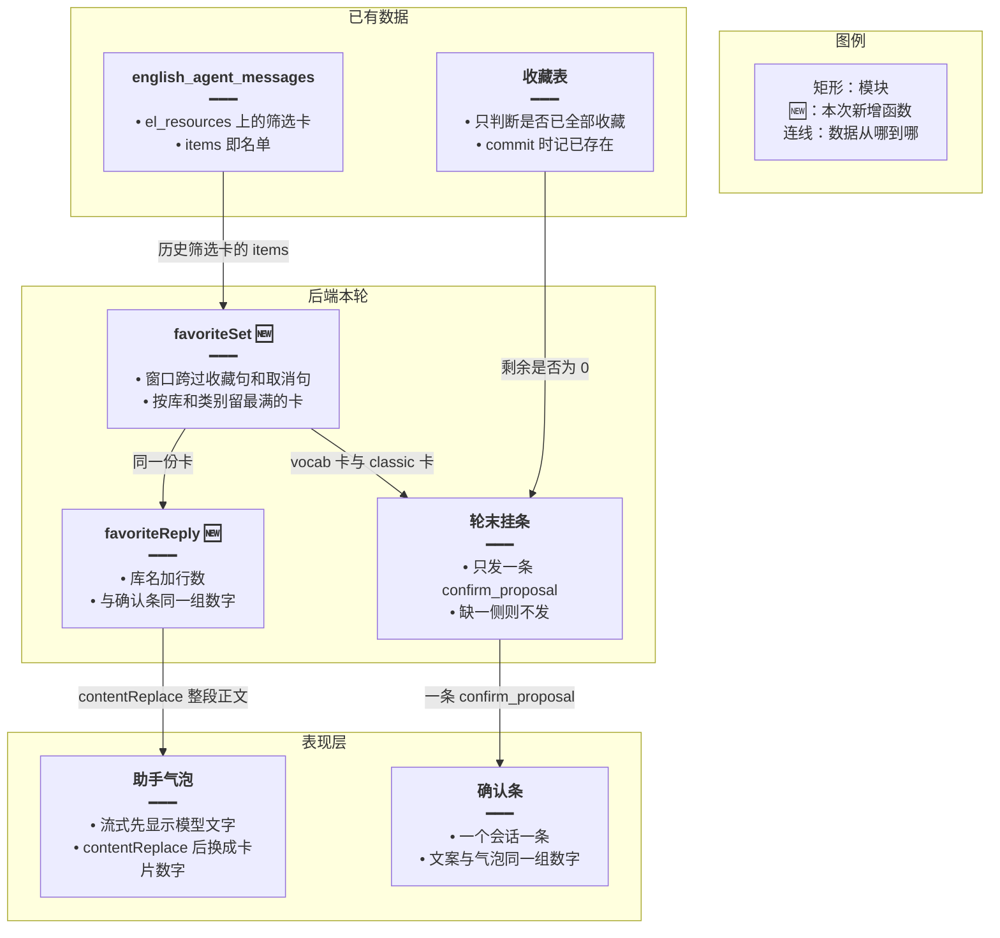
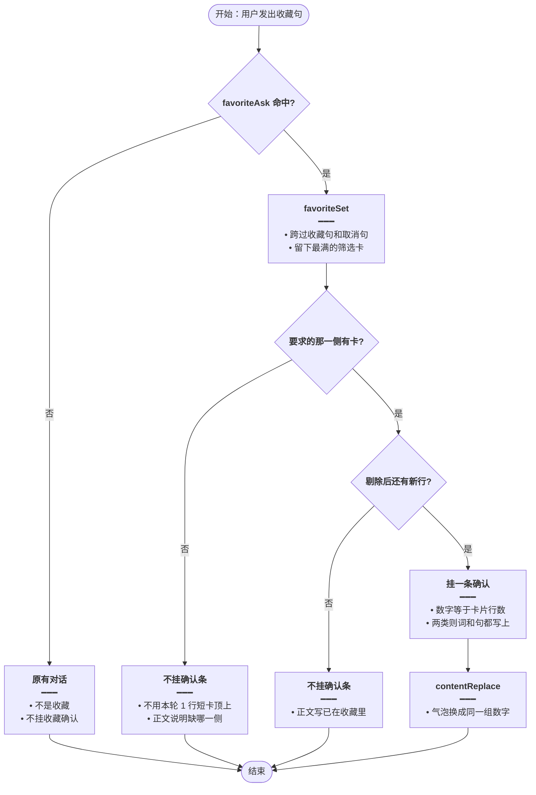
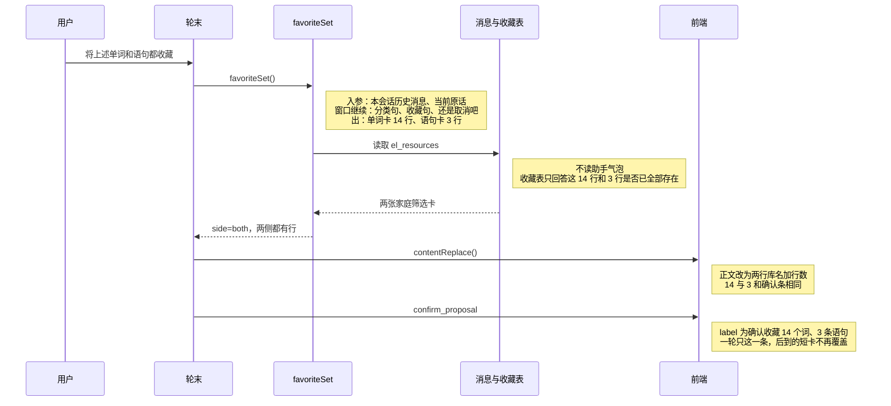
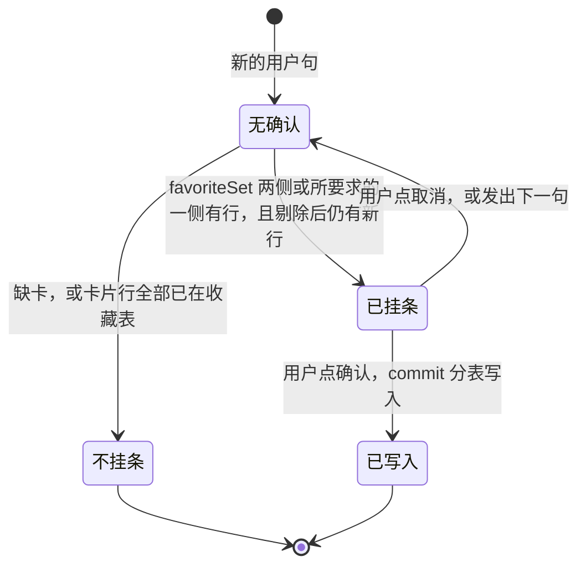

# 收藏确认跟卡片 — 实现思路

> **状态**：规划（工作区已按本文落地）  
> **日期**：2026-10-29  
> **需求摘要**：用户让英语 Agent 收藏上面的单词和语句时，确认条的条数和助手正文必须来自同一张已挂出的库卡片，不能再出现正文写 14 个词、3 条语句、确认条却是「确认收藏 1 条语句」。  
> **一句话方案（预告）**：添加和取消共用一个 `favoriteSet`：窗口跨过收藏句和取消句，集合只取窗口里行数最多的那张筛选卡；轮末用这份集合挂确认，并用已有的 `contentReplace` 把模型自己写的名单换成同一组数字。

## 延伸阅读

- [词句分表收藏](./词句分表收藏.md)：一起收藏时工具不占确认位、点确认后分表写入。本文不改 `paired` 落库，改掉它选卡的窗口
- [取消沿用上次收藏](./取消沿用上次收藏.md)：取消仍只撤上一次收藏圈定的行。本文只让「还是取消吧」这种没写「收藏」的取消句也能被认出来，避免它把下一句的窗口切断
- [语句分类稳定出卡](./语句分类稳定出卡.md)：筛选卡正文已是「库名：共 n 条。」。收藏轮的正文沿用同一句式
- [收藏提案直确认](./收藏提案直确认.md)：仍是一条 `proposalId`、一个会话一条确认条
- [语句整类一次收藏](./语句整类一次收藏.md)：「将这些进行收藏」仍只收语句卡，不把单词卡并进来
- [收藏意图总控](./收藏意图总控.md)：选卡已落地后仍可能整段不进闸（如「我需要收藏之前的…」）。意图总闸与「命中则模型禁止挂条」由那篇收口
- [收藏只收库卡](./收藏只收库卡.md)：进闸后仍可能把复习 other 卡当成单词卡（71 顶替 14）。来源只认 library、本轮与历史合并由那篇收口
- [再收藏不断窗](./再收藏不断窗.md)：「取消吧」能跨窗，「那帮我取消」不能 → 再「上述都收藏」变成整库词条 107+51

---

## 0. 读本文你将得到什么

- 为什么「将上述单词和语句都收藏」正文写了 14 个词和 3 条语句，确认条却是「确认收藏 1 条语句」
- 选定方案：一份 `favoriteSet` 同时供给确认条和正文，本轮重搜出的短卡不能替换已有筛选卡
- 改动在后端选卡和轮末正文替换；确认条组件、分表写入、分类器都不改
- 两个阶段：先收成一份集合并挂上正确条数，再把模型列举换成同一组数字
- 最大风险是窗口跨过取消句之后，更早的另一类筛选卡也被算进来

---

## 1. 需求与边界

### 1.1 用户故事

| 角色 | 场景 | 行为 | 期望结果 |
|------|------|------|----------|
| 登录用户 | 会话里已有「家庭」单词卡 14 行、语句卡 3 行 | 说「将上述单词和语句都收藏」 | 确认条是「确认收藏 14 个词、3 条语句」，正文数字与它相同 |
| 登录用户 | 中间说过「还是取消吧」，模型又重搜了一小段 | 再说上述那句 | 仍用那两张 14 行和 3 行的卡，不用本轮短卡 |
| 登录用户 | 只说「将语句收藏吧」 | 点确认 | 只收语句卡上的 3 句，不把 14 个词带上 |
| 登录用户 | 只说「将这些进行收藏」 | 点确认 | 仍只合并语句卡，行为与现在的语句整类收藏一致 |
| 登录用户 | 没点名英文，说「还是取消吧」 | 点确认 | 只撤上一次收藏的那些行；这句取消不再挡住下一次收藏的窗口 |
| 登录用户 | 卡片上的行已经都在收藏表里 | 再说收藏 | 不挂确认条，正文写明已在收藏里 |

### 1.2 范围

| 在范围内 | 不在范围内（非目标） |
|----------|----------------------|
| 收藏添加（单类、两类一起、「这些」）的选卡与确认文案 | 新建收藏表、改 `paired` 的分表写入 |
| 没点名英文的取消句识别，使窗口不被切断 | 点名英文的取消（仍走工具按词面删） |
| 轮末用 `contentReplace` 覆盖模型列举 | 改分类器、改筛选卡怎么生成、改确认条 UI 组件 |
| 已在收藏表里的行：确认条数字仍按卡片行数，回执继续记「已存在」 | 让模型正文里的词表成为写入名单 |

### 1.3 约束与依赖

- 必须复用 `quoteThreadAssistantIndexes`、`richest` / 按 `libraryId + categoryLabels[0]` 留最满的一张、`proposePairedFavorites`、`contentReplace`
- 一个会话一个 `pendingProposal`，一轮一个 `proposalId`
- 「将这些进行收藏」没有同时写出「单词」和「语句」时，只收语句
- 筛选卡已持久化在 `english_agent_messages.el_resources`，行在 `items` 里。有行就不再 `classifyLibrary`
- `source === 'favorites'` 的列表卡不进集合
- 温度、分类缓存、阅读生成确认条保持原样

---

## 2. 背景

- **谁、在什么场景、卡在哪**：登录用户在英语 Agent 里先问出小学三年级「家庭」单词卡和语句卡，中间取消过，再说「将上述单词和语句都收藏」。助手气泡按模型自己的列举写成 14 个词、3 条语句，底栏却是「确认收藏 1 条语句」。
- **现状缺口**：确认条和气泡不是同一份数据。气泡是模型流式正文。确认条来自轮末另一套选卡。这套选卡在用户句「还是取消吧」处停下，读不到上面的 14 行和 3 行，退回去用本轮工具刚搜出的短卡。短卡只有语句、而且只有 1 行时，两类一起收藏还会退成单类确认。
- **不解决会怎样**：每换一种说法（「还是取消吧」「将语句收藏吧」「都收藏」）就再偏一次。模型还会把卡片上没有的 parents、son、daughter、husband、wife 写进气泡，用户以为确认的是这段文字。
- **硬约束**：写入名单必须是已挂出的筛选卡。不能把模型列举当名单。不能为这一次再扫整本收藏表。不能让单词卡进「只收藏语句」的句子。

本次对账（会话 `e0bde9f5-bec9-4a85-bf6f-b447c09304b4`，2026-10-29 14:14:44 UTC）：

| 事实 | 值 |
|------|----|
| 语句卡 | `小学三年级上册`，`filtered`，类别「家庭」，3 行：This is my grandma. / Look! This is my family. / Is that your brother? |
| 单词卡 | `小学三年级上册英语单词`，`filtered`，类别「家庭」，14 行。卡片上有 grandpa、grandma、dad、mum，没有 parents、son、daughter、husband、wife |
| 收藏表 | 这 14 个词和这 3 句当时都不在收藏表里。不是「已经收藏掉 13 个所以只剩 1 条」 |
| 切断窗口的用户句 | 14:14:29 的「还是取消吧」。`unfavoriteFromCards` 只认「取消收藏 / 移除收藏 / 不要收藏 / 别收藏」，这句对不上，窗口在这里 `break` |
| 确认条 | `hangBothFavorites` 看到历史侧为空，用本轮短卡；单词侧 0 行、语句侧 1 行，`proposePairedFavorites` 返回 null，退回 `proposeFavoriteRows`，文案变成「确认收藏 1 条语句」 |

---

## 3. 现状与复用

| 能力 | 仓库中已有 | 本需求中的用法 |
|------|------------|----------------|
| 收藏句识别 | `apps/backend/src/services/agent/tools/english/favorite-ask.ts` 的 `favoriteAsk` / `favoriteAsksBoth` | 直接复用。决定 `side`：两类、只单词、只语句；「这些」仍是语句 |
| 取消句识别 | 同文件 `unfavoriteFromCards`，正则只含「取消收藏」等 | 扩展：没点名英文、整句是取消（含「还是取消吧」）也返回非 null。点名英文仍返回 null |
| 回扫窗口 | `apps/backend/src/services/agent/tools/english/domain-tools.ts` 的 `quoteThreadAssistantIndexes` | 直接复用。添加时 `bridgeFavorites` 固定为 true，取消句本身已经会 `continue` |
| 轮初灌卡 | `apps/backend/src/services/agent/agent.service.ts` 约 1257–1329 行，把窗口里的卡推进 `vocabLists` / `libraryLists` | 不再作为确认条的数据源。确认只读 `favoriteSet` |
| 两类一起挂条 | 同文件 `hangBothFavorites` | 改成调用 `favoriteSet`。历史侧为空时不再改用本轮短卡，除非窗口里这一侧一张卡都没有 |
| 单类轮末挂条 | 同文件约 1714 行，`!favoriteAsksBoth` 时另走一遍 `quoteThread` | 删除这条独立选卡。单类也走 `favoriteSet` |
| 取消范围 | `lastFavoriteScope` | 直接复用。它已经跳过取消句。前提是「还是取消吧」能被认成取消 |
| 最满的一张卡 | `favorite-ask.ts` 的 `richest` | 直接复用。同一库同一类别留 `items` 更多的那张 |
| 已收藏剔除 | `dropSaved` | 只用来判断「是不是全部已在收藏」。提案里的行仍是卡片行，数字不按剔除后的剩余来写 |
| 分表写入 | `proposePairedFavorites`、`apply-proposal.ts` 的 commit | 直接复用。回执继续写「已存在」 |
| 正文整段替换 | `categoryReply` + SSE `contentReplace`；前端 `englishAgent.ts` 的 `onContentReplace` | 收藏轮在 `finalizeTurn` 用同一事件，把模型列举换成卡片数字 |
| 一条确认 | 前端 `onTool` 里 `pendingProposal = proposal` | 不改。一轮只发出一条 `confirm_proposal` |
| 筛选卡持久化 | `english_agent_messages.el_resources` | 集合只读这里的 `items`。不读模型气泡 |

**调研结论**：确认条、分表写入、正文替换、按库和类别留最满卡片都已经有了。缺的是一份被添加和取消共同使用的集合，以及「还是取消吧」进不了现有取消识别、导致窗口在卡片之前断开。模型气泡没有和第二份数据对齐的步骤，筛选卡那套 `contentReplace` 没有用在收藏轮上。

---

## 4. 方案比对与最终方案

### 4.1 候选方案

#### 方案 A：只放宽取消正则（复用现状）

- **做法**：`unfavoriteFromCards` 增加「还是取消吧 / 取消吧」。`quoteThreadAssistantIndexes` 遇到取消句已经 `continue`，窗口就能走到 14 行和 3 行的卡。`hangBothFavorites` 继续读轮初灌进 `vocabLists` / `libraryLists` 的 `fromPrior` 卡。单类轮末那一段保持现在的独立回扫。
- **能工作的原因**：这次确认条变成 1 条，是因为窗口在「还是取消吧」断开，历史侧为空，本轮短卡只有 1 条语句。正则放宽后历史侧重新有 14 和 3，现有 `rowsOf` 会挂上「确认收藏 14 个词、3 条语句」。
- **主要代价**：选卡仍是三处（轮初灌卡、`hangBothFavorites`、单类轮末）。下一句若写成「算了不藏了」，窗口再次断开。气泡仍是模型列举，和确认条可以数字碰巧相同、词表仍然不同。

#### 方案 B：一份 `favoriteSet`，正文和确认条都用它（扩展）

- **做法**：在 `favorite-ask.ts` 新增 `favoriteSet(messages, userText, priorIndexes)`。添加（两类、单类、「这些」）和之后的窗口判断都只调用它。集合等于窗口内 `source !== 'favorites'` 的筛选卡，按库和类别留最满的一张，再按这句话的 `side` 留下单词或语句。本轮工具卡只在窗口里完全没有这一侧时才补上。`finalizeTurn` 用 `contentReplace` 写成「库名：N 个词。」「库名：M 条语句。」，确认条文案使用同一组 N、M。两类一起但有一侧是 0 时不挂确认条，正文说明缺的是哪一侧。
- **能工作的原因**：14 和 3 来自已落库的两张卡，不经过模型列举，也不经过本轮 1 行短卡。气泡和底栏读同一个返回值，数字不会再分叉。
- **主要代价**：轮初灌卡不再决定确认条，`hangBothFavorites` 里按 `fromPrior` 分堆的那段要删掉。窗口跨过取消句和更早的收藏句，可能带上更早的另一类筛选卡。

#### 方案 C：用模型气泡里的词表当确认名单（新增）

- **做法**：从助手正文解析「单词 …」「语句 …」两行，转成 `propose_add` 的 `items`，确认条条数等于解析出的行数。
- **能工作的原因**：底栏会和气泡逐字一致。这次会得到模型写下的那一串词和 3 句。
- **主要代价**：这次气泡里的 15 个词含 parents、son、daughter、husband、wife，卡片上没有；卡片上的 grandpa、grandma、dad、mum 被漏掉。点确认会写入词库里不存在的词。这条路已经在「I love my family.」那次收藏里发生过。

### 4.2 比对

| 维度 | 方案 A | 方案 B | 方案 C |
|------|--------|--------|--------|
| 正确性（失败路径、边界、数据是否会错） | 这次能回到 14 和 3。换一种取消说法、或单类轮末仍先拿到短卡时，还会变成 1 条。气泡词表仍然是错的 | 窗口规则和短卡退路只写一处。两侧数字和卡片行数一致。一侧缺失时不挂单类条，避免「都收藏」却只确认 1 条语句 | 条数和气泡一致，但写入的是模型编的词，不是卡片 |
| 复用 / 与现状契合 | 只改一个正则，三处选卡原样留下 | 复用窗口、`richest`、`paired`、`contentReplace`。删掉第二套、第三套选卡 | 不复用卡片。和「名单以卡片为准」的现有约束相反 |
| 改动面（要动哪些路径） | `unfavoriteFromCards` 一处 | `favorite-ask.ts` 增函数；`agent.service.ts` 两处挂条收成一处；`finalizeTurn` 加一次替换 | 要新写正文解析，并关掉现在的卡片挂条 |
| 复杂度（新概念、新状态、新依赖） | 不增加状态 | 一个纯函数返回 `{ side, vocab, classic }`，无新表、无新缓存 | 正文格式一变解析就失败，还要维护两套名单 |
| 体验（延迟、步骤数、失败时用户看到什么） | 确认条这次正确。气泡仍列出卡片上没有的词，用户仍觉得两边不一致 | 流结束时气泡从模型列举换成「库名：14 个词。」「库名：3 条语句。」，和底栏同一组数字。全部已收藏则不挂条 | 气泡和底栏一致，点下去收藏的是错词 |
| 风险（迁移、互斥、并发、回滚） | 低。下一句说法又会复发 | 窗口变宽，更早的另一类卡可能进入「上述」。用最满卡片而不是把所有语句卡拼在一起，可挡住短卡，挡不住第二个类别 | 会把编造词写入 `english_vocabulary_favorite` |
| 可维护性（以后改一处还是改多处） | 窗口规则仍在三处，下一次还要三处一起改 | 窗口和集合只在 `favoriteSet`。挂条和正文都读它的返回值 | 解析规则和卡片规则会一直分叉 |

### 4.3 综合考量

这次要的是确认条和用户看见的内容永远同一份，而且这份必须是卡片。正确性的权重大于改动面：方案 A 的改动最小，也能修好「还是取消吧」这一句，但单类轮末、本轮短卡、模型列举还各自留着，下一次截图仍会对不上。方案 C 能让底栏逐字跟上气泡，代价是把卡片上没有的词写进收藏，这和前面几次「不要收藏模型编的句子」直接冲突，放弃它「和气泡逐字相同」这一项。

选定方案 B。放弃方案 A「只改一行正则」的小改动面，因为那一项抵不过三套选卡还会再分叉。放弃方案 C 和气泡逐字相同的体验，因为那份文字不是词库里的行。

### 4.4 最终方案

#### 背景

英语 Agent 的收藏确认有三套选卡：轮初把窗口灌进 `vocabLists` / `libraryLists`，`hangBothFavorites` 读这份表面状态，单类轮末再自己回扫一遍。取消句只有写了「取消收藏」才会被窗口放过。「还是取消吧」让回扫在 14 行单词卡和 3 行语句卡之前断开，本轮模型重搜的 1 条语句成为确认条。气泡则是模型另写的一串词，含卡片上没有的词。硬约束是：写入和展示都用已落在 `el_resources` 上的筛选卡，一轮一条确认，点确认后的分表写入保持不变。

#### 具体思路

1. 选卡收成 `favorite-ask.ts` 里的纯函数 `favoriteSet`。`agent.service.ts` 的两类挂条和单类挂条都改成调用它，不再各写一遍窗口。
2. 数据从历史消息的 `elResources` 来，到 `favoriteSet` 的单词卡数组和语句卡数组，再到提案 `items` 和 `contentReplace` 的正文。不经过模型正文。
3. 集合不进 MobX，也不进新表。它只活在这一轮的请求里。前端仍只保存最后一条 `confirm_proposal`。
4. 窗口继续的条件收成一个判断：分类句、收藏句、没点名英文的取消句都继续；其余用户句停止。「还是取消吧」因此不再切断窗口。某一侧窗口里已经有卡时，本轮短卡丢弃。两类请求有一侧为 0 时不挂确认条。卡片行全部已在收藏表时不挂确认条，正文说明已在收藏。

#### 实现方案

**一句话**：添加和取消共用一个 `favoriteSet`：窗口跨过收藏句和取消句，集合只取窗口里行数最多的那张筛选卡；轮末用这份集合挂确认，并用已有的 `contentReplace` 把模型自己写的名单换成同一组数字。

| 步骤 | 谁 | 做什么 | 输入 → 输出 |
|------|----|--------|-------------|
| 1 | `unfavoriteFromCards` | 没点名英文、整句是取消时返回 `'both'` 或收窄后的一侧 | 「还是取消吧」→ 非 null；「取消收藏 family」→ null |
| 2 | `favoriteSet` | 用 `quoteThreadAssistantIndexes(..., true, true)` 取窗口，`richest` 后按 `side` 分堆 | 历史消息 + 用户原话 → `{ side, vocab, classic }` |
| 3 | `agent.service.ts` 轮末 | 窗口某一侧为空才用本轮该侧的卡补；两类且补完仍有一侧为 0 则不挂条 | 集合 → 一条 `confirm_proposal` 或没有 ui |
| 4 | `proposePairedFavorites` / `proposeFavoriteRows` | 提案 `items` 用卡片行。数字用卡片行数，不用 `dropSaved` 之后的剩余 | 行数组 → `proposalId` + 文案 |
| 5 | `finalizeTurn` | `contentReplace` 写成与确认条同一组数字 | 集合 → 助手正文 |
| 6 | 前端 `onContentReplace` / `onTool` | 已有逻辑：替换气泡，记下这一条确认 | SSE → 气泡与底栏 |

#### 选定原因

1. **正确性**：集合只来自筛选卡，本轮 1 行短卡不能覆盖 14 和 3，两类缺一侧时也不再退成「确认收藏 1 条语句」。牺牲：窗口变宽，更早的第二类卡可能被算进「上述」。
2. **复用**：窗口、最满卡片、分表提案、`contentReplace` 都是现成的。牺牲：轮初灌进 `vocabLists` 的那份不再被确认条读取，灌卡代码暂时留着给别的工具用，多留一段直到确认不再依赖它。
3. **体验**：气泡和底栏同一组数字，全部已收藏时不出现一条空确认。牺牲：用户会先看到模型列举，流结束时整段被换成「库名：N 个词。」，有一次替换。
4. **可维护性**：以后改窗口只改 `favoriteSet` 的继续条件。牺牲：方案 A 那种一行正则做不到这件事。

#### 优势

- 相对方案 A：取消说法再变，也不会只改到一半；单类和两类不会再各选各的卡；气泡不再留下卡片上没有的词。
- 相对方案 C：点确认写入的是「家庭」卡上的 14 个词和 3 句，不会写入 parents、son、daughter、husband、wife。

#### 怎么实现

1. 放宽 `unfavoriteFromCards`：原话没有英文词，且匹配取消、又不含「找出 / 生成 / 分类 / 关于 / 有关」时，视为取消。已有的「取消收藏」等句子保持原样。
2. `favoriteSet` 调用现有 `quoteThreadAssistantIndexes(messages, undefined, true, true)`。`bridgeFavorites === true` 时收藏句会继续；步骤 1 之后取消句也会继续。助手下标上的卡去掉 `source === 'favorites'`，再 `richest`，再按 `side` 分成单词和语句。
3. 轮末若用户句是 `favoriteAsksBoth`，两侧都有行才 `proposePairedFavorites`。只有一侧有行则不发 ui，正文写「没有可收藏的单词卡」或「没有可收藏的语句卡」。单类只把那一侧交给 `proposeFavoriteRows`。
4. 提案数字写成卡片行数。`dropSaved` 只负责「剩余为 0 则不挂条」。剩余大于 0 时，提案仍放整张卡的行，commit 对已存在的行记「已存在」。确认条与正文使用同一个字符串里的数字。
5. `finalizeTurn` 在写库前，若本轮是收藏句且 `favoriteSet` 有结果，`subscriber.next({ type: 'contentReplace', data })`，`accumulated` 改成这段文字。分类轮已经在用的 `categoryReply` 不改；收藏句不是分类句，两条不会叠在同一轮。

主要实现代码见 §9。

### 4.5 其他关键决策

#### 4.5.1 已在收藏的行算不算进确认条数字

##### 候选

**方案 A（复用 `dropSaved` 的现行为）**：确认条数字等于剔除后剩下的行。3 句里已有 2 句时，条上写「确认收藏 1 条语句」。

**方案 B（数字跟卡片）**：确认条和正文的数字都是卡片行数。全部已在收藏表时不挂条，正文写「已在收藏里」。有剩余时提案仍带上整张卡，commit 按现有逻辑把已存在的记进回执。

##### 比对

| 维度 | 方案 A | 方案 B |
|------|--------|--------|
| 正确性 | 数字是「还将新写入的行」。卡片 3 行、表里已有 2 行时，用户看到 1，又会认为对不上 | 数字等于眼前那张卡。回执分开写新写入和已存在 |
| 复用 | 现成 `dropSaved` | `dropSaved` 仍用来判断要不要挂条；commit 的「已存在」原样复用 |
| 改动面 | 不改提案 | 提案 `items` 改回卡片行，文案不再用剔除后的长度 |
| 复杂度 | 此项相同 | 此项相同。不增加状态 |
| 体验 | 和这次投诉相同：卡片 3 条，确认 1 条 | 底栏和气泡都是 3。全部已在时没有一条可点的空确认 |
| 风险 | 低 | 用户可能以为 14 个都会新插一行。回执里的「已存在」要保持可见 |
| 可维护性 | 数字规则和卡片行数是两套 | 数字只有卡片行数这一套 |

##### 综合考量

用户比的是确认条和卡片，不是确认条和「尚未写入的子集」。正确性权重大于「确认条只显示新行」这个现有优点。放弃方案 A「条上不会重复列出已收藏行」的优点，因为那正是 3 被显示成 1 的来源。选定方案 B。

##### 最终方案

- **背景**：`dropSaved` 会把已在 `english_classic_quote_favorite` / `english_vocabulary_favorite` 的行拿掉，文案用剩下的长度。卡片行数和确认条从此可以不同。
- **具体思路**：挂不挂条看剔除后还剩不剩。挂的话，`items` 和文案都用卡片全量。状态仍只在提案存储器里，不新加字段。
- **实现方案**：`proposePairedFavorites` 先 `dropSaved`。两侧剩余都是 0 则返回没有 ui 的说明。否则 `items` 用去重后的卡片行，label 用卡片行数。
- **选定原因**：正确性上确认条等于卡片。牺牲：已收藏的行会出现在这一次提案里，由 commit 记成已存在，而不是从条上消失。
- **优势**：相对「只显示剩余」，用户看到的 14 和 3 不会因为表里已有一部分而变成 1。
- **怎么实现**：见 §9.3。全部已在收藏时 `favoriteSet` 的调用方不 `emit`，`contentReplace` 写「这 14 个词、3 条语句已在收藏里。」

---

## 5. 架构图



**图内方法说明**：

| 方法 | 功能 |
|------|------|
| `favoriteSet(messages, userText, priorIndexes)` | 从历史消息取出本句该收藏的单词卡和语句卡。添加轮末和取消之前的窗口都走它，避免两套回扫 |
| `favoriteReply(vocab, classic)` | 把卡的标题和行数写成正文。行数与确认条文案使用同一组数，模型列举不再留下 |
| `quoteThreadAssistantIndexes(...)` | 已有。从近到远收集助手下标。收藏句和取消句继续，其它用户句停止 |
| `richest(cards)` | 已有。同一 `libraryId` 加第一个类别标签只留 `items` 更多的那张，短卡盖不住长卡 |
| `proposePairedFavorites(...)` | 已有。两侧都有行时写入一条带 `paired` 的提案。本文只改它的数字来源，不改落库 |
| `onContentReplace(text)` | 已有。用服务端全文替换当前助手气泡，刷新后读到的也是这段 |
| `parseElConfirmProposal(output)` | 已有。从工具 ui 取出 `confirm_proposal`，写入当前会话的 `pendingProposal` |

**读图要点**：

- 名单只从消息上的筛选卡来，气泡和确认条是这份集合的两个出口。
- 收藏表不提供名单，只决定「要不要干脆不挂条」。
- 新增的只有 `favoriteSet` 和 `favoriteReply`，确认条组件和表结构不动。

---

## 6. 主流程图



**图内方法说明**：

| 方法 | 功能 |
|------|------|
| `favoriteAsk(userText)` | 已有。判断这句是不是收藏，以及要单词、语句，还是两类一起 |
| `favoriteSet(...)` | 抽出这句对应的卡。返回的行数是后面挂条和正文的唯一数字来源 |
| `dropSaved(...)` | 已有。对照收藏表。这里只决定剩余是否为 0，不拿来改写确认条数字 |
| `proposePairedFavorites(...)` | 两类都有卡时挂一条。任一侧为 0 时调用方不进入这里 |
| `proposeFavoriteRows(...)` | 只收藏一类时挂这一侧。文案用该侧卡片行数 |
| `contentReplace` | 已有 SSE。用 `favoriteReply` 的全文替换本轮助手正文 |

**读图要点**：

- 入口只看用户原话，不看模型后来写了什么。
- 两条失败路径都不发确认条：缺卡，或全部已在收藏。本轮短卡不能把失败路径变成「确认收藏 1 条语句」。
- 成功路径上挂条和替换正文使用同一次 `favoriteSet` 的结果。

---

## 7. 核心时序图



**图内方法说明**：

| 方法 | 功能 |
|------|------|
| `favoriteSet()` | 服务端在模型工具跑完之后调用。返回值决定挂不挂条、挂哪一侧、数字是多少 |
| `contentReplace()` | 把已经流式显示的模型列举换成卡片数字。前端按现有 `onContentReplace` 覆盖当前助手消息 |
| `confirm_proposal` | 工具事件上的 ui。前端写入当前会话的 `pendingProposal`，底栏只显示这一条 |

**读图要点**：

- 用户句先到，集合在轮末才算，所以本轮模型中途搜出的短卡默认不进集合。
- 收藏表的查询发生在出条之前，只拦截「全部已在」这一种空确认。
- 前端不解析气泡来生成确认条，避免再跟模型列举走。

---

## 8. 状态机



**图内方法说明**：

| 方法 | 功能 |
|------|------|
| `favoriteSet` | 「已挂条 / 不挂条」的判断。缺一侧或全部已收藏都进不挂条，不存在第三种「先挂 1 条再说」 |
| `commit` | 已有。点确认后单词进单词收藏、语句进语句收藏，回执写已收藏与已存在 |

**读图要点**：

- 一轮最多一次从「无确认」到「已挂条」。模型中途的 `propose_add` 在收藏句上仍然提前返回，不占这个状态。
- 「不挂条」是终态的一种，正文会说明原因，底栏保持没有按钮。

---

## 9. 具体实现（主链路代码）

### 9.1 模块一览

| 模块 | 职责 | 新增/改动 | 预估路径 |
|------|------|-----------|----------|
| `favoriteSet` / `favoriteReply` | 从历史卡得到两侧集合和正文 | 新增 | `apps/backend/src/services/agent/tools/english/favorite-ask.ts` |
| `unfavoriteFromCards` | 认出「还是取消吧」 | 扩展 | 同上 |
| 轮末挂条 | 两类和单类都改读 `favoriteSet` | 改动 | `apps/backend/src/services/agent/agent.service.ts` |
| `proposePairedFavorites` | 数字改为卡片行数 | 改动 | `favorite-ask.ts` |
| 确认条与 `contentReplace` | 原样接收一条 ui 和一段全文 | 不改 | `apps/frontend/src/store/englishAgent.ts` |
| 现有范围测试 | 补「还是取消吧」不切断窗口、两类不会退成 1 条 | 扩展 | `apps/backend/src/services/agent/tools/english/favorite-ask.scope.spec.ts` |

### 9.2 集合

```typescript
// 对应 §4.4 步骤 2。添加和取消共用这一份，避免轮初灌卡和轮末再各选一次
type FavoriteSet = {
	// both 要两侧都有卡才挂条；vocab / classic 只读自己那一侧
	side: 'vocab' | 'classic' | 'both';
	// 最满的单词筛选卡。只收藏语句时保持空数组
	vocab: ScopeCard[];
	// 最满的语句筛选卡。只收藏单词时保持空数组
	classic: ScopeCard[];
};

// 对应 §4.4 步骤 1。没点名英文的取消必须让窗口继续，否则「还是取消吧」会把上面的卡隔开
function unfavoriteFromCards(userText: string): 'both' | 'vocab' | 'classic' | null {
	// 原话里的英文词仍交给工具按词面取消，不在这里当成「撤上一次」
	const text = userText.trim();
	// 空句和带英文的句子都不是「没点名的取消」
	if (!text || /[A-Za-z]{2,}/.test(text)) return null;
	// 找出、生成、分类、关于是新话题，不能为了含有「取消」两个字就继续往上扫
	if (/找出|生成|分类|关于|有关/.test(text)) return null;
	// 现有四句加上「取消吧」，盖住「还是取消吧」这种没写「收藏」的说法
	if (!/取消收藏|移除收藏|不要收藏|别收藏|取消吧/.test(text)) return null;
	// 语句、句子、经典句算语句侧，和 favoriteAsk 用的是同一组词
	const classic = /语句|句子|经典句/.test(text);
	// 单词、词汇、词书算单词侧。两个都没写时不能收窄，否则「还是取消吧」会丢掉另一类
	const vocab = /单词|词汇|词书/.test(text);
	// 只点了单词就只撤单词，避免一句取消把语句卡也圈进来
	if (vocab && !classic) return 'vocab';
	// 只点了语句就只撤语句
	if (classic && !vocab) return 'classic';
	// 「还是取消吧」两类都没点，返回 both，类别留给上一次收藏原话
	return 'both';
}

// 对应 §4.4 步骤 2。priorIndexes 就是现有的 quoteThreadAssistantIndexes，第二参 true 表示收藏句也继续
function favoriteSet(
	// 本会话按时间升序的消息。集合只读这些消息上的筛选卡，不读模型气泡
	messages: FavoriteScopeMessage[],
	// 当前用户原话。用来决定要两侧还是一侧
	userText: string,
	// 已有窗口函数。调用时第二参固定 true，更早的收藏句不再把卡隔开
	priorIndexes: (slice: FavoriteScopeMessage[], bridgeFavorites: boolean) => number[],
	// 不是收藏句时返回 null，调用方不挂条
): FavoriteSet | null {
	// 先认收藏句。阅读生成和普通问答走不到后面的取卡
	const ask = favoriteAsk(userText);
	// 认不出收藏就没有集合，避免给无关句子挂确认条
	if (!ask) return null;
	// 同时写出单词和语句才是两侧；只写单词留单词；其余含「将这些进行收藏」都只留语句
	const side = favoriteAsksBoth(userText) ? 'both' : ask.kind === 'vocab' ? 'vocab' : 'classic';
	// 第二参 true：更早的「都收藏」「将语句收藏吧」不再把窗口截断
	const indexes = priorIndexes(messages, true);
	// 收藏列表卡 source 为 favorites，整本收藏不能当成「上述」；没有 items 的卡也不能凑数
	const cards = indexes.flatMap((index) => (messages[index]?.elResources ?? []).filter((card) => card.source !== 'favorites' && (card.items?.length ?? 0) > 0));
	// 同一库同一类别只留行数更多的那张，本轮若也曾落过 1 行卡也不会赢过 14 行和 3 行
	const full = richest(cards);
	// 只收藏语句时单词数组必须为空，避免 14 个词被带进「将语句收藏吧」
	const vocab = side === 'classic' ? [] : full.filter((card) => card.contentKind === 'vocab');
	// 只收藏单词时语句数组必须为空
	const classic = side === 'vocab' ? [] : full.filter((card) => card.contentKind === 'classic');
	// side 与两侧卡一起返回，挂条和正文都只读这个对象
	return { side, vocab, classic };
}
```

### 9.3 轮末挂条与正文

```typescript
// 对应 §4.4 步骤 3 和步骤 5。数字只从 favoriteSet 来，本轮短卡仅在某一侧完全没有历史卡时补上
function hangFavorite(input: {
	// favoriteSet 的结果。历史卡优先于本轮短卡
	set: FavoriteSet;
	// 本轮工具新挂的单词卡。只有历史单词侧为空才用
	turnVocab: ScopeCard[];
	// 本轮工具新挂的语句卡。只有历史语句侧为空才用
	turnClassic: ScopeCard[];
	// hang 为 false 时不发 confirm_proposal，reply 仍要写给气泡
}): { label: string; reply: string; hang: boolean } {
	// 历史已有单词卡就丢掉本轮短卡，避免 1 行搜索结果盖住 14 行
	const vocab = input.set.vocab.length ? input.set.vocab : input.turnVocab;
	// 语句侧同样：历史有 3 行就不采用本轮那 1 行
	const classic = input.set.classic.length ? input.set.classic : input.turnClassic;
	// 单词行数累加每张卡的 items，不用模型气泡里顿号隔开的那一串
	const vocabCount = vocab.reduce((sum, card) => sum + (card.items?.length ?? 0), 0);
	// 语句行数同样只累加卡片 items
	const classicCount = classic.reduce((sum, card) => sum + (card.items?.length ?? 0), 0);
	// 两类一起却缺一侧：不挂条，避免再出现「确认收藏 1 条语句」
	if (input.set.side === 'both' && (vocabCount === 0 || classicCount === 0)) {
		// 缺单词和缺语句分开写，用户能看出是哪一侧没挂过卡
		const reply = vocabCount === 0 ? '上面没有可收藏的单词卡。' : '上面没有可收藏的语句卡。';
		// 不带 label、hang 为 false，前端不会出现「确认收藏 1 条语句」
		return { label: '', reply, hang: false };
	}
	// 每张单词卡一行「库名：N 个词。」，数字稍后原样出现在确认条
	const vocabLines = vocab.map((card) => `${card.title}：${card.items?.length ?? 0} 个词。`);
	// 每张语句卡一行「库名：M 条语句。」
	const classicLines = classic.map((card) => `${card.title}：${card.items?.length ?? 0} 条语句。`);
	// 先词后句，和确认条「N 个词、M 条语句」的顺序一致
	const lines = [...vocabLines, ...classicLines];
	// 两类把词数和句数写在同一条上，数字与上面 lines 里的行数相同
	const bothLabel = `确认收藏 ${vocabCount} 个词、${classicCount} 条语句`;
	// 只收藏单词时确认条不出现语句
	const vocabLabel = `确认收藏 ${vocabCount} 个词`;
	// 只收藏语句时确认条不出现单词，对应「将语句收藏吧」
	const classicLabel = `确认收藏 ${classicCount} 条语句`;
	// 按 side 取一条文案，避免三类句子共用一个会把另一侧算进去的模板
	const label = input.set.side === 'both' ? bothLabel : input.set.side === 'vocab' ? vocabLabel : classicLabel;
	// reply 用换行拼库名，hang 为 true 时调用方才 emit 确认条
	return { label, reply: lines.join('\n'), hang: true };
}
```

### 9.4 数据模型

| 字段/实体 | 来源 | 存储 | 说明 |
|-----------|------|------|------|
| `FavoriteSet.side` | 用户原话 | 请求内 | 不入库 |
| `FavoriteSet.vocab` / `classic` | `el_resources` | 已在消息行 | 只读 `items`、`libraryId`、`categoryLabels`、`title` |
| `confirm_proposal.label` | `hangFavorite` | 提案存储器，现有 TTL | 与 `reply` 里的数字相同 |
| 助手正文 | `contentReplace` | `english_agent_messages.content` | 覆盖模型列举 |

---

## 10. 分阶段实现步骤

| 阶段 | 目标 | 交付物 | 依赖 |
|------|------|--------|------|
| M1 | 「还是取消吧」之后再说「都收藏」，确认条为 14 个词、3 条语句 | `unfavoriteFromCards` + `favoriteSet` + 轮末只挂这一份 | 现有筛选卡仍写在 `el_resources` |
| M2 | 气泡与确认条同一组数字，全部已收藏时不挂条 | `favoriteReply` + `contentReplace`；`dropSaved` 只决定挂不挂 | M1 |

M1

- [ ] `unfavoriteFromCards('还是取消吧')` 返回 `'both'`，带英文的取消仍返回 null
- [ ] `favoriteSet` 在「还是取消吧」之后仍能取到家庭单词卡和语句卡
- [ ] 两类且一侧为 0 时不发出 `confirm_proposal`
- [ ] 单类「将语句收藏吧」的集合里没有单词卡
- [ ] `favorite-ask.scope.spec.ts` 覆盖上述三条

M2

- [ ] 收藏轮 `finalizeTurn` 发出 `contentReplace`，正文含「14 个词」和「3 条语句」
- [ ] 确认条 label 与正文数字相同
- [ ] 14 和 3 都已在收藏表时不挂条，正文写已在收藏里
- [ ] 分类轮的 `categoryReply` 和阅读生成的「确认开始自选生成」不被这段替换碰到

---

## 11. 风险、边界与待确认

| 项 | 等级 | 说明 | 缓解 |
|----|------|------|------|
| 窗口带上更早的第二类 | 中 | 「家庭」之前若还有「问候」筛选卡，且中间只有收藏句和取消句，两张卡都会进入「上述」 | 按库和类别分卡展示，不把两类并成一行；验收里加一条问候加家庭 |
| 流式先看到模型错词 | 低 | 替换发生在轮末，用户会先看到 parents、son 再被换成库名和行数 | 与筛选卡现有的 `contentReplace` 相同，可接受 |
| 提案里含已收藏行 | 低 | 点确认后回执会出现「已存在」 | 数字仍等于卡片；全部已在时根本不挂条 |
| 「取消」误伤新话题 | 中 | 含「找出 / 生成 / 分类 / 关于 / 有关」的句子即使有「取消」也停止 | 规则写在 `unfavoriteFromCards`，测试一句「取消吧，找出问候的单词」 |

**待确认**：

- [ ] 「算了不藏了」是否也要当成取消句（验证方式：若产品上会这么说，再把这句加进正则；当前只覆盖带「取消」的句子）

---

## 12. 验收清单

| # | 用例 | 步骤 | 期望 |
|---|------|------|------|
| AC1 | 这次的截图 | 先有家庭单词卡 14 行、语句卡 3 行，中间说「还是取消吧」，再说「将上述单词和语句都收藏」 | 确认条「确认收藏 14 个词、3 条语句」；正文是两行库名和同样的数字；不写入 parents、son、daughter、husband、wife |
| AC2 | 只收藏语句 | 同上，说「将语句收藏吧」 | 确认条「确认收藏 3 条语句」，集合里没有那 14 个词 |
| AC3 | 这些 | 连续两张语句筛选卡后说「将这些进行收藏」 | 只收语句卡，不出现单词 |
| AC4 | 缺一侧 | 会话里只有语句卡，说「将上述单词和语句都收藏」 | 不挂确认条，正文写没有单词卡 |
| AC5 | 已全部收藏 | 14 和 3 都已在表里，再说「都收藏」 | 不挂确认条，正文写已在收藏里 |
| AC6 | 取消 | 「还是取消吧」发生在一次「都收藏」之后 | 确认取消的只是那 14 和 3，不是整本收藏；下一句收藏仍能看见这两张卡 |
| AC7 | 点名英文的取消 | 「取消收藏 family」 | 仍走工具按词面，不改成撤上一次整卡 |

---

## 13. 预估改动面（实现阶段参考）

| 类型 | 路径（预估） |
|------|--------------|
| 后端 | `apps/backend/src/services/agent/tools/english/favorite-ask.ts` |
| 后端 | `apps/backend/src/services/agent/agent.service.ts`（轮末挂条与 `finalizeTurn`） |
| 后端测试 | `apps/backend/src/services/agent/tools/english/favorite-ask.scope.spec.ts` |
| 前端 | 不改。`contentReplace` 与 `pendingProposal` 已能接收 |
| 文档（实现后） | `remote-docs/wiki/english/` 下的收藏确认专题，落地后再写 |

---

（本文档为规划态实现思路；落地后以源码与 remote-docs wiki 专题为准）
