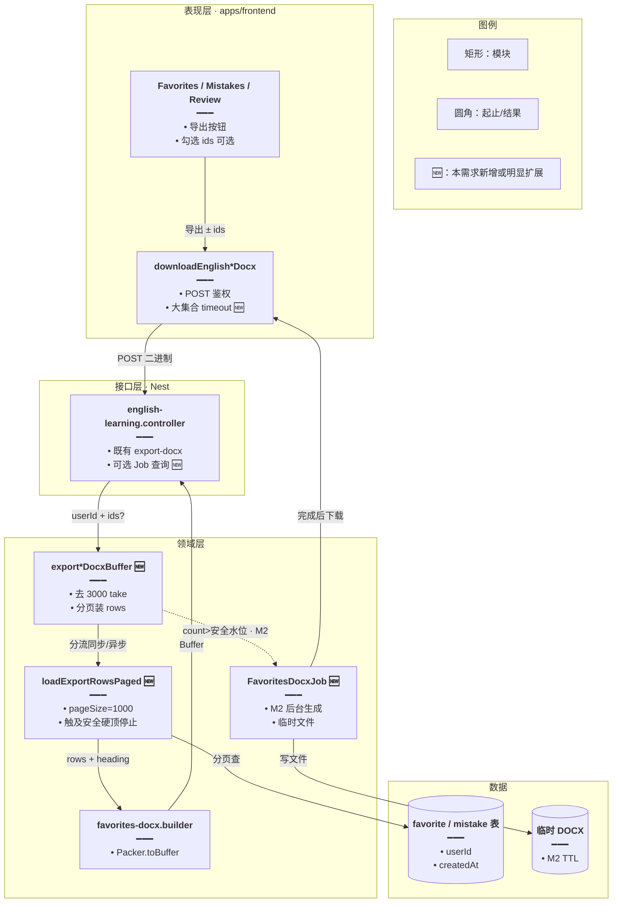
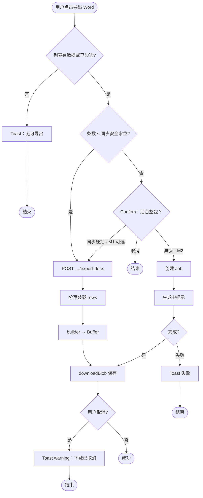
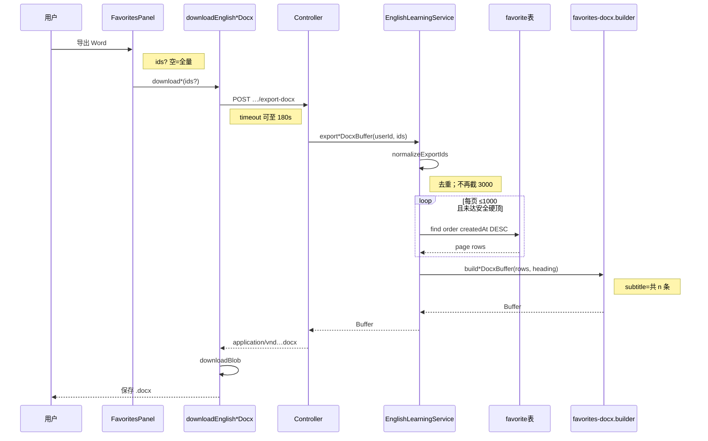
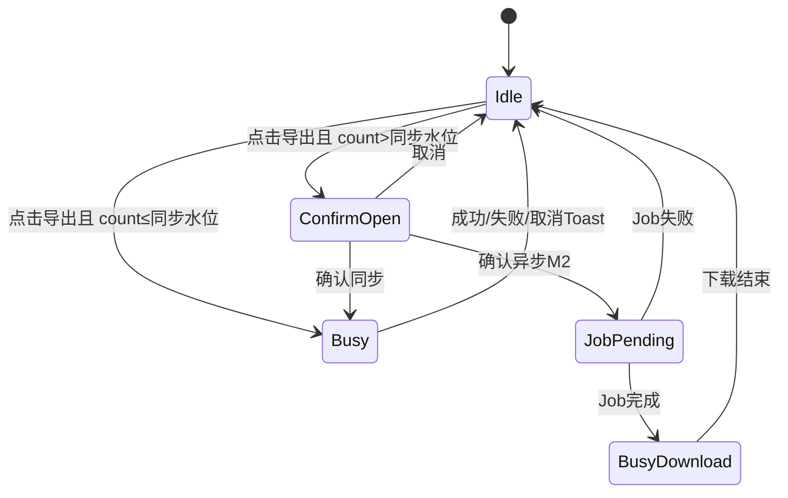

# 收藏 / 错题全量导出 Word — 实现思路

> **状态**：规划（已实现）  
> **日期**：2026-10-13  
> **需求摘要**：已登录用户导出收藏 / 错题 / 今日复习 Word 时不再静默截断为 3000 条，按当前数据**全量**导出；数据量很大时须控制内存与超时，避免 Nest / 网关打爆。

## 延伸阅读

- 收藏 / 错题 / 今日复习 DOCX（已落地，含 3000 硬顶，本需求**改其装载策略**）：[英语学习DOCX导出.md](./英语学习DOCX导出.md)
- 单词库 / 语句库 Word（已落地整库分页装载，可对齐装载模式）：[词库导出Word.md](./词库导出Word.md)
- 学习笔记大文档导出（异步 / 预算可对照）：[学习笔记列表导出.md](../notes/学习笔记列表导出.md)

---

## 0. 读本文你将得到什么

- **问题**：`FAVORITES_DOCX_EXPORT_MAX = 3000` 使全量导出静默只出前 3000；勾选 ids 也被 `clipExportDocxIds` 截到 3000；用户需要「有多少导多少」。
- **一句话方案**：服务端**分页装载**全量 rows → 复用现有 builder；小量同步即时下载；超量走 **Confirm + 异步 Job（M2）** 或拉长超时的同步整包（M1 先对齐词库）。
- **主要改动层**：`english-learning.service` 导出装载 → DTO `ArrayMaxSize` → 前端超时 / 可选大库 Confirm → i18n。
- **阶段**：M1 去掉 3000 截断 + 分页全量同步（对齐词库）→ M2 超安全水位异步 Job → M3 统一导出预算常量与监控。
- **最大风险**：收藏 / 错题**无生成上限**，可比词库（12k）更大；同步 `Packer.toBuffer` 堆峰值与网关超时是核心约束。

---

## 1. 需求与边界

### 1.1 用户故事

| 角色 | 场景 | 行为 | 期望结果 |
|------|------|------|----------|
| 已登录用户 | 单词收藏 N 条，N>3000，未勾选 | 点导出 Word | DOCX 条数 = N（全量），副标题写真实条数 |
| 已登录用户 | 语句错题 M 条，M>3000 | 导出 Word | 全量 M 条，版式不变 |
| 已登录用户 | 勾选 K 条（K 可 >3000） | 导出 Word | 仅导出这 K 条，不被截到 3000 |
| 已登录用户 | 今日复习到期很多 | 导出 Word | 与列表一致的全量（或勾选子集） |
| 已登录用户 | 收藏极多（如数万） | 导出 Word | 不挂死：进度提示或后台生成后下载（M2） |
| 已登录用户 | 取消保存对话框 | — | Toast「下载已取消」warning，不出现「下载成功」 |

### 1.2 范围

| 在范围内 | 不在范围内（非目标） |
|----------|----------------------|
| 单词/语句 **收藏** DOCX 全量 | 改 DOCX 版式字段 |
| 单词/语句 **错题** DOCX 全量 | 前端用 `docx` 拼装 |
| **今日复习** DOCX 全量（同源 builder） | 导出 PDF / Excel / JSON（另需求） |
| 勾选导出：ids 全量进文档（提高 DTO 上限或分批） | 改词库导出（已整库，见姊妹文） |
| 大集合内存 / 超时策略（分页 + 可选 Job） | M1 就上全集群可观测平台 |

### 1.3 约束与依赖

- 登录；仅导出**当前用户**收藏 / 错题 / 复习行。
- 复用：`buildVocabularyFavoritesDocxBuffer` / `buildClassicQuoteFavoritesDocxBuffer`、`downloadEnglishAuthorizedDocx`、`downloadBlob`。
- 对齐词库：`LIBRARY_DOCX_PAGE_SIZE = 1000` 分页装载；前端大文件超时可复用 `LIBRARY_DOCX_TIMEOUT_MS`（180s）模式。
- 与词库差异：**无** `ENGLISH_VOCAB_GENERATION_MAX` 天然顶；须自建**安全硬顶**或强制 M2，防止无限表打爆进程。
- 性能底线：同步路径建议 **P95 &lt; 60s**、响应体建议 **&lt; 80MB**；失败须明确 Toast，不半截文件。

---

## 2. 方案总览（一句话 + 要点）

**一句话方案**：去掉收藏/错题/复习导出的 3000 `take` / clip；分页读全量再 builder；小量同步，超量异步（或 M1 先同步拉长超时 + 安全硬顶）。

| # | 设计要点 | 理由 |
|---|----------|------|
| 1 | **删除**全量路径的 `take: 3000` | 需求明确要全量，静默截断不可接受 |
| 2 | **分页装载**（pageSize=1000）拼 rows | 避免单次无界 `find` 瞬时占满堆 |
| 3 | 勾选路径：`In(ids)` **不再 clip 到 3000**；DTO `ArrayMaxSize` 提高到安全顶或改「服务端按会话已选」 | 勾选 4000 也应全出 |
| 4 | **安全硬顶**（如 20000，待确认）超则 413/业务码 → 引导 M2 | 收藏可无限增长，必须有天花板 |
| 5 | M1 同步 + FE 超时 180s；M2 Job 写临时 DOCX | 与词库大库策略同构，复用心智 |
| 6 | 副标题写真实条数（全量 / 已选） | 用户可核对是否真全量 |

---

## 3. 现状与复用

| 能力 | 仓库中已有 | 本需求中的用法 |
|------|------------|----------------|
| DOCX 排版 | `english-favorites-docx.builder.ts` | **直接复用** |
| 导出 API | `POST …/vocabulary-favorites/export-docx` 等 5 路 | **扩展** Service 装载，路由可不动 |
| 3000 硬顶 | `FAVORITES_DOCX_EXPORT_MAX` + `clipExportDocxIds` + `take` | **删除或改为安全硬顶常量** |
| DTO ids 上限 | `EnglishExportDocxDto` `@ArrayMaxSize(3000)` | **扩展** 与安全硬顶对齐 |
| 词库分页装载 | `exportVocabularyLibraryDocxBuffer` while 分页 | **对照复用**同一分页模式 |
| 前端下载 | `downloadEnglishAuthorizedDocx` + 收藏面板 `handleExportDocx` | **扩展** 超时；Tauri Toast 已区分取消 warning |
| 列表总数 | 收藏/错题分页 API 的 total / count | **复用** 判断是否超同步安全水位 |

**调研结论**：版式与 API 入口已稳；缺的是「全量装载策略」和「无界表的安全阀」。词库侧已验证分页 + 长超时同步整包；收藏侧应抽同一装载 helper，并因无生成上限必须保留硬顶或异步。

---

## 4. 架构图



**图内方法说明**：

| 方法 | 功能 |
|------|------|
| `handleExportDocx`（面板） | 收集勾选 ids（可空=全量）；调 download*；Web 成功 Toast，Tauri 交给 downloadBlob |
| `downloadEnglishVocabularyFavoritesDocx(ids?)` 等 | POST 鉴权拉 ArrayBuffer → `downloadBlob`；大集合带长 timeout |
| `exportVocabularyFavoritesDocxBuffer(userId, ids?)` | 校验后分页装 rows → builder；超安全硬顶抛错或转 Job |
| `loadExportRowsPaged(...)` 🆕 | 按 userId（或 In ids）分页累计至硬顶；统一收藏/错题/复习装载 |
| `clipExportDocxIds` | **改语义**：仅去重，不再 slice(0,3000)；或删除改由硬顶约束 |
| `buildVocabularyFavoritesDocxBuffer` / `buildClassicQuoteFavoritesDocxBuffer` | 已有：rows → DOCX Buffer |
| `enqueueFavoritesDocxJob(...)` 🆕（M2） | 大集合后台生成并暴露下载 |

**读图要点**：

- API 路径尽量不动；改动集中在 Service 装载与可选 Job。
- 与词库导出同构：分页 → builder → 二进制；收藏多一条「无界表安全阀」。
- UI 仍同步点一下下载；仅超水位才出现异步分支。

---

## 5. 主流程图



**图内方法说明**：

| 方法 | 功能 |
|------|------|
| `HasData` / 空列表短路 | 用当前页 entries 或 total，避免无意义请求 |
| `export*DocxBuffer` | 同步路径核心：分页 + builder |
| `enqueueFavoritesDocxJob` | M2：登记任务并返回 jobId |
| `downloadBlob` | Web/Tauri 落盘；取消时 warning Toast |

**读图要点**：

- 默认用户路径仍是「点一下 → 下载」；大集合才 Confirm。
- M1 可暂时把「超水位」也走同步 + 长超时（对齐词库现状），但文档保留 M2 出口。
- 取消与失败分 Toast，禁止再弹「下载成功」。

---

## 6. 核心时序图



**图内方法说明**：

| 方法 | 功能 |
|------|------|
| `downloadEnglishVocabularyFavoritesDocx` | 封装 POST + downloadBlob；失败抛错由面板 Toast |
| `exportVocabularyFavoritesDocxBuffer` | 全量/勾选导出入口（单词收藏） |
| `normalizeExportIds` 🆕 | 去重 trim；可选上限=安全硬顶；替代 clip 到 3000 |
| `loadExportRowsPaged` | 分页累计 rows |
| `buildVocabularyFavoritesDocxBuffer` | rows → Buffer |

**读图要点**：

- Happy path 与现网同构，只换「一次 take 3000」为「循环分页」。
- 勾选时 where `In(ids)`，仍分页（ids 很大时避免一次 IN 过大——可分批 In，待确认）。

---

## 7. 状态机（导出按钮）



**图内方法说明**：

| 方法 | 功能 |
|------|------|
| `setExportingDocx(true/false)` | 按钮 Spinner / disabled，防连点 |
| `openConfirm` / `onConfirm` | 大集合分流 UI（M2） |

---

## 8. 模块职责与接口草图

### 8.1 模块一览

| 模块 | 职责 | 新增/改动 | 预估路径 |
|------|------|-----------|----------|
| Service 导出装载 | 分页全量 / 勾选 | **扩展** | `english-learning.service.ts` |
| 常量 | 安全硬顶、pageSize、同步水位 | **扩展** | 同文件或 `constant.ts` |
| DTO | ids ArrayMaxSize | **扩展** | `vocabulary-favorite.dto.ts` 等 |
| Controller | 注释更新；M2 Job 路由 | 小改 / 新增 | `english-learning.controller.ts` |
| 前端 download | 收藏等也带长 timeout | **扩展** | `service/index.ts` |
| 面板 UI | 可选大集合 Confirm | **扩展** | `favorites/*`、`mistakes/*` |
| i18n | 大集合 Confirm / 超硬顶文案 | **扩展** | `englishLearning.ts` |
| builder | 不动 | 复用 | `english-favorites-docx.builder.ts` |

### 8.2 关键接口草图

```typescript
// 安全硬顶：防止无界收藏表一次打爆进程（数值待压测确认）
const DOCX_EXPORT_HARD_MAX = 20_000;
// 同步路径建议水位：超过可走 M2（M1 可先仍同步）
const DOCX_EXPORT_SYNC_SOFT = 5_000;
// 分页大小：对齐词库 / items API
const DOCX_EXPORT_PAGE_SIZE = 1_000;

// 去重 ids；触顶则截到硬顶（并在 heading 标明）或抛错——实现阶段二选一
function normalizeExportIds(
	// 前端勾选的主键列表
	ids?: string[] | null,
): string[] | undefined {
	// … 去重；不再固定 slice(0, 3000)
	return undefined;
}

// 分页装载后生成；全量时不 take 3000
async function exportVocabularyFavoritesDocxBuffer(
	// 当前用户
	userId: number,
	// 可选勾选；空=全量
	ids?: string[] | null,
): Promise<Buffer> {
	// … loadExportRowsPaged → buildVocabularyFavoritesDocxBuffer
	return Buffer.alloc(0);
}
```

### 8.3 数据模型

| 字段/实体 | 来源 | 存储 | 说明 |
|-----------|------|------|------|
| `EnglishVocabularyFavorite` 等 | DB | MySQL | 按 `userId` + `createdAt DESC` |
| 勾选 `ids` | 请求 body | — | UUID 列表；上限=硬顶 |
| 临时 DOCX（M2） | Job | 本地 uploads / 对象存储 | TTL；下载后删 |

### 8.4 大集合策略

| 水位 | 策略 | 用户感知 |
|------|------|----------|
| `0` | 不请求 | Toast 空 |
| `1 … SYNC_SOFT`（建议 5000） | 同步分页 + 即时下载 | 与现网相同，只是可超过 3000 |
| `SYNC_SOFT … HARD_MAX` | M1：仍同步 + 180s 超时；或 Confirm 进 M2 | 稍慢 / 可后台 |
| `> HARD_MAX` | 拒绝或强制截断并明示 | Toast：超过上限请缩小勾选 |

**为何不能「无上限同步」**：

- 收藏可持续增长，无词库 12k 封顶。
- `docx` Packer 持有完整段落树，数万行 × 多段 → 堆与耗时非线性上升。
- 网关常见 60s 级超时；前端默认 http timeout 50s（词库已特判 180s）。

---

## 9. 分阶段实现步骤

| 阶段 | 目标 | 交付物 | 依赖 |
|------|------|--------|------|
| M1 | 去掉 3000 截断，分页全量同步 | Service + DTO + FE timeout | builder / 词库分页可对照 |
| M2 | 超 SYNC_SOFT 异步整包 | Job + 临时文件 + UI | M1 |
| M3 | 统一常量、监控、文案 | 常量抽离 + 指标 | M1 |

### M1

- [ ] 抽取 `loadExportRowsPaged`（或内联 while），收藏/错题/复习五路共用分页模式
- [ ] 删除全量 `take: FAVORITES_DOCX_EXPORT_MAX`；`normalizeExportIds` 不再 slice(0,3000)
- [ ] DTO `@ArrayMaxSize` 调到 `DOCX_EXPORT_HARD_MAX`（或分批 In）
- [ ] 引入 `DOCX_EXPORT_HARD_MAX`：触顶停止并在 subtitle 标明，或抛 BadRequest（实现时择一，默认**明示截断**优于静默）
- [ ] 前端收藏/错题/复习 download 使用长 timeout（对齐词库 180s）
- [ ] 更新 Controller / 注释 / i18n（去掉「至多 3000」文案）
- [ ] 验收：3010 条全量；勾选 3500；空；取消 warning；词库导出回归

### M2

- [ ] count > SYNC_SOFT 时 Confirm → Job → 完成后下载
- [ ] 临时文件 TTL 与失败清理
- [ ] 验收：1 万+ 条完整条数可打开

### M3

- [ ] 与词库导出共享 pageSize / timeout / hardMax 常量命名
- [ ] 日志：导出条数、耗时、是否触顶

---

## 10. 关键决策与备选方案

| 决策 | 选用 | 备选 | 为何不选备选 |
|------|------|------|--------------|
| 去掉 3000 | 是 | 保留并 Confirm 截断 | 用户明确要求全量 |
| 装载方式 | 服务端分页 | 前端拉全再回传 | 双倍流量；与现 DOCX 链路分裂 |
| M1 超量 | 同步 + 长超时 + 硬顶 | 一上来就上 Job | 多数用户 &lt; 数千；YAGNI |
| 触硬顶 | 明示截断或 400 | 静默截断 | 静默是本次要消灭的行为 |
| 勾选很大 | 提高 ArrayMaxSize + 分批 In | 禁止勾选超 3000 | 与全量诉求矛盾 |

---

## 11. 风险、边界与待确认

| 项 | 等级 | 说明 | 缓解 |
|----|------|------|------|
| 同步内存 | 高 | 上万条 Packer 堆峰值 | 硬顶 + M2；监控 p95 |
| 网关超时 | 高 | 接近硬顶时变慢 | FE 180s；反向代理调优；超软顶走 Job |
| 大 IN 列表 | 中 | 勾选数千 UUID | 分批 `In` 查询 |
| 文案误导 | 中 | 注释/UI 仍写「至多 3000」 | 一并改掉 |
| 与词库常量分裂 | 低 | 两套 pageSize/timeout | M3 抽公共 |

**待确认**：

- [ ] `DOCX_EXPORT_HARD_MAX` 取 10000 / 20000 / 其它？（验证：压测 5k/1万/2万内存与耗时）
- [ ] M1 是否接受「超 5000 仍同步等」、还是必须 M2 才上线全量？（验证：问产品）
- [ ] 触硬顶：拒绝 vs 明示截断前 N？（验证：问产品；技术偏好明示截断+subtitle）
- [ ] 今日复习是否与收藏同一硬顶？（验证：看 `listPracticeReviewDuePage` 规模）

---

## 12. 验收清单

| # | 用例 | 步骤 | 期望 |
|---|------|------|------|
| AC1 | 收藏全量 >3000 | 准备 3010 词收藏 → 导出 | Word 恰 3010；无「仅 3000」 |
| AC2 | 错题全量 >3000 | 同上语句错题 | 条数=库内错题数 |
| AC3 | 勾选 >3000 | 勾 3500 → 导出 | Word 3500，不含未勾选 |
| AC4 | 小集合回归 | 100 条导出 | 行为与现网一致 |
| AC5 | 空 | 无数据点导出 | Toast 空，无请求或快速失败 |
| AC6 | 取消 | Tauri 取消保存 | warning「下载已取消」，无成功 Toast |
| AC7 | 触硬顶 | 造数 > HARD_MAX | 明示截断或 400，不静默 |
| AC8 |（M2）异步 | 超 SYNC_SOFT 选后台 | 完成后条数完整 |
| AC9 | 词库导出回归 | 库 Word 再导一次 | 仍整库，不受本次常量误伤 |

---

## 13. 预估改动面（实现阶段参考）

| 类型 | 路径（预估） |
|------|--------------|
| 后端核心 | `apps/backend/src/services/english-learning/english-learning.service.ts` |
| DTO | `dto/vocabulary-favorite.dto.ts`、`classic-quote-favorite.dto.ts`、mistake / review 相关 |
| Controller 注释 | `english-learning.controller.ts` |
| 前端 download | `apps/frontend/src/service/index.ts` |
| 面板 | `favorites/vocabulary|classic`、`mistakes/**`、复习导出入口 |
| i18n | `i18n/locales/*/englishLearning.ts` |
| 复用不动 | `english-favorites-docx.builder.ts` |
| 文档（落地后） | `wiki/english/` 归档；更新 [英语学习DOCX导出.md](./英语学习DOCX导出.md) 中 3000 描述 |

---

（本文档为规划态实现思路；落地后以源码与 wiki/english 归档为准）
